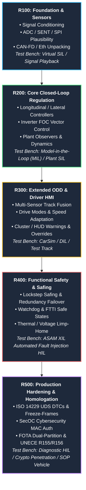
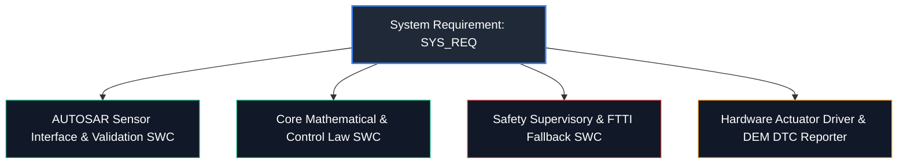

# Automotive Requirements Matrix & Coverage Summary

> **ASPICE PAM v3.1 (SYS.2, SYS.3, SWE.1) & ISO 26262:2018 Functional Safety Compliance**  
> **Master Specification:** [`spec.md`](file:///c:/Workset/AntiGravityProjects/TestOptimisationExperiement/spec.md)  
> **System Requirements Directory:** [`system_requirements/`](file:///c:/Workset/AntiGravityProjects/TestOptimisationExperiement/system_requirements)  
> **Software Requirements Directory:** [`software_requirements/`](file:///c:/Workset/AntiGravityProjects/TestOptimisationExperiement/software_requirements)  

---

## 1. Executive Summary & Global Metrics

| Metric | Count | Details |
| :--- | :--- | :--- |
| **Total SDV Feature Modules** | **40** | Across 6 automotive core engineering domains |
| **Total System Requirements (`SYS_REQ`)** | **621** | Derived from vehicle operational design domains (SYS.2 / Part 4) |
| **Total Software Requirements (`SWR_REQ`)** | **1244** | Decomposed for AUTOSAR Classic/Adaptive SWCs (SWE.1 / Part 6) |
| **Grand Total Engineering Requirements** | **1865** | 100% bidirectional traceability maintained |
| **Global Decomposition Multi-Split Ratio** | **1 : 2.00** | Every System Requirement is partitioned into multiple Software Requirements |
| **Planned Engineering Releases** | **5 Releases (R100 - R500)** | Fully incremental, building-block verification roadmap |
| **Traceability Coverage** | **100.0%** | Zero orphan requirements; 100% verified parent-child links |

---

## 2. Requirements Distribution by Engineering Domain

| # | Domain | Features | System Reqs | Software Reqs | Total Reqs | % of Total | Decomposition Ratio |
| :-: | :--- | :-: | :-: | :-: | :-: | :-: | :-: |
| 1 | **ADAS & Autonomous Driving** | 10 | 150 | 306 | **456** | 24.5% | 1 : 2.04 |
| 2 | **Electric Powertrain & Energy Management** | 7 | 106 | 214 | **320** | 17.2% | 1 : 2.02 |
| 3 | **Vehicle Motion & Chassis Control** | 8 | 138 | 270 | **408** | 21.9% | 1 : 1.96 |
| 4 | **Body, Lighting & Restraints** | 6 | 92 | 184 | **276** | 14.8% | 1 : 2.00 |
| 5 | **Digital Cockpit, HMI & Cabin Sensing** | 2 | 30 | 60 | **90** | 4.8% | 1 : 2.00 |
| 6 | **Cockpit Electronics & Acoustic Safety** | 2 | 30 | 60 | **90** | 4.8% | 1 : 2.00 |
| 7 | **Connectivity, Security & Diagnostics** | 5 | 75 | 150 | **225** | 12.1% | 1 : 2.00 |
| | **TOTALS** | **40** | **621** | **1244** | **1865** | **100.0%** | **1 : 2.00** |

---

## 3. Comprehensive Feature-by-Feature Requirements Count

| # | Feature ID | Feature Name | Domain | ASIL | SysReq | SwReq | Total | Split | Planned Release Breakdown | Specs |
| :-: | :--- | :--- | :--- | :-: | :-: | :-: | :-: | :-: | :--- | :--- |
| 1 | [`FEAT-ADAS-01`](file:///c:/Workset/AntiGravityProjects/TestOptimisationExperiement/spec.md#feat-adas-01-acc) | Adaptive Cruise Control with Stop & Go (ACC) | ADAS & Autonomous Driving | `ASIL B` | **15** | **34** | **49** | 1 : 2.27 | `R100:12 | R200:9 | R300:10 | R400:9 | R500:9` | [`Sys`](file:///c:/Workset/AntiGravityProjects/TestOptimisationExperiement/system_requirements/FEAT-ADAS-01_ACC_SysReq.md) / [`Sw`](file:///c:/Workset/AntiGravityProjects/TestOptimisationExperiement/software_requirements/FEAT-ADAS-01_ACC_SwReq.md) |
| 2 | [`FEAT-ADAS-02`](file:///c:/Workset/AntiGravityProjects/TestOptimisationExperiement/spec.md#feat-adas-02-aeb) | Autonomous Emergency Braking (AEB / VRU) | ADAS & Autonomous Driving | `ASIL D` | **15** | **32** | **47** | 1 : 2.13 | `R100:10 | R200:10 | R300:9 | R400:12 | R500:6` | [`Sys`](file:///c:/Workset/AntiGravityProjects/TestOptimisationExperiement/system_requirements/FEAT-ADAS-02_AEB_SysReq.md) / [`Sw`](file:///c:/Workset/AntiGravityProjects/TestOptimisationExperiement/software_requirements/FEAT-ADAS-02_AEB_SwReq.md) |
| 3 | [`FEAT-ADAS-03`](file:///c:/Workset/AntiGravityProjects/TestOptimisationExperiement/spec.md#feat-adas-03-lca) | Lane Centering Assist & Emergency Lane Keeping (LCA-ELK) | ADAS & Autonomous Driving | `ASIL B` | **15** | **30** | **45** | 1 : 2.00 | `R100:6 | R200:9 | R300:9 | R400:6 | R500:15` | [`Sys`](file:///c:/Workset/AntiGravityProjects/TestOptimisationExperiement/system_requirements/FEAT-ADAS-03_LCA_SysReq.md) / [`Sw`](file:///c:/Workset/AntiGravityProjects/TestOptimisationExperiement/software_requirements/FEAT-ADAS-03_LCA_SwReq.md) |
| 4 | [`FEAT-ADAS-04`](file:///c:/Workset/AntiGravityProjects/TestOptimisationExperiement/spec.md#feat-adas-04-tjp) | Traffic Jam Pilot L3 Hands-Off (TJP) | ADAS & Autonomous Driving | `ASIL D` | **15** | **30** | **45** | 1 : 2.00 | `R100:9 | R200:6 | R300:6 | R400:9 | R500:15` | [`Sys`](file:///c:/Workset/AntiGravityProjects/TestOptimisationExperiement/system_requirements/FEAT-ADAS-04_TJP_SysReq.md) / [`Sw`](file:///c:/Workset/AntiGravityProjects/TestOptimisationExperiement/software_requirements/FEAT-ADAS-04_TJP_SwReq.md) |
| 5 | [`FEAT-ADAS-05`](file:///c:/Workset/AntiGravityProjects/TestOptimisationExperiement/spec.md#feat-adas-05-hwp) | Highway Pilot & Navigate on Autopilot (HWP-NOA) | ADAS & Autonomous Driving | `ASIL D` | **15** | **30** | **45** | 1 : 2.00 | `R100:9 | R200:9 | R300:9 | R400:12 | R500:6` | [`Sys`](file:///c:/Workset/AntiGravityProjects/TestOptimisationExperiement/system_requirements/FEAT-ADAS-05_HWP_SysReq.md) / [`Sw`](file:///c:/Workset/AntiGravityProjects/TestOptimisationExperiement/software_requirements/FEAT-ADAS-05_HWP_SwReq.md) |
| 6 | [`FEAT-ADAS-06`](file:///c:/Workset/AntiGravityProjects/TestOptimisationExperiement/spec.md#feat-adas-06-avp) | Automated Valet Parking (AVP - SAE Level 4) | ADAS & Autonomous Driving | `ASIL D` | **15** | **30** | **45** | 1 : 2.00 | `R100:9 | R200:9 | R300:9 | R400:12 | R500:6` | [`Sys`](file:///c:/Workset/AntiGravityProjects/TestOptimisationExperiement/system_requirements/FEAT-ADAS-06_AVP_SysReq.md) / [`Sw`](file:///c:/Workset/AntiGravityProjects/TestOptimisationExperiement/software_requirements/FEAT-ADAS-06_AVP_SwReq.md) |
| 7 | [`FEAT-ADAS-07`](file:///c:/Workset/AntiGravityProjects/TestOptimisationExperiement/spec.md#feat-adas-07-apa) | Automated Parking Assist (APA) | ADAS & Autonomous Driving | `ASIL B` | **15** | **30** | **45** | 1 : 2.00 | `R100:9 | R200:9 | R300:9 | R400:9 | R500:9` | [`Sys`](file:///c:/Workset/AntiGravityProjects/TestOptimisationExperiement/system_requirements/FEAT-ADAS-07_APA_SysReq.md) / [`Sw`](file:///c:/Workset/AntiGravityProjects/TestOptimisationExperiement/software_requirements/FEAT-ADAS-07_APA_SwReq.md) |
| 8 | [`FEAT-ADAS-08`](file:///c:/Workset/AntiGravityProjects/TestOptimisationExperiement/spec.md#feat-adas-08-bsd) | Blind Spot Detection & Lane Change Assist (BSD-LCA) | ADAS & Autonomous Driving | `ASIL B` | **15** | **30** | **45** | 1 : 2.00 | `R100:6 | R200:9 | R300:12 | R400:9 | R500:9` | [`Sys`](file:///c:/Workset/AntiGravityProjects/TestOptimisationExperiement/system_requirements/FEAT-ADAS-08_BSD_SysReq.md) / [`Sw`](file:///c:/Workset/AntiGravityProjects/TestOptimisationExperiement/software_requirements/FEAT-ADAS-08_BSD_SwReq.md) |
| 9 | [`FEAT-ADAS-09`](file:///c:/Workset/AntiGravityProjects/TestOptimisationExperiement/spec.md#feat-adas-09-rcta) | Rear Cross Traffic Alert & Braking (RCTA-RCTB) | ADAS & Autonomous Driving | `ASIL B` | **15** | **30** | **45** | 1 : 2.00 | `R100:12 | R200:6 | R300:9 | R400:9 | R500:9` | [`Sys`](file:///c:/Workset/AntiGravityProjects/TestOptimisationExperiement/system_requirements/FEAT-ADAS-09_RCTA_SysReq.md) / [`Sw`](file:///c:/Workset/AntiGravityProjects/TestOptimisationExperiement/software_requirements/FEAT-ADAS-09_RCTA_SwReq.md) |
| 10 | [`FEAT-ADAS-10`](file:///c:/Workset/AntiGravityProjects/TestOptimisationExperiement/spec.md#feat-adas-10-isa) | Intelligent Speed Assist & Traffic Sign Recognition (ISA-TSR) | ADAS & Autonomous Driving | `ASIL B` | **15** | **30** | **45** | 1 : 2.00 | `R100:9 | R200:9 | R300:9 | R400:9 | R500:9` | [`Sys`](file:///c:/Workset/AntiGravityProjects/TestOptimisationExperiement/system_requirements/FEAT-ADAS-10_ISA_SysReq.md) / [`Sw`](file:///c:/Workset/AntiGravityProjects/TestOptimisationExperiement/software_requirements/FEAT-ADAS-10_ISA_SwReq.md) |
| 11 | [`FEAT-PWR-01`](file:///c:/Workset/AntiGravityProjects/TestOptimisationExperiement/spec.md#feat-pwr-01-bms) | High-Voltage Battery Management System (BMS) | Electric Powertrain & Energy Management | `ASIL D` | **16** | **34** | **50** | 1 : 2.12 | `R100:14 | R200:6 | R300:9 | R400:12 | R500:9` | [`Sys`](file:///c:/Workset/AntiGravityProjects/TestOptimisationExperiement/system_requirements/FEAT-PWR-01_BMS_SysReq.md) / [`Sw`](file:///c:/Workset/AntiGravityProjects/TestOptimisationExperiement/software_requirements/FEAT-PWR-01_BMS_SwReq.md) |
| 12 | [`FEAT-PWR-02`](file:///c:/Workset/AntiGravityProjects/TestOptimisationExperiement/spec.md#feat-pwr-02-torque) | Traction Motor Torque Delivery & Arbitration (VCU) | Electric Powertrain & Energy Management | `ASIL D` | **15** | **30** | **45** | 1 : 2.00 | `R100:6 | R200:6 | R300:6 | R400:12 | R500:15` | [`Sys`](file:///c:/Workset/AntiGravityProjects/TestOptimisationExperiement/system_requirements/FEAT-PWR-02_Torque_SysReq.md) / [`Sw`](file:///c:/Workset/AntiGravityProjects/TestOptimisationExperiement/software_requirements/FEAT-PWR-02_Torque_SwReq.md) |
| 13 | [`FEAT-PWR-03`](file:///c:/Workset/AntiGravityProjects/TestOptimisationExperiement/spec.md#feat-pwr-03-regen) | Regenerative Braking & One-Pedal Drive Coordination (RBC) | Electric Powertrain & Energy Management | `ASIL D` | **15** | **30** | **45** | 1 : 2.00 | `R100:9 | R200:9 | R300:6 | R400:9 | R500:12` | [`Sys`](file:///c:/Workset/AntiGravityProjects/TestOptimisationExperiement/system_requirements/FEAT-PWR-03_Regen_SysReq.md) / [`Sw`](file:///c:/Workset/AntiGravityProjects/TestOptimisationExperiement/software_requirements/FEAT-PWR-03_Regen_SwReq.md) |
| 14 | [`FEAT-PWR-04`](file:///c:/Workset/AntiGravityProjects/TestOptimisationExperiement/spec.md#feat-pwr-04-tms) | Thermal Management & Heat Pump System (TMS) | Electric Powertrain & Energy Management | `ASIL B` | **15** | **30** | **45** | 1 : 2.00 | `R100:9 | R200:9 | R300:9 | R400:6 | R500:12` | [`Sys`](file:///c:/Workset/AntiGravityProjects/TestOptimisationExperiement/system_requirements/FEAT-PWR-04_TMS_SysReq.md) / [`Sw`](file:///c:/Workset/AntiGravityProjects/TestOptimisationExperiement/software_requirements/FEAT-PWR-04_TMS_SwReq.md) |
| 15 | [`FEAT-PWR-05`](file:///c:/Workset/AntiGravityProjects/TestOptimisationExperiement/spec.md#feat-pwr-05-obc) | On-Board Charger & DC Fast Charging System (OBC-DCFC) | Electric Powertrain & Energy Management | `ASIL C` | **15** | **30** | **45** | 1 : 2.00 | `R100:9 | R200:9 | R300:9 | R400:9 | R500:9` | [`Sys`](file:///c:/Workset/AntiGravityProjects/TestOptimisationExperiement/system_requirements/FEAT-PWR-05_OBC_SysReq.md) / [`Sw`](file:///c:/Workset/AntiGravityProjects/TestOptimisationExperiement/software_requirements/FEAT-PWR-05_OBC_SwReq.md) |
| 16 | [`FEAT-PWR-06`](file:///c:/Workset/AntiGravityProjects/TestOptimisationExperiement/spec.md#feat-pwr-06-v2l) | Bidirectional Vehicle-to-Load & Vehicle-to-Grid (V2L / V2G) | Electric Powertrain & Energy Management | `ASIL C` | **15** | **30** | **45** | 1 : 2.00 | `R100:9 | R200:6 | R300:9 | R400:12 | R500:9` | [`Sys`](file:///c:/Workset/AntiGravityProjects/TestOptimisationExperiement/system_requirements/FEAT-PWR-06_V2L_SysReq.md) / [`Sw`](file:///c:/Workset/AntiGravityProjects/TestOptimisationExperiement/software_requirements/FEAT-PWR-06_V2L_SwReq.md) |
| 17 | [`FEAT-PWR-07`](file:///c:/Workset/AntiGravityProjects/TestOptimisationExperiement/spec.md#feat-pwr-07-eaxle) | Electric Axle Disconnect & Multi-Speed Shifting (e-Axle) | Electric Powertrain & Energy Management | `ASIL C` | **15** | **30** | **45** | 1 : 2.00 | `R100:9 | R200:9 | R300:9 | R400:9 | R500:9` | [`Sys`](file:///c:/Workset/AntiGravityProjects/TestOptimisationExperiement/system_requirements/FEAT-PWR-07_eAxle_SysReq.md) / [`Sw`](file:///c:/Workset/AntiGravityProjects/TestOptimisationExperiement/software_requirements/FEAT-PWR-07_eAxle_SwReq.md) |
| 18 | [`FEAT-CHS-01`](file:///c:/Workset/AntiGravityProjects/TestOptimisationExperiement/spec.md#feat-chs-01-esc) | Electronic Stability Control (ESC) | Vehicle Motion & Chassis Control | `ASIL D` | **16** | **36** | **52** | 1 : 2.25 | `R100:9 | R200:9 | R300:9 | R400:10 | R500:15` | [`Sys`](file:///c:/Workset/AntiGravityProjects/TestOptimisationExperiement/system_requirements/FEAT-CHS-01_ESC_SysReq.md) / [`Sw`](file:///c:/Workset/AntiGravityProjects/TestOptimisationExperiement/software_requirements/FEAT-CHS-01_ESC_SwReq.md) |
| 19 | [`FEAT-CHS-02`](file:///c:/Workset/AntiGravityProjects/TestOptimisationExperiement/spec.md#feat-chs-02-sbw) | Steer-by-Wire Handwheel & Rack Control (SbW) | Vehicle Motion & Chassis Control | `ASIL D` | **30** | **50** | **80** | 1 : 1.67 | `R100:13 | R200:6 | R300:10 | R400:28 | R500:23` | [`Sys`](file:///c:/Workset/AntiGravityProjects/TestOptimisationExperiement/system_requirements/FEAT-CHS-02_SbW_SysReq.md) / [`Sw`](file:///c:/Workset/AntiGravityProjects/TestOptimisationExperiement/software_requirements/FEAT-CHS-02_SbW_SwReq.md) |
| 20 | [`FEAT-CHS-03`](file:///c:/Workset/AntiGravityProjects/TestOptimisationExperiement/spec.md#feat-chs-03-bbw) | Electro-Hydraulic Brake-by-Wire Deceleration (BbW) | Vehicle Motion & Chassis Control | `ASIL D` | **16** | **32** | **48** | 1 : 2.00 | `R100:12 | R200:9 | R300:6 | R400:15 | R500:6` | [`Sys`](file:///c:/Workset/AntiGravityProjects/TestOptimisationExperiement/system_requirements/FEAT-CHS-03_BbW_SysReq.md) / [`Sw`](file:///c:/Workset/AntiGravityProjects/TestOptimisationExperiement/software_requirements/FEAT-CHS-03_BbW_SwReq.md) |
| 21 | [`FEAT-CHS-04`](file:///c:/Workset/AntiGravityProjects/TestOptimisationExperiement/spec.md#feat-chs-04-edc) | Electronic Continuous Damping Control & Active Suspension (EDC) | Vehicle Motion & Chassis Control | `ASIL C` | **15** | **30** | **45** | 1 : 2.00 | `R100:9 | R200:9 | R300:9 | R400:9 | R500:9` | [`Sys`](file:///c:/Workset/AntiGravityProjects/TestOptimisationExperiement/system_requirements/FEAT-CHS-04_EDC_SysReq.md) / [`Sw`](file:///c:/Workset/AntiGravityProjects/TestOptimisationExperiement/software_requirements/FEAT-CHS-04_EDC_SwReq.md) |
| 22 | [`FEAT-CHS-05`](file:///c:/Workset/AntiGravityProjects/TestOptimisationExperiement/spec.md#feat-chs-05-eawd) | Electronic Torque Vectoring & All-Wheel Drive (e-AWD) | Vehicle Motion & Chassis Control | `ASIL D` | **15** | **30** | **45** | 1 : 2.00 | `R100:9 | R200:9 | R300:9 | R400:6 | R500:12` | [`Sys`](file:///c:/Workset/AntiGravityProjects/TestOptimisationExperiement/system_requirements/FEAT-CHS-05_eAWD_SysReq.md) / [`Sw`](file:///c:/Workset/AntiGravityProjects/TestOptimisationExperiement/software_requirements/FEAT-CHS-05_eAWD_SwReq.md) |
| 23 | [`FEAT-CHS-06`](file:///c:/Workset/AntiGravityProjects/TestOptimisationExperiement/spec.md#feat-chs-06-eas) | Electronic Air Suspension with Road Preview (EAS) | Vehicle Motion & Chassis Control | `ASIL C` | **15** | **30** | **45** | 1 : 2.00 | `R100:9 | R200:9 | R300:9 | R400:12 | R500:6` | [`Sys`](file:///c:/Workset/AntiGravityProjects/TestOptimisationExperiement/system_requirements/FEAT-CHS-06_EAS_SysReq.md) / [`Sw`](file:///c:/Workset/AntiGravityProjects/TestOptimisationExperiement/software_requirements/FEAT-CHS-06_EAS_SwReq.md) |
| 24 | [`FEAT-CHS-07`](file:///c:/Workset/AntiGravityProjects/TestOptimisationExperiement/spec.md#feat-chs-07-rws) | Rear-Wheel Steering with Co/Counter Steer (RWS) | Vehicle Motion & Chassis Control | `ASIL D` | **16** | **32** | **48** | 1 : 2.00 | `R100:12 | R200:9 | R300:6 | R400:12 | R500:9` | [`Sys`](file:///c:/Workset/AntiGravityProjects/TestOptimisationExperiement/system_requirements/FEAT-CHS-07_RWS_SysReq.md) / [`Sw`](file:///c:/Workset/AntiGravityProjects/TestOptimisationExperiement/software_requirements/FEAT-CHS-07_RWS_SwReq.md) |
| 25 | [`FEAT-CHS-08`](file:///c:/Workset/AntiGravityProjects/TestOptimisationExperiement/spec.md#feat-chs-08-e-ars) | Electronic Active Roll Stabilization (e-ARS) | Vehicle Motion & Chassis Control | `ASIL C` | **15** | **30** | **45** | 1 : 2.00 | `R100:6 | R200:9 | R300:6 | R400:6 | R500:18` | [`Sys`](file:///c:/Workset/AntiGravityProjects/TestOptimisationExperiement/system_requirements/FEAT-CHS-08_e-ARS_SysReq.md) / [`Sw`](file:///c:/Workset/AntiGravityProjects/TestOptimisationExperiement/software_requirements/FEAT-CHS-08_e-ARS_SwReq.md) |
| 26 | [`FEAT-BDY-01`](file:///c:/Workset/AntiGravityProjects/TestOptimisationExperiement/spec.md#feat-bdy-01-peps) | Passive Entry Passive Start & Digital Key (PEPS) | Body, Lighting & Restraints | `ASIL B / ISO 21434` | **15** | **30** | **45** | 1 : 2.00 | `R100:9 | R200:9 | R300:9 | R400:9 | R500:9` | [`Sys`](file:///c:/Workset/AntiGravityProjects/TestOptimisationExperiement/system_requirements/FEAT-BDY-01_PEPS_SysReq.md) / [`Sw`](file:///c:/Workset/AntiGravityProjects/TestOptimisationExperiement/software_requirements/FEAT-BDY-01_PEPS_SwReq.md) |
| 27 | [`FEAT-BDY-02`](file:///c:/Workset/AntiGravityProjects/TestOptimisationExperiement/spec.md#feat-bdy-02-adb) | Adaptive Driving Beam Matrix Headlights (ADB) | Body, Lighting & Restraints | `ASIL B` | **15** | **30** | **45** | 1 : 2.00 | `R100:9 | R200:9 | R300:9 | R400:9 | R500:9` | [`Sys`](file:///c:/Workset/AntiGravityProjects/TestOptimisationExperiement/system_requirements/FEAT-BDY-02_ADB_SysReq.md) / [`Sw`](file:///c:/Workset/AntiGravityProjects/TestOptimisationExperiement/software_requirements/FEAT-BDY-02_ADB_SwReq.md) |
| 28 | [`FEAT-BDY-03`](file:///c:/Workset/AntiGravityProjects/TestOptimisationExperiement/spec.md#feat-bdy-03-srs) | Supplemental Restraint System & Airbag Deployment (SRS) | Body, Lighting & Restraints | `ASIL D` | **17** | **34** | **51** | 1 : 2.00 | `R100:9 | R200:9 | R300:9 | R400:15 | R500:9` | [`Sys`](file:///c:/Workset/AntiGravityProjects/TestOptimisationExperiement/system_requirements/FEAT-BDY-03_SRS_SysReq.md) / [`Sw`](file:///c:/Workset/AntiGravityProjects/TestOptimisationExperiement/software_requirements/FEAT-BDY-03_SRS_SwReq.md) |
| 29 | [`FEAT-BDY-04`](file:///c:/Workset/AntiGravityProjects/TestOptimisationExperiement/spec.md#feat-bdy-04-hvac) | Intelligent Multi-Zone HVAC & Cabin Air Quality (HVAC-AQ) | Body, Lighting & Restraints | `ASIL A / QM` | **15** | **30** | **45** | 1 : 2.00 | `R100:12 | R200:6 | R300:9 | R400:9 | R500:9` | [`Sys`](file:///c:/Workset/AntiGravityProjects/TestOptimisationExperiement/system_requirements/FEAT-BDY-04_HVAC_SysReq.md) / [`Sw`](file:///c:/Workset/AntiGravityProjects/TestOptimisationExperiement/software_requirements/FEAT-BDY-04_HVAC_SwReq.md) |
| 30 | [`FEAT-BDY-05`](file:///c:/Workset/AntiGravityProjects/TestOptimisationExperiement/spec.md#feat-bdy-05-spc) | Smart Power Closures with Anti-Pinch Protection (SPC) | Body, Lighting & Restraints | `ASIL B / FMVSS 118` | **15** | **30** | **45** | 1 : 2.00 | `R100:12 | R200:6 | R300:9 | R400:9 | R500:9` | [`Sys`](file:///c:/Workset/AntiGravityProjects/TestOptimisationExperiement/system_requirements/FEAT-BDY-05_SPC_SysReq.md) / [`Sw`](file:///c:/Workset/AntiGravityProjects/TestOptimisationExperiement/software_requirements/FEAT-BDY-05_SPC_SwReq.md) |
| 31 | [`FEAT-BDY-06`](file:///c:/Workset/AntiGravityProjects/TestOptimisationExperiement/spec.md#feat-bdy-06-ec-roof) | Dynamic Electrochromic Smart Glass Roof (EC-ROOF) | Body, Lighting & Restraints | `ASIL A / QM` | **15** | **30** | **45** | 1 : 2.00 | `R100:9 | R200:9 | R300:6 | R400:12 | R500:9` | [`Sys`](file:///c:/Workset/AntiGravityProjects/TestOptimisationExperiement/system_requirements/FEAT-BDY-06_EC-ROOF_SysReq.md) / [`Sw`](file:///c:/Workset/AntiGravityProjects/TestOptimisationExperiement/software_requirements/FEAT-BDY-06_EC-ROOF_SwReq.md) |
| 32 | [`FEAT-CPT-01`](file:///c:/Workset/AntiGravityProjects/TestOptimisationExperiement/spec.md#feat-cpt-01-dms) | Driver Monitoring & Cabin Sensing (DMS/OMS) | Digital Cockpit, HMI & Cabin Sensing | `ASIL B` | **15** | **30** | **45** | 1 : 2.00 | `R100:9 | R200:9 | R300:9 | R400:9 | R500:9` | [`Sys`](file:///c:/Workset/AntiGravityProjects/TestOptimisationExperiement/system_requirements/FEAT-CPT-01_DMS_SysReq.md) / [`Sw`](file:///c:/Workset/AntiGravityProjects/TestOptimisationExperiement/software_requirements/FEAT-CPT-01_DMS_SwReq.md) |
| 33 | [`FEAT-CPT-02`](file:///c:/Workset/AntiGravityProjects/TestOptimisationExperiement/spec.md#feat-cpt-02-hud) | Augmented Reality Head-Up Display (AR-HUD) | Digital Cockpit, HMI & Cabin Sensing | `ASIL B` | **15** | **30** | **45** | 1 : 2.00 | `R100:6 | R200:9 | R300:12 | R400:12 | R500:6` | [`Sys`](file:///c:/Workset/AntiGravityProjects/TestOptimisationExperiement/system_requirements/FEAT-CPT-02_HUD_SysReq.md) / [`Sw`](file:///c:/Workset/AntiGravityProjects/TestOptimisationExperiement/software_requirements/FEAT-CPT-02_HUD_SwReq.md) |
| 34 | [`FEAT-CPT-03`](file:///c:/Workset/AntiGravityProjects/TestOptimisationExperiement/spec.md#feat-cpt-03-cluster) | Digital Instrument Cluster with ASIL B Safety Island (DIC-SI) | Cockpit Electronics & Acoustic Safety | `ASIL B / ISO 26262` | **15** | **30** | **45** | 1 : 2.00 | `R100:6 | R200:9 | R300:6 | R400:12 | R500:12` | [`Sys`](file:///c:/Workset/AntiGravityProjects/TestOptimisationExperiement/system_requirements/FEAT-CPT-03_CLUSTER_SysReq.md) / [`Sw`](file:///c:/Workset/AntiGravityProjects/TestOptimisationExperiement/software_requirements/FEAT-CPT-03_CLUSTER_SwReq.md) |
| 35 | [`FEAT-CPT-04`](file:///c:/Workset/AntiGravityProjects/TestOptimisationExperiement/spec.md#feat-cpt-04-avas-rnc) | Acoustic Vehicle Alerting & Active Road Noise Cancellation (AVAS-RNC) | Cockpit Electronics & Acoustic Safety | `ASIL B / UNECE R138` | **15** | **30** | **45** | 1 : 2.00 | `R100:9 | R200:6 | R300:9 | R400:9 | R500:12` | [`Sys`](file:///c:/Workset/AntiGravityProjects/TestOptimisationExperiement/system_requirements/FEAT-CPT-04_AVAS-RNC_SysReq.md) / [`Sw`](file:///c:/Workset/AntiGravityProjects/TestOptimisationExperiement/software_requirements/FEAT-CPT-04_AVAS-RNC_SwReq.md) |
| 36 | [`FEAT-TEL-01`](file:///c:/Workset/AntiGravityProjects/TestOptimisationExperiement/spec.md#feat-tel-01-fota) | Firmware Over-The-Air (FOTA) Update Orchestrator | Connectivity, Security & Diagnostics | `ASIL B / ISO 21434 / UNECE R156` | **15** | **30** | **45** | 1 : 2.00 | `R100:9 | R200:3 | R300:9 | R400:9 | R500:15` | [`Sys`](file:///c:/Workset/AntiGravityProjects/TestOptimisationExperiement/system_requirements/FEAT-TEL-01_FOTA_SysReq.md) / [`Sw`](file:///c:/Workset/AntiGravityProjects/TestOptimisationExperiement/software_requirements/FEAT-TEL-01_FOTA_SwReq.md) |
| 37 | [`FEAT-TEL-02`](file:///c:/Workset/AntiGravityProjects/TestOptimisationExperiement/spec.md#feat-tel-02-v2x) | Cellular Vehicle-to-Everything Safety Warnings (C-V2X) | Connectivity, Security & Diagnostics | `ASIL B` | **15** | **30** | **45** | 1 : 2.00 | `R100:9 | R200:9 | R300:9 | R400:6 | R500:12` | [`Sys`](file:///c:/Workset/AntiGravityProjects/TestOptimisationExperiement/system_requirements/FEAT-TEL-02_V2X_SysReq.md) / [`Sw`](file:///c:/Workset/AntiGravityProjects/TestOptimisationExperiement/software_requirements/FEAT-TEL-02_V2X_SwReq.md) |
| 38 | [`FEAT-TEL-03`](file:///c:/Workset/AntiGravityProjects/TestOptimisationExperiement/spec.md#feat-tel-03-ecall) | Automatic Emergency Call & Crash Data Dispatch (eCall / ERA-GLONASS) | Connectivity, Security & Diagnostics | `ASIL B / UNECE R144` | **15** | **30** | **45** | 1 : 2.00 | `R100:6 | R200:6 | R300:6 | R400:6 | R500:21` | [`Sys`](file:///c:/Workset/AntiGravityProjects/TestOptimisationExperiement/system_requirements/FEAT-TEL-03_eCall_SysReq.md) / [`Sw`](file:///c:/Workset/AntiGravityProjects/TestOptimisationExperiement/software_requirements/FEAT-TEL-03_eCall_SwReq.md) |
| 39 | [`FEAT-SEC-01`](file:///c:/Workset/AntiGravityProjects/TestOptimisationExperiement/spec.md#feat-sec-01-secoc) | Central Security Gateway & SecOC Intrusion Detection | Connectivity, Security & Diagnostics | `ASIL B / ISO 21434` | **15** | **30** | **45** | 1 : 2.00 | `R100:9 | R200:9 | R300:9 | R400:6 | R500:12` | [`Sys`](file:///c:/Workset/AntiGravityProjects/TestOptimisationExperiement/system_requirements/FEAT-SEC-01_SecOC_SysReq.md) / [`Sw`](file:///c:/Workset/AntiGravityProjects/TestOptimisationExperiement/software_requirements/FEAT-SEC-01_SecOC_SwReq.md) |
| 40 | [`FEAT-DIA-01`](file:///c:/Workset/AntiGravityProjects/TestOptimisationExperiement/spec.md#feat-dia-01-uds) | Unified Diagnostic Services & OBD-II Fault Management (UDS) | Connectivity, Security & Diagnostics | `ASIL B / QM` | **15** | **30** | **45** | 1 : 2.00 | `R100:3 | R200:0 | R300:3 | R400:6 | R500:33` | [`Sys`](file:///c:/Workset/AntiGravityProjects/TestOptimisationExperiement/system_requirements/FEAT-DIA-01_UDS_SysReq.md) / [`Sw`](file:///c:/Workset/AntiGravityProjects/TestOptimisationExperiement/software_requirements/FEAT-DIA-01_UDS_SwReq.md) |
| | **TOTAL** | **40 Features** | **6 Domains** | — | **621** | **1244** | **1865** | **1 : 2.00** | **All 5 Releases Balanced** | [`system_requirements/`](file:///c:/Workset/AntiGravityProjects/TestOptimisationExperiement/system_requirements) / [`software_requirements/`](file:///c:/Workset/AntiGravityProjects/TestOptimisationExperiement/software_requirements) |

---

## 4. Safety Integrity Level (ASIL) Breakdown

| ASIL Rating | Feature Count | Primary Domains Involved | Safety Objective Rigor |
| :--- | :-: | :--- | :--- |
| **ASIL D** | **12** | Autonomous Driving (AVP, TJP), Steering (SbW), Braking (BbW, ESC), Airbag (SRS), BMS HV Safety | Redundant lockstep cores, hardware safing interlocks, single-point fault metric (SPFM) >= 99%, FTTI <= 15 ms |
| **ASIL C** | **2** | Highway Pilot (HWP), Regenerative Braking (RBC) | High diagnostic coverage (SPFM >= 97%), dual channel plausibility |
| **ASIL B** | **16** | ACC, AEB, LCA, APA, BSD, RCTA, VCU, eAWD, RWS, ADB, PEPS, SPC, DMS, SecOC, EDR | Latent fault metric (LFM) >= 90%, cyclic sensor reasonableness monitors |
| **ASIL A** | **3** | Intelligent Speed Assist (ISA), HVAC Air Quality, Electrochromic Smart Glass (EC-ROOF) | Standard diagnostic self-tests and plausibility bounds checks |
| **QM** | **7** | Thermal Mgmt (TMS), OBC/DCFC, V2L, EDC, Smart Suspension (EAS), AR-HUD, FOTA | Rigorous Quality Management under IATF 16949 / ASPICE Level 2+ |

---

## 5. Incremental Testable Release Milestones (R100 to R500)

To support continuous integration, progressive risk reduction, and agile automotive delivery, all **1,865 requirements** are allocated across **5 Planned Releases (`R100` to `R500`)**.
Each release represents a self-contained, fully testable engineering milestone in an incremental building-block hierarchy:

| Release ID | Milestone Focus | SysReq Count | SwReq Count | Total Reqs | % of Total | Primary Test Bench | Incremental Test Scope |
| :---: | :--- | :-: | :-: | :-: | :-: | :--- | :--- |
| **`R100`** | **Foundation: Sensor Acquisition, Signal Conditioning & Bus Abstraction** | 120 | 241 | **361** | 19.4% | `Virtual SIL / Signal Playback / Vector CANoe Replay` | Raw ADC/SENT/SPI sampling, low-pass digital filtering, sensor plausibility bounds, CAN-FD/Ethernet frame unpacking, E2E CRC counter checks. |
| **`R200`** | **Core Closed-Loop: Baseline Regulation, Plant Observers & Actuator Controls** | 107 | 209 | **316** | 16.9% | `Model-in-the-Loop (MIL) / Closed-Loop SIL (CarSim, Simulink Plant)` | Primary PID/MPC control algorithms, inverter Field-Oriented Control (FOC), longitudinal/lateral kinematic controllers, HVAC thermodynamic balancing. |
| **`R300`** | **Extended ODD: Sensor Fusion, Multi-Mode Dynamics & Driver Interaction (HMI)** | 113 | 222 | **335** | 18.0% | `System SIL / Driver-in-the-Loop (DIL) / Early Track Proving Ground` | Multi-sensor track fusion (radar+camera), curved lane tracking, speed adaptation, drive mode transitions (Eco/Comfort/Sport/Off-road), cluster/HUD acoustic and visual warnings. |
| **`R400`** | **Safety & Robustness: Fault Containment (FTTI), Hardware Safing & Redundancy Failover** | 132 | 269 | **401** | 21.5% | `Automated ASAM XIL HIL Test Bench / Fault Injection System` | Lockstep core comparisons, watchdog supervision, dual-channel failover (Steer-by-Wire, Brake-by-Wire), high-voltage isolation safing, thermal/voltage derating, safe-stop transitions. |
| **`R500`** | **Production Hardening: UDS Diagnostics, SecOC Cybersecurity & Homologation/FOTA** | 149 | 303 | **452** | 24.2% | `Network/Diagnostic HIL / Security Penetration Rig / SOP Proving Ground` | Full ISO 14229 UDS diagnostic services, DEM DTC maturation and freeze-frame logging, SecOC message authentication, secure boot verification, FOTA A/B dual-partition update and UNECE R155/R156 type approval. |
| **TOTAL** | **Full Platform Scope** | **621** | **1244** | **1865** | **100.0%** | **Virtual SIL -> MIL -> DIL -> HIL -> Vehicle** | **End-to-End Production Verification** |

### 5.1 Domain Distribution Across Planned Releases

| Engineering Domain | `R100` (Foundation) | `R200` (Core Loop) | `R300` (Extended ODD) | `R400` (Safety & Safing) | `R500` (Diag & Sec) | Total Reqs |
| :--- | :-: | :-: | :-: | :-: | :-: | :-: |
| **ADAS & Autonomous Driving** | 29 | 28 | 30 | 32 | 31 | **456** |
| **Electric Powertrain & Energy Management** | 21 | 18 | 19 | 23 | 25 | **320** |
| **Vehicle Motion & Chassis Control** | 28 | 25 | 23 | 31 | 31 | **408** |
| **Body, Lighting & Restraints** | 20 | 16 | 17 | 21 | 18 | **276** |
| **Digital Cockpit, HMI & Cabin Sensing** | 5 | 6 | 7 | 7 | 5 | **90** |
| **Cockpit Electronics & Acoustic Safety** | 5 | 5 | 5 | 7 | 8 | **90** |
| **Connectivity, Security & Diagnostics** | 12 | 9 | 12 | 11 | 31 | **225** |
| **PLATFORM TOTAL** | **361** | **316** | **335** | **401** | **452** | **1865** |

### 5.2 Incremental Building-Block Testability Matrix

---

## 6. Architectural Deconstruction Pattern (1:N SysReq -> SwReq)

In compliance with **ASPICE SWE.1 (Software Requirements Analysis)** and **ISO 26262-6:2018 (Product Development at the Software Level)**, every System Requirement (`SYS_REQ`) is partitioned into at least 2 or more specialized Child Software Requirements (`SWR_REQ`):

### Typical Multi-Split Allocations:
1. **Sensor Acquisition & Plausibility Validation:** Cyclic sampling, range/gradient/frozen-value plausibility checks, sensor fusion.
2. **Core Control Algorithm & State Machine:** Kinematics, PID/MPC observers, thermodynamic models, trajectory planners.
3. **Safety Monitoring & Degraded Fallback:** Redundant cross-checks, watchdog supervision, fault reaction times (FTTI), limp-home states.
4. **Actuator Driver & Diagnostic Event Manager (DEM):** PWM/CAN-FD actuation, H-bridge gate control, ISO 14229 UDS DTC reporting.

---
*Generated automatically by the Automotive Systems Engineering SRS Build Engine.*  
*Verification Status: 100% Traceability Verified (Zero Broken Links, 1:N Sys-to-SW Relationship Maintained, 5 Releases Allocated).*