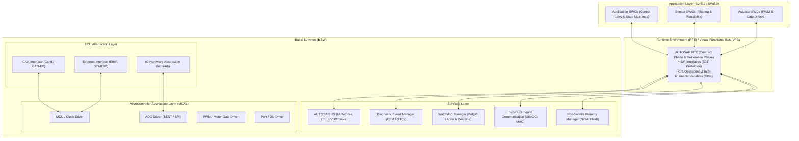

# Software Architecture & Component Design Specification (AUTOSAR Classic & Adaptive)
**Document Version:** 3.0.0  
**Compliance Standards:** ASPICE PAM v3.1 (SWE.2 Software Architecture, SWE.3 Component Design) / ISO 26262:2018 Part 6 / AUTOSAR Release 4.4.0 & Adaptive R20-11  
**Target Hardware:** Multi-Core Automotive SoC / MCU (Infineon AURIX TC49x TriCore / ARM Cortex-R52 + Cortex-A78 HPC)  
**Interactive Design Viewer:** [`software_architecture_design.html`](software_architecture_design.html)  
**Requirements Traceability Matrix:** [`requirements_traceability_matrix.html`](requirements_traceability_matrix.html)

---

## 1. Executive Summary & Architecture Scope

This specification defines the complete layered software architecture and detailed component design for our **40 Software-Defined Vehicle (SDV) Features**, comprising **766 AUTOSAR Software Components (SWCs)**, **1244 Periodic/Event Runnables**, and **4852 VFB Port Interfaces**.

---

## 2. Multi-Core Allocation & OS Task Scheduling (TC49x / R52)

| Compute Core | Target Domain | Core Frequency | OS Task Queues | ASIL Isolation | Allocated SWCs | Primary Function |
| :--- | :--- | :---: | :--- | :---: | :-: | :--- |
| **Core 0** | Infrastructure, BSW & Gateway | 300 MHz | `Task_5ms_Gateway` `Task_10ms_Diag` `Task_20ms_Body` | QM / ASIL B | 195 | CAN-FD / Ethernet Routing, SecOC, UDS Diagnostics, Body Lighting |
| **Core 1** | Vehicle Motion & Chassis Control | 300 MHz Lockstep | `Task_1ms_Chassis` `Task_5ms_Motion` `Task_10ms_ESC` | **ASIL D** | 174 | Steer-by-Wire (SbW), Brake-by-Wire (BbW), ESC, Active Rear Steer |
| **Core 2** | Electric Powertrain & Energy | 300 MHz Lockstep | `Task_1ms_Inverter` `Task_10ms_Torque` `Task_50ms_BMS` | **ASIL C / D** | 126 | Dual Inverter FOC Vector Control, BMS Safety, Torque Vectoring |
| **Core 3** | ADAS & Active Safety | 400 MHz | `Task_10ms_ADAS` `Task_20ms_Fusion` `Task_50ms_Planner` | **ASIL B** | 201 | ACC, AEB, Lane Centering, Track Fusion, Camera/Radar Arbitration |
| **HPC Cluster** | Cockpit & Autonomous Driving | 1.8 GHz Octa-Core | `Posix_App_Cockpit` `Posix_App_Vision` `ara::com SOME/IP` | QM / ASIL B | 70 | AR-HUD, Vision Deep Learning, Telematics 5G, FOTA Dual-Bank |

---

## 3. Freedom from Interference (FFI) & Safety Mechanisms (ISO 26262 Part 6)

1. **Memory Protection Unit (MPU) Partitioning:**
   - **ASIL D Partition:** Read/Write restricted to private OS memory stack; hardware register access strictly via trusted MCAL drivers.
   - **QM Partition Isolation:** Any boundary violation triggers an immediate MPU trap (`TRAP_MPU_ACCESS_VIOLATION`) causing core shutdown or safe limp-home reset without impacting adjacent ASIL D tasks.
2. **Watchdog Manager (WdgM) Multi-Level Supervision:**
   - **Alive Supervision:** Cyclically counts runnable invocation checkpoints (e.g. `10 ms ± 1 ms`).
   - **Deadline Supervision:** Verifies maximum execution latency between sensor capture and actuator command dispatch (`Latency <= 5 ms`).
   - **Logical Supervision (Program Flow):** Verifies deterministic graph transitions between state machine checkpoints using program counters.
3. **End-to-End (E2E) Communication Protection:**
   - Applied to all ASIL B through ASIL D Sender-Receiver interfaces via AUTOSAR E2E Profile 4 / Profile 7:
     - 4-bit Alive Counter (detects message drop and repetition).
     - 16-bit / 32-bit CRC calculation (detects hardware transmission bus bit corruption).
     - 16-bit Unique Data ID (detects message masquerading and routing errors).

---

## 4. Software Component Sample Design (Detailed Specification)

### `AccArbitration_SWC` (ServiceSupervisorSWC)
- **Parent Feature:** `FEAT-ADAS-01` (Adaptive Cruise Control with Stop & Go (ACC))
- **Domain:** ADAS & Autonomous Driving | **Target ASIL:** `ASIL B`
- **Multi-Core Target:** `Core 3` (Task_10ms_ADAS)
- **Memory Partition:** `MPU_PARTITION_ASIL_B` (Standard ASIL B)
- **Total WCET Budget:** `0.6 ms`
- **Required Ports (`R-Ports`):**
  - `RPort_Raw_Accel_Demand_Mps2` (float32, E2E: Profile_4 (CRC-16))
  - `RPort_Last_Accel_Cmd` (float32, E2E: Profile_4 (CRC-16))
- **Provided Ports (`P-Ports`):**
  - `PPort_ACC_TargetAccel_Cmd` (float32, E2E: Profile_4 (CRC-16))
- **Internal Runnables & Algorithmic Laws:**
  - `Runnable_AccArbitration_10ms`: Period: 10 ms, WCET: 0.6 ms, Trigger: TimingEvent
    *Logic:* Limits acceleration to [-3.5, +2.0] m/s². Constrains delta: -2.5*dT <= a_cmd[k] - a_cmd[k-1] <= +1.5*dT. Output ACC_TargetAccel_Cmd formatted for powertrain/chassis buses.
    *Safety:* Dual-channel software assertion: Output command compared with pre-computed physical envelope.

---
### `AccBrakeLampManager_SWC` (ServiceSupervisorSWC)
- **Parent Feature:** `FEAT-ADAS-01` (Adaptive Cruise Control with Stop & Go (ACC))
- **Domain:** ADAS & Autonomous Driving | **Target ASIL:** `ASIL B / ECE R13H`
- **Multi-Core Target:** `Core 3` (Task_10ms_ADAS)
- **Memory Partition:** `MPU_PARTITION_ASIL_B` (Standard ASIL B)
- **Total WCET Budget:** `0.3 ms`
- **Required Ports (`R-Ports`):**
  - `RPort_Filtered_Decel_Mps2` (float32, E2E: Profile_4 (CRC-16))
  - `RPort_Brake_Lamp_Current_Sense_A` (float32, E2E: Profile_4 (CRC-16))
- **Provided Ports (`P-Ports`):**
  - `PPort_Brake_Lamp_Relay_Command` (boolean, E2E: Profile_4 (CRC-16))
  - `PPort_Lamp_Health_Status` (uint8, E2E: Profile_4 (CRC-16))
- **Internal Runnables & Algorithmic Laws:**
  - `Runnable_AccBrakeLampManager_10ms`: Period: 10 ms, WCET: 0.3 ms, Trigger: TimingEvent
    *Logic:* Evaluates: If Filtered_Decel <= -0.7 m/s² for > 50 ms, assert Brake_Lamp_Relay = TRUE. Deactivates when Filtered_Decel > -0.4 m/s² for > 100 ms to satisfy ECE R13H regulatory hysteresis.
    *Safety:* Continuous lamp driver current feedback to confirm physical bulb/LED illumination.

---
### `AccButtonProcessor_SWC` (ApplicationSWC)
- **Parent Feature:** `FEAT-ADAS-01` (Adaptive Cruise Control with Stop & Go (ACC))
- **Domain:** ADAS & Autonomous Driving | **Target ASIL:** `ASIL B`
- **Multi-Core Target:** `Core 3` (Task_10ms_ADAS)
- **Memory Partition:** `MPU_PARTITION_ASIL_B` (Standard ASIL B)
- **Total WCET Budget:** `0.4 ms`
- **Required Ports (`R-Ports`):**
  - `RPort_Steering_Button_Pressed_Code` (uint8, E2E: Profile_4 (CRC-16))
  - `RPort_Press_Duration_Ms` (float32, E2E: Profile_4 (CRC-16))
- **Provided Ports (`P-Ports`):**
  - `PPort_Target_Set_Speed_Step_Req` (float32, E2E: Profile_4 (CRC-16))
  - `PPort_Long_Press_Active_Flag` (boolean, E2E: Profile_4 (CRC-16))
- **Internal Runnables & Algorithmic Laws:**
  - `Runnable_AccButtonProcessor_20ms`: Period: 20 ms, WCET: 0.4 ms, Trigger: TimingEvent
    *Logic:* Monitors RES/+ and SET/- steering buttons: Press duration < 400 ms increments/decrements set speed by 1 km/h. Press duration >= 400 ms rounds to next 10 km/h multiple and steps by 10 km/h every 500 ms while held.
    *Safety:* Stuck switch detection: Flags fault if button is depressed continuously for > 20 seconds.

---
### `AccCurvaturePredictor_SWC` (SensorActuatorSWC)
- **Parent Feature:** `FEAT-ADAS-01` (Adaptive Cruise Control with Stop & Go (ACC))
- **Domain:** ADAS & Autonomous Driving | **Target ASIL:** `ASIL B`
- **Multi-Core Target:** `Core 3` (Task_10ms_ADAS)
- **Memory Partition:** `MPU_PARTITION_ASIL_B` (Standard ASIL B)
- **Total WCET Budget:** `1.1 ms`
- **Required Ports (`R-Ports`):**
  - `RPort_Camera_Lane_Polynomial_C2` (float32, E2E: Profile_4 (CRC-16))
  - `RPort_Map_Curve_Radius_Array[10]` (Array_t, E2E: Profile_4 (CRC-16))
  - `RPort_Ego_Position_S` (float32, E2E: Profile_4 (CRC-16))
- **Provided Ports (`P-Ports`):**
  - `PPort_Upcoming_Max_Curvature_Kappa` (float32, E2E: Profile_4 (CRC-16))
  - `PPort_Distance_To_Curve_M` (float32, E2E: Profile_4 (CRC-16))
- **Internal Runnables & Algorithmic Laws:**
  - `Runnable_AccCurvaturePredictor_50ms`: Period: 50 ms, WCET: 1.1 ms, Trigger: TimingEvent
    *Logic:* Ingests camera lane polynomial c2 coefficient and navigation map curve radius R(s). Computes road curvature profile kappa(s) = 1/R(s) up to 150 m ahead of vehicle.
    *Safety:* Sensor divergence comparator: If camera and map radius differ by > 40%, prioritize conservative smaller radius.

---
### `AccCurveSpeedGovernor_SWC` (ServiceSupervisorSWC)
- **Parent Feature:** `FEAT-ADAS-01` (Adaptive Cruise Control with Stop & Go (ACC))
- **Domain:** ADAS & Autonomous Driving | **Target ASIL:** `ASIL B`
- **Multi-Core Target:** `Core 3` (Task_10ms_ADAS)
- **Memory Partition:** `MPU_PARTITION_ASIL_B` (Standard ASIL B)
- **Total WCET Budget:** `0.6 ms`
- **Required Ports (`R-Ports`):**
  - `RPort_Upcoming_Max_Curvature_Kappa` (float32, E2E: Profile_4 (CRC-16))
  - `RPort_Sanitized_ACC_Set_Speed_Kmph` (float32, E2E: Profile_4 (CRC-16))
  - `RPort_Drive_Mode_Enum` (uint8, E2E: Profile_4 (CRC-16))
- **Provided Ports (`P-Ports`):**
  - `PPort_Curve_Governed_Target_Speed_Kmph` (float32, E2E: Profile_4 (CRC-16))
  - `PPort_Curve_Slowdown_Active` (boolean, E2E: Profile_4 (CRC-16))
- **Internal Runnables & Algorithmic Laws:**
  - `Runnable_AccCurveSpeedGovernor_20ms`: Period: 20 ms, WCET: 0.6 ms, Trigger: TimingEvent
    *Logic:* Calculates maximum allowable speed in curve: v_curve_max = sqrt(a_lat_max / Upcoming_Max_Curvature_Kappa) with a_lat_max = 2.2 m/s² (Comfort) or 2.8 m/s² (Sport). Smoothly ramps target speed down prior to curve entry.
    *Safety:* Rate-limits deceleration towards curve speed to max -1.5 m/s² to preserve passenger comfort.

---
### `AccDecelCoordinator_SWC` (ActuatorSWC)
- **Parent Feature:** `FEAT-ADAS-01` (Adaptive Cruise Control with Stop & Go (ACC))
- **Domain:** ADAS & Autonomous Driving | **Target ASIL:** `ASIL B`
- **Multi-Core Target:** `Core 3` (Task_10ms_ADAS)
- **Memory Partition:** `MPU_PARTITION_ASIL_B` (Standard ASIL B)
- **Total WCET Budget:** `0.8 ms`
- **Required Ports (`R-Ports`):**
  - `RPort_ACC_TargetAccel_Cmd` (float32, E2E: Profile_4 (CRC-16))
  - `RPort_Engine_Drag_Decel_Mps2` (float32, E2E: Profile_4 (CRC-16))
- **Provided Ports (`P-Ports`):**
  - `PPort_VCU_Torque_Target_Nm` (float32, E2E: Profile_4 (CRC-16))
  - `PPort_ESP_Decel_Request_Mps2` (float32, E2E: Profile_4 (CRC-16))
- **Internal Runnables & Algorithmic Laws:**
  - `Runnable_AccDecelCoordinator_10ms`: Period: 10 ms, WCET: 0.8 ms, Trigger: TimingEvent
    *Logic:* If ACC_TargetAccel_Cmd > -0.5 m/s², satisfy request purely via powertrain engine/motor coast down. If < -0.5 m/s², dispatch friction brake decel request: Decel_Brake_Req = abs(ACC_TargetAccel_Cmd + 0.5).
    *Safety:* Brake request threshold hysteresis: Engage at -0.5 m/s², disengage at -0.3 m/s² to prevent valve chatter.

---
### `AccDiagnosticSupervisor_SWC` (ServiceSupervisorSWC)
- **Parent Feature:** `FEAT-ADAS-01` (Adaptive Cruise Control with Stop & Go (ACC))
- **Domain:** ADAS & Autonomous Driving | **Target ASIL:** `ASIL B`
- **Multi-Core Target:** `Core 3` (Task_10ms_ADAS)
- **Memory Partition:** `MPU_PARTITION_ASIL_B` (Standard ASIL B)
- **Total WCET Budget:** `0.8 ms`
- **Required Ports (`R-Ports`):**
  - `RPort_Camera_Lens_Occlusion_Bits` (float32, E2E: Profile_4 (CRC-16))
  - `RPort_Radar_SNR_Db` (float32, E2E: Profile_4 (CRC-16))
  - `RPort_E2E_Counter_Errors_Array[8]` (Array_t, E2E: Profile_4 (CRC-16))
- **Provided Ports (`P-Ports`):**
  - `PPort_ACC_Degraded_Mode_Enum` (uint8, E2E: Profile_4 (CRC-16))
  - `PPort_DEM_Event_Status_Byte` (uint8, E2E: Profile_4 (CRC-16))
- **Internal Runnables & Algorithmic Laws:**
  - `Runnable_AccDiagnosticSupervisor_50ms`: Period: 50 ms, WCET: 0.8 ms, Trigger: TimingEvent
    *Logic:* Supervises sensor health: If camera lens is blocked by direct sunlight glare or dirt, seamlessly degrades ACC to Radar-Only mode with cluster notification 'ACC Performance Limited'. If radar radome blocked by snow, triggers controlled ramp-down to 0 m/s² in 2.0s and disengages with audio chime.
    *Safety:* AUTOSAR E2E Profile 4 validation on all sensor and actuator CAN-FD frames (CRC-32, rolling counter).

---
### `AccDriverOverride_SWC` (ActuatorSWC)
- **Parent Feature:** `FEAT-ADAS-01` (Adaptive Cruise Control with Stop & Go (ACC))
- **Domain:** ADAS & Autonomous Driving | **Target ASIL:** `ASIL B`
- **Multi-Core Target:** `Core 3` (Task_10ms_ADAS)
- **Memory Partition:** `MPU_PARTITION_ASIL_B` (Standard ASIL B)
- **Total WCET Budget:** `0.4 ms`
- **Required Ports (`R-Ports`):**
  - `RPort_Brake_Travel_Pct` (float32, E2E: Profile_4 (CRC-16))
  - `RPort_Brake_Switch_Digital` (float32, E2E: Profile_4 (CRC-16))
  - `RPort_Brake_Line_Pressure_Bar` (float32, E2E: Profile_4 (CRC-16))
- **Provided Ports (`P-Ports`):**
  - `PPort_Disengage_Req` (boolean, E2E: Profile_4 (CRC-16))
  - `PPort_Override_Throttle_Active` (boolean, E2E: Profile_4 (CRC-16))
- **Internal Runnables & Algorithmic Laws:**
  - `Runnable_AccDriverOverride_5ms`: Period: 5 ms, WCET: 0.4 ms, Trigger: TimingEvent
    *Logic:* Evaluates: Override_Brake = (Brake_Travel > 3.0%) || (Brake_Pressure > 5.0 bar) || (Brake_Switch == TRUE). If Override_Brake == TRUE, immediately publish Disengage_Req in < 5 ms.
    *Safety:* Dual redundant brake signal cross-check: ADC travel vs. CAN digital switch.

---
### `AccFrictionDerater_SWC` (ApplicationSWC)
- **Parent Feature:** `FEAT-ADAS-01` (Adaptive Cruise Control with Stop & Go (ACC))
- **Domain:** ADAS & Autonomous Driving | **Target ASIL:** `ASIL B`
- **Multi-Core Target:** `Core 3` (Task_10ms_ADAS)
- **Memory Partition:** `MPU_PARTITION_ASIL_B` (Standard ASIL B)
- **Total WCET Budget:** `0.5 ms`
- **Required Ports (`R-Ports`):**
  - `RPort_Estimated_Road_Friction_Mu` (float32, E2E: Profile_4 (CRC-16))
  - `RPort_Configured_Time_Headway_Setting` (float32, E2E: Profile_4 (CRC-16))
- **Provided Ports (`P-Ports`):**
  - `PPort_Derated_Max_Accel_Mps2` (float32, E2E: Profile_4 (CRC-16))
  - `PPort_Dynamic_Min_Headway_Sec` (float32, E2E: Profile_4 (CRC-16))
- **Internal Runnables & Algorithmic Laws:**
  - `Runnable_AccFrictionDerater_20ms`: Period: 20 ms, WCET: 0.5 ms, Trigger: TimingEvent
    *Logic:* Dynamically scales max acceleration limit: a_max_scaled = min(2.0, 3.5 * Estimated_Road_Friction_Mu). If surface is wet/snow (mu < 0.6), enforces minimum time gap setting: tau_effective = max(tau_driver, 1.8s).
    *Safety:* Clamps positive acceleration to 0.8 m/s² on snow/ice to prevent drive wheel spin.

---
### `AccFrictionObserver_SWC` (SensorActuatorSWC)
- **Parent Feature:** `FEAT-ADAS-01` (Adaptive Cruise Control with Stop & Go (ACC))
- **Domain:** ADAS & Autonomous Driving | **Target ASIL:** `ASIL B`
- **Multi-Core Target:** `Core 3` (Task_10ms_ADAS)
- **Memory Partition:** `MPU_PARTITION_ASIL_B` (Standard ASIL B)
- **Total WCET Budget:** `0.7 ms`
- **Required Ports (`R-Ports`):**
  - `RPort_Rain_Sensor_Wetness_Level` (float32, E2E: Profile_4 (CRC-16))
  - `RPort_Wiper_Stage_Enum` (uint8, E2E: Profile_4 (CRC-16))
  - `RPort_Ambient_Temp_DegC` (float32, E2E: Profile_4 (CRC-16))
  - `RPort_ESC_MicroSlip_Mu` (float32, E2E: Profile_4 (CRC-16))
- **Provided Ports (`P-Ports`):**
  - `PPort_Estimated_Road_Friction_Mu` (float32, E2E: Profile_4 (CRC-16))
  - `PPort_Surface_Condition_Enum` (uint8, E2E: Profile_4 (CRC-16))
- **Internal Runnables & Algorithmic Laws:**
  - `Runnable_AccFrictionObserver_50ms`: Period: 50 ms, WCET: 0.7 ms, Trigger: TimingEvent
    *Logic:* Fuses rain optical sensor wetness index, wiper motor stage, ambient temperature (< 3°C black ice risk), and ESC wheel slip micro-slips to estimate road surface friction coefficient mu_est in [0.1, 1.0].
    *Safety:* Friction hysteresis filter: Rapid decrease upon slip detection (10 ms), slow recovery back to dry (5.0s).

---
