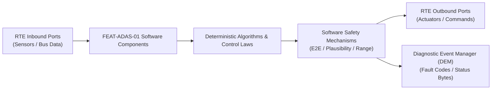

# Software Requirements Specification: Adaptive Cruise Control with Stop & Go (ACC)
**Feature ID:** `FEAT-ADAS-01`  
**Domain:** ADAS & Autonomous Driving  
**Target ASIL:** ASIL B  
**Compliance Standard:** ISO 26262:2018 (Part 6 - Software Development) / ASPICE PAM v3.1 (SWE.1, SWE.2)  
**Parent System Specification:** [`FEAT-ADAS-01_ACC_SysReq.md`](file:///c:/Workset/AntiGravityProjects/TestOptimisationExperiement/system_requirements/FEAT-ADAS-01_ACC_SysReq.md)  
**Global Master Specification:** [`spec.md`](file:///c:/Workset/AntiGravityProjects/TestOptimisationExperiement/spec.md)

---

## 1. Software Architecture & Component Structure

This document specifies the AUTOSAR Software Components (SWCs), periodic runnables, algorithmic laws, safety mechanisms, and data ports implementing `FEAT-ADAS-01` (Adaptive Cruise Control with Stop & Go (ACC)).

### AUTOSAR SWC Interaction Diagram

---

## 2. Detailed Software Requirements (SWR_REQ)
*(Multi-Software Requirement Partitioning derived from System Requirements)*

### `SWR-ADAS-01-01`: Radar-Camera Track Fusion Extended Kalman Filter
- **Planned Release:** R100
- **ASIL Rating:** ASIL B
- **Parent System Requirement:** [`SYS-ADAS-01-01`](file:///c:/Workset/AntiGravityProjects/TestOptimisationExperiement/system_requirements/FEAT-ADAS-01_ACC_SysReq.md#sys-adas-01-01)
- **Allocated AUTOSAR SWC:** `AccTargetFusion_SWC`
- **Execution Rate / Trigger:** 20 ms
- **Worst-Case Execution Time (WCET):** 2.8 ms
- **Software Activation Condition:** Executed cyclically every 20 ms when RTE scheduler is active.
- **Algorithmic Description / Logic:**
  > Implements 5-state EKF [x, y, v_x, v_y, a_x]^T using constant acceleration motion model. Tracks with innovation Mahalanobis distance > 9.21 (p=0.01) are rejected as clutter.
- **Software Safety Mechanism:** Matrix inversion determinant check; if det(S) < 1e-6, reset Kalman covariance to default initial matrix P_0.
- **Failure Reaction & DEM Diagnostic Event:** Set Fused_Track_Fault_Flag = TRUE and report DEM event DEM_ACC_FUSION_LOST.
- **Software Port Inputs:** `Radar_Track_Array[32], Camera_Track_Array[16]`
- **Software Port Outputs:** `Fused_Target_Array[16]`
- **Software Verification Criteria:** GoogleTest unit test with simulated track injection achieving 100% MC/DC.
- **Traceability Link:** Traces upward to [`SYS-ADAS-01-01`](file:///c:/Workset/AntiGravityProjects/TestOptimisationExperiement/system_requirements/FEAT-ADAS-01_ACC_SysReq.md#sys-adas-01-01) and [`FEAT-ADAS-01`](file:///c:/Workset/AntiGravityProjects/TestOptimisationExperiement/spec.md).

### `SWR-ADAS-01-02`: Curvilinear Road Coordinate Transformation & CIPV Selection
- **Planned Release:** R100
- **ASIL Rating:** ASIL B
- **Parent System Requirement:** [`SYS-ADAS-01-01`](file:///c:/Workset/AntiGravityProjects/TestOptimisationExperiement/system_requirements/FEAT-ADAS-01_ACC_SysReq.md#sys-adas-01-01)
- **Allocated AUTOSAR SWC:** `AccTargetSelector_SWC`
- **Execution Rate / Trigger:** 20 ms
- **Worst-Case Execution Time (WCET):** 1.4 ms
- **Software Activation Condition:** Executed every 20 ms following completion of AccTargetFusion_SWC.
- **Algorithmic Description / Logic:**
  > Converts Cartesian tracks into Frenet coordinates (s, d) using path curvature kappa = (yaw_rate / v_ego). Assigns CIPV_ID to target with minimum positive s where |d| <= 1.85 m.
- **Software Safety Mechanism:** Range check: |d| > 15 m clamp; curvature kappa bounded to physical road maximum |kappa| <= 0.05 1/m.
- **Failure Reaction & DEM Diagnostic Event:** If yaw_rate sensor is invalid, fallback to camera lane polynomial centerline approximation.
- **Software Port Inputs:** `Fused_Target_Array[16], Yaw_Rate_RadS, Ego_Velocity_Mps`
- **Software Port Outputs:** `CIPV_Target_Kinematics (struct Target_t), CIPV_Valid (boolean)`
- **Software Verification Criteria:** SIL scenario testing on curved road geometries.
- **Traceability Link:** Traces upward to [`SYS-ADAS-01-01`](file:///c:/Workset/AntiGravityProjects/TestOptimisationExperiement/system_requirements/FEAT-ADAS-01_ACC_SysReq.md#sys-adas-01-01) and [`FEAT-ADAS-01`](file:///c:/Workset/AntiGravityProjects/TestOptimisationExperiement/spec.md).

### `SWR-ADAS-01-03`: Multi-Sensor Track Plausibility & Dropout Persistence Filter
- **Planned Release:** R100
- **ASIL Rating:** ASIL B
- **Parent System Requirement:** [`SYS-ADAS-01-01`](file:///c:/Workset/AntiGravityProjects/TestOptimisationExperiement/system_requirements/FEAT-ADAS-01_ACC_SysReq.md#sys-adas-01-01)
- **Allocated AUTOSAR SWC:** `AccSensorPlausibility_SWC`
- **Execution Rate / Trigger:** 20 ms
- **Worst-Case Execution Time (WCET):** 0.9 ms
- **Software Activation Condition:** Executed every 20 ms on target selection output.
- **Algorithmic Description / Logic:**
  > Maintains a 5-frame persistence counter (100 ms). If CIPV momentarily drops out, extrapolate position using last known acceleration: s[k] = s[k-1] + v[k-1]*dT + 0.5*a[k-1]*dT^2.
- **Software Safety Mechanism:** Extrapolation time bounded to maximum 200 ms; after 200 ms, target is permanently de-selected.
- **Failure Reaction & DEM Diagnostic Event:** Assert Target_Lost_Warning flag if target disappears within critical distance (< 15 m).
- **Software Port Inputs:** `CIPV_Target_Kinematics, CIPV_Valid`
- **Software Port Outputs:** `Plausible_CIPV_Data, CIPV_Persistence_State`
- **Software Verification Criteria:** Boundary value testing with simulated intermittent radar blips.
- **Traceability Link:** Traces upward to [`SYS-ADAS-01-01`](file:///c:/Workset/AntiGravityProjects/TestOptimisationExperiement/system_requirements/FEAT-ADAS-01_ACC_SysReq.md#sys-adas-01-01) and [`FEAT-ADAS-01`](file:///c:/Workset/AntiGravityProjects/TestOptimisationExperiement/spec.md).

### `SWR-ADAS-01-04`: Gain-Scheduled Headway Gap PID Control Law
- **Planned Release:** R100
- **ASIL Rating:** ASIL B
- **Parent System Requirement:** [`SYS-ADAS-01-02`](file:///c:/Workset/AntiGravityProjects/TestOptimisationExperiement/system_requirements/FEAT-ADAS-01_ACC_SysReq.md#sys-adas-01-02)
- **Allocated AUTOSAR SWC:** `AccLongController_SWC`
- **Execution Rate / Trigger:** 10 ms
- **Worst-Case Execution Time (WCET):** 1.2 ms
- **Software Activation Condition:** Executed cyclically every 10 ms when ACC state is ACTIVE_GAP_CONTROL.
- **Algorithmic Description / Logic:**
  > Calculates clearance error e_s = s_act - (d_0 + tau * v_ego). Generates raw acceleration demand: a_raw = K_p(v_ego) * e_s + K_d(v_ego) * v_rel + K_i * int(e_s dt) with anti-windup clamping.
- **Software Safety Mechanism:** Anti-windup clamping restricts integrator accumulator to [-1.0, +1.0] m/s².
- **Failure Reaction & DEM Diagnostic Event:** If calculated a_raw is NaN or Inf, force a_raw = 0.0 and report runtime error.
- **Software Port Inputs:** `Plausible_CIPV_Data, Time_Headway_Setting, Ego_Velocity_Mps`
- **Software Port Outputs:** `Raw_Accel_Demand_Mps2`
- **Software Verification Criteria:** Unit test verifying closed-loop frequency response and gain stability.
- **Traceability Link:** Traces upward to [`SYS-ADAS-01-02`](file:///c:/Workset/AntiGravityProjects/TestOptimisationExperiement/system_requirements/FEAT-ADAS-01_ACC_SysReq.md#sys-adas-01-02) and [`FEAT-ADAS-01`](file:///c:/Workset/AntiGravityProjects/TestOptimisationExperiement/spec.md).

### `SWR-ADAS-01-05`: Dynamic Jerk & Acceleration Boundary Limiter
- **Planned Release:** R100
- **ASIL Rating:** ASIL B
- **Parent System Requirement:** [`SYS-ADAS-01-02`](file:///c:/Workset/AntiGravityProjects/TestOptimisationExperiement/system_requirements/FEAT-ADAS-01_ACC_SysReq.md#sys-adas-01-02)
- **Allocated AUTOSAR SWC:** `AccArbitration_SWC`
- **Execution Rate / Trigger:** 10 ms
- **Worst-Case Execution Time (WCET):** 0.6 ms
- **Software Activation Condition:** Executed every 10 ms on Raw_Accel_Demand_Mps2.
- **Algorithmic Description / Logic:**
  > Limits acceleration to [-3.5, +2.0] m/s². Constrains delta: -2.5*dT <= a_cmd[k] - a_cmd[k-1] <= +1.5*dT. Output ACC_TargetAccel_Cmd formatted for powertrain/chassis buses.
- **Software Safety Mechanism:** Dual-channel software assertion: Output command compared with pre-computed physical envelope.
- **Failure Reaction & DEM Diagnostic Event:** Latch safe default deceleration -1.0 m/s² if rate limiter enters invalid state.
- **Software Port Inputs:** `Raw_Accel_Demand_Mps2, Last_Accel_Cmd`
- **Software Port Outputs:** `ACC_TargetAccel_Cmd (float32)`
- **Software Verification Criteria:** Equivalence partitioning unit test across extreme acceleration jumps.
- **Traceability Link:** Traces upward to [`SYS-ADAS-01-02`](file:///c:/Workset/AntiGravityProjects/TestOptimisationExperiement/system_requirements/FEAT-ADAS-01_ACC_SysReq.md#sys-adas-01-02) and [`FEAT-ADAS-01`](file:///c:/Workset/AntiGravityProjects/TestOptimisationExperiement/spec.md).

### `SWR-ADAS-01-06`: Powertrain-Brake Deceleration Arbitration Coordinator
- **Planned Release:** R100
- **ASIL Rating:** ASIL B
- **Parent System Requirement:** [`SYS-ADAS-01-02`](file:///c:/Workset/AntiGravityProjects/TestOptimisationExperiement/system_requirements/FEAT-ADAS-01_ACC_SysReq.md#sys-adas-01-02)
- **Allocated AUTOSAR SWC:** `AccDecelCoordinator_SWC`
- **Execution Rate / Trigger:** 10 ms
- **Worst-Case Execution Time (WCET):** 0.8 ms
- **Software Activation Condition:** Executed every 10 ms on ACC_TargetAccel_Cmd.
- **Algorithmic Description / Logic:**
  > If ACC_TargetAccel_Cmd > -0.5 m/s², satisfy request purely via powertrain engine/motor coast down. If < -0.5 m/s², dispatch friction brake decel request: Decel_Brake_Req = abs(ACC_TargetAccel_Cmd + 0.5).
- **Software Safety Mechanism:** Brake request threshold hysteresis: Engage at -0.5 m/s², disengage at -0.3 m/s² to prevent valve chatter.
- **Failure Reaction & DEM Diagnostic Event:** If chassis brake interface reports communication timeout, set Powertrain_Torque_Limit to 0 Nm.
- **Software Port Inputs:** `ACC_TargetAccel_Cmd, Engine_Drag_Decel_Mps2`
- **Software Port Outputs:** `VCU_Torque_Target_Nm, ESP_Decel_Request_Mps2`
- **Software Verification Criteria:** SIL co-simulation with vehicle chassis dynamics model.
- **Traceability Link:** Traces upward to [`SYS-ADAS-01-02`](file:///c:/Workset/AntiGravityProjects/TestOptimisationExperiement/system_requirements/FEAT-ADAS-01_ACC_SysReq.md#sys-adas-01-02) and [`FEAT-ADAS-01`](file:///c:/Workset/AntiGravityProjects/TestOptimisationExperiement/spec.md).

### `SWR-ADAS-01-07`: Master Supervisory Finite State Machine
- **Planned Release:** R100
- **ASIL Rating:** ASIL B
- **Parent System Requirement:** [`SYS-ADAS-01-03`](file:///c:/Workset/AntiGravityProjects/TestOptimisationExperiement/system_requirements/FEAT-ADAS-01_ACC_SysReq.md#sys-adas-01-03)
- **Allocated AUTOSAR SWC:** `AccStateManager_SWC`
- **Execution Rate / Trigger:** 10 ms
- **Worst-Case Execution Time (WCET):** 0.9 ms
- **Software Activation Condition:** Executed every 10 ms.
- **Algorithmic Description / Logic:**
  > Implements deterministic state machine with states [OFF, STANDBY, ACTIVE_SPEED, ACTIVE_GAP, STANDSTILL, OVERRIDE]. Evaluates transition guard conditions every cycle.
- **Software Safety Mechanism:** State machine integrity check: Detect illegal state codes and force recovery to STANDBY.
- **Failure Reaction & DEM Diagnostic Event:** Transition to FAULT_SHUTDOWN and set DTC P0571 on state corruption.
- **Software Port Inputs:** `Driver_Switch_Inputs, Vehicle_Speed, Override_Flags, Sensor_Status`
- **Software Port Outputs:** `ACC_State_Code (uint8), ACC_Active_Flag (boolean)`
- **Software Verification Criteria:** 100% transition coverage test suite in SIL environment.
- **Traceability Link:** Traces upward to [`SYS-ADAS-01-03`](file:///c:/Workset/AntiGravityProjects/TestOptimisationExperiement/system_requirements/FEAT-ADAS-01_ACC_SysReq.md#sys-adas-01-03) and [`FEAT-ADAS-01`](file:///c:/Workset/AntiGravityProjects/TestOptimisationExperiement/spec.md).

### `SWR-ADAS-01-08`: Driver Override Fast-Disengagement Interlock
- **Planned Release:** R100
- **ASIL Rating:** ASIL B
- **Parent System Requirement:** [`SYS-ADAS-01-03`](file:///c:/Workset/AntiGravityProjects/TestOptimisationExperiement/system_requirements/FEAT-ADAS-01_ACC_SysReq.md#sys-adas-01-03)
- **Allocated AUTOSAR SWC:** `AccDriverOverride_SWC`
- **Execution Rate / Trigger:** 5 ms
- **Worst-Case Execution Time (WCET):** 0.4 ms
- **Software Activation Condition:** Executed cyclically every 5 ms (high-priority task).
- **Algorithmic Description / Logic:**
  > Evaluates: Override_Brake = (Brake_Travel > 3.0%) || (Brake_Pressure > 5.0 bar) || (Brake_Switch == TRUE). If Override_Brake == TRUE, immediately publish Disengage_Req in < 5 ms.
- **Software Safety Mechanism:** Dual redundant brake signal cross-check: ADC travel vs. CAN digital switch.
- **Failure Reaction & DEM Diagnostic Event:** If brake signals disagree for > 40 ms, disengage ACC permanently for current ignition cycle.
- **Software Port Inputs:** `Brake_Travel_Pct, Brake_Switch_Digital, Brake_Line_Pressure_Bar`
- **Software Port Outputs:** `Disengage_Req (boolean), Override_Throttle_Active (boolean)`
- **Software Verification Criteria:** Timing-critical benchmark test verifying <= 5 ms response time.
- **Traceability Link:** Traces upward to [`SYS-ADAS-01-03`](file:///c:/Workset/AntiGravityProjects/TestOptimisationExperiement/system_requirements/FEAT-ADAS-01_ACC_SysReq.md#sys-adas-01-03) and [`FEAT-ADAS-01`](file:///c:/Workset/AntiGravityProjects/TestOptimisationExperiement/spec.md).

### `SWR-ADAS-01-09`: Standstill Hold & Electric Parking Brake (EPB) Handover Manager
- **Planned Release:** R100
- **ASIL Rating:** ASIL B
- **Parent System Requirement:** [`SYS-ADAS-01-03`](file:///c:/Workset/AntiGravityProjects/TestOptimisationExperiement/system_requirements/FEAT-ADAS-01_ACC_SysReq.md#sys-adas-01-03)
- **Allocated AUTOSAR SWC:** `AccStandstillManager_SWC`
- **Execution Rate / Trigger:** 20 ms
- **Worst-Case Execution Time (WCET):** 0.7 ms
- **Software Activation Condition:** Executed every 20 ms when ACC state is STANDSTILL.
- **Algorithmic Description / Logic:**
  > When ego velocity == 0.0 m/s for > 1.5s, assert ESP_Hold_Request = TRUE. If stopped for > 3.0 minutes or driver door opens, command EPB_Apply_Req and transition ACC to STANDBY.
- **Software Safety Mechanism:** Door open and seatbelt buckle interlock check before releasing standstill hold.
- **Failure Reaction & DEM Diagnostic Event:** If ESP hold fails to build pressure, instantly request EPB emergency clamping.
- **Software Port Inputs:** `Ego_Velocity_Mps, Standstill_Timer_Sec, Door_Open_Switch, Seatbelt_Switch`
- **Software Port Outputs:** `ESP_Hold_Request (boolean), EPB_Apply_Req (boolean)`
- **Software Verification Criteria:** Automated HIL test of standstill duration and handover timeout.
- **Traceability Link:** Traces upward to [`SYS-ADAS-01-03`](file:///c:/Workset/AntiGravityProjects/TestOptimisationExperiement/system_requirements/FEAT-ADAS-01_ACC_SysReq.md#sys-adas-01-03) and [`FEAT-ADAS-01`](file:///c:/Workset/AntiGravityProjects/TestOptimisationExperiement/spec.md).

### `SWR-ADAS-01-10`: Steering Wheel Multi-Step Speed Adjuster & Long-Press Timer
- **Planned Release:** R200
- **ASIL Rating:** ASIL B
- **Parent System Requirement:** [`SYS-ADAS-01-04`](file:///c:/Workset/AntiGravityProjects/TestOptimisationExperiement/system_requirements/FEAT-ADAS-01_ACC_SysReq.md#sys-adas-01-04)
- **Allocated AUTOSAR SWC:** `AccButtonProcessor_SWC`
- **Execution Rate / Trigger:** 20 ms
- **Worst-Case Execution Time (WCET):** 0.4 ms
- **Software Activation Condition:** Cyclic 20 ms task.
- **Algorithmic Description / Logic:**
  > Monitors RES/+ and SET/- steering buttons: Press duration < 400 ms increments/decrements set speed by 1 km/h. Press duration >= 400 ms rounds to next 10 km/h multiple and steps by 10 km/h every 500 ms while held.
- **Software Safety Mechanism:** Stuck switch detection: Flags fault if button is depressed continuously for > 20 seconds.
- **Failure Reaction & DEM Diagnostic Event:** Ignore button input and latch DTC B1029.
- **Software Port Inputs:** `Steering_Button_Pressed_Code, Press_Duration_Ms`
- **Software Port Outputs:** `Target_Set_Speed_Step_Req, Long_Press_Active_Flag`
- **Software Verification Criteria:** Switch timing profile and bouncing injection testing.
- **Traceability Link:** Traces upward to [`SYS-ADAS-01-04`](file:///c:/Workset/AntiGravityProjects/TestOptimisationExperiement/system_requirements/FEAT-ADAS-01_ACC_SysReq.md#sys-adas-01-04) and [`FEAT-ADAS-01`](file:///c:/Workset/AntiGravityProjects/TestOptimisationExperiement/spec.md).

### `SWR-ADAS-01-11`: Set-Speed Boundary Enforcer & Powertrain Limiter
- **Planned Release:** R200
- **ASIL Rating:** ASIL B
- **Parent System Requirement:** [`SYS-ADAS-01-04`](file:///c:/Workset/AntiGravityProjects/TestOptimisationExperiement/system_requirements/FEAT-ADAS-01_ACC_SysReq.md#sys-adas-01-04)
- **Allocated AUTOSAR SWC:** `AccSpeedBoundary_SWC`
- **Execution Rate / Trigger:** 20 ms
- **Worst-Case Execution Time (WCET):** 0.3 ms
- **Software Activation Condition:** Executed upon set speed modification.
- **Algorithmic Description / Logic:**
  > Clamps Target_Set_Speed within [V_min, V_max]: V_min = 30 km/h, V_max = 160 km/h. If vehicle is in reverse or neutral, inhibits speed adoption.
- **Software Safety Mechanism:** Plausibility check: Ensures set speed does not exceed vehicle tire rated speed.
- **Failure Reaction & DEM Diagnostic Event:** Clamp to current vehicle speed if requested target is out of physical bounds.
- **Software Port Inputs:** `Target_Set_Speed_Step_Req, Transmission_Gear_PRND, Tire_Speed_Rating_Kmph`
- **Software Port Outputs:** `Sanitized_ACC_Set_Speed_Kmph`
- **Software Verification Criteria:** Boundary value testing across extreme values (-50, 0, 30, 160, 250 km/h).
- **Traceability Link:** Traces upward to [`SYS-ADAS-01-04`](file:///c:/Workset/AntiGravityProjects/TestOptimisationExperiement/system_requirements/FEAT-ADAS-01_ACC_SysReq.md#sys-adas-01-04) and [`FEAT-ADAS-01`](file:///c:/Workset/AntiGravityProjects/TestOptimisationExperiement/spec.md).

### `SWR-ADAS-01-12`: Vision & e-Horizon Curvature Lookahead Path Evaluator
- **Planned Release:** R200
- **ASIL Rating:** ASIL B
- **Parent System Requirement:** [`SYS-ADAS-01-05`](file:///c:/Workset/AntiGravityProjects/TestOptimisationExperiement/system_requirements/FEAT-ADAS-01_ACC_SysReq.md#sys-adas-01-05)
- **Allocated AUTOSAR SWC:** `AccCurvaturePredictor_SWC`
- **Execution Rate / Trigger:** 50 ms
- **Worst-Case Execution Time (WCET):** 1.1 ms
- **Software Activation Condition:** Cyclic 50 ms task.
- **Algorithmic Description / Logic:**
  > Ingests camera lane polynomial c2 coefficient and navigation map curve radius R(s). Computes road curvature profile kappa(s) = 1/R(s) up to 150 m ahead of vehicle.
- **Software Safety Mechanism:** Sensor divergence comparator: If camera and map radius differ by > 40%, prioritize conservative smaller radius.
- **Failure Reaction & DEM Diagnostic Event:** Fallback to camera-only curvature if map stream times out.
- **Software Port Inputs:** `Camera_Lane_Polynomial_C2, Map_Curve_Radius_Array[10], Ego_Position_S`
- **Software Port Outputs:** `Upcoming_Max_Curvature_Kappa, Distance_To_Curve_M`
- **Software Verification Criteria:** Real-world road map curvature comparison test.
- **Traceability Link:** Traces upward to [`SYS-ADAS-01-05`](file:///c:/Workset/AntiGravityProjects/TestOptimisationExperiement/system_requirements/FEAT-ADAS-01_ACC_SysReq.md#sys-adas-01-05) and [`FEAT-ADAS-01`](file:///c:/Workset/AntiGravityProjects/TestOptimisationExperiement/spec.md).

### `SWR-ADAS-01-13`: Lateral Centripetal Acceleration Curve Speed Governor
- **Planned Release:** R200
- **ASIL Rating:** ASIL B
- **Parent System Requirement:** [`SYS-ADAS-01-05`](file:///c:/Workset/AntiGravityProjects/TestOptimisationExperiement/system_requirements/FEAT-ADAS-01_ACC_SysReq.md#sys-adas-01-05)
- **Allocated AUTOSAR SWC:** `AccCurveSpeedGovernor_SWC`
- **Execution Rate / Trigger:** 20 ms
- **Worst-Case Execution Time (WCET):** 0.6 ms
- **Software Activation Condition:** Active when upcoming curve detected.
- **Algorithmic Description / Logic:**
  > Calculates maximum allowable speed in curve: v_curve_max = sqrt(a_lat_max / Upcoming_Max_Curvature_Kappa) with a_lat_max = 2.2 m/s² (Comfort) or 2.8 m/s² (Sport). Smoothly ramps target speed down prior to curve entry.
- **Software Safety Mechanism:** Rate-limits deceleration towards curve speed to max -1.5 m/s² to preserve passenger comfort.
- **Failure Reaction & DEM Diagnostic Event:** Disable curve speed reduction if curvature calculation yields negative radius.
- **Software Port Inputs:** `Upcoming_Max_Curvature_Kappa, Sanitized_ACC_Set_Speed_Kmph, Drive_Mode_Enum`
- **Software Port Outputs:** `Curve_Governed_Target_Speed_Kmph, Curve_Slowdown_Active (boolean)`
- **Software Verification Criteria:** Proving ground curve entry speed profiles and lateral G logging.
- **Traceability Link:** Traces upward to [`SYS-ADAS-01-05`](file:///c:/Workset/AntiGravityProjects/TestOptimisationExperiement/system_requirements/FEAT-ADAS-01_ACC_SysReq.md#sys-adas-01-05) and [`FEAT-ADAS-01`](file:///c:/Workset/AntiGravityProjects/TestOptimisationExperiement/spec.md).

### `SWR-ADAS-01-14`: Turn Stalk Lane Change Intent & Clearance Assessor
- **Planned Release:** R200
- **ASIL Rating:** ASIL B
- **Parent System Requirement:** [`SYS-ADAS-01-06`](file:///c:/Workset/AntiGravityProjects/TestOptimisationExperiement/system_requirements/FEAT-ADAS-01_ACC_SysReq.md#sys-adas-01-06)
- **Allocated AUTOSAR SWC:** `AccOvertakeIntent_SWC`
- **Execution Rate / Trigger:** 20 ms
- **Worst-Case Execution Time (WCET):** 0.5 ms
- **Software Activation Condition:** Active when turn stalk engaged.
- **Algorithmic Description / Logic:**
  > Detects turn indicator active > 300 ms towards passing lane (Left for LHD vehicles). Interrogates Blind Spot Detection (BSD) radar: If adjacent lane is unoccupied for >= 40 m rearward, asserts Overtake_Permit_Flag.
- **Software Safety Mechanism:** Inhibits overtake boost if driver is in rightmost lane or steering angle opposes turn signal.
- **Failure Reaction & DEM Diagnostic Event:** Revoke overtake permit immediately upon rear radar detection.
- **Software Port Inputs:** `Turn_Indicator_Direction, Steering_Wheel_Angle_Deg, BSD_Zone_Occupied_Flag`
- **Software Port Outputs:** `Overtake_Permit_Flag (boolean), Target_Overtake_Lane_Enum`
- **Software Verification Criteria:** Scenario testing on multi-lane motorway tracks.
- **Traceability Link:** Traces upward to [`SYS-ADAS-01-06`](file:///c:/Workset/AntiGravityProjects/TestOptimisationExperiement/system_requirements/FEAT-ADAS-01_ACC_SysReq.md#sys-adas-01-06) and [`FEAT-ADAS-01`](file:///c:/Workset/AntiGravityProjects/TestOptimisationExperiement/spec.md).

### `SWR-ADAS-01-15`: Anticipatory Overtaking Acceleration Bias Synthesizer
- **Planned Release:** R200
- **ASIL Rating:** ASIL B
- **Parent System Requirement:** [`SYS-ADAS-01-06`](file:///c:/Workset/AntiGravityProjects/TestOptimisationExperiement/system_requirements/FEAT-ADAS-01_ACC_SysReq.md#sys-adas-01-06)
- **Allocated AUTOSAR SWC:** `AccOvertakeBooster_SWC`
- **Execution Rate / Trigger:** 10 ms
- **Worst-Case Execution Time (WCET):** 0.4 ms
- **Software Activation Condition:** Active upon Overtake_Permit_Flag.
- **Algorithmic Description / Logic:**
  > Temporarily reduces effective headway clearance by 30% and adds +0.75 m/s² feedforward acceleration bias, allowing vehicle to begin accelerating into passing gap before completely crossing lane divider.
- **Software Safety Mechanism:** Overtake boost timer limited to maximum 6.0 seconds; automatically cancels if lane change not completed.
- **Failure Reaction & DEM Diagnostic Event:** Zero acceleration bias if lead vehicle applies sudden brakes.
- **Software Port Inputs:** `Overtake_Permit_Flag, CIPV_Target_Kinematics, Lane_Change_Timer_Sec`
- **Software Port Outputs:** `Overtake_Accel_Bias_Mps2, Headway_Compression_Factor`
- **Software Verification Criteria:** Highway passing maneuver data log comparison against human benchmark.
- **Traceability Link:** Traces upward to [`SYS-ADAS-01-06`](file:///c:/Workset/AntiGravityProjects/TestOptimisationExperiement/system_requirements/FEAT-ADAS-01_ACC_SysReq.md#sys-adas-01-06) and [`FEAT-ADAS-01`](file:///c:/Workset/AntiGravityProjects/TestOptimisationExperiement/spec.md).

### `SWR-ADAS-01-16`: Multi-Source Road Friction & Wet Weather Surface Observer
- **Planned Release:** R300
- **ASIL Rating:** ASIL B
- **Parent System Requirement:** [`SYS-ADAS-01-07`](file:///c:/Workset/AntiGravityProjects/TestOptimisationExperiement/system_requirements/FEAT-ADAS-01_ACC_SysReq.md#sys-adas-01-07)
- **Allocated AUTOSAR SWC:** `AccFrictionObserver_SWC`
- **Execution Rate / Trigger:** 50 ms
- **Worst-Case Execution Time (WCET):** 0.7 ms
- **Software Activation Condition:** Cyclic 50 ms task.
- **Algorithmic Description / Logic:**
  > Fuses rain optical sensor wetness index, wiper motor stage, ambient temperature (< 3°C black ice risk), and ESC wheel slip micro-slips to estimate road surface friction coefficient mu_est in [0.1, 1.0].
- **Software Safety Mechanism:** Friction hysteresis filter: Rapid decrease upon slip detection (10 ms), slow recovery back to dry (5.0s).
- **Failure Reaction & DEM Diagnostic Event:** Default to mu_est = 0.5 (wet road) upon rain sensor open circuit.
- **Software Port Inputs:** `Rain_Sensor_Wetness_Level, Wiper_Stage_Enum, Ambient_Temp_DegC, ESC_MicroSlip_Mu`
- **Software Port Outputs:** `Estimated_Road_Friction_Mu (float32), Surface_Condition_Enum`
- **Software Verification Criteria:** Winter proving ground low-mu ice and snow skidpad testing.
- **Traceability Link:** Traces upward to [`SYS-ADAS-01-07`](file:///c:/Workset/AntiGravityProjects/TestOptimisationExperiement/system_requirements/FEAT-ADAS-01_ACC_SysReq.md#sys-adas-01-07) and [`FEAT-ADAS-01`](file:///c:/Workset/AntiGravityProjects/TestOptimisationExperiement/spec.md).

### `SWR-ADAS-01-17`: Friction-Compensated Acceleration Clamper & Headway Expander
- **Planned Release:** R300
- **ASIL Rating:** ASIL B
- **Parent System Requirement:** [`SYS-ADAS-01-07`](file:///c:/Workset/AntiGravityProjects/TestOptimisationExperiement/system_requirements/FEAT-ADAS-01_ACC_SysReq.md#sys-adas-01-07)
- **Allocated AUTOSAR SWC:** `AccFrictionDerater_SWC`
- **Execution Rate / Trigger:** 20 ms
- **Worst-Case Execution Time (WCET):** 0.5 ms
- **Software Activation Condition:** Active when ACC is engaged.
- **Algorithmic Description / Logic:**
  > Dynamically scales max acceleration limit: a_max_scaled = min(2.0, 3.5 * Estimated_Road_Friction_Mu). If surface is wet/snow (mu < 0.6), enforces minimum time gap setting: tau_effective = max(tau_driver, 1.8s).
- **Software Safety Mechanism:** Clamps positive acceleration to 0.8 m/s² on snow/ice to prevent drive wheel spin.
- **Failure Reaction & DEM Diagnostic Event:** Inhibit ACC activation on ice (mu < 0.25).
- **Software Port Inputs:** `Estimated_Road_Friction_Mu, Configured_Time_Headway_Setting`
- **Software Port Outputs:** `Derated_Max_Accel_Mps2, Dynamic_Min_Headway_Sec`
- **Software Verification Criteria:** Low-friction dyno track testing validating prevention of wheel spin during acceleration.
- **Traceability Link:** Traces upward to [`SYS-ADAS-01-07`](file:///c:/Workset/AntiGravityProjects/TestOptimisationExperiement/system_requirements/FEAT-ADAS-01_ACC_SysReq.md#sys-adas-01-07) and [`FEAT-ADAS-01`](file:///c:/Workset/AntiGravityProjects/TestOptimisationExperiement/spec.md).

### `SWR-ADAS-01-18`: ECE R13H Autonomous Deceleration Brake Lamp Driver
- **Planned Release:** R300
- **ASIL Rating:** ASIL B / ECE R13H
- **Parent System Requirement:** [`SYS-ADAS-01-08`](file:///c:/Workset/AntiGravityProjects/TestOptimisationExperiement/system_requirements/FEAT-ADAS-01_ACC_SysReq.md#sys-adas-01-08)
- **Allocated AUTOSAR SWC:** `AccBrakeLampManager_SWC`
- **Execution Rate / Trigger:** 10 ms
- **Worst-Case Execution Time (WCET):** 0.3 ms
- **Software Activation Condition:** Executed cyclically every 10 ms.
- **Algorithmic Description / Logic:**
  > Evaluates: If Filtered_Decel <= -0.7 m/s² for > 50 ms, assert Brake_Lamp_Relay = TRUE. Deactivates when Filtered_Decel > -0.4 m/s² for > 100 ms to satisfy ECE R13H regulatory hysteresis.
- **Software Safety Mechanism:** Continuous lamp driver current feedback to confirm physical bulb/LED illumination.
- **Failure Reaction & DEM Diagnostic Event:** Set DTC B14A8 if brake lamp relay does not draw expected current.
- **Software Port Inputs:** `Filtered_Decel_Mps2, Brake_Lamp_Current_Sense_A`
- **Software Port Outputs:** `Brake_Lamp_Relay_Command (boolean), Lamp_Health_Status`
- **Software Verification Criteria:** Regulatory compliance certification according to ECE R13H Annex 8.
- **Traceability Link:** Traces upward to [`SYS-ADAS-01-08`](file:///c:/Workset/AntiGravityProjects/TestOptimisationExperiement/system_requirements/FEAT-ADAS-01_ACC_SysReq.md#sys-adas-01-08) and [`FEAT-ADAS-01`](file:///c:/Workset/AntiGravityProjects/TestOptimisationExperiement/spec.md).

### `SWR-ADAS-01-19`: Stop-and-Go 3-Second Auto-Resume & Departure Chime Coordinator
- **Planned Release:** R300
- **ASIL Rating:** ASIL B
- **Parent System Requirement:** [`SYS-ADAS-01-08`](file:///c:/Workset/AntiGravityProjects/TestOptimisationExperiement/system_requirements/FEAT-ADAS-01_ACC_SysReq.md#sys-adas-01-08)
- **Allocated AUTOSAR SWC:** `AccStopAndGoResume_SWC`
- **Execution Rate / Trigger:** 20 ms
- **Worst-Case Execution Time (WCET):** 0.5 ms
- **Software Activation Condition:** Active in STANDSTILL state.
- **Algorithmic Description / Logic:**
  > Monitors lead vehicle motion: If lead vehicle moves and standstill duration <= 3.0 seconds, automatically transitions to ACTIVE_GAP_CONTROL and resumes cruising. If stopped > 3.0s, sounds 'Lead Vehicle Departed' chime and requires driver RESUME button or accelerator tap.
- **Software Safety Mechanism:** Forward blind spot ultrasonic check before auto-resume: Prohibits auto-drive-off if pedestrian detected directly in front of bumper.
- **Failure Reaction & DEM Diagnostic Event:** Keep vehicle clamped in standstill if front ultrasonic sensors are blocked.
- **Software Port Inputs:** `Lead_Vehicle_Velocity_Mps, Standstill_Stopwatch_Sec, Front_Ultrasonic_Clear_Flag`
- **Software Port Outputs:** `Auto_Resume_Permit_Flag, Cluster_Departure_Alert_Req`
- **Software Verification Criteria:** Urban stop-and-go driving scenario testing with pedestrian dummy obstructions.
- **Traceability Link:** Traces upward to [`SYS-ADAS-01-08`](file:///c:/Workset/AntiGravityProjects/TestOptimisationExperiement/system_requirements/FEAT-ADAS-01_ACC_SysReq.md#sys-adas-01-08) and [`FEAT-ADAS-01`](file:///c:/Workset/AntiGravityProjects/TestOptimisationExperiement/spec.md).

### `SWR-ADAS-01-20`: Sensor Degradation Radar-Only Fallback & Diagnostic Event Manager
- **Planned Release:** R300
- **ASIL Rating:** ASIL B
- **Parent System Requirement:** [`SYS-ADAS-01-08`](file:///c:/Workset/AntiGravityProjects/TestOptimisationExperiement/system_requirements/FEAT-ADAS-01_ACC_SysReq.md#sys-adas-01-08)
- **Allocated AUTOSAR SWC:** `AccDiagnosticSupervisor_SWC`
- **Execution Rate / Trigger:** 50 ms
- **Worst-Case Execution Time (WCET):** 0.8 ms
- **Software Activation Condition:** Continuous supervisory task.
- **Algorithmic Description / Logic:**
  > Supervises sensor health: If camera lens is blocked by direct sunlight glare or dirt, seamlessly degrades ACC to Radar-Only mode with cluster notification 'ACC Performance Limited'. If radar radome blocked by snow, triggers controlled ramp-down to 0 m/s² in 2.0s and disengages with audio chime.
- **Software Safety Mechanism:** AUTOSAR E2E Profile 4 validation on all sensor and actuator CAN-FD frames (CRC-32, rolling counter).
- **Failure Reaction & DEM Diagnostic Event:** Report DEM DTC U0415 (Invalid Data From Brake ECU), DTC C1A00 (Radar Blocked).
- **Software Port Inputs:** `Camera_Lens_Occlusion_Bits, Radar_SNR_Db, E2E_Counter_Errors_Array[8]`
- **Software Port Outputs:** `ACC_Degraded_Mode_Enum, DEM_Event_Status_Byte`
- **Software Verification Criteria:** Fault injection testing simulating dirty sensors and corrupted CAN-FD frames.
- **Traceability Link:** Traces upward to [`SYS-ADAS-01-08`](file:///c:/Workset/AntiGravityProjects/TestOptimisationExperiement/system_requirements/FEAT-ADAS-01_ACC_SysReq.md#sys-adas-01-08) and [`FEAT-ADAS-01`](file:///c:/Workset/AntiGravityProjects/TestOptimisationExperiement/spec.md).

### `SWR-ADAS-01-21`: Curve Speed Preview & Transverse G Regulation - Dynamic Observer & Signal Filter
- **Planned Release:** R300
- **ASIL Rating:** ASIL B
- **Parent System Requirement:** [`SYS-ADAS-01-09`](file:///c:/Workset/AntiGravityProjects/TestOptimisationExperiement/system_requirements/FEAT-ADAS-01_ACC_SysReq.md#sys-adas-01-09)
- **Allocated AUTOSAR SWC:** `AdasCurvePreview_SWC`
- **Execution Rate / Trigger:** 20 ms
- **Worst-Case Execution Time (WCET):** 0.3 ms
- **Software Activation Condition:** Executed cyclically every 20 ms.
- **Algorithmic Description / Logic:**
  > Executes signal plausibility filtering, calibration offsets, and discrete state estimation for Curve Speed Preview & Transverse G Regulation.
- **Software Safety Mechanism:** Range limit plausibility check and E2E alive sequence verification.
- **Failure Reaction & DEM Diagnostic Event:** Set default fallback output and report DEM_EVENT_FEAT_ADAS_01_ERR.
- **Software Port Inputs:** `Raw sensor ADC/SENT/SPI values and RTE bus inputs.`
- **Software Port Outputs:** `Filtered physical signals and validity status bitmasks.`
- **Software Verification Criteria:** Unit test and HiL software integration test.
- **Traceability Link:** Traces upward to [`SYS-ADAS-01-09`](file:///c:/Workset/AntiGravityProjects/TestOptimisationExperiement/system_requirements/FEAT-ADAS-01_ACC_SysReq.md#sys-adas-01-09) and [`FEAT-ADAS-01`](file:///c:/Workset/AntiGravityProjects/TestOptimisationExperiement/spec.md).

### `SWR-ADAS-01-22`: Curve Speed Preview & Transverse G Regulation - Closed-Loop Control Law & Actuator Dispatch
- **Planned Release:** R300
- **ASIL Rating:** ASIL B
- **Parent System Requirement:** [`SYS-ADAS-01-09`](file:///c:/Workset/AntiGravityProjects/TestOptimisationExperiement/system_requirements/FEAT-ADAS-01_ACC_SysReq.md#sys-adas-01-09)
- **Allocated AUTOSAR SWC:** `AdasCurvePreview_SWC`
- **Execution Rate / Trigger:** 20 ms
- **Worst-Case Execution Time (WCET):** 0.4 ms
- **Software Activation Condition:** Executed cyclically every 20 ms.
- **Algorithmic Description / Logic:**
  > Evaluates deterministic closed-loop control law, rate limits, and dispatches commands for Curve Speed Preview & Transverse G Regulation.
- **Software Safety Mechanism:** Command saturation clamping and watchdog program flow monitoring.
- **Failure Reaction & DEM Diagnostic Event:** De-energize actuator output, apply safe fallback clamp, and latch DTC.
- **Software Port Inputs:** `Validated physical state signals from observer SWC.`
- **Software Port Outputs:** `Actuator PWM duty cycles, torque/pressure setpoints, and diagnostic flags.`
- **Software Verification Criteria:** Hardware dynamometer and HiL closed-loop regression test suite.
- **Traceability Link:** Traces upward to [`SYS-ADAS-01-09`](file:///c:/Workset/AntiGravityProjects/TestOptimisationExperiement/system_requirements/FEAT-ADAS-01_ACC_SysReq.md#sys-adas-01-09) and [`FEAT-ADAS-01`](file:///c:/Workset/AntiGravityProjects/TestOptimisationExperiement/spec.md).

### `SWR-ADAS-01-23`: Stop-and-Go Automatic Standstill Hold & Creep Management - Dynamic Observer & Signal Filter
- **Planned Release:** R400
- **ASIL Rating:** ASIL B
- **Parent System Requirement:** [`SYS-ADAS-01-10`](file:///c:/Workset/AntiGravityProjects/TestOptimisationExperiement/system_requirements/FEAT-ADAS-01_ACC_SysReq.md#sys-adas-01-10)
- **Allocated AUTOSAR SWC:** `AdasStopAndGo_SWC`
- **Execution Rate / Trigger:** 10 ms
- **Worst-Case Execution Time (WCET):** 0.3 ms
- **Software Activation Condition:** Executed cyclically every 10 ms.
- **Algorithmic Description / Logic:**
  > Executes signal plausibility filtering, calibration offsets, and discrete state estimation for Stop-and-Go Automatic Standstill Hold & Creep Management.
- **Software Safety Mechanism:** Range limit plausibility check and E2E alive sequence verification.
- **Failure Reaction & DEM Diagnostic Event:** Set default fallback output and report DEM_EVENT_FEAT_ADAS_01_ERR.
- **Software Port Inputs:** `Raw sensor ADC/SENT/SPI values and RTE bus inputs.`
- **Software Port Outputs:** `Filtered physical signals and validity status bitmasks.`
- **Software Verification Criteria:** Unit test and HiL software integration test.
- **Traceability Link:** Traces upward to [`SYS-ADAS-01-10`](file:///c:/Workset/AntiGravityProjects/TestOptimisationExperiement/system_requirements/FEAT-ADAS-01_ACC_SysReq.md#sys-adas-01-10) and [`FEAT-ADAS-01`](file:///c:/Workset/AntiGravityProjects/TestOptimisationExperiement/spec.md).

### `SWR-ADAS-01-24`: Stop-and-Go Automatic Standstill Hold & Creep Management - Closed-Loop Control Law & Actuator Dispatch
- **Planned Release:** R400
- **ASIL Rating:** ASIL B
- **Parent System Requirement:** [`SYS-ADAS-01-10`](file:///c:/Workset/AntiGravityProjects/TestOptimisationExperiement/system_requirements/FEAT-ADAS-01_ACC_SysReq.md#sys-adas-01-10)
- **Allocated AUTOSAR SWC:** `AdasStopAndGo_SWC`
- **Execution Rate / Trigger:** 10 ms
- **Worst-Case Execution Time (WCET):** 0.4 ms
- **Software Activation Condition:** Executed cyclically every 10 ms.
- **Algorithmic Description / Logic:**
  > Evaluates deterministic closed-loop control law, rate limits, and dispatches commands for Stop-and-Go Automatic Standstill Hold & Creep Management.
- **Software Safety Mechanism:** Command saturation clamping and watchdog program flow monitoring.
- **Failure Reaction & DEM Diagnostic Event:** De-energize actuator output, apply safe fallback clamp, and latch DTC.
- **Software Port Inputs:** `Validated physical state signals from observer SWC.`
- **Software Port Outputs:** `Actuator PWM duty cycles, torque/pressure setpoints, and diagnostic flags.`
- **Software Verification Criteria:** Hardware dynamometer and HiL closed-loop regression test suite.
- **Traceability Link:** Traces upward to [`SYS-ADAS-01-10`](file:///c:/Workset/AntiGravityProjects/TestOptimisationExperiement/system_requirements/FEAT-ADAS-01_ACC_SysReq.md#sys-adas-01-10) and [`FEAT-ADAS-01`](file:///c:/Workset/AntiGravityProjects/TestOptimisationExperiement/spec.md).

### `SWR-ADAS-01-25`: Overtake Assist & Adjacent Lane Indicator Trigger - Dynamic Observer & Signal Filter
- **Planned Release:** R400
- **ASIL Rating:** ASIL B
- **Parent System Requirement:** [`SYS-ADAS-01-11`](file:///c:/Workset/AntiGravityProjects/TestOptimisationExperiement/system_requirements/FEAT-ADAS-01_ACC_SysReq.md#sys-adas-01-11)
- **Allocated AUTOSAR SWC:** `AdasOvertakeAssist_SWC`
- **Execution Rate / Trigger:** 20 ms
- **Worst-Case Execution Time (WCET):** 0.3 ms
- **Software Activation Condition:** Executed cyclically every 20 ms.
- **Algorithmic Description / Logic:**
  > Executes signal plausibility filtering, calibration offsets, and discrete state estimation for Overtake Assist & Adjacent Lane Indicator Trigger.
- **Software Safety Mechanism:** Range limit plausibility check and E2E alive sequence verification.
- **Failure Reaction & DEM Diagnostic Event:** Set default fallback output and report DEM_EVENT_FEAT_ADAS_01_ERR.
- **Software Port Inputs:** `Raw sensor ADC/SENT/SPI values and RTE bus inputs.`
- **Software Port Outputs:** `Filtered physical signals and validity status bitmasks.`
- **Software Verification Criteria:** Unit test and HiL software integration test.
- **Traceability Link:** Traces upward to [`SYS-ADAS-01-11`](file:///c:/Workset/AntiGravityProjects/TestOptimisationExperiement/system_requirements/FEAT-ADAS-01_ACC_SysReq.md#sys-adas-01-11) and [`FEAT-ADAS-01`](file:///c:/Workset/AntiGravityProjects/TestOptimisationExperiement/spec.md).

### `SWR-ADAS-01-26`: Overtake Assist & Adjacent Lane Indicator Trigger - Closed-Loop Control Law & Actuator Dispatch
- **Planned Release:** R400
- **ASIL Rating:** ASIL B
- **Parent System Requirement:** [`SYS-ADAS-01-11`](file:///c:/Workset/AntiGravityProjects/TestOptimisationExperiement/system_requirements/FEAT-ADAS-01_ACC_SysReq.md#sys-adas-01-11)
- **Allocated AUTOSAR SWC:** `AdasOvertakeAssist_SWC`
- **Execution Rate / Trigger:** 20 ms
- **Worst-Case Execution Time (WCET):** 0.4 ms
- **Software Activation Condition:** Executed cyclically every 20 ms.
- **Algorithmic Description / Logic:**
  > Evaluates deterministic closed-loop control law, rate limits, and dispatches commands for Overtake Assist & Adjacent Lane Indicator Trigger.
- **Software Safety Mechanism:** Command saturation clamping and watchdog program flow monitoring.
- **Failure Reaction & DEM Diagnostic Event:** De-energize actuator output, apply safe fallback clamp, and latch DTC.
- **Software Port Inputs:** `Validated physical state signals from observer SWC.`
- **Software Port Outputs:** `Actuator PWM duty cycles, torque/pressure setpoints, and diagnostic flags.`
- **Software Verification Criteria:** Hardware dynamometer and HiL closed-loop regression test suite.
- **Traceability Link:** Traces upward to [`SYS-ADAS-01-11`](file:///c:/Workset/AntiGravityProjects/TestOptimisationExperiement/system_requirements/FEAT-ADAS-01_ACC_SysReq.md#sys-adas-01-11) and [`FEAT-ADAS-01`](file:///c:/Workset/AntiGravityProjects/TestOptimisationExperiement/spec.md).

### `SWR-ADAS-01-27`: Adverse Weather & Sensor Degraded Speed Derating - Dynamic Observer & Signal Filter
- **Planned Release:** R400
- **ASIL Rating:** ASIL B
- **Parent System Requirement:** [`SYS-ADAS-01-12`](file:///c:/Workset/AntiGravityProjects/TestOptimisationExperiement/system_requirements/FEAT-ADAS-01_ACC_SysReq.md#sys-adas-01-12)
- **Allocated AUTOSAR SWC:** `AdasWeatherDerate_SWC`
- **Execution Rate / Trigger:** 100 ms
- **Worst-Case Execution Time (WCET):** 0.3 ms
- **Software Activation Condition:** Executed cyclically every 100 ms.
- **Algorithmic Description / Logic:**
  > Executes signal plausibility filtering, calibration offsets, and discrete state estimation for Adverse Weather & Sensor Degraded Speed Derating.
- **Software Safety Mechanism:** Range limit plausibility check and E2E alive sequence verification.
- **Failure Reaction & DEM Diagnostic Event:** Set default fallback output and report DEM_EVENT_FEAT_ADAS_01_ERR.
- **Software Port Inputs:** `Raw sensor ADC/SENT/SPI values and RTE bus inputs.`
- **Software Port Outputs:** `Filtered physical signals and validity status bitmasks.`
- **Software Verification Criteria:** Unit test and HiL software integration test.
- **Traceability Link:** Traces upward to [`SYS-ADAS-01-12`](file:///c:/Workset/AntiGravityProjects/TestOptimisationExperiement/system_requirements/FEAT-ADAS-01_ACC_SysReq.md#sys-adas-01-12) and [`FEAT-ADAS-01`](file:///c:/Workset/AntiGravityProjects/TestOptimisationExperiement/spec.md).

### `SWR-ADAS-01-28`: Adverse Weather & Sensor Degraded Speed Derating - Closed-Loop Control Law & Actuator Dispatch
- **Planned Release:** R400
- **ASIL Rating:** ASIL B
- **Parent System Requirement:** [`SYS-ADAS-01-12`](file:///c:/Workset/AntiGravityProjects/TestOptimisationExperiement/system_requirements/FEAT-ADAS-01_ACC_SysReq.md#sys-adas-01-12)
- **Allocated AUTOSAR SWC:** `AdasWeatherDerate_SWC`
- **Execution Rate / Trigger:** 100 ms
- **Worst-Case Execution Time (WCET):** 0.4 ms
- **Software Activation Condition:** Executed cyclically every 100 ms.
- **Algorithmic Description / Logic:**
  > Evaluates deterministic closed-loop control law, rate limits, and dispatches commands for Adverse Weather & Sensor Degraded Speed Derating.
- **Software Safety Mechanism:** Command saturation clamping and watchdog program flow monitoring.
- **Failure Reaction & DEM Diagnostic Event:** De-energize actuator output, apply safe fallback clamp, and latch DTC.
- **Software Port Inputs:** `Validated physical state signals from observer SWC.`
- **Software Port Outputs:** `Actuator PWM duty cycles, torque/pressure setpoints, and diagnostic flags.`
- **Software Verification Criteria:** Hardware dynamometer and HiL closed-loop regression test suite.
- **Traceability Link:** Traces upward to [`SYS-ADAS-01-12`](file:///c:/Workset/AntiGravityProjects/TestOptimisationExperiement/system_requirements/FEAT-ADAS-01_ACC_SysReq.md#sys-adas-01-12) and [`FEAT-ADAS-01`](file:///c:/Workset/AntiGravityProjects/TestOptimisationExperiement/spec.md).

### `SWR-ADAS-01-29`: Driver Throttle & Brake Pedal Takeover Arbitration - Dynamic Observer & Signal Filter
- **Planned Release:** R500
- **ASIL Rating:** ASIL B
- **Parent System Requirement:** [`SYS-ADAS-01-13`](file:///c:/Workset/AntiGravityProjects/TestOptimisationExperiement/system_requirements/FEAT-ADAS-01_ACC_SysReq.md#sys-adas-01-13)
- **Allocated AUTOSAR SWC:** `AdasOverrideArbitrate_SWC`
- **Execution Rate / Trigger:** 10 ms
- **Worst-Case Execution Time (WCET):** 0.3 ms
- **Software Activation Condition:** Executed cyclically every 10 ms.
- **Algorithmic Description / Logic:**
  > Executes signal plausibility filtering, calibration offsets, and discrete state estimation for Driver Throttle & Brake Pedal Takeover Arbitration.
- **Software Safety Mechanism:** Range limit plausibility check and E2E alive sequence verification.
- **Failure Reaction & DEM Diagnostic Event:** Set default fallback output and report DEM_EVENT_FEAT_ADAS_01_ERR.
- **Software Port Inputs:** `Raw sensor ADC/SENT/SPI values and RTE bus inputs.`
- **Software Port Outputs:** `Filtered physical signals and validity status bitmasks.`
- **Software Verification Criteria:** Unit test and HiL software integration test.
- **Traceability Link:** Traces upward to [`SYS-ADAS-01-13`](file:///c:/Workset/AntiGravityProjects/TestOptimisationExperiement/system_requirements/FEAT-ADAS-01_ACC_SysReq.md#sys-adas-01-13) and [`FEAT-ADAS-01`](file:///c:/Workset/AntiGravityProjects/TestOptimisationExperiement/spec.md).

### `SWR-ADAS-01-30`: Driver Throttle & Brake Pedal Takeover Arbitration - Closed-Loop Control Law & Actuator Dispatch
- **Planned Release:** R500
- **ASIL Rating:** ASIL B
- **Parent System Requirement:** [`SYS-ADAS-01-13`](file:///c:/Workset/AntiGravityProjects/TestOptimisationExperiement/system_requirements/FEAT-ADAS-01_ACC_SysReq.md#sys-adas-01-13)
- **Allocated AUTOSAR SWC:** `AdasOverrideArbitrate_SWC`
- **Execution Rate / Trigger:** 10 ms
- **Worst-Case Execution Time (WCET):** 0.4 ms
- **Software Activation Condition:** Executed cyclically every 10 ms.
- **Algorithmic Description / Logic:**
  > Evaluates deterministic closed-loop control law, rate limits, and dispatches commands for Driver Throttle & Brake Pedal Takeover Arbitration.
- **Software Safety Mechanism:** Command saturation clamping and watchdog program flow monitoring.
- **Failure Reaction & DEM Diagnostic Event:** De-energize actuator output, apply safe fallback clamp, and latch DTC.
- **Software Port Inputs:** `Validated physical state signals from observer SWC.`
- **Software Port Outputs:** `Actuator PWM duty cycles, torque/pressure setpoints, and diagnostic flags.`
- **Software Verification Criteria:** Hardware dynamometer and HiL closed-loop regression test suite.
- **Traceability Link:** Traces upward to [`SYS-ADAS-01-13`](file:///c:/Workset/AntiGravityProjects/TestOptimisationExperiement/system_requirements/FEAT-ADAS-01_ACC_SysReq.md#sys-adas-01-13) and [`FEAT-ADAS-01`](file:///c:/Workset/AntiGravityProjects/TestOptimisationExperiement/spec.md).

### `SWR-ADAS-01-31`: ACC E2E CAN-FD & Automotive Ethernet Frame Protection - Dynamic Observer & Signal Filter
- **Planned Release:** R500
- **ASIL Rating:** ASIL B
- **Parent System Requirement:** [`SYS-ADAS-01-14`](file:///c:/Workset/AntiGravityProjects/TestOptimisationExperiement/system_requirements/FEAT-ADAS-01_ACC_SysReq.md#sys-adas-01-14)
- **Allocated AUTOSAR SWC:** `AdasE2ESupervisor_SWC`
- **Execution Rate / Trigger:** 10 ms
- **Worst-Case Execution Time (WCET):** 0.3 ms
- **Software Activation Condition:** Executed cyclically every 10 ms.
- **Algorithmic Description / Logic:**
  > Executes signal plausibility filtering, calibration offsets, and discrete state estimation for ACC E2E CAN-FD & Automotive Ethernet Frame Protection.
- **Software Safety Mechanism:** Range limit plausibility check and E2E alive sequence verification.
- **Failure Reaction & DEM Diagnostic Event:** Set default fallback output and report DEM_EVENT_FEAT_ADAS_01_ERR.
- **Software Port Inputs:** `Raw sensor ADC/SENT/SPI values and RTE bus inputs.`
- **Software Port Outputs:** `Filtered physical signals and validity status bitmasks.`
- **Software Verification Criteria:** Unit test and HiL software integration test.
- **Traceability Link:** Traces upward to [`SYS-ADAS-01-14`](file:///c:/Workset/AntiGravityProjects/TestOptimisationExperiement/system_requirements/FEAT-ADAS-01_ACC_SysReq.md#sys-adas-01-14) and [`FEAT-ADAS-01`](file:///c:/Workset/AntiGravityProjects/TestOptimisationExperiement/spec.md).

### `SWR-ADAS-01-32`: ACC E2E CAN-FD & Automotive Ethernet Frame Protection - Closed-Loop Control Law & Actuator Dispatch
- **Planned Release:** R500
- **ASIL Rating:** ASIL B
- **Parent System Requirement:** [`SYS-ADAS-01-14`](file:///c:/Workset/AntiGravityProjects/TestOptimisationExperiement/system_requirements/FEAT-ADAS-01_ACC_SysReq.md#sys-adas-01-14)
- **Allocated AUTOSAR SWC:** `AdasE2ESupervisor_SWC`
- **Execution Rate / Trigger:** 10 ms
- **Worst-Case Execution Time (WCET):** 0.4 ms
- **Software Activation Condition:** Executed cyclically every 10 ms.
- **Algorithmic Description / Logic:**
  > Evaluates deterministic closed-loop control law, rate limits, and dispatches commands for ACC E2E CAN-FD & Automotive Ethernet Frame Protection.
- **Software Safety Mechanism:** Command saturation clamping and watchdog program flow monitoring.
- **Failure Reaction & DEM Diagnostic Event:** De-energize actuator output, apply safe fallback clamp, and latch DTC.
- **Software Port Inputs:** `Validated physical state signals from observer SWC.`
- **Software Port Outputs:** `Actuator PWM duty cycles, torque/pressure setpoints, and diagnostic flags.`
- **Software Verification Criteria:** Hardware dynamometer and HiL closed-loop regression test suite.
- **Traceability Link:** Traces upward to [`SYS-ADAS-01-14`](file:///c:/Workset/AntiGravityProjects/TestOptimisationExperiement/system_requirements/FEAT-ADAS-01_ACC_SysReq.md#sys-adas-01-14) and [`FEAT-ADAS-01`](file:///c:/Workset/AntiGravityProjects/TestOptimisationExperiement/spec.md).

### `SWR-ADAS-01-33`: Instrument Cluster & HUD Multi-Level HMI Annunciation - Dynamic Observer & Signal Filter
- **Planned Release:** R500
- **ASIL Rating:** ASIL B
- **Parent System Requirement:** [`SYS-ADAS-01-15`](file:///c:/Workset/AntiGravityProjects/TestOptimisationExperiement/system_requirements/FEAT-ADAS-01_ACC_SysReq.md#sys-adas-01-15)
- **Allocated AUTOSAR SWC:** `AdasHmiDispatcher_SWC`
- **Execution Rate / Trigger:** 50 ms
- **Worst-Case Execution Time (WCET):** 0.3 ms
- **Software Activation Condition:** Executed cyclically every 50 ms.
- **Algorithmic Description / Logic:**
  > Executes signal plausibility filtering, calibration offsets, and discrete state estimation for Instrument Cluster & HUD Multi-Level HMI Annunciation.
- **Software Safety Mechanism:** Range limit plausibility check and E2E alive sequence verification.
- **Failure Reaction & DEM Diagnostic Event:** Set default fallback output and report DEM_EVENT_FEAT_ADAS_01_ERR.
- **Software Port Inputs:** `Raw sensor ADC/SENT/SPI values and RTE bus inputs.`
- **Software Port Outputs:** `Filtered physical signals and validity status bitmasks.`
- **Software Verification Criteria:** Unit test and HiL software integration test.
- **Traceability Link:** Traces upward to [`SYS-ADAS-01-15`](file:///c:/Workset/AntiGravityProjects/TestOptimisationExperiement/system_requirements/FEAT-ADAS-01_ACC_SysReq.md#sys-adas-01-15) and [`FEAT-ADAS-01`](file:///c:/Workset/AntiGravityProjects/TestOptimisationExperiement/spec.md).

### `SWR-ADAS-01-34`: Instrument Cluster & HUD Multi-Level HMI Annunciation - Closed-Loop Control Law & Actuator Dispatch
- **Planned Release:** R500
- **ASIL Rating:** ASIL B
- **Parent System Requirement:** [`SYS-ADAS-01-15`](file:///c:/Workset/AntiGravityProjects/TestOptimisationExperiement/system_requirements/FEAT-ADAS-01_ACC_SysReq.md#sys-adas-01-15)
- **Allocated AUTOSAR SWC:** `AdasHmiDispatcher_SWC`
- **Execution Rate / Trigger:** 50 ms
- **Worst-Case Execution Time (WCET):** 0.4 ms
- **Software Activation Condition:** Executed cyclically every 50 ms.
- **Algorithmic Description / Logic:**
  > Evaluates deterministic closed-loop control law, rate limits, and dispatches commands for Instrument Cluster & HUD Multi-Level HMI Annunciation.
- **Software Safety Mechanism:** Command saturation clamping and watchdog program flow monitoring.
- **Failure Reaction & DEM Diagnostic Event:** De-energize actuator output, apply safe fallback clamp, and latch DTC.
- **Software Port Inputs:** `Validated physical state signals from observer SWC.`
- **Software Port Outputs:** `Actuator PWM duty cycles, torque/pressure setpoints, and diagnostic flags.`
- **Software Verification Criteria:** Hardware dynamometer and HiL closed-loop regression test suite.
- **Traceability Link:** Traces upward to [`SYS-ADAS-01-15`](file:///c:/Workset/AntiGravityProjects/TestOptimisationExperiement/system_requirements/FEAT-ADAS-01_ACC_SysReq.md#sys-adas-01-15) and [`FEAT-ADAS-01`](file:///c:/Workset/AntiGravityProjects/TestOptimisationExperiement/spec.md).

---

## 3. Software-to-System Backward Traceability Matrix

| Software Requirement ID | Planned Release | Allocated SWC | Execution Rate | Upstream System Req | Verification Method |
| :--- | :---: | :--- | :--- | :--- | :--- |
| `SWR-ADAS-01-01` | **`R100`** | `AccTargetFusion_SWC` | 20 ms | [`SYS-ADAS-01-01`](file:///c:/Workset/AntiGravityProjects/TestOptimisationExperiement/system_requirements/FEAT-ADAS-01_ACC_SysReq.md#sys-adas-01-01) | GoogleTest unit test with simulated track injection achieving 100% MC/DC. |
| `SWR-ADAS-01-02` | **`R100`** | `AccTargetSelector_SWC` | 20 ms | [`SYS-ADAS-01-01`](file:///c:/Workset/AntiGravityProjects/TestOptimisationExperiement/system_requirements/FEAT-ADAS-01_ACC_SysReq.md#sys-adas-01-01) | SIL scenario testing on curved road geometries. |
| `SWR-ADAS-01-03` | **`R100`** | `AccSensorPlausibility_SWC` | 20 ms | [`SYS-ADAS-01-01`](file:///c:/Workset/AntiGravityProjects/TestOptimisationExperiement/system_requirements/FEAT-ADAS-01_ACC_SysReq.md#sys-adas-01-01) | Boundary value testing with simulated intermittent radar blips. |
| `SWR-ADAS-01-04` | **`R100`** | `AccLongController_SWC` | 10 ms | [`SYS-ADAS-01-02`](file:///c:/Workset/AntiGravityProjects/TestOptimisationExperiement/system_requirements/FEAT-ADAS-01_ACC_SysReq.md#sys-adas-01-02) | Unit test verifying closed-loop frequency response and gain stability. |
| `SWR-ADAS-01-05` | **`R100`** | `AccArbitration_SWC` | 10 ms | [`SYS-ADAS-01-02`](file:///c:/Workset/AntiGravityProjects/TestOptimisationExperiement/system_requirements/FEAT-ADAS-01_ACC_SysReq.md#sys-adas-01-02) | Equivalence partitioning unit test across extreme acceleration jumps. |
| `SWR-ADAS-01-06` | **`R100`** | `AccDecelCoordinator_SWC` | 10 ms | [`SYS-ADAS-01-02`](file:///c:/Workset/AntiGravityProjects/TestOptimisationExperiement/system_requirements/FEAT-ADAS-01_ACC_SysReq.md#sys-adas-01-02) | SIL co-simulation with vehicle chassis dynamics model. |
| `SWR-ADAS-01-07` | **`R100`** | `AccStateManager_SWC` | 10 ms | [`SYS-ADAS-01-03`](file:///c:/Workset/AntiGravityProjects/TestOptimisationExperiement/system_requirements/FEAT-ADAS-01_ACC_SysReq.md#sys-adas-01-03) | 100% transition coverage test suite in SIL environment. |
| `SWR-ADAS-01-08` | **`R100`** | `AccDriverOverride_SWC` | 5 ms | [`SYS-ADAS-01-03`](file:///c:/Workset/AntiGravityProjects/TestOptimisationExperiement/system_requirements/FEAT-ADAS-01_ACC_SysReq.md#sys-adas-01-03) | Timing-critical benchmark test verifying <= 5 ms response time. |
| `SWR-ADAS-01-09` | **`R100`** | `AccStandstillManager_SWC` | 20 ms | [`SYS-ADAS-01-03`](file:///c:/Workset/AntiGravityProjects/TestOptimisationExperiement/system_requirements/FEAT-ADAS-01_ACC_SysReq.md#sys-adas-01-03) | Automated HIL test of standstill duration and handover timeout. |
| `SWR-ADAS-01-10` | **`R200`** | `AccButtonProcessor_SWC` | 20 ms | [`SYS-ADAS-01-04`](file:///c:/Workset/AntiGravityProjects/TestOptimisationExperiement/system_requirements/FEAT-ADAS-01_ACC_SysReq.md#sys-adas-01-04) | Switch timing profile and bouncing injection testing. |
| `SWR-ADAS-01-11` | **`R200`** | `AccSpeedBoundary_SWC` | 20 ms | [`SYS-ADAS-01-04`](file:///c:/Workset/AntiGravityProjects/TestOptimisationExperiement/system_requirements/FEAT-ADAS-01_ACC_SysReq.md#sys-adas-01-04) | Boundary value testing across extreme values (-50, 0, 30, 160, 250 km/h). |
| `SWR-ADAS-01-12` | **`R200`** | `AccCurvaturePredictor_SWC` | 50 ms | [`SYS-ADAS-01-05`](file:///c:/Workset/AntiGravityProjects/TestOptimisationExperiement/system_requirements/FEAT-ADAS-01_ACC_SysReq.md#sys-adas-01-05) | Real-world road map curvature comparison test. |
| `SWR-ADAS-01-13` | **`R200`** | `AccCurveSpeedGovernor_SWC` | 20 ms | [`SYS-ADAS-01-05`](file:///c:/Workset/AntiGravityProjects/TestOptimisationExperiement/system_requirements/FEAT-ADAS-01_ACC_SysReq.md#sys-adas-01-05) | Proving ground curve entry speed profiles and lateral G logging. |
| `SWR-ADAS-01-14` | **`R200`** | `AccOvertakeIntent_SWC` | 20 ms | [`SYS-ADAS-01-06`](file:///c:/Workset/AntiGravityProjects/TestOptimisationExperiement/system_requirements/FEAT-ADAS-01_ACC_SysReq.md#sys-adas-01-06) | Scenario testing on multi-lane motorway tracks. |
| `SWR-ADAS-01-15` | **`R200`** | `AccOvertakeBooster_SWC` | 10 ms | [`SYS-ADAS-01-06`](file:///c:/Workset/AntiGravityProjects/TestOptimisationExperiement/system_requirements/FEAT-ADAS-01_ACC_SysReq.md#sys-adas-01-06) | Highway passing maneuver data log comparison against human benchmark. |
| `SWR-ADAS-01-16` | **`R300`** | `AccFrictionObserver_SWC` | 50 ms | [`SYS-ADAS-01-07`](file:///c:/Workset/AntiGravityProjects/TestOptimisationExperiement/system_requirements/FEAT-ADAS-01_ACC_SysReq.md#sys-adas-01-07) | Winter proving ground low-mu ice and snow skidpad testing. |
| `SWR-ADAS-01-17` | **`R300`** | `AccFrictionDerater_SWC` | 20 ms | [`SYS-ADAS-01-07`](file:///c:/Workset/AntiGravityProjects/TestOptimisationExperiement/system_requirements/FEAT-ADAS-01_ACC_SysReq.md#sys-adas-01-07) | Low-friction dyno track testing validating prevention of wheel spin during acceleration. |
| `SWR-ADAS-01-18` | **`R300`** | `AccBrakeLampManager_SWC` | 10 ms | [`SYS-ADAS-01-08`](file:///c:/Workset/AntiGravityProjects/TestOptimisationExperiement/system_requirements/FEAT-ADAS-01_ACC_SysReq.md#sys-adas-01-08) | Regulatory compliance certification according to ECE R13H Annex 8. |
| `SWR-ADAS-01-19` | **`R300`** | `AccStopAndGoResume_SWC` | 20 ms | [`SYS-ADAS-01-08`](file:///c:/Workset/AntiGravityProjects/TestOptimisationExperiement/system_requirements/FEAT-ADAS-01_ACC_SysReq.md#sys-adas-01-08) | Urban stop-and-go driving scenario testing with pedestrian dummy obstructions. |
| `SWR-ADAS-01-20` | **`R300`** | `AccDiagnosticSupervisor_SWC` | 50 ms | [`SYS-ADAS-01-08`](file:///c:/Workset/AntiGravityProjects/TestOptimisationExperiement/system_requirements/FEAT-ADAS-01_ACC_SysReq.md#sys-adas-01-08) | Fault injection testing simulating dirty sensors and corrupted CAN-FD frames. |
| `SWR-ADAS-01-21` | **`R300`** | `AdasCurvePreview_SWC` | 20 ms | [`SYS-ADAS-01-09`](file:///c:/Workset/AntiGravityProjects/TestOptimisationExperiement/system_requirements/FEAT-ADAS-01_ACC_SysReq.md#sys-adas-01-09) | Unit test and HiL software integration test. |
| `SWR-ADAS-01-22` | **`R300`** | `AdasCurvePreview_SWC` | 20 ms | [`SYS-ADAS-01-09`](file:///c:/Workset/AntiGravityProjects/TestOptimisationExperiement/system_requirements/FEAT-ADAS-01_ACC_SysReq.md#sys-adas-01-09) | Hardware dynamometer and HiL closed-loop regression test suite. |
| `SWR-ADAS-01-23` | **`R400`** | `AdasStopAndGo_SWC` | 10 ms | [`SYS-ADAS-01-10`](file:///c:/Workset/AntiGravityProjects/TestOptimisationExperiement/system_requirements/FEAT-ADAS-01_ACC_SysReq.md#sys-adas-01-10) | Unit test and HiL software integration test. |
| `SWR-ADAS-01-24` | **`R400`** | `AdasStopAndGo_SWC` | 10 ms | [`SYS-ADAS-01-10`](file:///c:/Workset/AntiGravityProjects/TestOptimisationExperiement/system_requirements/FEAT-ADAS-01_ACC_SysReq.md#sys-adas-01-10) | Hardware dynamometer and HiL closed-loop regression test suite. |
| `SWR-ADAS-01-25` | **`R400`** | `AdasOvertakeAssist_SWC` | 20 ms | [`SYS-ADAS-01-11`](file:///c:/Workset/AntiGravityProjects/TestOptimisationExperiement/system_requirements/FEAT-ADAS-01_ACC_SysReq.md#sys-adas-01-11) | Unit test and HiL software integration test. |
| `SWR-ADAS-01-26` | **`R400`** | `AdasOvertakeAssist_SWC` | 20 ms | [`SYS-ADAS-01-11`](file:///c:/Workset/AntiGravityProjects/TestOptimisationExperiement/system_requirements/FEAT-ADAS-01_ACC_SysReq.md#sys-adas-01-11) | Hardware dynamometer and HiL closed-loop regression test suite. |
| `SWR-ADAS-01-27` | **`R400`** | `AdasWeatherDerate_SWC` | 100 ms | [`SYS-ADAS-01-12`](file:///c:/Workset/AntiGravityProjects/TestOptimisationExperiement/system_requirements/FEAT-ADAS-01_ACC_SysReq.md#sys-adas-01-12) | Unit test and HiL software integration test. |
| `SWR-ADAS-01-28` | **`R400`** | `AdasWeatherDerate_SWC` | 100 ms | [`SYS-ADAS-01-12`](file:///c:/Workset/AntiGravityProjects/TestOptimisationExperiement/system_requirements/FEAT-ADAS-01_ACC_SysReq.md#sys-adas-01-12) | Hardware dynamometer and HiL closed-loop regression test suite. |
| `SWR-ADAS-01-29` | **`R500`** | `AdasOverrideArbitrate_SWC` | 10 ms | [`SYS-ADAS-01-13`](file:///c:/Workset/AntiGravityProjects/TestOptimisationExperiement/system_requirements/FEAT-ADAS-01_ACC_SysReq.md#sys-adas-01-13) | Unit test and HiL software integration test. |
| `SWR-ADAS-01-30` | **`R500`** | `AdasOverrideArbitrate_SWC` | 10 ms | [`SYS-ADAS-01-13`](file:///c:/Workset/AntiGravityProjects/TestOptimisationExperiement/system_requirements/FEAT-ADAS-01_ACC_SysReq.md#sys-adas-01-13) | Hardware dynamometer and HiL closed-loop regression test suite. |
| `SWR-ADAS-01-31` | **`R500`** | `AdasE2ESupervisor_SWC` | 10 ms | [`SYS-ADAS-01-14`](file:///c:/Workset/AntiGravityProjects/TestOptimisationExperiement/system_requirements/FEAT-ADAS-01_ACC_SysReq.md#sys-adas-01-14) | Unit test and HiL software integration test. |
| `SWR-ADAS-01-32` | **`R500`** | `AdasE2ESupervisor_SWC` | 10 ms | [`SYS-ADAS-01-14`](file:///c:/Workset/AntiGravityProjects/TestOptimisationExperiement/system_requirements/FEAT-ADAS-01_ACC_SysReq.md#sys-adas-01-14) | Hardware dynamometer and HiL closed-loop regression test suite. |
| `SWR-ADAS-01-33` | **`R500`** | `AdasHmiDispatcher_SWC` | 50 ms | [`SYS-ADAS-01-15`](file:///c:/Workset/AntiGravityProjects/TestOptimisationExperiement/system_requirements/FEAT-ADAS-01_ACC_SysReq.md#sys-adas-01-15) | Unit test and HiL software integration test. |
| `SWR-ADAS-01-34` | **`R500`** | `AdasHmiDispatcher_SWC` | 50 ms | [`SYS-ADAS-01-15`](file:///c:/Workset/AntiGravityProjects/TestOptimisationExperiement/system_requirements/FEAT-ADAS-01_ACC_SysReq.md#sys-adas-01-15) | Hardware dynamometer and HiL closed-loop regression test suite. |

- **Parent System Specification Document:** [`FEAT-ADAS-01_ACC_SysReq.md`](file:///c:/Workset/AntiGravityProjects/TestOptimisationExperiement/system_requirements/FEAT-ADAS-01_ACC_SysReq.md)
- **Master Automotive Specification:** [`spec.md`](file:///c:/Workset/AntiGravityProjects/TestOptimisationExperiement/spec.md)
