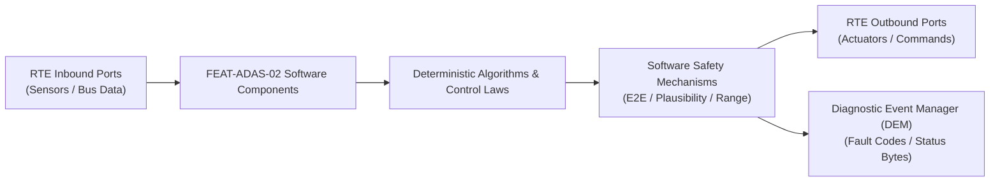

# Software Requirements Specification: Autonomous Emergency Braking (AEB / VRU)
**Feature ID:** `FEAT-ADAS-02`  
**Domain:** ADAS & Autonomous Driving  
**Target ASIL:** ASIL D  
**Compliance Standard:** ISO 26262:2018 (Part 6 - Software Development) / ASPICE PAM v3.1 (SWE.1, SWE.2)  
**Parent System Specification:** [`FEAT-ADAS-02_AEB_SysReq.md`](file:///c:/Workset/AntiGravityProjects/TestOptimisationExperiement/system_requirements/FEAT-ADAS-02_AEB_SysReq.md)  
**Global Master Specification:** [`spec.md`](file:///c:/Workset/AntiGravityProjects/TestOptimisationExperiement/spec.md)

---

## 1. Software Architecture & Component Structure

This document specifies the AUTOSAR Software Components (SWCs), periodic runnables, algorithmic laws, safety mechanisms, and data ports implementing `FEAT-ADAS-02` (Autonomous Emergency Braking (AEB / VRU)).

### AUTOSAR SWC Interaction Diagram

---

## 2. Detailed Software Requirements (SWR_REQ)
*(Multi-Software Requirement Partitioning derived from System Requirements)*

### `SWR-ADAS-02-01`: High-Speed Time-to-Collision & Relative Range Derivator
- **Planned Release:** R100
- **ASIL Rating:** ASIL D
- **Parent System Requirement:** [`SYS-ADAS-02-01`](file:///c:/Workset/AntiGravityProjects/TestOptimisationExperiement/system_requirements/FEAT-ADAS-02_AEB_SysReq.md#sys-adas-02-01)
- **Allocated AUTOSAR SWC:** `AebThreatEvaluator_SWC`
- **Execution Rate / Trigger:** 10 ms
- **Worst-Case Execution Time (WCET):** 1.2 ms
- **Software Activation Condition:** Executed in 100 Hz cyclic task.
- **Algorithmic Description / Logic:**
  > Computes TTC = -d_rel / v_rel when v_rel < -0.1 m/s. Computes Time-to-Brake TTB = sqrt(2 * d_rel / a_max_aeb). Classifies threat tier: Level 0 (None), Level 1 (FCW), Level 2 (Prefill), Level 3 (Braking).
- **Software Safety Mechanism:** Division by zero guard: Clamps v_rel denominator to minimum |v_rel| >= 0.05 m/s.
- **Failure Reaction & DEM Diagnostic Event:** Invalidate TTC and reset threat tier if sensor confidence < 75%.
- **Software Port Inputs:** `Fused_Target_Kinematics_Array[16], Ego_Speed_Mps`
- **Software Port Outputs:** `Critical_Threat_TTC_Sec, Threat_Level_Enum`
- **Software Verification Criteria:** SIL scenario regression testing across 5,000 synthetic collision profiles.
- **Traceability Link:** Traces upward to [`SYS-ADAS-02-01`](file:///c:/Workset/AntiGravityProjects/TestOptimisationExperiement/system_requirements/FEAT-ADAS-02_AEB_SysReq.md#sys-adas-02-01) and [`FEAT-ADAS-02`](file:///c:/Workset/AntiGravityProjects/TestOptimisationExperiement/spec.md).

### `SWR-ADAS-02-02`: Multi-Hypothesis Trajectory Intersection Classifier
- **Planned Release:** R100
- **ASIL Rating:** ASIL D
- **Parent System Requirement:** [`SYS-ADAS-02-01`](file:///c:/Workset/AntiGravityProjects/TestOptimisationExperiement/system_requirements/FEAT-ADAS-02_AEB_SysReq.md#sys-adas-02-01)
- **Allocated AUTOSAR SWC:** `AebTrajectoryPredictor_SWC`
- **Execution Rate / Trigger:** 10 ms
- **Worst-Case Execution Time (WCET):** 1.5 ms
- **Software Activation Condition:** Executed every 10 ms on all identified tracks.
- **Algorithmic Description / Logic:**
  > Predicts future trajectory polynomials y_ego(t) and y_target(t) for t in [0, 3.0s]. Calculates lateral clearance at time of closest approach: d_lat_min = abs(y_target(t_ca) - y_ego(t_ca)). Flags overlap if d_lat_min < 0.9 * (w_ego + w_target)/2.
- **Software Safety Mechanism:** Bounded curve extrapolation: Limits yaw rate extrapolation to road friction limits.
- **Failure Reaction & DEM Diagnostic Event:** Filter targets with zero Doppler velocity to prevent false tripping on overhead bridge gantries.
- **Software Port Inputs:** `Fused_Target_Kinematics_Array, Ego_YawRate_RadS, Steering_Angle_Rad`
- **Software Port Outputs:** `In_Path_Collision_Probability, Lateral_Overlap_Ratio`
- **Software Verification Criteria:** Euro NCAP overhead bridge and steel plate false positive suppression tests.
- **Traceability Link:** Traces upward to [`SYS-ADAS-02-01`](file:///c:/Workset/AntiGravityProjects/TestOptimisationExperiement/system_requirements/FEAT-ADAS-02_AEB_SysReq.md#sys-adas-02-01) and [`FEAT-ADAS-02`](file:///c:/Workset/AntiGravityProjects/TestOptimisationExperiement/spec.md).

### `SWR-ADAS-02-03`: Vision Bounding Box IoU & Radar Doppler Consistency Validator
- **Planned Release:** R100
- **ASIL Rating:** ASIL D
- **Parent System Requirement:** [`SYS-ADAS-02-01`](file:///c:/Workset/AntiGravityProjects/TestOptimisationExperiement/system_requirements/FEAT-ADAS-02_AEB_SysReq.md#sys-adas-02-01)
- **Allocated AUTOSAR SWC:** `AebSensorCrossValidator_SWC`
- **Execution Rate / Trigger:** 10 ms
- **Worst-Case Execution Time (WCET):** 0.9 ms
- **Software Activation Condition:** Executed before triggering autonomous braking.
- **Algorithmic Description / Logic:**
  > Cross-validates camera 2D/3D bounding box Intersection-over-Union (IoU > 0.4) against radar range and Doppler speed. Confirms target exists in both independent sensor domains before permitting Stage 3 braking.
- **Software Safety Mechanism:** Independent 2oo2 sensor confirmation rule to guarantee zero false braking interventions.
- **Failure Reaction & DEM Diagnostic Event:** Suppress emergency braking if single-sensor detection is unconfirmed.
- **Software Port Inputs:** `Camera_3D_BBox_Data, Radar_Target_Detection_Data`
- **Software Port Outputs:** `Cross_Validated_Target_Confirmed (boolean), Sensor_Disagreement_Metric`
- **Software Verification Criteria:** Automated false positive verification across 100,000 km real-world fleet replay dataset.
- **Traceability Link:** Traces upward to [`SYS-ADAS-02-01`](file:///c:/Workset/AntiGravityProjects/TestOptimisationExperiement/system_requirements/FEAT-ADAS-02_AEB_SysReq.md#sys-adas-02-01) and [`FEAT-ADAS-02`](file:///c:/Workset/AntiGravityProjects/TestOptimisationExperiement/spec.md).

### `SWR-ADAS-02-04`: Vision Micro-Doppler Pedestrian & Cyclist Classifier
- **Planned Release:** R100
- **ASIL Rating:** ASIL D
- **Parent System Requirement:** [`SYS-ADAS-02-02`](file:///c:/Workset/AntiGravityProjects/TestOptimisationExperiement/system_requirements/FEAT-ADAS-02_AEB_SysReq.md#sys-adas-02-02)
- **Allocated AUTOSAR SWC:** `AebVruClassifier_SWC`
- **Execution Rate / Trigger:** 20 ms
- **Worst-Case Execution Time (WCET):** 2.5 ms
- **Software Activation Condition:** Executed upon camera object track updates.
- **Algorithmic Description / Logic:**
  > Analyzes limb keypoint motion frequencies (1-3 Hz human stride) and radar micro-Doppler spread. Distinguishes pedestrian, cyclist, and scooter categories with > 95% classification certainty.
- **Software Safety Mechanism:** Temporal consistency filter: Requires 3 consecutive valid classifications before asserting VRU_Type.
- **Failure Reaction & DEM Diagnostic Event:** Degrade to generic obstacle bounding box if classification fails.
- **Software Port Inputs:** `Camera_Keypoint_Stream, Radar_MicroDoppler_Energy_Bins`
- **Software Port Outputs:** `VRU_Class_Enum, VRU_Classification_Confidence`
- **Software Verification Criteria:** Deep neural network classification validation on diverse pedestrian datasets.
- **Traceability Link:** Traces upward to [`SYS-ADAS-02-02`](file:///c:/Workset/AntiGravityProjects/TestOptimisationExperiement/system_requirements/FEAT-ADAS-02_AEB_SysReq.md#sys-adas-02-02) and [`FEAT-ADAS-02`](file:///c:/Workset/AntiGravityProjects/TestOptimisationExperiement/spec.md).

### `SWR-ADAS-02-05`: VRU Lateral Crossing Trajectory Extrapolator
- **Planned Release:** R100
- **ASIL Rating:** ASIL D
- **Parent System Requirement:** [`SYS-ADAS-02-02`](file:///c:/Workset/AntiGravityProjects/TestOptimisationExperiement/system_requirements/FEAT-ADAS-02_AEB_SysReq.md#sys-adas-02-02)
- **Allocated AUTOSAR SWC:** `AebVruTrajectory_SWC`
- **Execution Rate / Trigger:** 10 ms
- **Worst-Case Execution Time (WCET):** 0.8 ms
- **Software Activation Condition:** Active when VRU target detected.
- **Algorithmic Description / Logic:**
  > Tracks lateral velocity v_y of crossing pedestrian. Computes impact arrival time: t_enter = (x_lane_left - y_vru) / v_y. If t_enter matches vehicle arrival time within +-200 ms, triggers VRU pre-crash warning.
- **Software Safety Mechanism:** Speed cap check: Rejects pedestrian tracks with calculated v_y > 15 m/s as sensor artifacts.
- **Failure Reaction & DEM Diagnostic Event:** Abort VRU intervention if target suddenly reverses direction outside path.
- **Software Port Inputs:** `VRU_Position_X_Y, VRU_Velocity_X_Y, Ego_Speed_Mps`
- **Software Port Outputs:** `VRU_Impact_Time_Sec, VRU_Critical_Flag (boolean)`
- **Software Verification Criteria:** Pedestrian night crossing tests with low ambient illumination (< 1 lux).
- **Traceability Link:** Traces upward to [`SYS-ADAS-02-02`](file:///c:/Workset/AntiGravityProjects/TestOptimisationExperiement/system_requirements/FEAT-ADAS-02_AEB_SysReq.md#sys-adas-02-02) and [`FEAT-ADAS-02`](file:///c:/Workset/AntiGravityProjects/TestOptimisationExperiement/spec.md).

### `SWR-ADAS-02-06`: Brake Caliper Clearance Hydraulic Pre-Fill Commander
- **Planned Release:** R100
- **ASIL Rating:** ASIL D
- **Parent System Requirement:** [`SYS-ADAS-02-03`](file:///c:/Workset/AntiGravityProjects/TestOptimisationExperiement/system_requirements/FEAT-ADAS-02_AEB_SysReq.md#sys-adas-02-03)
- **Allocated AUTOSAR SWC:** `AebPrefillManager_SWC`
- **Execution Rate / Trigger:** 10 ms
- **Worst-Case Execution Time (WCET):** 0.4 ms
- **Software Activation Condition:** Triggered when TTC <= 2.2 seconds.
- **Algorithmic Description / Logic:**
  > Sends high-priority CAN-FD command to ESP hydraulic pump: Advances master piston to build 5.0 bar line pressure, bringing brake friction pads into zero-clearance contact with iron rotors.
- **Software Safety Mechanism:** Pre-fill duration timer clamped to 1500 ms maximum to prevent brake pad overheating.
- **Failure Reaction & DEM Diagnostic Event:** Release pre-fill pressure if driver steps on throttle pedal.
- **Software Port Inputs:** `Critical_Threat_TTC_Sec, Throttle_Pedal_Travel_Pct`
- **Software Port Outputs:** `ESP_Prefill_Active_Flag (boolean), Target_Prefill_Pressure_Bar`
- **Software Verification Criteria:** Dynamometer brake latency testing measuring response time reduction from 220 ms to 45 ms.
- **Traceability Link:** Traces upward to [`SYS-ADAS-02-03`](file:///c:/Workset/AntiGravityProjects/TestOptimisationExperiement/system_requirements/FEAT-ADAS-02_AEB_SysReq.md#sys-adas-02-03) and [`FEAT-ADAS-02`](file:///c:/Workset/AntiGravityProjects/TestOptimisationExperiement/spec.md).

### `SWR-ADAS-02-07`: Hydraulic Brake Booster Fast Rise-Time Observer
- **Planned Release:** R100
- **ASIL Rating:** ASIL D
- **Parent System Requirement:** [`SYS-ADAS-02-03`](file:///c:/Workset/AntiGravityProjects/TestOptimisationExperiement/system_requirements/FEAT-ADAS-02_AEB_SysReq.md#sys-adas-02-03)
- **Allocated AUTOSAR SWC:** `AebBoosterSupervisor_SWC`
- **Execution Rate / Trigger:** 5 ms
- **Worst-Case Execution Time (WCET):** 0.3 ms
- **Software Activation Condition:** Active during pre-fill and emergency braking.
- **Algorithmic Description / Logic:**
  > Monitors hydraulic line pressure rise rate: dP/dt >= 800 bar/s required during emergency demand. If pressure rise stalls, commands secondary brushless motor booster to maximum speed.
- **Software Safety Mechanism:** Motor overcurrent detection and dual-winding inverter fault supervision.
- **Failure Reaction & DEM Diagnostic Event:** Set DTC C1093 and switch to backup hydraulic accumulator circuit.
- **Software Port Inputs:** `Master_Cylinder_Pressure_Bar, Booster_Motor_Current_A`
- **Software Port Outputs:** `Booster_Boost_Duty_PWM, Hydraulic_Rise_Time_Status`
- **Software Verification Criteria:** Hardware-in-the-loop brake booster pressure rise dynamics testing.
- **Traceability Link:** Traces upward to [`SYS-ADAS-02-03`](file:///c:/Workset/AntiGravityProjects/TestOptimisationExperiement/system_requirements/FEAT-ADAS-02_AEB_SysReq.md#sys-adas-02-03) and [`FEAT-ADAS-02`](file:///c:/Workset/AntiGravityProjects/TestOptimisationExperiement/spec.md).

### `SWR-ADAS-02-08`: Forward Collision Warning (FCW) HMI Escalation Sequencer
- **Planned Release:** R200
- **ASIL Rating:** ASIL B
- **Parent System Requirement:** [`SYS-ADAS-02-04`](file:///c:/Workset/AntiGravityProjects/TestOptimisationExperiement/system_requirements/FEAT-ADAS-02_AEB_SysReq.md#sys-adas-02-04)
- **Allocated AUTOSAR SWC:** `AebFcwManager_SWC`
- **Execution Rate / Trigger:** 10 ms
- **Worst-Case Execution Time (WCET):** 0.4 ms
- **Software Activation Condition:** Triggered when TTC <= 2.4 seconds.
- **Algorithmic Description / Logic:**
  > Generates multi-sensory alert: 1) Flash high-contrast red collision icon on HUD and Cluster; 2) Sound pulsing 2.4 kHz acoustic warning chime at 85 dB(A); 3) Trigger seatbelt pretensioner haptic tug.
- **Software Safety Mechanism:** Driver eye gaze cross-check: If DMS detects driver is looking at road, postpone FCW chime by 200 ms to reduce nuisance.
- **Failure Reaction & DEM Diagnostic Event:** If cluster display communication fails, trigger hardware piezo buzzer directly.
- **Software Port Inputs:** `Threat_Level_Enum, DMS_Driver_Attention_State, Vehicle_Speed_Mps`
- **Software Port Outputs:** `FCW_Display_Command, Audio_Alert_Tone_Req, Haptic_Seatbelt_Tug_Req`
- **Software Verification Criteria:** HMI warning intelligibility and human reaction time benchmark testing.
- **Traceability Link:** Traces upward to [`SYS-ADAS-02-04`](file:///c:/Workset/AntiGravityProjects/TestOptimisationExperiement/system_requirements/FEAT-ADAS-02_AEB_SysReq.md#sys-adas-02-04) and [`FEAT-ADAS-02`](file:///c:/Workset/AntiGravityProjects/TestOptimisationExperiement/spec.md).

### `SWR-ADAS-02-09`: Haptic Brake Warning Jerk Pulse Synthesizer
- **Planned Release:** R200
- **ASIL Rating:** ASIL D
- **Parent System Requirement:** [`SYS-ADAS-02-04`](file:///c:/Workset/AntiGravityProjects/TestOptimisationExperiement/system_requirements/FEAT-ADAS-02_AEB_SysReq.md#sys-adas-02-04)
- **Allocated AUTOSAR SWC:** `AebBrakeJerk_SWC`
- **Execution Rate / Trigger:** 10 ms
- **Worst-Case Execution Time (WCET):** 0.5 ms
- **Software Activation Condition:** Triggered when TTC <= 1.6 seconds and driver has not braked.
- **Algorithmic Description / Logic:**
  > Commands rapid pulse of deceleration: Delta_a = -3.5 m/s² for duration t_pulse = 350 ms, followed by return to coast. Induces tactile deceleration jolt through vehicle seat and pedals to compel immediate driver intervention.
- **Software Safety Mechanism:** Pulse duration hard-limited to <= 450 ms to prevent unintended tail-end collisions.
- **Failure Reaction & DEM Diagnostic Event:** Cancel brake pulse instantly if driver applies brake or swerves.
- **Software Port Inputs:** `Threat_Level_Enum, Driver_Brake_Override, Driver_Steering_Torque_Nm`
- **Software Port Outputs:** `Haptic_Jerk_Decel_Req_Mps2, Haptic_Jerk_Active_Flag (boolean)`
- **Software Verification Criteria:** Proving ground subjective driver response evaluation to haptic jerk.
- **Traceability Link:** Traces upward to [`SYS-ADAS-02-04`](file:///c:/Workset/AntiGravityProjects/TestOptimisationExperiement/system_requirements/FEAT-ADAS-02_AEB_SysReq.md#sys-adas-02-04) and [`FEAT-ADAS-02`](file:///c:/Workset/AntiGravityProjects/TestOptimisationExperiement/spec.md).

### `SWR-ADAS-02-10`: Full Autonomous Emergency Braking Deceleration Clamper
- **Planned Release:** R200
- **ASIL Rating:** ASIL D
- **Parent System Requirement:** [`SYS-ADAS-02-04`](file:///c:/Workset/AntiGravityProjects/TestOptimisationExperiement/system_requirements/FEAT-ADAS-02_AEB_SysReq.md#sys-adas-02-04)
- **Allocated AUTOSAR SWC:** `AebDecelController_SWC`
- **Execution Rate / Trigger:** 10 ms
- **Worst-Case Execution Time (WCET):** 0.7 ms
- **Software Activation Condition:** Triggered when TTC <= 0.9 seconds (point of no return).
- **Algorithmic Description / Logic:**
  > Commands maximum vehicle deceleration: a_req = -10.0 m/s² with ramp rate da/dt = -30 m/s³. Holds maximum braking until target collision is avoided or vehicle reaches complete stop (v == 0 km/h).
- **Software Safety Mechanism:** ABS slip coordination: Modulates hydraulic pressure to prevent wheel lockup on wet or split-mu roads.
- **Failure Reaction & DEM Diagnostic Event:** Release brake pressure after vehicle comes to a complete standstill for 2.0 seconds.
- **Software Port Inputs:** `Critical_Threat_TTC_Sec, Vehicle_Speed_Mps, ABS_Active_Flag`
- **Software Port Outputs:** `AEB_Full_Decel_Cmd_Mps2, Autonomous_Stop_Hold_Flag`
- **Software Verification Criteria:** Euro NCAP maximum speed AEB crash avoidance tests (10 to 80 km/h).
- **Traceability Link:** Traces upward to [`SYS-ADAS-02-04`](file:///c:/Workset/AntiGravityProjects/TestOptimisationExperiement/system_requirements/FEAT-ADAS-02_AEB_SysReq.md#sys-adas-02-04) and [`FEAT-ADAS-02`](file:///c:/Workset/AntiGravityProjects/TestOptimisationExperiement/spec.md).

### `SWR-ADAS-02-11`: Evasive Steering Corridor Clearance Observer
- **Planned Release:** R200
- **ASIL Rating:** ASIL D
- **Parent System Requirement:** [`SYS-ADAS-02-05`](file:///c:/Workset/AntiGravityProjects/TestOptimisationExperiement/system_requirements/FEAT-ADAS-02_AEB_SysReq.md#sys-adas-02-05)
- **Allocated AUTOSAR SWC:** `AebEvasionCorridor_SWC`
- **Execution Rate / Trigger:** 10 ms
- **Worst-Case Execution Time (WCET):** 1.1 ms
- **Software Activation Condition:** Active during critical threat.
- **Algorithmic Description / Logic:**
  > Evaluates left and right adjacent escape corridors using wide-angle side radars and camera lane boundaries. Computes corridor safety index: S_corridor = (width >= 3.2 m) && (rear_ttc > 4.0s) && (no_oncoming).
- **Software Safety Mechanism:** Prohibits evasive steering torque boost towards any lane with approaching traffic.
- **Failure Reaction & DEM Diagnostic Event:** Inhibit ESA if side radar sensors are occluded.
- **Software Port Inputs:** `Side_Radar_Targets_Left_Right, Lane_Boundary_Type_Array[4]`
- **Software Port Outputs:** `Left_Corridor_Clear_Flag, Right_Corridor_Clear_Flag`
- **Software Verification Criteria:** Multi-vehicle dynamic simulation of highway obstacle avoidance.
- **Traceability Link:** Traces upward to [`SYS-ADAS-02-05`](file:///c:/Workset/AntiGravityProjects/TestOptimisationExperiement/system_requirements/FEAT-ADAS-02_AEB_SysReq.md#sys-adas-02-05) and [`FEAT-ADAS-02`](file:///c:/Workset/AntiGravityProjects/TestOptimisationExperiement/spec.md).

### `SWR-ADAS-02-12`: Electric Power Steering Evasive Torque Overlay Assistant
- **Planned Release:** R200
- **ASIL Rating:** ASIL D
- **Parent System Requirement:** [`SYS-ADAS-02-05`](file:///c:/Workset/AntiGravityProjects/TestOptimisationExperiement/system_requirements/FEAT-ADAS-02_AEB_SysReq.md#sys-adas-02-05)
- **Allocated AUTOSAR SWC:** `AebEvasiveTorque_SWC`
- **Execution Rate / Trigger:** 5 ms
- **Worst-Case Execution Time (WCET):** 0.6 ms
- **Software Activation Condition:** Active when driver steers to avoid collision.
- **Algorithmic Description / Logic:**
  > Adds assistive torque pulse (+-3.0 Nm) in direction of driver evasion turn, and counter-steer torque pulse to help vehicle quickly straighten back into target lane without spin-out.
- **Software Safety Mechanism:** Driver override dominance: Driver can overcome overlay with 5.0 Nm opposing handwheel torque.
- **Failure Reaction & DEM Diagnostic Event:** Zero torque output if steering angle sensor health degrades.
- **Software Port Inputs:** `Driver_Handwheel_Torque_Nm, Evasion_Direction_Enum, Vehicle_YawRate_RadS`
- **Software Port Outputs:** `EPS_Assist_Torque_Overlay_Nm, ESA_Status_Enum`
- **Software Verification Criteria:** EPS motor dyno bench torque overlay response time testing (< 15 ms).
- **Traceability Link:** Traces upward to [`SYS-ADAS-02-05`](file:///c:/Workset/AntiGravityProjects/TestOptimisationExperiement/system_requirements/FEAT-ADAS-02_AEB_SysReq.md#sys-adas-02-05) and [`FEAT-ADAS-02`](file:///c:/Workset/AntiGravityProjects/TestOptimisationExperiement/spec.md).

### `SWR-ADAS-02-13`: Secondary Collision Brake Pressure Hold & Standstill Lockout
- **Planned Release:** R200
- **ASIL Rating:** ASIL D
- **Parent System Requirement:** [`SYS-ADAS-02-06`](file:///c:/Workset/AntiGravityProjects/TestOptimisationExperiement/system_requirements/FEAT-ADAS-02_AEB_SysReq.md#sys-adas-02-06)
- **Allocated AUTOSAR SWC:** `AebSecondaryCollision_SWC`
- **Execution Rate / Trigger:** 10 ms
- **Worst-Case Execution Time (WCET):** 0.4 ms
- **Software Activation Condition:** Triggered upon crash impact detection.
- **Algorithmic Description / Logic:**
  > If crash acceleration spike > 5g or Airbag pyrofuse signal confirmed, commands ESP to lock hydraulic brakes at 80 bar and clamps transmission in PARK, maintaining standstill hold for 5.0 seconds.
- **Software Safety Mechanism:** Hardware latch circuit: Unaffected by CAN bus severed during front collision.
- **Failure Reaction & DEM Diagnostic Event:** Engage dual EPB calipers mechanically if hydraulic pressure drops.
- **Software Port Inputs:** `Airbag_ECU_Crash_Pulse_Pin, Chassis_IMU_Long_G, Wheel_Speed_Ticks`
- **Software Port Outputs:** `Post_Crash_Brake_Hold_Cmd (boolean), Transmission_Park_Req`
- **Software Verification Criteria:** Physical crash sled tests measuring brake hold persistence after impact.
- **Traceability Link:** Traces upward to [`SYS-ADAS-02-06`](file:///c:/Workset/AntiGravityProjects/TestOptimisationExperiement/system_requirements/FEAT-ADAS-02_AEB_SysReq.md#sys-adas-02-06) and [`FEAT-ADAS-02`](file:///c:/Workset/AntiGravityProjects/TestOptimisationExperiement/spec.md).

### `SWR-ADAS-02-14`: Emergency Hazard Lamp Fast-Flash & Crash Notification Dispatcher
- **Planned Release:** R200
- **ASIL Rating:** ASIL B
- **Parent System Requirement:** [`SYS-ADAS-02-06`](file:///c:/Workset/AntiGravityProjects/TestOptimisationExperiement/system_requirements/FEAT-ADAS-02_AEB_SysReq.md#sys-adas-02-06)
- **Allocated AUTOSAR SWC:** `AebEmergencyBeacon_SWC`
- **Execution Rate / Trigger:** 20 ms
- **Worst-Case Execution Time (WCET):** 0.3 ms
- **Software Activation Condition:** Triggered upon AEB full stop or crash event.
- **Algorithmic Description / Logic:**
  > Commands exterior hazard warning lamps to flash at rapid frequency (4.0 Hz) to alert following traffic. Broadcasts Emergency_Stop_Signaling (ESS according to UNECE R48) and triggers eCall dispatch.
- **Software Safety Mechanism:** Automatic reset: Reverts to standard hazard flashing (1.5 Hz) after 10 seconds or when vehicle resumes driving.
- **Failure Reaction & DEM Diagnostic Event:** Illuminate brake lights continuously if hazard relay fails.
- **Software Port Inputs:** `AEB_Active_State, Crash_Confirmed_Flag, Vehicle_Speed_Mps`
- **Software Port Outputs:** `Hazard_Lamp_Flash_Frequency_Hz, ESS_Broadcast_PDU, eCall_Trigger_Signal`
- **Software Verification Criteria:** Photometric flash rate and timing compliance tests (UNECE R48).
- **Traceability Link:** Traces upward to [`SYS-ADAS-02-06`](file:///c:/Workset/AntiGravityProjects/TestOptimisationExperiement/system_requirements/FEAT-ADAS-02_AEB_SysReq.md#sys-adas-02-06) and [`FEAT-ADAS-02`](file:///c:/Workset/AntiGravityProjects/TestOptimisationExperiement/spec.md).

### `SWR-ADAS-02-15`: Cross-Junction Oncoming Traffic & Turn AEB Assist - Dynamic Observer & Signal Filter
- **Planned Release:** R300
- **ASIL Rating:** ASIL D
- **Parent System Requirement:** [`SYS-ADAS-02-07`](file:///c:/Workset/AntiGravityProjects/TestOptimisationExperiement/system_requirements/FEAT-ADAS-02_AEB_SysReq.md#sys-adas-02-07)
- **Allocated AUTOSAR SWC:** `AebJunctionMonitor_SWC`
- **Execution Rate / Trigger:** 10 ms
- **Worst-Case Execution Time (WCET):** 0.3 ms
- **Software Activation Condition:** Executed cyclically every 10 ms.
- **Algorithmic Description / Logic:**
  > Executes signal plausibility filtering, calibration offsets, and discrete state estimation for Cross-Junction Oncoming Traffic & Turn AEB Assist.
- **Software Safety Mechanism:** Range limit plausibility check and E2E alive sequence verification.
- **Failure Reaction & DEM Diagnostic Event:** Set default fallback output and report DEM_EVENT_FEAT_ADAS_02_ERR.
- **Software Port Inputs:** `Raw sensor ADC/SENT/SPI values and RTE bus inputs.`
- **Software Port Outputs:** `Filtered physical signals and validity status bitmasks.`
- **Software Verification Criteria:** Unit test and HiL software integration test.
- **Traceability Link:** Traces upward to [`SYS-ADAS-02-07`](file:///c:/Workset/AntiGravityProjects/TestOptimisationExperiement/system_requirements/FEAT-ADAS-02_AEB_SysReq.md#sys-adas-02-07) and [`FEAT-ADAS-02`](file:///c:/Workset/AntiGravityProjects/TestOptimisationExperiement/spec.md).

### `SWR-ADAS-02-16`: Cross-Junction Oncoming Traffic & Turn AEB Assist - Closed-Loop Control Law & Actuator Dispatch
- **Planned Release:** R300
- **ASIL Rating:** ASIL D
- **Parent System Requirement:** [`SYS-ADAS-02-07`](file:///c:/Workset/AntiGravityProjects/TestOptimisationExperiement/system_requirements/FEAT-ADAS-02_AEB_SysReq.md#sys-adas-02-07)
- **Allocated AUTOSAR SWC:** `AebJunctionMonitor_SWC`
- **Execution Rate / Trigger:** 10 ms
- **Worst-Case Execution Time (WCET):** 0.4 ms
- **Software Activation Condition:** Executed cyclically every 10 ms.
- **Algorithmic Description / Logic:**
  > Evaluates deterministic closed-loop control law, rate limits, and dispatches commands for Cross-Junction Oncoming Traffic & Turn AEB Assist.
- **Software Safety Mechanism:** Command saturation clamping and watchdog program flow monitoring.
- **Failure Reaction & DEM Diagnostic Event:** De-energize actuator output, apply safe fallback clamp, and latch DTC.
- **Software Port Inputs:** `Validated physical state signals from observer SWC.`
- **Software Port Outputs:** `Actuator PWM duty cycles, torque/pressure setpoints, and diagnostic flags.`
- **Software Verification Criteria:** Hardware dynamometer and HiL closed-loop regression test suite.
- **Traceability Link:** Traces upward to [`SYS-ADAS-02-07`](file:///c:/Workset/AntiGravityProjects/TestOptimisationExperiement/system_requirements/FEAT-ADAS-02_AEB_SysReq.md#sys-adas-02-07) and [`FEAT-ADAS-02`](file:///c:/Workset/AntiGravityProjects/TestOptimisationExperiement/spec.md).

### `SWR-ADAS-02-17`: Pedestrian & Vulnerable Road User (VRU) Lateral Path Prediction - Dynamic Observer & Signal Filter
- **Planned Release:** R300
- **ASIL Rating:** ASIL D
- **Parent System Requirement:** [`SYS-ADAS-02-08`](file:///c:/Workset/AntiGravityProjects/TestOptimisationExperiement/system_requirements/FEAT-ADAS-02_AEB_SysReq.md#sys-adas-02-08)
- **Allocated AUTOSAR SWC:** `AebVruPredictor_SWC`
- **Execution Rate / Trigger:** 10 ms
- **Worst-Case Execution Time (WCET):** 0.3 ms
- **Software Activation Condition:** Executed cyclically every 10 ms.
- **Algorithmic Description / Logic:**
  > Executes signal plausibility filtering, calibration offsets, and discrete state estimation for Pedestrian & Vulnerable Road User (VRU) Lateral Path Prediction.
- **Software Safety Mechanism:** Range limit plausibility check and E2E alive sequence verification.
- **Failure Reaction & DEM Diagnostic Event:** Set default fallback output and report DEM_EVENT_FEAT_ADAS_02_ERR.
- **Software Port Inputs:** `Raw sensor ADC/SENT/SPI values and RTE bus inputs.`
- **Software Port Outputs:** `Filtered physical signals and validity status bitmasks.`
- **Software Verification Criteria:** Unit test and HiL software integration test.
- **Traceability Link:** Traces upward to [`SYS-ADAS-02-08`](file:///c:/Workset/AntiGravityProjects/TestOptimisationExperiement/system_requirements/FEAT-ADAS-02_AEB_SysReq.md#sys-adas-02-08) and [`FEAT-ADAS-02`](file:///c:/Workset/AntiGravityProjects/TestOptimisationExperiement/spec.md).

### `SWR-ADAS-02-18`: Pedestrian & Vulnerable Road User (VRU) Lateral Path Prediction - Closed-Loop Control Law & Actuator Dispatch
- **Planned Release:** R300
- **ASIL Rating:** ASIL D
- **Parent System Requirement:** [`SYS-ADAS-02-08`](file:///c:/Workset/AntiGravityProjects/TestOptimisationExperiement/system_requirements/FEAT-ADAS-02_AEB_SysReq.md#sys-adas-02-08)
- **Allocated AUTOSAR SWC:** `AebVruPredictor_SWC`
- **Execution Rate / Trigger:** 10 ms
- **Worst-Case Execution Time (WCET):** 0.4 ms
- **Software Activation Condition:** Executed cyclically every 10 ms.
- **Algorithmic Description / Logic:**
  > Evaluates deterministic closed-loop control law, rate limits, and dispatches commands for Pedestrian & Vulnerable Road User (VRU) Lateral Path Prediction.
- **Software Safety Mechanism:** Command saturation clamping and watchdog program flow monitoring.
- **Failure Reaction & DEM Diagnostic Event:** De-energize actuator output, apply safe fallback clamp, and latch DTC.
- **Software Port Inputs:** `Validated physical state signals from observer SWC.`
- **Software Port Outputs:** `Actuator PWM duty cycles, torque/pressure setpoints, and diagnostic flags.`
- **Software Verification Criteria:** Hardware dynamometer and HiL closed-loop regression test suite.
- **Traceability Link:** Traces upward to [`SYS-ADAS-02-08`](file:///c:/Workset/AntiGravityProjects/TestOptimisationExperiement/system_requirements/FEAT-ADAS-02_AEB_SysReq.md#sys-adas-02-08) and [`FEAT-ADAS-02`](file:///c:/Workset/AntiGravityProjects/TestOptimisationExperiement/spec.md).

### `SWR-ADAS-02-19`: Evasive Steering Maneuver Assist (EMA) Torque Superposition - Dynamic Observer & Signal Filter
- **Planned Release:** R300
- **ASIL Rating:** ASIL D
- **Parent System Requirement:** [`SYS-ADAS-02-09`](file:///c:/Workset/AntiGravityProjects/TestOptimisationExperiement/system_requirements/FEAT-ADAS-02_AEB_SysReq.md#sys-adas-02-09)
- **Allocated AUTOSAR SWC:** `AebEvasiveSteer_SWC`
- **Execution Rate / Trigger:** 5 ms
- **Worst-Case Execution Time (WCET):** 0.3 ms
- **Software Activation Condition:** Executed cyclically every 5 ms.
- **Algorithmic Description / Logic:**
  > Executes signal plausibility filtering, calibration offsets, and discrete state estimation for Evasive Steering Maneuver Assist (EMA) Torque Superposition.
- **Software Safety Mechanism:** Range limit plausibility check and E2E alive sequence verification.
- **Failure Reaction & DEM Diagnostic Event:** Set default fallback output and report DEM_EVENT_FEAT_ADAS_02_ERR.
- **Software Port Inputs:** `Raw sensor ADC/SENT/SPI values and RTE bus inputs.`
- **Software Port Outputs:** `Filtered physical signals and validity status bitmasks.`
- **Software Verification Criteria:** Unit test and HiL software integration test.
- **Traceability Link:** Traces upward to [`SYS-ADAS-02-09`](file:///c:/Workset/AntiGravityProjects/TestOptimisationExperiement/system_requirements/FEAT-ADAS-02_AEB_SysReq.md#sys-adas-02-09) and [`FEAT-ADAS-02`](file:///c:/Workset/AntiGravityProjects/TestOptimisationExperiement/spec.md).

### `SWR-ADAS-02-20`: Evasive Steering Maneuver Assist (EMA) Torque Superposition - Closed-Loop Control Law & Actuator Dispatch
- **Planned Release:** R300
- **ASIL Rating:** ASIL D
- **Parent System Requirement:** [`SYS-ADAS-02-09`](file:///c:/Workset/AntiGravityProjects/TestOptimisationExperiement/system_requirements/FEAT-ADAS-02_AEB_SysReq.md#sys-adas-02-09)
- **Allocated AUTOSAR SWC:** `AebEvasiveSteer_SWC`
- **Execution Rate / Trigger:** 5 ms
- **Worst-Case Execution Time (WCET):** 0.4 ms
- **Software Activation Condition:** Executed cyclically every 5 ms.
- **Algorithmic Description / Logic:**
  > Evaluates deterministic closed-loop control law, rate limits, and dispatches commands for Evasive Steering Maneuver Assist (EMA) Torque Superposition.
- **Software Safety Mechanism:** Command saturation clamping and watchdog program flow monitoring.
- **Failure Reaction & DEM Diagnostic Event:** De-energize actuator output, apply safe fallback clamp, and latch DTC.
- **Software Port Inputs:** `Validated physical state signals from observer SWC.`
- **Software Port Outputs:** `Actuator PWM duty cycles, torque/pressure setpoints, and diagnostic flags.`
- **Software Verification Criteria:** Hardware dynamometer and HiL closed-loop regression test suite.
- **Traceability Link:** Traces upward to [`SYS-ADAS-02-09`](file:///c:/Workset/AntiGravityProjects/TestOptimisationExperiement/system_requirements/FEAT-ADAS-02_AEB_SysReq.md#sys-adas-02-09) and [`FEAT-ADAS-02`](file:///c:/Workset/AntiGravityProjects/TestOptimisationExperiement/spec.md).

### `SWR-ADAS-02-21`: Brake Caliper Hydraulic Pre-Fill & Zero-Clearance Booster - Dynamic Observer & Signal Filter
- **Planned Release:** R400
- **ASIL Rating:** ASIL D
- **Parent System Requirement:** [`SYS-ADAS-02-10`](file:///c:/Workset/AntiGravityProjects/TestOptimisationExperiement/system_requirements/FEAT-ADAS-02_AEB_SysReq.md#sys-adas-02-10)
- **Allocated AUTOSAR SWC:** `AebPreFillCommander_SWC`
- **Execution Rate / Trigger:** 5 ms
- **Worst-Case Execution Time (WCET):** 0.3 ms
- **Software Activation Condition:** Executed cyclically every 5 ms.
- **Algorithmic Description / Logic:**
  > Executes signal plausibility filtering, calibration offsets, and discrete state estimation for Brake Caliper Hydraulic Pre-Fill & Zero-Clearance Booster.
- **Software Safety Mechanism:** Range limit plausibility check and E2E alive sequence verification.
- **Failure Reaction & DEM Diagnostic Event:** Set default fallback output and report DEM_EVENT_FEAT_ADAS_02_ERR.
- **Software Port Inputs:** `Raw sensor ADC/SENT/SPI values and RTE bus inputs.`
- **Software Port Outputs:** `Filtered physical signals and validity status bitmasks.`
- **Software Verification Criteria:** Unit test and HiL software integration test.
- **Traceability Link:** Traces upward to [`SYS-ADAS-02-10`](file:///c:/Workset/AntiGravityProjects/TestOptimisationExperiement/system_requirements/FEAT-ADAS-02_AEB_SysReq.md#sys-adas-02-10) and [`FEAT-ADAS-02`](file:///c:/Workset/AntiGravityProjects/TestOptimisationExperiement/spec.md).

### `SWR-ADAS-02-22`: Brake Caliper Hydraulic Pre-Fill & Zero-Clearance Booster - Closed-Loop Control Law & Actuator Dispatch
- **Planned Release:** R400
- **ASIL Rating:** ASIL D
- **Parent System Requirement:** [`SYS-ADAS-02-10`](file:///c:/Workset/AntiGravityProjects/TestOptimisationExperiement/system_requirements/FEAT-ADAS-02_AEB_SysReq.md#sys-adas-02-10)
- **Allocated AUTOSAR SWC:** `AebPreFillCommander_SWC`
- **Execution Rate / Trigger:** 5 ms
- **Worst-Case Execution Time (WCET):** 0.4 ms
- **Software Activation Condition:** Executed cyclically every 5 ms.
- **Algorithmic Description / Logic:**
  > Evaluates deterministic closed-loop control law, rate limits, and dispatches commands for Brake Caliper Hydraulic Pre-Fill & Zero-Clearance Booster.
- **Software Safety Mechanism:** Command saturation clamping and watchdog program flow monitoring.
- **Failure Reaction & DEM Diagnostic Event:** De-energize actuator output, apply safe fallback clamp, and latch DTC.
- **Software Port Inputs:** `Validated physical state signals from observer SWC.`
- **Software Port Outputs:** `Actuator PWM duty cycles, torque/pressure setpoints, and diagnostic flags.`
- **Software Verification Criteria:** Hardware dynamometer and HiL closed-loop regression test suite.
- **Traceability Link:** Traces upward to [`SYS-ADAS-02-10`](file:///c:/Workset/AntiGravityProjects/TestOptimisationExperiement/system_requirements/FEAT-ADAS-02_AEB_SysReq.md#sys-adas-02-10) and [`FEAT-ADAS-02`](file:///c:/Workset/AntiGravityProjects/TestOptimisationExperiement/spec.md).

### `SWR-ADAS-02-23`: Reversible Seatbelt Pre-Tensioning & Window Closure Safing - Dynamic Observer & Signal Filter
- **Planned Release:** R400
- **ASIL Rating:** ASIL D
- **Parent System Requirement:** [`SYS-ADAS-02-11`](file:///c:/Workset/AntiGravityProjects/TestOptimisationExperiement/system_requirements/FEAT-ADAS-02_AEB_SysReq.md#sys-adas-02-11)
- **Allocated AUTOSAR SWC:** `AebPreCrashSafing_SWC`
- **Execution Rate / Trigger:** 10 ms
- **Worst-Case Execution Time (WCET):** 0.3 ms
- **Software Activation Condition:** Executed cyclically every 10 ms.
- **Algorithmic Description / Logic:**
  > Executes signal plausibility filtering, calibration offsets, and discrete state estimation for Reversible Seatbelt Pre-Tensioning & Window Closure Safing.
- **Software Safety Mechanism:** Range limit plausibility check and E2E alive sequence verification.
- **Failure Reaction & DEM Diagnostic Event:** Set default fallback output and report DEM_EVENT_FEAT_ADAS_02_ERR.
- **Software Port Inputs:** `Raw sensor ADC/SENT/SPI values and RTE bus inputs.`
- **Software Port Outputs:** `Filtered physical signals and validity status bitmasks.`
- **Software Verification Criteria:** Unit test and HiL software integration test.
- **Traceability Link:** Traces upward to [`SYS-ADAS-02-11`](file:///c:/Workset/AntiGravityProjects/TestOptimisationExperiement/system_requirements/FEAT-ADAS-02_AEB_SysReq.md#sys-adas-02-11) and [`FEAT-ADAS-02`](file:///c:/Workset/AntiGravityProjects/TestOptimisationExperiement/spec.md).

### `SWR-ADAS-02-24`: Reversible Seatbelt Pre-Tensioning & Window Closure Safing - Closed-Loop Control Law & Actuator Dispatch
- **Planned Release:** R400
- **ASIL Rating:** ASIL D
- **Parent System Requirement:** [`SYS-ADAS-02-11`](file:///c:/Workset/AntiGravityProjects/TestOptimisationExperiement/system_requirements/FEAT-ADAS-02_AEB_SysReq.md#sys-adas-02-11)
- **Allocated AUTOSAR SWC:** `AebPreCrashSafing_SWC`
- **Execution Rate / Trigger:** 10 ms
- **Worst-Case Execution Time (WCET):** 0.4 ms
- **Software Activation Condition:** Executed cyclically every 10 ms.
- **Algorithmic Description / Logic:**
  > Evaluates deterministic closed-loop control law, rate limits, and dispatches commands for Reversible Seatbelt Pre-Tensioning & Window Closure Safing.
- **Software Safety Mechanism:** Command saturation clamping and watchdog program flow monitoring.
- **Failure Reaction & DEM Diagnostic Event:** De-energize actuator output, apply safe fallback clamp, and latch DTC.
- **Software Port Inputs:** `Validated physical state signals from observer SWC.`
- **Software Port Outputs:** `Actuator PWM duty cycles, torque/pressure setpoints, and diagnostic flags.`
- **Software Verification Criteria:** Hardware dynamometer and HiL closed-loop regression test suite.
- **Traceability Link:** Traces upward to [`SYS-ADAS-02-11`](file:///c:/Workset/AntiGravityProjects/TestOptimisationExperiement/system_requirements/FEAT-ADAS-02_AEB_SysReq.md#sys-adas-02-11) and [`FEAT-ADAS-02`](file:///c:/Workset/AntiGravityProjects/TestOptimisationExperiement/spec.md).

### `SWR-ADAS-02-25`: Driver Panic Steering & Throttle Suppression Logic - Dynamic Observer & Signal Filter
- **Planned Release:** R400
- **ASIL Rating:** ASIL D
- **Parent System Requirement:** [`SYS-ADAS-02-12`](file:///c:/Workset/AntiGravityProjects/TestOptimisationExperiement/system_requirements/FEAT-ADAS-02_AEB_SysReq.md#sys-adas-02-12)
- **Allocated AUTOSAR SWC:** `AebOverrideSuppress_SWC`
- **Execution Rate / Trigger:** 10 ms
- **Worst-Case Execution Time (WCET):** 0.3 ms
- **Software Activation Condition:** Executed cyclically every 10 ms.
- **Algorithmic Description / Logic:**
  > Executes signal plausibility filtering, calibration offsets, and discrete state estimation for Driver Panic Steering & Throttle Suppression Logic.
- **Software Safety Mechanism:** Range limit plausibility check and E2E alive sequence verification.
- **Failure Reaction & DEM Diagnostic Event:** Set default fallback output and report DEM_EVENT_FEAT_ADAS_02_ERR.
- **Software Port Inputs:** `Raw sensor ADC/SENT/SPI values and RTE bus inputs.`
- **Software Port Outputs:** `Filtered physical signals and validity status bitmasks.`
- **Software Verification Criteria:** Unit test and HiL software integration test.
- **Traceability Link:** Traces upward to [`SYS-ADAS-02-12`](file:///c:/Workset/AntiGravityProjects/TestOptimisationExperiement/system_requirements/FEAT-ADAS-02_AEB_SysReq.md#sys-adas-02-12) and [`FEAT-ADAS-02`](file:///c:/Workset/AntiGravityProjects/TestOptimisationExperiement/spec.md).

### `SWR-ADAS-02-26`: Driver Panic Steering & Throttle Suppression Logic - Closed-Loop Control Law & Actuator Dispatch
- **Planned Release:** R400
- **ASIL Rating:** ASIL D
- **Parent System Requirement:** [`SYS-ADAS-02-12`](file:///c:/Workset/AntiGravityProjects/TestOptimisationExperiement/system_requirements/FEAT-ADAS-02_AEB_SysReq.md#sys-adas-02-12)
- **Allocated AUTOSAR SWC:** `AebOverrideSuppress_SWC`
- **Execution Rate / Trigger:** 10 ms
- **Worst-Case Execution Time (WCET):** 0.4 ms
- **Software Activation Condition:** Executed cyclically every 10 ms.
- **Algorithmic Description / Logic:**
  > Evaluates deterministic closed-loop control law, rate limits, and dispatches commands for Driver Panic Steering & Throttle Suppression Logic.
- **Software Safety Mechanism:** Command saturation clamping and watchdog program flow monitoring.
- **Failure Reaction & DEM Diagnostic Event:** De-energize actuator output, apply safe fallback clamp, and latch DTC.
- **Software Port Inputs:** `Validated physical state signals from observer SWC.`
- **Software Port Outputs:** `Actuator PWM duty cycles, torque/pressure setpoints, and diagnostic flags.`
- **Software Verification Criteria:** Hardware dynamometer and HiL closed-loop regression test suite.
- **Traceability Link:** Traces upward to [`SYS-ADAS-02-12`](file:///c:/Workset/AntiGravityProjects/TestOptimisationExperiement/system_requirements/FEAT-ADAS-02_AEB_SysReq.md#sys-adas-02-12) and [`FEAT-ADAS-02`](file:///c:/Workset/AntiGravityProjects/TestOptimisationExperiement/spec.md).

### `SWR-ADAS-02-27`: Post-Crash Autonomous Deceleration & Secondary Collision Prevention - Dynamic Observer & Signal Filter
- **Planned Release:** R500
- **ASIL Rating:** ASIL D
- **Parent System Requirement:** [`SYS-ADAS-02-13`](file:///c:/Workset/AntiGravityProjects/TestOptimisationExperiement/system_requirements/FEAT-ADAS-02_AEB_SysReq.md#sys-adas-02-13)
- **Allocated AUTOSAR SWC:** `AebPostCrashHold_SWC`
- **Execution Rate / Trigger:** 10 ms
- **Worst-Case Execution Time (WCET):** 0.3 ms
- **Software Activation Condition:** Executed cyclically every 10 ms.
- **Algorithmic Description / Logic:**
  > Executes signal plausibility filtering, calibration offsets, and discrete state estimation for Post-Crash Autonomous Deceleration & Secondary Collision Prevention.
- **Software Safety Mechanism:** Range limit plausibility check and E2E alive sequence verification.
- **Failure Reaction & DEM Diagnostic Event:** Set default fallback output and report DEM_EVENT_FEAT_ADAS_02_ERR.
- **Software Port Inputs:** `Raw sensor ADC/SENT/SPI values and RTE bus inputs.`
- **Software Port Outputs:** `Filtered physical signals and validity status bitmasks.`
- **Software Verification Criteria:** Unit test and HiL software integration test.
- **Traceability Link:** Traces upward to [`SYS-ADAS-02-13`](file:///c:/Workset/AntiGravityProjects/TestOptimisationExperiement/system_requirements/FEAT-ADAS-02_AEB_SysReq.md#sys-adas-02-13) and [`FEAT-ADAS-02`](file:///c:/Workset/AntiGravityProjects/TestOptimisationExperiement/spec.md).

### `SWR-ADAS-02-28`: Post-Crash Autonomous Deceleration & Secondary Collision Prevention - Closed-Loop Control Law & Actuator Dispatch
- **Planned Release:** R500
- **ASIL Rating:** ASIL D
- **Parent System Requirement:** [`SYS-ADAS-02-13`](file:///c:/Workset/AntiGravityProjects/TestOptimisationExperiement/system_requirements/FEAT-ADAS-02_AEB_SysReq.md#sys-adas-02-13)
- **Allocated AUTOSAR SWC:** `AebPostCrashHold_SWC`
- **Execution Rate / Trigger:** 10 ms
- **Worst-Case Execution Time (WCET):** 0.4 ms
- **Software Activation Condition:** Executed cyclically every 10 ms.
- **Algorithmic Description / Logic:**
  > Evaluates deterministic closed-loop control law, rate limits, and dispatches commands for Post-Crash Autonomous Deceleration & Secondary Collision Prevention.
- **Software Safety Mechanism:** Command saturation clamping and watchdog program flow monitoring.
- **Failure Reaction & DEM Diagnostic Event:** De-energize actuator output, apply safe fallback clamp, and latch DTC.
- **Software Port Inputs:** `Validated physical state signals from observer SWC.`
- **Software Port Outputs:** `Actuator PWM duty cycles, torque/pressure setpoints, and diagnostic flags.`
- **Software Verification Criteria:** Hardware dynamometer and HiL closed-loop regression test suite.
- **Traceability Link:** Traces upward to [`SYS-ADAS-02-13`](file:///c:/Workset/AntiGravityProjects/TestOptimisationExperiement/system_requirements/FEAT-ADAS-02_AEB_SysReq.md#sys-adas-02-13) and [`FEAT-ADAS-02`](file:///c:/Workset/AntiGravityProjects/TestOptimisationExperiement/spec.md).

### `SWR-ADAS-02-29`: Dual Core Lockstep Safing & Unintended Braking Supervisor - Dynamic Observer & Signal Filter
- **Planned Release:** R400
- **ASIL Rating:** ASIL D
- **Parent System Requirement:** [`SYS-ADAS-02-14`](file:///c:/Workset/AntiGravityProjects/TestOptimisationExperiement/system_requirements/FEAT-ADAS-02_AEB_SysReq.md#sys-adas-02-14)
- **Allocated AUTOSAR SWC:** `AebLockstepSupervisor_SWC`
- **Execution Rate / Trigger:** 2 ms
- **Worst-Case Execution Time (WCET):** 0.3 ms
- **Software Activation Condition:** Executed cyclically every 2 ms.
- **Algorithmic Description / Logic:**
  > Executes signal plausibility filtering, calibration offsets, and discrete state estimation for Dual Core Lockstep Safing & Unintended Braking Supervisor.
- **Software Safety Mechanism:** Range limit plausibility check and E2E alive sequence verification.
- **Failure Reaction & DEM Diagnostic Event:** Set default fallback output and report DEM_EVENT_FEAT_ADAS_02_ERR.
- **Software Port Inputs:** `Raw sensor ADC/SENT/SPI values and RTE bus inputs.`
- **Software Port Outputs:** `Filtered physical signals and validity status bitmasks.`
- **Software Verification Criteria:** Unit test and HiL software integration test.
- **Traceability Link:** Traces upward to [`SYS-ADAS-02-14`](file:///c:/Workset/AntiGravityProjects/TestOptimisationExperiement/system_requirements/FEAT-ADAS-02_AEB_SysReq.md#sys-adas-02-14) and [`FEAT-ADAS-02`](file:///c:/Workset/AntiGravityProjects/TestOptimisationExperiement/spec.md).

### `SWR-ADAS-02-30`: Dual Core Lockstep Safing & Unintended Braking Supervisor - Closed-Loop Control Law & Actuator Dispatch
- **Planned Release:** R400
- **ASIL Rating:** ASIL D
- **Parent System Requirement:** [`SYS-ADAS-02-14`](file:///c:/Workset/AntiGravityProjects/TestOptimisationExperiement/system_requirements/FEAT-ADAS-02_AEB_SysReq.md#sys-adas-02-14)
- **Allocated AUTOSAR SWC:** `AebLockstepSupervisor_SWC`
- **Execution Rate / Trigger:** 2 ms
- **Worst-Case Execution Time (WCET):** 0.4 ms
- **Software Activation Condition:** Executed cyclically every 2 ms.
- **Algorithmic Description / Logic:**
  > Evaluates deterministic closed-loop control law, rate limits, and dispatches commands for Dual Core Lockstep Safing & Unintended Braking Supervisor.
- **Software Safety Mechanism:** Command saturation clamping and watchdog program flow monitoring.
- **Failure Reaction & DEM Diagnostic Event:** De-energize actuator output, apply safe fallback clamp, and latch DTC.
- **Software Port Inputs:** `Validated physical state signals from observer SWC.`
- **Software Port Outputs:** `Actuator PWM duty cycles, torque/pressure setpoints, and diagnostic flags.`
- **Software Verification Criteria:** Hardware dynamometer and HiL closed-loop regression test suite.
- **Traceability Link:** Traces upward to [`SYS-ADAS-02-14`](file:///c:/Workset/AntiGravityProjects/TestOptimisationExperiement/system_requirements/FEAT-ADAS-02_AEB_SysReq.md#sys-adas-02-14) and [`FEAT-ADAS-02`](file:///c:/Workset/AntiGravityProjects/TestOptimisationExperiement/spec.md).

### `SWR-ADAS-02-31`: DEM Non-Volatile Freeze-Frame Crash Event Recording - Dynamic Observer & Signal Filter
- **Planned Release:** R500
- **ASIL Rating:** ASIL B
- **Parent System Requirement:** [`SYS-ADAS-02-15`](file:///c:/Workset/AntiGravityProjects/TestOptimisationExperiement/system_requirements/FEAT-ADAS-02_AEB_SysReq.md#sys-adas-02-15)
- **Allocated AUTOSAR SWC:** `AebCrashRecorder_SWC`
- **Execution Rate / Trigger:** 10 ms
- **Worst-Case Execution Time (WCET):** 0.3 ms
- **Software Activation Condition:** Executed cyclically every 10 ms.
- **Algorithmic Description / Logic:**
  > Executes signal plausibility filtering, calibration offsets, and discrete state estimation for DEM Non-Volatile Freeze-Frame Crash Event Recording.
- **Software Safety Mechanism:** Range limit plausibility check and E2E alive sequence verification.
- **Failure Reaction & DEM Diagnostic Event:** Set default fallback output and report DEM_EVENT_FEAT_ADAS_02_ERR.
- **Software Port Inputs:** `Raw sensor ADC/SENT/SPI values and RTE bus inputs.`
- **Software Port Outputs:** `Filtered physical signals and validity status bitmasks.`
- **Software Verification Criteria:** Unit test and HiL software integration test.
- **Traceability Link:** Traces upward to [`SYS-ADAS-02-15`](file:///c:/Workset/AntiGravityProjects/TestOptimisationExperiement/system_requirements/FEAT-ADAS-02_AEB_SysReq.md#sys-adas-02-15) and [`FEAT-ADAS-02`](file:///c:/Workset/AntiGravityProjects/TestOptimisationExperiement/spec.md).

### `SWR-ADAS-02-32`: DEM Non-Volatile Freeze-Frame Crash Event Recording - Closed-Loop Control Law & Actuator Dispatch
- **Planned Release:** R500
- **ASIL Rating:** ASIL B
- **Parent System Requirement:** [`SYS-ADAS-02-15`](file:///c:/Workset/AntiGravityProjects/TestOptimisationExperiement/system_requirements/FEAT-ADAS-02_AEB_SysReq.md#sys-adas-02-15)
- **Allocated AUTOSAR SWC:** `AebCrashRecorder_SWC`
- **Execution Rate / Trigger:** 10 ms
- **Worst-Case Execution Time (WCET):** 0.4 ms
- **Software Activation Condition:** Executed cyclically every 10 ms.
- **Algorithmic Description / Logic:**
  > Evaluates deterministic closed-loop control law, rate limits, and dispatches commands for DEM Non-Volatile Freeze-Frame Crash Event Recording.
- **Software Safety Mechanism:** Command saturation clamping and watchdog program flow monitoring.
- **Failure Reaction & DEM Diagnostic Event:** De-energize actuator output, apply safe fallback clamp, and latch DTC.
- **Software Port Inputs:** `Validated physical state signals from observer SWC.`
- **Software Port Outputs:** `Actuator PWM duty cycles, torque/pressure setpoints, and diagnostic flags.`
- **Software Verification Criteria:** Hardware dynamometer and HiL closed-loop regression test suite.
- **Traceability Link:** Traces upward to [`SYS-ADAS-02-15`](file:///c:/Workset/AntiGravityProjects/TestOptimisationExperiement/system_requirements/FEAT-ADAS-02_AEB_SysReq.md#sys-adas-02-15) and [`FEAT-ADAS-02`](file:///c:/Workset/AntiGravityProjects/TestOptimisationExperiement/spec.md).

---

## 3. Software-to-System Backward Traceability Matrix

| Software Requirement ID | Planned Release | Allocated SWC | Execution Rate | Upstream System Req | Verification Method |
| :--- | :---: | :--- | :--- | :--- | :--- |
| `SWR-ADAS-02-01` | **`R100`** | `AebThreatEvaluator_SWC` | 10 ms | [`SYS-ADAS-02-01`](file:///c:/Workset/AntiGravityProjects/TestOptimisationExperiement/system_requirements/FEAT-ADAS-02_AEB_SysReq.md#sys-adas-02-01) | SIL scenario regression testing across 5,000 synthetic collision profiles. |
| `SWR-ADAS-02-02` | **`R100`** | `AebTrajectoryPredictor_SWC` | 10 ms | [`SYS-ADAS-02-01`](file:///c:/Workset/AntiGravityProjects/TestOptimisationExperiement/system_requirements/FEAT-ADAS-02_AEB_SysReq.md#sys-adas-02-01) | Euro NCAP overhead bridge and steel plate false positive suppression tests. |
| `SWR-ADAS-02-03` | **`R100`** | `AebSensorCrossValidator_SWC` | 10 ms | [`SYS-ADAS-02-01`](file:///c:/Workset/AntiGravityProjects/TestOptimisationExperiement/system_requirements/FEAT-ADAS-02_AEB_SysReq.md#sys-adas-02-01) | Automated false positive verification across 100,000 km real-world fleet replay dataset. |
| `SWR-ADAS-02-04` | **`R100`** | `AebVruClassifier_SWC` | 20 ms | [`SYS-ADAS-02-02`](file:///c:/Workset/AntiGravityProjects/TestOptimisationExperiement/system_requirements/FEAT-ADAS-02_AEB_SysReq.md#sys-adas-02-02) | Deep neural network classification validation on diverse pedestrian datasets. |
| `SWR-ADAS-02-05` | **`R100`** | `AebVruTrajectory_SWC` | 10 ms | [`SYS-ADAS-02-02`](file:///c:/Workset/AntiGravityProjects/TestOptimisationExperiement/system_requirements/FEAT-ADAS-02_AEB_SysReq.md#sys-adas-02-02) | Pedestrian night crossing tests with low ambient illumination (< 1 lux). |
| `SWR-ADAS-02-06` | **`R100`** | `AebPrefillManager_SWC` | 10 ms | [`SYS-ADAS-02-03`](file:///c:/Workset/AntiGravityProjects/TestOptimisationExperiement/system_requirements/FEAT-ADAS-02_AEB_SysReq.md#sys-adas-02-03) | Dynamometer brake latency testing measuring response time reduction from 220 ms to 45 ms. |
| `SWR-ADAS-02-07` | **`R100`** | `AebBoosterSupervisor_SWC` | 5 ms | [`SYS-ADAS-02-03`](file:///c:/Workset/AntiGravityProjects/TestOptimisationExperiement/system_requirements/FEAT-ADAS-02_AEB_SysReq.md#sys-adas-02-03) | Hardware-in-the-loop brake booster pressure rise dynamics testing. |
| `SWR-ADAS-02-08` | **`R200`** | `AebFcwManager_SWC` | 10 ms | [`SYS-ADAS-02-04`](file:///c:/Workset/AntiGravityProjects/TestOptimisationExperiement/system_requirements/FEAT-ADAS-02_AEB_SysReq.md#sys-adas-02-04) | HMI warning intelligibility and human reaction time benchmark testing. |
| `SWR-ADAS-02-09` | **`R200`** | `AebBrakeJerk_SWC` | 10 ms | [`SYS-ADAS-02-04`](file:///c:/Workset/AntiGravityProjects/TestOptimisationExperiement/system_requirements/FEAT-ADAS-02_AEB_SysReq.md#sys-adas-02-04) | Proving ground subjective driver response evaluation to haptic jerk. |
| `SWR-ADAS-02-10` | **`R200`** | `AebDecelController_SWC` | 10 ms | [`SYS-ADAS-02-04`](file:///c:/Workset/AntiGravityProjects/TestOptimisationExperiement/system_requirements/FEAT-ADAS-02_AEB_SysReq.md#sys-adas-02-04) | Euro NCAP maximum speed AEB crash avoidance tests (10 to 80 km/h). |
| `SWR-ADAS-02-11` | **`R200`** | `AebEvasionCorridor_SWC` | 10 ms | [`SYS-ADAS-02-05`](file:///c:/Workset/AntiGravityProjects/TestOptimisationExperiement/system_requirements/FEAT-ADAS-02_AEB_SysReq.md#sys-adas-02-05) | Multi-vehicle dynamic simulation of highway obstacle avoidance. |
| `SWR-ADAS-02-12` | **`R200`** | `AebEvasiveTorque_SWC` | 5 ms | [`SYS-ADAS-02-05`](file:///c:/Workset/AntiGravityProjects/TestOptimisationExperiement/system_requirements/FEAT-ADAS-02_AEB_SysReq.md#sys-adas-02-05) | EPS motor dyno bench torque overlay response time testing (< 15 ms). |
| `SWR-ADAS-02-13` | **`R200`** | `AebSecondaryCollision_SWC` | 10 ms | [`SYS-ADAS-02-06`](file:///c:/Workset/AntiGravityProjects/TestOptimisationExperiement/system_requirements/FEAT-ADAS-02_AEB_SysReq.md#sys-adas-02-06) | Physical crash sled tests measuring brake hold persistence after impact. |
| `SWR-ADAS-02-14` | **`R200`** | `AebEmergencyBeacon_SWC` | 20 ms | [`SYS-ADAS-02-06`](file:///c:/Workset/AntiGravityProjects/TestOptimisationExperiement/system_requirements/FEAT-ADAS-02_AEB_SysReq.md#sys-adas-02-06) | Photometric flash rate and timing compliance tests (UNECE R48). |
| `SWR-ADAS-02-15` | **`R300`** | `AebJunctionMonitor_SWC` | 10 ms | [`SYS-ADAS-02-07`](file:///c:/Workset/AntiGravityProjects/TestOptimisationExperiement/system_requirements/FEAT-ADAS-02_AEB_SysReq.md#sys-adas-02-07) | Unit test and HiL software integration test. |
| `SWR-ADAS-02-16` | **`R300`** | `AebJunctionMonitor_SWC` | 10 ms | [`SYS-ADAS-02-07`](file:///c:/Workset/AntiGravityProjects/TestOptimisationExperiement/system_requirements/FEAT-ADAS-02_AEB_SysReq.md#sys-adas-02-07) | Hardware dynamometer and HiL closed-loop regression test suite. |
| `SWR-ADAS-02-17` | **`R300`** | `AebVruPredictor_SWC` | 10 ms | [`SYS-ADAS-02-08`](file:///c:/Workset/AntiGravityProjects/TestOptimisationExperiement/system_requirements/FEAT-ADAS-02_AEB_SysReq.md#sys-adas-02-08) | Unit test and HiL software integration test. |
| `SWR-ADAS-02-18` | **`R300`** | `AebVruPredictor_SWC` | 10 ms | [`SYS-ADAS-02-08`](file:///c:/Workset/AntiGravityProjects/TestOptimisationExperiement/system_requirements/FEAT-ADAS-02_AEB_SysReq.md#sys-adas-02-08) | Hardware dynamometer and HiL closed-loop regression test suite. |
| `SWR-ADAS-02-19` | **`R300`** | `AebEvasiveSteer_SWC` | 5 ms | [`SYS-ADAS-02-09`](file:///c:/Workset/AntiGravityProjects/TestOptimisationExperiement/system_requirements/FEAT-ADAS-02_AEB_SysReq.md#sys-adas-02-09) | Unit test and HiL software integration test. |
| `SWR-ADAS-02-20` | **`R300`** | `AebEvasiveSteer_SWC` | 5 ms | [`SYS-ADAS-02-09`](file:///c:/Workset/AntiGravityProjects/TestOptimisationExperiement/system_requirements/FEAT-ADAS-02_AEB_SysReq.md#sys-adas-02-09) | Hardware dynamometer and HiL closed-loop regression test suite. |
| `SWR-ADAS-02-21` | **`R400`** | `AebPreFillCommander_SWC` | 5 ms | [`SYS-ADAS-02-10`](file:///c:/Workset/AntiGravityProjects/TestOptimisationExperiement/system_requirements/FEAT-ADAS-02_AEB_SysReq.md#sys-adas-02-10) | Unit test and HiL software integration test. |
| `SWR-ADAS-02-22` | **`R400`** | `AebPreFillCommander_SWC` | 5 ms | [`SYS-ADAS-02-10`](file:///c:/Workset/AntiGravityProjects/TestOptimisationExperiement/system_requirements/FEAT-ADAS-02_AEB_SysReq.md#sys-adas-02-10) | Hardware dynamometer and HiL closed-loop regression test suite. |
| `SWR-ADAS-02-23` | **`R400`** | `AebPreCrashSafing_SWC` | 10 ms | [`SYS-ADAS-02-11`](file:///c:/Workset/AntiGravityProjects/TestOptimisationExperiement/system_requirements/FEAT-ADAS-02_AEB_SysReq.md#sys-adas-02-11) | Unit test and HiL software integration test. |
| `SWR-ADAS-02-24` | **`R400`** | `AebPreCrashSafing_SWC` | 10 ms | [`SYS-ADAS-02-11`](file:///c:/Workset/AntiGravityProjects/TestOptimisationExperiement/system_requirements/FEAT-ADAS-02_AEB_SysReq.md#sys-adas-02-11) | Hardware dynamometer and HiL closed-loop regression test suite. |
| `SWR-ADAS-02-25` | **`R400`** | `AebOverrideSuppress_SWC` | 10 ms | [`SYS-ADAS-02-12`](file:///c:/Workset/AntiGravityProjects/TestOptimisationExperiement/system_requirements/FEAT-ADAS-02_AEB_SysReq.md#sys-adas-02-12) | Unit test and HiL software integration test. |
| `SWR-ADAS-02-26` | **`R400`** | `AebOverrideSuppress_SWC` | 10 ms | [`SYS-ADAS-02-12`](file:///c:/Workset/AntiGravityProjects/TestOptimisationExperiement/system_requirements/FEAT-ADAS-02_AEB_SysReq.md#sys-adas-02-12) | Hardware dynamometer and HiL closed-loop regression test suite. |
| `SWR-ADAS-02-27` | **`R500`** | `AebPostCrashHold_SWC` | 10 ms | [`SYS-ADAS-02-13`](file:///c:/Workset/AntiGravityProjects/TestOptimisationExperiement/system_requirements/FEAT-ADAS-02_AEB_SysReq.md#sys-adas-02-13) | Unit test and HiL software integration test. |
| `SWR-ADAS-02-28` | **`R500`** | `AebPostCrashHold_SWC` | 10 ms | [`SYS-ADAS-02-13`](file:///c:/Workset/AntiGravityProjects/TestOptimisationExperiement/system_requirements/FEAT-ADAS-02_AEB_SysReq.md#sys-adas-02-13) | Hardware dynamometer and HiL closed-loop regression test suite. |
| `SWR-ADAS-02-29` | **`R400`** | `AebLockstepSupervisor_SWC` | 2 ms | [`SYS-ADAS-02-14`](file:///c:/Workset/AntiGravityProjects/TestOptimisationExperiement/system_requirements/FEAT-ADAS-02_AEB_SysReq.md#sys-adas-02-14) | Unit test and HiL software integration test. |
| `SWR-ADAS-02-30` | **`R400`** | `AebLockstepSupervisor_SWC` | 2 ms | [`SYS-ADAS-02-14`](file:///c:/Workset/AntiGravityProjects/TestOptimisationExperiement/system_requirements/FEAT-ADAS-02_AEB_SysReq.md#sys-adas-02-14) | Hardware dynamometer and HiL closed-loop regression test suite. |
| `SWR-ADAS-02-31` | **`R500`** | `AebCrashRecorder_SWC` | 10 ms | [`SYS-ADAS-02-15`](file:///c:/Workset/AntiGravityProjects/TestOptimisationExperiement/system_requirements/FEAT-ADAS-02_AEB_SysReq.md#sys-adas-02-15) | Unit test and HiL software integration test. |
| `SWR-ADAS-02-32` | **`R500`** | `AebCrashRecorder_SWC` | 10 ms | [`SYS-ADAS-02-15`](file:///c:/Workset/AntiGravityProjects/TestOptimisationExperiement/system_requirements/FEAT-ADAS-02_AEB_SysReq.md#sys-adas-02-15) | Hardware dynamometer and HiL closed-loop regression test suite. |

- **Parent System Specification Document:** [`FEAT-ADAS-02_AEB_SysReq.md`](file:///c:/Workset/AntiGravityProjects/TestOptimisationExperiement/system_requirements/FEAT-ADAS-02_AEB_SysReq.md)
- **Master Automotive Specification:** [`spec.md`](file:///c:/Workset/AntiGravityProjects/TestOptimisationExperiement/spec.md)
