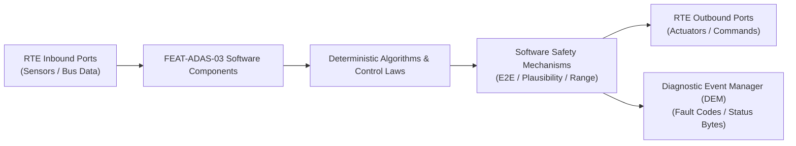

# Software Requirements Specification: Lane Centering Assist & Emergency Lane Keeping (LCA-ELK)
**Feature ID:** `FEAT-ADAS-03`  
**Domain:** ADAS & Autonomous Driving  
**Target ASIL:** ASIL B  
**Compliance Standard:** ISO 26262:2018 (Part 6 - Software Development) / ASPICE PAM v3.1 (SWE.1, SWE.2)  
**Parent System Specification:** [`FEAT-ADAS-03_LCA_SysReq.md`](file:///c:/Workset/AntiGravityProjects/TestOptimisationExperiement/system_requirements/FEAT-ADAS-03_LCA_SysReq.md)  
**Global Master Specification:** [`spec.md`](file:///c:/Workset/AntiGravityProjects/TestOptimisationExperiement/spec.md)

---

## 1. Software Architecture & Component Structure

This document specifies the AUTOSAR Software Components (SWCs), periodic runnables, algorithmic laws, safety mechanisms, and data ports implementing `FEAT-ADAS-03` (Lane Centering Assist & Emergency Lane Keeping (LCA-ELK)).

### AUTOSAR SWC Interaction Diagram

---

## 2. Detailed Software Requirements (SWR_REQ)
*(Multi-Software Requirement Partitioning derived from System Requirements)*

### `SWR-ADAS-03-01`: Camera Lane Polynomial Least-Squares Estimator
- **Planned Release:** R100
- **ASIL Rating:** ASIL B
- **Parent System Requirement:** [`SYS-ADAS-03-01`](file:///c:/Workset/AntiGravityProjects/TestOptimisationExperiement/system_requirements/FEAT-ADAS-03_LCA_SysReq.md#sys-adas-03-01)
- **Allocated AUTOSAR SWC:** `LcaLaneEstimator_SWC`
- **Execution Rate / Trigger:** 30 ms
- **Worst-Case Execution Time (WCET):** 1.5 ms
- **Software Activation Condition:** Executed upon camera lane frame arrival.
- **Algorithmic Description / Logic:**
  > Fits 3rd-order polynomial y(x) = c0 + c1*x + c2*x^2 + c3*x^3 using RANSAC and recursive least squares. Rejects outlier points with lateral residual > 0.25 m.
- **Software Safety Mechanism:** Lane width sanity check: 2.5 m <= Lane_Width <= 4.5 m; rejects crossing lines.
- **Failure Reaction & DEM Diagnostic Event:** Flag Lane_Data_Invalid if confidence score < 50%.
- **Software Port Inputs:** `Camera_Lane_Points_Raw[64], Vehicle_Odometer_Ticks`
- **Software Port Outputs:** `Lane_Polynomial_Coeffs_Left[4], Lane_Polynomial_Coeffs_Right[4], Fit_RMSE`
- **Software Verification Criteria:** Mathematical curve fitting unit test with synthetic noisy markers.
- **Traceability Link:** Traces upward to [`SYS-ADAS-03-01`](file:///c:/Workset/AntiGravityProjects/TestOptimisationExperiement/system_requirements/FEAT-ADAS-03_LCA_SysReq.md#sys-adas-03-01) and [`FEAT-ADAS-03`](file:///c:/Workset/AntiGravityProjects/TestOptimisationExperiement/spec.md).

### `SWR-ADAS-03-02`: Virtual Centerline Trajectory & Lookahead Point Generator
- **Planned Release:** R100
- **ASIL Rating:** ASIL B
- **Parent System Requirement:** [`SYS-ADAS-03-01`](file:///c:/Workset/AntiGravityProjects/TestOptimisationExperiement/system_requirements/FEAT-ADAS-03_LCA_SysReq.md#sys-adas-03-01)
- **Allocated AUTOSAR SWC:** `LcaTrajectoryPlanner_SWC`
- **Execution Rate / Trigger:** 20 ms
- **Worst-Case Execution Time (WCET):** 1.0 ms
- **Software Activation Condition:** Cyclic 20 ms task.
- **Algorithmic Description / Logic:**
  > Computes centerline y_center(x) = (y_left(x) + y_right(x)) / 2. Calculates dynamic lookahead distance: L_lookahead = max(10.0, 1.2 * v_ego). Evaluates target lateral error e_y and heading error e_psi at lookahead distance.
- **Software Safety Mechanism:** Curvature rate limiter: d(c2)/dt bounded to <= 0.005 1/m/s to prevent violent steering changes.
- **Failure Reaction & DEM Diagnostic Event:** Freeze trajectory for 100 ms if camera frame is dropped.
- **Software Port Inputs:** `Lane_Polynomial_Coeffs_Left, Lane_Polynomial_Coeffs_Right, Ego_Velocity_Mps`
- **Software Port Outputs:** `Target_Heading_Error_Rad, Target_Lateral_Error_Meters, Lookahead_Distance_M`
- **Software Verification Criteria:** Trajectory continuity simulation on S-curves and chicane tracks.
- **Traceability Link:** Traces upward to [`SYS-ADAS-03-01`](file:///c:/Workset/AntiGravityProjects/TestOptimisationExperiement/system_requirements/FEAT-ADAS-03_LCA_SysReq.md#sys-adas-03-01) and [`FEAT-ADAS-03`](file:///c:/Workset/AntiGravityProjects/TestOptimisationExperiement/spec.md).

### `SWR-ADAS-03-03`: Lateral Path-Following Feedforward & Feedback PID Controller
- **Planned Release:** R500
- **ASIL Rating:** ASIL B
- **Parent System Requirement:** [`SYS-ADAS-03-02`](file:///c:/Workset/AntiGravityProjects/TestOptimisationExperiement/system_requirements/FEAT-ADAS-03_LCA_SysReq.md#sys-adas-03-02)
- **Allocated AUTOSAR SWC:** `LcaSteeringController_SWC`
- **Execution Rate / Trigger:** 10 ms
- **Worst-Case Execution Time (WCET):** 0.9 ms
- **Software Activation Condition:** Executed in 100 Hz steering control task.
- **Algorithmic Description / Logic:**
  > Computes feedforward steering angle: Delta_ff = Wheelbase * c2 + K_understeer * v_ego^2 * c2. Computes feedback torque: T_fb = K_p * e_y + K_d * d(e_y)/dt + K_psi * e_psi. Clamps total torque to +-3.5 Nm.
- **Software Safety Mechanism:** Torque rate limiter: Max torque gradient limited to 5.0 Nm/s.
- **Failure Reaction & DEM Diagnostic Event:** Ramp down torque demand to 0.0 in 100 ms upon command overflow.
- **Software Port Inputs:** `Target_Heading_Error_Rad, Target_Lateral_Error_Meters, Vehicle_Velocity_Mps`
- **Software Port Outputs:** `LCA_Steering_Torque_Demand_Nm, Target_Road_Wheel_Angle_Deg`
- **Software Verification Criteria:** Closed-loop CarSim vehicle dynamics simulation achieving tracking error < 0.15 m.
- **Traceability Link:** Traces upward to [`SYS-ADAS-03-02`](file:///c:/Workset/AntiGravityProjects/TestOptimisationExperiement/system_requirements/FEAT-ADAS-03_LCA_SysReq.md#sys-adas-03-02) and [`FEAT-ADAS-03`](file:///c:/Workset/AntiGravityProjects/TestOptimisationExperiement/spec.md).

### `SWR-ADAS-03-04`: Driver Manual Steering Override Blending & Hysteresis
- **Planned Release:** R500
- **ASIL Rating:** ASIL B
- **Parent System Requirement:** [`SYS-ADAS-03-02`](file:///c:/Workset/AntiGravityProjects/TestOptimisationExperiement/system_requirements/FEAT-ADAS-03_LCA_SysReq.md#sys-adas-03-02)
- **Allocated AUTOSAR SWC:** `LcaOverrideManager_SWC`
- **Execution Rate / Trigger:** 10 ms
- **Worst-Case Execution Time (WCET):** 0.4 ms
- **Software Activation Condition:** Monitors driver steering interaction.
- **Algorithmic Description / Logic:**
  > Monitors driver torque T_driver: If |T_driver| > 3.0 Nm, immediately fades out LCA torque: T_out = T_demand * max(0.0, 1.0 - (|T_driver| - 3.0)/1.5). Restores centering when |T_driver| < 1.0 Nm for > 500 ms.
- **Software Safety Mechanism:** Instant disengage: If driver torque opposes assist with > 4.0 Nm, disengage in <= 10 ms.
- **Failure Reaction & DEM Diagnostic Event:** Zero assist torque if steering torque sensor signal status is uncalibrated.
- **Software Port Inputs:** `Driver_Handwheel_Torque_Nm, LCA_Steering_Torque_Demand_Nm`
- **Software Port Outputs:** `Blended_Steering_Torque_Nm, Driver_Overriding_Flag (boolean)`
- **Software Verification Criteria:** Subjective test bench steering feel evaluation during driver lane change.
- **Traceability Link:** Traces upward to [`SYS-ADAS-03-02`](file:///c:/Workset/AntiGravityProjects/TestOptimisationExperiement/system_requirements/FEAT-ADAS-03_LCA_SysReq.md#sys-adas-03-02) and [`FEAT-ADAS-03`](file:///c:/Workset/AntiGravityProjects/TestOptimisationExperiement/spec.md).

### `SWR-ADAS-03-05`: Capacitive Hands-On Detection Signal Conditioning & Debounce
- **Planned Release:** R100
- **ASIL Rating:** ASIL B
- **Parent System Requirement:** [`SYS-ADAS-03-03`](file:///c:/Workset/AntiGravityProjects/TestOptimisationExperiement/system_requirements/FEAT-ADAS-03_LCA_SysReq.md#sys-adas-03-03)
- **Allocated AUTOSAR SWC:** `LcaHodProcessor_SWC`
- **Execution Rate / Trigger:** 10 ms
- **Worst-Case Execution Time (WCET):** 0.5 ms
- **Software Activation Condition:** Cyclic 10 ms task.
- **Algorithmic Description / Logic:**
  > Samples 4 capacitive zones around steering wheel rim. Evaluates capacitance shift Delta_C: If Delta_C > 30 pF in >= 1 zone, declares Hands_On = TRUE. Applies 200 ms debounce filter to eliminate brushing contacts.
- **Software Safety Mechanism:** Redundant check: Cross-checks capacitive sensing against handwheel torque micro-dithering (torque variance > 0.05 Nm RMS).
- **Failure Reaction & DEM Diagnostic Event:** Fallback to torque variance sensing if capacitive sensor reports fault.
- **Software Port Inputs:** `Capacitive_Sensor_ADC_Array[4], Driver_Handwheel_Torque_Nm`
- **Software Port Outputs:** `Driver_Hands_On_Confirmed (boolean), Contact_Zone_Bitmask`
- **Software Verification Criteria:** Environmental temperature soak test (-40°C to +85°C) with leather and gloves.
- **Traceability Link:** Traces upward to [`SYS-ADAS-03-03`](file:///c:/Workset/AntiGravityProjects/TestOptimisationExperiement/system_requirements/FEAT-ADAS-03_LCA_SysReq.md#sys-adas-03-03) and [`FEAT-ADAS-03`](file:///c:/Workset/AntiGravityProjects/TestOptimisationExperiement/spec.md).

### `SWR-ADAS-03-06`: Hands-Off Escalation Timer & In-Lane Stop Sequencer
- **Planned Release:** R100
- **ASIL Rating:** ASIL B
- **Parent System Requirement:** [`SYS-ADAS-03-03`](file:///c:/Workset/AntiGravityProjects/TestOptimisationExperiement/system_requirements/FEAT-ADAS-03_LCA_SysReq.md#sys-adas-03-03)
- **Allocated AUTOSAR SWC:** `LcaTakeoverSequencer_SWC`
- **Execution Rate / Trigger:** 100 ms
- **Worst-Case Execution Time (WCET):** 0.6 ms
- **Software Activation Condition:** Active when Hands_On == FALSE during centering.
- **Algorithmic Description / Logic:**
  > Executes staged timer: Stage 1 (0-15s): Green wheel icon; Stage 2 (15-25s): Flashing yellow icon + 1 Hz audio beep; Stage 3 (25-35s): Red takeover icon + continuous 85 dB alarm + brake jerk pulse; Stage 4 (> 35s): Brings vehicle to safe stop in lane.
- **Software Safety Mechanism:** Timer instantly resets to 0.0s upon driver touching steering wheel.
- **Failure Reaction & DEM Diagnostic Event:** Force immediate Stage 3 escalation if driver eye gaze is closed (drowsiness).
- **Software Port Inputs:** `Driver_Hands_On_Confirmed, Hands_Off_Timer_Sec, DMS_Driver_Drowsy_Flag`
- **Software Port Outputs:** `LCA_Alert_Stage_Enum, Emergency_InLane_Stop_Req (boolean)`
- **Software Verification Criteria:** Automated regression test verifying exact escalation timing (15s, 25s, 35s).
- **Traceability Link:** Traces upward to [`SYS-ADAS-03-03`](file:///c:/Workset/AntiGravityProjects/TestOptimisationExperiement/system_requirements/FEAT-ADAS-03_LCA_SysReq.md#sys-adas-03-03) and [`FEAT-ADAS-03`](file:///c:/Workset/AntiGravityProjects/TestOptimisationExperiement/spec.md).

### `SWR-ADAS-03-07`: Time-To-Line-Crossing (TLC) Kinematic Predictor
- **Planned Release:** R200
- **ASIL Rating:** ASIL B
- **Parent System Requirement:** [`SYS-ADAS-03-04`](file:///c:/Workset/AntiGravityProjects/TestOptimisationExperiement/system_requirements/FEAT-ADAS-03_LCA_SysReq.md#sys-adas-03-04)
- **Allocated AUTOSAR SWC:** `LcaTlcPredictor_SWC`
- **Execution Rate / Trigger:** 10 ms
- **Worst-Case Execution Time (WCET):** 0.7 ms
- **Software Activation Condition:** Cyclic 10 ms task.
- **Algorithmic Description / Logic:**
  > Computes Time-To-Line-Crossing: TLC = d_edge / (v_ego * sin(e_psi) + d(d_edge)/dt). If TLC <= 0.6 seconds and turn indicator is OFF, triggers ELK emergency intervention.
- **Software Safety Mechanism:** Division by zero clamp on lateral crossing velocity.
- **Failure Reaction & DEM Diagnostic Event:** Suppress ELK if vehicle is traveling along road fork.
- **Software Port Inputs:** `Distance_To_Left_Edge_M, Distance_To_Right_Edge_M, Lateral_Velocity_Mps`
- **Software Port Outputs:** `TLC_Left_Sec, TLC_Right_Sec, ELK_Trigger_Req (boolean)`
- **Software Verification Criteria:** Euro NCAP ELK lane departure edge approach trajectory simulation.
- **Traceability Link:** Traces upward to [`SYS-ADAS-03-04`](file:///c:/Workset/AntiGravityProjects/TestOptimisationExperiement/system_requirements/FEAT-ADAS-03_LCA_SysReq.md#sys-adas-03-04) and [`FEAT-ADAS-03`](file:///c:/Workset/AntiGravityProjects/TestOptimisationExperiement/spec.md).

### `SWR-ADAS-03-08`: ELK High-Dynamic Corrective Counter-Steering Pulse
- **Planned Release:** R200
- **ASIL Rating:** ASIL B
- **Parent System Requirement:** [`SYS-ADAS-03-04`](file:///c:/Workset/AntiGravityProjects/TestOptimisationExperiement/system_requirements/FEAT-ADAS-03_LCA_SysReq.md#sys-adas-03-04)
- **Allocated AUTOSAR SWC:** `LcaElkActuator_SWC`
- **Execution Rate / Trigger:** 5 ms
- **Worst-Case Execution Time (WCET):** 0.4 ms
- **Software Activation Condition:** Triggered on ELK_Trigger_Req.
- **Algorithmic Description / Logic:**
  > Applies rapid corrective steering torque pulse: T_elk = +-4.5 Nm with 20 Nm/s slew rate to push vehicle back into center of lane. Decays torque smoothly once TLC > 1.8 seconds.
- **Software Safety Mechanism:** Intervention duration capped to maximum 1.5 seconds per event.
- **Failure Reaction & DEM Diagnostic Event:** Abort pulse if driver turns in opposite direction with > 5 Nm.
- **Software Port Inputs:** `ELK_Trigger_Req, Departure_Direction_Enum, Driver_Handwheel_Torque_Nm`
- **Software Port Outputs:** `ELK_Correction_Torque_Nm, ELK_Active_Warning_Flag`
- **Software Verification Criteria:** Proving ground dynamic test preventing road edge run-off at 80 km/h.
- **Traceability Link:** Traces upward to [`SYS-ADAS-03-04`](file:///c:/Workset/AntiGravityProjects/TestOptimisationExperiement/system_requirements/FEAT-ADAS-03_LCA_SysReq.md#sys-adas-03-04) and [`FEAT-ADAS-03`](file:///c:/Workset/AntiGravityProjects/TestOptimisationExperiement/spec.md).

### `SWR-ADAS-03-09`: Single-Boundary Virtual Corridor Extrapolator
- **Planned Release:** R200
- **ASIL Rating:** ASIL B
- **Parent System Requirement:** [`SYS-ADAS-03-05`](file:///c:/Workset/AntiGravityProjects/TestOptimisationExperiement/system_requirements/FEAT-ADAS-03_LCA_SysReq.md#sys-adas-03-05)
- **Allocated AUTOSAR SWC:** `LcaSingleBoundary_SWC`
- **Execution Rate / Trigger:** 20 ms
- **Worst-Case Execution Time (WCET):** 0.8 ms
- **Software Activation Condition:** Active when one boundary lost.
- **Algorithmic Description / Logic:**
  > If only left boundary is visible, creates virtual right boundary by projecting lateral offset: y_right_virtual(x) = y_left(x) + W_nominal, where W_nominal is learned lane width (default 3.5 m).
- **Software Safety Mechanism:** Limits single-boundary tracking duration to maximum 10.0 seconds.
- **Failure Reaction & DEM Diagnostic Event:** Smoothly disengage assist if single boundary also disappears.
- **Software Port Inputs:** `Valid_Boundary_Polynomial, Boundary_Side_Enum, Learned_Lane_Width_M`
- **Software Port Outputs:** `Virtual_Lane_Centerline_Polynomial, Single_Boundary_Active_Flag`
- **Software Verification Criteria:** Highway lane loss and construction barrier testing.
- **Traceability Link:** Traces upward to [`SYS-ADAS-03-05`](file:///c:/Workset/AntiGravityProjects/TestOptimisationExperiement/system_requirements/FEAT-ADAS-03_LCA_SysReq.md#sys-adas-03-05) and [`FEAT-ADAS-03`](file:///c:/Workset/AntiGravityProjects/TestOptimisationExperiement/spec.md).

### `SWR-ADAS-03-10`: Construction Zone Pylon & Guardrail Offset Bias Generator
- **Planned Release:** R200
- **ASIL Rating:** ASIL B
- **Parent System Requirement:** [`SYS-ADAS-03-05`](file:///c:/Workset/AntiGravityProjects/TestOptimisationExperiement/system_requirements/FEAT-ADAS-03_LCA_SysReq.md#sys-adas-03-05)
- **Allocated AUTOSAR SWC:** `LcaConstructionZone_SWC`
- **Execution Rate / Trigger:** 20 ms
- **Worst-Case Execution Time (WCET):** 0.7 ms
- **Software Activation Condition:** Active when construction cones or temporary barriers detected.
- **Algorithmic Description / Logic:**
  > Detects line of traffic cones or temporary concrete barriers: Adds lateral safety clearance bias (+0.3 m away from barrier) to prevent vehicle mirror clipping.
- **Software Safety Mechanism:** Clamps maximum offset bias to <= 0.5 m to avoid crossing opposite lane line.
- **Failure Reaction & DEM Diagnostic Event:** Zero bias if barrier line position fluctuates erratically.
- **Software Port Inputs:** `Camera_Barrier_Contour_Points[16], Ego_Vehicle_Width_M`
- **Software Port Outputs:** `Lateral_Safety_Offset_Bias_M, Construction_Mode_Active_Flag`
- **Software Verification Criteria:** Narrow lane construction zone simulation with concrete K-rail barriers.
- **Traceability Link:** Traces upward to [`SYS-ADAS-03-05`](file:///c:/Workset/AntiGravityProjects/TestOptimisationExperiement/system_requirements/FEAT-ADAS-03_LCA_SysReq.md#sys-adas-03-05) and [`FEAT-ADAS-03`](file:///c:/Workset/AntiGravityProjects/TestOptimisationExperiement/spec.md).

### `SWR-ADAS-03-11`: Camera Video Stream Road Edge & Barrier Kinematic Boundary Estimator - Dynamic Observer & Signal Filter
- **Planned Release:** R200
- **ASIL Rating:** ASIL B
- **Parent System Requirement:** [`SYS-ADAS-03-06`](file:///c:/Workset/AntiGravityProjects/TestOptimisationExperiement/system_requirements/FEAT-ADAS-03_LCA_SysReq.md#sys-adas-03-06)
- **Allocated AUTOSAR SWC:** `LcaRoadEdgeDetector_SWC`
- **Execution Rate / Trigger:** 20 ms
- **Worst-Case Execution Time (WCET):** 0.3 ms
- **Software Activation Condition:** Executed cyclically every 20 ms.
- **Algorithmic Description / Logic:**
  > Executes signal plausibility filtering, calibration offsets, and discrete state estimation for Camera Video Stream Road Edge & Barrier Kinematic Boundary Estimator.
- **Software Safety Mechanism:** Range limit plausibility check and E2E alive sequence verification.
- **Failure Reaction & DEM Diagnostic Event:** Set default fallback output and report DEM_EVENT_FEAT_ADAS_03_ERR.
- **Software Port Inputs:** `Raw sensor ADC/SENT/SPI values and RTE bus inputs.`
- **Software Port Outputs:** `Filtered physical signals and validity status bitmasks.`
- **Software Verification Criteria:** Unit test and HiL software integration test.
- **Traceability Link:** Traces upward to [`SYS-ADAS-03-06`](file:///c:/Workset/AntiGravityProjects/TestOptimisationExperiement/system_requirements/FEAT-ADAS-03_LCA_SysReq.md#sys-adas-03-06) and [`FEAT-ADAS-03`](file:///c:/Workset/AntiGravityProjects/TestOptimisationExperiement/spec.md).

### `SWR-ADAS-03-12`: Camera Video Stream Road Edge & Barrier Kinematic Boundary Estimator - Closed-Loop Control Law & Actuator Dispatch
- **Planned Release:** R200
- **ASIL Rating:** ASIL B
- **Parent System Requirement:** [`SYS-ADAS-03-06`](file:///c:/Workset/AntiGravityProjects/TestOptimisationExperiement/system_requirements/FEAT-ADAS-03_LCA_SysReq.md#sys-adas-03-06)
- **Allocated AUTOSAR SWC:** `LcaRoadEdgeDetector_SWC`
- **Execution Rate / Trigger:** 20 ms
- **Worst-Case Execution Time (WCET):** 0.4 ms
- **Software Activation Condition:** Executed cyclically every 20 ms.
- **Algorithmic Description / Logic:**
  > Evaluates deterministic closed-loop control law, rate limits, and dispatches commands for Camera Video Stream Road Edge & Barrier Kinematic Boundary Estimator.
- **Software Safety Mechanism:** Command saturation clamping and watchdog program flow monitoring.
- **Failure Reaction & DEM Diagnostic Event:** De-energize actuator output, apply safe fallback clamp, and latch DTC.
- **Software Port Inputs:** `Validated physical state signals from observer SWC.`
- **Software Port Outputs:** `Actuator PWM duty cycles, torque/pressure setpoints, and diagnostic flags.`
- **Software Verification Criteria:** Hardware dynamometer and HiL closed-loop regression test suite.
- **Traceability Link:** Traces upward to [`SYS-ADAS-03-06`](file:///c:/Workset/AntiGravityProjects/TestOptimisationExperiement/system_requirements/FEAT-ADAS-03_LCA_SysReq.md#sys-adas-03-06) and [`FEAT-ADAS-03`](file:///c:/Workset/AntiGravityProjects/TestOptimisationExperiement/spec.md).

### `SWR-ADAS-03-13`: Clothoid Lane Model 3rd-Degree Polynomial Tracking Filter - Dynamic Observer & Signal Filter
- **Planned Release:** R300
- **ASIL Rating:** ASIL B
- **Parent System Requirement:** [`SYS-ADAS-03-07`](file:///c:/Workset/AntiGravityProjects/TestOptimisationExperiement/system_requirements/FEAT-ADAS-03_LCA_SysReq.md#sys-adas-03-07)
- **Allocated AUTOSAR SWC:** `LcaClothoidTracker_SWC`
- **Execution Rate / Trigger:** 10 ms
- **Worst-Case Execution Time (WCET):** 0.3 ms
- **Software Activation Condition:** Executed cyclically every 10 ms.
- **Algorithmic Description / Logic:**
  > Executes signal plausibility filtering, calibration offsets, and discrete state estimation for Clothoid Lane Model 3rd-Degree Polynomial Tracking Filter.
- **Software Safety Mechanism:** Range limit plausibility check and E2E alive sequence verification.
- **Failure Reaction & DEM Diagnostic Event:** Set default fallback output and report DEM_EVENT_FEAT_ADAS_03_ERR.
- **Software Port Inputs:** `Raw sensor ADC/SENT/SPI values and RTE bus inputs.`
- **Software Port Outputs:** `Filtered physical signals and validity status bitmasks.`
- **Software Verification Criteria:** Unit test and HiL software integration test.
- **Traceability Link:** Traces upward to [`SYS-ADAS-03-07`](file:///c:/Workset/AntiGravityProjects/TestOptimisationExperiement/system_requirements/FEAT-ADAS-03_LCA_SysReq.md#sys-adas-03-07) and [`FEAT-ADAS-03`](file:///c:/Workset/AntiGravityProjects/TestOptimisationExperiement/spec.md).

### `SWR-ADAS-03-14`: Clothoid Lane Model 3rd-Degree Polynomial Tracking Filter - Closed-Loop Control Law & Actuator Dispatch
- **Planned Release:** R300
- **ASIL Rating:** ASIL B
- **Parent System Requirement:** [`SYS-ADAS-03-07`](file:///c:/Workset/AntiGravityProjects/TestOptimisationExperiement/system_requirements/FEAT-ADAS-03_LCA_SysReq.md#sys-adas-03-07)
- **Allocated AUTOSAR SWC:** `LcaClothoidTracker_SWC`
- **Execution Rate / Trigger:** 10 ms
- **Worst-Case Execution Time (WCET):** 0.4 ms
- **Software Activation Condition:** Executed cyclically every 10 ms.
- **Algorithmic Description / Logic:**
  > Evaluates deterministic closed-loop control law, rate limits, and dispatches commands for Clothoid Lane Model 3rd-Degree Polynomial Tracking Filter.
- **Software Safety Mechanism:** Command saturation clamping and watchdog program flow monitoring.
- **Failure Reaction & DEM Diagnostic Event:** De-energize actuator output, apply safe fallback clamp, and latch DTC.
- **Software Port Inputs:** `Validated physical state signals from observer SWC.`
- **Software Port Outputs:** `Actuator PWM duty cycles, torque/pressure setpoints, and diagnostic flags.`
- **Software Verification Criteria:** Hardware dynamometer and HiL closed-loop regression test suite.
- **Traceability Link:** Traces upward to [`SYS-ADAS-03-07`](file:///c:/Workset/AntiGravityProjects/TestOptimisationExperiement/system_requirements/FEAT-ADAS-03_LCA_SysReq.md#sys-adas-03-07) and [`FEAT-ADAS-03`](file:///c:/Workset/AntiGravityProjects/TestOptimisationExperiement/spec.md).

### `SWR-ADAS-03-15`: Emergency Lane Keeping (ELK) Oncoming Vehicle Hazard Mitigator - Dynamic Observer & Signal Filter
- **Planned Release:** R300
- **ASIL Rating:** ASIL B
- **Parent System Requirement:** [`SYS-ADAS-03-08`](file:///c:/Workset/AntiGravityProjects/TestOptimisationExperiement/system_requirements/FEAT-ADAS-03_LCA_SysReq.md#sys-adas-03-08)
- **Allocated AUTOSAR SWC:** `LcaElkEmergencySteer_SWC`
- **Execution Rate / Trigger:** 10 ms
- **Worst-Case Execution Time (WCET):** 0.3 ms
- **Software Activation Condition:** Executed cyclically every 10 ms.
- **Algorithmic Description / Logic:**
  > Executes signal plausibility filtering, calibration offsets, and discrete state estimation for Emergency Lane Keeping (ELK) Oncoming Vehicle Hazard Mitigator.
- **Software Safety Mechanism:** Range limit plausibility check and E2E alive sequence verification.
- **Failure Reaction & DEM Diagnostic Event:** Set default fallback output and report DEM_EVENT_FEAT_ADAS_03_ERR.
- **Software Port Inputs:** `Raw sensor ADC/SENT/SPI values and RTE bus inputs.`
- **Software Port Outputs:** `Filtered physical signals and validity status bitmasks.`
- **Software Verification Criteria:** Unit test and HiL software integration test.
- **Traceability Link:** Traces upward to [`SYS-ADAS-03-08`](file:///c:/Workset/AntiGravityProjects/TestOptimisationExperiement/system_requirements/FEAT-ADAS-03_LCA_SysReq.md#sys-adas-03-08) and [`FEAT-ADAS-03`](file:///c:/Workset/AntiGravityProjects/TestOptimisationExperiement/spec.md).

### `SWR-ADAS-03-16`: Emergency Lane Keeping (ELK) Oncoming Vehicle Hazard Mitigator - Closed-Loop Control Law & Actuator Dispatch
- **Planned Release:** R300
- **ASIL Rating:** ASIL B
- **Parent System Requirement:** [`SYS-ADAS-03-08`](file:///c:/Workset/AntiGravityProjects/TestOptimisationExperiement/system_requirements/FEAT-ADAS-03_LCA_SysReq.md#sys-adas-03-08)
- **Allocated AUTOSAR SWC:** `LcaElkEmergencySteer_SWC`
- **Execution Rate / Trigger:** 10 ms
- **Worst-Case Execution Time (WCET):** 0.4 ms
- **Software Activation Condition:** Executed cyclically every 10 ms.
- **Algorithmic Description / Logic:**
  > Evaluates deterministic closed-loop control law, rate limits, and dispatches commands for Emergency Lane Keeping (ELK) Oncoming Vehicle Hazard Mitigator.
- **Software Safety Mechanism:** Command saturation clamping and watchdog program flow monitoring.
- **Failure Reaction & DEM Diagnostic Event:** De-energize actuator output, apply safe fallback clamp, and latch DTC.
- **Software Port Inputs:** `Validated physical state signals from observer SWC.`
- **Software Port Outputs:** `Actuator PWM duty cycles, torque/pressure setpoints, and diagnostic flags.`
- **Software Verification Criteria:** Hardware dynamometer and HiL closed-loop regression test suite.
- **Traceability Link:** Traces upward to [`SYS-ADAS-03-08`](file:///c:/Workset/AntiGravityProjects/TestOptimisationExperiement/system_requirements/FEAT-ADAS-03_LCA_SysReq.md#sys-adas-03-08) and [`FEAT-ADAS-03`](file:///c:/Workset/AntiGravityProjects/TestOptimisationExperiement/spec.md).

### `SWR-ADAS-03-17`: Driver Capacitive Hands-On Detection (HOD) Supervisor - Dynamic Observer & Signal Filter
- **Planned Release:** R300
- **ASIL Rating:** ASIL B
- **Parent System Requirement:** [`SYS-ADAS-03-09`](file:///c:/Workset/AntiGravityProjects/TestOptimisationExperiement/system_requirements/FEAT-ADAS-03_LCA_SysReq.md#sys-adas-03-09)
- **Allocated AUTOSAR SWC:** `LcaHodSupervisor_SWC`
- **Execution Rate / Trigger:** 20 ms
- **Worst-Case Execution Time (WCET):** 0.3 ms
- **Software Activation Condition:** Executed cyclically every 20 ms.
- **Algorithmic Description / Logic:**
  > Executes signal plausibility filtering, calibration offsets, and discrete state estimation for Driver Capacitive Hands-On Detection (HOD) Supervisor.
- **Software Safety Mechanism:** Range limit plausibility check and E2E alive sequence verification.
- **Failure Reaction & DEM Diagnostic Event:** Set default fallback output and report DEM_EVENT_FEAT_ADAS_03_ERR.
- **Software Port Inputs:** `Raw sensor ADC/SENT/SPI values and RTE bus inputs.`
- **Software Port Outputs:** `Filtered physical signals and validity status bitmasks.`
- **Software Verification Criteria:** Unit test and HiL software integration test.
- **Traceability Link:** Traces upward to [`SYS-ADAS-03-09`](file:///c:/Workset/AntiGravityProjects/TestOptimisationExperiement/system_requirements/FEAT-ADAS-03_LCA_SysReq.md#sys-adas-03-09) and [`FEAT-ADAS-03`](file:///c:/Workset/AntiGravityProjects/TestOptimisationExperiement/spec.md).

### `SWR-ADAS-03-18`: Driver Capacitive Hands-On Detection (HOD) Supervisor - Closed-Loop Control Law & Actuator Dispatch
- **Planned Release:** R300
- **ASIL Rating:** ASIL B
- **Parent System Requirement:** [`SYS-ADAS-03-09`](file:///c:/Workset/AntiGravityProjects/TestOptimisationExperiement/system_requirements/FEAT-ADAS-03_LCA_SysReq.md#sys-adas-03-09)
- **Allocated AUTOSAR SWC:** `LcaHodSupervisor_SWC`
- **Execution Rate / Trigger:** 20 ms
- **Worst-Case Execution Time (WCET):** 0.4 ms
- **Software Activation Condition:** Executed cyclically every 20 ms.
- **Algorithmic Description / Logic:**
  > Evaluates deterministic closed-loop control law, rate limits, and dispatches commands for Driver Capacitive Hands-On Detection (HOD) Supervisor.
- **Software Safety Mechanism:** Command saturation clamping and watchdog program flow monitoring.
- **Failure Reaction & DEM Diagnostic Event:** De-energize actuator output, apply safe fallback clamp, and latch DTC.
- **Software Port Inputs:** `Validated physical state signals from observer SWC.`
- **Software Port Outputs:** `Actuator PWM duty cycles, torque/pressure setpoints, and diagnostic flags.`
- **Software Verification Criteria:** Hardware dynamometer and HiL closed-loop regression test suite.
- **Traceability Link:** Traces upward to [`SYS-ADAS-03-09`](file:///c:/Workset/AntiGravityProjects/TestOptimisationExperiement/system_requirements/FEAT-ADAS-03_LCA_SysReq.md#sys-adas-03-09) and [`FEAT-ADAS-03`](file:///c:/Workset/AntiGravityProjects/TestOptimisationExperiement/spec.md).

### `SWR-ADAS-03-19`: Turn Signal Lane Change Suppression & Override Deactivation - Dynamic Observer & Signal Filter
- **Planned Release:** R400
- **ASIL Rating:** ASIL B
- **Parent System Requirement:** [`SYS-ADAS-03-10`](file:///c:/Workset/AntiGravityProjects/TestOptimisationExperiement/system_requirements/FEAT-ADAS-03_LCA_SysReq.md#sys-adas-03-10)
- **Allocated AUTOSAR SWC:** `LcaSignalOverride_SWC`
- **Execution Rate / Trigger:** 10 ms
- **Worst-Case Execution Time (WCET):** 0.3 ms
- **Software Activation Condition:** Executed cyclically every 10 ms.
- **Algorithmic Description / Logic:**
  > Executes signal plausibility filtering, calibration offsets, and discrete state estimation for Turn Signal Lane Change Suppression & Override Deactivation.
- **Software Safety Mechanism:** Range limit plausibility check and E2E alive sequence verification.
- **Failure Reaction & DEM Diagnostic Event:** Set default fallback output and report DEM_EVENT_FEAT_ADAS_03_ERR.
- **Software Port Inputs:** `Raw sensor ADC/SENT/SPI values and RTE bus inputs.`
- **Software Port Outputs:** `Filtered physical signals and validity status bitmasks.`
- **Software Verification Criteria:** Unit test and HiL software integration test.
- **Traceability Link:** Traces upward to [`SYS-ADAS-03-10`](file:///c:/Workset/AntiGravityProjects/TestOptimisationExperiement/system_requirements/FEAT-ADAS-03_LCA_SysReq.md#sys-adas-03-10) and [`FEAT-ADAS-03`](file:///c:/Workset/AntiGravityProjects/TestOptimisationExperiement/spec.md).

### `SWR-ADAS-03-20`: Turn Signal Lane Change Suppression & Override Deactivation - Closed-Loop Control Law & Actuator Dispatch
- **Planned Release:** R400
- **ASIL Rating:** ASIL B
- **Parent System Requirement:** [`SYS-ADAS-03-10`](file:///c:/Workset/AntiGravityProjects/TestOptimisationExperiement/system_requirements/FEAT-ADAS-03_LCA_SysReq.md#sys-adas-03-10)
- **Allocated AUTOSAR SWC:** `LcaSignalOverride_SWC`
- **Execution Rate / Trigger:** 10 ms
- **Worst-Case Execution Time (WCET):** 0.4 ms
- **Software Activation Condition:** Executed cyclically every 10 ms.
- **Algorithmic Description / Logic:**
  > Evaluates deterministic closed-loop control law, rate limits, and dispatches commands for Turn Signal Lane Change Suppression & Override Deactivation.
- **Software Safety Mechanism:** Command saturation clamping and watchdog program flow monitoring.
- **Failure Reaction & DEM Diagnostic Event:** De-energize actuator output, apply safe fallback clamp, and latch DTC.
- **Software Port Inputs:** `Validated physical state signals from observer SWC.`
- **Software Port Outputs:** `Actuator PWM duty cycles, torque/pressure setpoints, and diagnostic flags.`
- **Software Verification Criteria:** Hardware dynamometer and HiL closed-loop regression test suite.
- **Traceability Link:** Traces upward to [`SYS-ADAS-03-10`](file:///c:/Workset/AntiGravityProjects/TestOptimisationExperiement/system_requirements/FEAT-ADAS-03_LCA_SysReq.md#sys-adas-03-10) and [`FEAT-ADAS-03`](file:///c:/Workset/AntiGravityProjects/TestOptimisationExperiement/spec.md).

### `SWR-ADAS-03-21`: EPS Steering Torque Overlay Maximum Authority Clamp - Dynamic Observer & Signal Filter
- **Planned Release:** R500
- **ASIL Rating:** ASIL B
- **Parent System Requirement:** [`SYS-ADAS-03-11`](file:///c:/Workset/AntiGravityProjects/TestOptimisationExperiement/system_requirements/FEAT-ADAS-03_LCA_SysReq.md#sys-adas-03-11)
- **Allocated AUTOSAR SWC:** `LcaTorqueClamp_SWC`
- **Execution Rate / Trigger:** 5 ms
- **Worst-Case Execution Time (WCET):** 0.3 ms
- **Software Activation Condition:** Executed cyclically every 5 ms.
- **Algorithmic Description / Logic:**
  > Executes signal plausibility filtering, calibration offsets, and discrete state estimation for EPS Steering Torque Overlay Maximum Authority Clamp.
- **Software Safety Mechanism:** Range limit plausibility check and E2E alive sequence verification.
- **Failure Reaction & DEM Diagnostic Event:** Set default fallback output and report DEM_EVENT_FEAT_ADAS_03_ERR.
- **Software Port Inputs:** `Raw sensor ADC/SENT/SPI values and RTE bus inputs.`
- **Software Port Outputs:** `Filtered physical signals and validity status bitmasks.`
- **Software Verification Criteria:** Unit test and HiL software integration test.
- **Traceability Link:** Traces upward to [`SYS-ADAS-03-11`](file:///c:/Workset/AntiGravityProjects/TestOptimisationExperiement/system_requirements/FEAT-ADAS-03_LCA_SysReq.md#sys-adas-03-11) and [`FEAT-ADAS-03`](file:///c:/Workset/AntiGravityProjects/TestOptimisationExperiement/spec.md).

### `SWR-ADAS-03-22`: EPS Steering Torque Overlay Maximum Authority Clamp - Closed-Loop Control Law & Actuator Dispatch
- **Planned Release:** R500
- **ASIL Rating:** ASIL B
- **Parent System Requirement:** [`SYS-ADAS-03-11`](file:///c:/Workset/AntiGravityProjects/TestOptimisationExperiement/system_requirements/FEAT-ADAS-03_LCA_SysReq.md#sys-adas-03-11)
- **Allocated AUTOSAR SWC:** `LcaTorqueClamp_SWC`
- **Execution Rate / Trigger:** 5 ms
- **Worst-Case Execution Time (WCET):** 0.4 ms
- **Software Activation Condition:** Executed cyclically every 5 ms.
- **Algorithmic Description / Logic:**
  > Evaluates deterministic closed-loop control law, rate limits, and dispatches commands for EPS Steering Torque Overlay Maximum Authority Clamp.
- **Software Safety Mechanism:** Command saturation clamping and watchdog program flow monitoring.
- **Failure Reaction & DEM Diagnostic Event:** De-energize actuator output, apply safe fallback clamp, and latch DTC.
- **Software Port Inputs:** `Validated physical state signals from observer SWC.`
- **Software Port Outputs:** `Actuator PWM duty cycles, torque/pressure setpoints, and diagnostic flags.`
- **Software Verification Criteria:** Hardware dynamometer and HiL closed-loop regression test suite.
- **Traceability Link:** Traces upward to [`SYS-ADAS-03-11`](file:///c:/Workset/AntiGravityProjects/TestOptimisationExperiement/system_requirements/FEAT-ADAS-03_LCA_SysReq.md#sys-adas-03-11) and [`FEAT-ADAS-03`](file:///c:/Workset/AntiGravityProjects/TestOptimisationExperiement/spec.md).

### `SWR-ADAS-03-23`: Wet Surface Low-Contrast Marker Confidence Degradation - Dynamic Observer & Signal Filter
- **Planned Release:** R400
- **ASIL Rating:** ASIL B
- **Parent System Requirement:** [`SYS-ADAS-03-12`](file:///c:/Workset/AntiGravityProjects/TestOptimisationExperiement/system_requirements/FEAT-ADAS-03_LCA_SysReq.md#sys-adas-03-12)
- **Allocated AUTOSAR SWC:** `LcaConfidenceDegrader_SWC`
- **Execution Rate / Trigger:** 50 ms
- **Worst-Case Execution Time (WCET):** 0.3 ms
- **Software Activation Condition:** Executed cyclically every 50 ms.
- **Algorithmic Description / Logic:**
  > Executes signal plausibility filtering, calibration offsets, and discrete state estimation for Wet Surface Low-Contrast Marker Confidence Degradation.
- **Software Safety Mechanism:** Range limit plausibility check and E2E alive sequence verification.
- **Failure Reaction & DEM Diagnostic Event:** Set default fallback output and report DEM_EVENT_FEAT_ADAS_03_ERR.
- **Software Port Inputs:** `Raw sensor ADC/SENT/SPI values and RTE bus inputs.`
- **Software Port Outputs:** `Filtered physical signals and validity status bitmasks.`
- **Software Verification Criteria:** Unit test and HiL software integration test.
- **Traceability Link:** Traces upward to [`SYS-ADAS-03-12`](file:///c:/Workset/AntiGravityProjects/TestOptimisationExperiement/system_requirements/FEAT-ADAS-03_LCA_SysReq.md#sys-adas-03-12) and [`FEAT-ADAS-03`](file:///c:/Workset/AntiGravityProjects/TestOptimisationExperiement/spec.md).

### `SWR-ADAS-03-24`: Wet Surface Low-Contrast Marker Confidence Degradation - Closed-Loop Control Law & Actuator Dispatch
- **Planned Release:** R400
- **ASIL Rating:** ASIL B
- **Parent System Requirement:** [`SYS-ADAS-03-12`](file:///c:/Workset/AntiGravityProjects/TestOptimisationExperiement/system_requirements/FEAT-ADAS-03_LCA_SysReq.md#sys-adas-03-12)
- **Allocated AUTOSAR SWC:** `LcaConfidenceDegrader_SWC`
- **Execution Rate / Trigger:** 50 ms
- **Worst-Case Execution Time (WCET):** 0.4 ms
- **Software Activation Condition:** Executed cyclically every 50 ms.
- **Algorithmic Description / Logic:**
  > Evaluates deterministic closed-loop control law, rate limits, and dispatches commands for Wet Surface Low-Contrast Marker Confidence Degradation.
- **Software Safety Mechanism:** Command saturation clamping and watchdog program flow monitoring.
- **Failure Reaction & DEM Diagnostic Event:** De-energize actuator output, apply safe fallback clamp, and latch DTC.
- **Software Port Inputs:** `Validated physical state signals from observer SWC.`
- **Software Port Outputs:** `Actuator PWM duty cycles, torque/pressure setpoints, and diagnostic flags.`
- **Software Verification Criteria:** Hardware dynamometer and HiL closed-loop regression test suite.
- **Traceability Link:** Traces upward to [`SYS-ADAS-03-12`](file:///c:/Workset/AntiGravityProjects/TestOptimisationExperiement/system_requirements/FEAT-ADAS-03_LCA_SysReq.md#sys-adas-03-12) and [`FEAT-ADAS-03`](file:///c:/Workset/AntiGravityProjects/TestOptimisationExperiement/spec.md).

### `SWR-ADAS-03-25`: HMI Visual Lane Departure Tell-Tale & Haptic Vibration Annunciation - Dynamic Observer & Signal Filter
- **Planned Release:** R500
- **ASIL Rating:** ASIL B
- **Parent System Requirement:** [`SYS-ADAS-03-13`](file:///c:/Workset/AntiGravityProjects/TestOptimisationExperiement/system_requirements/FEAT-ADAS-03_LCA_SysReq.md#sys-adas-03-13)
- **Allocated AUTOSAR SWC:** `LcaHmiNotifier_SWC`
- **Execution Rate / Trigger:** 20 ms
- **Worst-Case Execution Time (WCET):** 0.3 ms
- **Software Activation Condition:** Executed cyclically every 20 ms.
- **Algorithmic Description / Logic:**
  > Executes signal plausibility filtering, calibration offsets, and discrete state estimation for HMI Visual Lane Departure Tell-Tale & Haptic Vibration Annunciation.
- **Software Safety Mechanism:** Range limit plausibility check and E2E alive sequence verification.
- **Failure Reaction & DEM Diagnostic Event:** Set default fallback output and report DEM_EVENT_FEAT_ADAS_03_ERR.
- **Software Port Inputs:** `Raw sensor ADC/SENT/SPI values and RTE bus inputs.`
- **Software Port Outputs:** `Filtered physical signals and validity status bitmasks.`
- **Software Verification Criteria:** Unit test and HiL software integration test.
- **Traceability Link:** Traces upward to [`SYS-ADAS-03-13`](file:///c:/Workset/AntiGravityProjects/TestOptimisationExperiement/system_requirements/FEAT-ADAS-03_LCA_SysReq.md#sys-adas-03-13) and [`FEAT-ADAS-03`](file:///c:/Workset/AntiGravityProjects/TestOptimisationExperiement/spec.md).

### `SWR-ADAS-03-26`: HMI Visual Lane Departure Tell-Tale & Haptic Vibration Annunciation - Closed-Loop Control Law & Actuator Dispatch
- **Planned Release:** R500
- **ASIL Rating:** ASIL B
- **Parent System Requirement:** [`SYS-ADAS-03-13`](file:///c:/Workset/AntiGravityProjects/TestOptimisationExperiement/system_requirements/FEAT-ADAS-03_LCA_SysReq.md#sys-adas-03-13)
- **Allocated AUTOSAR SWC:** `LcaHmiNotifier_SWC`
- **Execution Rate / Trigger:** 20 ms
- **Worst-Case Execution Time (WCET):** 0.4 ms
- **Software Activation Condition:** Executed cyclically every 20 ms.
- **Algorithmic Description / Logic:**
  > Evaluates deterministic closed-loop control law, rate limits, and dispatches commands for HMI Visual Lane Departure Tell-Tale & Haptic Vibration Annunciation.
- **Software Safety Mechanism:** Command saturation clamping and watchdog program flow monitoring.
- **Failure Reaction & DEM Diagnostic Event:** De-energize actuator output, apply safe fallback clamp, and latch DTC.
- **Software Port Inputs:** `Validated physical state signals from observer SWC.`
- **Software Port Outputs:** `Actuator PWM duty cycles, torque/pressure setpoints, and diagnostic flags.`
- **Software Verification Criteria:** Hardware dynamometer and HiL closed-loop regression test suite.
- **Traceability Link:** Traces upward to [`SYS-ADAS-03-13`](file:///c:/Workset/AntiGravityProjects/TestOptimisationExperiement/system_requirements/FEAT-ADAS-03_LCA_SysReq.md#sys-adas-03-13) and [`FEAT-ADAS-03`](file:///c:/Workset/AntiGravityProjects/TestOptimisationExperiement/spec.md).

### `SWR-ADAS-03-27`: LCA System Fault Passive Disengagement & Fail-Silent Isolation - Dynamic Observer & Signal Filter
- **Planned Release:** R500
- **ASIL Rating:** ASIL B
- **Parent System Requirement:** [`SYS-ADAS-03-14`](file:///c:/Workset/AntiGravityProjects/TestOptimisationExperiement/system_requirements/FEAT-ADAS-03_LCA_SysReq.md#sys-adas-03-14)
- **Allocated AUTOSAR SWC:** `LcaFailSilentShutdown_SWC`
- **Execution Rate / Trigger:** 10 ms
- **Worst-Case Execution Time (WCET):** 0.3 ms
- **Software Activation Condition:** Executed cyclically every 10 ms.
- **Algorithmic Description / Logic:**
  > Executes signal plausibility filtering, calibration offsets, and discrete state estimation for LCA System Fault Passive Disengagement & Fail-Silent Isolation.
- **Software Safety Mechanism:** Range limit plausibility check and E2E alive sequence verification.
- **Failure Reaction & DEM Diagnostic Event:** Set default fallback output and report DEM_EVENT_FEAT_ADAS_03_ERR.
- **Software Port Inputs:** `Raw sensor ADC/SENT/SPI values and RTE bus inputs.`
- **Software Port Outputs:** `Filtered physical signals and validity status bitmasks.`
- **Software Verification Criteria:** Unit test and HiL software integration test.
- **Traceability Link:** Traces upward to [`SYS-ADAS-03-14`](file:///c:/Workset/AntiGravityProjects/TestOptimisationExperiement/system_requirements/FEAT-ADAS-03_LCA_SysReq.md#sys-adas-03-14) and [`FEAT-ADAS-03`](file:///c:/Workset/AntiGravityProjects/TestOptimisationExperiement/spec.md).

### `SWR-ADAS-03-28`: LCA System Fault Passive Disengagement & Fail-Silent Isolation - Closed-Loop Control Law & Actuator Dispatch
- **Planned Release:** R500
- **ASIL Rating:** ASIL B
- **Parent System Requirement:** [`SYS-ADAS-03-14`](file:///c:/Workset/AntiGravityProjects/TestOptimisationExperiement/system_requirements/FEAT-ADAS-03_LCA_SysReq.md#sys-adas-03-14)
- **Allocated AUTOSAR SWC:** `LcaFailSilentShutdown_SWC`
- **Execution Rate / Trigger:** 10 ms
- **Worst-Case Execution Time (WCET):** 0.4 ms
- **Software Activation Condition:** Executed cyclically every 10 ms.
- **Algorithmic Description / Logic:**
  > Evaluates deterministic closed-loop control law, rate limits, and dispatches commands for LCA System Fault Passive Disengagement & Fail-Silent Isolation.
- **Software Safety Mechanism:** Command saturation clamping and watchdog program flow monitoring.
- **Failure Reaction & DEM Diagnostic Event:** De-energize actuator output, apply safe fallback clamp, and latch DTC.
- **Software Port Inputs:** `Validated physical state signals from observer SWC.`
- **Software Port Outputs:** `Actuator PWM duty cycles, torque/pressure setpoints, and diagnostic flags.`
- **Software Verification Criteria:** Hardware dynamometer and HiL closed-loop regression test suite.
- **Traceability Link:** Traces upward to [`SYS-ADAS-03-14`](file:///c:/Workset/AntiGravityProjects/TestOptimisationExperiement/system_requirements/FEAT-ADAS-03_LCA_SysReq.md#sys-adas-03-14) and [`FEAT-ADAS-03`](file:///c:/Workset/AntiGravityProjects/TestOptimisationExperiement/spec.md).

### `SWR-ADAS-03-29`: DEM Lane Boundary Diagnostics & Camera Blockage Evaluation - Dynamic Observer & Signal Filter
- **Planned Release:** R500
- **ASIL Rating:** ASIL B
- **Parent System Requirement:** [`SYS-ADAS-03-15`](file:///c:/Workset/AntiGravityProjects/TestOptimisationExperiement/system_requirements/FEAT-ADAS-03_LCA_SysReq.md#sys-adas-03-15)
- **Allocated AUTOSAR SWC:** `LcaCameraDiag_SWC`
- **Execution Rate / Trigger:** 100 ms
- **Worst-Case Execution Time (WCET):** 0.3 ms
- **Software Activation Condition:** Executed cyclically every 100 ms.
- **Algorithmic Description / Logic:**
  > Executes signal plausibility filtering, calibration offsets, and discrete state estimation for DEM Lane Boundary Diagnostics & Camera Blockage Evaluation.
- **Software Safety Mechanism:** Range limit plausibility check and E2E alive sequence verification.
- **Failure Reaction & DEM Diagnostic Event:** Set default fallback output and report DEM_EVENT_FEAT_ADAS_03_ERR.
- **Software Port Inputs:** `Raw sensor ADC/SENT/SPI values and RTE bus inputs.`
- **Software Port Outputs:** `Filtered physical signals and validity status bitmasks.`
- **Software Verification Criteria:** Unit test and HiL software integration test.
- **Traceability Link:** Traces upward to [`SYS-ADAS-03-15`](file:///c:/Workset/AntiGravityProjects/TestOptimisationExperiement/system_requirements/FEAT-ADAS-03_LCA_SysReq.md#sys-adas-03-15) and [`FEAT-ADAS-03`](file:///c:/Workset/AntiGravityProjects/TestOptimisationExperiement/spec.md).

### `SWR-ADAS-03-30`: DEM Lane Boundary Diagnostics & Camera Blockage Evaluation - Closed-Loop Control Law & Actuator Dispatch
- **Planned Release:** R500
- **ASIL Rating:** ASIL B
- **Parent System Requirement:** [`SYS-ADAS-03-15`](file:///c:/Workset/AntiGravityProjects/TestOptimisationExperiement/system_requirements/FEAT-ADAS-03_LCA_SysReq.md#sys-adas-03-15)
- **Allocated AUTOSAR SWC:** `LcaCameraDiag_SWC`
- **Execution Rate / Trigger:** 100 ms
- **Worst-Case Execution Time (WCET):** 0.4 ms
- **Software Activation Condition:** Executed cyclically every 100 ms.
- **Algorithmic Description / Logic:**
  > Evaluates deterministic closed-loop control law, rate limits, and dispatches commands for DEM Lane Boundary Diagnostics & Camera Blockage Evaluation.
- **Software Safety Mechanism:** Command saturation clamping and watchdog program flow monitoring.
- **Failure Reaction & DEM Diagnostic Event:** De-energize actuator output, apply safe fallback clamp, and latch DTC.
- **Software Port Inputs:** `Validated physical state signals from observer SWC.`
- **Software Port Outputs:** `Actuator PWM duty cycles, torque/pressure setpoints, and diagnostic flags.`
- **Software Verification Criteria:** Hardware dynamometer and HiL closed-loop regression test suite.
- **Traceability Link:** Traces upward to [`SYS-ADAS-03-15`](file:///c:/Workset/AntiGravityProjects/TestOptimisationExperiement/system_requirements/FEAT-ADAS-03_LCA_SysReq.md#sys-adas-03-15) and [`FEAT-ADAS-03`](file:///c:/Workset/AntiGravityProjects/TestOptimisationExperiement/spec.md).

---

## 3. Software-to-System Backward Traceability Matrix

| Software Requirement ID | Planned Release | Allocated SWC | Execution Rate | Upstream System Req | Verification Method |
| :--- | :---: | :--- | :--- | :--- | :--- |
| `SWR-ADAS-03-01` | **`R100`** | `LcaLaneEstimator_SWC` | 30 ms | [`SYS-ADAS-03-01`](file:///c:/Workset/AntiGravityProjects/TestOptimisationExperiement/system_requirements/FEAT-ADAS-03_LCA_SysReq.md#sys-adas-03-01) | Mathematical curve fitting unit test with synthetic noisy markers. |
| `SWR-ADAS-03-02` | **`R100`** | `LcaTrajectoryPlanner_SWC` | 20 ms | [`SYS-ADAS-03-01`](file:///c:/Workset/AntiGravityProjects/TestOptimisationExperiement/system_requirements/FEAT-ADAS-03_LCA_SysReq.md#sys-adas-03-01) | Trajectory continuity simulation on S-curves and chicane tracks. |
| `SWR-ADAS-03-03` | **`R500`** | `LcaSteeringController_SWC` | 10 ms | [`SYS-ADAS-03-02`](file:///c:/Workset/AntiGravityProjects/TestOptimisationExperiement/system_requirements/FEAT-ADAS-03_LCA_SysReq.md#sys-adas-03-02) | Closed-loop CarSim vehicle dynamics simulation achieving tracking error < 0.15 m. |
| `SWR-ADAS-03-04` | **`R500`** | `LcaOverrideManager_SWC` | 10 ms | [`SYS-ADAS-03-02`](file:///c:/Workset/AntiGravityProjects/TestOptimisationExperiement/system_requirements/FEAT-ADAS-03_LCA_SysReq.md#sys-adas-03-02) | Subjective test bench steering feel evaluation during driver lane change. |
| `SWR-ADAS-03-05` | **`R100`** | `LcaHodProcessor_SWC` | 10 ms | [`SYS-ADAS-03-03`](file:///c:/Workset/AntiGravityProjects/TestOptimisationExperiement/system_requirements/FEAT-ADAS-03_LCA_SysReq.md#sys-adas-03-03) | Environmental temperature soak test (-40°C to +85°C) with leather and gloves. |
| `SWR-ADAS-03-06` | **`R100`** | `LcaTakeoverSequencer_SWC` | 100 ms | [`SYS-ADAS-03-03`](file:///c:/Workset/AntiGravityProjects/TestOptimisationExperiement/system_requirements/FEAT-ADAS-03_LCA_SysReq.md#sys-adas-03-03) | Automated regression test verifying exact escalation timing (15s, 25s, 35s). |
| `SWR-ADAS-03-07` | **`R200`** | `LcaTlcPredictor_SWC` | 10 ms | [`SYS-ADAS-03-04`](file:///c:/Workset/AntiGravityProjects/TestOptimisationExperiement/system_requirements/FEAT-ADAS-03_LCA_SysReq.md#sys-adas-03-04) | Euro NCAP ELK lane departure edge approach trajectory simulation. |
| `SWR-ADAS-03-08` | **`R200`** | `LcaElkActuator_SWC` | 5 ms | [`SYS-ADAS-03-04`](file:///c:/Workset/AntiGravityProjects/TestOptimisationExperiement/system_requirements/FEAT-ADAS-03_LCA_SysReq.md#sys-adas-03-04) | Proving ground dynamic test preventing road edge run-off at 80 km/h. |
| `SWR-ADAS-03-09` | **`R200`** | `LcaSingleBoundary_SWC` | 20 ms | [`SYS-ADAS-03-05`](file:///c:/Workset/AntiGravityProjects/TestOptimisationExperiement/system_requirements/FEAT-ADAS-03_LCA_SysReq.md#sys-adas-03-05) | Highway lane loss and construction barrier testing. |
| `SWR-ADAS-03-10` | **`R200`** | `LcaConstructionZone_SWC` | 20 ms | [`SYS-ADAS-03-05`](file:///c:/Workset/AntiGravityProjects/TestOptimisationExperiement/system_requirements/FEAT-ADAS-03_LCA_SysReq.md#sys-adas-03-05) | Narrow lane construction zone simulation with concrete K-rail barriers. |
| `SWR-ADAS-03-11` | **`R200`** | `LcaRoadEdgeDetector_SWC` | 20 ms | [`SYS-ADAS-03-06`](file:///c:/Workset/AntiGravityProjects/TestOptimisationExperiement/system_requirements/FEAT-ADAS-03_LCA_SysReq.md#sys-adas-03-06) | Unit test and HiL software integration test. |
| `SWR-ADAS-03-12` | **`R200`** | `LcaRoadEdgeDetector_SWC` | 20 ms | [`SYS-ADAS-03-06`](file:///c:/Workset/AntiGravityProjects/TestOptimisationExperiement/system_requirements/FEAT-ADAS-03_LCA_SysReq.md#sys-adas-03-06) | Hardware dynamometer and HiL closed-loop regression test suite. |
| `SWR-ADAS-03-13` | **`R300`** | `LcaClothoidTracker_SWC` | 10 ms | [`SYS-ADAS-03-07`](file:///c:/Workset/AntiGravityProjects/TestOptimisationExperiement/system_requirements/FEAT-ADAS-03_LCA_SysReq.md#sys-adas-03-07) | Unit test and HiL software integration test. |
| `SWR-ADAS-03-14` | **`R300`** | `LcaClothoidTracker_SWC` | 10 ms | [`SYS-ADAS-03-07`](file:///c:/Workset/AntiGravityProjects/TestOptimisationExperiement/system_requirements/FEAT-ADAS-03_LCA_SysReq.md#sys-adas-03-07) | Hardware dynamometer and HiL closed-loop regression test suite. |
| `SWR-ADAS-03-15` | **`R300`** | `LcaElkEmergencySteer_SWC` | 10 ms | [`SYS-ADAS-03-08`](file:///c:/Workset/AntiGravityProjects/TestOptimisationExperiement/system_requirements/FEAT-ADAS-03_LCA_SysReq.md#sys-adas-03-08) | Unit test and HiL software integration test. |
| `SWR-ADAS-03-16` | **`R300`** | `LcaElkEmergencySteer_SWC` | 10 ms | [`SYS-ADAS-03-08`](file:///c:/Workset/AntiGravityProjects/TestOptimisationExperiement/system_requirements/FEAT-ADAS-03_LCA_SysReq.md#sys-adas-03-08) | Hardware dynamometer and HiL closed-loop regression test suite. |
| `SWR-ADAS-03-17` | **`R300`** | `LcaHodSupervisor_SWC` | 20 ms | [`SYS-ADAS-03-09`](file:///c:/Workset/AntiGravityProjects/TestOptimisationExperiement/system_requirements/FEAT-ADAS-03_LCA_SysReq.md#sys-adas-03-09) | Unit test and HiL software integration test. |
| `SWR-ADAS-03-18` | **`R300`** | `LcaHodSupervisor_SWC` | 20 ms | [`SYS-ADAS-03-09`](file:///c:/Workset/AntiGravityProjects/TestOptimisationExperiement/system_requirements/FEAT-ADAS-03_LCA_SysReq.md#sys-adas-03-09) | Hardware dynamometer and HiL closed-loop regression test suite. |
| `SWR-ADAS-03-19` | **`R400`** | `LcaSignalOverride_SWC` | 10 ms | [`SYS-ADAS-03-10`](file:///c:/Workset/AntiGravityProjects/TestOptimisationExperiement/system_requirements/FEAT-ADAS-03_LCA_SysReq.md#sys-adas-03-10) | Unit test and HiL software integration test. |
| `SWR-ADAS-03-20` | **`R400`** | `LcaSignalOverride_SWC` | 10 ms | [`SYS-ADAS-03-10`](file:///c:/Workset/AntiGravityProjects/TestOptimisationExperiement/system_requirements/FEAT-ADAS-03_LCA_SysReq.md#sys-adas-03-10) | Hardware dynamometer and HiL closed-loop regression test suite. |
| `SWR-ADAS-03-21` | **`R500`** | `LcaTorqueClamp_SWC` | 5 ms | [`SYS-ADAS-03-11`](file:///c:/Workset/AntiGravityProjects/TestOptimisationExperiement/system_requirements/FEAT-ADAS-03_LCA_SysReq.md#sys-adas-03-11) | Unit test and HiL software integration test. |
| `SWR-ADAS-03-22` | **`R500`** | `LcaTorqueClamp_SWC` | 5 ms | [`SYS-ADAS-03-11`](file:///c:/Workset/AntiGravityProjects/TestOptimisationExperiement/system_requirements/FEAT-ADAS-03_LCA_SysReq.md#sys-adas-03-11) | Hardware dynamometer and HiL closed-loop regression test suite. |
| `SWR-ADAS-03-23` | **`R400`** | `LcaConfidenceDegrader_SWC` | 50 ms | [`SYS-ADAS-03-12`](file:///c:/Workset/AntiGravityProjects/TestOptimisationExperiement/system_requirements/FEAT-ADAS-03_LCA_SysReq.md#sys-adas-03-12) | Unit test and HiL software integration test. |
| `SWR-ADAS-03-24` | **`R400`** | `LcaConfidenceDegrader_SWC` | 50 ms | [`SYS-ADAS-03-12`](file:///c:/Workset/AntiGravityProjects/TestOptimisationExperiement/system_requirements/FEAT-ADAS-03_LCA_SysReq.md#sys-adas-03-12) | Hardware dynamometer and HiL closed-loop regression test suite. |
| `SWR-ADAS-03-25` | **`R500`** | `LcaHmiNotifier_SWC` | 20 ms | [`SYS-ADAS-03-13`](file:///c:/Workset/AntiGravityProjects/TestOptimisationExperiement/system_requirements/FEAT-ADAS-03_LCA_SysReq.md#sys-adas-03-13) | Unit test and HiL software integration test. |
| `SWR-ADAS-03-26` | **`R500`** | `LcaHmiNotifier_SWC` | 20 ms | [`SYS-ADAS-03-13`](file:///c:/Workset/AntiGravityProjects/TestOptimisationExperiement/system_requirements/FEAT-ADAS-03_LCA_SysReq.md#sys-adas-03-13) | Hardware dynamometer and HiL closed-loop regression test suite. |
| `SWR-ADAS-03-27` | **`R500`** | `LcaFailSilentShutdown_SWC` | 10 ms | [`SYS-ADAS-03-14`](file:///c:/Workset/AntiGravityProjects/TestOptimisationExperiement/system_requirements/FEAT-ADAS-03_LCA_SysReq.md#sys-adas-03-14) | Unit test and HiL software integration test. |
| `SWR-ADAS-03-28` | **`R500`** | `LcaFailSilentShutdown_SWC` | 10 ms | [`SYS-ADAS-03-14`](file:///c:/Workset/AntiGravityProjects/TestOptimisationExperiement/system_requirements/FEAT-ADAS-03_LCA_SysReq.md#sys-adas-03-14) | Hardware dynamometer and HiL closed-loop regression test suite. |
| `SWR-ADAS-03-29` | **`R500`** | `LcaCameraDiag_SWC` | 100 ms | [`SYS-ADAS-03-15`](file:///c:/Workset/AntiGravityProjects/TestOptimisationExperiement/system_requirements/FEAT-ADAS-03_LCA_SysReq.md#sys-adas-03-15) | Unit test and HiL software integration test. |
| `SWR-ADAS-03-30` | **`R500`** | `LcaCameraDiag_SWC` | 100 ms | [`SYS-ADAS-03-15`](file:///c:/Workset/AntiGravityProjects/TestOptimisationExperiement/system_requirements/FEAT-ADAS-03_LCA_SysReq.md#sys-adas-03-15) | Hardware dynamometer and HiL closed-loop regression test suite. |

- **Parent System Specification Document:** [`FEAT-ADAS-03_LCA_SysReq.md`](file:///c:/Workset/AntiGravityProjects/TestOptimisationExperiement/system_requirements/FEAT-ADAS-03_LCA_SysReq.md)
- **Master Automotive Specification:** [`spec.md`](file:///c:/Workset/AntiGravityProjects/TestOptimisationExperiement/spec.md)
