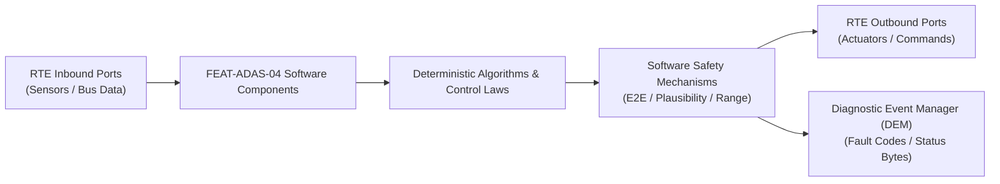

# Software Requirements Specification: Traffic Jam Pilot L3 Hands-Off (TJP)
**Feature ID:** `FEAT-ADAS-04`  
**Domain:** ADAS & Autonomous Driving  
**Target ASIL:** ASIL D  
**Compliance Standard:** ISO 26262:2018 (Part 6 - Software Development) / ASPICE PAM v3.1 (SWE.1, SWE.2)  
**Parent System Specification:** [`FEAT-ADAS-04_TJP_SysReq.md`](file:///c:/Workset/AntiGravityProjects/TestOptimisationExperiement/system_requirements/FEAT-ADAS-04_TJP_SysReq.md)  
**Global Master Specification:** [`spec.md`](file:///c:/Workset/AntiGravityProjects/TestOptimisationExperiement/spec.md)

---

## 1. Software Architecture & Component Structure

This document specifies the AUTOSAR Software Components (SWCs), periodic runnables, algorithmic laws, safety mechanisms, and data ports implementing `FEAT-ADAS-04` (Traffic Jam Pilot L3 Hands-Off (TJP)).

### AUTOSAR SWC Interaction Diagram

---

## 2. Detailed Software Requirements (SWR_REQ)
*(Multi-Software Requirement Partitioning derived from System Requirements)*

### `SWR-ADAS-04-01`: TJP ODD Multi-Layer Parameter Gatekeeper
- **Planned Release:** R100
- **ASIL Rating:** ASIL D
- **Parent System Requirement:** [`SYS-ADAS-04-01`](file:///c:/Workset/AntiGravityProjects/TestOptimisationExperiement/system_requirements/FEAT-ADAS-04_TJP_SysReq.md#sys-adas-04-01)
- **Allocated AUTOSAR SWC:** `TjpOddManager_SWC`
- **Execution Rate / Trigger:** 20 ms
- **Worst-Case Execution Time (WCET):** 1.2 ms
- **Software Activation Condition:** Cyclic 20 ms task.
- **Algorithmic Description / Logic:**
  > Evaluates boolean logic: ODD_Valid = (Road_Type == MOTORWAY) && (Median_Barrier == TRUE) && (Speed <= 60.0 km/h) && (Rain_Sensor < HEAVY) && (HD_Map_Confidence > 90%) && (No_Pedestrians_Detected).
- **Software Safety Mechanism:** Hysteresis on speed: Deactivates at 62.0 km/h; requires speed < 55.0 km/h to re-enter.
- **Failure Reaction & DEM Diagnostic Event:** Assert TOR_Trigger immediately upon any boolean condition turning FALSE.
- **Software Port Inputs:** `Nav_Road_Class, Speed_Kmph, Camera_Barrier_Detected, Rain_Rate_Mm_H`
- **Software Port Outputs:** `ODD_State_Bool, ODD_Violation_Bitmask`
- **Software Verification Criteria:** Test matrix testing every individual ODD boundary condition.
- **Traceability Link:** Traces upward to [`SYS-ADAS-04-01`](file:///c:/Workset/AntiGravityProjects/TestOptimisationExperiement/system_requirements/FEAT-ADAS-04_TJP_SysReq.md#sys-adas-04-01) and [`FEAT-ADAS-04`](file:///c:/Workset/AntiGravityProjects/TestOptimisationExperiement/spec.md).

### `SWR-ADAS-04-02`: Highway Infrastructure V2X & Traffic Density Ingestor
- **Planned Release:** R100
- **ASIL Rating:** ASIL B
- **Parent System Requirement:** [`SYS-ADAS-04-01`](file:///c:/Workset/AntiGravityProjects/TestOptimisationExperiement/system_requirements/FEAT-ADAS-04_TJP_SysReq.md#sys-adas-04-01)
- **Allocated AUTOSAR SWC:** `TjpTrafficDensity_SWC`
- **Execution Rate / Trigger:** 100 ms
- **Worst-Case Execution Time (WCET):** 0.8 ms
- **Software Activation Condition:** Cyclic 100 ms task.
- **Algorithmic Description / Logic:**
  > Calculates surrounding traffic density: Density = Count(Vehicles_within_100m) / 100m. Confirms jam conditions: Density >= 15 vehicles/100m and average traffic speed <= 45 km/h.
- **Software Safety Mechanism:** Rejects free-flow highway as invalid for TJP operation.
- **Failure Reaction & DEM Diagnostic Event:** Prompt takeover if traffic begins flowing freely (> 65 km/h).
- **Software Port Inputs:** `Surround_Radar_Target_List[64], V2X_Traffic_Speed_Broadcast`
- **Software Port Outputs:** `Traffic_Jam_Confirmed_Flag (boolean), Traffic_Average_Speed_Kmph`
- **Software Verification Criteria:** Traffic congestion simulation on SUMO traffic simulator.
- **Traceability Link:** Traces upward to [`SYS-ADAS-04-01`](file:///c:/Workset/AntiGravityProjects/TestOptimisationExperiement/system_requirements/FEAT-ADAS-04_TJP_SysReq.md#sys-adas-04-01) and [`FEAT-ADAS-04`](file:///c:/Workset/AntiGravityProjects/TestOptimisationExperiement/spec.md).

### `SWR-ADAS-04-03`: Heterogeneous Dual-SoC Command Cross-Voting Comparator
- **Planned Release:** R400
- **ASIL Rating:** ASIL D
- **Parent System Requirement:** [`SYS-ADAS-04-02`](file:///c:/Workset/AntiGravityProjects/TestOptimisationExperiement/system_requirements/FEAT-ADAS-04_TJP_SysReq.md#sys-adas-04-02)
- **Allocated AUTOSAR SWC:** `TjpVoter_SWC`
- **Execution Rate / Trigger:** 10 ms
- **Worst-Case Execution Time (WCET):** 0.4 ms
- **Software Activation Condition:** Executed in 100 Hz safety task.
- **Algorithmic Description / Logic:**
  > Compares Primary SoC trajectory command (a_1, delta_1) with Secondary SoC command (a_2, delta_2). If abs(a_1 - a_2) <= 0.25 m/s² and abs(delta_1 - delta_2) <= 0.15 deg, outputs average. If mismatch persists > 30 ms, isolates Primary SoC.
- **Software Safety Mechanism:** Independent hardware watchdog line to power-reset corrupted Primary SoC.
- **Failure Reaction & DEM Diagnostic Event:** Switch actuation authority to Secondary Safety MCU and initiate MRM.
- **Software Port Inputs:** `Primary_Accel_Cmd, Secondary_Accel_Cmd, Primary_Steer_Cmd, Secondary_Steer_Cmd`
- **Software Port Outputs:** `Voted_Accel_Cmd, Voted_Steer_Cmd, Core_Mismatch_Fault_Flag`
- **Software Verification Criteria:** Fault injection testing flipping bits in Primary SoC command buffers.
- **Traceability Link:** Traces upward to [`SYS-ADAS-04-02`](file:///c:/Workset/AntiGravityProjects/TestOptimisationExperiement/system_requirements/FEAT-ADAS-04_TJP_SysReq.md#sys-adas-04-02) and [`FEAT-ADAS-04`](file:///c:/Workset/AntiGravityProjects/TestOptimisationExperiement/spec.md).

### `SWR-ADAS-04-04`: Fail-Operational Secondary Controller Standby Watcher
- **Planned Release:** R400
- **ASIL Rating:** ASIL D
- **Parent System Requirement:** [`SYS-ADAS-04-02`](file:///c:/Workset/AntiGravityProjects/TestOptimisationExperiement/system_requirements/FEAT-ADAS-04_TJP_SysReq.md#sys-adas-04-02)
- **Allocated AUTOSAR SWC:** `TjpStandbyWatcher_SWC`
- **Execution Rate / Trigger:** 5 ms
- **Worst-Case Execution Time (WCET):** 0.3 ms
- **Software Activation Condition:** Cyclic 5 ms task on Secondary MCU.
- **Algorithmic Description / Logic:**
  > Maintains hot-standby shadow trajectory planner: Ingests raw radar and camera CAN streams independently. Verifies heartbeat pulse from Primary SoC every 10 ms.
- **Software Safety Mechanism:** Hardware timer timeout: If heartbeat missing for >= 15 ms, asserts Takeover_Bus_Control.
- **Failure Reaction & DEM Diagnostic Event:** Seize bus control and issue MRM deceleration command.
- **Software Port Inputs:** `Primary_Heartbeat_Line, Secondary_Sensor_Feed`
- **Software Port Outputs:** `Secondary_In_Control_Flag (boolean), Primary_SoC_Health_Status`
- **Software Verification Criteria:** Power cut simulation on Primary SoC during live HIL simulation.
- **Traceability Link:** Traces upward to [`SYS-ADAS-04-02`](file:///c:/Workset/AntiGravityProjects/TestOptimisationExperiement/system_requirements/FEAT-ADAS-04_TJP_SysReq.md#sys-adas-04-02) and [`FEAT-ADAS-04`](file:///c:/Workset/AntiGravityProjects/TestOptimisationExperiement/spec.md).

### `SWR-ADAS-04-05`: Low-Speed Model Predictive Control (MPC) Trajectory Optimizer
- **Planned Release:** R100
- **ASIL Rating:** ASIL D
- **Parent System Requirement:** [`SYS-ADAS-04-03`](file:///c:/Workset/AntiGravityProjects/TestOptimisationExperiement/system_requirements/FEAT-ADAS-04_TJP_SysReq.md#sys-adas-04-03)
- **Allocated AUTOSAR SWC:** `TjpMpcController_SWC`
- **Execution Rate / Trigger:** 20 ms
- **Worst-Case Execution Time (WCET):** 3.5 ms
- **Software Activation Condition:** Cyclic 20 ms optimization task.
- **Algorithmic Description / Logic:**
  > Solves quadratic programming MPC formulation over 3.0s horizon (N=15 steps): Minimizes J = sum(w_e*e_y^2 + w_psi*e_psi^2 + w_u*u^2 + w_du*Delta_u^2) subject to collision avoidance constraints with lead and cut-in vehicles.
- **Software Safety Mechanism:** Solver convergence check: If solver does not converge within 12 iterations, fallback to PID baseline.
- **Failure Reaction & DEM Diagnostic Event:** Fallback to PID trajectory follower upon QP solver timeout.
- **Software Port Inputs:** `Reference_Path_Waypoints[15], Lead_Vehicle_Predicted_States[15]`
- **Software Port Outputs:** `Optimal_Steering_Angle_Deg, Optimal_Longitudinal_Accel_Mps2`
- **Software Verification Criteria:** Optimization benchmark comparing tracking accuracy vs solver run time.
- **Traceability Link:** Traces upward to [`SYS-ADAS-04-03`](file:///c:/Workset/AntiGravityProjects/TestOptimisationExperiement/system_requirements/FEAT-ADAS-04_TJP_SysReq.md#sys-adas-04-03) and [`FEAT-ADAS-04`](file:///c:/Workset/AntiGravityProjects/TestOptimisationExperiement/spec.md).

### `SWR-ADAS-04-06`: Micro-Cut-In Space Cushion Speed Modulator
- **Planned Release:** R100
- **ASIL Rating:** ASIL D
- **Parent System Requirement:** [`SYS-ADAS-04-03`](file:///c:/Workset/AntiGravityProjects/TestOptimisationExperiement/system_requirements/FEAT-ADAS-04_TJP_SysReq.md#sys-adas-04-03)
- **Allocated AUTOSAR SWC:** `TjpSpaceCushion_SWC`
- **Execution Rate / Trigger:** 10 ms
- **Worst-Case Execution Time (WCET):** 0.6 ms
- **Software Activation Condition:** Active when adjacent vehicle edges closer.
- **Algorithmic Description / Logic:**
  > Detects vehicle in adjacent lane encroaching lane marker with lateral speed v_lat > 0.3 m/s: Proactively creates opening by smoothly increasing headway gap (-0.5 m/s²), avoiding harsh emergency braking when cut-in occurs.
- **Software Safety Mechanism:** Deceleration limited to -1.5 m/s² to preserve ride luxury.
- **Failure Reaction & DEM Diagnostic Event:** Escalate to AEB if adjacent vehicle cuts in violently (< 2 m distance).
- **Software Port Inputs:** `Adjacent_Vehicle_Track_Data, Lateral_Distance_To_Marker_M`
- **Software Port Outputs:** `Space_Cushion_Decel_Req_Mps2, Cut_In_Anticipated_Flag`
- **Software Verification Criteria:** Highway traffic merge simulation with aggressive cut-in vehicles.
- **Traceability Link:** Traces upward to [`SYS-ADAS-04-03`](file:///c:/Workset/AntiGravityProjects/TestOptimisationExperiement/system_requirements/FEAT-ADAS-04_TJP_SysReq.md#sys-adas-04-03) and [`FEAT-ADAS-04`](file:///c:/Workset/AntiGravityProjects/TestOptimisationExperiement/spec.md).

### `SWR-ADAS-04-07`: TOR 10-Second Acoustic & Visual Escalation Sequencer
- **Planned Release:** R100
- **ASIL Rating:** ASIL D
- **Parent System Requirement:** [`SYS-ADAS-04-04`](file:///c:/Workset/AntiGravityProjects/TestOptimisationExperiement/system_requirements/FEAT-ADAS-04_TJP_SysReq.md#sys-adas-04-04)
- **Allocated AUTOSAR SWC:** `TjpTorEscalator_SWC`
- **Execution Rate / Trigger:** 50 ms
- **Worst-Case Execution Time (WCET):** 0.4 ms
- **Software Activation Condition:** Active during takeover request.
- **Algorithmic Description / Logic:**
  > Tracks 10.0-second countdown timer: 0-4s: Visual flashing cluster prompt + 2 Hz chime; 4-7s: Red cluster fill + 4 Hz high-pitch chime + seat haptic vibration; 7-10s: Continuous siren + triple brake tap. If driver unbuckled or unresponsive at 10.0s, triggers MRM.
- **Software Safety Mechanism:** Driver interaction interrupt: Hands-on steering + eyes on road instantly transfers control to Level 2 / manual.
- **Failure Reaction & DEM Diagnostic Event:** Lockout TJP re-engagement for remainder of trip after MRM trigger.
- **Software Port Inputs:** `TOR_Active_Flag, Driver_Hands_On_Status, DMS_Gaze_Direction`
- **Software Port Outputs:** `Takeover_Remaining_Time_Sec, Chime_Pattern_Code, Haptic_Seat_Pattern`
- **Software Verification Criteria:** Driver in-the-loop simulator experiments verifying 10s takeover safety.
- **Traceability Link:** Traces upward to [`SYS-ADAS-04-04`](file:///c:/Workset/AntiGravityProjects/TestOptimisationExperiement/system_requirements/FEAT-ADAS-04_TJP_SysReq.md#sys-adas-04-04) and [`FEAT-ADAS-04`](file:///c:/Workset/AntiGravityProjects/TestOptimisationExperiement/spec.md).

### `SWR-ADAS-04-08`: Driver Gaze & Cognitive Readiness Verification Validator
- **Planned Release:** R100
- **ASIL Rating:** ASIL D
- **Parent System Requirement:** [`SYS-ADAS-04-04`](file:///c:/Workset/AntiGravityProjects/TestOptimisationExperiement/system_requirements/FEAT-ADAS-04_TJP_SysReq.md#sys-adas-04-04)
- **Allocated AUTOSAR SWC:** `TjpReadinessValidator_SWC`
- **Execution Rate / Trigger:** 20 ms
- **Worst-Case Execution Time (WCET):** 0.5 ms
- **Software Activation Condition:** Monitors driver readiness during TOR.
- **Algorithmic Description / Logic:**
  > Interrogates DMS camera: Verifies driver eyes are open (PERCLOS < 15%) and gaze vector points toward forward roadway for >= 1.0 second continuously before confirming manual takeover permit.
- **Software Safety Mechanism:** Prevents handing control to driver whose hands touch wheel while eyes are closed.
- **Failure Reaction & DEM Diagnostic Event:** Continue automated MRM if driver touches wheel but is unconscious.
- **Software Port Inputs:** `DMS_Eye_Open_Ratio, DMS_Gaze_Yaw_Deg, Capacitive_Rim_Hands_On_Flag`
- **Software Port Outputs:** `Driver_Cognitively_Ready_Flag (boolean), Handover_Permit_Granted`
- **Software Verification Criteria:** DMS simulated driver distraction and sleepiness evaluation.
- **Traceability Link:** Traces upward to [`SYS-ADAS-04-04`](file:///c:/Workset/AntiGravityProjects/TestOptimisationExperiement/system_requirements/FEAT-ADAS-04_TJP_SysReq.md#sys-adas-04-04) and [`FEAT-ADAS-04`](file:///c:/Workset/AntiGravityProjects/TestOptimisationExperiement/spec.md).

### `SWR-ADAS-04-09`: MRM In-Lane Smooth Deceleration Trajectory Profiler
- **Planned Release:** R200
- **ASIL Rating:** ASIL D
- **Parent System Requirement:** [`SYS-ADAS-04-05`](file:///c:/Workset/AntiGravityProjects/TestOptimisationExperiement/system_requirements/FEAT-ADAS-04_TJP_SysReq.md#sys-adas-04-05)
- **Allocated AUTOSAR SWC:** `TjpMrmDecelProfiler_SWC`
- **Execution Rate / Trigger:** 10 ms
- **Worst-Case Execution Time (WCET):** 0.5 ms
- **Software Activation Condition:** Triggered when TOR countdown reaches 0.0s.
- **Algorithmic Description / Logic:**
  > Ramps deceleration smoothly: a_mrm = -2.5 m/s² with jerk da/dt = -1.5 m/s³. Steers vehicle precisely within lane center until vehicle reaches standstill (v == 0.0 m/s). Clamps EPB park brake upon standstill.
- **Software Safety Mechanism:** Rear radar collision check: If following vehicle approaches at high closing speed, modulates decel down to -1.5 m/s² to prevent rear-end collision.
- **Failure Reaction & DEM Diagnostic Event:** Apply emergency braking (-6 m/s²) if obstacle detected ahead.
- **Software Port Inputs:** `Current_Vehicle_Speed_Mps, Rear_Radar_Closing_Speed_Mps`
- **Software Port Outputs:** `MRM_Target_Decel_Mps2, EPB_Clamping_Command (boolean)`
- **Software Verification Criteria:** Full vehicle track validation of MRM deceleration according to UNECE R157.
- **Traceability Link:** Traces upward to [`SYS-ADAS-04-05`](file:///c:/Workset/AntiGravityProjects/TestOptimisationExperiement/system_requirements/FEAT-ADAS-04_TJP_SysReq.md#sys-adas-04-05) and [`FEAT-ADAS-04`](file:///c:/Workset/AntiGravityProjects/TestOptimisationExperiement/spec.md).

### `SWR-ADAS-04-10`: Post-MRM Hazard Beacon, Door Unlock & eCall Coordinator
- **Planned Release:** R200
- **ASIL Rating:** ASIL D
- **Parent System Requirement:** [`SYS-ADAS-04-05`](file:///c:/Workset/AntiGravityProjects/TestOptimisationExperiement/system_requirements/FEAT-ADAS-04_TJP_SysReq.md#sys-adas-04-05)
- **Allocated AUTOSAR SWC:** `TjpPostMrmCoordinator_SWC`
- **Execution Rate / Trigger:** 50 ms
- **Worst-Case Execution Time (WCET):** 0.3 ms
- **Software Activation Condition:** Triggered upon MRM vehicle standstill.
- **Algorithmic Description / Logic:**
  > Executes safety lockdown: 1) Flashes hazard warning lamps; 2) Commands central locking to unlock all doors to allow first-responder access; 3) Interior cabin dome light ON; 4) Transmits emergency eCall with 'Unresponsive Driver MRM' payload.
- **Software Safety Mechanism:** Maintains low-voltage power bus alive to preserve hazard lamps and telematics call.
- **Failure Reaction & DEM Diagnostic Event:** Sound exterior vehicle horn pulses if telematics modem fails.
- **Software Port Inputs:** `Vehicle_Standstill_Confirmed_Flag, MRM_Execution_Complete_Flag`
- **Software Port Outputs:** `Hazard_Lights_Enable, Central_Lock_Unlock_Cmd, eCall_Trigger_MRM_Payload`
- **Software Verification Criteria:** End-to-end integration test from MRM stop to telematics emergency call dispatch.
- **Traceability Link:** Traces upward to [`SYS-ADAS-04-05`](file:///c:/Workset/AntiGravityProjects/TestOptimisationExperiement/system_requirements/FEAT-ADAS-04_TJP_SysReq.md#sys-adas-04-05) and [`FEAT-ADAS-04`](file:///c:/Workset/AntiGravityProjects/TestOptimisationExperiement/spec.md).

### `SWR-ADAS-04-11`: L3 ODD Boundary Dynamic Validator & Speed Envelope Gate - Dynamic Observer & Signal Filter
- **Planned Release:** R200
- **ASIL Rating:** ASIL D
- **Parent System Requirement:** [`SYS-ADAS-04-06`](file:///c:/Workset/AntiGravityProjects/TestOptimisationExperiement/system_requirements/FEAT-ADAS-04_TJP_SysReq.md#sys-adas-04-06)
- **Allocated AUTOSAR SWC:** `TjpOddValidator_SWC`
- **Execution Rate / Trigger:** 20 ms
- **Worst-Case Execution Time (WCET):** 0.3 ms
- **Software Activation Condition:** Executed cyclically every 20 ms.
- **Algorithmic Description / Logic:**
  > Executes signal plausibility filtering, calibration offsets, and discrete state estimation for L3 ODD Boundary Dynamic Validator & Speed Envelope Gate.
- **Software Safety Mechanism:** Range limit plausibility check and E2E alive sequence verification.
- **Failure Reaction & DEM Diagnostic Event:** Set default fallback output and report DEM_EVENT_FEAT_ADAS_04_ERR.
- **Software Port Inputs:** `Raw sensor ADC/SENT/SPI values and RTE bus inputs.`
- **Software Port Outputs:** `Filtered physical signals and validity status bitmasks.`
- **Software Verification Criteria:** Unit test and HiL software integration test.
- **Traceability Link:** Traces upward to [`SYS-ADAS-04-06`](file:///c:/Workset/AntiGravityProjects/TestOptimisationExperiement/system_requirements/FEAT-ADAS-04_TJP_SysReq.md#sys-adas-04-06) and [`FEAT-ADAS-04`](file:///c:/Workset/AntiGravityProjects/TestOptimisationExperiement/spec.md).

### `SWR-ADAS-04-12`: L3 ODD Boundary Dynamic Validator & Speed Envelope Gate - Closed-Loop Control Law & Actuator Dispatch
- **Planned Release:** R200
- **ASIL Rating:** ASIL D
- **Parent System Requirement:** [`SYS-ADAS-04-06`](file:///c:/Workset/AntiGravityProjects/TestOptimisationExperiement/system_requirements/FEAT-ADAS-04_TJP_SysReq.md#sys-adas-04-06)
- **Allocated AUTOSAR SWC:** `TjpOddValidator_SWC`
- **Execution Rate / Trigger:** 20 ms
- **Worst-Case Execution Time (WCET):** 0.4 ms
- **Software Activation Condition:** Executed cyclically every 20 ms.
- **Algorithmic Description / Logic:**
  > Evaluates deterministic closed-loop control law, rate limits, and dispatches commands for L3 ODD Boundary Dynamic Validator & Speed Envelope Gate.
- **Software Safety Mechanism:** Command saturation clamping and watchdog program flow monitoring.
- **Failure Reaction & DEM Diagnostic Event:** De-energize actuator output, apply safe fallback clamp, and latch DTC.
- **Software Port Inputs:** `Validated physical state signals from observer SWC.`
- **Software Port Outputs:** `Actuator PWM duty cycles, torque/pressure setpoints, and diagnostic flags.`
- **Software Verification Criteria:** Hardware dynamometer and HiL closed-loop regression test suite.
- **Traceability Link:** Traces upward to [`SYS-ADAS-04-06`](file:///c:/Workset/AntiGravityProjects/TestOptimisationExperiement/system_requirements/FEAT-ADAS-04_TJP_SysReq.md#sys-adas-04-06) and [`FEAT-ADAS-04`](file:///c:/Workset/AntiGravityProjects/TestOptimisationExperiement/spec.md).

### `SWR-ADAS-04-13`: Triple Sensor Perception Fusion (Dual Lidar, Camera, Radar) - Dynamic Observer & Signal Filter
- **Planned Release:** R500
- **ASIL Rating:** ASIL D
- **Parent System Requirement:** [`SYS-ADAS-04-07`](file:///c:/Workset/AntiGravityProjects/TestOptimisationExperiement/system_requirements/FEAT-ADAS-04_TJP_SysReq.md#sys-adas-04-07)
- **Allocated AUTOSAR SWC:** `TjpPerceptionFusion_SWC`
- **Execution Rate / Trigger:** 15 ms
- **Worst-Case Execution Time (WCET):** 0.3 ms
- **Software Activation Condition:** Executed cyclically every 15 ms.
- **Algorithmic Description / Logic:**
  > Executes signal plausibility filtering, calibration offsets, and discrete state estimation for Triple Sensor Perception Fusion (Dual Lidar, Camera, Radar).
- **Software Safety Mechanism:** Range limit plausibility check and E2E alive sequence verification.
- **Failure Reaction & DEM Diagnostic Event:** Set default fallback output and report DEM_EVENT_FEAT_ADAS_04_ERR.
- **Software Port Inputs:** `Raw sensor ADC/SENT/SPI values and RTE bus inputs.`
- **Software Port Outputs:** `Filtered physical signals and validity status bitmasks.`
- **Software Verification Criteria:** Unit test and HiL software integration test.
- **Traceability Link:** Traces upward to [`SYS-ADAS-04-07`](file:///c:/Workset/AntiGravityProjects/TestOptimisationExperiement/system_requirements/FEAT-ADAS-04_TJP_SysReq.md#sys-adas-04-07) and [`FEAT-ADAS-04`](file:///c:/Workset/AntiGravityProjects/TestOptimisationExperiement/spec.md).

### `SWR-ADAS-04-14`: Triple Sensor Perception Fusion (Dual Lidar, Camera, Radar) - Closed-Loop Control Law & Actuator Dispatch
- **Planned Release:** R500
- **ASIL Rating:** ASIL D
- **Parent System Requirement:** [`SYS-ADAS-04-07`](file:///c:/Workset/AntiGravityProjects/TestOptimisationExperiement/system_requirements/FEAT-ADAS-04_TJP_SysReq.md#sys-adas-04-07)
- **Allocated AUTOSAR SWC:** `TjpPerceptionFusion_SWC`
- **Execution Rate / Trigger:** 15 ms
- **Worst-Case Execution Time (WCET):** 0.4 ms
- **Software Activation Condition:** Executed cyclically every 15 ms.
- **Algorithmic Description / Logic:**
  > Evaluates deterministic closed-loop control law, rate limits, and dispatches commands for Triple Sensor Perception Fusion (Dual Lidar, Camera, Radar).
- **Software Safety Mechanism:** Command saturation clamping and watchdog program flow monitoring.
- **Failure Reaction & DEM Diagnostic Event:** De-energize actuator output, apply safe fallback clamp, and latch DTC.
- **Software Port Inputs:** `Validated physical state signals from observer SWC.`
- **Software Port Outputs:** `Actuator PWM duty cycles, torque/pressure setpoints, and diagnostic flags.`
- **Software Verification Criteria:** Hardware dynamometer and HiL closed-loop regression test suite.
- **Traceability Link:** Traces upward to [`SYS-ADAS-04-07`](file:///c:/Workset/AntiGravityProjects/TestOptimisationExperiement/system_requirements/FEAT-ADAS-04_TJP_SysReq.md#sys-adas-04-07) and [`FEAT-ADAS-04`](file:///c:/Workset/AntiGravityProjects/TestOptimisationExperiement/spec.md).

### `SWR-ADAS-04-15`: HD Map & GNSS RTK Decimeter-Level Localization Cross-Monitor - Dynamic Observer & Signal Filter
- **Planned Release:** R300
- **ASIL Rating:** ASIL D
- **Parent System Requirement:** [`SYS-ADAS-04-08`](file:///c:/Workset/AntiGravityProjects/TestOptimisationExperiement/system_requirements/FEAT-ADAS-04_TJP_SysReq.md#sys-adas-04-08)
- **Allocated AUTOSAR SWC:** `TjpMapLocalization_SWC`
- **Execution Rate / Trigger:** 20 ms
- **Worst-Case Execution Time (WCET):** 0.3 ms
- **Software Activation Condition:** Executed cyclically every 20 ms.
- **Algorithmic Description / Logic:**
  > Executes signal plausibility filtering, calibration offsets, and discrete state estimation for HD Map & GNSS RTK Decimeter-Level Localization Cross-Monitor.
- **Software Safety Mechanism:** Range limit plausibility check and E2E alive sequence verification.
- **Failure Reaction & DEM Diagnostic Event:** Set default fallback output and report DEM_EVENT_FEAT_ADAS_04_ERR.
- **Software Port Inputs:** `Raw sensor ADC/SENT/SPI values and RTE bus inputs.`
- **Software Port Outputs:** `Filtered physical signals and validity status bitmasks.`
- **Software Verification Criteria:** Unit test and HiL software integration test.
- **Traceability Link:** Traces upward to [`SYS-ADAS-04-08`](file:///c:/Workset/AntiGravityProjects/TestOptimisationExperiement/system_requirements/FEAT-ADAS-04_TJP_SysReq.md#sys-adas-04-08) and [`FEAT-ADAS-04`](file:///c:/Workset/AntiGravityProjects/TestOptimisationExperiement/spec.md).

### `SWR-ADAS-04-16`: HD Map & GNSS RTK Decimeter-Level Localization Cross-Monitor - Closed-Loop Control Law & Actuator Dispatch
- **Planned Release:** R300
- **ASIL Rating:** ASIL D
- **Parent System Requirement:** [`SYS-ADAS-04-08`](file:///c:/Workset/AntiGravityProjects/TestOptimisationExperiement/system_requirements/FEAT-ADAS-04_TJP_SysReq.md#sys-adas-04-08)
- **Allocated AUTOSAR SWC:** `TjpMapLocalization_SWC`
- **Execution Rate / Trigger:** 20 ms
- **Worst-Case Execution Time (WCET):** 0.4 ms
- **Software Activation Condition:** Executed cyclically every 20 ms.
- **Algorithmic Description / Logic:**
  > Evaluates deterministic closed-loop control law, rate limits, and dispatches commands for HD Map & GNSS RTK Decimeter-Level Localization Cross-Monitor.
- **Software Safety Mechanism:** Command saturation clamping and watchdog program flow monitoring.
- **Failure Reaction & DEM Diagnostic Event:** De-energize actuator output, apply safe fallback clamp, and latch DTC.
- **Software Port Inputs:** `Validated physical state signals from observer SWC.`
- **Software Port Outputs:** `Actuator PWM duty cycles, torque/pressure setpoints, and diagnostic flags.`
- **Software Verification Criteria:** Hardware dynamometer and HiL closed-loop regression test suite.
- **Traceability Link:** Traces upward to [`SYS-ADAS-04-08`](file:///c:/Workset/AntiGravityProjects/TestOptimisationExperiement/system_requirements/FEAT-ADAS-04_TJP_SysReq.md#sys-adas-04-08) and [`FEAT-ADAS-04`](file:///c:/Workset/AntiGravityProjects/TestOptimisationExperiement/spec.md).

### `SWR-ADAS-04-17`: Driver Availability Recognition & DMS Gaze Continuous Tracker - Dynamic Observer & Signal Filter
- **Planned Release:** R300
- **ASIL Rating:** ASIL D
- **Parent System Requirement:** [`SYS-ADAS-04-09`](file:///c:/Workset/AntiGravityProjects/TestOptimisationExperiement/system_requirements/FEAT-ADAS-04_TJP_SysReq.md#sys-adas-04-09)
- **Allocated AUTOSAR SWC:** `TjpDriverReadiness_SWC`
- **Execution Rate / Trigger:** 50 ms
- **Worst-Case Execution Time (WCET):** 0.3 ms
- **Software Activation Condition:** Executed cyclically every 50 ms.
- **Algorithmic Description / Logic:**
  > Executes signal plausibility filtering, calibration offsets, and discrete state estimation for Driver Availability Recognition & DMS Gaze Continuous Tracker.
- **Software Safety Mechanism:** Range limit plausibility check and E2E alive sequence verification.
- **Failure Reaction & DEM Diagnostic Event:** Set default fallback output and report DEM_EVENT_FEAT_ADAS_04_ERR.
- **Software Port Inputs:** `Raw sensor ADC/SENT/SPI values and RTE bus inputs.`
- **Software Port Outputs:** `Filtered physical signals and validity status bitmasks.`
- **Software Verification Criteria:** Unit test and HiL software integration test.
- **Traceability Link:** Traces upward to [`SYS-ADAS-04-09`](file:///c:/Workset/AntiGravityProjects/TestOptimisationExperiement/system_requirements/FEAT-ADAS-04_TJP_SysReq.md#sys-adas-04-09) and [`FEAT-ADAS-04`](file:///c:/Workset/AntiGravityProjects/TestOptimisationExperiement/spec.md).

### `SWR-ADAS-04-18`: Driver Availability Recognition & DMS Gaze Continuous Tracker - Closed-Loop Control Law & Actuator Dispatch
- **Planned Release:** R300
- **ASIL Rating:** ASIL D
- **Parent System Requirement:** [`SYS-ADAS-04-09`](file:///c:/Workset/AntiGravityProjects/TestOptimisationExperiement/system_requirements/FEAT-ADAS-04_TJP_SysReq.md#sys-adas-04-09)
- **Allocated AUTOSAR SWC:** `TjpDriverReadiness_SWC`
- **Execution Rate / Trigger:** 50 ms
- **Worst-Case Execution Time (WCET):** 0.4 ms
- **Software Activation Condition:** Executed cyclically every 50 ms.
- **Algorithmic Description / Logic:**
  > Evaluates deterministic closed-loop control law, rate limits, and dispatches commands for Driver Availability Recognition & DMS Gaze Continuous Tracker.
- **Software Safety Mechanism:** Command saturation clamping and watchdog program flow monitoring.
- **Failure Reaction & DEM Diagnostic Event:** De-energize actuator output, apply safe fallback clamp, and latch DTC.
- **Software Port Inputs:** `Validated physical state signals from observer SWC.`
- **Software Port Outputs:** `Actuator PWM duty cycles, torque/pressure setpoints, and diagnostic flags.`
- **Software Verification Criteria:** Hardware dynamometer and HiL closed-loop regression test suite.
- **Traceability Link:** Traces upward to [`SYS-ADAS-04-09`](file:///c:/Workset/AntiGravityProjects/TestOptimisationExperiement/system_requirements/FEAT-ADAS-04_TJP_SysReq.md#sys-adas-04-09) and [`FEAT-ADAS-04`](file:///c:/Workset/AntiGravityProjects/TestOptimisationExperiement/spec.md).

### `SWR-ADAS-04-19`: 10-Second Transition Demand (TD) Handover Sequence Governor - Dynamic Observer & Signal Filter
- **Planned Release:** R500
- **ASIL Rating:** ASIL D
- **Parent System Requirement:** [`SYS-ADAS-04-10`](file:///c:/Workset/AntiGravityProjects/TestOptimisationExperiement/system_requirements/FEAT-ADAS-04_TJP_SysReq.md#sys-adas-04-10)
- **Allocated AUTOSAR SWC:** `TjpTransitionManager_SWC`
- **Execution Rate / Trigger:** 50 ms
- **Worst-Case Execution Time (WCET):** 0.3 ms
- **Software Activation Condition:** Executed cyclically every 50 ms.
- **Algorithmic Description / Logic:**
  > Executes signal plausibility filtering, calibration offsets, and discrete state estimation for 10-Second Transition Demand (TD) Handover Sequence Governor.
- **Software Safety Mechanism:** Range limit plausibility check and E2E alive sequence verification.
- **Failure Reaction & DEM Diagnostic Event:** Set default fallback output and report DEM_EVENT_FEAT_ADAS_04_ERR.
- **Software Port Inputs:** `Raw sensor ADC/SENT/SPI values and RTE bus inputs.`
- **Software Port Outputs:** `Filtered physical signals and validity status bitmasks.`
- **Software Verification Criteria:** Unit test and HiL software integration test.
- **Traceability Link:** Traces upward to [`SYS-ADAS-04-10`](file:///c:/Workset/AntiGravityProjects/TestOptimisationExperiement/system_requirements/FEAT-ADAS-04_TJP_SysReq.md#sys-adas-04-10) and [`FEAT-ADAS-04`](file:///c:/Workset/AntiGravityProjects/TestOptimisationExperiement/spec.md).

### `SWR-ADAS-04-20`: 10-Second Transition Demand (TD) Handover Sequence Governor - Closed-Loop Control Law & Actuator Dispatch
- **Planned Release:** R500
- **ASIL Rating:** ASIL D
- **Parent System Requirement:** [`SYS-ADAS-04-10`](file:///c:/Workset/AntiGravityProjects/TestOptimisationExperiement/system_requirements/FEAT-ADAS-04_TJP_SysReq.md#sys-adas-04-10)
- **Allocated AUTOSAR SWC:** `TjpTransitionManager_SWC`
- **Execution Rate / Trigger:** 50 ms
- **Worst-Case Execution Time (WCET):** 0.4 ms
- **Software Activation Condition:** Executed cyclically every 50 ms.
- **Algorithmic Description / Logic:**
  > Evaluates deterministic closed-loop control law, rate limits, and dispatches commands for 10-Second Transition Demand (TD) Handover Sequence Governor.
- **Software Safety Mechanism:** Command saturation clamping and watchdog program flow monitoring.
- **Failure Reaction & DEM Diagnostic Event:** De-energize actuator output, apply safe fallback clamp, and latch DTC.
- **Software Port Inputs:** `Validated physical state signals from observer SWC.`
- **Software Port Outputs:** `Actuator PWM duty cycles, torque/pressure setpoints, and diagnostic flags.`
- **Software Verification Criteria:** Hardware dynamometer and HiL closed-loop regression test suite.
- **Traceability Link:** Traces upward to [`SYS-ADAS-04-10`](file:///c:/Workset/AntiGravityProjects/TestOptimisationExperiement/system_requirements/FEAT-ADAS-04_TJP_SysReq.md#sys-adas-04-10) and [`FEAT-ADAS-04`](file:///c:/Workset/AntiGravityProjects/TestOptimisationExperiement/spec.md).

### `SWR-ADAS-04-21`: Minimum Risk Maneuver (MRM) Safe-Stop Controlled Trajectory - Dynamic Observer & Signal Filter
- **Planned Release:** R400
- **ASIL Rating:** ASIL D
- **Parent System Requirement:** [`SYS-ADAS-04-11`](file:///c:/Workset/AntiGravityProjects/TestOptimisationExperiement/system_requirements/FEAT-ADAS-04_TJP_SysReq.md#sys-adas-04-11)
- **Allocated AUTOSAR SWC:** `TjpMrmController_SWC`
- **Execution Rate / Trigger:** 20 ms
- **Worst-Case Execution Time (WCET):** 0.3 ms
- **Software Activation Condition:** Executed cyclically every 20 ms.
- **Algorithmic Description / Logic:**
  > Executes signal plausibility filtering, calibration offsets, and discrete state estimation for Minimum Risk Maneuver (MRM) Safe-Stop Controlled Trajectory.
- **Software Safety Mechanism:** Range limit plausibility check and E2E alive sequence verification.
- **Failure Reaction & DEM Diagnostic Event:** Set default fallback output and report DEM_EVENT_FEAT_ADAS_04_ERR.
- **Software Port Inputs:** `Raw sensor ADC/SENT/SPI values and RTE bus inputs.`
- **Software Port Outputs:** `Filtered physical signals and validity status bitmasks.`
- **Software Verification Criteria:** Unit test and HiL software integration test.
- **Traceability Link:** Traces upward to [`SYS-ADAS-04-11`](file:///c:/Workset/AntiGravityProjects/TestOptimisationExperiement/system_requirements/FEAT-ADAS-04_TJP_SysReq.md#sys-adas-04-11) and [`FEAT-ADAS-04`](file:///c:/Workset/AntiGravityProjects/TestOptimisationExperiement/spec.md).

### `SWR-ADAS-04-22`: Minimum Risk Maneuver (MRM) Safe-Stop Controlled Trajectory - Closed-Loop Control Law & Actuator Dispatch
- **Planned Release:** R400
- **ASIL Rating:** ASIL D
- **Parent System Requirement:** [`SYS-ADAS-04-11`](file:///c:/Workset/AntiGravityProjects/TestOptimisationExperiement/system_requirements/FEAT-ADAS-04_TJP_SysReq.md#sys-adas-04-11)
- **Allocated AUTOSAR SWC:** `TjpMrmController_SWC`
- **Execution Rate / Trigger:** 20 ms
- **Worst-Case Execution Time (WCET):** 0.4 ms
- **Software Activation Condition:** Executed cyclically every 20 ms.
- **Algorithmic Description / Logic:**
  > Evaluates deterministic closed-loop control law, rate limits, and dispatches commands for Minimum Risk Maneuver (MRM) Safe-Stop Controlled Trajectory.
- **Software Safety Mechanism:** Command saturation clamping and watchdog program flow monitoring.
- **Failure Reaction & DEM Diagnostic Event:** De-energize actuator output, apply safe fallback clamp, and latch DTC.
- **Software Port Inputs:** `Validated physical state signals from observer SWC.`
- **Software Port Outputs:** `Actuator PWM duty cycles, torque/pressure setpoints, and diagnostic flags.`
- **Software Verification Criteria:** Hardware dynamometer and HiL closed-loop regression test suite.
- **Traceability Link:** Traces upward to [`SYS-ADAS-04-11`](file:///c:/Workset/AntiGravityProjects/TestOptimisationExperiement/system_requirements/FEAT-ADAS-04_TJP_SysReq.md#sys-adas-04-11) and [`FEAT-ADAS-04`](file:///c:/Workset/AntiGravityProjects/TestOptimisationExperiement/spec.md).

### `SWR-ADAS-04-23`: Automated Hazard Warning Flasher & E-Call Trigger Dispatcher - Dynamic Observer & Signal Filter
- **Planned Release:** R400
- **ASIL Rating:** ASIL B
- **Parent System Requirement:** [`SYS-ADAS-04-12`](file:///c:/Workset/AntiGravityProjects/TestOptimisationExperiement/system_requirements/FEAT-ADAS-04_TJP_SysReq.md#sys-adas-04-12)
- **Allocated AUTOSAR SWC:** `TjpEmergencyHmi_SWC`
- **Execution Rate / Trigger:** 50 ms
- **Worst-Case Execution Time (WCET):** 0.3 ms
- **Software Activation Condition:** Executed cyclically every 50 ms.
- **Algorithmic Description / Logic:**
  > Executes signal plausibility filtering, calibration offsets, and discrete state estimation for Automated Hazard Warning Flasher & E-Call Trigger Dispatcher.
- **Software Safety Mechanism:** Range limit plausibility check and E2E alive sequence verification.
- **Failure Reaction & DEM Diagnostic Event:** Set default fallback output and report DEM_EVENT_FEAT_ADAS_04_ERR.
- **Software Port Inputs:** `Raw sensor ADC/SENT/SPI values and RTE bus inputs.`
- **Software Port Outputs:** `Filtered physical signals and validity status bitmasks.`
- **Software Verification Criteria:** Unit test and HiL software integration test.
- **Traceability Link:** Traces upward to [`SYS-ADAS-04-12`](file:///c:/Workset/AntiGravityProjects/TestOptimisationExperiement/system_requirements/FEAT-ADAS-04_TJP_SysReq.md#sys-adas-04-12) and [`FEAT-ADAS-04`](file:///c:/Workset/AntiGravityProjects/TestOptimisationExperiement/spec.md).

### `SWR-ADAS-04-24`: Automated Hazard Warning Flasher & E-Call Trigger Dispatcher - Closed-Loop Control Law & Actuator Dispatch
- **Planned Release:** R400
- **ASIL Rating:** ASIL B
- **Parent System Requirement:** [`SYS-ADAS-04-12`](file:///c:/Workset/AntiGravityProjects/TestOptimisationExperiement/system_requirements/FEAT-ADAS-04_TJP_SysReq.md#sys-adas-04-12)
- **Allocated AUTOSAR SWC:** `TjpEmergencyHmi_SWC`
- **Execution Rate / Trigger:** 50 ms
- **Worst-Case Execution Time (WCET):** 0.4 ms
- **Software Activation Condition:** Executed cyclically every 50 ms.
- **Algorithmic Description / Logic:**
  > Evaluates deterministic closed-loop control law, rate limits, and dispatches commands for Automated Hazard Warning Flasher & E-Call Trigger Dispatcher.
- **Software Safety Mechanism:** Command saturation clamping and watchdog program flow monitoring.
- **Failure Reaction & DEM Diagnostic Event:** De-energize actuator output, apply safe fallback clamp, and latch DTC.
- **Software Port Inputs:** `Validated physical state signals from observer SWC.`
- **Software Port Outputs:** `Actuator PWM duty cycles, torque/pressure setpoints, and diagnostic flags.`
- **Software Verification Criteria:** Hardware dynamometer and HiL closed-loop regression test suite.
- **Traceability Link:** Traces upward to [`SYS-ADAS-04-12`](file:///c:/Workset/AntiGravityProjects/TestOptimisationExperiement/system_requirements/FEAT-ADAS-04_TJP_SysReq.md#sys-adas-04-12) and [`FEAT-ADAS-04`](file:///c:/Workset/AntiGravityProjects/TestOptimisationExperiement/spec.md).

### `SWR-ADAS-04-25`: Redundant Steering & Braking Communication Heartbeat Monitor - Dynamic Observer & Signal Filter
- **Planned Release:** R500
- **ASIL Rating:** ASIL D
- **Parent System Requirement:** [`SYS-ADAS-04-13`](file:///c:/Workset/AntiGravityProjects/TestOptimisationExperiement/system_requirements/FEAT-ADAS-04_TJP_SysReq.md#sys-adas-04-13)
- **Allocated AUTOSAR SWC:** `TjpActuatorHeartbeat_SWC`
- **Execution Rate / Trigger:** 5 ms
- **Worst-Case Execution Time (WCET):** 0.3 ms
- **Software Activation Condition:** Executed cyclically every 5 ms.
- **Algorithmic Description / Logic:**
  > Executes signal plausibility filtering, calibration offsets, and discrete state estimation for Redundant Steering & Braking Communication Heartbeat Monitor.
- **Software Safety Mechanism:** Range limit plausibility check and E2E alive sequence verification.
- **Failure Reaction & DEM Diagnostic Event:** Set default fallback output and report DEM_EVENT_FEAT_ADAS_04_ERR.
- **Software Port Inputs:** `Raw sensor ADC/SENT/SPI values and RTE bus inputs.`
- **Software Port Outputs:** `Filtered physical signals and validity status bitmasks.`
- **Software Verification Criteria:** Unit test and HiL software integration test.
- **Traceability Link:** Traces upward to [`SYS-ADAS-04-13`](file:///c:/Workset/AntiGravityProjects/TestOptimisationExperiement/system_requirements/FEAT-ADAS-04_TJP_SysReq.md#sys-adas-04-13) and [`FEAT-ADAS-04`](file:///c:/Workset/AntiGravityProjects/TestOptimisationExperiement/spec.md).

### `SWR-ADAS-04-26`: Redundant Steering & Braking Communication Heartbeat Monitor - Closed-Loop Control Law & Actuator Dispatch
- **Planned Release:** R500
- **ASIL Rating:** ASIL D
- **Parent System Requirement:** [`SYS-ADAS-04-13`](file:///c:/Workset/AntiGravityProjects/TestOptimisationExperiement/system_requirements/FEAT-ADAS-04_TJP_SysReq.md#sys-adas-04-13)
- **Allocated AUTOSAR SWC:** `TjpActuatorHeartbeat_SWC`
- **Execution Rate / Trigger:** 5 ms
- **Worst-Case Execution Time (WCET):** 0.4 ms
- **Software Activation Condition:** Executed cyclically every 5 ms.
- **Algorithmic Description / Logic:**
  > Evaluates deterministic closed-loop control law, rate limits, and dispatches commands for Redundant Steering & Braking Communication Heartbeat Monitor.
- **Software Safety Mechanism:** Command saturation clamping and watchdog program flow monitoring.
- **Failure Reaction & DEM Diagnostic Event:** De-energize actuator output, apply safe fallback clamp, and latch DTC.
- **Software Port Inputs:** `Validated physical state signals from observer SWC.`
- **Software Port Outputs:** `Actuator PWM duty cycles, torque/pressure setpoints, and diagnostic flags.`
- **Software Verification Criteria:** Hardware dynamometer and HiL closed-loop regression test suite.
- **Traceability Link:** Traces upward to [`SYS-ADAS-04-13`](file:///c:/Workset/AntiGravityProjects/TestOptimisationExperiement/system_requirements/FEAT-ADAS-04_TJP_SysReq.md#sys-adas-04-13) and [`FEAT-ADAS-04`](file:///c:/Workset/AntiGravityProjects/TestOptimisationExperiement/spec.md).

### `SWR-ADAS-04-27`: Event Data Recorder (EDR) Autonomous Control State Logger - Dynamic Observer & Signal Filter
- **Planned Release:** R500
- **ASIL Rating:** ASIL B
- **Parent System Requirement:** [`SYS-ADAS-04-14`](file:///c:/Workset/AntiGravityProjects/TestOptimisationExperiement/system_requirements/FEAT-ADAS-04_TJP_SysReq.md#sys-adas-04-14)
- **Allocated AUTOSAR SWC:** `TjpEdrLogger_SWC`
- **Execution Rate / Trigger:** 50 ms
- **Worst-Case Execution Time (WCET):** 0.3 ms
- **Software Activation Condition:** Executed cyclically every 50 ms.
- **Algorithmic Description / Logic:**
  > Executes signal plausibility filtering, calibration offsets, and discrete state estimation for Event Data Recorder (EDR) Autonomous Control State Logger.
- **Software Safety Mechanism:** Range limit plausibility check and E2E alive sequence verification.
- **Failure Reaction & DEM Diagnostic Event:** Set default fallback output and report DEM_EVENT_FEAT_ADAS_04_ERR.
- **Software Port Inputs:** `Raw sensor ADC/SENT/SPI values and RTE bus inputs.`
- **Software Port Outputs:** `Filtered physical signals and validity status bitmasks.`
- **Software Verification Criteria:** Unit test and HiL software integration test.
- **Traceability Link:** Traces upward to [`SYS-ADAS-04-14`](file:///c:/Workset/AntiGravityProjects/TestOptimisationExperiement/system_requirements/FEAT-ADAS-04_TJP_SysReq.md#sys-adas-04-14) and [`FEAT-ADAS-04`](file:///c:/Workset/AntiGravityProjects/TestOptimisationExperiement/spec.md).

### `SWR-ADAS-04-28`: Event Data Recorder (EDR) Autonomous Control State Logger - Closed-Loop Control Law & Actuator Dispatch
- **Planned Release:** R500
- **ASIL Rating:** ASIL B
- **Parent System Requirement:** [`SYS-ADAS-04-14`](file:///c:/Workset/AntiGravityProjects/TestOptimisationExperiement/system_requirements/FEAT-ADAS-04_TJP_SysReq.md#sys-adas-04-14)
- **Allocated AUTOSAR SWC:** `TjpEdrLogger_SWC`
- **Execution Rate / Trigger:** 50 ms
- **Worst-Case Execution Time (WCET):** 0.4 ms
- **Software Activation Condition:** Executed cyclically every 50 ms.
- **Algorithmic Description / Logic:**
  > Evaluates deterministic closed-loop control law, rate limits, and dispatches commands for Event Data Recorder (EDR) Autonomous Control State Logger.
- **Software Safety Mechanism:** Command saturation clamping and watchdog program flow monitoring.
- **Failure Reaction & DEM Diagnostic Event:** De-energize actuator output, apply safe fallback clamp, and latch DTC.
- **Software Port Inputs:** `Validated physical state signals from observer SWC.`
- **Software Port Outputs:** `Actuator PWM duty cycles, torque/pressure setpoints, and diagnostic flags.`
- **Software Verification Criteria:** Hardware dynamometer and HiL closed-loop regression test suite.
- **Traceability Link:** Traces upward to [`SYS-ADAS-04-14`](file:///c:/Workset/AntiGravityProjects/TestOptimisationExperiement/system_requirements/FEAT-ADAS-04_TJP_SysReq.md#sys-adas-04-14) and [`FEAT-ADAS-04`](file:///c:/Workset/AntiGravityProjects/TestOptimisationExperiement/spec.md).

### `SWR-ADAS-04-29`: DEM Level 3 Operational Diagnostics & Hardware Failure Latching - Dynamic Observer & Signal Filter
- **Planned Release:** R500
- **ASIL Rating:** ASIL D
- **Parent System Requirement:** [`SYS-ADAS-04-15`](file:///c:/Workset/AntiGravityProjects/TestOptimisationExperiement/system_requirements/FEAT-ADAS-04_TJP_SysReq.md#sys-adas-04-15)
- **Allocated AUTOSAR SWC:** `TjpDemSupervisor_SWC`
- **Execution Rate / Trigger:** 20 ms
- **Worst-Case Execution Time (WCET):** 0.3 ms
- **Software Activation Condition:** Executed cyclically every 20 ms.
- **Algorithmic Description / Logic:**
  > Executes signal plausibility filtering, calibration offsets, and discrete state estimation for DEM Level 3 Operational Diagnostics & Hardware Failure Latching.
- **Software Safety Mechanism:** Range limit plausibility check and E2E alive sequence verification.
- **Failure Reaction & DEM Diagnostic Event:** Set default fallback output and report DEM_EVENT_FEAT_ADAS_04_ERR.
- **Software Port Inputs:** `Raw sensor ADC/SENT/SPI values and RTE bus inputs.`
- **Software Port Outputs:** `Filtered physical signals and validity status bitmasks.`
- **Software Verification Criteria:** Unit test and HiL software integration test.
- **Traceability Link:** Traces upward to [`SYS-ADAS-04-15`](file:///c:/Workset/AntiGravityProjects/TestOptimisationExperiement/system_requirements/FEAT-ADAS-04_TJP_SysReq.md#sys-adas-04-15) and [`FEAT-ADAS-04`](file:///c:/Workset/AntiGravityProjects/TestOptimisationExperiement/spec.md).

### `SWR-ADAS-04-30`: DEM Level 3 Operational Diagnostics & Hardware Failure Latching - Closed-Loop Control Law & Actuator Dispatch
- **Planned Release:** R500
- **ASIL Rating:** ASIL D
- **Parent System Requirement:** [`SYS-ADAS-04-15`](file:///c:/Workset/AntiGravityProjects/TestOptimisationExperiement/system_requirements/FEAT-ADAS-04_TJP_SysReq.md#sys-adas-04-15)
- **Allocated AUTOSAR SWC:** `TjpDemSupervisor_SWC`
- **Execution Rate / Trigger:** 20 ms
- **Worst-Case Execution Time (WCET):** 0.4 ms
- **Software Activation Condition:** Executed cyclically every 20 ms.
- **Algorithmic Description / Logic:**
  > Evaluates deterministic closed-loop control law, rate limits, and dispatches commands for DEM Level 3 Operational Diagnostics & Hardware Failure Latching.
- **Software Safety Mechanism:** Command saturation clamping and watchdog program flow monitoring.
- **Failure Reaction & DEM Diagnostic Event:** De-energize actuator output, apply safe fallback clamp, and latch DTC.
- **Software Port Inputs:** `Validated physical state signals from observer SWC.`
- **Software Port Outputs:** `Actuator PWM duty cycles, torque/pressure setpoints, and diagnostic flags.`
- **Software Verification Criteria:** Hardware dynamometer and HiL closed-loop regression test suite.
- **Traceability Link:** Traces upward to [`SYS-ADAS-04-15`](file:///c:/Workset/AntiGravityProjects/TestOptimisationExperiement/system_requirements/FEAT-ADAS-04_TJP_SysReq.md#sys-adas-04-15) and [`FEAT-ADAS-04`](file:///c:/Workset/AntiGravityProjects/TestOptimisationExperiement/spec.md).

---

## 3. Software-to-System Backward Traceability Matrix

| Software Requirement ID | Planned Release | Allocated SWC | Execution Rate | Upstream System Req | Verification Method |
| :--- | :---: | :--- | :--- | :--- | :--- |
| `SWR-ADAS-04-01` | **`R100`** | `TjpOddManager_SWC` | 20 ms | [`SYS-ADAS-04-01`](file:///c:/Workset/AntiGravityProjects/TestOptimisationExperiement/system_requirements/FEAT-ADAS-04_TJP_SysReq.md#sys-adas-04-01) | Test matrix testing every individual ODD boundary condition. |
| `SWR-ADAS-04-02` | **`R100`** | `TjpTrafficDensity_SWC` | 100 ms | [`SYS-ADAS-04-01`](file:///c:/Workset/AntiGravityProjects/TestOptimisationExperiement/system_requirements/FEAT-ADAS-04_TJP_SysReq.md#sys-adas-04-01) | Traffic congestion simulation on SUMO traffic simulator. |
| `SWR-ADAS-04-03` | **`R400`** | `TjpVoter_SWC` | 10 ms | [`SYS-ADAS-04-02`](file:///c:/Workset/AntiGravityProjects/TestOptimisationExperiement/system_requirements/FEAT-ADAS-04_TJP_SysReq.md#sys-adas-04-02) | Fault injection testing flipping bits in Primary SoC command buffers. |
| `SWR-ADAS-04-04` | **`R400`** | `TjpStandbyWatcher_SWC` | 5 ms | [`SYS-ADAS-04-02`](file:///c:/Workset/AntiGravityProjects/TestOptimisationExperiement/system_requirements/FEAT-ADAS-04_TJP_SysReq.md#sys-adas-04-02) | Power cut simulation on Primary SoC during live HIL simulation. |
| `SWR-ADAS-04-05` | **`R100`** | `TjpMpcController_SWC` | 20 ms | [`SYS-ADAS-04-03`](file:///c:/Workset/AntiGravityProjects/TestOptimisationExperiement/system_requirements/FEAT-ADAS-04_TJP_SysReq.md#sys-adas-04-03) | Optimization benchmark comparing tracking accuracy vs solver run time. |
| `SWR-ADAS-04-06` | **`R100`** | `TjpSpaceCushion_SWC` | 10 ms | [`SYS-ADAS-04-03`](file:///c:/Workset/AntiGravityProjects/TestOptimisationExperiement/system_requirements/FEAT-ADAS-04_TJP_SysReq.md#sys-adas-04-03) | Highway traffic merge simulation with aggressive cut-in vehicles. |
| `SWR-ADAS-04-07` | **`R100`** | `TjpTorEscalator_SWC` | 50 ms | [`SYS-ADAS-04-04`](file:///c:/Workset/AntiGravityProjects/TestOptimisationExperiement/system_requirements/FEAT-ADAS-04_TJP_SysReq.md#sys-adas-04-04) | Driver in-the-loop simulator experiments verifying 10s takeover safety. |
| `SWR-ADAS-04-08` | **`R100`** | `TjpReadinessValidator_SWC` | 20 ms | [`SYS-ADAS-04-04`](file:///c:/Workset/AntiGravityProjects/TestOptimisationExperiement/system_requirements/FEAT-ADAS-04_TJP_SysReq.md#sys-adas-04-04) | DMS simulated driver distraction and sleepiness evaluation. |
| `SWR-ADAS-04-09` | **`R200`** | `TjpMrmDecelProfiler_SWC` | 10 ms | [`SYS-ADAS-04-05`](file:///c:/Workset/AntiGravityProjects/TestOptimisationExperiement/system_requirements/FEAT-ADAS-04_TJP_SysReq.md#sys-adas-04-05) | Full vehicle track validation of MRM deceleration according to UNECE R157. |
| `SWR-ADAS-04-10` | **`R200`** | `TjpPostMrmCoordinator_SWC` | 50 ms | [`SYS-ADAS-04-05`](file:///c:/Workset/AntiGravityProjects/TestOptimisationExperiement/system_requirements/FEAT-ADAS-04_TJP_SysReq.md#sys-adas-04-05) | End-to-end integration test from MRM stop to telematics emergency call dispatch. |
| `SWR-ADAS-04-11` | **`R200`** | `TjpOddValidator_SWC` | 20 ms | [`SYS-ADAS-04-06`](file:///c:/Workset/AntiGravityProjects/TestOptimisationExperiement/system_requirements/FEAT-ADAS-04_TJP_SysReq.md#sys-adas-04-06) | Unit test and HiL software integration test. |
| `SWR-ADAS-04-12` | **`R200`** | `TjpOddValidator_SWC` | 20 ms | [`SYS-ADAS-04-06`](file:///c:/Workset/AntiGravityProjects/TestOptimisationExperiement/system_requirements/FEAT-ADAS-04_TJP_SysReq.md#sys-adas-04-06) | Hardware dynamometer and HiL closed-loop regression test suite. |
| `SWR-ADAS-04-13` | **`R500`** | `TjpPerceptionFusion_SWC` | 15 ms | [`SYS-ADAS-04-07`](file:///c:/Workset/AntiGravityProjects/TestOptimisationExperiement/system_requirements/FEAT-ADAS-04_TJP_SysReq.md#sys-adas-04-07) | Unit test and HiL software integration test. |
| `SWR-ADAS-04-14` | **`R500`** | `TjpPerceptionFusion_SWC` | 15 ms | [`SYS-ADAS-04-07`](file:///c:/Workset/AntiGravityProjects/TestOptimisationExperiement/system_requirements/FEAT-ADAS-04_TJP_SysReq.md#sys-adas-04-07) | Hardware dynamometer and HiL closed-loop regression test suite. |
| `SWR-ADAS-04-15` | **`R300`** | `TjpMapLocalization_SWC` | 20 ms | [`SYS-ADAS-04-08`](file:///c:/Workset/AntiGravityProjects/TestOptimisationExperiement/system_requirements/FEAT-ADAS-04_TJP_SysReq.md#sys-adas-04-08) | Unit test and HiL software integration test. |
| `SWR-ADAS-04-16` | **`R300`** | `TjpMapLocalization_SWC` | 20 ms | [`SYS-ADAS-04-08`](file:///c:/Workset/AntiGravityProjects/TestOptimisationExperiement/system_requirements/FEAT-ADAS-04_TJP_SysReq.md#sys-adas-04-08) | Hardware dynamometer and HiL closed-loop regression test suite. |
| `SWR-ADAS-04-17` | **`R300`** | `TjpDriverReadiness_SWC` | 50 ms | [`SYS-ADAS-04-09`](file:///c:/Workset/AntiGravityProjects/TestOptimisationExperiement/system_requirements/FEAT-ADAS-04_TJP_SysReq.md#sys-adas-04-09) | Unit test and HiL software integration test. |
| `SWR-ADAS-04-18` | **`R300`** | `TjpDriverReadiness_SWC` | 50 ms | [`SYS-ADAS-04-09`](file:///c:/Workset/AntiGravityProjects/TestOptimisationExperiement/system_requirements/FEAT-ADAS-04_TJP_SysReq.md#sys-adas-04-09) | Hardware dynamometer and HiL closed-loop regression test suite. |
| `SWR-ADAS-04-19` | **`R500`** | `TjpTransitionManager_SWC` | 50 ms | [`SYS-ADAS-04-10`](file:///c:/Workset/AntiGravityProjects/TestOptimisationExperiement/system_requirements/FEAT-ADAS-04_TJP_SysReq.md#sys-adas-04-10) | Unit test and HiL software integration test. |
| `SWR-ADAS-04-20` | **`R500`** | `TjpTransitionManager_SWC` | 50 ms | [`SYS-ADAS-04-10`](file:///c:/Workset/AntiGravityProjects/TestOptimisationExperiement/system_requirements/FEAT-ADAS-04_TJP_SysReq.md#sys-adas-04-10) | Hardware dynamometer and HiL closed-loop regression test suite. |
| `SWR-ADAS-04-21` | **`R400`** | `TjpMrmController_SWC` | 20 ms | [`SYS-ADAS-04-11`](file:///c:/Workset/AntiGravityProjects/TestOptimisationExperiement/system_requirements/FEAT-ADAS-04_TJP_SysReq.md#sys-adas-04-11) | Unit test and HiL software integration test. |
| `SWR-ADAS-04-22` | **`R400`** | `TjpMrmController_SWC` | 20 ms | [`SYS-ADAS-04-11`](file:///c:/Workset/AntiGravityProjects/TestOptimisationExperiement/system_requirements/FEAT-ADAS-04_TJP_SysReq.md#sys-adas-04-11) | Hardware dynamometer and HiL closed-loop regression test suite. |
| `SWR-ADAS-04-23` | **`R400`** | `TjpEmergencyHmi_SWC` | 50 ms | [`SYS-ADAS-04-12`](file:///c:/Workset/AntiGravityProjects/TestOptimisationExperiement/system_requirements/FEAT-ADAS-04_TJP_SysReq.md#sys-adas-04-12) | Unit test and HiL software integration test. |
| `SWR-ADAS-04-24` | **`R400`** | `TjpEmergencyHmi_SWC` | 50 ms | [`SYS-ADAS-04-12`](file:///c:/Workset/AntiGravityProjects/TestOptimisationExperiement/system_requirements/FEAT-ADAS-04_TJP_SysReq.md#sys-adas-04-12) | Hardware dynamometer and HiL closed-loop regression test suite. |
| `SWR-ADAS-04-25` | **`R500`** | `TjpActuatorHeartbeat_SWC` | 5 ms | [`SYS-ADAS-04-13`](file:///c:/Workset/AntiGravityProjects/TestOptimisationExperiement/system_requirements/FEAT-ADAS-04_TJP_SysReq.md#sys-adas-04-13) | Unit test and HiL software integration test. |
| `SWR-ADAS-04-26` | **`R500`** | `TjpActuatorHeartbeat_SWC` | 5 ms | [`SYS-ADAS-04-13`](file:///c:/Workset/AntiGravityProjects/TestOptimisationExperiement/system_requirements/FEAT-ADAS-04_TJP_SysReq.md#sys-adas-04-13) | Hardware dynamometer and HiL closed-loop regression test suite. |
| `SWR-ADAS-04-27` | **`R500`** | `TjpEdrLogger_SWC` | 50 ms | [`SYS-ADAS-04-14`](file:///c:/Workset/AntiGravityProjects/TestOptimisationExperiement/system_requirements/FEAT-ADAS-04_TJP_SysReq.md#sys-adas-04-14) | Unit test and HiL software integration test. |
| `SWR-ADAS-04-28` | **`R500`** | `TjpEdrLogger_SWC` | 50 ms | [`SYS-ADAS-04-14`](file:///c:/Workset/AntiGravityProjects/TestOptimisationExperiement/system_requirements/FEAT-ADAS-04_TJP_SysReq.md#sys-adas-04-14) | Hardware dynamometer and HiL closed-loop regression test suite. |
| `SWR-ADAS-04-29` | **`R500`** | `TjpDemSupervisor_SWC` | 20 ms | [`SYS-ADAS-04-15`](file:///c:/Workset/AntiGravityProjects/TestOptimisationExperiement/system_requirements/FEAT-ADAS-04_TJP_SysReq.md#sys-adas-04-15) | Unit test and HiL software integration test. |
| `SWR-ADAS-04-30` | **`R500`** | `TjpDemSupervisor_SWC` | 20 ms | [`SYS-ADAS-04-15`](file:///c:/Workset/AntiGravityProjects/TestOptimisationExperiement/system_requirements/FEAT-ADAS-04_TJP_SysReq.md#sys-adas-04-15) | Hardware dynamometer and HiL closed-loop regression test suite. |

- **Parent System Specification Document:** [`FEAT-ADAS-04_TJP_SysReq.md`](file:///c:/Workset/AntiGravityProjects/TestOptimisationExperiement/system_requirements/FEAT-ADAS-04_TJP_SysReq.md)
- **Master Automotive Specification:** [`spec.md`](file:///c:/Workset/AntiGravityProjects/TestOptimisationExperiement/spec.md)
