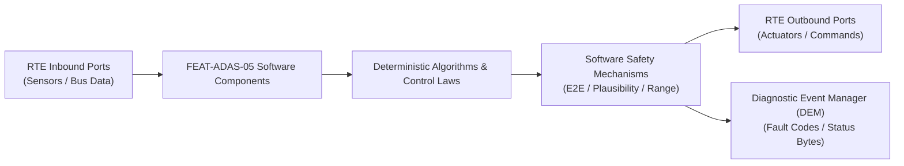

# Software Requirements Specification: Highway Pilot & Navigate on Autopilot (HWP-NOA)
**Feature ID:** `FEAT-ADAS-05`  
**Domain:** ADAS & Autonomous Driving  
**Target ASIL:** ASIL D  
**Compliance Standard:** ISO 26262:2018 (Part 6 - Software Development) / ASPICE PAM v3.1 (SWE.1, SWE.2)  
**Parent System Specification:** [`FEAT-ADAS-05_HWP_SysReq.md`](file:///c:/Workset/AntiGravityProjects/TestOptimisationExperiement/system_requirements/FEAT-ADAS-05_HWP_SysReq.md)  
**Global Master Specification:** [`spec.md`](file:///c:/Workset/AntiGravityProjects/TestOptimisationExperiement/spec.md)

---

## 1. Software Architecture & Component Structure

This document specifies the AUTOSAR Software Components (SWCs), periodic runnables, algorithmic laws, safety mechanisms, and data ports implementing `FEAT-ADAS-05` (Highway Pilot & Navigate on Autopilot (HWP-NOA)).

### AUTOSAR SWC Interaction Diagram

---

## 2. Detailed Software Requirements (SWR_REQ)
*(Multi-Software Requirement Partitioning derived from System Requirements)*

### `SWR-ADAS-05-01`: Multi-Constellation GNSS-RTK Carrier-Phase Ambiguity Resolver
- **Planned Release:** R100
- **ASIL Rating:** ASIL D
- **Parent System Requirement:** [`SYS-ADAS-05-01`](file:///c:/Workset/AntiGravityProjects/TestOptimisationExperiement/system_requirements/FEAT-ADAS-05_HWP_SysReq.md#sys-adas-05-01)
- **Allocated AUTOSAR SWC:** `HwpLocalization_SWC`
- **Execution Rate / Trigger:** 20 ms
- **Worst-Case Execution Time (WCET):** 1.8 ms
- **Software Activation Condition:** Executed in 50 Hz cyclic task.
- **Algorithmic Description / Logic:**
  > Implements LAMBDA integer carrier-phase ambiguity resolution on GPS L1/L5 and Galileo E1/E5a signals. Fuses with wheel odometry and IMU via 15-state Error-State Kalman Filter (ESKF).
- **Software Safety Mechanism:** Horizontal Protection Level (HPL) verification: If HPL > 0.3 m, flags Localization_Degraded.
- **Failure Reaction & DEM Diagnostic Event:** Switch to dead-reckoning tunnel navigation mode.
- **Software Port Inputs:** `Raw_GNSS_Observations, RTK_Correction_Data, Wheel_Speed_Ticks, IMU_Delta_V`
- **Software Port Outputs:** `Ego_Position_UTM_X_Y_Z, Ego_Attitude_Euler_Rad, HPL_Radius_Meters`
- **Software Verification Criteria:** Geodetic survey monument comparison test.
- **Traceability Link:** Traces upward to [`SYS-ADAS-05-01`](file:///c:/Workset/AntiGravityProjects/TestOptimisationExperiement/system_requirements/FEAT-ADAS-05_HWP_SysReq.md#sys-adas-05-01) and [`FEAT-ADAS-05`](file:///c:/Workset/AntiGravityProjects/TestOptimisationExperiement/spec.md).

### `SWR-ADAS-05-02`: Visual Landmark HD Map Semantic Feature Matcher
- **Planned Release:** R100
- **ASIL Rating:** ASIL D
- **Parent System Requirement:** [`SYS-ADAS-05-01`](file:///c:/Workset/AntiGravityProjects/TestOptimisationExperiement/system_requirements/FEAT-ADAS-05_HWP_SysReq.md#sys-adas-05-01)
- **Allocated AUTOSAR SWC:** `HwpMapMatcher_SWC`
- **Execution Rate / Trigger:** 50 ms
- **Worst-Case Execution Time (WCET):** 2.2 ms
- **Software Activation Condition:** Cyclic 50 ms task.
- **Algorithmic Description / Logic:**
  > Extracts camera visual features (overhead gantry poles, lane boundary splines, painted arrows). Matches against HD vector tile using Iterative Closest Point (ICP), resolving along-track and cross-track localization error to < 5 cm.
- **Software Safety Mechanism:** Map version CRC checksum validation against cloud fleet signature.
- **Failure Reaction & DEM Diagnostic Event:** Reject map matching if visual feature correspondence < 4 landmarks.
- **Software Port Inputs:** `Camera_Visual_Objects[16], HD_Map_Vector_Data, Ego_Position_UTM`
- **Software Port Outputs:** `Map_Matched_Pose_Correction, Lane_Index_Current`
- **Software Verification Criteria:** Highway localization repeatability testing over repeat drive cycles.
- **Traceability Link:** Traces upward to [`SYS-ADAS-05-01`](file:///c:/Workset/AntiGravityProjects/TestOptimisationExperiement/system_requirements/FEAT-ADAS-05_HWP_SysReq.md#sys-adas-05-01) and [`FEAT-ADAS-05`](file:///c:/Workset/AntiGravityProjects/TestOptimisationExperiement/spec.md).

### `SWR-ADAS-05-03`: Quintic Polynomial Lane Change Trajectory Generator
- **Planned Release:** R100
- **ASIL Rating:** ASIL D
- **Parent System Requirement:** [`SYS-ADAS-05-02`](file:///c:/Workset/AntiGravityProjects/TestOptimisationExperiement/system_requirements/FEAT-ADAS-05_HWP_SysReq.md#sys-adas-05-02)
- **Allocated AUTOSAR SWC:** `HwpAlcTrajectory_SWC`
- **Execution Rate / Trigger:** 20 ms
- **Worst-Case Execution Time (WCET):** 1.1 ms
- **Software Activation Condition:** Active upon ALC trigger.
- **Algorithmic Description / Logic:**
  > Synthesizes 5th-order jerk-optimal polynomial: y(t) = a0 + a1*t + a2*t^2 + a3*t^3 + a4*t^4 + a5*t^5, satisfying boundary conditions (y(0)=0, y(T)=W_lane, dy/dt(0)=dy/dt(T)=0, d2y/dt2(0)=d2y/dt2(T)=0). Computes optimal duration T in [4.0, 6.0]s.
- **Software Safety Mechanism:** Lateral acceleration bound: Clamps maximum lateral acceleration to <= 1.2 m/s².
- **Failure Reaction & DEM Diagnostic Event:** Aborts trajectory if target lane gap decreases during maneuver.
- **Software Port Inputs:** `Origin_Lane_Y, Target_Lane_Y, Vehicle_Velocity_Mps, Gap_Safety_Margin_M`
- **Software Port Outputs:** `ALC_Waypoint_Stream[20], Maneuver_Duration_T_Sec`
- **Software Verification Criteria:** Comfort and dynamic stability simulation on highway lane changes.
- **Traceability Link:** Traces upward to [`SYS-ADAS-05-02`](file:///c:/Workset/AntiGravityProjects/TestOptimisationExperiement/system_requirements/FEAT-ADAS-05_HWP_SysReq.md#sys-adas-05-02) and [`FEAT-ADAS-05`](file:///c:/Workset/AntiGravityProjects/TestOptimisationExperiement/spec.md).

### `SWR-ADAS-05-04`: Surround Radar Gap Safety Checker & Blinker Automator
- **Planned Release:** R100
- **ASIL Rating:** ASIL D
- **Parent System Requirement:** [`SYS-ADAS-05-02`](file:///c:/Workset/AntiGravityProjects/TestOptimisationExperiement/system_requirements/FEAT-ADAS-05_HWP_SysReq.md#sys-adas-05-02)
- **Allocated AUTOSAR SWC:** `HwpAlcSupervisor_SWC`
- **Execution Rate / Trigger:** 10 ms
- **Worst-Case Execution Time (WCET):** 0.6 ms
- **Software Activation Condition:** Continuous supervision during ALC.
- **Algorithmic Description / Logic:**
  > Monitors side and rear corner radars: Confirms Time-to-Collision of approaching vehicle in target lane TTC_rear > 5.0 seconds. Engages turn signal indicator 1.0 second prior to lateral lane boundary crossing.
- **Software Safety Mechanism:** Continuous blind spot clearance monitoring during entire 5-second lateral motion.
- **Failure Reaction & DEM Diagnostic Event:** Immediately steer back to origin lane if approaching vehicle accelerates aggressively.
- **Software Port Inputs:** `Side_Radar_Track_Array[8], Target_Lane_Rear_Speed_Mps, BCM_Blinker_Status`
- **Software Port Outputs:** `ALC_Permit_Continuous_Flag, BCM_Turn_Signal_Cmd`
- **Software Verification Criteria:** Automated scenario testing with aggressive trailing vehicles.
- **Traceability Link:** Traces upward to [`SYS-ADAS-05-02`](file:///c:/Workset/AntiGravityProjects/TestOptimisationExperiement/system_requirements/FEAT-ADAS-05_HWP_SysReq.md#sys-adas-05-02) and [`FEAT-ADAS-05`](file:///c:/Workset/AntiGravityProjects/TestOptimisationExperiement/spec.md).

### `SWR-ADAS-05-05`: Highway Interchange Diverge Clothoid Path Synthesizer
- **Planned Release:** R100
- **ASIL Rating:** ASIL D
- **Parent System Requirement:** [`SYS-ADAS-05-03`](file:///c:/Workset/AntiGravityProjects/TestOptimisationExperiement/system_requirements/FEAT-ADAS-05_HWP_SysReq.md#sys-adas-05-03)
- **Allocated AUTOSAR SWC:** `HwpRampNavigator_SWC`
- **Execution Rate / Trigger:** 20 ms
- **Worst-Case Execution Time (WCET):** 1.3 ms
- **Software Activation Condition:** Active when approaching route exit fork.
- **Algorithmic Description / Logic:**
  > Generates clothoid transition spiral curvature kappa(s) = s / (A^2) from straight highway to curved interchange ramp. Coordinates steering actuator to seamlessly branch off main highway.
- **Software Safety Mechanism:** Maximum ramp entry speed clamp: Hard-limits entry speed to <= 60 km/h.
- **Failure Reaction & DEM Diagnostic Event:** Abort diverge and stay on highway if gore area visual tracking confidence degrades.
- **Software Port Inputs:** `Exit_Ramp_Clothoid_Parameter_A, Distance_To_Diverge_Gore_M`
- **Software Port Outputs:** `Ramp_Target_Curvature_Kappa, Ramp_Target_Speed_Kmph`
- **Software Verification Criteria:** Curved highway ramp automated driving track validation.
- **Traceability Link:** Traces upward to [`SYS-ADAS-05-03`](file:///c:/Workset/AntiGravityProjects/TestOptimisationExperiement/system_requirements/FEAT-ADAS-05_HWP_SysReq.md#sys-adas-05-03) and [`FEAT-ADAS-05`](file:///c:/Workset/AntiGravityProjects/TestOptimisationExperiement/spec.md).

### `SWR-ADAS-05-06`: Ramp Deceleration Profile Powertrain-Brake Coordinator
- **Planned Release:** R100
- **ASIL Rating:** ASIL B
- **Parent System Requirement:** [`SYS-ADAS-05-03`](file:///c:/Workset/AntiGravityProjects/TestOptimisationExperiement/system_requirements/FEAT-ADAS-05_HWP_SysReq.md#sys-adas-05-03)
- **Allocated AUTOSAR SWC:** `HwpRampDecel_SWC`
- **Execution Rate / Trigger:** 20 ms
- **Worst-Case Execution Time (WCET):** 0.5 ms
- **Software Activation Condition:** Executed 300 m before ramp curve.
- **Algorithmic Description / Logic:**
  > Ramps vehicle speed down from highway cruising speed (e.g. 120 km/h) to ramp speed (50 km/h) over distance d_preview using gentle deceleration a = -1.2 m/s².
- **Software Safety Mechanism:** Deceleration rate-limiter prevents sudden braking on highway main lanes.
- **Failure Reaction & DEM Diagnostic Event:** Inhibit ramp deceleration if following vehicle is tailgating closely (< 10 m).
- **Software Port Inputs:** `Distance_To_Ramp_Entry_M, Current_Highway_Speed_Kmph, Target_Ramp_Speed_Kmph`
- **Software Port Outputs:** `Ramp_Decel_Request_Mps2, Brake_Lamp_Trigger_Flag`
- **Software Verification Criteria:** Speed profile logging across highway off-ramps.
- **Traceability Link:** Traces upward to [`SYS-ADAS-05-03`](file:///c:/Workset/AntiGravityProjects/TestOptimisationExperiement/system_requirements/FEAT-ADAS-05_HWP_SysReq.md#sys-adas-05-03) and [`FEAT-ADAS-05`](file:///c:/Workset/AntiGravityProjects/TestOptimisationExperiement/spec.md).

### `SWR-ADAS-05-07`: Variable Speed Limit Gantry Camera OCR Parser
- **Planned Release:** R200
- **ASIL Rating:** ASIL B
- **Parent System Requirement:** [`SYS-ADAS-05-04`](file:///c:/Workset/AntiGravityProjects/TestOptimisationExperiement/system_requirements/FEAT-ADAS-05_HWP_SysReq.md#sys-adas-05-04)
- **Allocated AUTOSAR SWC:** `HwpVslParser_SWC`
- **Execution Rate / Trigger:** 100 ms
- **Worst-Case Execution Time (WCET):** 1.5 ms
- **Software Activation Condition:** Active upon detection of overhead gantry sign.
- **Algorithmic Description / Logic:**
  > Ingests camera cropped bounding box of LED dot-matrix overhead speed sign. Runs convolutional neural network OCR model: Extracts numerical limit (e.g. '80', '100'). Cross-references with V2X broadcast.
- **Software Safety Mechanism:** Plausibility rule: Discards detected speed limits outside [30, 140] km/h on highways.
- **Failure Reaction & DEM Diagnostic Event:** Fallback to base map speed limit if OCR confidence < 80%.
- **Software Port Inputs:** `Camera_Gantry_Crop_Image, V2X_Speed_Sign_Data`
- **Software Port Outputs:** `Variable_Speed_Limit_Kmph, VSL_Sign_Confidence`
- **Software Verification Criteria:** OCR accuracy benchmark across flashing, rain, and dirty electronic matrix signs.
- **Traceability Link:** Traces upward to [`SYS-ADAS-05-04`](file:///c:/Workset/AntiGravityProjects/TestOptimisationExperiement/system_requirements/FEAT-ADAS-05_HWP_SysReq.md#sys-adas-05-04) and [`FEAT-ADAS-05`](file:///c:/Workset/AntiGravityProjects/TestOptimisationExperiement/spec.md).

### `SWR-ADAS-05-08`: Toll Plaza Approach Pre-Slowdown & Lane Guide
- **Planned Release:** R200
- **ASIL Rating:** ASIL B
- **Parent System Requirement:** [`SYS-ADAS-05-04`](file:///c:/Workset/AntiGravityProjects/TestOptimisationExperiement/system_requirements/FEAT-ADAS-05_HWP_SysReq.md#sys-adas-05-04)
- **Allocated AUTOSAR SWC:** `HwpTollPlaza_SWC`
- **Execution Rate / Trigger:** 50 ms
- **Worst-Case Execution Time (WCET):** 0.8 ms
- **Software Activation Condition:** Active 500 m before electronic toll station.
- **Algorithmic Description / Logic:**
  > Identifies dedicated ETC (Electronic Toll Collection) lane: Slows vehicle smoothly to 20 km/h, centers vehicle between concrete toll booth curbs, and passes gate before accelerating back to cruising speed.
- **Software Safety Mechanism:** Barrier crash protection: If toll gate arm is horizontal (< 2 m height), stops vehicle completely.
- **Failure Reaction & DEM Diagnostic Event:** Bring vehicle to standstill 5 m before toll gate if arm fails to lift.
- **Software Port Inputs:** `Toll_Gate_Arm_Angle_Deg, Distance_To_Booth_M, Vehicle_Speed_Mps`
- **Software Port Outputs:** `Toll_Approach_Target_Speed_Kmph, Toll_Barrier_Detected_Flag`
- **Software Verification Criteria:** Electronic toll station gate approach track tests.
- **Traceability Link:** Traces upward to [`SYS-ADAS-05-04`](file:///c:/Workset/AntiGravityProjects/TestOptimisationExperiement/system_requirements/FEAT-ADAS-05_HWP_SysReq.md#sys-adas-05-04) and [`FEAT-ADAS-05`](file:///c:/Workset/AntiGravityProjects/TestOptimisationExperiement/spec.md).

### `SWR-ADAS-05-09`: Construction Pylon Cluster RANSAC Line Extractor
- **Planned Release:** R200
- **ASIL Rating:** ASIL D
- **Parent System Requirement:** [`SYS-ADAS-05-05`](file:///c:/Workset/AntiGravityProjects/TestOptimisationExperiement/system_requirements/FEAT-ADAS-05_HWP_SysReq.md#sys-adas-05-05)
- **Allocated AUTOSAR SWC:** `HwpConeCluster_SWC`
- **Execution Rate / Trigger:** 30 ms
- **Worst-Case Execution Time (WCET):** 1.8 ms
- **Software Activation Condition:** Active when traffic cones detected.
- **Algorithmic Description / Logic:**
  > Clusters 3D coordinates of orange traffic cones using Euclidean distance clustering. Applies RANSAC line fitting to derive temporary cone boundary line. Calculates lateral shift offset Delta_y from original lane.
- **Software Safety Mechanism:** Cone count threshold: Requires >= 4 aligned cones before asserting construction line.
- **Failure Reaction & DEM Diagnostic Event:** Prompt immediate driver takeover if cone line tapers to zero width.
- **Software Port Inputs:** `Camera_Traffic_Cone_3D_Points[32], Lidar_Reflective_Pylons[32]`
- **Software Port Outputs:** `Temporary_Cone_Boundary_Polynomial, Shift_Offset_Delta_Y_M`
- **Software Verification Criteria:** Construction zone highway obstacle course testing.
- **Traceability Link:** Traces upward to [`SYS-ADAS-05-05`](file:///c:/Workset/AntiGravityProjects/TestOptimisationExperiement/system_requirements/FEAT-ADAS-05_HWP_SysReq.md#sys-adas-05-05) and [`FEAT-ADAS-05`](file:///c:/Workset/AntiGravityProjects/TestOptimisationExperiement/spec.md).

### `SWR-ADAS-05-10`: Narrow Lane Construction Speed & Steering Dampener
- **Planned Release:** R200
- **ASIL Rating:** ASIL D
- **Parent System Requirement:** [`SYS-ADAS-05-05`](file:///c:/Workset/AntiGravityProjects/TestOptimisationExperiement/system_requirements/FEAT-ADAS-05_HWP_SysReq.md#sys-adas-05-05)
- **Allocated AUTOSAR SWC:** `HwpConstructionDampener_SWC`
- **Execution Rate / Trigger:** 20 ms
- **Worst-Case Execution Time (WCET):** 0.6 ms
- **Software Activation Condition:** Active in construction zone.
- **Algorithmic Description / Logic:**
  > Limits maximum vehicle speed to 60 km/h (or posted construction limit). Adjusts steering controller gains to increase damping ratio (zeta = 0.95), preventing aggressive lateral oscillations in narrow construction corridors.
- **Software Safety Mechanism:** Tight clearance supervisor: If lateral clearance to concrete barrier < 0.4 m, derates speed to 40 km/h.
- **Failure Reaction & DEM Diagnostic Event:** Bring vehicle to stop if corridor width < vehicle width + 0.5 m.
- **Software Port Inputs:** `Construction_Offset_Path_Polynomial, Lane_Width_Narrow_M, Ego_Speed_Kmph`
- **Software Port Outputs:** `Construction_Governed_Speed_Kmph, Damped_Steering_Torque_Cmd`
- **Software Verification Criteria:** Narrow 2.75 m construction lane dynamic stability testing.
- **Traceability Link:** Traces upward to [`SYS-ADAS-05-05`](file:///c:/Workset/AntiGravityProjects/TestOptimisationExperiement/system_requirements/FEAT-ADAS-05_HWP_SysReq.md#sys-adas-05-05) and [`FEAT-ADAS-05`](file:///c:/Workset/AntiGravityProjects/TestOptimisationExperiement/spec.md).

### `SWR-ADAS-05-11`: High-Speed Highway Navigation Point-to-Point Route Optimizer - Dynamic Observer & Signal Filter
- **Planned Release:** R200
- **ASIL Rating:** ASIL D
- **Parent System Requirement:** [`SYS-ADAS-05-06`](file:///c:/Workset/AntiGravityProjects/TestOptimisationExperiement/system_requirements/FEAT-ADAS-05_HWP_SysReq.md#sys-adas-05-06)
- **Allocated AUTOSAR SWC:** `HwpRoutePlanner_SWC`
- **Execution Rate / Trigger:** 50 ms
- **Worst-Case Execution Time (WCET):** 0.3 ms
- **Software Activation Condition:** Executed cyclically every 50 ms.
- **Algorithmic Description / Logic:**
  > Executes signal plausibility filtering, calibration offsets, and discrete state estimation for High-Speed Highway Navigation Point-to-Point Route Optimizer.
- **Software Safety Mechanism:** Range limit plausibility check and E2E alive sequence verification.
- **Failure Reaction & DEM Diagnostic Event:** Set default fallback output and report DEM_EVENT_FEAT_ADAS_05_ERR.
- **Software Port Inputs:** `Raw sensor ADC/SENT/SPI values and RTE bus inputs.`
- **Software Port Outputs:** `Filtered physical signals and validity status bitmasks.`
- **Software Verification Criteria:** Unit test and HiL software integration test.
- **Traceability Link:** Traces upward to [`SYS-ADAS-05-06`](file:///c:/Workset/AntiGravityProjects/TestOptimisationExperiement/system_requirements/FEAT-ADAS-05_HWP_SysReq.md#sys-adas-05-06) and [`FEAT-ADAS-05`](file:///c:/Workset/AntiGravityProjects/TestOptimisationExperiement/spec.md).

### `SWR-ADAS-05-12`: High-Speed Highway Navigation Point-to-Point Route Optimizer - Closed-Loop Control Law & Actuator Dispatch
- **Planned Release:** R200
- **ASIL Rating:** ASIL D
- **Parent System Requirement:** [`SYS-ADAS-05-06`](file:///c:/Workset/AntiGravityProjects/TestOptimisationExperiement/system_requirements/FEAT-ADAS-05_HWP_SysReq.md#sys-adas-05-06)
- **Allocated AUTOSAR SWC:** `HwpRoutePlanner_SWC`
- **Execution Rate / Trigger:** 50 ms
- **Worst-Case Execution Time (WCET):** 0.4 ms
- **Software Activation Condition:** Executed cyclically every 50 ms.
- **Algorithmic Description / Logic:**
  > Evaluates deterministic closed-loop control law, rate limits, and dispatches commands for High-Speed Highway Navigation Point-to-Point Route Optimizer.
- **Software Safety Mechanism:** Command saturation clamping and watchdog program flow monitoring.
- **Failure Reaction & DEM Diagnostic Event:** De-energize actuator output, apply safe fallback clamp, and latch DTC.
- **Software Port Inputs:** `Validated physical state signals from observer SWC.`
- **Software Port Outputs:** `Actuator PWM duty cycles, torque/pressure setpoints, and diagnostic flags.`
- **Software Verification Criteria:** Hardware dynamometer and HiL closed-loop regression test suite.
- **Traceability Link:** Traces upward to [`SYS-ADAS-05-06`](file:///c:/Workset/AntiGravityProjects/TestOptimisationExperiement/system_requirements/FEAT-ADAS-05_HWP_SysReq.md#sys-adas-05-06) and [`FEAT-ADAS-05`](file:///c:/Workset/AntiGravityProjects/TestOptimisationExperiement/spec.md).

### `SWR-ADAS-05-13`: Automated Lane Change Trajectory Generator & Gap Evaluator - Dynamic Observer & Signal Filter
- **Planned Release:** R300
- **ASIL Rating:** ASIL D
- **Parent System Requirement:** [`SYS-ADAS-05-07`](file:///c:/Workset/AntiGravityProjects/TestOptimisationExperiement/system_requirements/FEAT-ADAS-05_HWP_SysReq.md#sys-adas-05-07)
- **Allocated AUTOSAR SWC:** `HwpLaneChangePlanner_SWC`
- **Execution Rate / Trigger:** 20 ms
- **Worst-Case Execution Time (WCET):** 0.3 ms
- **Software Activation Condition:** Executed cyclically every 20 ms.
- **Algorithmic Description / Logic:**
  > Executes signal plausibility filtering, calibration offsets, and discrete state estimation for Automated Lane Change Trajectory Generator & Gap Evaluator.
- **Software Safety Mechanism:** Range limit plausibility check and E2E alive sequence verification.
- **Failure Reaction & DEM Diagnostic Event:** Set default fallback output and report DEM_EVENT_FEAT_ADAS_05_ERR.
- **Software Port Inputs:** `Raw sensor ADC/SENT/SPI values and RTE bus inputs.`
- **Software Port Outputs:** `Filtered physical signals and validity status bitmasks.`
- **Software Verification Criteria:** Unit test and HiL software integration test.
- **Traceability Link:** Traces upward to [`SYS-ADAS-05-07`](file:///c:/Workset/AntiGravityProjects/TestOptimisationExperiement/system_requirements/FEAT-ADAS-05_HWP_SysReq.md#sys-adas-05-07) and [`FEAT-ADAS-05`](file:///c:/Workset/AntiGravityProjects/TestOptimisationExperiement/spec.md).

### `SWR-ADAS-05-14`: Automated Lane Change Trajectory Generator & Gap Evaluator - Closed-Loop Control Law & Actuator Dispatch
- **Planned Release:** R300
- **ASIL Rating:** ASIL D
- **Parent System Requirement:** [`SYS-ADAS-05-07`](file:///c:/Workset/AntiGravityProjects/TestOptimisationExperiement/system_requirements/FEAT-ADAS-05_HWP_SysReq.md#sys-adas-05-07)
- **Allocated AUTOSAR SWC:** `HwpLaneChangePlanner_SWC`
- **Execution Rate / Trigger:** 20 ms
- **Worst-Case Execution Time (WCET):** 0.4 ms
- **Software Activation Condition:** Executed cyclically every 20 ms.
- **Algorithmic Description / Logic:**
  > Evaluates deterministic closed-loop control law, rate limits, and dispatches commands for Automated Lane Change Trajectory Generator & Gap Evaluator.
- **Software Safety Mechanism:** Command saturation clamping and watchdog program flow monitoring.
- **Failure Reaction & DEM Diagnostic Event:** De-energize actuator output, apply safe fallback clamp, and latch DTC.
- **Software Port Inputs:** `Validated physical state signals from observer SWC.`
- **Software Port Outputs:** `Actuator PWM duty cycles, torque/pressure setpoints, and diagnostic flags.`
- **Software Verification Criteria:** Hardware dynamometer and HiL closed-loop regression test suite.
- **Traceability Link:** Traces upward to [`SYS-ADAS-05-07`](file:///c:/Workset/AntiGravityProjects/TestOptimisationExperiement/system_requirements/FEAT-ADAS-05_HWP_SysReq.md#sys-adas-05-07) and [`FEAT-ADAS-05`](file:///c:/Workset/AntiGravityProjects/TestOptimisationExperiement/spec.md).

### `SWR-ADAS-05-15`: Blind Spot & Fast-Approaching Rear Vehicle TTC Safety Assessor - Dynamic Observer & Signal Filter
- **Planned Release:** R300
- **ASIL Rating:** ASIL D
- **Parent System Requirement:** [`SYS-ADAS-05-08`](file:///c:/Workset/AntiGravityProjects/TestOptimisationExperiement/system_requirements/FEAT-ADAS-05_HWP_SysReq.md#sys-adas-05-08)
- **Allocated AUTOSAR SWC:** `HwpRearClearance_SWC`
- **Execution Rate / Trigger:** 15 ms
- **Worst-Case Execution Time (WCET):** 0.3 ms
- **Software Activation Condition:** Executed cyclically every 15 ms.
- **Algorithmic Description / Logic:**
  > Executes signal plausibility filtering, calibration offsets, and discrete state estimation for Blind Spot & Fast-Approaching Rear Vehicle TTC Safety Assessor.
- **Software Safety Mechanism:** Range limit plausibility check and E2E alive sequence verification.
- **Failure Reaction & DEM Diagnostic Event:** Set default fallback output and report DEM_EVENT_FEAT_ADAS_05_ERR.
- **Software Port Inputs:** `Raw sensor ADC/SENT/SPI values and RTE bus inputs.`
- **Software Port Outputs:** `Filtered physical signals and validity status bitmasks.`
- **Software Verification Criteria:** Unit test and HiL software integration test.
- **Traceability Link:** Traces upward to [`SYS-ADAS-05-08`](file:///c:/Workset/AntiGravityProjects/TestOptimisationExperiement/system_requirements/FEAT-ADAS-05_HWP_SysReq.md#sys-adas-05-08) and [`FEAT-ADAS-05`](file:///c:/Workset/AntiGravityProjects/TestOptimisationExperiement/spec.md).

### `SWR-ADAS-05-16`: Blind Spot & Fast-Approaching Rear Vehicle TTC Safety Assessor - Closed-Loop Control Law & Actuator Dispatch
- **Planned Release:** R300
- **ASIL Rating:** ASIL D
- **Parent System Requirement:** [`SYS-ADAS-05-08`](file:///c:/Workset/AntiGravityProjects/TestOptimisationExperiement/system_requirements/FEAT-ADAS-05_HWP_SysReq.md#sys-adas-05-08)
- **Allocated AUTOSAR SWC:** `HwpRearClearance_SWC`
- **Execution Rate / Trigger:** 15 ms
- **Worst-Case Execution Time (WCET):** 0.4 ms
- **Software Activation Condition:** Executed cyclically every 15 ms.
- **Algorithmic Description / Logic:**
  > Evaluates deterministic closed-loop control law, rate limits, and dispatches commands for Blind Spot & Fast-Approaching Rear Vehicle TTC Safety Assessor.
- **Software Safety Mechanism:** Command saturation clamping and watchdog program flow monitoring.
- **Failure Reaction & DEM Diagnostic Event:** De-energize actuator output, apply safe fallback clamp, and latch DTC.
- **Software Port Inputs:** `Validated physical state signals from observer SWC.`
- **Software Port Outputs:** `Actuator PWM duty cycles, torque/pressure setpoints, and diagnostic flags.`
- **Software Verification Criteria:** Hardware dynamometer and HiL closed-loop regression test suite.
- **Traceability Link:** Traces upward to [`SYS-ADAS-05-08`](file:///c:/Workset/AntiGravityProjects/TestOptimisationExperiement/system_requirements/FEAT-ADAS-05_HWP_SysReq.md#sys-adas-05-08) and [`FEAT-ADAS-05`](file:///c:/Workset/AntiGravityProjects/TestOptimisationExperiement/spec.md).

### `SWR-ADAS-05-17`: High-Speed Interchange Ramp Merging & Speed Adaptation Governor - Dynamic Observer & Signal Filter
- **Planned Release:** R300
- **ASIL Rating:** ASIL D
- **Parent System Requirement:** [`SYS-ADAS-05-09`](file:///c:/Workset/AntiGravityProjects/TestOptimisationExperiement/system_requirements/FEAT-ADAS-05_HWP_SysReq.md#sys-adas-05-09)
- **Allocated AUTOSAR SWC:** `HwpRampSpeedGovernor_SWC`
- **Execution Rate / Trigger:** 20 ms
- **Worst-Case Execution Time (WCET):** 0.3 ms
- **Software Activation Condition:** Executed cyclically every 20 ms.
- **Algorithmic Description / Logic:**
  > Executes signal plausibility filtering, calibration offsets, and discrete state estimation for High-Speed Interchange Ramp Merging & Speed Adaptation Governor.
- **Software Safety Mechanism:** Range limit plausibility check and E2E alive sequence verification.
- **Failure Reaction & DEM Diagnostic Event:** Set default fallback output and report DEM_EVENT_FEAT_ADAS_05_ERR.
- **Software Port Inputs:** `Raw sensor ADC/SENT/SPI values and RTE bus inputs.`
- **Software Port Outputs:** `Filtered physical signals and validity status bitmasks.`
- **Software Verification Criteria:** Unit test and HiL software integration test.
- **Traceability Link:** Traces upward to [`SYS-ADAS-05-09`](file:///c:/Workset/AntiGravityProjects/TestOptimisationExperiement/system_requirements/FEAT-ADAS-05_HWP_SysReq.md#sys-adas-05-09) and [`FEAT-ADAS-05`](file:///c:/Workset/AntiGravityProjects/TestOptimisationExperiement/spec.md).

### `SWR-ADAS-05-18`: High-Speed Interchange Ramp Merging & Speed Adaptation Governor - Closed-Loop Control Law & Actuator Dispatch
- **Planned Release:** R300
- **ASIL Rating:** ASIL D
- **Parent System Requirement:** [`SYS-ADAS-05-09`](file:///c:/Workset/AntiGravityProjects/TestOptimisationExperiement/system_requirements/FEAT-ADAS-05_HWP_SysReq.md#sys-adas-05-09)
- **Allocated AUTOSAR SWC:** `HwpRampSpeedGovernor_SWC`
- **Execution Rate / Trigger:** 20 ms
- **Worst-Case Execution Time (WCET):** 0.4 ms
- **Software Activation Condition:** Executed cyclically every 20 ms.
- **Algorithmic Description / Logic:**
  > Evaluates deterministic closed-loop control law, rate limits, and dispatches commands for High-Speed Interchange Ramp Merging & Speed Adaptation Governor.
- **Software Safety Mechanism:** Command saturation clamping and watchdog program flow monitoring.
- **Failure Reaction & DEM Diagnostic Event:** De-energize actuator output, apply safe fallback clamp, and latch DTC.
- **Software Port Inputs:** `Validated physical state signals from observer SWC.`
- **Software Port Outputs:** `Actuator PWM duty cycles, torque/pressure setpoints, and diagnostic flags.`
- **Software Verification Criteria:** Hardware dynamometer and HiL closed-loop regression test suite.
- **Traceability Link:** Traces upward to [`SYS-ADAS-05-09`](file:///c:/Workset/AntiGravityProjects/TestOptimisationExperiement/system_requirements/FEAT-ADAS-05_HWP_SysReq.md#sys-adas-05-09) and [`FEAT-ADAS-05`](file:///c:/Workset/AntiGravityProjects/TestOptimisationExperiement/spec.md).

### `SWR-ADAS-05-19`: Dynamic 360-Degree Safety Corridor Buffer Envelope Calculator - Dynamic Observer & Signal Filter
- **Planned Release:** R400
- **ASIL Rating:** ASIL D
- **Parent System Requirement:** [`SYS-ADAS-05-10`](file:///c:/Workset/AntiGravityProjects/TestOptimisationExperiement/system_requirements/FEAT-ADAS-05_HWP_SysReq.md#sys-adas-05-10)
- **Allocated AUTOSAR SWC:** `HwpCorridorCalculator_SWC`
- **Execution Rate / Trigger:** 10 ms
- **Worst-Case Execution Time (WCET):** 0.3 ms
- **Software Activation Condition:** Executed cyclically every 10 ms.
- **Algorithmic Description / Logic:**
  > Executes signal plausibility filtering, calibration offsets, and discrete state estimation for Dynamic 360-Degree Safety Corridor Buffer Envelope Calculator.
- **Software Safety Mechanism:** Range limit plausibility check and E2E alive sequence verification.
- **Failure Reaction & DEM Diagnostic Event:** Set default fallback output and report DEM_EVENT_FEAT_ADAS_05_ERR.
- **Software Port Inputs:** `Raw sensor ADC/SENT/SPI values and RTE bus inputs.`
- **Software Port Outputs:** `Filtered physical signals and validity status bitmasks.`
- **Software Verification Criteria:** Unit test and HiL software integration test.
- **Traceability Link:** Traces upward to [`SYS-ADAS-05-10`](file:///c:/Workset/AntiGravityProjects/TestOptimisationExperiement/system_requirements/FEAT-ADAS-05_HWP_SysReq.md#sys-adas-05-10) and [`FEAT-ADAS-05`](file:///c:/Workset/AntiGravityProjects/TestOptimisationExperiement/spec.md).

### `SWR-ADAS-05-20`: Dynamic 360-Degree Safety Corridor Buffer Envelope Calculator - Closed-Loop Control Law & Actuator Dispatch
- **Planned Release:** R400
- **ASIL Rating:** ASIL D
- **Parent System Requirement:** [`SYS-ADAS-05-10`](file:///c:/Workset/AntiGravityProjects/TestOptimisationExperiement/system_requirements/FEAT-ADAS-05_HWP_SysReq.md#sys-adas-05-10)
- **Allocated AUTOSAR SWC:** `HwpCorridorCalculator_SWC`
- **Execution Rate / Trigger:** 10 ms
- **Worst-Case Execution Time (WCET):** 0.4 ms
- **Software Activation Condition:** Executed cyclically every 10 ms.
- **Algorithmic Description / Logic:**
  > Evaluates deterministic closed-loop control law, rate limits, and dispatches commands for Dynamic 360-Degree Safety Corridor Buffer Envelope Calculator.
- **Software Safety Mechanism:** Command saturation clamping and watchdog program flow monitoring.
- **Failure Reaction & DEM Diagnostic Event:** De-energize actuator output, apply safe fallback clamp, and latch DTC.
- **Software Port Inputs:** `Validated physical state signals from observer SWC.`
- **Software Port Outputs:** `Actuator PWM duty cycles, torque/pressure setpoints, and diagnostic flags.`
- **Software Verification Criteria:** Hardware dynamometer and HiL closed-loop regression test suite.
- **Traceability Link:** Traces upward to [`SYS-ADAS-05-10`](file:///c:/Workset/AntiGravityProjects/TestOptimisationExperiement/system_requirements/FEAT-ADAS-05_HWP_SysReq.md#sys-adas-05-10) and [`FEAT-ADAS-05`](file:///c:/Workset/AntiGravityProjects/TestOptimisationExperiement/spec.md).

### `SWR-ADAS-05-21`: Longitudinal & Lateral Actuation Coordinated Command Dispatcher - Dynamic Observer & Signal Filter
- **Planned Release:** R400
- **ASIL Rating:** ASIL D
- **Parent System Requirement:** [`SYS-ADAS-05-11`](file:///c:/Workset/AntiGravityProjects/TestOptimisationExperiement/system_requirements/FEAT-ADAS-05_HWP_SysReq.md#sys-adas-05-11)
- **Allocated AUTOSAR SWC:** `HwpActuationCoordinator_SWC`
- **Execution Rate / Trigger:** 5 ms
- **Worst-Case Execution Time (WCET):** 0.3 ms
- **Software Activation Condition:** Executed cyclically every 5 ms.
- **Algorithmic Description / Logic:**
  > Executes signal plausibility filtering, calibration offsets, and discrete state estimation for Longitudinal & Lateral Actuation Coordinated Command Dispatcher.
- **Software Safety Mechanism:** Range limit plausibility check and E2E alive sequence verification.
- **Failure Reaction & DEM Diagnostic Event:** Set default fallback output and report DEM_EVENT_FEAT_ADAS_05_ERR.
- **Software Port Inputs:** `Raw sensor ADC/SENT/SPI values and RTE bus inputs.`
- **Software Port Outputs:** `Filtered physical signals and validity status bitmasks.`
- **Software Verification Criteria:** Unit test and HiL software integration test.
- **Traceability Link:** Traces upward to [`SYS-ADAS-05-11`](file:///c:/Workset/AntiGravityProjects/TestOptimisationExperiement/system_requirements/FEAT-ADAS-05_HWP_SysReq.md#sys-adas-05-11) and [`FEAT-ADAS-05`](file:///c:/Workset/AntiGravityProjects/TestOptimisationExperiement/spec.md).

### `SWR-ADAS-05-22`: Longitudinal & Lateral Actuation Coordinated Command Dispatcher - Closed-Loop Control Law & Actuator Dispatch
- **Planned Release:** R400
- **ASIL Rating:** ASIL D
- **Parent System Requirement:** [`SYS-ADAS-05-11`](file:///c:/Workset/AntiGravityProjects/TestOptimisationExperiement/system_requirements/FEAT-ADAS-05_HWP_SysReq.md#sys-adas-05-11)
- **Allocated AUTOSAR SWC:** `HwpActuationCoordinator_SWC`
- **Execution Rate / Trigger:** 5 ms
- **Worst-Case Execution Time (WCET):** 0.4 ms
- **Software Activation Condition:** Executed cyclically every 5 ms.
- **Algorithmic Description / Logic:**
  > Evaluates deterministic closed-loop control law, rate limits, and dispatches commands for Longitudinal & Lateral Actuation Coordinated Command Dispatcher.
- **Software Safety Mechanism:** Command saturation clamping and watchdog program flow monitoring.
- **Failure Reaction & DEM Diagnostic Event:** De-energize actuator output, apply safe fallback clamp, and latch DTC.
- **Software Port Inputs:** `Validated physical state signals from observer SWC.`
- **Software Port Outputs:** `Actuator PWM duty cycles, torque/pressure setpoints, and diagnostic flags.`
- **Software Verification Criteria:** Hardware dynamometer and HiL closed-loop regression test suite.
- **Traceability Link:** Traces upward to [`SYS-ADAS-05-11`](file:///c:/Workset/AntiGravityProjects/TestOptimisationExperiement/system_requirements/FEAT-ADAS-05_HWP_SysReq.md#sys-adas-05-11) and [`FEAT-ADAS-05`](file:///c:/Workset/AntiGravityProjects/TestOptimisationExperiement/spec.md).

### `SWR-ADAS-05-23`: Driver Steering Nudge Override Cancellation & Smooth Handover - Dynamic Observer & Signal Filter
- **Planned Release:** R400
- **ASIL Rating:** ASIL D
- **Parent System Requirement:** [`SYS-ADAS-05-12`](file:///c:/Workset/AntiGravityProjects/TestOptimisationExperiement/system_requirements/FEAT-ADAS-05_HWP_SysReq.md#sys-adas-05-12)
- **Allocated AUTOSAR SWC:** `HwpDriverTakeover_SWC`
- **Execution Rate / Trigger:** 10 ms
- **Worst-Case Execution Time (WCET):** 0.3 ms
- **Software Activation Condition:** Executed cyclically every 10 ms.
- **Algorithmic Description / Logic:**
  > Executes signal plausibility filtering, calibration offsets, and discrete state estimation for Driver Steering Nudge Override Cancellation & Smooth Handover.
- **Software Safety Mechanism:** Range limit plausibility check and E2E alive sequence verification.
- **Failure Reaction & DEM Diagnostic Event:** Set default fallback output and report DEM_EVENT_FEAT_ADAS_05_ERR.
- **Software Port Inputs:** `Raw sensor ADC/SENT/SPI values and RTE bus inputs.`
- **Software Port Outputs:** `Filtered physical signals and validity status bitmasks.`
- **Software Verification Criteria:** Unit test and HiL software integration test.
- **Traceability Link:** Traces upward to [`SYS-ADAS-05-12`](file:///c:/Workset/AntiGravityProjects/TestOptimisationExperiement/system_requirements/FEAT-ADAS-05_HWP_SysReq.md#sys-adas-05-12) and [`FEAT-ADAS-05`](file:///c:/Workset/AntiGravityProjects/TestOptimisationExperiement/spec.md).

### `SWR-ADAS-05-24`: Driver Steering Nudge Override Cancellation & Smooth Handover - Closed-Loop Control Law & Actuator Dispatch
- **Planned Release:** R400
- **ASIL Rating:** ASIL D
- **Parent System Requirement:** [`SYS-ADAS-05-12`](file:///c:/Workset/AntiGravityProjects/TestOptimisationExperiement/system_requirements/FEAT-ADAS-05_HWP_SysReq.md#sys-adas-05-12)
- **Allocated AUTOSAR SWC:** `HwpDriverTakeover_SWC`
- **Execution Rate / Trigger:** 10 ms
- **Worst-Case Execution Time (WCET):** 0.4 ms
- **Software Activation Condition:** Executed cyclically every 10 ms.
- **Algorithmic Description / Logic:**
  > Evaluates deterministic closed-loop control law, rate limits, and dispatches commands for Driver Steering Nudge Override Cancellation & Smooth Handover.
- **Software Safety Mechanism:** Command saturation clamping and watchdog program flow monitoring.
- **Failure Reaction & DEM Diagnostic Event:** De-energize actuator output, apply safe fallback clamp, and latch DTC.
- **Software Port Inputs:** `Validated physical state signals from observer SWC.`
- **Software Port Outputs:** `Actuator PWM duty cycles, torque/pressure setpoints, and diagnostic flags.`
- **Software Verification Criteria:** Hardware dynamometer and HiL closed-loop regression test suite.
- **Traceability Link:** Traces upward to [`SYS-ADAS-05-12`](file:///c:/Workset/AntiGravityProjects/TestOptimisationExperiement/system_requirements/FEAT-ADAS-05_HWP_SysReq.md#sys-adas-05-12) and [`FEAT-ADAS-05`](file:///c:/Workset/AntiGravityProjects/TestOptimisationExperiement/spec.md).

### `SWR-ADAS-05-25`: Inclement Weather & Low Visibility Highway ODD Limiter - Dynamic Observer & Signal Filter
- **Planned Release:** R500
- **ASIL Rating:** ASIL B
- **Parent System Requirement:** [`SYS-ADAS-05-13`](file:///c:/Workset/AntiGravityProjects/TestOptimisationExperiement/system_requirements/FEAT-ADAS-05_HWP_SysReq.md#sys-adas-05-13)
- **Allocated AUTOSAR SWC:** `HwpWeatherGovernor_SWC`
- **Execution Rate / Trigger:** 100 ms
- **Worst-Case Execution Time (WCET):** 0.3 ms
- **Software Activation Condition:** Executed cyclically every 100 ms.
- **Algorithmic Description / Logic:**
  > Executes signal plausibility filtering, calibration offsets, and discrete state estimation for Inclement Weather & Low Visibility Highway ODD Limiter.
- **Software Safety Mechanism:** Range limit plausibility check and E2E alive sequence verification.
- **Failure Reaction & DEM Diagnostic Event:** Set default fallback output and report DEM_EVENT_FEAT_ADAS_05_ERR.
- **Software Port Inputs:** `Raw sensor ADC/SENT/SPI values and RTE bus inputs.`
- **Software Port Outputs:** `Filtered physical signals and validity status bitmasks.`
- **Software Verification Criteria:** Unit test and HiL software integration test.
- **Traceability Link:** Traces upward to [`SYS-ADAS-05-13`](file:///c:/Workset/AntiGravityProjects/TestOptimisationExperiement/system_requirements/FEAT-ADAS-05_HWP_SysReq.md#sys-adas-05-13) and [`FEAT-ADAS-05`](file:///c:/Workset/AntiGravityProjects/TestOptimisationExperiement/spec.md).

### `SWR-ADAS-05-26`: Inclement Weather & Low Visibility Highway ODD Limiter - Closed-Loop Control Law & Actuator Dispatch
- **Planned Release:** R500
- **ASIL Rating:** ASIL B
- **Parent System Requirement:** [`SYS-ADAS-05-13`](file:///c:/Workset/AntiGravityProjects/TestOptimisationExperiement/system_requirements/FEAT-ADAS-05_HWP_SysReq.md#sys-adas-05-13)
- **Allocated AUTOSAR SWC:** `HwpWeatherGovernor_SWC`
- **Execution Rate / Trigger:** 100 ms
- **Worst-Case Execution Time (WCET):** 0.4 ms
- **Software Activation Condition:** Executed cyclically every 100 ms.
- **Algorithmic Description / Logic:**
  > Evaluates deterministic closed-loop control law, rate limits, and dispatches commands for Inclement Weather & Low Visibility Highway ODD Limiter.
- **Software Safety Mechanism:** Command saturation clamping and watchdog program flow monitoring.
- **Failure Reaction & DEM Diagnostic Event:** De-energize actuator output, apply safe fallback clamp, and latch DTC.
- **Software Port Inputs:** `Validated physical state signals from observer SWC.`
- **Software Port Outputs:** `Actuator PWM duty cycles, torque/pressure setpoints, and diagnostic flags.`
- **Software Verification Criteria:** Hardware dynamometer and HiL closed-loop regression test suite.
- **Traceability Link:** Traces upward to [`SYS-ADAS-05-13`](file:///c:/Workset/AntiGravityProjects/TestOptimisationExperiement/system_requirements/FEAT-ADAS-05_HWP_SysReq.md#sys-adas-05-13) and [`FEAT-ADAS-05`](file:///c:/Workset/AntiGravityProjects/TestOptimisationExperiement/spec.md).

### `SWR-ADAS-05-27`: Redundant Dual-Compute Platform Synchronization & Failover Engine - Dynamic Observer & Signal Filter
- **Planned Release:** R400
- **ASIL Rating:** ASIL D
- **Parent System Requirement:** [`SYS-ADAS-05-14`](file:///c:/Workset/AntiGravityProjects/TestOptimisationExperiement/system_requirements/FEAT-ADAS-05_HWP_SysReq.md#sys-adas-05-14)
- **Allocated AUTOSAR SWC:** `HwpComputeFailover_SWC`
- **Execution Rate / Trigger:** 5 ms
- **Worst-Case Execution Time (WCET):** 0.3 ms
- **Software Activation Condition:** Executed cyclically every 5 ms.
- **Algorithmic Description / Logic:**
  > Executes signal plausibility filtering, calibration offsets, and discrete state estimation for Redundant Dual-Compute Platform Synchronization & Failover Engine.
- **Software Safety Mechanism:** Range limit plausibility check and E2E alive sequence verification.
- **Failure Reaction & DEM Diagnostic Event:** Set default fallback output and report DEM_EVENT_FEAT_ADAS_05_ERR.
- **Software Port Inputs:** `Raw sensor ADC/SENT/SPI values and RTE bus inputs.`
- **Software Port Outputs:** `Filtered physical signals and validity status bitmasks.`
- **Software Verification Criteria:** Unit test and HiL software integration test.
- **Traceability Link:** Traces upward to [`SYS-ADAS-05-14`](file:///c:/Workset/AntiGravityProjects/TestOptimisationExperiement/system_requirements/FEAT-ADAS-05_HWP_SysReq.md#sys-adas-05-14) and [`FEAT-ADAS-05`](file:///c:/Workset/AntiGravityProjects/TestOptimisationExperiement/spec.md).

### `SWR-ADAS-05-28`: Redundant Dual-Compute Platform Synchronization & Failover Engine - Closed-Loop Control Law & Actuator Dispatch
- **Planned Release:** R400
- **ASIL Rating:** ASIL D
- **Parent System Requirement:** [`SYS-ADAS-05-14`](file:///c:/Workset/AntiGravityProjects/TestOptimisationExperiement/system_requirements/FEAT-ADAS-05_HWP_SysReq.md#sys-adas-05-14)
- **Allocated AUTOSAR SWC:** `HwpComputeFailover_SWC`
- **Execution Rate / Trigger:** 5 ms
- **Worst-Case Execution Time (WCET):** 0.4 ms
- **Software Activation Condition:** Executed cyclically every 5 ms.
- **Algorithmic Description / Logic:**
  > Evaluates deterministic closed-loop control law, rate limits, and dispatches commands for Redundant Dual-Compute Platform Synchronization & Failover Engine.
- **Software Safety Mechanism:** Command saturation clamping and watchdog program flow monitoring.
- **Failure Reaction & DEM Diagnostic Event:** De-energize actuator output, apply safe fallback clamp, and latch DTC.
- **Software Port Inputs:** `Validated physical state signals from observer SWC.`
- **Software Port Outputs:** `Actuator PWM duty cycles, torque/pressure setpoints, and diagnostic flags.`
- **Software Verification Criteria:** Hardware dynamometer and HiL closed-loop regression test suite.
- **Traceability Link:** Traces upward to [`SYS-ADAS-05-14`](file:///c:/Workset/AntiGravityProjects/TestOptimisationExperiement/system_requirements/FEAT-ADAS-05_HWP_SysReq.md#sys-adas-05-14) and [`FEAT-ADAS-05`](file:///c:/Workset/AntiGravityProjects/TestOptimisationExperiement/spec.md).

### `SWR-ADAS-05-29`: DEM Diagnostic Freeze-Frame & Highway Event Recorder - Dynamic Observer & Signal Filter
- **Planned Release:** R500
- **ASIL Rating:** ASIL B
- **Parent System Requirement:** [`SYS-ADAS-05-15`](file:///c:/Workset/AntiGravityProjects/TestOptimisationExperiement/system_requirements/FEAT-ADAS-05_HWP_SysReq.md#sys-adas-05-15)
- **Allocated AUTOSAR SWC:** `HwpDiagnosticManager_SWC`
- **Execution Rate / Trigger:** 50 ms
- **Worst-Case Execution Time (WCET):** 0.3 ms
- **Software Activation Condition:** Executed cyclically every 50 ms.
- **Algorithmic Description / Logic:**
  > Executes signal plausibility filtering, calibration offsets, and discrete state estimation for DEM Diagnostic Freeze-Frame & Highway Event Recorder.
- **Software Safety Mechanism:** Range limit plausibility check and E2E alive sequence verification.
- **Failure Reaction & DEM Diagnostic Event:** Set default fallback output and report DEM_EVENT_FEAT_ADAS_05_ERR.
- **Software Port Inputs:** `Raw sensor ADC/SENT/SPI values and RTE bus inputs.`
- **Software Port Outputs:** `Filtered physical signals and validity status bitmasks.`
- **Software Verification Criteria:** Unit test and HiL software integration test.
- **Traceability Link:** Traces upward to [`SYS-ADAS-05-15`](file:///c:/Workset/AntiGravityProjects/TestOptimisationExperiement/system_requirements/FEAT-ADAS-05_HWP_SysReq.md#sys-adas-05-15) and [`FEAT-ADAS-05`](file:///c:/Workset/AntiGravityProjects/TestOptimisationExperiement/spec.md).

### `SWR-ADAS-05-30`: DEM Diagnostic Freeze-Frame & Highway Event Recorder - Closed-Loop Control Law & Actuator Dispatch
- **Planned Release:** R500
- **ASIL Rating:** ASIL B
- **Parent System Requirement:** [`SYS-ADAS-05-15`](file:///c:/Workset/AntiGravityProjects/TestOptimisationExperiement/system_requirements/FEAT-ADAS-05_HWP_SysReq.md#sys-adas-05-15)
- **Allocated AUTOSAR SWC:** `HwpDiagnosticManager_SWC`
- **Execution Rate / Trigger:** 50 ms
- **Worst-Case Execution Time (WCET):** 0.4 ms
- **Software Activation Condition:** Executed cyclically every 50 ms.
- **Algorithmic Description / Logic:**
  > Evaluates deterministic closed-loop control law, rate limits, and dispatches commands for DEM Diagnostic Freeze-Frame & Highway Event Recorder.
- **Software Safety Mechanism:** Command saturation clamping and watchdog program flow monitoring.
- **Failure Reaction & DEM Diagnostic Event:** De-energize actuator output, apply safe fallback clamp, and latch DTC.
- **Software Port Inputs:** `Validated physical state signals from observer SWC.`
- **Software Port Outputs:** `Actuator PWM duty cycles, torque/pressure setpoints, and diagnostic flags.`
- **Software Verification Criteria:** Hardware dynamometer and HiL closed-loop regression test suite.
- **Traceability Link:** Traces upward to [`SYS-ADAS-05-15`](file:///c:/Workset/AntiGravityProjects/TestOptimisationExperiement/system_requirements/FEAT-ADAS-05_HWP_SysReq.md#sys-adas-05-15) and [`FEAT-ADAS-05`](file:///c:/Workset/AntiGravityProjects/TestOptimisationExperiement/spec.md).

---

## 3. Software-to-System Backward Traceability Matrix

| Software Requirement ID | Planned Release | Allocated SWC | Execution Rate | Upstream System Req | Verification Method |
| :--- | :---: | :--- | :--- | :--- | :--- |
| `SWR-ADAS-05-01` | **`R100`** | `HwpLocalization_SWC` | 20 ms | [`SYS-ADAS-05-01`](file:///c:/Workset/AntiGravityProjects/TestOptimisationExperiement/system_requirements/FEAT-ADAS-05_HWP_SysReq.md#sys-adas-05-01) | Geodetic survey monument comparison test. |
| `SWR-ADAS-05-02` | **`R100`** | `HwpMapMatcher_SWC` | 50 ms | [`SYS-ADAS-05-01`](file:///c:/Workset/AntiGravityProjects/TestOptimisationExperiement/system_requirements/FEAT-ADAS-05_HWP_SysReq.md#sys-adas-05-01) | Highway localization repeatability testing over repeat drive cycles. |
| `SWR-ADAS-05-03` | **`R100`** | `HwpAlcTrajectory_SWC` | 20 ms | [`SYS-ADAS-05-02`](file:///c:/Workset/AntiGravityProjects/TestOptimisationExperiement/system_requirements/FEAT-ADAS-05_HWP_SysReq.md#sys-adas-05-02) | Comfort and dynamic stability simulation on highway lane changes. |
| `SWR-ADAS-05-04` | **`R100`** | `HwpAlcSupervisor_SWC` | 10 ms | [`SYS-ADAS-05-02`](file:///c:/Workset/AntiGravityProjects/TestOptimisationExperiement/system_requirements/FEAT-ADAS-05_HWP_SysReq.md#sys-adas-05-02) | Automated scenario testing with aggressive trailing vehicles. |
| `SWR-ADAS-05-05` | **`R100`** | `HwpRampNavigator_SWC` | 20 ms | [`SYS-ADAS-05-03`](file:///c:/Workset/AntiGravityProjects/TestOptimisationExperiement/system_requirements/FEAT-ADAS-05_HWP_SysReq.md#sys-adas-05-03) | Curved highway ramp automated driving track validation. |
| `SWR-ADAS-05-06` | **`R100`** | `HwpRampDecel_SWC` | 20 ms | [`SYS-ADAS-05-03`](file:///c:/Workset/AntiGravityProjects/TestOptimisationExperiement/system_requirements/FEAT-ADAS-05_HWP_SysReq.md#sys-adas-05-03) | Speed profile logging across highway off-ramps. |
| `SWR-ADAS-05-07` | **`R200`** | `HwpVslParser_SWC` | 100 ms | [`SYS-ADAS-05-04`](file:///c:/Workset/AntiGravityProjects/TestOptimisationExperiement/system_requirements/FEAT-ADAS-05_HWP_SysReq.md#sys-adas-05-04) | OCR accuracy benchmark across flashing, rain, and dirty electronic matrix signs. |
| `SWR-ADAS-05-08` | **`R200`** | `HwpTollPlaza_SWC` | 50 ms | [`SYS-ADAS-05-04`](file:///c:/Workset/AntiGravityProjects/TestOptimisationExperiement/system_requirements/FEAT-ADAS-05_HWP_SysReq.md#sys-adas-05-04) | Electronic toll station gate approach track tests. |
| `SWR-ADAS-05-09` | **`R200`** | `HwpConeCluster_SWC` | 30 ms | [`SYS-ADAS-05-05`](file:///c:/Workset/AntiGravityProjects/TestOptimisationExperiement/system_requirements/FEAT-ADAS-05_HWP_SysReq.md#sys-adas-05-05) | Construction zone highway obstacle course testing. |
| `SWR-ADAS-05-10` | **`R200`** | `HwpConstructionDampener_SWC` | 20 ms | [`SYS-ADAS-05-05`](file:///c:/Workset/AntiGravityProjects/TestOptimisationExperiement/system_requirements/FEAT-ADAS-05_HWP_SysReq.md#sys-adas-05-05) | Narrow 2.75 m construction lane dynamic stability testing. |
| `SWR-ADAS-05-11` | **`R200`** | `HwpRoutePlanner_SWC` | 50 ms | [`SYS-ADAS-05-06`](file:///c:/Workset/AntiGravityProjects/TestOptimisationExperiement/system_requirements/FEAT-ADAS-05_HWP_SysReq.md#sys-adas-05-06) | Unit test and HiL software integration test. |
| `SWR-ADAS-05-12` | **`R200`** | `HwpRoutePlanner_SWC` | 50 ms | [`SYS-ADAS-05-06`](file:///c:/Workset/AntiGravityProjects/TestOptimisationExperiement/system_requirements/FEAT-ADAS-05_HWP_SysReq.md#sys-adas-05-06) | Hardware dynamometer and HiL closed-loop regression test suite. |
| `SWR-ADAS-05-13` | **`R300`** | `HwpLaneChangePlanner_SWC` | 20 ms | [`SYS-ADAS-05-07`](file:///c:/Workset/AntiGravityProjects/TestOptimisationExperiement/system_requirements/FEAT-ADAS-05_HWP_SysReq.md#sys-adas-05-07) | Unit test and HiL software integration test. |
| `SWR-ADAS-05-14` | **`R300`** | `HwpLaneChangePlanner_SWC` | 20 ms | [`SYS-ADAS-05-07`](file:///c:/Workset/AntiGravityProjects/TestOptimisationExperiement/system_requirements/FEAT-ADAS-05_HWP_SysReq.md#sys-adas-05-07) | Hardware dynamometer and HiL closed-loop regression test suite. |
| `SWR-ADAS-05-15` | **`R300`** | `HwpRearClearance_SWC` | 15 ms | [`SYS-ADAS-05-08`](file:///c:/Workset/AntiGravityProjects/TestOptimisationExperiement/system_requirements/FEAT-ADAS-05_HWP_SysReq.md#sys-adas-05-08) | Unit test and HiL software integration test. |
| `SWR-ADAS-05-16` | **`R300`** | `HwpRearClearance_SWC` | 15 ms | [`SYS-ADAS-05-08`](file:///c:/Workset/AntiGravityProjects/TestOptimisationExperiement/system_requirements/FEAT-ADAS-05_HWP_SysReq.md#sys-adas-05-08) | Hardware dynamometer and HiL closed-loop regression test suite. |
| `SWR-ADAS-05-17` | **`R300`** | `HwpRampSpeedGovernor_SWC` | 20 ms | [`SYS-ADAS-05-09`](file:///c:/Workset/AntiGravityProjects/TestOptimisationExperiement/system_requirements/FEAT-ADAS-05_HWP_SysReq.md#sys-adas-05-09) | Unit test and HiL software integration test. |
| `SWR-ADAS-05-18` | **`R300`** | `HwpRampSpeedGovernor_SWC` | 20 ms | [`SYS-ADAS-05-09`](file:///c:/Workset/AntiGravityProjects/TestOptimisationExperiement/system_requirements/FEAT-ADAS-05_HWP_SysReq.md#sys-adas-05-09) | Hardware dynamometer and HiL closed-loop regression test suite. |
| `SWR-ADAS-05-19` | **`R400`** | `HwpCorridorCalculator_SWC` | 10 ms | [`SYS-ADAS-05-10`](file:///c:/Workset/AntiGravityProjects/TestOptimisationExperiement/system_requirements/FEAT-ADAS-05_HWP_SysReq.md#sys-adas-05-10) | Unit test and HiL software integration test. |
| `SWR-ADAS-05-20` | **`R400`** | `HwpCorridorCalculator_SWC` | 10 ms | [`SYS-ADAS-05-10`](file:///c:/Workset/AntiGravityProjects/TestOptimisationExperiement/system_requirements/FEAT-ADAS-05_HWP_SysReq.md#sys-adas-05-10) | Hardware dynamometer and HiL closed-loop regression test suite. |
| `SWR-ADAS-05-21` | **`R400`** | `HwpActuationCoordinator_SWC` | 5 ms | [`SYS-ADAS-05-11`](file:///c:/Workset/AntiGravityProjects/TestOptimisationExperiement/system_requirements/FEAT-ADAS-05_HWP_SysReq.md#sys-adas-05-11) | Unit test and HiL software integration test. |
| `SWR-ADAS-05-22` | **`R400`** | `HwpActuationCoordinator_SWC` | 5 ms | [`SYS-ADAS-05-11`](file:///c:/Workset/AntiGravityProjects/TestOptimisationExperiement/system_requirements/FEAT-ADAS-05_HWP_SysReq.md#sys-adas-05-11) | Hardware dynamometer and HiL closed-loop regression test suite. |
| `SWR-ADAS-05-23` | **`R400`** | `HwpDriverTakeover_SWC` | 10 ms | [`SYS-ADAS-05-12`](file:///c:/Workset/AntiGravityProjects/TestOptimisationExperiement/system_requirements/FEAT-ADAS-05_HWP_SysReq.md#sys-adas-05-12) | Unit test and HiL software integration test. |
| `SWR-ADAS-05-24` | **`R400`** | `HwpDriverTakeover_SWC` | 10 ms | [`SYS-ADAS-05-12`](file:///c:/Workset/AntiGravityProjects/TestOptimisationExperiement/system_requirements/FEAT-ADAS-05_HWP_SysReq.md#sys-adas-05-12) | Hardware dynamometer and HiL closed-loop regression test suite. |
| `SWR-ADAS-05-25` | **`R500`** | `HwpWeatherGovernor_SWC` | 100 ms | [`SYS-ADAS-05-13`](file:///c:/Workset/AntiGravityProjects/TestOptimisationExperiement/system_requirements/FEAT-ADAS-05_HWP_SysReq.md#sys-adas-05-13) | Unit test and HiL software integration test. |
| `SWR-ADAS-05-26` | **`R500`** | `HwpWeatherGovernor_SWC` | 100 ms | [`SYS-ADAS-05-13`](file:///c:/Workset/AntiGravityProjects/TestOptimisationExperiement/system_requirements/FEAT-ADAS-05_HWP_SysReq.md#sys-adas-05-13) | Hardware dynamometer and HiL closed-loop regression test suite. |
| `SWR-ADAS-05-27` | **`R400`** | `HwpComputeFailover_SWC` | 5 ms | [`SYS-ADAS-05-14`](file:///c:/Workset/AntiGravityProjects/TestOptimisationExperiement/system_requirements/FEAT-ADAS-05_HWP_SysReq.md#sys-adas-05-14) | Unit test and HiL software integration test. |
| `SWR-ADAS-05-28` | **`R400`** | `HwpComputeFailover_SWC` | 5 ms | [`SYS-ADAS-05-14`](file:///c:/Workset/AntiGravityProjects/TestOptimisationExperiement/system_requirements/FEAT-ADAS-05_HWP_SysReq.md#sys-adas-05-14) | Hardware dynamometer and HiL closed-loop regression test suite. |
| `SWR-ADAS-05-29` | **`R500`** | `HwpDiagnosticManager_SWC` | 50 ms | [`SYS-ADAS-05-15`](file:///c:/Workset/AntiGravityProjects/TestOptimisationExperiement/system_requirements/FEAT-ADAS-05_HWP_SysReq.md#sys-adas-05-15) | Unit test and HiL software integration test. |
| `SWR-ADAS-05-30` | **`R500`** | `HwpDiagnosticManager_SWC` | 50 ms | [`SYS-ADAS-05-15`](file:///c:/Workset/AntiGravityProjects/TestOptimisationExperiement/system_requirements/FEAT-ADAS-05_HWP_SysReq.md#sys-adas-05-15) | Hardware dynamometer and HiL closed-loop regression test suite. |

- **Parent System Specification Document:** [`FEAT-ADAS-05_HWP_SysReq.md`](file:///c:/Workset/AntiGravityProjects/TestOptimisationExperiement/system_requirements/FEAT-ADAS-05_HWP_SysReq.md)
- **Master Automotive Specification:** [`spec.md`](file:///c:/Workset/AntiGravityProjects/TestOptimisationExperiement/spec.md)
