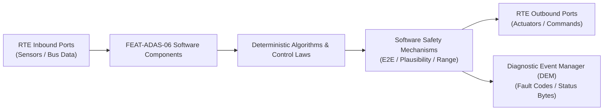

# Software Requirements Specification: Automated Valet Parking (AVP - SAE Level 4)
**Feature ID:** `FEAT-ADAS-06`  
**Domain:** ADAS & Autonomous Driving  
**Target ASIL:** ASIL D  
**Compliance Standard:** ISO 26262:2018 (Part 6 - Software Development) / ASPICE PAM v3.1 (SWE.1, SWE.2)  
**Parent System Specification:** [`FEAT-ADAS-06_AVP_SysReq.md`](file:///c:/Workset/AntiGravityProjects/TestOptimisationExperiement/system_requirements/FEAT-ADAS-06_AVP_SysReq.md)  
**Global Master Specification:** [`spec.md`](file:///c:/Workset/AntiGravityProjects/TestOptimisationExperiement/spec.md)

---

## 1. Software Architecture & Component Structure

This document specifies the AUTOSAR Software Components (SWCs), periodic runnables, algorithmic laws, safety mechanisms, and data ports implementing `FEAT-ADAS-06` (Automated Valet Parking (AVP - SAE Level 4)).

### AUTOSAR SWC Interaction Diagram

---

## 2. Detailed Software Requirements (SWR_REQ)
*(Multi-Software Requirement Partitioning derived from System Requirements)*

### `SWR-ADAS-06-01`: Facility V2X Digital Twin Geo-Reference Parser
- **Planned Release:** R100
- **ASIL Rating:** ASIL D
- **Parent System Requirement:** [`SYS-ADAS-06-01`](file:///c:/Workset/AntiGravityProjects/TestOptimisationExperiement/system_requirements/FEAT-ADAS-06_AVP_SysReq.md#sys-adas-06-01)
- **Allocated AUTOSAR SWC:** `AvpMapIngestor_SWC`
- **Execution Rate / Trigger:** 100 ms
- **Worst-Case Execution Time (WCET):** 2.5 ms
- **Software Activation Condition:** Executed upon receiving facility map payload.
- **Algorithmic Description / Logic:**
  > Parses ASN.1 / GeoJSON facility map: Identifies one-way aisle directions, clearance heights, speed limits, pillar polygons, and empty slot coordinates. Validates facility cryptographic signature.
- **Software Safety Mechanism:** Cryptographic signature check: Rejects unsigned or expired parking facility manifests.
- **Failure Reaction & DEM Diagnostic Event:** Abort automated valet mission if map parse errors occur.
- **Software Port Inputs:** `V2X_Map_Stream_Payload, Cryptographic_Facility_Cert`
- **Software Port Outputs:** `Parsed_Facility_Graph_Nodes[256], Target_Slot_Coordinates_X_Y`
- **Software Verification Criteria:** ISO 23374 V2X message conformance and schema validation.
- **Traceability Link:** Traces upward to [`SYS-ADAS-06-01`](file:///c:/Workset/AntiGravityProjects/TestOptimisationExperiement/system_requirements/FEAT-ADAS-06_AVP_SysReq.md#sys-adas-06-01) and [`FEAT-ADAS-06`](file:///c:/Workset/AntiGravityProjects/TestOptimisationExperiement/spec.md).

### `SWR-ADAS-06-02`: A-Star Conflict-Free Global Garage Path Planner
- **Planned Release:** R100
- **ASIL Rating:** ASIL D
- **Parent System Requirement:** [`SYS-ADAS-06-01`](file:///c:/Workset/AntiGravityProjects/TestOptimisationExperiement/system_requirements/FEAT-ADAS-06_AVP_SysReq.md#sys-adas-06-01)
- **Allocated AUTOSAR SWC:** `AvpGlobalPlanner_SWC`
- **Execution Rate / Trigger:** 100 ms
- **Worst-Case Execution Time (WCET):** 4.2 ms
- **Software Activation Condition:** Executed to compute path from entrance to slot.
- **Algorithmic Description / Logic:**
  > Executes hybrid A-Star search over garage road graph: Minimizes total distance while avoiding known congested aisles and reserved EV charging lanes. Generates sequence of waypoints.
- **Software Safety Mechanism:** Clearance check: Prohibits routing vehicle through aisles with height < 2.0 m.
- **Failure Reaction & DEM Diagnostic Event:** Re-calculate path if designated aisle is reported blocked by facility server.
- **Software Port Inputs:** `Start_Pose_X_Y_Theta, Target_Slot_Coordinates_X_Y, Facility_Graph_Nodes`
- **Software Port Outputs:** `Global_Waypoint_Sequence[64], Total_Route_Distance_M`
- **Software Verification Criteria:** Simulation matrix covering complex 5-floor underground parking structures.
- **Traceability Link:** Traces upward to [`SYS-ADAS-06-01`](file:///c:/Workset/AntiGravityProjects/TestOptimisationExperiement/system_requirements/FEAT-ADAS-06_AVP_SysReq.md#sys-adas-06-01) and [`FEAT-ADAS-06`](file:///c:/Workset/AntiGravityProjects/TestOptimisationExperiement/spec.md).

### `SWR-ADAS-06-03`: Surround LiDAR 3D Voxel Point Cloud Pre-Processor
- **Planned Release:** R100
- **ASIL Rating:** ASIL D
- **Parent System Requirement:** [`SYS-ADAS-06-02`](file:///c:/Workset/AntiGravityProjects/TestOptimisationExperiement/system_requirements/FEAT-ADAS-06_AVP_SysReq.md#sys-adas-06-02)
- **Allocated AUTOSAR SWC:** `AvpLidarProcessor_SWC`
- **Execution Rate / Trigger:** 50 ms
- **Worst-Case Execution Time (WCET):** 3.8 ms
- **Software Activation Condition:** Executed upon arrival of LiDAR point packets.
- **Algorithmic Description / Logic:**
  > Filters ground plane reflections using RANSAC plane fitting. Voxelizes remaining points into 5 cm grid cells: Counts hit frequencies to classify occupied vs free space. Filters out dust and exhaust smoke.
- **Software Safety Mechanism:** Point density check: Detects sensor blinding if zero points returned in 90-deg sector.
- **Failure Reaction & DEM Diagnostic Event:** Stop vehicle if blind sector covers travel direction.
- **Software Port Inputs:** `Raw_Lidar_Points_Array[30000], Extrinsic_Calibration_Matrix`
- **Software Port Outputs:** `Voxelized_Obstacle_Cloud[5000], Ground_Plane_Normal_Vector`
- **Software Verification Criteria:** LiDAR point cloud accuracy bench test with retro-reflective survey targets.
- **Traceability Link:** Traces upward to [`SYS-ADAS-06-02`](file:///c:/Workset/AntiGravityProjects/TestOptimisationExperiement/system_requirements/FEAT-ADAS-06_AVP_SysReq.md#sys-adas-06-02) and [`FEAT-ADAS-06`](file:///c:/Workset/AntiGravityProjects/TestOptimisationExperiement/spec.md).

### `SWR-ADAS-06-04`: 360-Degree Fish-Eye Vision Near-Field Depth Estimator
- **Planned Release:** R100
- **ASIL Rating:** ASIL D
- **Parent System Requirement:** [`SYS-ADAS-06-02`](file:///c:/Workset/AntiGravityProjects/TestOptimisationExperiement/system_requirements/FEAT-ADAS-06_AVP_SysReq.md#sys-adas-06-02)
- **Allocated AUTOSAR SWC:** `AvpVisionDepth_SWC`
- **Execution Rate / Trigger:** 50 ms
- **Worst-Case Execution Time (WCET):** 5.5 ms
- **Software Activation Condition:** Executed on 4 fish-eye camera video streams.
- **Algorithmic Description / Logic:**
  > Runs lightweight neural network estimating dense depth from 190-degree fish-eye distortion-corrected images. Fuses with ultrasonic sensor range readings to detect obstacles between 0.1 m and 8.0 m.
- **Software Safety Mechanism:** Ultrasonic cross-check: Ultrasonic readings override vision depth in 0.1-1.0 m zone.
- **Failure Reaction & DEM Diagnostic Event:** Rely strictly on ultrasonic sensors if camera image is pitch black.
- **Software Port Inputs:** `FishEye_Cameras_RGBA[4], Ultrasonic_Distances_Cm[12]`
- **Software Port Outputs:** `Near_Field_Depth_Map[4], Closest_Obstacle_Distance_Cm`
- **Software Verification Criteria:** Ground truth distance measurement against concrete parking garage columns.
- **Traceability Link:** Traces upward to [`SYS-ADAS-06-02`](file:///c:/Workset/AntiGravityProjects/TestOptimisationExperiement/system_requirements/FEAT-ADAS-06_AVP_SysReq.md#sys-adas-06-02) and [`FEAT-ADAS-06`](file:///c:/Workset/AntiGravityProjects/TestOptimisationExperiement/spec.md).

### `SWR-ADAS-06-05`: Low-Speed Closed-Loop Motor Crawl Velocity Governor
- **Planned Release:** R100
- **ASIL Rating:** ASIL D
- **Parent System Requirement:** [`SYS-ADAS-06-03`](file:///c:/Workset/AntiGravityProjects/TestOptimisationExperiement/system_requirements/FEAT-ADAS-06_AVP_SysReq.md#sys-adas-06-03)
- **Allocated AUTOSAR SWC:** `AvpCrawlController_SWC`
- **Execution Rate / Trigger:** 10 ms
- **Worst-Case Execution Time (WCET):** 0.5 ms
- **Software Activation Condition:** Executed in 100 Hz traction control loop.
- **Algorithmic Description / Logic:**
  > Regulates vehicle crawl speed to setpoint v_target (default 5.0 km/h; 2.0 km/h in corners): Computes motor torque demand using PI governor with anti-windup: T_cmd = K_p * (v_target - v_ego) + K_i * int(e).
- **Software Safety Mechanism:** Hard speed cap: Inverter gate driver shuts down if vehicle speed exceeds 12.0 km/h.
- **Failure Reaction & DEM Diagnostic Event:** Clamp hydraulic friction brakes if motor torque fails to restrain downhill speed.
- **Software Port Inputs:** `Target_Crawl_Speed_Kmph, Actual_Wheel_Speed_Mps, Road_Grade_Pct`
- **Software Port Outputs:** `Motor_Torque_Cmd_Nm, Friction_Brake_Precharge_Bar`
- **Software Verification Criteria:** Speed regulation stability test on steep ramps and slippery epoxy floor surfaces.
- **Traceability Link:** Traces upward to [`SYS-ADAS-06-03`](file:///c:/Workset/AntiGravityProjects/TestOptimisationExperiement/system_requirements/FEAT-ADAS-06_AVP_SysReq.md#sys-adas-06-03) and [`FEAT-ADAS-06`](file:///c:/Workset/AntiGravityProjects/TestOptimisationExperiement/spec.md).

### `SWR-ADAS-06-06`: Kinematic Bicycle Model High-Steer Angle Path Follower
- **Planned Release:** R100
- **ASIL Rating:** ASIL D
- **Parent System Requirement:** [`SYS-ADAS-06-03`](file:///c:/Workset/AntiGravityProjects/TestOptimisationExperiement/system_requirements/FEAT-ADAS-06_AVP_SysReq.md#sys-adas-06-03)
- **Allocated AUTOSAR SWC:** `AvpPathFollower_SWC`
- **Execution Rate / Trigger:** 10 ms
- **Worst-Case Execution Time (WCET):** 0.7 ms
- **Software Activation Condition:** Executed in 100 Hz steering control task.
- **Algorithmic Description / Logic:**
  > Computes required front road wheel angle using kinematic bicycle model with pure pursuit: delta = atan2(2 * L * sin(alpha), L_d). Supports large steering angles up to +-35 degrees for maneuvering around tight pillars.
- **Software Safety Mechanism:** Steering angle rate limiter: Constrained to <= 40 deg/s to avoid tyre scrub damage.
- **Failure Reaction & DEM Diagnostic Event:** Stop vehicle if lateral tracking error exceeds 0.35 m.
- **Software Port Inputs:** `Global_Waypoint_Sequence, Ego_Pose_X_Y_Theta, Lookahead_Distance_Ld`
- **Software Port Outputs:** `EPS_Target_Steering_Angle_Deg, Lateral_Tracking_Error_M`
- **Software Verification Criteria:** Slalom maneuver test between garage columns with 0.3 m clearance.
- **Traceability Link:** Traces upward to [`SYS-ADAS-06-03`](file:///c:/Workset/AntiGravityProjects/TestOptimisationExperiement/system_requirements/FEAT-ADAS-06_AVP_SysReq.md#sys-adas-06-03) and [`FEAT-ADAS-06`](file:///c:/Workset/AntiGravityProjects/TestOptimisationExperiement/spec.md).

### `SWR-ADAS-06-07`: Indoor Pedestrian Motion Classifier & Instant Stop Commander
- **Planned Release:** R200
- **ASIL Rating:** ASIL D
- **Parent System Requirement:** [`SYS-ADAS-06-04`](file:///c:/Workset/AntiGravityProjects/TestOptimisationExperiement/system_requirements/FEAT-ADAS-06_AVP_SysReq.md#sys-adas-06-04)
- **Allocated AUTOSAR SWC:** `AvpPedestrianMonitor_SWC`
- **Execution Rate / Trigger:** 20 ms
- **Worst-Case Execution Time (WCET):** 1.2 ms
- **Software Activation Condition:** Active at all times.
- **Algorithmic Description / Logic:**
  > Detects moving pedestrians in vehicle path: If pedestrian distance < 3.0 m and closing speed > 0.1 m/s, issues Emergency_Stop in <= 50 ms. Commands hydraulic brake booster to build 60 bar pressure instantly.
- **Software Safety Mechanism:** Braking distance check: Vehicle brought to complete stop within 0.35 m at 5 km/h.
- **Failure Reaction & DEM Diagnostic Event:** Hold vehicle stopped until pedestrian has exited safety bubble (distance > 2.5 m).
- **Software Port Inputs:** `Obstacle_Class_Enum, Obstacle_Distance_Meters, Obstacle_Relative_Velocity`
- **Software Port Outputs:** `AVP_Emergency_Brake_Cmd (boolean), Acoustic_Pedestrian_Horn_Req`
- **Software Verification Criteria:** Dummy pedestrian drop tests from blind pillar intersections.
- **Traceability Link:** Traces upward to [`SYS-ADAS-06-04`](file:///c:/Workset/AntiGravityProjects/TestOptimisationExperiement/system_requirements/FEAT-ADAS-06_AVP_SysReq.md#sys-adas-06-04) and [`FEAT-ADAS-06`](file:///c:/Workset/AntiGravityProjects/TestOptimisationExperiement/spec.md).

### `SWR-ADAS-06-08`: Acoustic Pedestrian Warning & Low-Speed External Chimer
- **Planned Release:** R200
- **ASIL Rating:** ASIL B
- **Parent System Requirement:** [`SYS-ADAS-06-04`](file:///c:/Workset/AntiGravityProjects/TestOptimisationExperiement/system_requirements/FEAT-ADAS-06_AVP_SysReq.md#sys-adas-06-04)
- **Allocated AUTOSAR SWC:** `AvpAcousticChimer_SWC`
- **Execution Rate / Trigger:** 100 ms
- **Worst-Case Execution Time (WCET):** 0.3 ms
- **Software Activation Condition:** Active while vehicle is moving driverless.
- **Algorithmic Description / Logic:**
  > Emits distinct pleasant acoustic chime pulses (60 dB(A) @ 1.0 kHz) through external AVAS speakers to alert pedestrians that vehicle is operating autonomously without driver inside.
- **Software Safety Mechanism:** Speaker current feedback loop verifying audio transducer operation.
- **Failure Reaction & DEM Diagnostic Event:** Flash exterior parking lights if external audio speaker faults.
- **Software Port Inputs:** `Vehicle_Moving_Flag, Autonomous_Driverless_Active`
- **Software Port Outputs:** `External_AVAS_Chime_Pattern, External_Lamp_Pulsing_Req`
- **Software Verification Criteria:** Acoustic sound pressure measurement in reverberant garage environment.
- **Traceability Link:** Traces upward to [`SYS-ADAS-06-04`](file:///c:/Workset/AntiGravityProjects/TestOptimisationExperiement/system_requirements/FEAT-ADAS-06_AVP_SysReq.md#sys-adas-06-04) and [`FEAT-ADAS-06`](file:///c:/Workset/AntiGravityProjects/TestOptimisationExperiement/spec.md).

### `SWR-ADAS-06-09`: Parking Slot Final Docking Alignment Clothoid Profiler
- **Planned Release:** R200
- **ASIL Rating:** ASIL D
- **Parent System Requirement:** [`SYS-ADAS-06-05`](file:///c:/Workset/AntiGravityProjects/TestOptimisationExperiement/system_requirements/FEAT-ADAS-06_AVP_SysReq.md#sys-adas-06-05)
- **Allocated AUTOSAR SWC:** `AvpSlotDocking_SWC`
- **Execution Rate / Trigger:** 20 ms
- **Worst-Case Execution Time (WCET):** 1.4 ms
- **Software Activation Condition:** Active in final parking slot approach.
- **Algorithmic Description / Logic:**
  > Synthesizes multi-segment reversing clothoid path into slot. Aligns vehicle parallel to painted parking bay lines within +-1.0 degree heading and +-4 cm lateral offset.
- **Software Safety Mechanism:** Ultrasonic bumper guard: Stops vehicle exactly 30 cm before rear wall or parking stopper.
- **Failure Reaction & DEM Diagnostic Event:** Shift to DRIVE and perform re-alignment pull-forward if initial angle skewed > 3 deg.
- **Software Port Inputs:** `Parking_Slot_Marker_Lines, Ultrasonic_Rear_Distance_Cm`
- **Software Port Outputs:** `Docking_Steer_Angle_Deg, Docking_Direction_PRND, Reversing_Complete_Flag`
- **Software Verification Criteria:** Autonomous parking docking accuracy evaluation across 500 parking cycles.
- **Traceability Link:** Traces upward to [`SYS-ADAS-06-05`](file:///c:/Workset/AntiGravityProjects/TestOptimisationExperiement/system_requirements/FEAT-ADAS-06_AVP_SysReq.md#sys-adas-06-05) and [`FEAT-ADAS-06`](file:///c:/Workset/AntiGravityProjects/TestOptimisationExperiement/spec.md).

### `SWR-ADAS-06-10`: Mission Finalization, EPB Handshake & Cloud Telematics Notifier
- **Planned Release:** R200
- **ASIL Rating:** ASIL D
- **Parent System Requirement:** [`SYS-ADAS-06-05`](file:///c:/Workset/AntiGravityProjects/TestOptimisationExperiement/system_requirements/FEAT-ADAS-06_AVP_SysReq.md#sys-adas-06-05)
- **Allocated AUTOSAR SWC:** `AvpMissionFinalizer_SWC`
- **Execution Rate / Trigger:** 50 ms
- **Worst-Case Execution Time (WCET):** 0.6 ms
- **Software Activation Condition:** Triggered upon Reversing_Complete_Flag.
- **Algorithmic Description / Logic:**
  > Performs secure shutdown: 1) Engages Electric Parking Brake (EPB); 2) Shifts transmission to PARK; 3) Folds exterior side mirrors; 4) Locks all doors; 5) Shuts down high-voltage traction contactors; 6) Transmits 'Parked Safely' MQTT status message to smartphone app.
- **Software Safety Mechanism:** EPB confirmation switch read before releasing service brake hydraulic pressure.
- **Failure Reaction & DEM Diagnostic Event:** Send 'Docking Issue' push notification to user smartphone if EPB fails to clamp.
- **Software Port Inputs:** `EPB_Clamped_Feedback_Switch, Transmission_Actual_PRND`
- **Software Port Outputs:** `HighVoltage_PowerDown_Req, Mirror_Fold_Cmd, Cloud_Mission_Completed_Payload`
- **Software Verification Criteria:** End-to-end integration test from smartphone park command to final locked state.
- **Traceability Link:** Traces upward to [`SYS-ADAS-06-05`](file:///c:/Workset/AntiGravityProjects/TestOptimisationExperiement/system_requirements/FEAT-ADAS-06_AVP_SysReq.md#sys-adas-06-05) and [`FEAT-ADAS-06`](file:///c:/Workset/AntiGravityProjects/TestOptimisationExperiement/spec.md).

### `SWR-ADAS-06-11`: Infrastructure-to-Vehicle (I2V) 5G/V2X Secure Session Authenticator - Dynamic Observer & Signal Filter
- **Planned Release:** R200
- **ASIL Rating:** ASIL D
- **Parent System Requirement:** [`SYS-ADAS-06-06`](file:///c:/Workset/AntiGravityProjects/TestOptimisationExperiement/system_requirements/FEAT-ADAS-06_AVP_SysReq.md#sys-adas-06-06)
- **Allocated AUTOSAR SWC:** `AvpSecurityAuth_SWC`
- **Execution Rate / Trigger:** 50 ms
- **Worst-Case Execution Time (WCET):** 0.3 ms
- **Software Activation Condition:** Executed cyclically every 50 ms.
- **Algorithmic Description / Logic:**
  > Executes signal plausibility filtering, calibration offsets, and discrete state estimation for Infrastructure-to-Vehicle (I2V) 5G/V2X Secure Session Authenticator.
- **Software Safety Mechanism:** Range limit plausibility check and E2E alive sequence verification.
- **Failure Reaction & DEM Diagnostic Event:** Set default fallback output and report DEM_EVENT_FEAT_ADAS_06_ERR.
- **Software Port Inputs:** `Raw sensor ADC/SENT/SPI values and RTE bus inputs.`
- **Software Port Outputs:** `Filtered physical signals and validity status bitmasks.`
- **Software Verification Criteria:** Unit test and HiL software integration test.
- **Traceability Link:** Traces upward to [`SYS-ADAS-06-06`](file:///c:/Workset/AntiGravityProjects/TestOptimisationExperiement/system_requirements/FEAT-ADAS-06_AVP_SysReq.md#sys-adas-06-06) and [`FEAT-ADAS-06`](file:///c:/Workset/AntiGravityProjects/TestOptimisationExperiement/spec.md).

### `SWR-ADAS-06-12`: Infrastructure-to-Vehicle (I2V) 5G/V2X Secure Session Authenticator - Closed-Loop Control Law & Actuator Dispatch
- **Planned Release:** R200
- **ASIL Rating:** ASIL D
- **Parent System Requirement:** [`SYS-ADAS-06-06`](file:///c:/Workset/AntiGravityProjects/TestOptimisationExperiement/system_requirements/FEAT-ADAS-06_AVP_SysReq.md#sys-adas-06-06)
- **Allocated AUTOSAR SWC:** `AvpSecurityAuth_SWC`
- **Execution Rate / Trigger:** 50 ms
- **Worst-Case Execution Time (WCET):** 0.4 ms
- **Software Activation Condition:** Executed cyclically every 50 ms.
- **Algorithmic Description / Logic:**
  > Evaluates deterministic closed-loop control law, rate limits, and dispatches commands for Infrastructure-to-Vehicle (I2V) 5G/V2X Secure Session Authenticator.
- **Software Safety Mechanism:** Command saturation clamping and watchdog program flow monitoring.
- **Failure Reaction & DEM Diagnostic Event:** De-energize actuator output, apply safe fallback clamp, and latch DTC.
- **Software Port Inputs:** `Validated physical state signals from observer SWC.`
- **Software Port Outputs:** `Actuator PWM duty cycles, torque/pressure setpoints, and diagnostic flags.`
- **Software Verification Criteria:** Hardware dynamometer and HiL closed-loop regression test suite.
- **Traceability Link:** Traces upward to [`SYS-ADAS-06-06`](file:///c:/Workset/AntiGravityProjects/TestOptimisationExperiement/system_requirements/FEAT-ADAS-06_AVP_SysReq.md#sys-adas-06-06) and [`FEAT-ADAS-06`](file:///c:/Workset/AntiGravityProjects/TestOptimisationExperiement/spec.md).

### `SWR-ADAS-06-13`: Indoor Parking Garage SLAM & Multi-Sensor Localization Engine - Dynamic Observer & Signal Filter
- **Planned Release:** R300
- **ASIL Rating:** ASIL D
- **Parent System Requirement:** [`SYS-ADAS-06-07`](file:///c:/Workset/AntiGravityProjects/TestOptimisationExperiement/system_requirements/FEAT-ADAS-06_AVP_SysReq.md#sys-adas-06-07)
- **Allocated AUTOSAR SWC:** `AvpSlamLocalization_SWC`
- **Execution Rate / Trigger:** 20 ms
- **Worst-Case Execution Time (WCET):** 0.3 ms
- **Software Activation Condition:** Executed cyclically every 20 ms.
- **Algorithmic Description / Logic:**
  > Executes signal plausibility filtering, calibration offsets, and discrete state estimation for Indoor Parking Garage SLAM & Multi-Sensor Localization Engine.
- **Software Safety Mechanism:** Range limit plausibility check and E2E alive sequence verification.
- **Failure Reaction & DEM Diagnostic Event:** Set default fallback output and report DEM_EVENT_FEAT_ADAS_06_ERR.
- **Software Port Inputs:** `Raw sensor ADC/SENT/SPI values and RTE bus inputs.`
- **Software Port Outputs:** `Filtered physical signals and validity status bitmasks.`
- **Software Verification Criteria:** Unit test and HiL software integration test.
- **Traceability Link:** Traces upward to [`SYS-ADAS-06-07`](file:///c:/Workset/AntiGravityProjects/TestOptimisationExperiement/system_requirements/FEAT-ADAS-06_AVP_SysReq.md#sys-adas-06-07) and [`FEAT-ADAS-06`](file:///c:/Workset/AntiGravityProjects/TestOptimisationExperiement/spec.md).

### `SWR-ADAS-06-14`: Indoor Parking Garage SLAM & Multi-Sensor Localization Engine - Closed-Loop Control Law & Actuator Dispatch
- **Planned Release:** R300
- **ASIL Rating:** ASIL D
- **Parent System Requirement:** [`SYS-ADAS-06-07`](file:///c:/Workset/AntiGravityProjects/TestOptimisationExperiement/system_requirements/FEAT-ADAS-06_AVP_SysReq.md#sys-adas-06-07)
- **Allocated AUTOSAR SWC:** `AvpSlamLocalization_SWC`
- **Execution Rate / Trigger:** 20 ms
- **Worst-Case Execution Time (WCET):** 0.4 ms
- **Software Activation Condition:** Executed cyclically every 20 ms.
- **Algorithmic Description / Logic:**
  > Evaluates deterministic closed-loop control law, rate limits, and dispatches commands for Indoor Parking Garage SLAM & Multi-Sensor Localization Engine.
- **Software Safety Mechanism:** Command saturation clamping and watchdog program flow monitoring.
- **Failure Reaction & DEM Diagnostic Event:** De-energize actuator output, apply safe fallback clamp, and latch DTC.
- **Software Port Inputs:** `Validated physical state signals from observer SWC.`
- **Software Port Outputs:** `Actuator PWM duty cycles, torque/pressure setpoints, and diagnostic flags.`
- **Software Verification Criteria:** Hardware dynamometer and HiL closed-loop regression test suite.
- **Traceability Link:** Traces upward to [`SYS-ADAS-06-07`](file:///c:/Workset/AntiGravityProjects/TestOptimisationExperiement/system_requirements/FEAT-ADAS-06_AVP_SysReq.md#sys-adas-06-07) and [`FEAT-ADAS-06`](file:///c:/Workset/AntiGravityProjects/TestOptimisationExperiement/spec.md).

### `SWR-ADAS-06-15`: Surround Ultrasonic & Camera Occupancy Grid Map Generator - Dynamic Observer & Signal Filter
- **Planned Release:** R300
- **ASIL Rating:** ASIL D
- **Parent System Requirement:** [`SYS-ADAS-06-08`](file:///c:/Workset/AntiGravityProjects/TestOptimisationExperiement/system_requirements/FEAT-ADAS-06_AVP_SysReq.md#sys-adas-06-08)
- **Allocated AUTOSAR SWC:** `AvpGridMapBuilder_SWC`
- **Execution Rate / Trigger:** 20 ms
- **Worst-Case Execution Time (WCET):** 0.3 ms
- **Software Activation Condition:** Executed cyclically every 20 ms.
- **Algorithmic Description / Logic:**
  > Executes signal plausibility filtering, calibration offsets, and discrete state estimation for Surround Ultrasonic & Camera Occupancy Grid Map Generator.
- **Software Safety Mechanism:** Range limit plausibility check and E2E alive sequence verification.
- **Failure Reaction & DEM Diagnostic Event:** Set default fallback output and report DEM_EVENT_FEAT_ADAS_06_ERR.
- **Software Port Inputs:** `Raw sensor ADC/SENT/SPI values and RTE bus inputs.`
- **Software Port Outputs:** `Filtered physical signals and validity status bitmasks.`
- **Software Verification Criteria:** Unit test and HiL software integration test.
- **Traceability Link:** Traces upward to [`SYS-ADAS-06-08`](file:///c:/Workset/AntiGravityProjects/TestOptimisationExperiement/system_requirements/FEAT-ADAS-06_AVP_SysReq.md#sys-adas-06-08) and [`FEAT-ADAS-06`](file:///c:/Workset/AntiGravityProjects/TestOptimisationExperiement/spec.md).

### `SWR-ADAS-06-16`: Surround Ultrasonic & Camera Occupancy Grid Map Generator - Closed-Loop Control Law & Actuator Dispatch
- **Planned Release:** R300
- **ASIL Rating:** ASIL D
- **Parent System Requirement:** [`SYS-ADAS-06-08`](file:///c:/Workset/AntiGravityProjects/TestOptimisationExperiement/system_requirements/FEAT-ADAS-06_AVP_SysReq.md#sys-adas-06-08)
- **Allocated AUTOSAR SWC:** `AvpGridMapBuilder_SWC`
- **Execution Rate / Trigger:** 20 ms
- **Worst-Case Execution Time (WCET):** 0.4 ms
- **Software Activation Condition:** Executed cyclically every 20 ms.
- **Algorithmic Description / Logic:**
  > Evaluates deterministic closed-loop control law, rate limits, and dispatches commands for Surround Ultrasonic & Camera Occupancy Grid Map Generator.
- **Software Safety Mechanism:** Command saturation clamping and watchdog program flow monitoring.
- **Failure Reaction & DEM Diagnostic Event:** De-energize actuator output, apply safe fallback clamp, and latch DTC.
- **Software Port Inputs:** `Validated physical state signals from observer SWC.`
- **Software Port Outputs:** `Actuator PWM duty cycles, torque/pressure setpoints, and diagnostic flags.`
- **Software Verification Criteria:** Hardware dynamometer and HiL closed-loop regression test suite.
- **Traceability Link:** Traces upward to [`SYS-ADAS-06-08`](file:///c:/Workset/AntiGravityProjects/TestOptimisationExperiement/system_requirements/FEAT-ADAS-06_AVP_SysReq.md#sys-adas-06-08) and [`FEAT-ADAS-06`](file:///c:/Workset/AntiGravityProjects/TestOptimisationExperiement/spec.md).

### `SWR-ADAS-06-17`: Low-Speed Path Tracking & Dynamic Steering Angle Controller - Dynamic Observer & Signal Filter
- **Planned Release:** R300
- **ASIL Rating:** ASIL D
- **Parent System Requirement:** [`SYS-ADAS-06-09`](file:///c:/Workset/AntiGravityProjects/TestOptimisationExperiement/system_requirements/FEAT-ADAS-06_AVP_SysReq.md#sys-adas-06-09)
- **Allocated AUTOSAR SWC:** `AvpPathTracker_SWC`
- **Execution Rate / Trigger:** 10 ms
- **Worst-Case Execution Time (WCET):** 0.3 ms
- **Software Activation Condition:** Executed cyclically every 10 ms.
- **Algorithmic Description / Logic:**
  > Executes signal plausibility filtering, calibration offsets, and discrete state estimation for Low-Speed Path Tracking & Dynamic Steering Angle Controller.
- **Software Safety Mechanism:** Range limit plausibility check and E2E alive sequence verification.
- **Failure Reaction & DEM Diagnostic Event:** Set default fallback output and report DEM_EVENT_FEAT_ADAS_06_ERR.
- **Software Port Inputs:** `Raw sensor ADC/SENT/SPI values and RTE bus inputs.`
- **Software Port Outputs:** `Filtered physical signals and validity status bitmasks.`
- **Software Verification Criteria:** Unit test and HiL software integration test.
- **Traceability Link:** Traces upward to [`SYS-ADAS-06-09`](file:///c:/Workset/AntiGravityProjects/TestOptimisationExperiement/system_requirements/FEAT-ADAS-06_AVP_SysReq.md#sys-adas-06-09) and [`FEAT-ADAS-06`](file:///c:/Workset/AntiGravityProjects/TestOptimisationExperiement/spec.md).

### `SWR-ADAS-06-18`: Low-Speed Path Tracking & Dynamic Steering Angle Controller - Closed-Loop Control Law & Actuator Dispatch
- **Planned Release:** R300
- **ASIL Rating:** ASIL D
- **Parent System Requirement:** [`SYS-ADAS-06-09`](file:///c:/Workset/AntiGravityProjects/TestOptimisationExperiement/system_requirements/FEAT-ADAS-06_AVP_SysReq.md#sys-adas-06-09)
- **Allocated AUTOSAR SWC:** `AvpPathTracker_SWC`
- **Execution Rate / Trigger:** 10 ms
- **Worst-Case Execution Time (WCET):** 0.4 ms
- **Software Activation Condition:** Executed cyclically every 10 ms.
- **Algorithmic Description / Logic:**
  > Evaluates deterministic closed-loop control law, rate limits, and dispatches commands for Low-Speed Path Tracking & Dynamic Steering Angle Controller.
- **Software Safety Mechanism:** Command saturation clamping and watchdog program flow monitoring.
- **Failure Reaction & DEM Diagnostic Event:** De-energize actuator output, apply safe fallback clamp, and latch DTC.
- **Software Port Inputs:** `Validated physical state signals from observer SWC.`
- **Software Port Outputs:** `Actuator PWM duty cycles, torque/pressure setpoints, and diagnostic flags.`
- **Software Verification Criteria:** Hardware dynamometer and HiL closed-loop regression test suite.
- **Traceability Link:** Traces upward to [`SYS-ADAS-06-09`](file:///c:/Workset/AntiGravityProjects/TestOptimisationExperiement/system_requirements/FEAT-ADAS-06_AVP_SysReq.md#sys-adas-06-09) and [`FEAT-ADAS-06`](file:///c:/Workset/AntiGravityProjects/TestOptimisationExperiement/spec.md).

### `SWR-ADAS-06-19`: Cross-Aisle Pedestrian Detection & Emergency Stop Deceleration - Dynamic Observer & Signal Filter
- **Planned Release:** R400
- **ASIL Rating:** ASIL D
- **Parent System Requirement:** [`SYS-ADAS-06-10`](file:///c:/Workset/AntiGravityProjects/TestOptimisationExperiement/system_requirements/FEAT-ADAS-06_AVP_SysReq.md#sys-adas-06-10)
- **Allocated AUTOSAR SWC:** `AvpPedestrianEmergencyStop_SWC`
- **Execution Rate / Trigger:** 10 ms
- **Worst-Case Execution Time (WCET):** 0.3 ms
- **Software Activation Condition:** Executed cyclically every 10 ms.
- **Algorithmic Description / Logic:**
  > Executes signal plausibility filtering, calibration offsets, and discrete state estimation for Cross-Aisle Pedestrian Detection & Emergency Stop Deceleration.
- **Software Safety Mechanism:** Range limit plausibility check and E2E alive sequence verification.
- **Failure Reaction & DEM Diagnostic Event:** Set default fallback output and report DEM_EVENT_FEAT_ADAS_06_ERR.
- **Software Port Inputs:** `Raw sensor ADC/SENT/SPI values and RTE bus inputs.`
- **Software Port Outputs:** `Filtered physical signals and validity status bitmasks.`
- **Software Verification Criteria:** Unit test and HiL software integration test.
- **Traceability Link:** Traces upward to [`SYS-ADAS-06-10`](file:///c:/Workset/AntiGravityProjects/TestOptimisationExperiement/system_requirements/FEAT-ADAS-06_AVP_SysReq.md#sys-adas-06-10) and [`FEAT-ADAS-06`](file:///c:/Workset/AntiGravityProjects/TestOptimisationExperiement/spec.md).

### `SWR-ADAS-06-20`: Cross-Aisle Pedestrian Detection & Emergency Stop Deceleration - Closed-Loop Control Law & Actuator Dispatch
- **Planned Release:** R400
- **ASIL Rating:** ASIL D
- **Parent System Requirement:** [`SYS-ADAS-06-10`](file:///c:/Workset/AntiGravityProjects/TestOptimisationExperiement/system_requirements/FEAT-ADAS-06_AVP_SysReq.md#sys-adas-06-10)
- **Allocated AUTOSAR SWC:** `AvpPedestrianEmergencyStop_SWC`
- **Execution Rate / Trigger:** 10 ms
- **Worst-Case Execution Time (WCET):** 0.4 ms
- **Software Activation Condition:** Executed cyclically every 10 ms.
- **Algorithmic Description / Logic:**
  > Evaluates deterministic closed-loop control law, rate limits, and dispatches commands for Cross-Aisle Pedestrian Detection & Emergency Stop Deceleration.
- **Software Safety Mechanism:** Command saturation clamping and watchdog program flow monitoring.
- **Failure Reaction & DEM Diagnostic Event:** De-energize actuator output, apply safe fallback clamp, and latch DTC.
- **Software Port Inputs:** `Validated physical state signals from observer SWC.`
- **Software Port Outputs:** `Actuator PWM duty cycles, torque/pressure setpoints, and diagnostic flags.`
- **Software Verification Criteria:** Hardware dynamometer and HiL closed-loop regression test suite.
- **Traceability Link:** Traces upward to [`SYS-ADAS-06-10`](file:///c:/Workset/AntiGravityProjects/TestOptimisationExperiement/system_requirements/FEAT-ADAS-06_AVP_SysReq.md#sys-adas-06-10) and [`FEAT-ADAS-06`](file:///c:/Workset/AntiGravityProjects/TestOptimisationExperiement/spec.md).

### `SWR-ADAS-06-21`: Automated Shift-by-Wire Gear State Coordinator (P-R-N-D) - Dynamic Observer & Signal Filter
- **Planned Release:** R400
- **ASIL Rating:** ASIL D
- **Parent System Requirement:** [`SYS-ADAS-06-11`](file:///c:/Workset/AntiGravityProjects/TestOptimisationExperiement/system_requirements/FEAT-ADAS-06_AVP_SysReq.md#sys-adas-06-11)
- **Allocated AUTOSAR SWC:** `AvpGearCoordinator_SWC`
- **Execution Rate / Trigger:** 20 ms
- **Worst-Case Execution Time (WCET):** 0.3 ms
- **Software Activation Condition:** Executed cyclically every 20 ms.
- **Algorithmic Description / Logic:**
  > Executes signal plausibility filtering, calibration offsets, and discrete state estimation for Automated Shift-by-Wire Gear State Coordinator (P-R-N-D).
- **Software Safety Mechanism:** Range limit plausibility check and E2E alive sequence verification.
- **Failure Reaction & DEM Diagnostic Event:** Set default fallback output and report DEM_EVENT_FEAT_ADAS_06_ERR.
- **Software Port Inputs:** `Raw sensor ADC/SENT/SPI values and RTE bus inputs.`
- **Software Port Outputs:** `Filtered physical signals and validity status bitmasks.`
- **Software Verification Criteria:** Unit test and HiL software integration test.
- **Traceability Link:** Traces upward to [`SYS-ADAS-06-11`](file:///c:/Workset/AntiGravityProjects/TestOptimisationExperiement/system_requirements/FEAT-ADAS-06_AVP_SysReq.md#sys-adas-06-11) and [`FEAT-ADAS-06`](file:///c:/Workset/AntiGravityProjects/TestOptimisationExperiement/spec.md).

### `SWR-ADAS-06-22`: Automated Shift-by-Wire Gear State Coordinator (P-R-N-D) - Closed-Loop Control Law & Actuator Dispatch
- **Planned Release:** R400
- **ASIL Rating:** ASIL D
- **Parent System Requirement:** [`SYS-ADAS-06-11`](file:///c:/Workset/AntiGravityProjects/TestOptimisationExperiement/system_requirements/FEAT-ADAS-06_AVP_SysReq.md#sys-adas-06-11)
- **Allocated AUTOSAR SWC:** `AvpGearCoordinator_SWC`
- **Execution Rate / Trigger:** 20 ms
- **Worst-Case Execution Time (WCET):** 0.4 ms
- **Software Activation Condition:** Executed cyclically every 20 ms.
- **Algorithmic Description / Logic:**
  > Evaluates deterministic closed-loop control law, rate limits, and dispatches commands for Automated Shift-by-Wire Gear State Coordinator (P-R-N-D).
- **Software Safety Mechanism:** Command saturation clamping and watchdog program flow monitoring.
- **Failure Reaction & DEM Diagnostic Event:** De-energize actuator output, apply safe fallback clamp, and latch DTC.
- **Software Port Inputs:** `Validated physical state signals from observer SWC.`
- **Software Port Outputs:** `Actuator PWM duty cycles, torque/pressure setpoints, and diagnostic flags.`
- **Software Verification Criteria:** Hardware dynamometer and HiL closed-loop regression test suite.
- **Traceability Link:** Traces upward to [`SYS-ADAS-06-11`](file:///c:/Workset/AntiGravityProjects/TestOptimisationExperiement/system_requirements/FEAT-ADAS-06_AVP_SysReq.md#sys-adas-06-11) and [`FEAT-ADAS-06`](file:///c:/Workset/AntiGravityProjects/TestOptimisationExperiement/spec.md).

### `SWR-ADAS-06-23`: Electric Parking Brake (EPB) Standstill Clamp & Lock Supervisor - Dynamic Observer & Signal Filter
- **Planned Release:** R400
- **ASIL Rating:** ASIL D
- **Parent System Requirement:** [`SYS-ADAS-06-12`](file:///c:/Workset/AntiGravityProjects/TestOptimisationExperiement/system_requirements/FEAT-ADAS-06_AVP_SysReq.md#sys-adas-06-12)
- **Allocated AUTOSAR SWC:** `AvpEpbLockSupervisor_SWC`
- **Execution Rate / Trigger:** 50 ms
- **Worst-Case Execution Time (WCET):** 0.3 ms
- **Software Activation Condition:** Executed cyclically every 50 ms.
- **Algorithmic Description / Logic:**
  > Executes signal plausibility filtering, calibration offsets, and discrete state estimation for Electric Parking Brake (EPB) Standstill Clamp & Lock Supervisor.
- **Software Safety Mechanism:** Range limit plausibility check and E2E alive sequence verification.
- **Failure Reaction & DEM Diagnostic Event:** Set default fallback output and report DEM_EVENT_FEAT_ADAS_06_ERR.
- **Software Port Inputs:** `Raw sensor ADC/SENT/SPI values and RTE bus inputs.`
- **Software Port Outputs:** `Filtered physical signals and validity status bitmasks.`
- **Software Verification Criteria:** Unit test and HiL software integration test.
- **Traceability Link:** Traces upward to [`SYS-ADAS-06-12`](file:///c:/Workset/AntiGravityProjects/TestOptimisationExperiement/system_requirements/FEAT-ADAS-06_AVP_SysReq.md#sys-adas-06-12) and [`FEAT-ADAS-06`](file:///c:/Workset/AntiGravityProjects/TestOptimisationExperiement/spec.md).

### `SWR-ADAS-06-24`: Electric Parking Brake (EPB) Standstill Clamp & Lock Supervisor - Closed-Loop Control Law & Actuator Dispatch
- **Planned Release:** R400
- **ASIL Rating:** ASIL D
- **Parent System Requirement:** [`SYS-ADAS-06-12`](file:///c:/Workset/AntiGravityProjects/TestOptimisationExperiement/system_requirements/FEAT-ADAS-06_AVP_SysReq.md#sys-adas-06-12)
- **Allocated AUTOSAR SWC:** `AvpEpbLockSupervisor_SWC`
- **Execution Rate / Trigger:** 50 ms
- **Worst-Case Execution Time (WCET):** 0.4 ms
- **Software Activation Condition:** Executed cyclically every 50 ms.
- **Algorithmic Description / Logic:**
  > Evaluates deterministic closed-loop control law, rate limits, and dispatches commands for Electric Parking Brake (EPB) Standstill Clamp & Lock Supervisor.
- **Software Safety Mechanism:** Command saturation clamping and watchdog program flow monitoring.
- **Failure Reaction & DEM Diagnostic Event:** De-energize actuator output, apply safe fallback clamp, and latch DTC.
- **Software Port Inputs:** `Validated physical state signals from observer SWC.`
- **Software Port Outputs:** `Actuator PWM duty cycles, torque/pressure setpoints, and diagnostic flags.`
- **Software Verification Criteria:** Hardware dynamometer and HiL closed-loop regression test suite.
- **Traceability Link:** Traces upward to [`SYS-ADAS-06-12`](file:///c:/Workset/AntiGravityProjects/TestOptimisationExperiement/system_requirements/FEAT-ADAS-06_AVP_SysReq.md#sys-adas-06-12) and [`FEAT-ADAS-06`](file:///c:/Workset/AntiGravityProjects/TestOptimisationExperiement/spec.md).

### `SWR-ADAS-06-25`: Vehicle Remote Summon & Waypoint Arrival Dispatcher - Dynamic Observer & Signal Filter
- **Planned Release:** R500
- **ASIL Rating:** ASIL B
- **Parent System Requirement:** [`SYS-ADAS-06-13`](file:///c:/Workset/AntiGravityProjects/TestOptimisationExperiement/system_requirements/FEAT-ADAS-06_AVP_SysReq.md#sys-adas-06-13)
- **Allocated AUTOSAR SWC:** `AvpSummonDispatcher_SWC`
- **Execution Rate / Trigger:** 100 ms
- **Worst-Case Execution Time (WCET):** 0.3 ms
- **Software Activation Condition:** Executed cyclically every 100 ms.
- **Algorithmic Description / Logic:**
  > Executes signal plausibility filtering, calibration offsets, and discrete state estimation for Vehicle Remote Summon & Waypoint Arrival Dispatcher.
- **Software Safety Mechanism:** Range limit plausibility check and E2E alive sequence verification.
- **Failure Reaction & DEM Diagnostic Event:** Set default fallback output and report DEM_EVENT_FEAT_ADAS_06_ERR.
- **Software Port Inputs:** `Raw sensor ADC/SENT/SPI values and RTE bus inputs.`
- **Software Port Outputs:** `Filtered physical signals and validity status bitmasks.`
- **Software Verification Criteria:** Unit test and HiL software integration test.
- **Traceability Link:** Traces upward to [`SYS-ADAS-06-13`](file:///c:/Workset/AntiGravityProjects/TestOptimisationExperiement/system_requirements/FEAT-ADAS-06_AVP_SysReq.md#sys-adas-06-13) and [`FEAT-ADAS-06`](file:///c:/Workset/AntiGravityProjects/TestOptimisationExperiement/spec.md).

### `SWR-ADAS-06-26`: Vehicle Remote Summon & Waypoint Arrival Dispatcher - Closed-Loop Control Law & Actuator Dispatch
- **Planned Release:** R500
- **ASIL Rating:** ASIL B
- **Parent System Requirement:** [`SYS-ADAS-06-13`](file:///c:/Workset/AntiGravityProjects/TestOptimisationExperiement/system_requirements/FEAT-ADAS-06_AVP_SysReq.md#sys-adas-06-13)
- **Allocated AUTOSAR SWC:** `AvpSummonDispatcher_SWC`
- **Execution Rate / Trigger:** 100 ms
- **Worst-Case Execution Time (WCET):** 0.4 ms
- **Software Activation Condition:** Executed cyclically every 100 ms.
- **Algorithmic Description / Logic:**
  > Evaluates deterministic closed-loop control law, rate limits, and dispatches commands for Vehicle Remote Summon & Waypoint Arrival Dispatcher.
- **Software Safety Mechanism:** Command saturation clamping and watchdog program flow monitoring.
- **Failure Reaction & DEM Diagnostic Event:** De-energize actuator output, apply safe fallback clamp, and latch DTC.
- **Software Port Inputs:** `Validated physical state signals from observer SWC.`
- **Software Port Outputs:** `Actuator PWM duty cycles, torque/pressure setpoints, and diagnostic flags.`
- **Software Verification Criteria:** Hardware dynamometer and HiL closed-loop regression test suite.
- **Traceability Link:** Traces upward to [`SYS-ADAS-06-13`](file:///c:/Workset/AntiGravityProjects/TestOptimisationExperiement/system_requirements/FEAT-ADAS-06_AVP_SysReq.md#sys-adas-06-13) and [`FEAT-ADAS-06`](file:///c:/Workset/AntiGravityProjects/TestOptimisationExperiement/spec.md).

### `SWR-ADAS-06-27`: Remote Teleoperation Emergency Heartbeat & Watchdog Monitor - Dynamic Observer & Signal Filter
- **Planned Release:** R400
- **ASIL Rating:** ASIL D
- **Parent System Requirement:** [`SYS-ADAS-06-14`](file:///c:/Workset/AntiGravityProjects/TestOptimisationExperiement/system_requirements/FEAT-ADAS-06_AVP_SysReq.md#sys-adas-06-14)
- **Allocated AUTOSAR SWC:** `AvpTeleopHeartbeat_SWC`
- **Execution Rate / Trigger:** 10 ms
- **Worst-Case Execution Time (WCET):** 0.3 ms
- **Software Activation Condition:** Executed cyclically every 10 ms.
- **Algorithmic Description / Logic:**
  > Executes signal plausibility filtering, calibration offsets, and discrete state estimation for Remote Teleoperation Emergency Heartbeat & Watchdog Monitor.
- **Software Safety Mechanism:** Range limit plausibility check and E2E alive sequence verification.
- **Failure Reaction & DEM Diagnostic Event:** Set default fallback output and report DEM_EVENT_FEAT_ADAS_06_ERR.
- **Software Port Inputs:** `Raw sensor ADC/SENT/SPI values and RTE bus inputs.`
- **Software Port Outputs:** `Filtered physical signals and validity status bitmasks.`
- **Software Verification Criteria:** Unit test and HiL software integration test.
- **Traceability Link:** Traces upward to [`SYS-ADAS-06-14`](file:///c:/Workset/AntiGravityProjects/TestOptimisationExperiement/system_requirements/FEAT-ADAS-06_AVP_SysReq.md#sys-adas-06-14) and [`FEAT-ADAS-06`](file:///c:/Workset/AntiGravityProjects/TestOptimisationExperiement/spec.md).

### `SWR-ADAS-06-28`: Remote Teleoperation Emergency Heartbeat & Watchdog Monitor - Closed-Loop Control Law & Actuator Dispatch
- **Planned Release:** R400
- **ASIL Rating:** ASIL D
- **Parent System Requirement:** [`SYS-ADAS-06-14`](file:///c:/Workset/AntiGravityProjects/TestOptimisationExperiement/system_requirements/FEAT-ADAS-06_AVP_SysReq.md#sys-adas-06-14)
- **Allocated AUTOSAR SWC:** `AvpTeleopHeartbeat_SWC`
- **Execution Rate / Trigger:** 10 ms
- **Worst-Case Execution Time (WCET):** 0.4 ms
- **Software Activation Condition:** Executed cyclically every 10 ms.
- **Algorithmic Description / Logic:**
  > Evaluates deterministic closed-loop control law, rate limits, and dispatches commands for Remote Teleoperation Emergency Heartbeat & Watchdog Monitor.
- **Software Safety Mechanism:** Command saturation clamping and watchdog program flow monitoring.
- **Failure Reaction & DEM Diagnostic Event:** De-energize actuator output, apply safe fallback clamp, and latch DTC.
- **Software Port Inputs:** `Validated physical state signals from observer SWC.`
- **Software Port Outputs:** `Actuator PWM duty cycles, torque/pressure setpoints, and diagnostic flags.`
- **Software Verification Criteria:** Hardware dynamometer and HiL closed-loop regression test suite.
- **Traceability Link:** Traces upward to [`SYS-ADAS-06-14`](file:///c:/Workset/AntiGravityProjects/TestOptimisationExperiement/system_requirements/FEAT-ADAS-06_AVP_SysReq.md#sys-adas-06-14) and [`FEAT-ADAS-06`](file:///c:/Workset/AntiGravityProjects/TestOptimisationExperiement/spec.md).

### `SWR-ADAS-06-29`: DEM Non-Volatile AVP Parking Mission Audit Buffer - Dynamic Observer & Signal Filter
- **Planned Release:** R500
- **ASIL Rating:** ASIL B
- **Parent System Requirement:** [`SYS-ADAS-06-15`](file:///c:/Workset/AntiGravityProjects/TestOptimisationExperiement/system_requirements/FEAT-ADAS-06_AVP_SysReq.md#sys-adas-06-15)
- **Allocated AUTOSAR SWC:** `AvpMissionRecorder_SWC`
- **Execution Rate / Trigger:** 50 ms
- **Worst-Case Execution Time (WCET):** 0.3 ms
- **Software Activation Condition:** Executed cyclically every 50 ms.
- **Algorithmic Description / Logic:**
  > Executes signal plausibility filtering, calibration offsets, and discrete state estimation for DEM Non-Volatile AVP Parking Mission Audit Buffer.
- **Software Safety Mechanism:** Range limit plausibility check and E2E alive sequence verification.
- **Failure Reaction & DEM Diagnostic Event:** Set default fallback output and report DEM_EVENT_FEAT_ADAS_06_ERR.
- **Software Port Inputs:** `Raw sensor ADC/SENT/SPI values and RTE bus inputs.`
- **Software Port Outputs:** `Filtered physical signals and validity status bitmasks.`
- **Software Verification Criteria:** Unit test and HiL software integration test.
- **Traceability Link:** Traces upward to [`SYS-ADAS-06-15`](file:///c:/Workset/AntiGravityProjects/TestOptimisationExperiement/system_requirements/FEAT-ADAS-06_AVP_SysReq.md#sys-adas-06-15) and [`FEAT-ADAS-06`](file:///c:/Workset/AntiGravityProjects/TestOptimisationExperiement/spec.md).

### `SWR-ADAS-06-30`: DEM Non-Volatile AVP Parking Mission Audit Buffer - Closed-Loop Control Law & Actuator Dispatch
- **Planned Release:** R500
- **ASIL Rating:** ASIL B
- **Parent System Requirement:** [`SYS-ADAS-06-15`](file:///c:/Workset/AntiGravityProjects/TestOptimisationExperiement/system_requirements/FEAT-ADAS-06_AVP_SysReq.md#sys-adas-06-15)
- **Allocated AUTOSAR SWC:** `AvpMissionRecorder_SWC`
- **Execution Rate / Trigger:** 50 ms
- **Worst-Case Execution Time (WCET):** 0.4 ms
- **Software Activation Condition:** Executed cyclically every 50 ms.
- **Algorithmic Description / Logic:**
  > Evaluates deterministic closed-loop control law, rate limits, and dispatches commands for DEM Non-Volatile AVP Parking Mission Audit Buffer.
- **Software Safety Mechanism:** Command saturation clamping and watchdog program flow monitoring.
- **Failure Reaction & DEM Diagnostic Event:** De-energize actuator output, apply safe fallback clamp, and latch DTC.
- **Software Port Inputs:** `Validated physical state signals from observer SWC.`
- **Software Port Outputs:** `Actuator PWM duty cycles, torque/pressure setpoints, and diagnostic flags.`
- **Software Verification Criteria:** Hardware dynamometer and HiL closed-loop regression test suite.
- **Traceability Link:** Traces upward to [`SYS-ADAS-06-15`](file:///c:/Workset/AntiGravityProjects/TestOptimisationExperiement/system_requirements/FEAT-ADAS-06_AVP_SysReq.md#sys-adas-06-15) and [`FEAT-ADAS-06`](file:///c:/Workset/AntiGravityProjects/TestOptimisationExperiement/spec.md).

---

## 3. Software-to-System Backward Traceability Matrix

| Software Requirement ID | Planned Release | Allocated SWC | Execution Rate | Upstream System Req | Verification Method |
| :--- | :---: | :--- | :--- | :--- | :--- |
| `SWR-ADAS-06-01` | **`R100`** | `AvpMapIngestor_SWC` | 100 ms | [`SYS-ADAS-06-01`](file:///c:/Workset/AntiGravityProjects/TestOptimisationExperiement/system_requirements/FEAT-ADAS-06_AVP_SysReq.md#sys-adas-06-01) | ISO 23374 V2X message conformance and schema validation. |
| `SWR-ADAS-06-02` | **`R100`** | `AvpGlobalPlanner_SWC` | 100 ms | [`SYS-ADAS-06-01`](file:///c:/Workset/AntiGravityProjects/TestOptimisationExperiement/system_requirements/FEAT-ADAS-06_AVP_SysReq.md#sys-adas-06-01) | Simulation matrix covering complex 5-floor underground parking structures. |
| `SWR-ADAS-06-03` | **`R100`** | `AvpLidarProcessor_SWC` | 50 ms | [`SYS-ADAS-06-02`](file:///c:/Workset/AntiGravityProjects/TestOptimisationExperiement/system_requirements/FEAT-ADAS-06_AVP_SysReq.md#sys-adas-06-02) | LiDAR point cloud accuracy bench test with retro-reflective survey targets. |
| `SWR-ADAS-06-04` | **`R100`** | `AvpVisionDepth_SWC` | 50 ms | [`SYS-ADAS-06-02`](file:///c:/Workset/AntiGravityProjects/TestOptimisationExperiement/system_requirements/FEAT-ADAS-06_AVP_SysReq.md#sys-adas-06-02) | Ground truth distance measurement against concrete parking garage columns. |
| `SWR-ADAS-06-05` | **`R100`** | `AvpCrawlController_SWC` | 10 ms | [`SYS-ADAS-06-03`](file:///c:/Workset/AntiGravityProjects/TestOptimisationExperiement/system_requirements/FEAT-ADAS-06_AVP_SysReq.md#sys-adas-06-03) | Speed regulation stability test on steep ramps and slippery epoxy floor surfaces. |
| `SWR-ADAS-06-06` | **`R100`** | `AvpPathFollower_SWC` | 10 ms | [`SYS-ADAS-06-03`](file:///c:/Workset/AntiGravityProjects/TestOptimisationExperiement/system_requirements/FEAT-ADAS-06_AVP_SysReq.md#sys-adas-06-03) | Slalom maneuver test between garage columns with 0.3 m clearance. |
| `SWR-ADAS-06-07` | **`R200`** | `AvpPedestrianMonitor_SWC` | 20 ms | [`SYS-ADAS-06-04`](file:///c:/Workset/AntiGravityProjects/TestOptimisationExperiement/system_requirements/FEAT-ADAS-06_AVP_SysReq.md#sys-adas-06-04) | Dummy pedestrian drop tests from blind pillar intersections. |
| `SWR-ADAS-06-08` | **`R200`** | `AvpAcousticChimer_SWC` | 100 ms | [`SYS-ADAS-06-04`](file:///c:/Workset/AntiGravityProjects/TestOptimisationExperiement/system_requirements/FEAT-ADAS-06_AVP_SysReq.md#sys-adas-06-04) | Acoustic sound pressure measurement in reverberant garage environment. |
| `SWR-ADAS-06-09` | **`R200`** | `AvpSlotDocking_SWC` | 20 ms | [`SYS-ADAS-06-05`](file:///c:/Workset/AntiGravityProjects/TestOptimisationExperiement/system_requirements/FEAT-ADAS-06_AVP_SysReq.md#sys-adas-06-05) | Autonomous parking docking accuracy evaluation across 500 parking cycles. |
| `SWR-ADAS-06-10` | **`R200`** | `AvpMissionFinalizer_SWC` | 50 ms | [`SYS-ADAS-06-05`](file:///c:/Workset/AntiGravityProjects/TestOptimisationExperiement/system_requirements/FEAT-ADAS-06_AVP_SysReq.md#sys-adas-06-05) | End-to-end integration test from smartphone park command to final locked state. |
| `SWR-ADAS-06-11` | **`R200`** | `AvpSecurityAuth_SWC` | 50 ms | [`SYS-ADAS-06-06`](file:///c:/Workset/AntiGravityProjects/TestOptimisationExperiement/system_requirements/FEAT-ADAS-06_AVP_SysReq.md#sys-adas-06-06) | Unit test and HiL software integration test. |
| `SWR-ADAS-06-12` | **`R200`** | `AvpSecurityAuth_SWC` | 50 ms | [`SYS-ADAS-06-06`](file:///c:/Workset/AntiGravityProjects/TestOptimisationExperiement/system_requirements/FEAT-ADAS-06_AVP_SysReq.md#sys-adas-06-06) | Hardware dynamometer and HiL closed-loop regression test suite. |
| `SWR-ADAS-06-13` | **`R300`** | `AvpSlamLocalization_SWC` | 20 ms | [`SYS-ADAS-06-07`](file:///c:/Workset/AntiGravityProjects/TestOptimisationExperiement/system_requirements/FEAT-ADAS-06_AVP_SysReq.md#sys-adas-06-07) | Unit test and HiL software integration test. |
| `SWR-ADAS-06-14` | **`R300`** | `AvpSlamLocalization_SWC` | 20 ms | [`SYS-ADAS-06-07`](file:///c:/Workset/AntiGravityProjects/TestOptimisationExperiement/system_requirements/FEAT-ADAS-06_AVP_SysReq.md#sys-adas-06-07) | Hardware dynamometer and HiL closed-loop regression test suite. |
| `SWR-ADAS-06-15` | **`R300`** | `AvpGridMapBuilder_SWC` | 20 ms | [`SYS-ADAS-06-08`](file:///c:/Workset/AntiGravityProjects/TestOptimisationExperiement/system_requirements/FEAT-ADAS-06_AVP_SysReq.md#sys-adas-06-08) | Unit test and HiL software integration test. |
| `SWR-ADAS-06-16` | **`R300`** | `AvpGridMapBuilder_SWC` | 20 ms | [`SYS-ADAS-06-08`](file:///c:/Workset/AntiGravityProjects/TestOptimisationExperiement/system_requirements/FEAT-ADAS-06_AVP_SysReq.md#sys-adas-06-08) | Hardware dynamometer and HiL closed-loop regression test suite. |
| `SWR-ADAS-06-17` | **`R300`** | `AvpPathTracker_SWC` | 10 ms | [`SYS-ADAS-06-09`](file:///c:/Workset/AntiGravityProjects/TestOptimisationExperiement/system_requirements/FEAT-ADAS-06_AVP_SysReq.md#sys-adas-06-09) | Unit test and HiL software integration test. |
| `SWR-ADAS-06-18` | **`R300`** | `AvpPathTracker_SWC` | 10 ms | [`SYS-ADAS-06-09`](file:///c:/Workset/AntiGravityProjects/TestOptimisationExperiement/system_requirements/FEAT-ADAS-06_AVP_SysReq.md#sys-adas-06-09) | Hardware dynamometer and HiL closed-loop regression test suite. |
| `SWR-ADAS-06-19` | **`R400`** | `AvpPedestrianEmergencyStop_SWC` | 10 ms | [`SYS-ADAS-06-10`](file:///c:/Workset/AntiGravityProjects/TestOptimisationExperiement/system_requirements/FEAT-ADAS-06_AVP_SysReq.md#sys-adas-06-10) | Unit test and HiL software integration test. |
| `SWR-ADAS-06-20` | **`R400`** | `AvpPedestrianEmergencyStop_SWC` | 10 ms | [`SYS-ADAS-06-10`](file:///c:/Workset/AntiGravityProjects/TestOptimisationExperiement/system_requirements/FEAT-ADAS-06_AVP_SysReq.md#sys-adas-06-10) | Hardware dynamometer and HiL closed-loop regression test suite. |
| `SWR-ADAS-06-21` | **`R400`** | `AvpGearCoordinator_SWC` | 20 ms | [`SYS-ADAS-06-11`](file:///c:/Workset/AntiGravityProjects/TestOptimisationExperiement/system_requirements/FEAT-ADAS-06_AVP_SysReq.md#sys-adas-06-11) | Unit test and HiL software integration test. |
| `SWR-ADAS-06-22` | **`R400`** | `AvpGearCoordinator_SWC` | 20 ms | [`SYS-ADAS-06-11`](file:///c:/Workset/AntiGravityProjects/TestOptimisationExperiement/system_requirements/FEAT-ADAS-06_AVP_SysReq.md#sys-adas-06-11) | Hardware dynamometer and HiL closed-loop regression test suite. |
| `SWR-ADAS-06-23` | **`R400`** | `AvpEpbLockSupervisor_SWC` | 50 ms | [`SYS-ADAS-06-12`](file:///c:/Workset/AntiGravityProjects/TestOptimisationExperiement/system_requirements/FEAT-ADAS-06_AVP_SysReq.md#sys-adas-06-12) | Unit test and HiL software integration test. |
| `SWR-ADAS-06-24` | **`R400`** | `AvpEpbLockSupervisor_SWC` | 50 ms | [`SYS-ADAS-06-12`](file:///c:/Workset/AntiGravityProjects/TestOptimisationExperiement/system_requirements/FEAT-ADAS-06_AVP_SysReq.md#sys-adas-06-12) | Hardware dynamometer and HiL closed-loop regression test suite. |
| `SWR-ADAS-06-25` | **`R500`** | `AvpSummonDispatcher_SWC` | 100 ms | [`SYS-ADAS-06-13`](file:///c:/Workset/AntiGravityProjects/TestOptimisationExperiement/system_requirements/FEAT-ADAS-06_AVP_SysReq.md#sys-adas-06-13) | Unit test and HiL software integration test. |
| `SWR-ADAS-06-26` | **`R500`** | `AvpSummonDispatcher_SWC` | 100 ms | [`SYS-ADAS-06-13`](file:///c:/Workset/AntiGravityProjects/TestOptimisationExperiement/system_requirements/FEAT-ADAS-06_AVP_SysReq.md#sys-adas-06-13) | Hardware dynamometer and HiL closed-loop regression test suite. |
| `SWR-ADAS-06-27` | **`R400`** | `AvpTeleopHeartbeat_SWC` | 10 ms | [`SYS-ADAS-06-14`](file:///c:/Workset/AntiGravityProjects/TestOptimisationExperiement/system_requirements/FEAT-ADAS-06_AVP_SysReq.md#sys-adas-06-14) | Unit test and HiL software integration test. |
| `SWR-ADAS-06-28` | **`R400`** | `AvpTeleopHeartbeat_SWC` | 10 ms | [`SYS-ADAS-06-14`](file:///c:/Workset/AntiGravityProjects/TestOptimisationExperiement/system_requirements/FEAT-ADAS-06_AVP_SysReq.md#sys-adas-06-14) | Hardware dynamometer and HiL closed-loop regression test suite. |
| `SWR-ADAS-06-29` | **`R500`** | `AvpMissionRecorder_SWC` | 50 ms | [`SYS-ADAS-06-15`](file:///c:/Workset/AntiGravityProjects/TestOptimisationExperiement/system_requirements/FEAT-ADAS-06_AVP_SysReq.md#sys-adas-06-15) | Unit test and HiL software integration test. |
| `SWR-ADAS-06-30` | **`R500`** | `AvpMissionRecorder_SWC` | 50 ms | [`SYS-ADAS-06-15`](file:///c:/Workset/AntiGravityProjects/TestOptimisationExperiement/system_requirements/FEAT-ADAS-06_AVP_SysReq.md#sys-adas-06-15) | Hardware dynamometer and HiL closed-loop regression test suite. |

- **Parent System Specification Document:** [`FEAT-ADAS-06_AVP_SysReq.md`](file:///c:/Workset/AntiGravityProjects/TestOptimisationExperiement/system_requirements/FEAT-ADAS-06_AVP_SysReq.md)
- **Master Automotive Specification:** [`spec.md`](file:///c:/Workset/AntiGravityProjects/TestOptimisationExperiement/spec.md)
