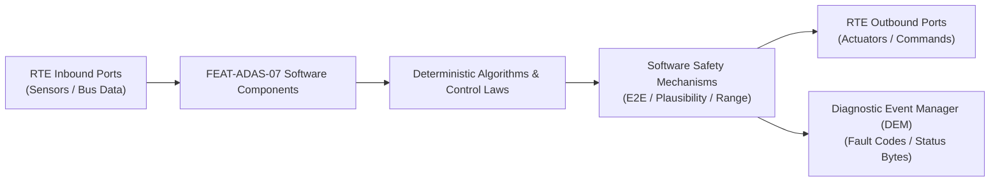

# Software Requirements Specification: Automated Parking Assist (APA)
**Feature ID:** `FEAT-ADAS-07`  
**Domain:** ADAS & Autonomous Driving  
**Target ASIL:** ASIL B  
**Compliance Standard:** ISO 26262:2018 (Part 6 - Software Development) / ASPICE PAM v3.1 (SWE.1, SWE.2)  
**Parent System Specification:** [`FEAT-ADAS-07_APA_SysReq.md`](file:///c:/Workset/AntiGravityProjects/TestOptimisationExperiement/system_requirements/FEAT-ADAS-07_APA_SysReq.md)  
**Global Master Specification:** [`spec.md`](file:///c:/Workset/AntiGravityProjects/TestOptimisationExperiement/spec.md)

---

## 1. Software Architecture & Component Structure

This document specifies the AUTOSAR Software Components (SWCs), periodic runnables, algorithmic laws, safety mechanisms, and data ports implementing `FEAT-ADAS-07` (Automated Parking Assist (APA)).

### AUTOSAR SWC Interaction Diagram

---

## 2. Detailed Software Requirements (SWR_REQ)
*(Multi-Software Requirement Partitioning derived from System Requirements)*

### `SWR-ADAS-07-01`: Ultrasonic Echo Width Integration & Curb Depth Profiler
- **Planned Release:** R100
- **ASIL Rating:** ASIL B
- **Parent System Requirement:** [`SYS-ADAS-07-01`](file:///c:/Workset/AntiGravityProjects/TestOptimisationExperiement/system_requirements/FEAT-ADAS-07_APA_SysReq.md#sys-adas-07-01)
- **Allocated AUTOSAR SWC:** `ApaSlotScanner_SWC`
- **Execution Rate / Trigger:** 20 ms
- **Worst-Case Execution Time (WCET):** 1.4 ms
- **Software Activation Condition:** Executed every 20 ms during slot search.
- **Algorithmic Description / Logic:**
  > Integrates vehicle travel distance via wheel ticks between leading edge and trailing edge echo drops. Computes: L_slot = v_ego * delta_t. Validates depth: D_slot >= 2.0 m.
- **Software Safety Mechanism:** Speed gating: Disables slot scanning if vehicle speed exceeds 30 km/h.
- **Failure Reaction & DEM Diagnostic Event:** Reject slot if curb line is detected as irregular or broken.
- **Software Port Inputs:** `Side_USS_Echo_Distances, Wheel_Tick_Counter, Vehicle_Speed_Kmph`
- **Software Port Outputs:** `Scanned_Slot_Dimensions (struct SlotGeometry_t)`
- **Software Verification Criteria:** Bench testing against simulated side wall reflections.
- **Traceability Link:** Traces upward to [`SYS-ADAS-07-01`](file:///c:/Workset/AntiGravityProjects/TestOptimisationExperiement/system_requirements/FEAT-ADAS-07_APA_SysReq.md#sys-adas-07-01) and [`FEAT-ADAS-07`](file:///c:/Workset/AntiGravityProjects/TestOptimisationExperiement/spec.md).

### `SWR-ADAS-07-02`: Surround Bird's Eye View (BEV) Parking Line Slot Extractor
- **Planned Release:** R100
- **ASIL Rating:** ASIL B
- **Parent System Requirement:** [`SYS-ADAS-07-01`](file:///c:/Workset/AntiGravityProjects/TestOptimisationExperiement/system_requirements/FEAT-ADAS-07_APA_SysReq.md#sys-adas-07-01)
- **Allocated AUTOSAR SWC:** `ApaBevSlotDetector_SWC`
- **Execution Rate / Trigger:** 33 ms
- **Worst-Case Execution Time (WCET):** 11.2 ms (NPU)
- **Software Activation Condition:** Executed on surround camera frames.
- **Algorithmic Description / Logic:**
  > Detects white and yellow parking bay line segments. Computes 4 corner vertices in vehicle coordinate system. Fuses with ultrasonic slot boundaries to resolve exact parking angle.
- **Software Safety Mechanism:** Angle bounds check: Reject slots with parking angle > 15 deg from nominal perpendicular/parallel.
- **Failure Reaction & DEM Diagnostic Event:** Fallback to ultrasonic-only boundaries if painted lines obscured.
- **Software Port Inputs:** `BEV_Image_Feed, Scanned_Slot_Dimensions`
- **Software Port Outputs:** `Fused_Parking_Slot_Pose, Slot_Quality_Metric`
- **Software Verification Criteria:** Test against worn paint markings and shaded asphalt surfaces.
- **Traceability Link:** Traces upward to [`SYS-ADAS-07-01`](file:///c:/Workset/AntiGravityProjects/TestOptimisationExperiement/system_requirements/FEAT-ADAS-07_APA_SysReq.md#sys-adas-07-01) and [`FEAT-ADAS-07`](file:///c:/Workset/AntiGravityProjects/TestOptimisationExperiement/spec.md).

### `SWR-ADAS-07-03`: Continuous Curvature Multi-Turn Geometric Path Planner
- **Planned Release:** R100
- **ASIL Rating:** ASIL B
- **Parent System Requirement:** [`SYS-ADAS-07-02`](file:///c:/Workset/AntiGravityProjects/TestOptimisationExperiement/system_requirements/FEAT-ADAS-07_APA_SysReq.md#sys-adas-07-02)
- **Allocated AUTOSAR SWC:** `ApaPathPlanner_SWC`
- **Execution Rate / Trigger:** 50 ms
- **Worst-Case Execution Time (WCET):** 3.5 ms
- **Software Activation Condition:** Executed on maneuver start and gear change points.
- **Algorithmic Description / Logic:**
  > Computes circle-clothoid-circle trajectories minimizing vehicle envelope footprint. Calculates transition switch points where vehicle stops and shifts gear between Reverse and Drive.
- **Software Safety Mechanism:** Minimum obstacle clearance constraint: Enforces 25 cm clearance to adjacent vehicles.
- **Failure Reaction & DEM Diagnostic Event:** Abort and prompt manual takeover if maneuver requires > 5 gear changes.
- **Software Port Inputs:** `Fused_Parking_Slot_Pose, Vehicle_Dimensions_Config`
- **Software Port Outputs:** `Planned_Parking_Waypoints[60], Maneuver_Stage_Count`
- **Software Verification Criteria:** SIL unit test verifying vehicle body corners do not clip obstacles.
- **Traceability Link:** Traces upward to [`SYS-ADAS-07-02`](file:///c:/Workset/AntiGravityProjects/TestOptimisationExperiement/system_requirements/FEAT-ADAS-07_APA_SysReq.md#sys-adas-07-02) and [`FEAT-ADAS-07`](file:///c:/Workset/AntiGravityProjects/TestOptimisationExperiement/spec.md).

### `SWR-ADAS-07-04`: Low-Speed Trajectory Follower & Shift-by-Wire Coordinator
- **Planned Release:** R100
- **ASIL Rating:** ASIL B
- **Parent System Requirement:** [`SYS-ADAS-07-02`](file:///c:/Workset/AntiGravityProjects/TestOptimisationExperiement/system_requirements/FEAT-ADAS-07_APA_SysReq.md#sys-adas-07-02)
- **Allocated AUTOSAR SWC:** `ApaTrajectoryTracker_SWC`
- **Execution Rate / Trigger:** 10 ms
- **Worst-Case Execution Time (WCET):** 1.1 ms
- **Software Activation Condition:** Executed every 10 ms during parking execution.
- **Algorithmic Description / Logic:**
  > Applies PID cross-track error correction to EPS steering controller. Coordinates vehicle speed (governed to 4 km/h via powertrain creep and brake pressure). Commands PRND gear shifts.
- **Software Safety Mechanism:** Zero-speed interlock: Shift-by-wire request issued ONLY when vehicle speed == 0.0 km/h.
- **Failure Reaction & DEM Diagnostic Event:** Apply emergency brake if driver applies override torque > 2.5 Nm.
- **Software Port Inputs:** `Planned_Parking_Waypoints, Vehicle_Current_Pose, Vehicle_Speed_Mps`
- **Software Port Outputs:** `EPS_Angle_Req_Deg, Brake_Decel_Req_Mps2, Transmission_Shift_Req`
- **Software Verification Criteria:** Vehicle parking precision verification measuring final parking alignment.
- **Traceability Link:** Traces upward to [`SYS-ADAS-07-02`](file:///c:/Workset/AntiGravityProjects/TestOptimisationExperiement/system_requirements/FEAT-ADAS-07_APA_SysReq.md#sys-adas-07-02) and [`FEAT-ADAS-07`](file:///c:/Workset/AntiGravityProjects/TestOptimisationExperiement/spec.md).

### `SWR-ADAS-07-05`: Shift-by-Wire Automated PRND Transmission Sequencer
- **Planned Release:** R100
- **ASIL Rating:** ASIL B
- **Parent System Requirement:** [`SYS-ADAS-07-03`](file:///c:/Workset/AntiGravityProjects/TestOptimisationExperiement/system_requirements/FEAT-ADAS-07_APA_SysReq.md#sys-adas-07-03)
- **Allocated AUTOSAR SWC:** `ApaShiftSequencer_SWC`
- **Execution Rate / Trigger:** 20 ms
- **Worst-Case Execution Time (WCET):** 0.5 ms
- **Software Activation Condition:** Active at maneuver directional change points.
- **Algorithmic Description / Logic:**
  > Applies hydraulic brakes until wheel speed == 0.0 m/s for 200 ms. Commands transmission shift (e.g. D -> R). Verifies transmission status byte matches target before releasing brake pressure to ramp up creep torque.
- **Software Safety Mechanism:** Shift interlock: Zero motor torque commanded while transmission gear is in intermediate neutral transition.
- **Failure Reaction & DEM Diagnostic Event:** Latch DTC P0700 if transmission fails to engage commanded gear.
- **Software Port Inputs:** `Maneuver_Direction_Demand_PRND, Transmission_Actual_Gear, Wheel_Speed_Ticks`
- **Software Port Outputs:** `Shift_By_Wire_CAN_PDU, Brake_Hold_Active_Flag`
- **Software Verification Criteria:** Automated transmission cycling test across 500 multi-move park maneuvers.
- **Traceability Link:** Traces upward to [`SYS-ADAS-07-03`](file:///c:/Workset/AntiGravityProjects/TestOptimisationExperiement/system_requirements/FEAT-ADAS-07_APA_SysReq.md#sys-adas-07-03) and [`FEAT-ADAS-07`](file:///c:/Workset/AntiGravityProjects/TestOptimisationExperiement/spec.md).

### `SWR-ADAS-07-06`: Kerbstone Height & Wheel Rim Scuff Protective Observer
- **Planned Release:** R100
- **ASIL Rating:** ASIL B
- **Parent System Requirement:** [`SYS-ADAS-07-03`](file:///c:/Workset/AntiGravityProjects/TestOptimisationExperiement/system_requirements/FEAT-ADAS-07_APA_SysReq.md#sys-adas-07-03)
- **Allocated AUTOSAR SWC:** `ApaKerbstoneGuard_SWC`
- **Execution Rate / Trigger:** 10 ms
- **Worst-Case Execution Time (WCET):** 0.4 ms
- **Software Activation Condition:** Active when parking adjacent to curbs.
- **Algorithmic Description / Logic:**
  > Fuses ultrasonic side sensors and surround camera edge detection: Classifies curb height. If curb > 8 cm, offsets target trajectory by +12 cm away from curb to protect alloy wheels from scuff damage.
- **Software Safety Mechanism:** Curb collision avoidance: Stops vehicle if wheel tire sidewall approaches within 5 cm of high stone curb.
- **Failure Reaction & DEM Diagnostic Event:** Inhibit parking if curb height exceeds vehicle ground clearance (15 cm).
- **Software Port Inputs:** `Side_Ultrasonic_Echo_Profiles[4], Camera_Curber_Points[16]`
- **Software Port Outputs:** `Curb_Offset_Correction_Cm, High_Curb_Warning_Flag`
- **Software Verification Criteria:** Real curb parking test measuring wheel rim clearance distance.
- **Traceability Link:** Traces upward to [`SYS-ADAS-07-03`](file:///c:/Workset/AntiGravityProjects/TestOptimisationExperiement/system_requirements/FEAT-ADAS-07_APA_SysReq.md#sys-adas-07-03) and [`FEAT-ADAS-07`](file:///c:/Workset/AntiGravityProjects/TestOptimisationExperiement/spec.md).

### `SWR-ADAS-07-07`: BLE Dead-Man Touch Heartbeat Packet Parser & Range Poller
- **Planned Release:** R200
- **ASIL Rating:** ASIL B
- **Parent System Requirement:** [`SYS-ADAS-07-04`](file:///c:/Workset/AntiGravityProjects/TestOptimisationExperiement/system_requirements/FEAT-ADAS-07_APA_SysReq.md#sys-adas-07-04)
- **Allocated AUTOSAR SWC:** `ApaBleSupervisor_SWC`
- **Execution Rate / Trigger:** 20 ms
- **Worst-Case Execution Time (WCET):** 0.3 ms
- **Software Activation Condition:** Active during remote parking operation.
- **Algorithmic Description / Logic:**
  > Parses encrypted BLE heartbeat packet received every 50 ms. Verifies rolling counter and dynamic touch hold status. Evaluates BLE signal RSSI: Computes distance d_user. If d_user > 6.0 m, clears Motion_Permit.
- **Software Safety Mechanism:** Timeout monitor: Missing heartbeat packet for > 100 ms clears motion permit unconditionally.
- **Failure Reaction & DEM Diagnostic Event:** Stop vehicle and apply EPB upon BLE connection loss.
- **Software Port Inputs:** `Raw_BLE_Packet_Payload[32], BLE_RSSI_Dbm, Vehicle_Speed_Mps`
- **Software Port Outputs:** `DeadMan_Touch_Confirmed_Flag (boolean), User_Proximity_Distance_M`
- **Software Verification Criteria:** Smartphone app screen release response latency measurements.
- **Traceability Link:** Traces upward to [`SYS-ADAS-07-04`](file:///c:/Workset/AntiGravityProjects/TestOptimisationExperiement/system_requirements/FEAT-ADAS-07_APA_SysReq.md#sys-adas-07-04) and [`FEAT-ADAS-07`](file:///c:/Workset/AntiGravityProjects/TestOptimisationExperiement/spec.md).

### `SWR-ADAS-07-08`: Remote Parking Fast Deceleration Interrupter & Brake Clamper
- **Planned Release:** R200
- **ASIL Rating:** ASIL B
- **Parent System Requirement:** [`SYS-ADAS-07-04`](file:///c:/Workset/AntiGravityProjects/TestOptimisationExperiement/system_requirements/FEAT-ADAS-07_APA_SysReq.md#sys-adas-07-04)
- **Allocated AUTOSAR SWC:** `ApaRemoteBrake_SWC`
- **Execution Rate / Trigger:** 10 ms
- **Worst-Case Execution Time (WCET):** 0.3 ms
- **Software Activation Condition:** Supervises remote motion.
- **Algorithmic Description / Logic:**
  > If DeadMan_Touch_Confirmed drops to FALSE, immediately commands service brake pressure to 40 bar in <= 150 ms, bringing vehicle to immediate stop from parking crawl speed.
- **Software Safety Mechanism:** EPB secondary clamp: Engages mechanical EPB if vehicle remains stopped for > 3.0 seconds.
- **Failure Reaction & DEM Diagnostic Event:** Report fault to smartphone app if hydraulic pressure cannot be maintained.
- **Software Port Inputs:** `DeadMan_Touch_Confirmed_Flag, Vehicle_Speed_Mps`
- **Software Port Outputs:** `Emergency_Brake_Pressure_Bar, Remote_Park_Halt_State`
- **Software Verification Criteria:** Stop latency test from fingertip release to zero vehicle velocity.
- **Traceability Link:** Traces upward to [`SYS-ADAS-07-04`](file:///c:/Workset/AntiGravityProjects/TestOptimisationExperiement/system_requirements/FEAT-ADAS-07_APA_SysReq.md#sys-adas-07-04) and [`FEAT-ADAS-07`](file:///c:/Workset/AntiGravityProjects/TestOptimisationExperiement/spec.md).

### `SWR-ADAS-07-09`: Ultrasonic Echo Time-of-Flight Slot Width & Depth Profiler - Dynamic Observer & Signal Filter
- **Planned Release:** R200
- **ASIL Rating:** ASIL B
- **Parent System Requirement:** [`SYS-ADAS-07-05`](file:///c:/Workset/AntiGravityProjects/TestOptimisationExperiement/system_requirements/FEAT-ADAS-07_APA_SysReq.md#sys-adas-07-05)
- **Allocated AUTOSAR SWC:** `ApaSlotScanner_SWC`
- **Execution Rate / Trigger:** 20 ms
- **Worst-Case Execution Time (WCET):** 0.3 ms
- **Software Activation Condition:** Executed cyclically every 20 ms.
- **Algorithmic Description / Logic:**
  > Executes signal plausibility filtering, calibration offsets, and discrete state estimation for Ultrasonic Echo Time-of-Flight Slot Width & Depth Profiler.
- **Software Safety Mechanism:** Range limit plausibility check and E2E alive sequence verification.
- **Failure Reaction & DEM Diagnostic Event:** Set default fallback output and report DEM_EVENT_FEAT_ADAS_07_ERR.
- **Software Port Inputs:** `Raw sensor ADC/SENT/SPI values and RTE bus inputs.`
- **Software Port Outputs:** `Filtered physical signals and validity status bitmasks.`
- **Software Verification Criteria:** Unit test and HiL software integration test.
- **Traceability Link:** Traces upward to [`SYS-ADAS-07-05`](file:///c:/Workset/AntiGravityProjects/TestOptimisationExperiement/system_requirements/FEAT-ADAS-07_APA_SysReq.md#sys-adas-07-05) and [`FEAT-ADAS-07`](file:///c:/Workset/AntiGravityProjects/TestOptimisationExperiement/spec.md).

### `SWR-ADAS-07-10`: Ultrasonic Echo Time-of-Flight Slot Width & Depth Profiler - Closed-Loop Control Law & Actuator Dispatch
- **Planned Release:** R200
- **ASIL Rating:** ASIL B
- **Parent System Requirement:** [`SYS-ADAS-07-05`](file:///c:/Workset/AntiGravityProjects/TestOptimisationExperiement/system_requirements/FEAT-ADAS-07_APA_SysReq.md#sys-adas-07-05)
- **Allocated AUTOSAR SWC:** `ApaSlotScanner_SWC`
- **Execution Rate / Trigger:** 20 ms
- **Worst-Case Execution Time (WCET):** 0.4 ms
- **Software Activation Condition:** Executed cyclically every 20 ms.
- **Algorithmic Description / Logic:**
  > Evaluates deterministic closed-loop control law, rate limits, and dispatches commands for Ultrasonic Echo Time-of-Flight Slot Width & Depth Profiler.
- **Software Safety Mechanism:** Command saturation clamping and watchdog program flow monitoring.
- **Failure Reaction & DEM Diagnostic Event:** De-energize actuator output, apply safe fallback clamp, and latch DTC.
- **Software Port Inputs:** `Validated physical state signals from observer SWC.`
- **Software Port Outputs:** `Actuator PWM duty cycles, torque/pressure setpoints, and diagnostic flags.`
- **Software Verification Criteria:** Hardware dynamometer and HiL closed-loop regression test suite.
- **Traceability Link:** Traces upward to [`SYS-ADAS-07-05`](file:///c:/Workset/AntiGravityProjects/TestOptimisationExperiement/system_requirements/FEAT-ADAS-07_APA_SysReq.md#sys-adas-07-05) and [`FEAT-ADAS-07`](file:///c:/Workset/AntiGravityProjects/TestOptimisationExperiement/spec.md).

### `SWR-ADAS-07-11`: Surround View Camera Parking Line Corner Coordinate Extractor - Dynamic Observer & Signal Filter
- **Planned Release:** R200
- **ASIL Rating:** ASIL B
- **Parent System Requirement:** [`SYS-ADAS-07-06`](file:///c:/Workset/AntiGravityProjects/TestOptimisationExperiement/system_requirements/FEAT-ADAS-07_APA_SysReq.md#sys-adas-07-06)
- **Allocated AUTOSAR SWC:** `ApaCameraLineExtractor_SWC`
- **Execution Rate / Trigger:** 30 ms
- **Worst-Case Execution Time (WCET):** 0.3 ms
- **Software Activation Condition:** Executed cyclically every 30 ms.
- **Algorithmic Description / Logic:**
  > Executes signal plausibility filtering, calibration offsets, and discrete state estimation for Surround View Camera Parking Line Corner Coordinate Extractor.
- **Software Safety Mechanism:** Range limit plausibility check and E2E alive sequence verification.
- **Failure Reaction & DEM Diagnostic Event:** Set default fallback output and report DEM_EVENT_FEAT_ADAS_07_ERR.
- **Software Port Inputs:** `Raw sensor ADC/SENT/SPI values and RTE bus inputs.`
- **Software Port Outputs:** `Filtered physical signals and validity status bitmasks.`
- **Software Verification Criteria:** Unit test and HiL software integration test.
- **Traceability Link:** Traces upward to [`SYS-ADAS-07-06`](file:///c:/Workset/AntiGravityProjects/TestOptimisationExperiement/system_requirements/FEAT-ADAS-07_APA_SysReq.md#sys-adas-07-06) and [`FEAT-ADAS-07`](file:///c:/Workset/AntiGravityProjects/TestOptimisationExperiement/spec.md).

### `SWR-ADAS-07-12`: Surround View Camera Parking Line Corner Coordinate Extractor - Closed-Loop Control Law & Actuator Dispatch
- **Planned Release:** R200
- **ASIL Rating:** ASIL B
- **Parent System Requirement:** [`SYS-ADAS-07-06`](file:///c:/Workset/AntiGravityProjects/TestOptimisationExperiement/system_requirements/FEAT-ADAS-07_APA_SysReq.md#sys-adas-07-06)
- **Allocated AUTOSAR SWC:** `ApaCameraLineExtractor_SWC`
- **Execution Rate / Trigger:** 30 ms
- **Worst-Case Execution Time (WCET):** 0.4 ms
- **Software Activation Condition:** Executed cyclically every 30 ms.
- **Algorithmic Description / Logic:**
  > Evaluates deterministic closed-loop control law, rate limits, and dispatches commands for Surround View Camera Parking Line Corner Coordinate Extractor.
- **Software Safety Mechanism:** Command saturation clamping and watchdog program flow monitoring.
- **Failure Reaction & DEM Diagnostic Event:** De-energize actuator output, apply safe fallback clamp, and latch DTC.
- **Software Port Inputs:** `Validated physical state signals from observer SWC.`
- **Software Port Outputs:** `Actuator PWM duty cycles, torque/pressure setpoints, and diagnostic flags.`
- **Software Verification Criteria:** Hardware dynamometer and HiL closed-loop regression test suite.
- **Traceability Link:** Traces upward to [`SYS-ADAS-07-06`](file:///c:/Workset/AntiGravityProjects/TestOptimisationExperiement/system_requirements/FEAT-ADAS-07_APA_SysReq.md#sys-adas-07-06) and [`FEAT-ADAS-07`](file:///c:/Workset/AntiGravityProjects/TestOptimisationExperiement/spec.md).

### `SWR-ADAS-07-13`: Collision-Free Multi-Segment Parking Trajectory Planner - Dynamic Observer & Signal Filter
- **Planned Release:** R300
- **ASIL Rating:** ASIL B
- **Parent System Requirement:** [`SYS-ADAS-07-07`](file:///c:/Workset/AntiGravityProjects/TestOptimisationExperiement/system_requirements/FEAT-ADAS-07_APA_SysReq.md#sys-adas-07-07)
- **Allocated AUTOSAR SWC:** `ApaTrajectoryPlanner_SWC`
- **Execution Rate / Trigger:** 30 ms
- **Worst-Case Execution Time (WCET):** 0.3 ms
- **Software Activation Condition:** Executed cyclically every 30 ms.
- **Algorithmic Description / Logic:**
  > Executes signal plausibility filtering, calibration offsets, and discrete state estimation for Collision-Free Multi-Segment Parking Trajectory Planner.
- **Software Safety Mechanism:** Range limit plausibility check and E2E alive sequence verification.
- **Failure Reaction & DEM Diagnostic Event:** Set default fallback output and report DEM_EVENT_FEAT_ADAS_07_ERR.
- **Software Port Inputs:** `Raw sensor ADC/SENT/SPI values and RTE bus inputs.`
- **Software Port Outputs:** `Filtered physical signals and validity status bitmasks.`
- **Software Verification Criteria:** Unit test and HiL software integration test.
- **Traceability Link:** Traces upward to [`SYS-ADAS-07-07`](file:///c:/Workset/AntiGravityProjects/TestOptimisationExperiement/system_requirements/FEAT-ADAS-07_APA_SysReq.md#sys-adas-07-07) and [`FEAT-ADAS-07`](file:///c:/Workset/AntiGravityProjects/TestOptimisationExperiement/spec.md).

### `SWR-ADAS-07-14`: Collision-Free Multi-Segment Parking Trajectory Planner - Closed-Loop Control Law & Actuator Dispatch
- **Planned Release:** R300
- **ASIL Rating:** ASIL B
- **Parent System Requirement:** [`SYS-ADAS-07-07`](file:///c:/Workset/AntiGravityProjects/TestOptimisationExperiement/system_requirements/FEAT-ADAS-07_APA_SysReq.md#sys-adas-07-07)
- **Allocated AUTOSAR SWC:** `ApaTrajectoryPlanner_SWC`
- **Execution Rate / Trigger:** 30 ms
- **Worst-Case Execution Time (WCET):** 0.4 ms
- **Software Activation Condition:** Executed cyclically every 30 ms.
- **Algorithmic Description / Logic:**
  > Evaluates deterministic closed-loop control law, rate limits, and dispatches commands for Collision-Free Multi-Segment Parking Trajectory Planner.
- **Software Safety Mechanism:** Command saturation clamping and watchdog program flow monitoring.
- **Failure Reaction & DEM Diagnostic Event:** De-energize actuator output, apply safe fallback clamp, and latch DTC.
- **Software Port Inputs:** `Validated physical state signals from observer SWC.`
- **Software Port Outputs:** `Actuator PWM duty cycles, torque/pressure setpoints, and diagnostic flags.`
- **Software Verification Criteria:** Hardware dynamometer and HiL closed-loop regression test suite.
- **Traceability Link:** Traces upward to [`SYS-ADAS-07-07`](file:///c:/Workset/AntiGravityProjects/TestOptimisationExperiement/system_requirements/FEAT-ADAS-07_APA_SysReq.md#sys-adas-07-07) and [`FEAT-ADAS-07`](file:///c:/Workset/AntiGravityProjects/TestOptimisationExperiement/spec.md).

### `SWR-ADAS-07-15`: Steering Wheel Automated Angle Servocontrol Tracking Law - Dynamic Observer & Signal Filter
- **Planned Release:** R300
- **ASIL Rating:** ASIL B
- **Parent System Requirement:** [`SYS-ADAS-07-08`](file:///c:/Workset/AntiGravityProjects/TestOptimisationExperiement/system_requirements/FEAT-ADAS-07_APA_SysReq.md#sys-adas-07-08)
- **Allocated AUTOSAR SWC:** `ApaSteeringServo_SWC`
- **Execution Rate / Trigger:** 10 ms
- **Worst-Case Execution Time (WCET):** 0.3 ms
- **Software Activation Condition:** Executed cyclically every 10 ms.
- **Algorithmic Description / Logic:**
  > Executes signal plausibility filtering, calibration offsets, and discrete state estimation for Steering Wheel Automated Angle Servocontrol Tracking Law.
- **Software Safety Mechanism:** Range limit plausibility check and E2E alive sequence verification.
- **Failure Reaction & DEM Diagnostic Event:** Set default fallback output and report DEM_EVENT_FEAT_ADAS_07_ERR.
- **Software Port Inputs:** `Raw sensor ADC/SENT/SPI values and RTE bus inputs.`
- **Software Port Outputs:** `Filtered physical signals and validity status bitmasks.`
- **Software Verification Criteria:** Unit test and HiL software integration test.
- **Traceability Link:** Traces upward to [`SYS-ADAS-07-08`](file:///c:/Workset/AntiGravityProjects/TestOptimisationExperiement/system_requirements/FEAT-ADAS-07_APA_SysReq.md#sys-adas-07-08) and [`FEAT-ADAS-07`](file:///c:/Workset/AntiGravityProjects/TestOptimisationExperiement/spec.md).

### `SWR-ADAS-07-16`: Steering Wheel Automated Angle Servocontrol Tracking Law - Closed-Loop Control Law & Actuator Dispatch
- **Planned Release:** R300
- **ASIL Rating:** ASIL B
- **Parent System Requirement:** [`SYS-ADAS-07-08`](file:///c:/Workset/AntiGravityProjects/TestOptimisationExperiement/system_requirements/FEAT-ADAS-07_APA_SysReq.md#sys-adas-07-08)
- **Allocated AUTOSAR SWC:** `ApaSteeringServo_SWC`
- **Execution Rate / Trigger:** 10 ms
- **Worst-Case Execution Time (WCET):** 0.4 ms
- **Software Activation Condition:** Executed cyclically every 10 ms.
- **Algorithmic Description / Logic:**
  > Evaluates deterministic closed-loop control law, rate limits, and dispatches commands for Steering Wheel Automated Angle Servocontrol Tracking Law.
- **Software Safety Mechanism:** Command saturation clamping and watchdog program flow monitoring.
- **Failure Reaction & DEM Diagnostic Event:** De-energize actuator output, apply safe fallback clamp, and latch DTC.
- **Software Port Inputs:** `Validated physical state signals from observer SWC.`
- **Software Port Outputs:** `Actuator PWM duty cycles, torque/pressure setpoints, and diagnostic flags.`
- **Software Verification Criteria:** Hardware dynamometer and HiL closed-loop regression test suite.
- **Traceability Link:** Traces upward to [`SYS-ADAS-07-08`](file:///c:/Workset/AntiGravityProjects/TestOptimisationExperiement/system_requirements/FEAT-ADAS-07_APA_SysReq.md#sys-adas-07-08) and [`FEAT-ADAS-07`](file:///c:/Workset/AntiGravityProjects/TestOptimisationExperiement/spec.md).

### `SWR-ADAS-07-17`: Slow-Speed Propulsion Torque & Creep Velocity Governor - Dynamic Observer & Signal Filter
- **Planned Release:** R300
- **ASIL Rating:** ASIL B
- **Parent System Requirement:** [`SYS-ADAS-07-09`](file:///c:/Workset/AntiGravityProjects/TestOptimisationExperiement/system_requirements/FEAT-ADAS-07_APA_SysReq.md#sys-adas-07-09)
- **Allocated AUTOSAR SWC:** `ApaSpeedGovernor_SWC`
- **Execution Rate / Trigger:** 10 ms
- **Worst-Case Execution Time (WCET):** 0.3 ms
- **Software Activation Condition:** Executed cyclically every 10 ms.
- **Algorithmic Description / Logic:**
  > Executes signal plausibility filtering, calibration offsets, and discrete state estimation for Slow-Speed Propulsion Torque & Creep Velocity Governor.
- **Software Safety Mechanism:** Range limit plausibility check and E2E alive sequence verification.
- **Failure Reaction & DEM Diagnostic Event:** Set default fallback output and report DEM_EVENT_FEAT_ADAS_07_ERR.
- **Software Port Inputs:** `Raw sensor ADC/SENT/SPI values and RTE bus inputs.`
- **Software Port Outputs:** `Filtered physical signals and validity status bitmasks.`
- **Software Verification Criteria:** Unit test and HiL software integration test.
- **Traceability Link:** Traces upward to [`SYS-ADAS-07-09`](file:///c:/Workset/AntiGravityProjects/TestOptimisationExperiement/system_requirements/FEAT-ADAS-07_APA_SysReq.md#sys-adas-07-09) and [`FEAT-ADAS-07`](file:///c:/Workset/AntiGravityProjects/TestOptimisationExperiement/spec.md).

### `SWR-ADAS-07-18`: Slow-Speed Propulsion Torque & Creep Velocity Governor - Closed-Loop Control Law & Actuator Dispatch
- **Planned Release:** R300
- **ASIL Rating:** ASIL B
- **Parent System Requirement:** [`SYS-ADAS-07-09`](file:///c:/Workset/AntiGravityProjects/TestOptimisationExperiement/system_requirements/FEAT-ADAS-07_APA_SysReq.md#sys-adas-07-09)
- **Allocated AUTOSAR SWC:** `ApaSpeedGovernor_SWC`
- **Execution Rate / Trigger:** 10 ms
- **Worst-Case Execution Time (WCET):** 0.4 ms
- **Software Activation Condition:** Executed cyclically every 10 ms.
- **Algorithmic Description / Logic:**
  > Evaluates deterministic closed-loop control law, rate limits, and dispatches commands for Slow-Speed Propulsion Torque & Creep Velocity Governor.
- **Software Safety Mechanism:** Command saturation clamping and watchdog program flow monitoring.
- **Failure Reaction & DEM Diagnostic Event:** De-energize actuator output, apply safe fallback clamp, and latch DTC.
- **Software Port Inputs:** `Validated physical state signals from observer SWC.`
- **Software Port Outputs:** `Actuator PWM duty cycles, torque/pressure setpoints, and diagnostic flags.`
- **Software Verification Criteria:** Hardware dynamometer and HiL closed-loop regression test suite.
- **Traceability Link:** Traces upward to [`SYS-ADAS-07-09`](file:///c:/Workset/AntiGravityProjects/TestOptimisationExperiement/system_requirements/FEAT-ADAS-07_APA_SysReq.md#sys-adas-07-09) and [`FEAT-ADAS-07`](file:///c:/Workset/AntiGravityProjects/TestOptimisationExperiement/spec.md).

### `SWR-ADAS-07-19`: Dynamic Ultrasonic Proximity Obstacle Encroachment Monitor - Dynamic Observer & Signal Filter
- **Planned Release:** R400
- **ASIL Rating:** ASIL B
- **Parent System Requirement:** [`SYS-ADAS-07-10`](file:///c:/Workset/AntiGravityProjects/TestOptimisationExperiement/system_requirements/FEAT-ADAS-07_APA_SysReq.md#sys-adas-07-10)
- **Allocated AUTOSAR SWC:** `ApaProximityStop_SWC`
- **Execution Rate / Trigger:** 10 ms
- **Worst-Case Execution Time (WCET):** 0.3 ms
- **Software Activation Condition:** Executed cyclically every 10 ms.
- **Algorithmic Description / Logic:**
  > Executes signal plausibility filtering, calibration offsets, and discrete state estimation for Dynamic Ultrasonic Proximity Obstacle Encroachment Monitor.
- **Software Safety Mechanism:** Range limit plausibility check and E2E alive sequence verification.
- **Failure Reaction & DEM Diagnostic Event:** Set default fallback output and report DEM_EVENT_FEAT_ADAS_07_ERR.
- **Software Port Inputs:** `Raw sensor ADC/SENT/SPI values and RTE bus inputs.`
- **Software Port Outputs:** `Filtered physical signals and validity status bitmasks.`
- **Software Verification Criteria:** Unit test and HiL software integration test.
- **Traceability Link:** Traces upward to [`SYS-ADAS-07-10`](file:///c:/Workset/AntiGravityProjects/TestOptimisationExperiement/system_requirements/FEAT-ADAS-07_APA_SysReq.md#sys-adas-07-10) and [`FEAT-ADAS-07`](file:///c:/Workset/AntiGravityProjects/TestOptimisationExperiement/spec.md).

### `SWR-ADAS-07-20`: Dynamic Ultrasonic Proximity Obstacle Encroachment Monitor - Closed-Loop Control Law & Actuator Dispatch
- **Planned Release:** R400
- **ASIL Rating:** ASIL B
- **Parent System Requirement:** [`SYS-ADAS-07-10`](file:///c:/Workset/AntiGravityProjects/TestOptimisationExperiement/system_requirements/FEAT-ADAS-07_APA_SysReq.md#sys-adas-07-10)
- **Allocated AUTOSAR SWC:** `ApaProximityStop_SWC`
- **Execution Rate / Trigger:** 10 ms
- **Worst-Case Execution Time (WCET):** 0.4 ms
- **Software Activation Condition:** Executed cyclically every 10 ms.
- **Algorithmic Description / Logic:**
  > Evaluates deterministic closed-loop control law, rate limits, and dispatches commands for Dynamic Ultrasonic Proximity Obstacle Encroachment Monitor.
- **Software Safety Mechanism:** Command saturation clamping and watchdog program flow monitoring.
- **Failure Reaction & DEM Diagnostic Event:** De-energize actuator output, apply safe fallback clamp, and latch DTC.
- **Software Port Inputs:** `Validated physical state signals from observer SWC.`
- **Software Port Outputs:** `Actuator PWM duty cycles, torque/pressure setpoints, and diagnostic flags.`
- **Software Verification Criteria:** Hardware dynamometer and HiL closed-loop regression test suite.
- **Traceability Link:** Traces upward to [`SYS-ADAS-07-10`](file:///c:/Workset/AntiGravityProjects/TestOptimisationExperiement/system_requirements/FEAT-ADAS-07_APA_SysReq.md#sys-adas-07-10) and [`FEAT-ADAS-07`](file:///c:/Workset/AntiGravityProjects/TestOptimisationExperiement/spec.md).

### `SWR-ADAS-07-21`: Driver Steering Wheel Hands-On Intervention Cancellation Gate - Dynamic Observer & Signal Filter
- **Planned Release:** R400
- **ASIL Rating:** ASIL B
- **Parent System Requirement:** [`SYS-ADAS-07-11`](file:///c:/Workset/AntiGravityProjects/TestOptimisationExperiement/system_requirements/FEAT-ADAS-07_APA_SysReq.md#sys-adas-07-11)
- **Allocated AUTOSAR SWC:** `ApaDriverAbort_SWC`
- **Execution Rate / Trigger:** 10 ms
- **Worst-Case Execution Time (WCET):** 0.3 ms
- **Software Activation Condition:** Executed cyclically every 10 ms.
- **Algorithmic Description / Logic:**
  > Executes signal plausibility filtering, calibration offsets, and discrete state estimation for Driver Steering Wheel Hands-On Intervention Cancellation Gate.
- **Software Safety Mechanism:** Range limit plausibility check and E2E alive sequence verification.
- **Failure Reaction & DEM Diagnostic Event:** Set default fallback output and report DEM_EVENT_FEAT_ADAS_07_ERR.
- **Software Port Inputs:** `Raw sensor ADC/SENT/SPI values and RTE bus inputs.`
- **Software Port Outputs:** `Filtered physical signals and validity status bitmasks.`
- **Software Verification Criteria:** Unit test and HiL software integration test.
- **Traceability Link:** Traces upward to [`SYS-ADAS-07-11`](file:///c:/Workset/AntiGravityProjects/TestOptimisationExperiement/system_requirements/FEAT-ADAS-07_APA_SysReq.md#sys-adas-07-11) and [`FEAT-ADAS-07`](file:///c:/Workset/AntiGravityProjects/TestOptimisationExperiement/spec.md).

### `SWR-ADAS-07-22`: Driver Steering Wheel Hands-On Intervention Cancellation Gate - Closed-Loop Control Law & Actuator Dispatch
- **Planned Release:** R400
- **ASIL Rating:** ASIL B
- **Parent System Requirement:** [`SYS-ADAS-07-11`](file:///c:/Workset/AntiGravityProjects/TestOptimisationExperiement/system_requirements/FEAT-ADAS-07_APA_SysReq.md#sys-adas-07-11)
- **Allocated AUTOSAR SWC:** `ApaDriverAbort_SWC`
- **Execution Rate / Trigger:** 10 ms
- **Worst-Case Execution Time (WCET):** 0.4 ms
- **Software Activation Condition:** Executed cyclically every 10 ms.
- **Algorithmic Description / Logic:**
  > Evaluates deterministic closed-loop control law, rate limits, and dispatches commands for Driver Steering Wheel Hands-On Intervention Cancellation Gate.
- **Software Safety Mechanism:** Command saturation clamping and watchdog program flow monitoring.
- **Failure Reaction & DEM Diagnostic Event:** De-energize actuator output, apply safe fallback clamp, and latch DTC.
- **Software Port Inputs:** `Validated physical state signals from observer SWC.`
- **Software Port Outputs:** `Actuator PWM duty cycles, torque/pressure setpoints, and diagnostic flags.`
- **Software Verification Criteria:** Hardware dynamometer and HiL closed-loop regression test suite.
- **Traceability Link:** Traces upward to [`SYS-ADAS-07-11`](file:///c:/Workset/AntiGravityProjects/TestOptimisationExperiement/system_requirements/FEAT-ADAS-07_APA_SysReq.md#sys-adas-07-11) and [`FEAT-ADAS-07`](file:///c:/Workset/AntiGravityProjects/TestOptimisationExperiement/spec.md).

### `SWR-ADAS-07-23`: Automated Shift-by-Wire Reverse/Drive Transition Sequence Manager - Dynamic Observer & Signal Filter
- **Planned Release:** R400
- **ASIL Rating:** ASIL B
- **Parent System Requirement:** [`SYS-ADAS-07-12`](file:///c:/Workset/AntiGravityProjects/TestOptimisationExperiement/system_requirements/FEAT-ADAS-07_APA_SysReq.md#sys-adas-07-12)
- **Allocated AUTOSAR SWC:** `ApaShiftSequencer_SWC`
- **Execution Rate / Trigger:** 20 ms
- **Worst-Case Execution Time (WCET):** 0.3 ms
- **Software Activation Condition:** Executed cyclically every 20 ms.
- **Algorithmic Description / Logic:**
  > Executes signal plausibility filtering, calibration offsets, and discrete state estimation for Automated Shift-by-Wire Reverse/Drive Transition Sequence Manager.
- **Software Safety Mechanism:** Range limit plausibility check and E2E alive sequence verification.
- **Failure Reaction & DEM Diagnostic Event:** Set default fallback output and report DEM_EVENT_FEAT_ADAS_07_ERR.
- **Software Port Inputs:** `Raw sensor ADC/SENT/SPI values and RTE bus inputs.`
- **Software Port Outputs:** `Filtered physical signals and validity status bitmasks.`
- **Software Verification Criteria:** Unit test and HiL software integration test.
- **Traceability Link:** Traces upward to [`SYS-ADAS-07-12`](file:///c:/Workset/AntiGravityProjects/TestOptimisationExperiement/system_requirements/FEAT-ADAS-07_APA_SysReq.md#sys-adas-07-12) and [`FEAT-ADAS-07`](file:///c:/Workset/AntiGravityProjects/TestOptimisationExperiement/spec.md).

### `SWR-ADAS-07-24`: Automated Shift-by-Wire Reverse/Drive Transition Sequence Manager - Closed-Loop Control Law & Actuator Dispatch
- **Planned Release:** R400
- **ASIL Rating:** ASIL B
- **Parent System Requirement:** [`SYS-ADAS-07-12`](file:///c:/Workset/AntiGravityProjects/TestOptimisationExperiement/system_requirements/FEAT-ADAS-07_APA_SysReq.md#sys-adas-07-12)
- **Allocated AUTOSAR SWC:** `ApaShiftSequencer_SWC`
- **Execution Rate / Trigger:** 20 ms
- **Worst-Case Execution Time (WCET):** 0.4 ms
- **Software Activation Condition:** Executed cyclically every 20 ms.
- **Algorithmic Description / Logic:**
  > Evaluates deterministic closed-loop control law, rate limits, and dispatches commands for Automated Shift-by-Wire Reverse/Drive Transition Sequence Manager.
- **Software Safety Mechanism:** Command saturation clamping and watchdog program flow monitoring.
- **Failure Reaction & DEM Diagnostic Event:** De-energize actuator output, apply safe fallback clamp, and latch DTC.
- **Software Port Inputs:** `Validated physical state signals from observer SWC.`
- **Software Port Outputs:** `Actuator PWM duty cycles, torque/pressure setpoints, and diagnostic flags.`
- **Software Verification Criteria:** Hardware dynamometer and HiL closed-loop regression test suite.
- **Traceability Link:** Traces upward to [`SYS-ADAS-07-12`](file:///c:/Workset/AntiGravityProjects/TestOptimisationExperiement/system_requirements/FEAT-ADAS-07_APA_SysReq.md#sys-adas-07-12) and [`FEAT-ADAS-07`](file:///c:/Workset/AntiGravityProjects/TestOptimisationExperiement/spec.md).

### `SWR-ADAS-07-25`: Curbside Wheel Rim Scrape Protection & Tilt Mirror Actuator - Dynamic Observer & Signal Filter
- **Planned Release:** R500
- **ASIL Rating:** ASIL B
- **Parent System Requirement:** [`SYS-ADAS-07-13`](file:///c:/Workset/AntiGravityProjects/TestOptimisationExperiement/system_requirements/FEAT-ADAS-07_APA_SysReq.md#sys-adas-07-13)
- **Allocated AUTOSAR SWC:** `ApaCurbProtector_SWC`
- **Execution Rate / Trigger:** 50 ms
- **Worst-Case Execution Time (WCET):** 0.3 ms
- **Software Activation Condition:** Executed cyclically every 50 ms.
- **Algorithmic Description / Logic:**
  > Executes signal plausibility filtering, calibration offsets, and discrete state estimation for Curbside Wheel Rim Scrape Protection & Tilt Mirror Actuator.
- **Software Safety Mechanism:** Range limit plausibility check and E2E alive sequence verification.
- **Failure Reaction & DEM Diagnostic Event:** Set default fallback output and report DEM_EVENT_FEAT_ADAS_07_ERR.
- **Software Port Inputs:** `Raw sensor ADC/SENT/SPI values and RTE bus inputs.`
- **Software Port Outputs:** `Filtered physical signals and validity status bitmasks.`
- **Software Verification Criteria:** Unit test and HiL software integration test.
- **Traceability Link:** Traces upward to [`SYS-ADAS-07-13`](file:///c:/Workset/AntiGravityProjects/TestOptimisationExperiement/system_requirements/FEAT-ADAS-07_APA_SysReq.md#sys-adas-07-13) and [`FEAT-ADAS-07`](file:///c:/Workset/AntiGravityProjects/TestOptimisationExperiement/spec.md).

### `SWR-ADAS-07-26`: Curbside Wheel Rim Scrape Protection & Tilt Mirror Actuator - Closed-Loop Control Law & Actuator Dispatch
- **Planned Release:** R500
- **ASIL Rating:** ASIL B
- **Parent System Requirement:** [`SYS-ADAS-07-13`](file:///c:/Workset/AntiGravityProjects/TestOptimisationExperiement/system_requirements/FEAT-ADAS-07_APA_SysReq.md#sys-adas-07-13)
- **Allocated AUTOSAR SWC:** `ApaCurbProtector_SWC`
- **Execution Rate / Trigger:** 50 ms
- **Worst-Case Execution Time (WCET):** 0.4 ms
- **Software Activation Condition:** Executed cyclically every 50 ms.
- **Algorithmic Description / Logic:**
  > Evaluates deterministic closed-loop control law, rate limits, and dispatches commands for Curbside Wheel Rim Scrape Protection & Tilt Mirror Actuator.
- **Software Safety Mechanism:** Command saturation clamping and watchdog program flow monitoring.
- **Failure Reaction & DEM Diagnostic Event:** De-energize actuator output, apply safe fallback clamp, and latch DTC.
- **Software Port Inputs:** `Validated physical state signals from observer SWC.`
- **Software Port Outputs:** `Actuator PWM duty cycles, torque/pressure setpoints, and diagnostic flags.`
- **Software Verification Criteria:** Hardware dynamometer and HiL closed-loop regression test suite.
- **Traceability Link:** Traces upward to [`SYS-ADAS-07-13`](file:///c:/Workset/AntiGravityProjects/TestOptimisationExperiement/system_requirements/FEAT-ADAS-07_APA_SysReq.md#sys-adas-07-13) and [`FEAT-ADAS-07`](file:///c:/Workset/AntiGravityProjects/TestOptimisationExperiement/spec.md).

### `SWR-ADAS-07-27`: Cluster Top-Down 3D Surround View Display Streamer - Dynamic Observer & Signal Filter
- **Planned Release:** R500
- **ASIL Rating:** ASIL B
- **Parent System Requirement:** [`SYS-ADAS-07-14`](file:///c:/Workset/AntiGravityProjects/TestOptimisationExperiement/system_requirements/FEAT-ADAS-07_APA_SysReq.md#sys-adas-07-14)
- **Allocated AUTOSAR SWC:** `ApaDisplayStreamer_SWC`
- **Execution Rate / Trigger:** 33 ms
- **Worst-Case Execution Time (WCET):** 0.3 ms
- **Software Activation Condition:** Executed cyclically every 33 ms.
- **Algorithmic Description / Logic:**
  > Executes signal plausibility filtering, calibration offsets, and discrete state estimation for Cluster Top-Down 3D Surround View Display Streamer.
- **Software Safety Mechanism:** Range limit plausibility check and E2E alive sequence verification.
- **Failure Reaction & DEM Diagnostic Event:** Set default fallback output and report DEM_EVENT_FEAT_ADAS_07_ERR.
- **Software Port Inputs:** `Raw sensor ADC/SENT/SPI values and RTE bus inputs.`
- **Software Port Outputs:** `Filtered physical signals and validity status bitmasks.`
- **Software Verification Criteria:** Unit test and HiL software integration test.
- **Traceability Link:** Traces upward to [`SYS-ADAS-07-14`](file:///c:/Workset/AntiGravityProjects/TestOptimisationExperiement/system_requirements/FEAT-ADAS-07_APA_SysReq.md#sys-adas-07-14) and [`FEAT-ADAS-07`](file:///c:/Workset/AntiGravityProjects/TestOptimisationExperiement/spec.md).

### `SWR-ADAS-07-28`: Cluster Top-Down 3D Surround View Display Streamer - Closed-Loop Control Law & Actuator Dispatch
- **Planned Release:** R500
- **ASIL Rating:** ASIL B
- **Parent System Requirement:** [`SYS-ADAS-07-14`](file:///c:/Workset/AntiGravityProjects/TestOptimisationExperiement/system_requirements/FEAT-ADAS-07_APA_SysReq.md#sys-adas-07-14)
- **Allocated AUTOSAR SWC:** `ApaDisplayStreamer_SWC`
- **Execution Rate / Trigger:** 33 ms
- **Worst-Case Execution Time (WCET):** 0.4 ms
- **Software Activation Condition:** Executed cyclically every 33 ms.
- **Algorithmic Description / Logic:**
  > Evaluates deterministic closed-loop control law, rate limits, and dispatches commands for Cluster Top-Down 3D Surround View Display Streamer.
- **Software Safety Mechanism:** Command saturation clamping and watchdog program flow monitoring.
- **Failure Reaction & DEM Diagnostic Event:** De-energize actuator output, apply safe fallback clamp, and latch DTC.
- **Software Port Inputs:** `Validated physical state signals from observer SWC.`
- **Software Port Outputs:** `Actuator PWM duty cycles, torque/pressure setpoints, and diagnostic flags.`
- **Software Verification Criteria:** Hardware dynamometer and HiL closed-loop regression test suite.
- **Traceability Link:** Traces upward to [`SYS-ADAS-07-14`](file:///c:/Workset/AntiGravityProjects/TestOptimisationExperiement/system_requirements/FEAT-ADAS-07_APA_SysReq.md#sys-adas-07-14) and [`FEAT-ADAS-07`](file:///c:/Workset/AntiGravityProjects/TestOptimisationExperiement/spec.md).

### `SWR-ADAS-07-29`: DEM Parking System Component Health Diagnostics & DTC Manager - Dynamic Observer & Signal Filter
- **Planned Release:** R500
- **ASIL Rating:** ASIL B
- **Parent System Requirement:** [`SYS-ADAS-07-15`](file:///c:/Workset/AntiGravityProjects/TestOptimisationExperiement/system_requirements/FEAT-ADAS-07_APA_SysReq.md#sys-adas-07-15)
- **Allocated AUTOSAR SWC:** `ApaDiagnosticManager_SWC`
- **Execution Rate / Trigger:** 50 ms
- **Worst-Case Execution Time (WCET):** 0.3 ms
- **Software Activation Condition:** Executed cyclically every 50 ms.
- **Algorithmic Description / Logic:**
  > Executes signal plausibility filtering, calibration offsets, and discrete state estimation for DEM Parking System Component Health Diagnostics & DTC Manager.
- **Software Safety Mechanism:** Range limit plausibility check and E2E alive sequence verification.
- **Failure Reaction & DEM Diagnostic Event:** Set default fallback output and report DEM_EVENT_FEAT_ADAS_07_ERR.
- **Software Port Inputs:** `Raw sensor ADC/SENT/SPI values and RTE bus inputs.`
- **Software Port Outputs:** `Filtered physical signals and validity status bitmasks.`
- **Software Verification Criteria:** Unit test and HiL software integration test.
- **Traceability Link:** Traces upward to [`SYS-ADAS-07-15`](file:///c:/Workset/AntiGravityProjects/TestOptimisationExperiement/system_requirements/FEAT-ADAS-07_APA_SysReq.md#sys-adas-07-15) and [`FEAT-ADAS-07`](file:///c:/Workset/AntiGravityProjects/TestOptimisationExperiement/spec.md).

### `SWR-ADAS-07-30`: DEM Parking System Component Health Diagnostics & DTC Manager - Closed-Loop Control Law & Actuator Dispatch
- **Planned Release:** R500
- **ASIL Rating:** ASIL B
- **Parent System Requirement:** [`SYS-ADAS-07-15`](file:///c:/Workset/AntiGravityProjects/TestOptimisationExperiement/system_requirements/FEAT-ADAS-07_APA_SysReq.md#sys-adas-07-15)
- **Allocated AUTOSAR SWC:** `ApaDiagnosticManager_SWC`
- **Execution Rate / Trigger:** 50 ms
- **Worst-Case Execution Time (WCET):** 0.4 ms
- **Software Activation Condition:** Executed cyclically every 50 ms.
- **Algorithmic Description / Logic:**
  > Evaluates deterministic closed-loop control law, rate limits, and dispatches commands for DEM Parking System Component Health Diagnostics & DTC Manager.
- **Software Safety Mechanism:** Command saturation clamping and watchdog program flow monitoring.
- **Failure Reaction & DEM Diagnostic Event:** De-energize actuator output, apply safe fallback clamp, and latch DTC.
- **Software Port Inputs:** `Validated physical state signals from observer SWC.`
- **Software Port Outputs:** `Actuator PWM duty cycles, torque/pressure setpoints, and diagnostic flags.`
- **Software Verification Criteria:** Hardware dynamometer and HiL closed-loop regression test suite.
- **Traceability Link:** Traces upward to [`SYS-ADAS-07-15`](file:///c:/Workset/AntiGravityProjects/TestOptimisationExperiement/system_requirements/FEAT-ADAS-07_APA_SysReq.md#sys-adas-07-15) and [`FEAT-ADAS-07`](file:///c:/Workset/AntiGravityProjects/TestOptimisationExperiement/spec.md).

---

## 3. Software-to-System Backward Traceability Matrix

| Software Requirement ID | Planned Release | Allocated SWC | Execution Rate | Upstream System Req | Verification Method |
| :--- | :---: | :--- | :--- | :--- | :--- |
| `SWR-ADAS-07-01` | **`R100`** | `ApaSlotScanner_SWC` | 20 ms | [`SYS-ADAS-07-01`](file:///c:/Workset/AntiGravityProjects/TestOptimisationExperiement/system_requirements/FEAT-ADAS-07_APA_SysReq.md#sys-adas-07-01) | Bench testing against simulated side wall reflections. |
| `SWR-ADAS-07-02` | **`R100`** | `ApaBevSlotDetector_SWC` | 33 ms | [`SYS-ADAS-07-01`](file:///c:/Workset/AntiGravityProjects/TestOptimisationExperiement/system_requirements/FEAT-ADAS-07_APA_SysReq.md#sys-adas-07-01) | Test against worn paint markings and shaded asphalt surfaces. |
| `SWR-ADAS-07-03` | **`R100`** | `ApaPathPlanner_SWC` | 50 ms | [`SYS-ADAS-07-02`](file:///c:/Workset/AntiGravityProjects/TestOptimisationExperiement/system_requirements/FEAT-ADAS-07_APA_SysReq.md#sys-adas-07-02) | SIL unit test verifying vehicle body corners do not clip obstacles. |
| `SWR-ADAS-07-04` | **`R100`** | `ApaTrajectoryTracker_SWC` | 10 ms | [`SYS-ADAS-07-02`](file:///c:/Workset/AntiGravityProjects/TestOptimisationExperiement/system_requirements/FEAT-ADAS-07_APA_SysReq.md#sys-adas-07-02) | Vehicle parking precision verification measuring final parking alignment. |
| `SWR-ADAS-07-05` | **`R100`** | `ApaShiftSequencer_SWC` | 20 ms | [`SYS-ADAS-07-03`](file:///c:/Workset/AntiGravityProjects/TestOptimisationExperiement/system_requirements/FEAT-ADAS-07_APA_SysReq.md#sys-adas-07-03) | Automated transmission cycling test across 500 multi-move park maneuvers. |
| `SWR-ADAS-07-06` | **`R100`** | `ApaKerbstoneGuard_SWC` | 10 ms | [`SYS-ADAS-07-03`](file:///c:/Workset/AntiGravityProjects/TestOptimisationExperiement/system_requirements/FEAT-ADAS-07_APA_SysReq.md#sys-adas-07-03) | Real curb parking test measuring wheel rim clearance distance. |
| `SWR-ADAS-07-07` | **`R200`** | `ApaBleSupervisor_SWC` | 20 ms | [`SYS-ADAS-07-04`](file:///c:/Workset/AntiGravityProjects/TestOptimisationExperiement/system_requirements/FEAT-ADAS-07_APA_SysReq.md#sys-adas-07-04) | Smartphone app screen release response latency measurements. |
| `SWR-ADAS-07-08` | **`R200`** | `ApaRemoteBrake_SWC` | 10 ms | [`SYS-ADAS-07-04`](file:///c:/Workset/AntiGravityProjects/TestOptimisationExperiement/system_requirements/FEAT-ADAS-07_APA_SysReq.md#sys-adas-07-04) | Stop latency test from fingertip release to zero vehicle velocity. |
| `SWR-ADAS-07-09` | **`R200`** | `ApaSlotScanner_SWC` | 20 ms | [`SYS-ADAS-07-05`](file:///c:/Workset/AntiGravityProjects/TestOptimisationExperiement/system_requirements/FEAT-ADAS-07_APA_SysReq.md#sys-adas-07-05) | Unit test and HiL software integration test. |
| `SWR-ADAS-07-10` | **`R200`** | `ApaSlotScanner_SWC` | 20 ms | [`SYS-ADAS-07-05`](file:///c:/Workset/AntiGravityProjects/TestOptimisationExperiement/system_requirements/FEAT-ADAS-07_APA_SysReq.md#sys-adas-07-05) | Hardware dynamometer and HiL closed-loop regression test suite. |
| `SWR-ADAS-07-11` | **`R200`** | `ApaCameraLineExtractor_SWC` | 30 ms | [`SYS-ADAS-07-06`](file:///c:/Workset/AntiGravityProjects/TestOptimisationExperiement/system_requirements/FEAT-ADAS-07_APA_SysReq.md#sys-adas-07-06) | Unit test and HiL software integration test. |
| `SWR-ADAS-07-12` | **`R200`** | `ApaCameraLineExtractor_SWC` | 30 ms | [`SYS-ADAS-07-06`](file:///c:/Workset/AntiGravityProjects/TestOptimisationExperiement/system_requirements/FEAT-ADAS-07_APA_SysReq.md#sys-adas-07-06) | Hardware dynamometer and HiL closed-loop regression test suite. |
| `SWR-ADAS-07-13` | **`R300`** | `ApaTrajectoryPlanner_SWC` | 30 ms | [`SYS-ADAS-07-07`](file:///c:/Workset/AntiGravityProjects/TestOptimisationExperiement/system_requirements/FEAT-ADAS-07_APA_SysReq.md#sys-adas-07-07) | Unit test and HiL software integration test. |
| `SWR-ADAS-07-14` | **`R300`** | `ApaTrajectoryPlanner_SWC` | 30 ms | [`SYS-ADAS-07-07`](file:///c:/Workset/AntiGravityProjects/TestOptimisationExperiement/system_requirements/FEAT-ADAS-07_APA_SysReq.md#sys-adas-07-07) | Hardware dynamometer and HiL closed-loop regression test suite. |
| `SWR-ADAS-07-15` | **`R300`** | `ApaSteeringServo_SWC` | 10 ms | [`SYS-ADAS-07-08`](file:///c:/Workset/AntiGravityProjects/TestOptimisationExperiement/system_requirements/FEAT-ADAS-07_APA_SysReq.md#sys-adas-07-08) | Unit test and HiL software integration test. |
| `SWR-ADAS-07-16` | **`R300`** | `ApaSteeringServo_SWC` | 10 ms | [`SYS-ADAS-07-08`](file:///c:/Workset/AntiGravityProjects/TestOptimisationExperiement/system_requirements/FEAT-ADAS-07_APA_SysReq.md#sys-adas-07-08) | Hardware dynamometer and HiL closed-loop regression test suite. |
| `SWR-ADAS-07-17` | **`R300`** | `ApaSpeedGovernor_SWC` | 10 ms | [`SYS-ADAS-07-09`](file:///c:/Workset/AntiGravityProjects/TestOptimisationExperiement/system_requirements/FEAT-ADAS-07_APA_SysReq.md#sys-adas-07-09) | Unit test and HiL software integration test. |
| `SWR-ADAS-07-18` | **`R300`** | `ApaSpeedGovernor_SWC` | 10 ms | [`SYS-ADAS-07-09`](file:///c:/Workset/AntiGravityProjects/TestOptimisationExperiement/system_requirements/FEAT-ADAS-07_APA_SysReq.md#sys-adas-07-09) | Hardware dynamometer and HiL closed-loop regression test suite. |
| `SWR-ADAS-07-19` | **`R400`** | `ApaProximityStop_SWC` | 10 ms | [`SYS-ADAS-07-10`](file:///c:/Workset/AntiGravityProjects/TestOptimisationExperiement/system_requirements/FEAT-ADAS-07_APA_SysReq.md#sys-adas-07-10) | Unit test and HiL software integration test. |
| `SWR-ADAS-07-20` | **`R400`** | `ApaProximityStop_SWC` | 10 ms | [`SYS-ADAS-07-10`](file:///c:/Workset/AntiGravityProjects/TestOptimisationExperiement/system_requirements/FEAT-ADAS-07_APA_SysReq.md#sys-adas-07-10) | Hardware dynamometer and HiL closed-loop regression test suite. |
| `SWR-ADAS-07-21` | **`R400`** | `ApaDriverAbort_SWC` | 10 ms | [`SYS-ADAS-07-11`](file:///c:/Workset/AntiGravityProjects/TestOptimisationExperiement/system_requirements/FEAT-ADAS-07_APA_SysReq.md#sys-adas-07-11) | Unit test and HiL software integration test. |
| `SWR-ADAS-07-22` | **`R400`** | `ApaDriverAbort_SWC` | 10 ms | [`SYS-ADAS-07-11`](file:///c:/Workset/AntiGravityProjects/TestOptimisationExperiement/system_requirements/FEAT-ADAS-07_APA_SysReq.md#sys-adas-07-11) | Hardware dynamometer and HiL closed-loop regression test suite. |
| `SWR-ADAS-07-23` | **`R400`** | `ApaShiftSequencer_SWC` | 20 ms | [`SYS-ADAS-07-12`](file:///c:/Workset/AntiGravityProjects/TestOptimisationExperiement/system_requirements/FEAT-ADAS-07_APA_SysReq.md#sys-adas-07-12) | Unit test and HiL software integration test. |
| `SWR-ADAS-07-24` | **`R400`** | `ApaShiftSequencer_SWC` | 20 ms | [`SYS-ADAS-07-12`](file:///c:/Workset/AntiGravityProjects/TestOptimisationExperiement/system_requirements/FEAT-ADAS-07_APA_SysReq.md#sys-adas-07-12) | Hardware dynamometer and HiL closed-loop regression test suite. |
| `SWR-ADAS-07-25` | **`R500`** | `ApaCurbProtector_SWC` | 50 ms | [`SYS-ADAS-07-13`](file:///c:/Workset/AntiGravityProjects/TestOptimisationExperiement/system_requirements/FEAT-ADAS-07_APA_SysReq.md#sys-adas-07-13) | Unit test and HiL software integration test. |
| `SWR-ADAS-07-26` | **`R500`** | `ApaCurbProtector_SWC` | 50 ms | [`SYS-ADAS-07-13`](file:///c:/Workset/AntiGravityProjects/TestOptimisationExperiement/system_requirements/FEAT-ADAS-07_APA_SysReq.md#sys-adas-07-13) | Hardware dynamometer and HiL closed-loop regression test suite. |
| `SWR-ADAS-07-27` | **`R500`** | `ApaDisplayStreamer_SWC` | 33 ms | [`SYS-ADAS-07-14`](file:///c:/Workset/AntiGravityProjects/TestOptimisationExperiement/system_requirements/FEAT-ADAS-07_APA_SysReq.md#sys-adas-07-14) | Unit test and HiL software integration test. |
| `SWR-ADAS-07-28` | **`R500`** | `ApaDisplayStreamer_SWC` | 33 ms | [`SYS-ADAS-07-14`](file:///c:/Workset/AntiGravityProjects/TestOptimisationExperiement/system_requirements/FEAT-ADAS-07_APA_SysReq.md#sys-adas-07-14) | Hardware dynamometer and HiL closed-loop regression test suite. |
| `SWR-ADAS-07-29` | **`R500`** | `ApaDiagnosticManager_SWC` | 50 ms | [`SYS-ADAS-07-15`](file:///c:/Workset/AntiGravityProjects/TestOptimisationExperiement/system_requirements/FEAT-ADAS-07_APA_SysReq.md#sys-adas-07-15) | Unit test and HiL software integration test. |
| `SWR-ADAS-07-30` | **`R500`** | `ApaDiagnosticManager_SWC` | 50 ms | [`SYS-ADAS-07-15`](file:///c:/Workset/AntiGravityProjects/TestOptimisationExperiement/system_requirements/FEAT-ADAS-07_APA_SysReq.md#sys-adas-07-15) | Hardware dynamometer and HiL closed-loop regression test suite. |

- **Parent System Specification Document:** [`FEAT-ADAS-07_APA_SysReq.md`](file:///c:/Workset/AntiGravityProjects/TestOptimisationExperiement/system_requirements/FEAT-ADAS-07_APA_SysReq.md)
- **Master Automotive Specification:** [`spec.md`](file:///c:/Workset/AntiGravityProjects/TestOptimisationExperiement/spec.md)
