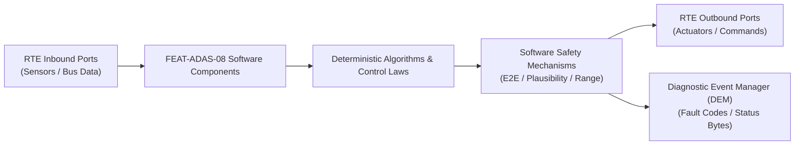

# Software Requirements Specification: Blind Spot Detection & Lane Change Assist (BSD-LCA)
**Feature ID:** `FEAT-ADAS-08`  
**Domain:** ADAS & Autonomous Driving  
**Target ASIL:** ASIL B  
**Compliance Standard:** ISO 26262:2018 (Part 6 - Software Development) / ASPICE PAM v3.1 (SWE.1, SWE.2)  
**Parent System Specification:** [`FEAT-ADAS-08_BSD_SysReq.md`](file:///c:/Workset/AntiGravityProjects/TestOptimisationExperiement/system_requirements/FEAT-ADAS-08_BSD_SysReq.md)  
**Global Master Specification:** [`spec.md`](file:///c:/Workset/AntiGravityProjects/TestOptimisationExperiement/spec.md)

---

## 1. Software Architecture & Component Structure

This document specifies the AUTOSAR Software Components (SWCs), periodic runnables, algorithmic laws, safety mechanisms, and data ports implementing `FEAT-ADAS-08` (Blind Spot Detection & Lane Change Assist (BSD-LCA)).

### AUTOSAR SWC Interaction Diagram

---

## 2. Detailed Software Requirements (SWR_REQ)
*(Multi-Software Requirement Partitioning derived from System Requirements)*

### `SWR-ADAS-08-01`: Rear Radar Target Tracking & Lane Association
- **Planned Release:** R100
- **ASIL Rating:** ASIL B
- **Parent System Requirement:** [`SYS-ADAS-08-01`](file:///c:/Workset/AntiGravityProjects/TestOptimisationExperiement/system_requirements/FEAT-ADAS-08_BSD_SysReq.md#sys-adas-08-01)
- **Allocated AUTOSAR SWC:** `BsdTrackManager_SWC`
- **Execution Rate / Trigger:** 20 ms
- **Worst-Case Execution Time (WCET):** 1.8 ms
- **Software Activation Condition:** Executed every 20 ms.
- **Algorithmic Description / Logic:**
  > Filters radar raw targets. Determines lateral lane position: Left Lane (y in [1.8, 5.0] m), Right Lane (y in [-5.0, -1.8] m). Computes closing speed v_rel = v_target - v_ego.
- **Software Safety Mechanism:** Guardrail and stationary clutter rejection using Doppler signature analysis.
- **Failure Reaction & DEM Diagnostic Event:** Drop tracks that have zero Doppler speed relative to ground.
- **Software Port Inputs:** `Rear_Radar_Raw_Tracks[32], Ego_Speed_Mps`
- **Software Port Outputs:** `Classified_Lane_Targets[8]`
- **Software Verification Criteria:** SIL radar track injection test suite.
- **Traceability Link:** Traces upward to [`SYS-ADAS-08-01`](file:///c:/Workset/AntiGravityProjects/TestOptimisationExperiement/system_requirements/FEAT-ADAS-08_BSD_SysReq.md#sys-adas-08-01) and [`FEAT-ADAS-08`](file:///c:/Workset/AntiGravityProjects/TestOptimisationExperiement/spec.md).

### `SWR-ADAS-08-02`: Blind Spot Closing Speed & Warning Threshold Resolver
- **Planned Release:** R100
- **ASIL Rating:** ASIL B
- **Parent System Requirement:** [`SYS-ADAS-08-01`](file:///c:/Workset/AntiGravityProjects/TestOptimisationExperiement/system_requirements/FEAT-ADAS-08_BSD_SysReq.md#sys-adas-08-01)
- **Allocated AUTOSAR SWC:** `BsdThreatEvaluator_SWC`
- **Execution Rate / Trigger:** 20 ms
- **Worst-Case Execution Time (WCET):** 0.9 ms
- **Software Activation Condition:** Executed every 20 ms on Classified_Lane_Targets.
- **Algorithmic Description / Logic:**
  > Computes TTC = -x_rel / v_rel. Trigger Condition: (Target in Blind Zone x in [-5.0, 1.0] m) OR (TTC <= 3.5s for approaching vehicles up to 70 m). Sets Threat_Active_Left / Right.
- **Software Safety Mechanism:** Hysteresis: Threat cleared when TTC > 4.2s or distance opens > 8.0 m.
- **Failure Reaction & DEM Diagnostic Event:** Force Threat_Active = FALSE if radar reporting self-diagnostic fault.
- **Software Port Inputs:** `Classified_Lane_Targets, Ego_Speed_Mps`
- **Software Port Outputs:** `Threat_Active_Left (boolean), Threat_Active_Right (boolean)`
- **Software Verification Criteria:** Boundary condition test across varying overtaking speeds.
- **Traceability Link:** Traces upward to [`SYS-ADAS-08-01`](file:///c:/Workset/AntiGravityProjects/TestOptimisationExperiement/system_requirements/FEAT-ADAS-08_BSD_SysReq.md#sys-adas-08-01) and [`FEAT-ADAS-08`](file:///c:/Workset/AntiGravityProjects/TestOptimisationExperiement/spec.md).

### `SWR-ADAS-08-03`: Side-Mirror HMI Warning State Machine & Chime Dispatcher
- **Planned Release:** R300
- **ASIL Rating:** ASIL B
- **Parent System Requirement:** [`SYS-ADAS-08-02`](file:///c:/Workset/AntiGravityProjects/TestOptimisationExperiement/system_requirements/FEAT-ADAS-08_BSD_SysReq.md#sys-adas-08-02)
- **Allocated AUTOSAR SWC:** `BsdHmiController_SWC`
- **Execution Rate / Trigger:** 20 ms
- **Worst-Case Execution Time (WCET):** 0.5 ms
- **Software Activation Condition:** Executed every 20 ms.
- **Algorithmic Description / Logic:**
  > If Threat_Active == TRUE and Turn_Signal == OFF: Mirror_LED = STEADY. If Threat_Active == TRUE and Turn_Signal == ON: Mirror_LED = BLINK_4HZ and Audio_Chime = PULSE_1KHZ.
- **Software Safety Mechanism:** PWM duty cycle verification of mirror LED driver pins.
- **Failure Reaction & DEM Diagnostic Event:** If LED open circuit detected, display backup warning on instrument cluster.
- **Software Port Inputs:** `Threat_Active_Left, Threat_Active_Right, Turn_Signal_Status`
- **Software Port Outputs:** `Left_Mirror_LED_Cmd, Right_Mirror_LED_Cmd, Audio_Warning_PDU`
- **Software Verification Criteria:** HMI state transition test suite.
- **Traceability Link:** Traces upward to [`SYS-ADAS-08-02`](file:///c:/Workset/AntiGravityProjects/TestOptimisationExperiement/system_requirements/FEAT-ADAS-08_BSD_SysReq.md#sys-adas-08-02) and [`FEAT-ADAS-08`](file:///c:/Workset/AntiGravityProjects/TestOptimisationExperiement/spec.md).

### `SWR-ADAS-08-04`: EPS Resistive Steering Torque Pulse Generator
- **Planned Release:** R300
- **ASIL Rating:** ASIL B
- **Parent System Requirement:** [`SYS-ADAS-08-02`](file:///c:/Workset/AntiGravityProjects/TestOptimisationExperiement/system_requirements/FEAT-ADAS-08_BSD_SysReq.md#sys-adas-08-02)
- **Allocated AUTOSAR SWC:** `BsdSteeringIntervention_SWC`
- **Execution Rate / Trigger:** 10 ms
- **Worst-Case Execution Time (WCET):** 0.8 ms
- **Software Activation Condition:** Executed when driver initiates lane change into occupied lane.
- **Algorithmic Description / Logic:**
  > Generates counter-steering torque pulse of 2.5 Nm resisting movement towards hazard for 1.5s. If driver applies > 3.0 Nm, ramp intervention torque to 0 Nm in 200 ms.
- **Software Safety Mechanism:** Torque command strictly capped to 2.5 Nm; cannot override driver physical strength.
- **Failure Reaction & DEM Diagnostic Event:** Instantly release torque if EPS motor temperature > 110°C.
- **Software Port Inputs:** `Threat_Active_Left, Threat_Active_Right, Steering_Angle, Driver_Torque`
- **Software Port Outputs:** `EPS_Bsd_Torque_Cmd_Nm`
- **Software Verification Criteria:** Chassis HIL steering feel validation.
- **Traceability Link:** Traces upward to [`SYS-ADAS-08-02`](file:///c:/Workset/AntiGravityProjects/TestOptimisationExperiement/system_requirements/FEAT-ADAS-08_BSD_SysReq.md#sys-adas-08-02) and [`FEAT-ADAS-08`](file:///c:/Workset/AntiGravityProjects/TestOptimisationExperiement/spec.md).

### `SWR-ADAS-08-05`: Side Mirror Warning LED Pulse-Width Modulator & Dimmer
- **Planned Release:** R100
- **ASIL Rating:** ASIL B
- **Parent System Requirement:** [`SYS-ADAS-08-03`](file:///c:/Workset/AntiGravityProjects/TestOptimisationExperiement/system_requirements/FEAT-ADAS-08_BSD_SysReq.md#sys-adas-08-03)
- **Allocated AUTOSAR SWC:** `BsdMirrorLed_SWC`
- **Execution Rate / Trigger:** 20 ms
- **Worst-Case Execution Time (WCET):** 0.3 ms
- **Software Activation Condition:** Cyclic 20 ms task.
- **Algorithmic Description / Logic:**
  > Modulates LED brightness based on ambient light sensor (bright daytime: 100% PWM; nighttime: 30% PWM to prevent glare). Generates 4.0 Hz square wave flashing when turn signal matches occupied side.
- **Software Safety Mechanism:** Driver feedback diagnostic: Reads shunt resistor voltage to verify LED current draw (15-25 mA).
- **Failure Reaction & DEM Diagnostic Event:** Report LED_Circuit_Fault if shunt current is zero.
- **Software Port Inputs:** `Threat_Level_Side_Enum, Ambient_Lux_Sensor, Turn_Signal_Active_Side`
- **Software Port Outputs:** `LED_PWM_Duty_Cycle_Left, LED_PWM_Duty_Cycle_Right`
- **Software Verification Criteria:** Illuminance meter test across ambient lighting from 1 lux to 100,000 lux.
- **Traceability Link:** Traces upward to [`SYS-ADAS-08-03`](file:///c:/Workset/AntiGravityProjects/TestOptimisationExperiement/system_requirements/FEAT-ADAS-08_BSD_SysReq.md#sys-adas-08-03) and [`FEAT-ADAS-08`](file:///c:/Workset/AntiGravityProjects/TestOptimisationExperiement/spec.md).

### `SWR-ADAS-08-06`: Blind Spot Audio Alert Chime Escalation Coordinator
- **Planned Release:** R100
- **ASIL Rating:** ASIL B
- **Parent System Requirement:** [`SYS-ADAS-08-03`](file:///c:/Workset/AntiGravityProjects/TestOptimisationExperiement/system_requirements/FEAT-ADAS-08_BSD_SysReq.md#sys-adas-08-03)
- **Allocated AUTOSAR SWC:** `BsdAudioAlert_SWC`
- **Execution Rate / Trigger:** 20 ms
- **Worst-Case Execution Time (WCET):** 0.3 ms
- **Software Activation Condition:** Active on Stage 2 alert.
- **Algorithmic Description / Logic:**
  > Sends chime request to cockpit audio DSP over CAN-FD: Requests directional double-chirp tone (800 Hz, 75 dB(A)) routed through door speaker on the threatened side to orient driver attention.
- **Software Safety Mechanism:** Chime mute guard: Does not suppress audio if driver is on emergency phone call.
- **Failure Reaction & DEM Diagnostic Event:** Direct chime to cluster hardware buzzer if audio DSP fails.
- **Software Port Inputs:** `Stage2_Alert_Left_Flag, Stage2_Alert_Right_Flag`
- **Software Port Outputs:** `Directional_Chime_Command_Payload, Chime_Speaker_Select_Enum`
- **Software Verification Criteria:** Directional sound localization acoustic testing in vehicle interior.
- **Traceability Link:** Traces upward to [`SYS-ADAS-08-03`](file:///c:/Workset/AntiGravityProjects/TestOptimisationExperiement/system_requirements/FEAT-ADAS-08_BSD_SysReq.md#sys-adas-08-03) and [`FEAT-ADAS-08`](file:///c:/Workset/AntiGravityProjects/TestOptimisationExperiement/spec.md).

### `SWR-ADAS-08-07`: Sideswipe Collision Trajectory Predictor & Kinematic Risk Gate
- **Planned Release:** R200
- **ASIL Rating:** ASIL B
- **Parent System Requirement:** [`SYS-ADAS-08-04`](file:///c:/Workset/AntiGravityProjects/TestOptimisationExperiement/system_requirements/FEAT-ADAS-08_BSD_SysReq.md#sys-adas-08-04)
- **Allocated AUTOSAR SWC:** `BsdSideswipePredictor_SWC`
- **Execution Rate / Trigger:** 10 ms
- **Worst-Case Execution Time (WCET):** 0.8 ms
- **Software Activation Condition:** Active when vehicle begins drifting towards adjacent lane.
- **Algorithmic Description / Logic:**
  > Predicts lateral distance between ego flank and target vehicle: d_flank(t) = d_lateral_0 - (v_lat_ego + v_lat_target) * t. If d_flank reaches 0.0 m within t < 2.5 seconds, triggers active steering resistance.
- **Software Safety Mechanism:** Sanity check: Rejects target tracks with negative longitudinal closing speed.
- **Failure Reaction & DEM Diagnostic Event:** Inhibit steering intervention if target confidence < 70%.
- **Software Port Inputs:** `Target_Relative_Pos_X_Y, Target_Relative_Vel_X_Y, Ego_Lateral_Velocity_Mps`
- **Software Port Outputs:** `Sideswipe_Collision_Risk_Flag, Time_To_Sideswipe_Sec`
- **Software Verification Criteria:** High-speed highway passing scenario simulation with closing speed up to 70 km/h.
- **Traceability Link:** Traces upward to [`SYS-ADAS-08-04`](file:///c:/Workset/AntiGravityProjects/TestOptimisationExperiement/system_requirements/FEAT-ADAS-08_BSD_SysReq.md#sys-adas-08-04) and [`FEAT-ADAS-08`](file:///c:/Workset/AntiGravityProjects/TestOptimisationExperiement/spec.md).

### `SWR-ADAS-08-08`: Active EPS Steering Resistance Haptic Virtual Barrier Generator
- **Planned Release:** R200
- **ASIL Rating:** ASIL B
- **Parent System Requirement:** [`SYS-ADAS-08-04`](file:///c:/Workset/AntiGravityProjects/TestOptimisationExperiement/system_requirements/FEAT-ADAS-08_BSD_SysReq.md#sys-adas-08-04)
- **Allocated AUTOSAR SWC:** `BsdSteeringResistance_SWC`
- **Execution Rate / Trigger:** 5 ms
- **Worst-Case Execution Time (WCET):** 0.4 ms
- **Software Activation Condition:** Triggered on Sideswipe_Collision_Risk_Flag.
- **Algorithmic Description / Logic:**
  > Commands EPS to synthesize virtual elastic resistance barrier: T_barrier = K_barrier * (Lateral_Displacement_Past_Line). Maximum opposing torque capped to +3.0 Nm. Feels like stiff virtual spring pushing steering wheel back.
- **Software Safety Mechanism:** Driver override dominance: Driver can easily overcome resistance with 4.5 Nm handwheel torque.
- **Failure Reaction & DEM Diagnostic Event:** Zero torque output if steering torque sensor confidence degrades.
- **Software Port Inputs:** `Sideswipe_Collision_Risk_Flag, Lateral_Lane_Position_M, Driver_Handwheel_Torque_Nm`
- **Software Port Outputs:** `EPS_Barrier_Torque_Cmd_Nm, Intervention_Duration_Timer_Sec`
- **Software Verification Criteria:** HIL steering robot test measuring opposing torque gradient and driver override threshold.
- **Traceability Link:** Traces upward to [`SYS-ADAS-08-04`](file:///c:/Workset/AntiGravityProjects/TestOptimisationExperiement/system_requirements/FEAT-ADAS-08_BSD_SysReq.md#sys-adas-08-04) and [`FEAT-ADAS-08`](file:///c:/Workset/AntiGravityProjects/TestOptimisationExperiement/spec.md).

### `SWR-ADAS-08-09`: Rear Corner Radar High-Speed Object Trajectory Tracker - Dynamic Observer & Signal Filter
- **Planned Release:** R200
- **ASIL Rating:** ASIL B
- **Parent System Requirement:** [`SYS-ADAS-08-05`](file:///c:/Workset/AntiGravityProjects/TestOptimisationExperiement/system_requirements/FEAT-ADAS-08_BSD_SysReq.md#sys-adas-08-05)
- **Allocated AUTOSAR SWC:** `BsdRadarTracker_SWC`
- **Execution Rate / Trigger:** 20 ms
- **Worst-Case Execution Time (WCET):** 0.3 ms
- **Software Activation Condition:** Executed cyclically every 20 ms.
- **Algorithmic Description / Logic:**
  > Executes signal plausibility filtering, calibration offsets, and discrete state estimation for Rear Corner Radar High-Speed Object Trajectory Tracker.
- **Software Safety Mechanism:** Range limit plausibility check and E2E alive sequence verification.
- **Failure Reaction & DEM Diagnostic Event:** Set default fallback output and report DEM_EVENT_FEAT_ADAS_08_ERR.
- **Software Port Inputs:** `Raw sensor ADC/SENT/SPI values and RTE bus inputs.`
- **Software Port Outputs:** `Filtered physical signals and validity status bitmasks.`
- **Software Verification Criteria:** Unit test and HiL software integration test.
- **Traceability Link:** Traces upward to [`SYS-ADAS-08-05`](file:///c:/Workset/AntiGravityProjects/TestOptimisationExperiement/system_requirements/FEAT-ADAS-08_BSD_SysReq.md#sys-adas-08-05) and [`FEAT-ADAS-08`](file:///c:/Workset/AntiGravityProjects/TestOptimisationExperiement/spec.md).

### `SWR-ADAS-08-10`: Rear Corner Radar High-Speed Object Trajectory Tracker - Closed-Loop Control Law & Actuator Dispatch
- **Planned Release:** R200
- **ASIL Rating:** ASIL B
- **Parent System Requirement:** [`SYS-ADAS-08-05`](file:///c:/Workset/AntiGravityProjects/TestOptimisationExperiement/system_requirements/FEAT-ADAS-08_BSD_SysReq.md#sys-adas-08-05)
- **Allocated AUTOSAR SWC:** `BsdRadarTracker_SWC`
- **Execution Rate / Trigger:** 20 ms
- **Worst-Case Execution Time (WCET):** 0.4 ms
- **Software Activation Condition:** Executed cyclically every 20 ms.
- **Algorithmic Description / Logic:**
  > Evaluates deterministic closed-loop control law, rate limits, and dispatches commands for Rear Corner Radar High-Speed Object Trajectory Tracker.
- **Software Safety Mechanism:** Command saturation clamping and watchdog program flow monitoring.
- **Failure Reaction & DEM Diagnostic Event:** De-energize actuator output, apply safe fallback clamp, and latch DTC.
- **Software Port Inputs:** `Validated physical state signals from observer SWC.`
- **Software Port Outputs:** `Actuator PWM duty cycles, torque/pressure setpoints, and diagnostic flags.`
- **Software Verification Criteria:** Hardware dynamometer and HiL closed-loop regression test suite.
- **Traceability Link:** Traces upward to [`SYS-ADAS-08-05`](file:///c:/Workset/AntiGravityProjects/TestOptimisationExperiement/system_requirements/FEAT-ADAS-08_BSD_SysReq.md#sys-adas-08-05) and [`FEAT-ADAS-08`](file:///c:/Workset/AntiGravityProjects/TestOptimisationExperiement/spec.md).

### `SWR-ADAS-08-11`: Adjacent Lane Blind Spot Zone Vehicle Occupancy Detector - Dynamic Observer & Signal Filter
- **Planned Release:** R200
- **ASIL Rating:** ASIL B
- **Parent System Requirement:** [`SYS-ADAS-08-06`](file:///c:/Workset/AntiGravityProjects/TestOptimisationExperiement/system_requirements/FEAT-ADAS-08_BSD_SysReq.md#sys-adas-08-06)
- **Allocated AUTOSAR SWC:** `BsdZoneDetector_SWC`
- **Execution Rate / Trigger:** 20 ms
- **Worst-Case Execution Time (WCET):** 0.3 ms
- **Software Activation Condition:** Executed cyclically every 20 ms.
- **Algorithmic Description / Logic:**
  > Executes signal plausibility filtering, calibration offsets, and discrete state estimation for Adjacent Lane Blind Spot Zone Vehicle Occupancy Detector.
- **Software Safety Mechanism:** Range limit plausibility check and E2E alive sequence verification.
- **Failure Reaction & DEM Diagnostic Event:** Set default fallback output and report DEM_EVENT_FEAT_ADAS_08_ERR.
- **Software Port Inputs:** `Raw sensor ADC/SENT/SPI values and RTE bus inputs.`
- **Software Port Outputs:** `Filtered physical signals and validity status bitmasks.`
- **Software Verification Criteria:** Unit test and HiL software integration test.
- **Traceability Link:** Traces upward to [`SYS-ADAS-08-06`](file:///c:/Workset/AntiGravityProjects/TestOptimisationExperiement/system_requirements/FEAT-ADAS-08_BSD_SysReq.md#sys-adas-08-06) and [`FEAT-ADAS-08`](file:///c:/Workset/AntiGravityProjects/TestOptimisationExperiement/spec.md).

### `SWR-ADAS-08-12`: Adjacent Lane Blind Spot Zone Vehicle Occupancy Detector - Closed-Loop Control Law & Actuator Dispatch
- **Planned Release:** R200
- **ASIL Rating:** ASIL B
- **Parent System Requirement:** [`SYS-ADAS-08-06`](file:///c:/Workset/AntiGravityProjects/TestOptimisationExperiement/system_requirements/FEAT-ADAS-08_BSD_SysReq.md#sys-adas-08-06)
- **Allocated AUTOSAR SWC:** `BsdZoneDetector_SWC`
- **Execution Rate / Trigger:** 20 ms
- **Worst-Case Execution Time (WCET):** 0.4 ms
- **Software Activation Condition:** Executed cyclically every 20 ms.
- **Algorithmic Description / Logic:**
  > Evaluates deterministic closed-loop control law, rate limits, and dispatches commands for Adjacent Lane Blind Spot Zone Vehicle Occupancy Detector.
- **Software Safety Mechanism:** Command saturation clamping and watchdog program flow monitoring.
- **Failure Reaction & DEM Diagnostic Event:** De-energize actuator output, apply safe fallback clamp, and latch DTC.
- **Software Port Inputs:** `Validated physical state signals from observer SWC.`
- **Software Port Outputs:** `Actuator PWM duty cycles, torque/pressure setpoints, and diagnostic flags.`
- **Software Verification Criteria:** Hardware dynamometer and HiL closed-loop regression test suite.
- **Traceability Link:** Traces upward to [`SYS-ADAS-08-06`](file:///c:/Workset/AntiGravityProjects/TestOptimisationExperiement/system_requirements/FEAT-ADAS-08_BSD_SysReq.md#sys-adas-08-06) and [`FEAT-ADAS-08`](file:///c:/Workset/AntiGravityProjects/TestOptimisationExperiement/spec.md).

### `SWR-ADAS-08-13`: Closing Velocity & Time-to-Collision (TTC) Criticality Evaluator - Dynamic Observer & Signal Filter
- **Planned Release:** R300
- **ASIL Rating:** ASIL B
- **Parent System Requirement:** [`SYS-ADAS-08-07`](file:///c:/Workset/AntiGravityProjects/TestOptimisationExperiement/system_requirements/FEAT-ADAS-08_BSD_SysReq.md#sys-adas-08-07)
- **Allocated AUTOSAR SWC:** `BsdTtcEvaluator_SWC`
- **Execution Rate / Trigger:** 15 ms
- **Worst-Case Execution Time (WCET):** 0.3 ms
- **Software Activation Condition:** Executed cyclically every 15 ms.
- **Algorithmic Description / Logic:**
  > Executes signal plausibility filtering, calibration offsets, and discrete state estimation for Closing Velocity & Time-to-Collision (TTC) Criticality Evaluator.
- **Software Safety Mechanism:** Range limit plausibility check and E2E alive sequence verification.
- **Failure Reaction & DEM Diagnostic Event:** Set default fallback output and report DEM_EVENT_FEAT_ADAS_08_ERR.
- **Software Port Inputs:** `Raw sensor ADC/SENT/SPI values and RTE bus inputs.`
- **Software Port Outputs:** `Filtered physical signals and validity status bitmasks.`
- **Software Verification Criteria:** Unit test and HiL software integration test.
- **Traceability Link:** Traces upward to [`SYS-ADAS-08-07`](file:///c:/Workset/AntiGravityProjects/TestOptimisationExperiement/system_requirements/FEAT-ADAS-08_BSD_SysReq.md#sys-adas-08-07) and [`FEAT-ADAS-08`](file:///c:/Workset/AntiGravityProjects/TestOptimisationExperiement/spec.md).

### `SWR-ADAS-08-14`: Closing Velocity & Time-to-Collision (TTC) Criticality Evaluator - Closed-Loop Control Law & Actuator Dispatch
- **Planned Release:** R300
- **ASIL Rating:** ASIL B
- **Parent System Requirement:** [`SYS-ADAS-08-07`](file:///c:/Workset/AntiGravityProjects/TestOptimisationExperiement/system_requirements/FEAT-ADAS-08_BSD_SysReq.md#sys-adas-08-07)
- **Allocated AUTOSAR SWC:** `BsdTtcEvaluator_SWC`
- **Execution Rate / Trigger:** 15 ms
- **Worst-Case Execution Time (WCET):** 0.4 ms
- **Software Activation Condition:** Executed cyclically every 15 ms.
- **Algorithmic Description / Logic:**
  > Evaluates deterministic closed-loop control law, rate limits, and dispatches commands for Closing Velocity & Time-to-Collision (TTC) Criticality Evaluator.
- **Software Safety Mechanism:** Command saturation clamping and watchdog program flow monitoring.
- **Failure Reaction & DEM Diagnostic Event:** De-energize actuator output, apply safe fallback clamp, and latch DTC.
- **Software Port Inputs:** `Validated physical state signals from observer SWC.`
- **Software Port Outputs:** `Actuator PWM duty cycles, torque/pressure setpoints, and diagnostic flags.`
- **Software Verification Criteria:** Hardware dynamometer and HiL closed-loop regression test suite.
- **Traceability Link:** Traces upward to [`SYS-ADAS-08-07`](file:///c:/Workset/AntiGravityProjects/TestOptimisationExperiement/system_requirements/FEAT-ADAS-08_BSD_SysReq.md#sys-adas-08-07) and [`FEAT-ADAS-08`](file:///c:/Workset/AntiGravityProjects/TestOptimisationExperiement/spec.md).

### `SWR-ADAS-08-15`: Side Mirror Optical Warning LED Intensity Driver - Dynamic Observer & Signal Filter
- **Planned Release:** R300
- **ASIL Rating:** ASIL B
- **Parent System Requirement:** [`SYS-ADAS-08-08`](file:///c:/Workset/AntiGravityProjects/TestOptimisationExperiement/system_requirements/FEAT-ADAS-08_BSD_SysReq.md#sys-adas-08-08)
- **Allocated AUTOSAR SWC:** `BsdOpticalDriver_SWC`
- **Execution Rate / Trigger:** 20 ms
- **Worst-Case Execution Time (WCET):** 0.3 ms
- **Software Activation Condition:** Executed cyclically every 20 ms.
- **Algorithmic Description / Logic:**
  > Executes signal plausibility filtering, calibration offsets, and discrete state estimation for Side Mirror Optical Warning LED Intensity Driver.
- **Software Safety Mechanism:** Range limit plausibility check and E2E alive sequence verification.
- **Failure Reaction & DEM Diagnostic Event:** Set default fallback output and report DEM_EVENT_FEAT_ADAS_08_ERR.
- **Software Port Inputs:** `Raw sensor ADC/SENT/SPI values and RTE bus inputs.`
- **Software Port Outputs:** `Filtered physical signals and validity status bitmasks.`
- **Software Verification Criteria:** Unit test and HiL software integration test.
- **Traceability Link:** Traces upward to [`SYS-ADAS-08-08`](file:///c:/Workset/AntiGravityProjects/TestOptimisationExperiement/system_requirements/FEAT-ADAS-08_BSD_SysReq.md#sys-adas-08-08) and [`FEAT-ADAS-08`](file:///c:/Workset/AntiGravityProjects/TestOptimisationExperiement/spec.md).

### `SWR-ADAS-08-16`: Side Mirror Optical Warning LED Intensity Driver - Closed-Loop Control Law & Actuator Dispatch
- **Planned Release:** R300
- **ASIL Rating:** ASIL B
- **Parent System Requirement:** [`SYS-ADAS-08-08`](file:///c:/Workset/AntiGravityProjects/TestOptimisationExperiement/system_requirements/FEAT-ADAS-08_BSD_SysReq.md#sys-adas-08-08)
- **Allocated AUTOSAR SWC:** `BsdOpticalDriver_SWC`
- **Execution Rate / Trigger:** 20 ms
- **Worst-Case Execution Time (WCET):** 0.4 ms
- **Software Activation Condition:** Executed cyclically every 20 ms.
- **Algorithmic Description / Logic:**
  > Evaluates deterministic closed-loop control law, rate limits, and dispatches commands for Side Mirror Optical Warning LED Intensity Driver.
- **Software Safety Mechanism:** Command saturation clamping and watchdog program flow monitoring.
- **Failure Reaction & DEM Diagnostic Event:** De-energize actuator output, apply safe fallback clamp, and latch DTC.
- **Software Port Inputs:** `Validated physical state signals from observer SWC.`
- **Software Port Outputs:** `Actuator PWM duty cycles, torque/pressure setpoints, and diagnostic flags.`
- **Software Verification Criteria:** Hardware dynamometer and HiL closed-loop regression test suite.
- **Traceability Link:** Traces upward to [`SYS-ADAS-08-08`](file:///c:/Workset/AntiGravityProjects/TestOptimisationExperiement/system_requirements/FEAT-ADAS-08_BSD_SysReq.md#sys-adas-08-08) and [`FEAT-ADAS-08`](file:///c:/Workset/AntiGravityProjects/TestOptimisationExperiement/spec.md).

### `SWR-ADAS-08-17`: Turn Signal Activation Intent & Level 2 Alert Escalation - Dynamic Observer & Signal Filter
- **Planned Release:** R300
- **ASIL Rating:** ASIL B
- **Parent System Requirement:** [`SYS-ADAS-08-09`](file:///c:/Workset/AntiGravityProjects/TestOptimisationExperiement/system_requirements/FEAT-ADAS-08_BSD_SysReq.md#sys-adas-08-09)
- **Allocated AUTOSAR SWC:** `BsdAlertEscalator_SWC`
- **Execution Rate / Trigger:** 10 ms
- **Worst-Case Execution Time (WCET):** 0.3 ms
- **Software Activation Condition:** Executed cyclically every 10 ms.
- **Algorithmic Description / Logic:**
  > Executes signal plausibility filtering, calibration offsets, and discrete state estimation for Turn Signal Activation Intent & Level 2 Alert Escalation.
- **Software Safety Mechanism:** Range limit plausibility check and E2E alive sequence verification.
- **Failure Reaction & DEM Diagnostic Event:** Set default fallback output and report DEM_EVENT_FEAT_ADAS_08_ERR.
- **Software Port Inputs:** `Raw sensor ADC/SENT/SPI values and RTE bus inputs.`
- **Software Port Outputs:** `Filtered physical signals and validity status bitmasks.`
- **Software Verification Criteria:** Unit test and HiL software integration test.
- **Traceability Link:** Traces upward to [`SYS-ADAS-08-09`](file:///c:/Workset/AntiGravityProjects/TestOptimisationExperiement/system_requirements/FEAT-ADAS-08_BSD_SysReq.md#sys-adas-08-09) and [`FEAT-ADAS-08`](file:///c:/Workset/AntiGravityProjects/TestOptimisationExperiement/spec.md).

### `SWR-ADAS-08-18`: Turn Signal Activation Intent & Level 2 Alert Escalation - Closed-Loop Control Law & Actuator Dispatch
- **Planned Release:** R300
- **ASIL Rating:** ASIL B
- **Parent System Requirement:** [`SYS-ADAS-08-09`](file:///c:/Workset/AntiGravityProjects/TestOptimisationExperiement/system_requirements/FEAT-ADAS-08_BSD_SysReq.md#sys-adas-08-09)
- **Allocated AUTOSAR SWC:** `BsdAlertEscalator_SWC`
- **Execution Rate / Trigger:** 10 ms
- **Worst-Case Execution Time (WCET):** 0.4 ms
- **Software Activation Condition:** Executed cyclically every 10 ms.
- **Algorithmic Description / Logic:**
  > Evaluates deterministic closed-loop control law, rate limits, and dispatches commands for Turn Signal Activation Intent & Level 2 Alert Escalation.
- **Software Safety Mechanism:** Command saturation clamping and watchdog program flow monitoring.
- **Failure Reaction & DEM Diagnostic Event:** De-energize actuator output, apply safe fallback clamp, and latch DTC.
- **Software Port Inputs:** `Validated physical state signals from observer SWC.`
- **Software Port Outputs:** `Actuator PWM duty cycles, torque/pressure setpoints, and diagnostic flags.`
- **Software Verification Criteria:** Hardware dynamometer and HiL closed-loop regression test suite.
- **Traceability Link:** Traces upward to [`SYS-ADAS-08-09`](file:///c:/Workset/AntiGravityProjects/TestOptimisationExperiement/system_requirements/FEAT-ADAS-08_BSD_SysReq.md#sys-adas-08-09) and [`FEAT-ADAS-08`](file:///c:/Workset/AntiGravityProjects/TestOptimisationExperiement/spec.md).

### `SWR-ADAS-08-19`: Active Lane Change Steering Resistance Torque Superposition - Dynamic Observer & Signal Filter
- **Planned Release:** R400
- **ASIL Rating:** ASIL B
- **Parent System Requirement:** [`SYS-ADAS-08-10`](file:///c:/Workset/AntiGravityProjects/TestOptimisationExperiement/system_requirements/FEAT-ADAS-08_BSD_SysReq.md#sys-adas-08-10)
- **Allocated AUTOSAR SWC:** `BsdSteerResistance_SWC`
- **Execution Rate / Trigger:** 10 ms
- **Worst-Case Execution Time (WCET):** 0.3 ms
- **Software Activation Condition:** Executed cyclically every 10 ms.
- **Algorithmic Description / Logic:**
  > Executes signal plausibility filtering, calibration offsets, and discrete state estimation for Active Lane Change Steering Resistance Torque Superposition.
- **Software Safety Mechanism:** Range limit plausibility check and E2E alive sequence verification.
- **Failure Reaction & DEM Diagnostic Event:** Set default fallback output and report DEM_EVENT_FEAT_ADAS_08_ERR.
- **Software Port Inputs:** `Raw sensor ADC/SENT/SPI values and RTE bus inputs.`
- **Software Port Outputs:** `Filtered physical signals and validity status bitmasks.`
- **Software Verification Criteria:** Unit test and HiL software integration test.
- **Traceability Link:** Traces upward to [`SYS-ADAS-08-10`](file:///c:/Workset/AntiGravityProjects/TestOptimisationExperiement/system_requirements/FEAT-ADAS-08_BSD_SysReq.md#sys-adas-08-10) and [`FEAT-ADAS-08`](file:///c:/Workset/AntiGravityProjects/TestOptimisationExperiement/spec.md).

### `SWR-ADAS-08-20`: Active Lane Change Steering Resistance Torque Superposition - Closed-Loop Control Law & Actuator Dispatch
- **Planned Release:** R400
- **ASIL Rating:** ASIL B
- **Parent System Requirement:** [`SYS-ADAS-08-10`](file:///c:/Workset/AntiGravityProjects/TestOptimisationExperiement/system_requirements/FEAT-ADAS-08_BSD_SysReq.md#sys-adas-08-10)
- **Allocated AUTOSAR SWC:** `BsdSteerResistance_SWC`
- **Execution Rate / Trigger:** 10 ms
- **Worst-Case Execution Time (WCET):** 0.4 ms
- **Software Activation Condition:** Executed cyclically every 10 ms.
- **Algorithmic Description / Logic:**
  > Evaluates deterministic closed-loop control law, rate limits, and dispatches commands for Active Lane Change Steering Resistance Torque Superposition.
- **Software Safety Mechanism:** Command saturation clamping and watchdog program flow monitoring.
- **Failure Reaction & DEM Diagnostic Event:** De-energize actuator output, apply safe fallback clamp, and latch DTC.
- **Software Port Inputs:** `Validated physical state signals from observer SWC.`
- **Software Port Outputs:** `Actuator PWM duty cycles, torque/pressure setpoints, and diagnostic flags.`
- **Software Verification Criteria:** Hardware dynamometer and HiL closed-loop regression test suite.
- **Traceability Link:** Traces upward to [`SYS-ADAS-08-10`](file:///c:/Workset/AntiGravityProjects/TestOptimisationExperiement/system_requirements/FEAT-ADAS-08_BSD_SysReq.md#sys-adas-08-10) and [`FEAT-ADAS-08`](file:///c:/Workset/AntiGravityProjects/TestOptimisationExperiement/spec.md).

### `SWR-ADAS-08-21`: Motorcycle & Narrow Vulnerable Vehicle High-Sensitivity Classifier - Dynamic Observer & Signal Filter
- **Planned Release:** R400
- **ASIL Rating:** ASIL B
- **Parent System Requirement:** [`SYS-ADAS-08-11`](file:///c:/Workset/AntiGravityProjects/TestOptimisationExperiement/system_requirements/FEAT-ADAS-08_BSD_SysReq.md#sys-adas-08-11)
- **Allocated AUTOSAR SWC:** `BsdMotorcycleFilter_SWC`
- **Execution Rate / Trigger:** 20 ms
- **Worst-Case Execution Time (WCET):** 0.3 ms
- **Software Activation Condition:** Executed cyclically every 20 ms.
- **Algorithmic Description / Logic:**
  > Executes signal plausibility filtering, calibration offsets, and discrete state estimation for Motorcycle & Narrow Vulnerable Vehicle High-Sensitivity Classifier.
- **Software Safety Mechanism:** Range limit plausibility check and E2E alive sequence verification.
- **Failure Reaction & DEM Diagnostic Event:** Set default fallback output and report DEM_EVENT_FEAT_ADAS_08_ERR.
- **Software Port Inputs:** `Raw sensor ADC/SENT/SPI values and RTE bus inputs.`
- **Software Port Outputs:** `Filtered physical signals and validity status bitmasks.`
- **Software Verification Criteria:** Unit test and HiL software integration test.
- **Traceability Link:** Traces upward to [`SYS-ADAS-08-11`](file:///c:/Workset/AntiGravityProjects/TestOptimisationExperiement/system_requirements/FEAT-ADAS-08_BSD_SysReq.md#sys-adas-08-11) and [`FEAT-ADAS-08`](file:///c:/Workset/AntiGravityProjects/TestOptimisationExperiement/spec.md).

### `SWR-ADAS-08-22`: Motorcycle & Narrow Vulnerable Vehicle High-Sensitivity Classifier - Closed-Loop Control Law & Actuator Dispatch
- **Planned Release:** R400
- **ASIL Rating:** ASIL B
- **Parent System Requirement:** [`SYS-ADAS-08-11`](file:///c:/Workset/AntiGravityProjects/TestOptimisationExperiement/system_requirements/FEAT-ADAS-08_BSD_SysReq.md#sys-adas-08-11)
- **Allocated AUTOSAR SWC:** `BsdMotorcycleFilter_SWC`
- **Execution Rate / Trigger:** 20 ms
- **Worst-Case Execution Time (WCET):** 0.4 ms
- **Software Activation Condition:** Executed cyclically every 20 ms.
- **Algorithmic Description / Logic:**
  > Evaluates deterministic closed-loop control law, rate limits, and dispatches commands for Motorcycle & Narrow Vulnerable Vehicle High-Sensitivity Classifier.
- **Software Safety Mechanism:** Command saturation clamping and watchdog program flow monitoring.
- **Failure Reaction & DEM Diagnostic Event:** De-energize actuator output, apply safe fallback clamp, and latch DTC.
- **Software Port Inputs:** `Validated physical state signals from observer SWC.`
- **Software Port Outputs:** `Actuator PWM duty cycles, torque/pressure setpoints, and diagnostic flags.`
- **Software Verification Criteria:** Hardware dynamometer and HiL closed-loop regression test suite.
- **Traceability Link:** Traces upward to [`SYS-ADAS-08-11`](file:///c:/Workset/AntiGravityProjects/TestOptimisationExperiement/system_requirements/FEAT-ADAS-08_BSD_SysReq.md#sys-adas-08-11) and [`FEAT-ADAS-08`](file:///c:/Workset/AntiGravityProjects/TestOptimisationExperiement/spec.md).

### `SWR-ADAS-08-23`: Highway Guardrail & Stationary Structure False Positive Filter - Dynamic Observer & Signal Filter
- **Planned Release:** R400
- **ASIL Rating:** ASIL B
- **Parent System Requirement:** [`SYS-ADAS-08-12`](file:///c:/Workset/AntiGravityProjects/TestOptimisationExperiement/system_requirements/FEAT-ADAS-08_BSD_SysReq.md#sys-adas-08-12)
- **Allocated AUTOSAR SWC:** `BsdFalsePositiveFilter_SWC`
- **Execution Rate / Trigger:** 20 ms
- **Worst-Case Execution Time (WCET):** 0.3 ms
- **Software Activation Condition:** Executed cyclically every 20 ms.
- **Algorithmic Description / Logic:**
  > Executes signal plausibility filtering, calibration offsets, and discrete state estimation for Highway Guardrail & Stationary Structure False Positive Filter.
- **Software Safety Mechanism:** Range limit plausibility check and E2E alive sequence verification.
- **Failure Reaction & DEM Diagnostic Event:** Set default fallback output and report DEM_EVENT_FEAT_ADAS_08_ERR.
- **Software Port Inputs:** `Raw sensor ADC/SENT/SPI values and RTE bus inputs.`
- **Software Port Outputs:** `Filtered physical signals and validity status bitmasks.`
- **Software Verification Criteria:** Unit test and HiL software integration test.
- **Traceability Link:** Traces upward to [`SYS-ADAS-08-12`](file:///c:/Workset/AntiGravityProjects/TestOptimisationExperiement/system_requirements/FEAT-ADAS-08_BSD_SysReq.md#sys-adas-08-12) and [`FEAT-ADAS-08`](file:///c:/Workset/AntiGravityProjects/TestOptimisationExperiement/spec.md).

### `SWR-ADAS-08-24`: Highway Guardrail & Stationary Structure False Positive Filter - Closed-Loop Control Law & Actuator Dispatch
- **Planned Release:** R400
- **ASIL Rating:** ASIL B
- **Parent System Requirement:** [`SYS-ADAS-08-12`](file:///c:/Workset/AntiGravityProjects/TestOptimisationExperiement/system_requirements/FEAT-ADAS-08_BSD_SysReq.md#sys-adas-08-12)
- **Allocated AUTOSAR SWC:** `BsdFalsePositiveFilter_SWC`
- **Execution Rate / Trigger:** 20 ms
- **Worst-Case Execution Time (WCET):** 0.4 ms
- **Software Activation Condition:** Executed cyclically every 20 ms.
- **Algorithmic Description / Logic:**
  > Evaluates deterministic closed-loop control law, rate limits, and dispatches commands for Highway Guardrail & Stationary Structure False Positive Filter.
- **Software Safety Mechanism:** Command saturation clamping and watchdog program flow monitoring.
- **Failure Reaction & DEM Diagnostic Event:** De-energize actuator output, apply safe fallback clamp, and latch DTC.
- **Software Port Inputs:** `Validated physical state signals from observer SWC.`
- **Software Port Outputs:** `Actuator PWM duty cycles, torque/pressure setpoints, and diagnostic flags.`
- **Software Verification Criteria:** Hardware dynamometer and HiL closed-loop regression test suite.
- **Traceability Link:** Traces upward to [`SYS-ADAS-08-12`](file:///c:/Workset/AntiGravityProjects/TestOptimisationExperiement/system_requirements/FEAT-ADAS-08_BSD_SysReq.md#sys-adas-08-12) and [`FEAT-ADAS-08`](file:///c:/Workset/AntiGravityProjects/TestOptimisationExperiement/spec.md).

### `SWR-ADAS-08-25`: Rear Corner Radar Bumper Misalignment & Pitch Angle Observer - Dynamic Observer & Signal Filter
- **Planned Release:** R500
- **ASIL Rating:** ASIL B
- **Parent System Requirement:** [`SYS-ADAS-08-13`](file:///c:/Workset/AntiGravityProjects/TestOptimisationExperiement/system_requirements/FEAT-ADAS-08_BSD_SysReq.md#sys-adas-08-13)
- **Allocated AUTOSAR SWC:** `BsdAlignmentMonitor_SWC`
- **Execution Rate / Trigger:** 100 ms
- **Worst-Case Execution Time (WCET):** 0.3 ms
- **Software Activation Condition:** Executed cyclically every 100 ms.
- **Algorithmic Description / Logic:**
  > Executes signal plausibility filtering, calibration offsets, and discrete state estimation for Rear Corner Radar Bumper Misalignment & Pitch Angle Observer.
- **Software Safety Mechanism:** Range limit plausibility check and E2E alive sequence verification.
- **Failure Reaction & DEM Diagnostic Event:** Set default fallback output and report DEM_EVENT_FEAT_ADAS_08_ERR.
- **Software Port Inputs:** `Raw sensor ADC/SENT/SPI values and RTE bus inputs.`
- **Software Port Outputs:** `Filtered physical signals and validity status bitmasks.`
- **Software Verification Criteria:** Unit test and HiL software integration test.
- **Traceability Link:** Traces upward to [`SYS-ADAS-08-13`](file:///c:/Workset/AntiGravityProjects/TestOptimisationExperiement/system_requirements/FEAT-ADAS-08_BSD_SysReq.md#sys-adas-08-13) and [`FEAT-ADAS-08`](file:///c:/Workset/AntiGravityProjects/TestOptimisationExperiement/spec.md).

### `SWR-ADAS-08-26`: Rear Corner Radar Bumper Misalignment & Pitch Angle Observer - Closed-Loop Control Law & Actuator Dispatch
- **Planned Release:** R500
- **ASIL Rating:** ASIL B
- **Parent System Requirement:** [`SYS-ADAS-08-13`](file:///c:/Workset/AntiGravityProjects/TestOptimisationExperiement/system_requirements/FEAT-ADAS-08_BSD_SysReq.md#sys-adas-08-13)
- **Allocated AUTOSAR SWC:** `BsdAlignmentMonitor_SWC`
- **Execution Rate / Trigger:** 100 ms
- **Worst-Case Execution Time (WCET):** 0.4 ms
- **Software Activation Condition:** Executed cyclically every 100 ms.
- **Algorithmic Description / Logic:**
  > Evaluates deterministic closed-loop control law, rate limits, and dispatches commands for Rear Corner Radar Bumper Misalignment & Pitch Angle Observer.
- **Software Safety Mechanism:** Command saturation clamping and watchdog program flow monitoring.
- **Failure Reaction & DEM Diagnostic Event:** De-energize actuator output, apply safe fallback clamp, and latch DTC.
- **Software Port Inputs:** `Validated physical state signals from observer SWC.`
- **Software Port Outputs:** `Actuator PWM duty cycles, torque/pressure setpoints, and diagnostic flags.`
- **Software Verification Criteria:** Hardware dynamometer and HiL closed-loop regression test suite.
- **Traceability Link:** Traces upward to [`SYS-ADAS-08-13`](file:///c:/Workset/AntiGravityProjects/TestOptimisationExperiement/system_requirements/FEAT-ADAS-08_BSD_SysReq.md#sys-adas-08-13) and [`FEAT-ADAS-08`](file:///c:/Workset/AntiGravityProjects/TestOptimisationExperiement/spec.md).

### `SWR-ADAS-08-27`: Trailer Hitch Detection & Blind Spot Zone Dynamic Extension - Dynamic Observer & Signal Filter
- **Planned Release:** R500
- **ASIL Rating:** ASIL B
- **Parent System Requirement:** [`SYS-ADAS-08-14`](file:///c:/Workset/AntiGravityProjects/TestOptimisationExperiement/system_requirements/FEAT-ADAS-08_BSD_SysReq.md#sys-adas-08-14)
- **Allocated AUTOSAR SWC:** `BsdTrailerExtension_SWC`
- **Execution Rate / Trigger:** 50 ms
- **Worst-Case Execution Time (WCET):** 0.3 ms
- **Software Activation Condition:** Executed cyclically every 50 ms.
- **Algorithmic Description / Logic:**
  > Executes signal plausibility filtering, calibration offsets, and discrete state estimation for Trailer Hitch Detection & Blind Spot Zone Dynamic Extension.
- **Software Safety Mechanism:** Range limit plausibility check and E2E alive sequence verification.
- **Failure Reaction & DEM Diagnostic Event:** Set default fallback output and report DEM_EVENT_FEAT_ADAS_08_ERR.
- **Software Port Inputs:** `Raw sensor ADC/SENT/SPI values and RTE bus inputs.`
- **Software Port Outputs:** `Filtered physical signals and validity status bitmasks.`
- **Software Verification Criteria:** Unit test and HiL software integration test.
- **Traceability Link:** Traces upward to [`SYS-ADAS-08-14`](file:///c:/Workset/AntiGravityProjects/TestOptimisationExperiement/system_requirements/FEAT-ADAS-08_BSD_SysReq.md#sys-adas-08-14) and [`FEAT-ADAS-08`](file:///c:/Workset/AntiGravityProjects/TestOptimisationExperiement/spec.md).

### `SWR-ADAS-08-28`: Trailer Hitch Detection & Blind Spot Zone Dynamic Extension - Closed-Loop Control Law & Actuator Dispatch
- **Planned Release:** R500
- **ASIL Rating:** ASIL B
- **Parent System Requirement:** [`SYS-ADAS-08-14`](file:///c:/Workset/AntiGravityProjects/TestOptimisationExperiement/system_requirements/FEAT-ADAS-08_BSD_SysReq.md#sys-adas-08-14)
- **Allocated AUTOSAR SWC:** `BsdTrailerExtension_SWC`
- **Execution Rate / Trigger:** 50 ms
- **Worst-Case Execution Time (WCET):** 0.4 ms
- **Software Activation Condition:** Executed cyclically every 50 ms.
- **Algorithmic Description / Logic:**
  > Evaluates deterministic closed-loop control law, rate limits, and dispatches commands for Trailer Hitch Detection & Blind Spot Zone Dynamic Extension.
- **Software Safety Mechanism:** Command saturation clamping and watchdog program flow monitoring.
- **Failure Reaction & DEM Diagnostic Event:** De-energize actuator output, apply safe fallback clamp, and latch DTC.
- **Software Port Inputs:** `Validated physical state signals from observer SWC.`
- **Software Port Outputs:** `Actuator PWM duty cycles, torque/pressure setpoints, and diagnostic flags.`
- **Software Verification Criteria:** Hardware dynamometer and HiL closed-loop regression test suite.
- **Traceability Link:** Traces upward to [`SYS-ADAS-08-14`](file:///c:/Workset/AntiGravityProjects/TestOptimisationExperiement/system_requirements/FEAT-ADAS-08_BSD_SysReq.md#sys-adas-08-14) and [`FEAT-ADAS-08`](file:///c:/Workset/AntiGravityProjects/TestOptimisationExperiement/spec.md).

### `SWR-ADAS-08-29`: DEM Diagnostic Fault Management & Low-Voltage Derating - Dynamic Observer & Signal Filter
- **Planned Release:** R500
- **ASIL Rating:** ASIL B
- **Parent System Requirement:** [`SYS-ADAS-08-15`](file:///c:/Workset/AntiGravityProjects/TestOptimisationExperiement/system_requirements/FEAT-ADAS-08_BSD_SysReq.md#sys-adas-08-15)
- **Allocated AUTOSAR SWC:** `BsdDiagnosticManager_SWC`
- **Execution Rate / Trigger:** 50 ms
- **Worst-Case Execution Time (WCET):** 0.3 ms
- **Software Activation Condition:** Executed cyclically every 50 ms.
- **Algorithmic Description / Logic:**
  > Executes signal plausibility filtering, calibration offsets, and discrete state estimation for DEM Diagnostic Fault Management & Low-Voltage Derating.
- **Software Safety Mechanism:** Range limit plausibility check and E2E alive sequence verification.
- **Failure Reaction & DEM Diagnostic Event:** Set default fallback output and report DEM_EVENT_FEAT_ADAS_08_ERR.
- **Software Port Inputs:** `Raw sensor ADC/SENT/SPI values and RTE bus inputs.`
- **Software Port Outputs:** `Filtered physical signals and validity status bitmasks.`
- **Software Verification Criteria:** Unit test and HiL software integration test.
- **Traceability Link:** Traces upward to [`SYS-ADAS-08-15`](file:///c:/Workset/AntiGravityProjects/TestOptimisationExperiement/system_requirements/FEAT-ADAS-08_BSD_SysReq.md#sys-adas-08-15) and [`FEAT-ADAS-08`](file:///c:/Workset/AntiGravityProjects/TestOptimisationExperiement/spec.md).

### `SWR-ADAS-08-30`: DEM Diagnostic Fault Management & Low-Voltage Derating - Closed-Loop Control Law & Actuator Dispatch
- **Planned Release:** R500
- **ASIL Rating:** ASIL B
- **Parent System Requirement:** [`SYS-ADAS-08-15`](file:///c:/Workset/AntiGravityProjects/TestOptimisationExperiement/system_requirements/FEAT-ADAS-08_BSD_SysReq.md#sys-adas-08-15)
- **Allocated AUTOSAR SWC:** `BsdDiagnosticManager_SWC`
- **Execution Rate / Trigger:** 50 ms
- **Worst-Case Execution Time (WCET):** 0.4 ms
- **Software Activation Condition:** Executed cyclically every 50 ms.
- **Algorithmic Description / Logic:**
  > Evaluates deterministic closed-loop control law, rate limits, and dispatches commands for DEM Diagnostic Fault Management & Low-Voltage Derating.
- **Software Safety Mechanism:** Command saturation clamping and watchdog program flow monitoring.
- **Failure Reaction & DEM Diagnostic Event:** De-energize actuator output, apply safe fallback clamp, and latch DTC.
- **Software Port Inputs:** `Validated physical state signals from observer SWC.`
- **Software Port Outputs:** `Actuator PWM duty cycles, torque/pressure setpoints, and diagnostic flags.`
- **Software Verification Criteria:** Hardware dynamometer and HiL closed-loop regression test suite.
- **Traceability Link:** Traces upward to [`SYS-ADAS-08-15`](file:///c:/Workset/AntiGravityProjects/TestOptimisationExperiement/system_requirements/FEAT-ADAS-08_BSD_SysReq.md#sys-adas-08-15) and [`FEAT-ADAS-08`](file:///c:/Workset/AntiGravityProjects/TestOptimisationExperiement/spec.md).

---

## 3. Software-to-System Backward Traceability Matrix

| Software Requirement ID | Planned Release | Allocated SWC | Execution Rate | Upstream System Req | Verification Method |
| :--- | :---: | :--- | :--- | :--- | :--- |
| `SWR-ADAS-08-01` | **`R100`** | `BsdTrackManager_SWC` | 20 ms | [`SYS-ADAS-08-01`](file:///c:/Workset/AntiGravityProjects/TestOptimisationExperiement/system_requirements/FEAT-ADAS-08_BSD_SysReq.md#sys-adas-08-01) | SIL radar track injection test suite. |
| `SWR-ADAS-08-02` | **`R100`** | `BsdThreatEvaluator_SWC` | 20 ms | [`SYS-ADAS-08-01`](file:///c:/Workset/AntiGravityProjects/TestOptimisationExperiement/system_requirements/FEAT-ADAS-08_BSD_SysReq.md#sys-adas-08-01) | Boundary condition test across varying overtaking speeds. |
| `SWR-ADAS-08-03` | **`R300`** | `BsdHmiController_SWC` | 20 ms | [`SYS-ADAS-08-02`](file:///c:/Workset/AntiGravityProjects/TestOptimisationExperiement/system_requirements/FEAT-ADAS-08_BSD_SysReq.md#sys-adas-08-02) | HMI state transition test suite. |
| `SWR-ADAS-08-04` | **`R300`** | `BsdSteeringIntervention_SWC` | 10 ms | [`SYS-ADAS-08-02`](file:///c:/Workset/AntiGravityProjects/TestOptimisationExperiement/system_requirements/FEAT-ADAS-08_BSD_SysReq.md#sys-adas-08-02) | Chassis HIL steering feel validation. |
| `SWR-ADAS-08-05` | **`R100`** | `BsdMirrorLed_SWC` | 20 ms | [`SYS-ADAS-08-03`](file:///c:/Workset/AntiGravityProjects/TestOptimisationExperiement/system_requirements/FEAT-ADAS-08_BSD_SysReq.md#sys-adas-08-03) | Illuminance meter test across ambient lighting from 1 lux to 100,000 lux. |
| `SWR-ADAS-08-06` | **`R100`** | `BsdAudioAlert_SWC` | 20 ms | [`SYS-ADAS-08-03`](file:///c:/Workset/AntiGravityProjects/TestOptimisationExperiement/system_requirements/FEAT-ADAS-08_BSD_SysReq.md#sys-adas-08-03) | Directional sound localization acoustic testing in vehicle interior. |
| `SWR-ADAS-08-07` | **`R200`** | `BsdSideswipePredictor_SWC` | 10 ms | [`SYS-ADAS-08-04`](file:///c:/Workset/AntiGravityProjects/TestOptimisationExperiement/system_requirements/FEAT-ADAS-08_BSD_SysReq.md#sys-adas-08-04) | High-speed highway passing scenario simulation with closing speed up to 70 km/h. |
| `SWR-ADAS-08-08` | **`R200`** | `BsdSteeringResistance_SWC` | 5 ms | [`SYS-ADAS-08-04`](file:///c:/Workset/AntiGravityProjects/TestOptimisationExperiement/system_requirements/FEAT-ADAS-08_BSD_SysReq.md#sys-adas-08-04) | HIL steering robot test measuring opposing torque gradient and driver override threshold. |
| `SWR-ADAS-08-09` | **`R200`** | `BsdRadarTracker_SWC` | 20 ms | [`SYS-ADAS-08-05`](file:///c:/Workset/AntiGravityProjects/TestOptimisationExperiement/system_requirements/FEAT-ADAS-08_BSD_SysReq.md#sys-adas-08-05) | Unit test and HiL software integration test. |
| `SWR-ADAS-08-10` | **`R200`** | `BsdRadarTracker_SWC` | 20 ms | [`SYS-ADAS-08-05`](file:///c:/Workset/AntiGravityProjects/TestOptimisationExperiement/system_requirements/FEAT-ADAS-08_BSD_SysReq.md#sys-adas-08-05) | Hardware dynamometer and HiL closed-loop regression test suite. |
| `SWR-ADAS-08-11` | **`R200`** | `BsdZoneDetector_SWC` | 20 ms | [`SYS-ADAS-08-06`](file:///c:/Workset/AntiGravityProjects/TestOptimisationExperiement/system_requirements/FEAT-ADAS-08_BSD_SysReq.md#sys-adas-08-06) | Unit test and HiL software integration test. |
| `SWR-ADAS-08-12` | **`R200`** | `BsdZoneDetector_SWC` | 20 ms | [`SYS-ADAS-08-06`](file:///c:/Workset/AntiGravityProjects/TestOptimisationExperiement/system_requirements/FEAT-ADAS-08_BSD_SysReq.md#sys-adas-08-06) | Hardware dynamometer and HiL closed-loop regression test suite. |
| `SWR-ADAS-08-13` | **`R300`** | `BsdTtcEvaluator_SWC` | 15 ms | [`SYS-ADAS-08-07`](file:///c:/Workset/AntiGravityProjects/TestOptimisationExperiement/system_requirements/FEAT-ADAS-08_BSD_SysReq.md#sys-adas-08-07) | Unit test and HiL software integration test. |
| `SWR-ADAS-08-14` | **`R300`** | `BsdTtcEvaluator_SWC` | 15 ms | [`SYS-ADAS-08-07`](file:///c:/Workset/AntiGravityProjects/TestOptimisationExperiement/system_requirements/FEAT-ADAS-08_BSD_SysReq.md#sys-adas-08-07) | Hardware dynamometer and HiL closed-loop regression test suite. |
| `SWR-ADAS-08-15` | **`R300`** | `BsdOpticalDriver_SWC` | 20 ms | [`SYS-ADAS-08-08`](file:///c:/Workset/AntiGravityProjects/TestOptimisationExperiement/system_requirements/FEAT-ADAS-08_BSD_SysReq.md#sys-adas-08-08) | Unit test and HiL software integration test. |
| `SWR-ADAS-08-16` | **`R300`** | `BsdOpticalDriver_SWC` | 20 ms | [`SYS-ADAS-08-08`](file:///c:/Workset/AntiGravityProjects/TestOptimisationExperiement/system_requirements/FEAT-ADAS-08_BSD_SysReq.md#sys-adas-08-08) | Hardware dynamometer and HiL closed-loop regression test suite. |
| `SWR-ADAS-08-17` | **`R300`** | `BsdAlertEscalator_SWC` | 10 ms | [`SYS-ADAS-08-09`](file:///c:/Workset/AntiGravityProjects/TestOptimisationExperiement/system_requirements/FEAT-ADAS-08_BSD_SysReq.md#sys-adas-08-09) | Unit test and HiL software integration test. |
| `SWR-ADAS-08-18` | **`R300`** | `BsdAlertEscalator_SWC` | 10 ms | [`SYS-ADAS-08-09`](file:///c:/Workset/AntiGravityProjects/TestOptimisationExperiement/system_requirements/FEAT-ADAS-08_BSD_SysReq.md#sys-adas-08-09) | Hardware dynamometer and HiL closed-loop regression test suite. |
| `SWR-ADAS-08-19` | **`R400`** | `BsdSteerResistance_SWC` | 10 ms | [`SYS-ADAS-08-10`](file:///c:/Workset/AntiGravityProjects/TestOptimisationExperiement/system_requirements/FEAT-ADAS-08_BSD_SysReq.md#sys-adas-08-10) | Unit test and HiL software integration test. |
| `SWR-ADAS-08-20` | **`R400`** | `BsdSteerResistance_SWC` | 10 ms | [`SYS-ADAS-08-10`](file:///c:/Workset/AntiGravityProjects/TestOptimisationExperiement/system_requirements/FEAT-ADAS-08_BSD_SysReq.md#sys-adas-08-10) | Hardware dynamometer and HiL closed-loop regression test suite. |
| `SWR-ADAS-08-21` | **`R400`** | `BsdMotorcycleFilter_SWC` | 20 ms | [`SYS-ADAS-08-11`](file:///c:/Workset/AntiGravityProjects/TestOptimisationExperiement/system_requirements/FEAT-ADAS-08_BSD_SysReq.md#sys-adas-08-11) | Unit test and HiL software integration test. |
| `SWR-ADAS-08-22` | **`R400`** | `BsdMotorcycleFilter_SWC` | 20 ms | [`SYS-ADAS-08-11`](file:///c:/Workset/AntiGravityProjects/TestOptimisationExperiement/system_requirements/FEAT-ADAS-08_BSD_SysReq.md#sys-adas-08-11) | Hardware dynamometer and HiL closed-loop regression test suite. |
| `SWR-ADAS-08-23` | **`R400`** | `BsdFalsePositiveFilter_SWC` | 20 ms | [`SYS-ADAS-08-12`](file:///c:/Workset/AntiGravityProjects/TestOptimisationExperiement/system_requirements/FEAT-ADAS-08_BSD_SysReq.md#sys-adas-08-12) | Unit test and HiL software integration test. |
| `SWR-ADAS-08-24` | **`R400`** | `BsdFalsePositiveFilter_SWC` | 20 ms | [`SYS-ADAS-08-12`](file:///c:/Workset/AntiGravityProjects/TestOptimisationExperiement/system_requirements/FEAT-ADAS-08_BSD_SysReq.md#sys-adas-08-12) | Hardware dynamometer and HiL closed-loop regression test suite. |
| `SWR-ADAS-08-25` | **`R500`** | `BsdAlignmentMonitor_SWC` | 100 ms | [`SYS-ADAS-08-13`](file:///c:/Workset/AntiGravityProjects/TestOptimisationExperiement/system_requirements/FEAT-ADAS-08_BSD_SysReq.md#sys-adas-08-13) | Unit test and HiL software integration test. |
| `SWR-ADAS-08-26` | **`R500`** | `BsdAlignmentMonitor_SWC` | 100 ms | [`SYS-ADAS-08-13`](file:///c:/Workset/AntiGravityProjects/TestOptimisationExperiement/system_requirements/FEAT-ADAS-08_BSD_SysReq.md#sys-adas-08-13) | Hardware dynamometer and HiL closed-loop regression test suite. |
| `SWR-ADAS-08-27` | **`R500`** | `BsdTrailerExtension_SWC` | 50 ms | [`SYS-ADAS-08-14`](file:///c:/Workset/AntiGravityProjects/TestOptimisationExperiement/system_requirements/FEAT-ADAS-08_BSD_SysReq.md#sys-adas-08-14) | Unit test and HiL software integration test. |
| `SWR-ADAS-08-28` | **`R500`** | `BsdTrailerExtension_SWC` | 50 ms | [`SYS-ADAS-08-14`](file:///c:/Workset/AntiGravityProjects/TestOptimisationExperiement/system_requirements/FEAT-ADAS-08_BSD_SysReq.md#sys-adas-08-14) | Hardware dynamometer and HiL closed-loop regression test suite. |
| `SWR-ADAS-08-29` | **`R500`** | `BsdDiagnosticManager_SWC` | 50 ms | [`SYS-ADAS-08-15`](file:///c:/Workset/AntiGravityProjects/TestOptimisationExperiement/system_requirements/FEAT-ADAS-08_BSD_SysReq.md#sys-adas-08-15) | Unit test and HiL software integration test. |
| `SWR-ADAS-08-30` | **`R500`** | `BsdDiagnosticManager_SWC` | 50 ms | [`SYS-ADAS-08-15`](file:///c:/Workset/AntiGravityProjects/TestOptimisationExperiement/system_requirements/FEAT-ADAS-08_BSD_SysReq.md#sys-adas-08-15) | Hardware dynamometer and HiL closed-loop regression test suite. |

- **Parent System Specification Document:** [`FEAT-ADAS-08_BSD_SysReq.md`](file:///c:/Workset/AntiGravityProjects/TestOptimisationExperiement/system_requirements/FEAT-ADAS-08_BSD_SysReq.md)
- **Master Automotive Specification:** [`spec.md`](file:///c:/Workset/AntiGravityProjects/TestOptimisationExperiement/spec.md)
