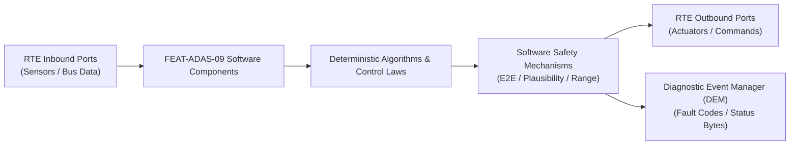

# Software Requirements Specification: Rear Cross Traffic Alert & Braking (RCTA-RCTB)
**Feature ID:** `FEAT-ADAS-09`  
**Domain:** ADAS & Autonomous Driving  
**Target ASIL:** ASIL B  
**Compliance Standard:** ISO 26262:2018 (Part 6 - Software Development) / ASPICE PAM v3.1 (SWE.1, SWE.2)  
**Parent System Specification:** [`FEAT-ADAS-09_RCTA_SysReq.md`](file:///c:/Workset/AntiGravityProjects/TestOptimisationExperiement/system_requirements/FEAT-ADAS-09_RCTA_SysReq.md)  
**Global Master Specification:** [`spec.md`](file:///c:/Workset/AntiGravityProjects/TestOptimisationExperiement/spec.md)

---

## 1. Software Architecture & Component Structure

This document specifies the AUTOSAR Software Components (SWCs), periodic runnables, algorithmic laws, safety mechanisms, and data ports implementing `FEAT-ADAS-09` (Rear Cross Traffic Alert & Braking (RCTA-RCTB)).

### AUTOSAR SWC Interaction Diagram

---

## 2. Detailed Software Requirements (SWR_REQ)
*(Multi-Software Requirement Partitioning derived from System Requirements)*

### `SWR-ADAS-09-01`: Lateral Crossing Vector Decomposition & Range-Rate Tracker
- **Planned Release:** R100
- **ASIL Rating:** ASIL B
- **Parent System Requirement:** [`SYS-ADAS-09-01`](file:///c:/Workset/AntiGravityProjects/TestOptimisationExperiement/system_requirements/FEAT-ADAS-09_RCTA_SysReq.md#sys-adas-09-01)
- **Allocated AUTOSAR SWC:** `RctaTracker_SWC`
- **Execution Rate / Trigger:** 20 ms
- **Worst-Case Execution Time (WCET):** 1.3 ms
- **Software Activation Condition:** Executed every 20 ms when gear == REVERSE.
- **Algorithmic Description / Logic:**
  > Decomposes target velocity into longitudinal and lateral components: v_x, v_y. Threat corridor defined as |x_target| <= 3.5 m behind rear bumper. Calculates TTC_lateral = y_target / v_y.
- **Software Safety Mechanism:** Angular boundary check: Rejects targets moving away from vehicle corridor (v_y directed outward).
- **Failure Reaction & DEM Diagnostic Event:** Discard targets with speed > 45 km/h as non-parking-lot highway traffic.
- **Software Port Inputs:** `Radar_Target_Cartesian_List[16], Vehicle_Reverse_Velocity`
- **Software Port Outputs:** `Crossing_Targets_Active[4]`
- **Software Verification Criteria:** Unit test across varying crossing angles (45 deg to 135 deg).
- **Traceability Link:** Traces upward to [`SYS-ADAS-09-01`](file:///c:/Workset/AntiGravityProjects/TestOptimisationExperiement/system_requirements/FEAT-ADAS-09_RCTA_SysReq.md#sys-adas-09-01) and [`FEAT-ADAS-09`](file:///c:/Workset/AntiGravityProjects/TestOptimisationExperiement/spec.md).

### `SWR-ADAS-09-02`: Rear Cross Traffic Warning & Chime Directional Formatter
- **Planned Release:** R100
- **ASIL Rating:** QM
- **Parent System Requirement:** [`SYS-ADAS-09-01`](file:///c:/Workset/AntiGravityProjects/TestOptimisationExperiement/system_requirements/FEAT-ADAS-09_RCTA_SysReq.md#sys-adas-09-01)
- **Allocated AUTOSAR SWC:** `RctaHmiManager_SWC`
- **Execution Rate / Trigger:** 20 ms
- **Worst-Case Execution Time (WCET):** 0.5 ms
- **Software Activation Condition:** Executed upon threat detection.
- **Algorithmic Description / Logic:**
  > If TTC <= 2.5s: Generates directional audio tone in rear left or rear right cabin speakers. Sends overlay alert flag to Infotainment display to draw blinking red arrow on backup camera feed.
- **Software Safety Mechanism:** Speaker spatial balance check: Validates audio panning command routes to correct cabin side.
- **Failure Reaction & DEM Diagnostic Event:** Fallback to cluster central chime if audio amplifier bus times out.
- **Software Port Inputs:** `Crossing_Targets_Active, Backup_Camera_Display_Ready`
- **Software Port Outputs:** `RCTA_Audio_Beep_PDU, Infotainment_Overlay_PDU`
- **Software Verification Criteria:** Cockpit HMI directional audio localization validation.
- **Traceability Link:** Traces upward to [`SYS-ADAS-09-01`](file:///c:/Workset/AntiGravityProjects/TestOptimisationExperiement/system_requirements/FEAT-ADAS-09_RCTA_SysReq.md#sys-adas-09-01) and [`FEAT-ADAS-09`](file:///c:/Workset/AntiGravityProjects/TestOptimisationExperiement/spec.md).

### `SWR-ADAS-09-03`: Autonomous Reversing Deceleration Command Profiler
- **Planned Release:** R100
- **ASIL Rating:** ASIL B
- **Parent System Requirement:** [`SYS-ADAS-09-02`](file:///c:/Workset/AntiGravityProjects/TestOptimisationExperiement/system_requirements/FEAT-ADAS-09_RCTA_SysReq.md#sys-adas-09-02)
- **Allocated AUTOSAR SWC:** `RctbBrakeController_SWC`
- **Execution Rate / Trigger:** 10 ms
- **Worst-Case Execution Time (WCET):** 0.7 ms
- **Software Activation Condition:** Executed when TTC <= 1.0s.
- **Algorithmic Description / Logic:**
  > Ramps braking deceleration to -6.0 m/s² with 20 m/s³ gradient. Transmits E2E protected command to Electronic Brake Booster. Holds vehicle stationary for exactly 2000 ms, then ramps pressure to zero.
- **Software Safety Mechanism:** Hold duration strictly governed by hardware timer to prevent locking driver permanently.
- **Failure Reaction & DEM Diagnostic Event:** Release brake immediately if driver firmly steps on accelerator (> 40%).
- **Software Port Inputs:** `Critical_Crossing_Target_TTC, Ego_Speed_Mps, Driver_Pedal_Positions`
- **Software Port Outputs:** `EBS_Reversing_Brake_Cmd_Mps2, RCTB_Active_State (boolean)`
- **Software Verification Criteria:** HIL braking response and pedal override timing testing.
- **Traceability Link:** Traces upward to [`SYS-ADAS-09-02`](file:///c:/Workset/AntiGravityProjects/TestOptimisationExperiement/system_requirements/FEAT-ADAS-09_RCTA_SysReq.md#sys-adas-09-02) and [`FEAT-ADAS-09`](file:///c:/Workset/AntiGravityProjects/TestOptimisationExperiement/spec.md).

### `SWR-ADAS-09-04`: Trailer Hitch Attachment Sensor Inhibit Interlock
- **Planned Release:** R100
- **ASIL Rating:** QM
- **Parent System Requirement:** [`SYS-ADAS-09-02`](file:///c:/Workset/AntiGravityProjects/TestOptimisationExperiement/system_requirements/FEAT-ADAS-09_RCTA_SysReq.md#sys-adas-09-02)
- **Allocated AUTOSAR SWC:** `RctaTrailerSupervisor_SWC`
- **Execution Rate / Trigger:** 100 ms
- **Worst-Case Execution Time (WCET):** 0.3 ms
- **Software Activation Condition:** Executed every 100 ms.
- **Algorithmic Description / Logic:**
  > Monitors trailer electrical hitch plug socket switch. If Trailer_Attached == TRUE, sets RCTA_Inhibit_Flag = TRUE and disables active reversing brake intervention to avoid false triggering.
- **Software Safety Mechanism:** Dual verification: Mechanical socket microswitch + trailer lighting electrical load check.
- **Failure Reaction & DEM Diagnostic Event:** Display 'Cross Traffic Alert Disabled - Trailer Attached' on cluster.
- **Software Port Inputs:** `Trailer_Socket_Switch, Trailer_Lamp_Current_Amps`
- **Software Port Outputs:** `RCTA_Inhibit_Flag (boolean)`
- **Software Verification Criteria:** Trailer hitch connection test fixture verification.
- **Traceability Link:** Traces upward to [`SYS-ADAS-09-02`](file:///c:/Workset/AntiGravityProjects/TestOptimisationExperiement/system_requirements/FEAT-ADAS-09_RCTA_SysReq.md#sys-adas-09-02) and [`FEAT-ADAS-09`](file:///c:/Workset/AntiGravityProjects/TestOptimisationExperiement/spec.md).

### `SWR-ADAS-09-05`: Reversing Dynamic Steering Angle Trajectory Curve Projector
- **Planned Release:** R100
- **ASIL Rating:** ASIL B
- **Parent System Requirement:** [`SYS-ADAS-09-03`](file:///c:/Workset/AntiGravityProjects/TestOptimisationExperiement/system_requirements/FEAT-ADAS-09_RCTA_SysReq.md#sys-adas-09-03)
- **Allocated AUTOSAR SWC:** `RctaGuidelineProjector_SWC`
- **Execution Rate / Trigger:** 33 ms
- **Worst-Case Execution Time (WCET):** 1.2 ms
- **Software Activation Condition:** Executed on vertical video blanking interval (30 Hz).
- **Algorithmic Description / Logic:**
  > Projects vehicle body width W_car and rear axle path: Transforms steering wheel angle delta into instantaneous turning radius R = Wheelbase / tan(delta). Renders perspective-distorted color-coded trajectory lines (Green: > 2m, Yellow: 1-2m, Red: < 1m).
- **Software Safety Mechanism:** Frame freeze check: If steering angle changes but guidelines remain static for > 100 ms, blanks overlay.
- **Failure Reaction & DEM Diagnostic Event:** Display default straight guidelines if steering sensor is lost.
- **Software Port Inputs:** `Steering_Wheel_Angle_Deg, Camera_Intrinsic_Calibration_Matrix`
- **Software Port Outputs:** `Overlay_Graphic_Primitives[32], Overlay_Render_Status`
- **Software Verification Criteria:** FMVSS 111 rear visibility guideline ground projection grid calibration test.
- **Traceability Link:** Traces upward to [`SYS-ADAS-09-03`](file:///c:/Workset/AntiGravityProjects/TestOptimisationExperiement/system_requirements/FEAT-ADAS-09_RCTA_SysReq.md#sys-adas-09-03) and [`FEAT-ADAS-09`](file:///c:/Workset/AntiGravityProjects/TestOptimisationExperiement/spec.md).

### `SWR-ADAS-09-06`: Cross-Traffic Directional Warning Arrow & Threat Highlighting
- **Planned Release:** R100
- **ASIL Rating:** ASIL B
- **Parent System Requirement:** [`SYS-ADAS-09-03`](file:///c:/Workset/AntiGravityProjects/TestOptimisationExperiement/system_requirements/FEAT-ADAS-09_RCTA_SysReq.md#sys-adas-09-03)
- **Allocated AUTOSAR SWC:** `RctaVisualWarning_SWC`
- **Execution Rate / Trigger:** 20 ms
- **Worst-Case Execution Time (WCET):** 0.4 ms
- **Software Activation Condition:** Active when lateral cross-traffic detected.
- **Algorithmic Description / Logic:**
  > Calculates 2D screen coordinate bounding box for approaching cross-traffic target: Renders flashing red directional indicator arrow pointing left or right, accompanied by pulsing yellow bounding box around threatening vehicle.
- **Software Safety Mechanism:** Latency budget check: Ensures warning graphic appears on screen within 60 ms of radar target track creation.
- **Failure Reaction & DEM Diagnostic Event:** Suppress arrow if target track disappears.
- **Software Port Inputs:** `RCTA_Cross_Threat_Left, RCTA_Cross_Threat_Right, Threat_Distance_Meters`
- **Software Port Outputs:** `Screen_Warning_Arrow_State_Enum, Flashing_Alert_Active (boolean)`
- **Software Verification Criteria:** User response testing measuring cognitive reaction time to directional visual warnings.
- **Traceability Link:** Traces upward to [`SYS-ADAS-09-03`](file:///c:/Workset/AntiGravityProjects/TestOptimisationExperiement/system_requirements/FEAT-ADAS-09_RCTA_SysReq.md#sys-adas-09-03) and [`FEAT-ADAS-09`](file:///c:/Workset/AntiGravityProjects/TestOptimisationExperiement/spec.md).

### `SWR-ADAS-09-07`: Ultrasonic Echo Time-of-Flight Obstacle Distance Triangulator
- **Planned Release:** R100
- **ASIL Rating:** ASIL B
- **Parent System Requirement:** [`SYS-ADAS-09-04`](file:///c:/Workset/AntiGravityProjects/TestOptimisationExperiement/system_requirements/FEAT-ADAS-09_RCTA_SysReq.md#sys-adas-09-04)
- **Allocated AUTOSAR SWC:** `RctaUltrasonicTriangulator_SWC`
- **Execution Rate / Trigger:** 25 ms
- **Worst-Case Execution Time (WCET):** 0.8 ms
- **Software Activation Condition:** Cyclic 40 Hz ultrasonic ping task.
- **Algorithmic Description / Logic:**
  > Emits 48 kHz ultrasonic chirp pulses across 4 rear bumper transducers. Measures Time-of-Flight (ToF) echoes: Triangulates 2D (x, y) coordinates of stationary objects within 1.8 m. Applies temperature compensation: c_sound = 331.3 * sqrt(1 + T/273.15).
- **Software Safety Mechanism:** Ground clutter filter: Rejects ground bounce reflections based on echo decay envelope.
- **Failure Reaction & DEM Diagnostic Event:** Flag sensor blind if acoustic reverberation ring-down time exceeds 1.5 ms (indicating mud coating).
- **Software Port Inputs:** `Ultrasonic_Raw_ToF_Array[4], Ambient_Temperature_DegC`
- **Software Port Outputs:** `Rear_Obstacle_Coordinates_X_Y[4], Closest_Rear_Obstacle_Dist_Cm`
- **Software Verification Criteria:** Ultrasonic distance accuracy test across -40°C to +85°C.
- **Traceability Link:** Traces upward to [`SYS-ADAS-09-04`](file:///c:/Workset/AntiGravityProjects/TestOptimisationExperiement/system_requirements/FEAT-ADAS-09_RCTA_SysReq.md#sys-adas-09-04) and [`FEAT-ADAS-09`](file:///c:/Workset/AntiGravityProjects/TestOptimisationExperiement/spec.md).

### `SWR-ADAS-09-08`: Bollard Low-Speed Parking Collision Autonomous Decelerator
- **Planned Release:** R100
- **ASIL Rating:** ASIL B
- **Parent System Requirement:** [`SYS-ADAS-09-04`](file:///c:/Workset/AntiGravityProjects/TestOptimisationExperiement/system_requirements/FEAT-ADAS-09_RCTA_SysReq.md#sys-adas-09-04)
- **Allocated AUTOSAR SWC:** `RctaBollardBrake_SWC`
- **Execution Rate / Trigger:** 10 ms
- **Worst-Case Execution Time (WCET):** 0.4 ms
- **Software Activation Condition:** Active when reversing towards close obstacle.
- **Algorithmic Description / Logic:**
  > Evaluates: If Closest_Rear_Obstacle_Dist_Cm <= 35 cm and Ego_Reverse_Speed > 0.3 km/h, commands immediate full brake deceleration request (-5.0 m/s²), stopping vehicle with 15 cm safety buffer before contact.
- **Software Safety Mechanism:** Holds brake pressure for 2.0 seconds after stopping, then transfers to EPB park brake.
- **Failure Reaction & DEM Diagnostic Event:** Release brake if driver shifts gear out of REVERSE.
- **Software Port Inputs:** `Closest_Rear_Obstacle_Dist_Cm, Ego_Reverse_Speed_Mps, Driver_Throttle_Travel_Pct`
- **Software Port Outputs:** `Bollard_Brake_Clamp_Req (boolean), Reversing_Buzzer_Continuous_Tone`
- **Software Verification Criteria:** Standard test with steel post bollards and concrete parking curbs.
- **Traceability Link:** Traces upward to [`SYS-ADAS-09-04`](file:///c:/Workset/AntiGravityProjects/TestOptimisationExperiement/system_requirements/FEAT-ADAS-09_RCTA_SysReq.md#sys-adas-09-04) and [`FEAT-ADAS-09`](file:///c:/Workset/AntiGravityProjects/TestOptimisationExperiement/spec.md).

### `SWR-ADAS-09-09`: Reverse Gear Selection Trigger & System State Initialization - Dynamic Observer & Signal Filter
- **Planned Release:** R200
- **ASIL Rating:** ASIL B
- **Parent System Requirement:** [`SYS-ADAS-09-05`](file:///c:/Workset/AntiGravityProjects/TestOptimisationExperiement/system_requirements/FEAT-ADAS-09_RCTA_SysReq.md#sys-adas-09-05)
- **Allocated AUTOSAR SWC:** `RctaStateInit_SWC`
- **Execution Rate / Trigger:** 20 ms
- **Worst-Case Execution Time (WCET):** 0.3 ms
- **Software Activation Condition:** Executed cyclically every 20 ms.
- **Algorithmic Description / Logic:**
  > Executes signal plausibility filtering, calibration offsets, and discrete state estimation for Reverse Gear Selection Trigger & System State Initialization.
- **Software Safety Mechanism:** Range limit plausibility check and E2E alive sequence verification.
- **Failure Reaction & DEM Diagnostic Event:** Set default fallback output and report DEM_EVENT_FEAT_ADAS_09_ERR.
- **Software Port Inputs:** `Raw sensor ADC/SENT/SPI values and RTE bus inputs.`
- **Software Port Outputs:** `Filtered physical signals and validity status bitmasks.`
- **Software Verification Criteria:** Unit test and HiL software integration test.
- **Traceability Link:** Traces upward to [`SYS-ADAS-09-05`](file:///c:/Workset/AntiGravityProjects/TestOptimisationExperiement/system_requirements/FEAT-ADAS-09_RCTA_SysReq.md#sys-adas-09-05) and [`FEAT-ADAS-09`](file:///c:/Workset/AntiGravityProjects/TestOptimisationExperiement/spec.md).

### `SWR-ADAS-09-10`: Reverse Gear Selection Trigger & System State Initialization - Closed-Loop Control Law & Actuator Dispatch
- **Planned Release:** R200
- **ASIL Rating:** ASIL B
- **Parent System Requirement:** [`SYS-ADAS-09-05`](file:///c:/Workset/AntiGravityProjects/TestOptimisationExperiement/system_requirements/FEAT-ADAS-09_RCTA_SysReq.md#sys-adas-09-05)
- **Allocated AUTOSAR SWC:** `RctaStateInit_SWC`
- **Execution Rate / Trigger:** 20 ms
- **Worst-Case Execution Time (WCET):** 0.4 ms
- **Software Activation Condition:** Executed cyclically every 20 ms.
- **Algorithmic Description / Logic:**
  > Evaluates deterministic closed-loop control law, rate limits, and dispatches commands for Reverse Gear Selection Trigger & System State Initialization.
- **Software Safety Mechanism:** Command saturation clamping and watchdog program flow monitoring.
- **Failure Reaction & DEM Diagnostic Event:** De-energize actuator output, apply safe fallback clamp, and latch DTC.
- **Software Port Inputs:** `Validated physical state signals from observer SWC.`
- **Software Port Outputs:** `Actuator PWM duty cycles, torque/pressure setpoints, and diagnostic flags.`
- **Software Verification Criteria:** Hardware dynamometer and HiL closed-loop regression test suite.
- **Traceability Link:** Traces upward to [`SYS-ADAS-09-05`](file:///c:/Workset/AntiGravityProjects/TestOptimisationExperiement/system_requirements/FEAT-ADAS-09_RCTA_SysReq.md#sys-adas-09-05) and [`FEAT-ADAS-09`](file:///c:/Workset/AntiGravityProjects/TestOptimisationExperiement/spec.md).

### `SWR-ADAS-09-11`: Rear Corner Radar 150-Degree Ultra-Wide Crossing Target Scanner - Dynamic Observer & Signal Filter
- **Planned Release:** R200
- **ASIL Rating:** ASIL B
- **Parent System Requirement:** [`SYS-ADAS-09-06`](file:///c:/Workset/AntiGravityProjects/TestOptimisationExperiement/system_requirements/FEAT-ADAS-09_RCTA_SysReq.md#sys-adas-09-06)
- **Allocated AUTOSAR SWC:** `RctaCrossingScanner_SWC`
- **Execution Rate / Trigger:** 15 ms
- **Worst-Case Execution Time (WCET):** 0.3 ms
- **Software Activation Condition:** Executed cyclically every 15 ms.
- **Algorithmic Description / Logic:**
  > Executes signal plausibility filtering, calibration offsets, and discrete state estimation for Rear Corner Radar 150-Degree Ultra-Wide Crossing Target Scanner.
- **Software Safety Mechanism:** Range limit plausibility check and E2E alive sequence verification.
- **Failure Reaction & DEM Diagnostic Event:** Set default fallback output and report DEM_EVENT_FEAT_ADAS_09_ERR.
- **Software Port Inputs:** `Raw sensor ADC/SENT/SPI values and RTE bus inputs.`
- **Software Port Outputs:** `Filtered physical signals and validity status bitmasks.`
- **Software Verification Criteria:** Unit test and HiL software integration test.
- **Traceability Link:** Traces upward to [`SYS-ADAS-09-06`](file:///c:/Workset/AntiGravityProjects/TestOptimisationExperiement/system_requirements/FEAT-ADAS-09_RCTA_SysReq.md#sys-adas-09-06) and [`FEAT-ADAS-09`](file:///c:/Workset/AntiGravityProjects/TestOptimisationExperiement/spec.md).

### `SWR-ADAS-09-12`: Rear Corner Radar 150-Degree Ultra-Wide Crossing Target Scanner - Closed-Loop Control Law & Actuator Dispatch
- **Planned Release:** R200
- **ASIL Rating:** ASIL B
- **Parent System Requirement:** [`SYS-ADAS-09-06`](file:///c:/Workset/AntiGravityProjects/TestOptimisationExperiement/system_requirements/FEAT-ADAS-09_RCTA_SysReq.md#sys-adas-09-06)
- **Allocated AUTOSAR SWC:** `RctaCrossingScanner_SWC`
- **Execution Rate / Trigger:** 15 ms
- **Worst-Case Execution Time (WCET):** 0.4 ms
- **Software Activation Condition:** Executed cyclically every 15 ms.
- **Algorithmic Description / Logic:**
  > Evaluates deterministic closed-loop control law, rate limits, and dispatches commands for Rear Corner Radar 150-Degree Ultra-Wide Crossing Target Scanner.
- **Software Safety Mechanism:** Command saturation clamping and watchdog program flow monitoring.
- **Failure Reaction & DEM Diagnostic Event:** De-energize actuator output, apply safe fallback clamp, and latch DTC.
- **Software Port Inputs:** `Validated physical state signals from observer SWC.`
- **Software Port Outputs:** `Actuator PWM duty cycles, torque/pressure setpoints, and diagnostic flags.`
- **Software Verification Criteria:** Hardware dynamometer and HiL closed-loop regression test suite.
- **Traceability Link:** Traces upward to [`SYS-ADAS-09-06`](file:///c:/Workset/AntiGravityProjects/TestOptimisationExperiement/system_requirements/FEAT-ADAS-09_RCTA_SysReq.md#sys-adas-09-06) and [`FEAT-ADAS-09`](file:///c:/Workset/AntiGravityProjects/TestOptimisationExperiement/spec.md).

### `SWR-ADAS-09-13`: Crossing Vehicle Lateral Path Intersection & TTC Predictor - Dynamic Observer & Signal Filter
- **Planned Release:** R300
- **ASIL Rating:** ASIL B
- **Parent System Requirement:** [`SYS-ADAS-09-07`](file:///c:/Workset/AntiGravityProjects/TestOptimisationExperiement/system_requirements/FEAT-ADAS-09_RCTA_SysReq.md#sys-adas-09-07)
- **Allocated AUTOSAR SWC:** `RctaTtcPredictor_SWC`
- **Execution Rate / Trigger:** 15 ms
- **Worst-Case Execution Time (WCET):** 0.3 ms
- **Software Activation Condition:** Executed cyclically every 15 ms.
- **Algorithmic Description / Logic:**
  > Executes signal plausibility filtering, calibration offsets, and discrete state estimation for Crossing Vehicle Lateral Path Intersection & TTC Predictor.
- **Software Safety Mechanism:** Range limit plausibility check and E2E alive sequence verification.
- **Failure Reaction & DEM Diagnostic Event:** Set default fallback output and report DEM_EVENT_FEAT_ADAS_09_ERR.
- **Software Port Inputs:** `Raw sensor ADC/SENT/SPI values and RTE bus inputs.`
- **Software Port Outputs:** `Filtered physical signals and validity status bitmasks.`
- **Software Verification Criteria:** Unit test and HiL software integration test.
- **Traceability Link:** Traces upward to [`SYS-ADAS-09-07`](file:///c:/Workset/AntiGravityProjects/TestOptimisationExperiement/system_requirements/FEAT-ADAS-09_RCTA_SysReq.md#sys-adas-09-07) and [`FEAT-ADAS-09`](file:///c:/Workset/AntiGravityProjects/TestOptimisationExperiement/spec.md).

### `SWR-ADAS-09-14`: Crossing Vehicle Lateral Path Intersection & TTC Predictor - Closed-Loop Control Law & Actuator Dispatch
- **Planned Release:** R300
- **ASIL Rating:** ASIL B
- **Parent System Requirement:** [`SYS-ADAS-09-07`](file:///c:/Workset/AntiGravityProjects/TestOptimisationExperiement/system_requirements/FEAT-ADAS-09_RCTA_SysReq.md#sys-adas-09-07)
- **Allocated AUTOSAR SWC:** `RctaTtcPredictor_SWC`
- **Execution Rate / Trigger:** 15 ms
- **Worst-Case Execution Time (WCET):** 0.4 ms
- **Software Activation Condition:** Executed cyclically every 15 ms.
- **Algorithmic Description / Logic:**
  > Evaluates deterministic closed-loop control law, rate limits, and dispatches commands for Crossing Vehicle Lateral Path Intersection & TTC Predictor.
- **Software Safety Mechanism:** Command saturation clamping and watchdog program flow monitoring.
- **Failure Reaction & DEM Diagnostic Event:** De-energize actuator output, apply safe fallback clamp, and latch DTC.
- **Software Port Inputs:** `Validated physical state signals from observer SWC.`
- **Software Port Outputs:** `Actuator PWM duty cycles, torque/pressure setpoints, and diagnostic flags.`
- **Software Verification Criteria:** Hardware dynamometer and HiL closed-loop regression test suite.
- **Traceability Link:** Traces upward to [`SYS-ADAS-09-07`](file:///c:/Workset/AntiGravityProjects/TestOptimisationExperiement/system_requirements/FEAT-ADAS-09_RCTA_SysReq.md#sys-adas-09-07) and [`FEAT-ADAS-09`](file:///c:/Workset/AntiGravityProjects/TestOptimisationExperiement/spec.md).

### `SWR-ADAS-09-15`: 3-Stage Driver Warning Alert (Visual Graphic, Audio Chime, HUD) - Dynamic Observer & Signal Filter
- **Planned Release:** R300
- **ASIL Rating:** ASIL B
- **Parent System Requirement:** [`SYS-ADAS-09-08`](file:///c:/Workset/AntiGravityProjects/TestOptimisationExperiement/system_requirements/FEAT-ADAS-09_RCTA_SysReq.md#sys-adas-09-08)
- **Allocated AUTOSAR SWC:** `RctaWarningDispatcher_SWC`
- **Execution Rate / Trigger:** 20 ms
- **Worst-Case Execution Time (WCET):** 0.3 ms
- **Software Activation Condition:** Executed cyclically every 20 ms.
- **Algorithmic Description / Logic:**
  > Executes signal plausibility filtering, calibration offsets, and discrete state estimation for 3-Stage Driver Warning Alert (Visual Graphic, Audio Chime, HUD).
- **Software Safety Mechanism:** Range limit plausibility check and E2E alive sequence verification.
- **Failure Reaction & DEM Diagnostic Event:** Set default fallback output and report DEM_EVENT_FEAT_ADAS_09_ERR.
- **Software Port Inputs:** `Raw sensor ADC/SENT/SPI values and RTE bus inputs.`
- **Software Port Outputs:** `Filtered physical signals and validity status bitmasks.`
- **Software Verification Criteria:** Unit test and HiL software integration test.
- **Traceability Link:** Traces upward to [`SYS-ADAS-09-08`](file:///c:/Workset/AntiGravityProjects/TestOptimisationExperiement/system_requirements/FEAT-ADAS-09_RCTA_SysReq.md#sys-adas-09-08) and [`FEAT-ADAS-09`](file:///c:/Workset/AntiGravityProjects/TestOptimisationExperiement/spec.md).

### `SWR-ADAS-09-16`: 3-Stage Driver Warning Alert (Visual Graphic, Audio Chime, HUD) - Closed-Loop Control Law & Actuator Dispatch
- **Planned Release:** R300
- **ASIL Rating:** ASIL B
- **Parent System Requirement:** [`SYS-ADAS-09-08`](file:///c:/Workset/AntiGravityProjects/TestOptimisationExperiement/system_requirements/FEAT-ADAS-09_RCTA_SysReq.md#sys-adas-09-08)
- **Allocated AUTOSAR SWC:** `RctaWarningDispatcher_SWC`
- **Execution Rate / Trigger:** 20 ms
- **Worst-Case Execution Time (WCET):** 0.4 ms
- **Software Activation Condition:** Executed cyclically every 20 ms.
- **Algorithmic Description / Logic:**
  > Evaluates deterministic closed-loop control law, rate limits, and dispatches commands for 3-Stage Driver Warning Alert (Visual Graphic, Audio Chime, HUD).
- **Software Safety Mechanism:** Command saturation clamping and watchdog program flow monitoring.
- **Failure Reaction & DEM Diagnostic Event:** De-energize actuator output, apply safe fallback clamp, and latch DTC.
- **Software Port Inputs:** `Validated physical state signals from observer SWC.`
- **Software Port Outputs:** `Actuator PWM duty cycles, torque/pressure setpoints, and diagnostic flags.`
- **Software Verification Criteria:** Hardware dynamometer and HiL closed-loop regression test suite.
- **Traceability Link:** Traces upward to [`SYS-ADAS-09-08`](file:///c:/Workset/AntiGravityProjects/TestOptimisationExperiement/system_requirements/FEAT-ADAS-09_RCTA_SysReq.md#sys-adas-09-08) and [`FEAT-ADAS-09`](file:///c:/Workset/AntiGravityProjects/TestOptimisationExperiement/spec.md).

### `SWR-ADAS-09-17`: Rear Cross Traffic Autonomous Braking (RCTB) Trigger Governor - Dynamic Observer & Signal Filter
- **Planned Release:** R300
- **ASIL Rating:** ASIL B
- **Parent System Requirement:** [`SYS-ADAS-09-09`](file:///c:/Workset/AntiGravityProjects/TestOptimisationExperiement/system_requirements/FEAT-ADAS-09_RCTA_SysReq.md#sys-adas-09-09)
- **Allocated AUTOSAR SWC:** `RctbBrakeTrigger_SWC`
- **Execution Rate / Trigger:** 10 ms
- **Worst-Case Execution Time (WCET):** 0.3 ms
- **Software Activation Condition:** Executed cyclically every 10 ms.
- **Algorithmic Description / Logic:**
  > Executes signal plausibility filtering, calibration offsets, and discrete state estimation for Rear Cross Traffic Autonomous Braking (RCTB) Trigger Governor.
- **Software Safety Mechanism:** Range limit plausibility check and E2E alive sequence verification.
- **Failure Reaction & DEM Diagnostic Event:** Set default fallback output and report DEM_EVENT_FEAT_ADAS_09_ERR.
- **Software Port Inputs:** `Raw sensor ADC/SENT/SPI values and RTE bus inputs.`
- **Software Port Outputs:** `Filtered physical signals and validity status bitmasks.`
- **Software Verification Criteria:** Unit test and HiL software integration test.
- **Traceability Link:** Traces upward to [`SYS-ADAS-09-09`](file:///c:/Workset/AntiGravityProjects/TestOptimisationExperiement/system_requirements/FEAT-ADAS-09_RCTA_SysReq.md#sys-adas-09-09) and [`FEAT-ADAS-09`](file:///c:/Workset/AntiGravityProjects/TestOptimisationExperiement/spec.md).

### `SWR-ADAS-09-18`: Rear Cross Traffic Autonomous Braking (RCTB) Trigger Governor - Closed-Loop Control Law & Actuator Dispatch
- **Planned Release:** R300
- **ASIL Rating:** ASIL B
- **Parent System Requirement:** [`SYS-ADAS-09-09`](file:///c:/Workset/AntiGravityProjects/TestOptimisationExperiement/system_requirements/FEAT-ADAS-09_RCTA_SysReq.md#sys-adas-09-09)
- **Allocated AUTOSAR SWC:** `RctbBrakeTrigger_SWC`
- **Execution Rate / Trigger:** 10 ms
- **Worst-Case Execution Time (WCET):** 0.4 ms
- **Software Activation Condition:** Executed cyclically every 10 ms.
- **Algorithmic Description / Logic:**
  > Evaluates deterministic closed-loop control law, rate limits, and dispatches commands for Rear Cross Traffic Autonomous Braking (RCTB) Trigger Governor.
- **Software Safety Mechanism:** Command saturation clamping and watchdog program flow monitoring.
- **Failure Reaction & DEM Diagnostic Event:** De-energize actuator output, apply safe fallback clamp, and latch DTC.
- **Software Port Inputs:** `Validated physical state signals from observer SWC.`
- **Software Port Outputs:** `Actuator PWM duty cycles, torque/pressure setpoints, and diagnostic flags.`
- **Software Verification Criteria:** Hardware dynamometer and HiL closed-loop regression test suite.
- **Traceability Link:** Traces upward to [`SYS-ADAS-09-09`](file:///c:/Workset/AntiGravityProjects/TestOptimisationExperiement/system_requirements/FEAT-ADAS-09_RCTA_SysReq.md#sys-adas-09-09) and [`FEAT-ADAS-09`](file:///c:/Workset/AntiGravityProjects/TestOptimisationExperiement/spec.md).

### `SWR-ADAS-09-19`: Rear Bumper Ultrasonic Sensor Close-Range Fusion Gatekeeper - Dynamic Observer & Signal Filter
- **Planned Release:** R400
- **ASIL Rating:** ASIL B
- **Parent System Requirement:** [`SYS-ADAS-09-10`](file:///c:/Workset/AntiGravityProjects/TestOptimisationExperiement/system_requirements/FEAT-ADAS-09_RCTA_SysReq.md#sys-adas-09-10)
- **Allocated AUTOSAR SWC:** `RctaUltrasonicFusion_SWC`
- **Execution Rate / Trigger:** 15 ms
- **Worst-Case Execution Time (WCET):** 0.3 ms
- **Software Activation Condition:** Executed cyclically every 15 ms.
- **Algorithmic Description / Logic:**
  > Executes signal plausibility filtering, calibration offsets, and discrete state estimation for Rear Bumper Ultrasonic Sensor Close-Range Fusion Gatekeeper.
- **Software Safety Mechanism:** Range limit plausibility check and E2E alive sequence verification.
- **Failure Reaction & DEM Diagnostic Event:** Set default fallback output and report DEM_EVENT_FEAT_ADAS_09_ERR.
- **Software Port Inputs:** `Raw sensor ADC/SENT/SPI values and RTE bus inputs.`
- **Software Port Outputs:** `Filtered physical signals and validity status bitmasks.`
- **Software Verification Criteria:** Unit test and HiL software integration test.
- **Traceability Link:** Traces upward to [`SYS-ADAS-09-10`](file:///c:/Workset/AntiGravityProjects/TestOptimisationExperiement/system_requirements/FEAT-ADAS-09_RCTA_SysReq.md#sys-adas-09-10) and [`FEAT-ADAS-09`](file:///c:/Workset/AntiGravityProjects/TestOptimisationExperiement/spec.md).

### `SWR-ADAS-09-20`: Rear Bumper Ultrasonic Sensor Close-Range Fusion Gatekeeper - Closed-Loop Control Law & Actuator Dispatch
- **Planned Release:** R400
- **ASIL Rating:** ASIL B
- **Parent System Requirement:** [`SYS-ADAS-09-10`](file:///c:/Workset/AntiGravityProjects/TestOptimisationExperiement/system_requirements/FEAT-ADAS-09_RCTA_SysReq.md#sys-adas-09-10)
- **Allocated AUTOSAR SWC:** `RctaUltrasonicFusion_SWC`
- **Execution Rate / Trigger:** 15 ms
- **Worst-Case Execution Time (WCET):** 0.4 ms
- **Software Activation Condition:** Executed cyclically every 15 ms.
- **Algorithmic Description / Logic:**
  > Evaluates deterministic closed-loop control law, rate limits, and dispatches commands for Rear Bumper Ultrasonic Sensor Close-Range Fusion Gatekeeper.
- **Software Safety Mechanism:** Command saturation clamping and watchdog program flow monitoring.
- **Failure Reaction & DEM Diagnostic Event:** De-energize actuator output, apply safe fallback clamp, and latch DTC.
- **Software Port Inputs:** `Validated physical state signals from observer SWC.`
- **Software Port Outputs:** `Actuator PWM duty cycles, torque/pressure setpoints, and diagnostic flags.`
- **Software Verification Criteria:** Hardware dynamometer and HiL closed-loop regression test suite.
- **Traceability Link:** Traces upward to [`SYS-ADAS-09-10`](file:///c:/Workset/AntiGravityProjects/TestOptimisationExperiement/system_requirements/FEAT-ADAS-09_RCTA_SysReq.md#sys-adas-09-10) and [`FEAT-ADAS-09`](file:///c:/Workset/AntiGravityProjects/TestOptimisationExperiement/spec.md).

### `SWR-ADAS-09-21`: Pedestrian & Cyclist Low-Profile Crossing Target Detector - Dynamic Observer & Signal Filter
- **Planned Release:** R400
- **ASIL Rating:** ASIL B
- **Parent System Requirement:** [`SYS-ADAS-09-11`](file:///c:/Workset/AntiGravityProjects/TestOptimisationExperiement/system_requirements/FEAT-ADAS-09_RCTA_SysReq.md#sys-adas-09-11)
- **Allocated AUTOSAR SWC:** `RctaVruDetector_SWC`
- **Execution Rate / Trigger:** 20 ms
- **Worst-Case Execution Time (WCET):** 0.3 ms
- **Software Activation Condition:** Executed cyclically every 20 ms.
- **Algorithmic Description / Logic:**
  > Executes signal plausibility filtering, calibration offsets, and discrete state estimation for Pedestrian & Cyclist Low-Profile Crossing Target Detector.
- **Software Safety Mechanism:** Range limit plausibility check and E2E alive sequence verification.
- **Failure Reaction & DEM Diagnostic Event:** Set default fallback output and report DEM_EVENT_FEAT_ADAS_09_ERR.
- **Software Port Inputs:** `Raw sensor ADC/SENT/SPI values and RTE bus inputs.`
- **Software Port Outputs:** `Filtered physical signals and validity status bitmasks.`
- **Software Verification Criteria:** Unit test and HiL software integration test.
- **Traceability Link:** Traces upward to [`SYS-ADAS-09-11`](file:///c:/Workset/AntiGravityProjects/TestOptimisationExperiement/system_requirements/FEAT-ADAS-09_RCTA_SysReq.md#sys-adas-09-11) and [`FEAT-ADAS-09`](file:///c:/Workset/AntiGravityProjects/TestOptimisationExperiement/spec.md).

### `SWR-ADAS-09-22`: Pedestrian & Cyclist Low-Profile Crossing Target Detector - Closed-Loop Control Law & Actuator Dispatch
- **Planned Release:** R400
- **ASIL Rating:** ASIL B
- **Parent System Requirement:** [`SYS-ADAS-09-11`](file:///c:/Workset/AntiGravityProjects/TestOptimisationExperiement/system_requirements/FEAT-ADAS-09_RCTA_SysReq.md#sys-adas-09-11)
- **Allocated AUTOSAR SWC:** `RctaVruDetector_SWC`
- **Execution Rate / Trigger:** 20 ms
- **Worst-Case Execution Time (WCET):** 0.4 ms
- **Software Activation Condition:** Executed cyclically every 20 ms.
- **Algorithmic Description / Logic:**
  > Evaluates deterministic closed-loop control law, rate limits, and dispatches commands for Pedestrian & Cyclist Low-Profile Crossing Target Detector.
- **Software Safety Mechanism:** Command saturation clamping and watchdog program flow monitoring.
- **Failure Reaction & DEM Diagnostic Event:** De-energize actuator output, apply safe fallback clamp, and latch DTC.
- **Software Port Inputs:** `Validated physical state signals from observer SWC.`
- **Software Port Outputs:** `Actuator PWM duty cycles, torque/pressure setpoints, and diagnostic flags.`
- **Software Verification Criteria:** Hardware dynamometer and HiL closed-loop regression test suite.
- **Traceability Link:** Traces upward to [`SYS-ADAS-09-11`](file:///c:/Workset/AntiGravityProjects/TestOptimisationExperiement/system_requirements/FEAT-ADAS-09_RCTA_SysReq.md#sys-adas-09-11) and [`FEAT-ADAS-09`](file:///c:/Workset/AntiGravityProjects/TestOptimisationExperiement/spec.md).

### `SWR-ADAS-09-23`: Trailer Hitch Engagement Automatic RCTB Deactivation - Dynamic Observer & Signal Filter
- **Planned Release:** R400
- **ASIL Rating:** ASIL B
- **Parent System Requirement:** [`SYS-ADAS-09-12`](file:///c:/Workset/AntiGravityProjects/TestOptimisationExperiement/system_requirements/FEAT-ADAS-09_RCTA_SysReq.md#sys-adas-09-12)
- **Allocated AUTOSAR SWC:** `RctaTrailerSuppress_SWC`
- **Execution Rate / Trigger:** 50 ms
- **Worst-Case Execution Time (WCET):** 0.3 ms
- **Software Activation Condition:** Executed cyclically every 50 ms.
- **Algorithmic Description / Logic:**
  > Executes signal plausibility filtering, calibration offsets, and discrete state estimation for Trailer Hitch Engagement Automatic RCTB Deactivation.
- **Software Safety Mechanism:** Range limit plausibility check and E2E alive sequence verification.
- **Failure Reaction & DEM Diagnostic Event:** Set default fallback output and report DEM_EVENT_FEAT_ADAS_09_ERR.
- **Software Port Inputs:** `Raw sensor ADC/SENT/SPI values and RTE bus inputs.`
- **Software Port Outputs:** `Filtered physical signals and validity status bitmasks.`
- **Software Verification Criteria:** Unit test and HiL software integration test.
- **Traceability Link:** Traces upward to [`SYS-ADAS-09-12`](file:///c:/Workset/AntiGravityProjects/TestOptimisationExperiement/system_requirements/FEAT-ADAS-09_RCTA_SysReq.md#sys-adas-09-12) and [`FEAT-ADAS-09`](file:///c:/Workset/AntiGravityProjects/TestOptimisationExperiement/spec.md).

### `SWR-ADAS-09-24`: Trailer Hitch Engagement Automatic RCTB Deactivation - Closed-Loop Control Law & Actuator Dispatch
- **Planned Release:** R400
- **ASIL Rating:** ASIL B
- **Parent System Requirement:** [`SYS-ADAS-09-12`](file:///c:/Workset/AntiGravityProjects/TestOptimisationExperiement/system_requirements/FEAT-ADAS-09_RCTA_SysReq.md#sys-adas-09-12)
- **Allocated AUTOSAR SWC:** `RctaTrailerSuppress_SWC`
- **Execution Rate / Trigger:** 50 ms
- **Worst-Case Execution Time (WCET):** 0.4 ms
- **Software Activation Condition:** Executed cyclically every 50 ms.
- **Algorithmic Description / Logic:**
  > Evaluates deterministic closed-loop control law, rate limits, and dispatches commands for Trailer Hitch Engagement Automatic RCTB Deactivation.
- **Software Safety Mechanism:** Command saturation clamping and watchdog program flow monitoring.
- **Failure Reaction & DEM Diagnostic Event:** De-energize actuator output, apply safe fallback clamp, and latch DTC.
- **Software Port Inputs:** `Validated physical state signals from observer SWC.`
- **Software Port Outputs:** `Actuator PWM duty cycles, torque/pressure setpoints, and diagnostic flags.`
- **Software Verification Criteria:** Hardware dynamometer and HiL closed-loop regression test suite.
- **Traceability Link:** Traces upward to [`SYS-ADAS-09-12`](file:///c:/Workset/AntiGravityProjects/TestOptimisationExperiement/system_requirements/FEAT-ADAS-09_RCTA_SysReq.md#sys-adas-09-12) and [`FEAT-ADAS-09`](file:///c:/Workset/AntiGravityProjects/TestOptimisationExperiement/spec.md).

### `SWR-ADAS-09-25`: Driver Throttle Override & Standstill Release Sequence - Dynamic Observer & Signal Filter
- **Planned Release:** R500
- **ASIL Rating:** ASIL B
- **Parent System Requirement:** [`SYS-ADAS-09-13`](file:///c:/Workset/AntiGravityProjects/TestOptimisationExperiement/system_requirements/FEAT-ADAS-09_RCTA_SysReq.md#sys-adas-09-13)
- **Allocated AUTOSAR SWC:** `RctaBrakeRelease_SWC`
- **Execution Rate / Trigger:** 20 ms
- **Worst-Case Execution Time (WCET):** 0.3 ms
- **Software Activation Condition:** Executed cyclically every 20 ms.
- **Algorithmic Description / Logic:**
  > Executes signal plausibility filtering, calibration offsets, and discrete state estimation for Driver Throttle Override & Standstill Release Sequence.
- **Software Safety Mechanism:** Range limit plausibility check and E2E alive sequence verification.
- **Failure Reaction & DEM Diagnostic Event:** Set default fallback output and report DEM_EVENT_FEAT_ADAS_09_ERR.
- **Software Port Inputs:** `Raw sensor ADC/SENT/SPI values and RTE bus inputs.`
- **Software Port Outputs:** `Filtered physical signals and validity status bitmasks.`
- **Software Verification Criteria:** Unit test and HiL software integration test.
- **Traceability Link:** Traces upward to [`SYS-ADAS-09-13`](file:///c:/Workset/AntiGravityProjects/TestOptimisationExperiement/system_requirements/FEAT-ADAS-09_RCTA_SysReq.md#sys-adas-09-13) and [`FEAT-ADAS-09`](file:///c:/Workset/AntiGravityProjects/TestOptimisationExperiement/spec.md).

### `SWR-ADAS-09-26`: Driver Throttle Override & Standstill Release Sequence - Closed-Loop Control Law & Actuator Dispatch
- **Planned Release:** R500
- **ASIL Rating:** ASIL B
- **Parent System Requirement:** [`SYS-ADAS-09-13`](file:///c:/Workset/AntiGravityProjects/TestOptimisationExperiement/system_requirements/FEAT-ADAS-09_RCTA_SysReq.md#sys-adas-09-13)
- **Allocated AUTOSAR SWC:** `RctaBrakeRelease_SWC`
- **Execution Rate / Trigger:** 20 ms
- **Worst-Case Execution Time (WCET):** 0.4 ms
- **Software Activation Condition:** Executed cyclically every 20 ms.
- **Algorithmic Description / Logic:**
  > Evaluates deterministic closed-loop control law, rate limits, and dispatches commands for Driver Throttle Override & Standstill Release Sequence.
- **Software Safety Mechanism:** Command saturation clamping and watchdog program flow monitoring.
- **Failure Reaction & DEM Diagnostic Event:** De-energize actuator output, apply safe fallback clamp, and latch DTC.
- **Software Port Inputs:** `Validated physical state signals from observer SWC.`
- **Software Port Outputs:** `Actuator PWM duty cycles, torque/pressure setpoints, and diagnostic flags.`
- **Software Verification Criteria:** Hardware dynamometer and HiL closed-loop regression test suite.
- **Traceability Link:** Traces upward to [`SYS-ADAS-09-13`](file:///c:/Workset/AntiGravityProjects/TestOptimisationExperiement/system_requirements/FEAT-ADAS-09_RCTA_SysReq.md#sys-adas-09-13) and [`FEAT-ADAS-09`](file:///c:/Workset/AntiGravityProjects/TestOptimisationExperiement/spec.md).

### `SWR-ADAS-09-27`: Rear Camera Video Feed Dirt & Snow Obstruction Detector - Dynamic Observer & Signal Filter
- **Planned Release:** R500
- **ASIL Rating:** ASIL B
- **Parent System Requirement:** [`SYS-ADAS-09-14`](file:///c:/Workset/AntiGravityProjects/TestOptimisationExperiement/system_requirements/FEAT-ADAS-09_RCTA_SysReq.md#sys-adas-09-14)
- **Allocated AUTOSAR SWC:** `RctaCameraObstruction_SWC`
- **Execution Rate / Trigger:** 100 ms
- **Worst-Case Execution Time (WCET):** 0.3 ms
- **Software Activation Condition:** Executed cyclically every 100 ms.
- **Algorithmic Description / Logic:**
  > Executes signal plausibility filtering, calibration offsets, and discrete state estimation for Rear Camera Video Feed Dirt & Snow Obstruction Detector.
- **Software Safety Mechanism:** Range limit plausibility check and E2E alive sequence verification.
- **Failure Reaction & DEM Diagnostic Event:** Set default fallback output and report DEM_EVENT_FEAT_ADAS_09_ERR.
- **Software Port Inputs:** `Raw sensor ADC/SENT/SPI values and RTE bus inputs.`
- **Software Port Outputs:** `Filtered physical signals and validity status bitmasks.`
- **Software Verification Criteria:** Unit test and HiL software integration test.
- **Traceability Link:** Traces upward to [`SYS-ADAS-09-14`](file:///c:/Workset/AntiGravityProjects/TestOptimisationExperiement/system_requirements/FEAT-ADAS-09_RCTA_SysReq.md#sys-adas-09-14) and [`FEAT-ADAS-09`](file:///c:/Workset/AntiGravityProjects/TestOptimisationExperiement/spec.md).

### `SWR-ADAS-09-28`: Rear Camera Video Feed Dirt & Snow Obstruction Detector - Closed-Loop Control Law & Actuator Dispatch
- **Planned Release:** R500
- **ASIL Rating:** ASIL B
- **Parent System Requirement:** [`SYS-ADAS-09-14`](file:///c:/Workset/AntiGravityProjects/TestOptimisationExperiement/system_requirements/FEAT-ADAS-09_RCTA_SysReq.md#sys-adas-09-14)
- **Allocated AUTOSAR SWC:** `RctaCameraObstruction_SWC`
- **Execution Rate / Trigger:** 100 ms
- **Worst-Case Execution Time (WCET):** 0.4 ms
- **Software Activation Condition:** Executed cyclically every 100 ms.
- **Algorithmic Description / Logic:**
  > Evaluates deterministic closed-loop control law, rate limits, and dispatches commands for Rear Camera Video Feed Dirt & Snow Obstruction Detector.
- **Software Safety Mechanism:** Command saturation clamping and watchdog program flow monitoring.
- **Failure Reaction & DEM Diagnostic Event:** De-energize actuator output, apply safe fallback clamp, and latch DTC.
- **Software Port Inputs:** `Validated physical state signals from observer SWC.`
- **Software Port Outputs:** `Actuator PWM duty cycles, torque/pressure setpoints, and diagnostic flags.`
- **Software Verification Criteria:** Hardware dynamometer and HiL closed-loop regression test suite.
- **Traceability Link:** Traces upward to [`SYS-ADAS-09-14`](file:///c:/Workset/AntiGravityProjects/TestOptimisationExperiement/system_requirements/FEAT-ADAS-09_RCTA_SysReq.md#sys-adas-09-14) and [`FEAT-ADAS-09`](file:///c:/Workset/AntiGravityProjects/TestOptimisationExperiement/spec.md).

### `SWR-ADAS-09-29`: DEM Diagnostic Event Reporting & Non-Volatile Error Latching - Dynamic Observer & Signal Filter
- **Planned Release:** R500
- **ASIL Rating:** ASIL B
- **Parent System Requirement:** [`SYS-ADAS-09-15`](file:///c:/Workset/AntiGravityProjects/TestOptimisationExperiement/system_requirements/FEAT-ADAS-09_RCTA_SysReq.md#sys-adas-09-15)
- **Allocated AUTOSAR SWC:** `RctaDiagnosticManager_SWC`
- **Execution Rate / Trigger:** 50 ms
- **Worst-Case Execution Time (WCET):** 0.3 ms
- **Software Activation Condition:** Executed cyclically every 50 ms.
- **Algorithmic Description / Logic:**
  > Executes signal plausibility filtering, calibration offsets, and discrete state estimation for DEM Diagnostic Event Reporting & Non-Volatile Error Latching.
- **Software Safety Mechanism:** Range limit plausibility check and E2E alive sequence verification.
- **Failure Reaction & DEM Diagnostic Event:** Set default fallback output and report DEM_EVENT_FEAT_ADAS_09_ERR.
- **Software Port Inputs:** `Raw sensor ADC/SENT/SPI values and RTE bus inputs.`
- **Software Port Outputs:** `Filtered physical signals and validity status bitmasks.`
- **Software Verification Criteria:** Unit test and HiL software integration test.
- **Traceability Link:** Traces upward to [`SYS-ADAS-09-15`](file:///c:/Workset/AntiGravityProjects/TestOptimisationExperiement/system_requirements/FEAT-ADAS-09_RCTA_SysReq.md#sys-adas-09-15) and [`FEAT-ADAS-09`](file:///c:/Workset/AntiGravityProjects/TestOptimisationExperiement/spec.md).

### `SWR-ADAS-09-30`: DEM Diagnostic Event Reporting & Non-Volatile Error Latching - Closed-Loop Control Law & Actuator Dispatch
- **Planned Release:** R500
- **ASIL Rating:** ASIL B
- **Parent System Requirement:** [`SYS-ADAS-09-15`](file:///c:/Workset/AntiGravityProjects/TestOptimisationExperiement/system_requirements/FEAT-ADAS-09_RCTA_SysReq.md#sys-adas-09-15)
- **Allocated AUTOSAR SWC:** `RctaDiagnosticManager_SWC`
- **Execution Rate / Trigger:** 50 ms
- **Worst-Case Execution Time (WCET):** 0.4 ms
- **Software Activation Condition:** Executed cyclically every 50 ms.
- **Algorithmic Description / Logic:**
  > Evaluates deterministic closed-loop control law, rate limits, and dispatches commands for DEM Diagnostic Event Reporting & Non-Volatile Error Latching.
- **Software Safety Mechanism:** Command saturation clamping and watchdog program flow monitoring.
- **Failure Reaction & DEM Diagnostic Event:** De-energize actuator output, apply safe fallback clamp, and latch DTC.
- **Software Port Inputs:** `Validated physical state signals from observer SWC.`
- **Software Port Outputs:** `Actuator PWM duty cycles, torque/pressure setpoints, and diagnostic flags.`
- **Software Verification Criteria:** Hardware dynamometer and HiL closed-loop regression test suite.
- **Traceability Link:** Traces upward to [`SYS-ADAS-09-15`](file:///c:/Workset/AntiGravityProjects/TestOptimisationExperiement/system_requirements/FEAT-ADAS-09_RCTA_SysReq.md#sys-adas-09-15) and [`FEAT-ADAS-09`](file:///c:/Workset/AntiGravityProjects/TestOptimisationExperiement/spec.md).

---

## 3. Software-to-System Backward Traceability Matrix

| Software Requirement ID | Planned Release | Allocated SWC | Execution Rate | Upstream System Req | Verification Method |
| :--- | :---: | :--- | :--- | :--- | :--- |
| `SWR-ADAS-09-01` | **`R100`** | `RctaTracker_SWC` | 20 ms | [`SYS-ADAS-09-01`](file:///c:/Workset/AntiGravityProjects/TestOptimisationExperiement/system_requirements/FEAT-ADAS-09_RCTA_SysReq.md#sys-adas-09-01) | Unit test across varying crossing angles (45 deg to 135 deg). |
| `SWR-ADAS-09-02` | **`R100`** | `RctaHmiManager_SWC` | 20 ms | [`SYS-ADAS-09-01`](file:///c:/Workset/AntiGravityProjects/TestOptimisationExperiement/system_requirements/FEAT-ADAS-09_RCTA_SysReq.md#sys-adas-09-01) | Cockpit HMI directional audio localization validation. |
| `SWR-ADAS-09-03` | **`R100`** | `RctbBrakeController_SWC` | 10 ms | [`SYS-ADAS-09-02`](file:///c:/Workset/AntiGravityProjects/TestOptimisationExperiement/system_requirements/FEAT-ADAS-09_RCTA_SysReq.md#sys-adas-09-02) | HIL braking response and pedal override timing testing. |
| `SWR-ADAS-09-04` | **`R100`** | `RctaTrailerSupervisor_SWC` | 100 ms | [`SYS-ADAS-09-02`](file:///c:/Workset/AntiGravityProjects/TestOptimisationExperiement/system_requirements/FEAT-ADAS-09_RCTA_SysReq.md#sys-adas-09-02) | Trailer hitch connection test fixture verification. |
| `SWR-ADAS-09-05` | **`R100`** | `RctaGuidelineProjector_SWC` | 33 ms | [`SYS-ADAS-09-03`](file:///c:/Workset/AntiGravityProjects/TestOptimisationExperiement/system_requirements/FEAT-ADAS-09_RCTA_SysReq.md#sys-adas-09-03) | FMVSS 111 rear visibility guideline ground projection grid calibration test. |
| `SWR-ADAS-09-06` | **`R100`** | `RctaVisualWarning_SWC` | 20 ms | [`SYS-ADAS-09-03`](file:///c:/Workset/AntiGravityProjects/TestOptimisationExperiement/system_requirements/FEAT-ADAS-09_RCTA_SysReq.md#sys-adas-09-03) | User response testing measuring cognitive reaction time to directional visual warnings. |
| `SWR-ADAS-09-07` | **`R100`** | `RctaUltrasonicTriangulator_SWC` | 25 ms | [`SYS-ADAS-09-04`](file:///c:/Workset/AntiGravityProjects/TestOptimisationExperiement/system_requirements/FEAT-ADAS-09_RCTA_SysReq.md#sys-adas-09-04) | Ultrasonic distance accuracy test across -40°C to +85°C. |
| `SWR-ADAS-09-08` | **`R100`** | `RctaBollardBrake_SWC` | 10 ms | [`SYS-ADAS-09-04`](file:///c:/Workset/AntiGravityProjects/TestOptimisationExperiement/system_requirements/FEAT-ADAS-09_RCTA_SysReq.md#sys-adas-09-04) | Standard test with steel post bollards and concrete parking curbs. |
| `SWR-ADAS-09-09` | **`R200`** | `RctaStateInit_SWC` | 20 ms | [`SYS-ADAS-09-05`](file:///c:/Workset/AntiGravityProjects/TestOptimisationExperiement/system_requirements/FEAT-ADAS-09_RCTA_SysReq.md#sys-adas-09-05) | Unit test and HiL software integration test. |
| `SWR-ADAS-09-10` | **`R200`** | `RctaStateInit_SWC` | 20 ms | [`SYS-ADAS-09-05`](file:///c:/Workset/AntiGravityProjects/TestOptimisationExperiement/system_requirements/FEAT-ADAS-09_RCTA_SysReq.md#sys-adas-09-05) | Hardware dynamometer and HiL closed-loop regression test suite. |
| `SWR-ADAS-09-11` | **`R200`** | `RctaCrossingScanner_SWC` | 15 ms | [`SYS-ADAS-09-06`](file:///c:/Workset/AntiGravityProjects/TestOptimisationExperiement/system_requirements/FEAT-ADAS-09_RCTA_SysReq.md#sys-adas-09-06) | Unit test and HiL software integration test. |
| `SWR-ADAS-09-12` | **`R200`** | `RctaCrossingScanner_SWC` | 15 ms | [`SYS-ADAS-09-06`](file:///c:/Workset/AntiGravityProjects/TestOptimisationExperiement/system_requirements/FEAT-ADAS-09_RCTA_SysReq.md#sys-adas-09-06) | Hardware dynamometer and HiL closed-loop regression test suite. |
| `SWR-ADAS-09-13` | **`R300`** | `RctaTtcPredictor_SWC` | 15 ms | [`SYS-ADAS-09-07`](file:///c:/Workset/AntiGravityProjects/TestOptimisationExperiement/system_requirements/FEAT-ADAS-09_RCTA_SysReq.md#sys-adas-09-07) | Unit test and HiL software integration test. |
| `SWR-ADAS-09-14` | **`R300`** | `RctaTtcPredictor_SWC` | 15 ms | [`SYS-ADAS-09-07`](file:///c:/Workset/AntiGravityProjects/TestOptimisationExperiement/system_requirements/FEAT-ADAS-09_RCTA_SysReq.md#sys-adas-09-07) | Hardware dynamometer and HiL closed-loop regression test suite. |
| `SWR-ADAS-09-15` | **`R300`** | `RctaWarningDispatcher_SWC` | 20 ms | [`SYS-ADAS-09-08`](file:///c:/Workset/AntiGravityProjects/TestOptimisationExperiement/system_requirements/FEAT-ADAS-09_RCTA_SysReq.md#sys-adas-09-08) | Unit test and HiL software integration test. |
| `SWR-ADAS-09-16` | **`R300`** | `RctaWarningDispatcher_SWC` | 20 ms | [`SYS-ADAS-09-08`](file:///c:/Workset/AntiGravityProjects/TestOptimisationExperiement/system_requirements/FEAT-ADAS-09_RCTA_SysReq.md#sys-adas-09-08) | Hardware dynamometer and HiL closed-loop regression test suite. |
| `SWR-ADAS-09-17` | **`R300`** | `RctbBrakeTrigger_SWC` | 10 ms | [`SYS-ADAS-09-09`](file:///c:/Workset/AntiGravityProjects/TestOptimisationExperiement/system_requirements/FEAT-ADAS-09_RCTA_SysReq.md#sys-adas-09-09) | Unit test and HiL software integration test. |
| `SWR-ADAS-09-18` | **`R300`** | `RctbBrakeTrigger_SWC` | 10 ms | [`SYS-ADAS-09-09`](file:///c:/Workset/AntiGravityProjects/TestOptimisationExperiement/system_requirements/FEAT-ADAS-09_RCTA_SysReq.md#sys-adas-09-09) | Hardware dynamometer and HiL closed-loop regression test suite. |
| `SWR-ADAS-09-19` | **`R400`** | `RctaUltrasonicFusion_SWC` | 15 ms | [`SYS-ADAS-09-10`](file:///c:/Workset/AntiGravityProjects/TestOptimisationExperiement/system_requirements/FEAT-ADAS-09_RCTA_SysReq.md#sys-adas-09-10) | Unit test and HiL software integration test. |
| `SWR-ADAS-09-20` | **`R400`** | `RctaUltrasonicFusion_SWC` | 15 ms | [`SYS-ADAS-09-10`](file:///c:/Workset/AntiGravityProjects/TestOptimisationExperiement/system_requirements/FEAT-ADAS-09_RCTA_SysReq.md#sys-adas-09-10) | Hardware dynamometer and HiL closed-loop regression test suite. |
| `SWR-ADAS-09-21` | **`R400`** | `RctaVruDetector_SWC` | 20 ms | [`SYS-ADAS-09-11`](file:///c:/Workset/AntiGravityProjects/TestOptimisationExperiement/system_requirements/FEAT-ADAS-09_RCTA_SysReq.md#sys-adas-09-11) | Unit test and HiL software integration test. |
| `SWR-ADAS-09-22` | **`R400`** | `RctaVruDetector_SWC` | 20 ms | [`SYS-ADAS-09-11`](file:///c:/Workset/AntiGravityProjects/TestOptimisationExperiement/system_requirements/FEAT-ADAS-09_RCTA_SysReq.md#sys-adas-09-11) | Hardware dynamometer and HiL closed-loop regression test suite. |
| `SWR-ADAS-09-23` | **`R400`** | `RctaTrailerSuppress_SWC` | 50 ms | [`SYS-ADAS-09-12`](file:///c:/Workset/AntiGravityProjects/TestOptimisationExperiement/system_requirements/FEAT-ADAS-09_RCTA_SysReq.md#sys-adas-09-12) | Unit test and HiL software integration test. |
| `SWR-ADAS-09-24` | **`R400`** | `RctaTrailerSuppress_SWC` | 50 ms | [`SYS-ADAS-09-12`](file:///c:/Workset/AntiGravityProjects/TestOptimisationExperiement/system_requirements/FEAT-ADAS-09_RCTA_SysReq.md#sys-adas-09-12) | Hardware dynamometer and HiL closed-loop regression test suite. |
| `SWR-ADAS-09-25` | **`R500`** | `RctaBrakeRelease_SWC` | 20 ms | [`SYS-ADAS-09-13`](file:///c:/Workset/AntiGravityProjects/TestOptimisationExperiement/system_requirements/FEAT-ADAS-09_RCTA_SysReq.md#sys-adas-09-13) | Unit test and HiL software integration test. |
| `SWR-ADAS-09-26` | **`R500`** | `RctaBrakeRelease_SWC` | 20 ms | [`SYS-ADAS-09-13`](file:///c:/Workset/AntiGravityProjects/TestOptimisationExperiement/system_requirements/FEAT-ADAS-09_RCTA_SysReq.md#sys-adas-09-13) | Hardware dynamometer and HiL closed-loop regression test suite. |
| `SWR-ADAS-09-27` | **`R500`** | `RctaCameraObstruction_SWC` | 100 ms | [`SYS-ADAS-09-14`](file:///c:/Workset/AntiGravityProjects/TestOptimisationExperiement/system_requirements/FEAT-ADAS-09_RCTA_SysReq.md#sys-adas-09-14) | Unit test and HiL software integration test. |
| `SWR-ADAS-09-28` | **`R500`** | `RctaCameraObstruction_SWC` | 100 ms | [`SYS-ADAS-09-14`](file:///c:/Workset/AntiGravityProjects/TestOptimisationExperiement/system_requirements/FEAT-ADAS-09_RCTA_SysReq.md#sys-adas-09-14) | Hardware dynamometer and HiL closed-loop regression test suite. |
| `SWR-ADAS-09-29` | **`R500`** | `RctaDiagnosticManager_SWC` | 50 ms | [`SYS-ADAS-09-15`](file:///c:/Workset/AntiGravityProjects/TestOptimisationExperiement/system_requirements/FEAT-ADAS-09_RCTA_SysReq.md#sys-adas-09-15) | Unit test and HiL software integration test. |
| `SWR-ADAS-09-30` | **`R500`** | `RctaDiagnosticManager_SWC` | 50 ms | [`SYS-ADAS-09-15`](file:///c:/Workset/AntiGravityProjects/TestOptimisationExperiement/system_requirements/FEAT-ADAS-09_RCTA_SysReq.md#sys-adas-09-15) | Hardware dynamometer and HiL closed-loop regression test suite. |

- **Parent System Specification Document:** [`FEAT-ADAS-09_RCTA_SysReq.md`](file:///c:/Workset/AntiGravityProjects/TestOptimisationExperiement/system_requirements/FEAT-ADAS-09_RCTA_SysReq.md)
- **Master Automotive Specification:** [`spec.md`](file:///c:/Workset/AntiGravityProjects/TestOptimisationExperiement/spec.md)
