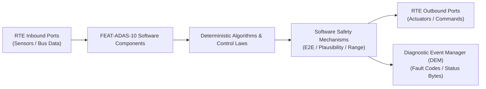

# Software Requirements Specification: Intelligent Speed Assist & Traffic Sign Recognition (ISA-TSR)
**Feature ID:** `FEAT-ADAS-10`  
**Domain:** ADAS & Autonomous Driving  
**Target ASIL:** ASIL B  
**Compliance Standard:** ISO 26262:2018 (Part 6 - Software Development) / ASPICE PAM v3.1 (SWE.1, SWE.2)  
**Parent System Specification:** [`FEAT-ADAS-10_ISA_SysReq.md`](file:///c:/Workset/AntiGravityProjects/TestOptimisationExperiement/system_requirements/FEAT-ADAS-10_ISA_SysReq.md)  
**Global Master Specification:** [`spec.md`](file:///c:/Workset/AntiGravityProjects/TestOptimisationExperiement/spec.md)

---

## 1. Software Architecture & Component Structure

This document specifies the AUTOSAR Software Components (SWCs), periodic runnables, algorithmic laws, safety mechanisms, and data ports implementing `FEAT-ADAS-10` (Intelligent Speed Assist & Traffic Sign Recognition (ISA-TSR)).

### AUTOSAR SWC Interaction Diagram

---

## 2. Detailed Software Requirements (SWR_REQ)
*(Multi-Software Requirement Partitioning derived from System Requirements)*

### `SWR-ADAS-10-01`: Traffic Sign Detection & OCR Deep Neural Network
- **Planned Release:** R100
- **ASIL Rating:** ASIL B
- **Parent System Requirement:** [`SYS-ADAS-10-01`](file:///c:/Workset/AntiGravityProjects/TestOptimisationExperiement/system_requirements/FEAT-ADAS-10_ISA_SysReq.md#sys-adas-10-01)
- **Allocated AUTOSAR SWC:** `TsrPerception_SWC`
- **Execution Rate / Trigger:** 50 ms
- **Worst-Case Execution Time (WCET):** 14.2 ms (NPU)
- **Software Activation Condition:** Executed every 50 ms on camera video frames.
- **Algorithmic Description / Logic:**
  > Executes convolutional object detector to locate sign bounding boxes, followed by optical character recognition (OCR) parsing digit strings [20, 30, 50, 60, 80, 100, 120, 130].
- **Software Safety Mechanism:** Temporal consistency: Sign must be detected in >= 3 consecutive frames before publication.
- **Failure Reaction & DEM Diagnostic Event:** Ignore sign if bounding box aspect ratio deviates > 20% from circular/rectangular standard.
- **Software Port Inputs:** `Front_Camera_Frame_Buffer`
- **Software Port Outputs:** `Detected_Sign_Value_Kmph, Optical_Confidence_Score`
- **Software Verification Criteria:** Test against extensive traffic sign image database (over 200,000 signs).
- **Traceability Link:** Traces upward to [`SYS-ADAS-10-01`](file:///c:/Workset/AntiGravityProjects/TestOptimisationExperiement/system_requirements/FEAT-ADAS-10_ISA_SysReq.md#sys-adas-10-01) and [`FEAT-ADAS-10`](file:///c:/Workset/AntiGravityProjects/TestOptimisationExperiement/spec.md).

### `SWR-ADAS-10-02`: Optical-Map Speed Limit Arbitration & Weather Filter
- **Planned Release:** R100
- **ASIL Rating:** ASIL B
- **Parent System Requirement:** [`SYS-ADAS-10-01`](file:///c:/Workset/AntiGravityProjects/TestOptimisationExperiement/system_requirements/FEAT-ADAS-10_ISA_SysReq.md#sys-adas-10-01)
- **Allocated AUTOSAR SWC:** `IsaArbitrator_SWC`
- **Execution Rate / Trigger:** 100 ms
- **Worst-Case Execution Time (WCET):** 1.5 ms
- **Software Activation Condition:** Executed every 100 ms.
- **Algorithmic Description / Logic:**
  > Arbitrates optical sign vs. digital map. If rain sensor detects wiper active and conditional 'In Rain' sign present, apply reduced rain limit. Optical sign takes precedence over map within 500 m of detection.
- **Software Safety Mechanism:** Sanity check: Reject sudden drops > 80 km/h within 50 m to avoid false emergency braking.
- **Failure Reaction & DEM Diagnostic Event:** Fallback to map database if camera blinded by sunset glare.
- **Software Port Inputs:** `Detected_Sign_Value_Kmph, Map_Speed_Limit_Kmph, Rain_Sensor_Active`
- **Software Port Outputs:** `Active_Legal_Speed_Limit_Kmph (uint8)`
- **Software Verification Criteria:** Road test route verification across varying urban/highway transitions.
- **Traceability Link:** Traces upward to [`SYS-ADAS-10-01`](file:///c:/Workset/AntiGravityProjects/TestOptimisationExperiement/system_requirements/FEAT-ADAS-10_ISA_SysReq.md#sys-adas-10-01) and [`FEAT-ADAS-10`](file:///c:/Workset/AntiGravityProjects/TestOptimisationExperiement/spec.md).

### `SWR-ADAS-10-03`: Overspeed Visual-Audio Escalation Manager
- **Planned Release:** R100
- **ASIL Rating:** QM
- **Parent System Requirement:** [`SYS-ADAS-10-02`](file:///c:/Workset/AntiGravityProjects/TestOptimisationExperiement/system_requirements/FEAT-ADAS-10_ISA_SysReq.md#sys-adas-10-02)
- **Allocated AUTOSAR SWC:** `IsaAlertManager_SWC`
- **Execution Rate / Trigger:** 100 ms
- **Worst-Case Execution Time (WCET):** 0.6 ms
- **Software Activation Condition:** Executed every 100 ms.
- **Algorithmic Description / Logic:**
  > Calculates delta = v_ego - Active_Legal_Speed_Limit. If delta > 3 km/h: Trigger Level 1 visual flash. If delta > 5 km/h for > 3.0s: Trigger Level 2 acoustic chime. Chime stops if driver slows down.
- **Software Safety Mechanism:** Driver mute timer: Allows driver to silence chime for current trip if configured in cluster.
- **Failure Reaction & DEM Diagnostic Event:** Default to silent visual-only mode if audio chime speaker reports failure.
- **Software Port Inputs:** `Vehicle_Speed_Kmph, Active_Legal_Speed_Limit_Kmph, Mute_Switch`
- **Software Port Outputs:** `ISA_Visual_Flash_Req (boolean), ISA_Acoustic_Chime_Req (boolean)`
- **Software Verification Criteria:** Timing test of audio chime onset and cancellation.
- **Traceability Link:** Traces upward to [`SYS-ADAS-10-02`](file:///c:/Workset/AntiGravityProjects/TestOptimisationExperiement/system_requirements/FEAT-ADAS-10_ISA_SysReq.md#sys-adas-10-02) and [`FEAT-ADAS-10`](file:///c:/Workset/AntiGravityProjects/TestOptimisationExperiement/spec.md).

### `SWR-ADAS-10-04`: Cruise Control Speed Setpoint Soft-Clamp Coordinator
- **Planned Release:** R100
- **ASIL Rating:** ASIL B
- **Parent System Requirement:** [`SYS-ADAS-10-02`](file:///c:/Workset/AntiGravityProjects/TestOptimisationExperiement/system_requirements/FEAT-ADAS-10_ISA_SysReq.md#sys-adas-10-02)
- **Allocated AUTOSAR SWC:** `IsaSpeedLimiter_SWC`
- **Execution Rate / Trigger:** 20 ms
- **Worst-Case Execution Time (WCET):** 0.8 ms
- **Software Activation Condition:** Executed when driver enables Intelligent Speed Limiter.
- **Algorithmic Description / Logic:**
  > When new lower speed limit detected, ramps VCU_Cruise_Speed_Cap down to new limit at smooth deceleration rate -1.2 m/s². If driver pushes throttle past kickdown point (> 85%), disable clamp.
- **Software Safety Mechanism:** Deceleration ramp limited to -1.2 m/s²; never applies sudden hard braking.
- **Failure Reaction & DEM Diagnostic Event:** Release speed clamp immediately upon accelerator kickdown switch activation.
- **Software Port Inputs:** `Active_Legal_Speed_Limit_Kmph, Driver_Kickdown_Active, Current_Set_Speed`
- **Software Port Outputs:** `VCU_Cruise_Speed_Cap_Kmph (uint8)`
- **Software Verification Criteria:** Dynamometer drive cycle speed regulation test.
- **Traceability Link:** Traces upward to [`SYS-ADAS-10-02`](file:///c:/Workset/AntiGravityProjects/TestOptimisationExperiement/system_requirements/FEAT-ADAS-10_ISA_SysReq.md#sys-adas-10-02) and [`FEAT-ADAS-10`](file:///c:/Workset/AntiGravityProjects/TestOptimisationExperiement/spec.md).

### `SWR-ADAS-10-05`: Multi-Source Optical & Navigation Map Speed Limit Arbiter
- **Planned Release:** R100
- **ASIL Rating:** ASIL A
- **Parent System Requirement:** [`SYS-ADAS-10-03`](file:///c:/Workset/AntiGravityProjects/TestOptimisationExperiement/system_requirements/FEAT-ADAS-10_ISA_SysReq.md#sys-adas-10-03)
- **Allocated AUTOSAR SWC:** `IsaSpeedArbiter_SWC`
- **Execution Rate / Trigger:** 100 ms
- **Worst-Case Execution Time (WCET):** 0.8 ms
- **Software Activation Condition:** Cyclic 100 ms task.
- **Algorithmic Description / Logic:**
  > Compares optical camera detected speed V_cam with navigation e-horizon speed V_map: If V_cam detected within past 300 m, V_cam takes priority. If V_cam aged > 1000 m without new signs, seamlessly fades to V_map. Confirms country code speed units (km/h vs mph).
- **Software Safety Mechanism:** Unit sanity check: Converts mph to km/h when crossing UK/EU borders based on GPS location.
- **Failure Reaction & DEM Diagnostic Event:** Display '---' if neither camera nor map provides valid speed limit.
- **Software Port Inputs:** `Camera_Speed_Limit_Kmph, Camera_Sign_Age_Meters, Map_Speed_Limit_Kmph, GPS_Country_Code`
- **Software Port Outputs:** `Arbitrated_Speed_Limit_Kmph, Speed_Unit_Enum (kmh/mph)`
- **Software Verification Criteria:** Cross-border international road test tracking speed unit transitions.
- **Traceability Link:** Traces upward to [`SYS-ADAS-10-03`](file:///c:/Workset/AntiGravityProjects/TestOptimisationExperiement/system_requirements/FEAT-ADAS-10_ISA_SysReq.md#sys-adas-10-03) and [`FEAT-ADAS-10`](file:///c:/Workset/AntiGravityProjects/TestOptimisationExperiement/spec.md).

### `SWR-ADAS-10-06`: Weather & Time-Dependent Conditional Sub-Sign Evaluator
- **Planned Release:** R100
- **ASIL Rating:** ASIL A
- **Parent System Requirement:** [`SYS-ADAS-10-03`](file:///c:/Workset/AntiGravityProjects/TestOptimisationExperiement/system_requirements/FEAT-ADAS-10_ISA_SysReq.md#sys-adas-10-03)
- **Allocated AUTOSAR SWC:** `IsaConditionalParser_SWC`
- **Execution Rate / Trigger:** 200 ms
- **Worst-Case Execution Time (WCET):** 0.6 ms
- **Software Activation Condition:** Active when supplemental sign plate detected.
- **Algorithmic Description / Logic:**
  > Evaluates conditional plate types: 1) 'In Rain' / 'Wet': If wipers ON > 10s, adopts lower limit; 2) 'Time Window' (e.g. 06:00-20:00): Compares with vehicle RTC clock; 3) 'Towing' / 'HGV': Checks trailer hitch connected status.
- **Software Safety Mechanism:** Failsafe default: In dry weather, displays base speed limit while showing conditional icon in cluster corner.
- **Failure Reaction & DEM Diagnostic Event:** Ignore conditional plate if OCR confidence < 70%.
- **Software Port Inputs:** `Supplemental_Sign_Type_Enum, Wiper_Active_Flag, RTC_Hour_Minute, Trailer_Attached_Bit`
- **Software Port Outputs:** `Conditional_Limit_Applicable_Flag (boolean), Enforced_Speed_Limit_Kmph`
- **Software Verification Criteria:** Euro NCAP wet weather and time-of-day conditional sign test tracks.
- **Traceability Link:** Traces upward to [`SYS-ADAS-10-03`](file:///c:/Workset/AntiGravityProjects/TestOptimisationExperiement/system_requirements/FEAT-ADAS-10_ISA_SysReq.md#sys-adas-10-03) and [`FEAT-ADAS-10`](file:///c:/Workset/AntiGravityProjects/TestOptimisationExperiement/spec.md).

### `SWR-ADAS-10-07`: Powertrain Propulsion Torque Soft-Limiter Governor
- **Planned Release:** R200
- **ASIL Rating:** ASIL A
- **Parent System Requirement:** [`SYS-ADAS-10-04`](file:///c:/Workset/AntiGravityProjects/TestOptimisationExperiement/system_requirements/FEAT-ADAS-10_ISA_SysReq.md#sys-adas-10-04)
- **Allocated AUTOSAR SWC:** `IsaTorqueLimiter_SWC`
- **Execution Rate / Trigger:** 10 ms
- **Worst-Case Execution Time (WCET):** 0.5 ms
- **Software Activation Condition:** Active when Intelligent Speed Limiter mode is engaged.
- **Algorithmic Description / Logic:**
  > Monitors vehicle velocity v_ego against speed limit v_limit: When v_ego approaches v_limit - 2 km/h, smoothly ramps down allowable motor torque T_max = T_driver * max(0.0, 1.0 - (v_ego - (v_limit - 2.0)) / 2.0). Prevents vehicle from exceeding limit under engine power.
- **Software Safety Mechanism:** Downhill braking exclusion: Soft-limiter regulates powertrain propulsion only; does not violently brake downhill unless specified.
- **Failure Reaction & DEM Diagnostic Event:** Release torque cap immediately upon driver kickdown switch.
- **Software Port Inputs:** `Actual_Vehicle_Speed_Kmph, Enforced_Speed_Limit_Kmph, Driver_Requested_Torque_Nm`
- **Software Port Outputs:** `VCU_Clamped_Torque_Demand_Nm, Torque_Limiting_Active_Flag`
- **Software Verification Criteria:** Type-approval test verifying smooth vehicle speed limiting conforming to EU 2019/2144.
- **Traceability Link:** Traces upward to [`SYS-ADAS-10-04`](file:///c:/Workset/AntiGravityProjects/TestOptimisationExperiement/system_requirements/FEAT-ADAS-10_ISA_SysReq.md#sys-adas-10-04) and [`FEAT-ADAS-10`](file:///c:/Workset/AntiGravityProjects/TestOptimisationExperiement/spec.md).

### `SWR-ADAS-10-08`: Driver Kickdown Override Detector & Limiter Handover
- **Planned Release:** R200
- **ASIL Rating:** ASIL A
- **Parent System Requirement:** [`SYS-ADAS-10-04`](file:///c:/Workset/AntiGravityProjects/TestOptimisationExperiement/system_requirements/FEAT-ADAS-10_ISA_SysReq.md#sys-adas-10-04)
- **Allocated AUTOSAR SWC:** `IsaKickdownOverride_SWC`
- **Execution Rate / Trigger:** 10 ms
- **Worst-Case Execution Time (WCET):** 0.3 ms
- **Software Activation Condition:** Supervises driver throttle pedal.
- **Algorithmic Description / Logic:**
  > Detects emergency overtaking intent: If accelerator pedal travel > 85% OR pedal depression rate d(pedal)/dt > 150 %/s, immediately cancels torque clamp in <= 20 ms, releasing 100% full motor power to driver.
- **Software Safety Mechanism:** Provides brief acoustic chime informing driver that speed limiter has been bypassed.
- **Failure Reaction & DEM Diagnostic Event:** Zero torque restriction if accelerator pedal sensor status is degraded.
- **Software Port Inputs:** `Accelerator_Pedal_Travel_Pct, Pedal_Rate_Of_Change_Pct_S`
- **Software Port Outputs:** `Kickdown_Override_Active_Flag (boolean), ISA_Suppressed_State`
- **Software Verification Criteria:** Emergency highway overtake kickdown response time bench testing.
- **Traceability Link:** Traces upward to [`SYS-ADAS-10-04`](file:///c:/Workset/AntiGravityProjects/TestOptimisationExperiement/system_requirements/FEAT-ADAS-10_ISA_SysReq.md#sys-adas-10-04) and [`FEAT-ADAS-10`](file:///c:/Workset/AntiGravityProjects/TestOptimisationExperiement/spec.md).

### `SWR-ADAS-10-09`: Front Camera Traffic Sign Deep Learning Detection & Classification - Dynamic Observer & Signal Filter
- **Planned Release:** R200
- **ASIL Rating:** ASIL B
- **Parent System Requirement:** [`SYS-ADAS-10-05`](file:///c:/Workset/AntiGravityProjects/TestOptimisationExperiement/system_requirements/FEAT-ADAS-10_ISA_SysReq.md#sys-adas-10-05)
- **Allocated AUTOSAR SWC:** `IsaTsrClassifier_SWC`
- **Execution Rate / Trigger:** 30 ms
- **Worst-Case Execution Time (WCET):** 0.3 ms
- **Software Activation Condition:** Executed cyclically every 30 ms.
- **Algorithmic Description / Logic:**
  > Executes signal plausibility filtering, calibration offsets, and discrete state estimation for Front Camera Traffic Sign Deep Learning Detection & Classification.
- **Software Safety Mechanism:** Range limit plausibility check and E2E alive sequence verification.
- **Failure Reaction & DEM Diagnostic Event:** Set default fallback output and report DEM_EVENT_FEAT_ADAS_10_ERR.
- **Software Port Inputs:** `Raw sensor ADC/SENT/SPI values and RTE bus inputs.`
- **Software Port Outputs:** `Filtered physical signals and validity status bitmasks.`
- **Software Verification Criteria:** Unit test and HiL software integration test.
- **Traceability Link:** Traces upward to [`SYS-ADAS-10-05`](file:///c:/Workset/AntiGravityProjects/TestOptimisationExperiement/system_requirements/FEAT-ADAS-10_ISA_SysReq.md#sys-adas-10-05) and [`FEAT-ADAS-10`](file:///c:/Workset/AntiGravityProjects/TestOptimisationExperiement/spec.md).

### `SWR-ADAS-10-10`: Front Camera Traffic Sign Deep Learning Detection & Classification - Closed-Loop Control Law & Actuator Dispatch
- **Planned Release:** R200
- **ASIL Rating:** ASIL B
- **Parent System Requirement:** [`SYS-ADAS-10-05`](file:///c:/Workset/AntiGravityProjects/TestOptimisationExperiement/system_requirements/FEAT-ADAS-10_ISA_SysReq.md#sys-adas-10-05)
- **Allocated AUTOSAR SWC:** `IsaTsrClassifier_SWC`
- **Execution Rate / Trigger:** 30 ms
- **Worst-Case Execution Time (WCET):** 0.4 ms
- **Software Activation Condition:** Executed cyclically every 30 ms.
- **Algorithmic Description / Logic:**
  > Evaluates deterministic closed-loop control law, rate limits, and dispatches commands for Front Camera Traffic Sign Deep Learning Detection & Classification.
- **Software Safety Mechanism:** Command saturation clamping and watchdog program flow monitoring.
- **Failure Reaction & DEM Diagnostic Event:** De-energize actuator output, apply safe fallback clamp, and latch DTC.
- **Software Port Inputs:** `Validated physical state signals from observer SWC.`
- **Software Port Outputs:** `Actuator PWM duty cycles, torque/pressure setpoints, and diagnostic flags.`
- **Software Verification Criteria:** Hardware dynamometer and HiL closed-loop regression test suite.
- **Traceability Link:** Traces upward to [`SYS-ADAS-10-05`](file:///c:/Workset/AntiGravityProjects/TestOptimisationExperiement/system_requirements/FEAT-ADAS-10_ISA_SysReq.md#sys-adas-10-05) and [`FEAT-ADAS-10`](file:///c:/Workset/AntiGravityProjects/TestOptimisationExperiement/spec.md).

### `SWR-ADAS-10-11`: Digital Navigation Map Speed Limit Database Fusion Engine - Dynamic Observer & Signal Filter
- **Planned Release:** R200
- **ASIL Rating:** ASIL B
- **Parent System Requirement:** [`SYS-ADAS-10-06`](file:///c:/Workset/AntiGravityProjects/TestOptimisationExperiement/system_requirements/FEAT-ADAS-10_ISA_SysReq.md#sys-adas-10-06)
- **Allocated AUTOSAR SWC:** `IsaMapFusion_SWC`
- **Execution Rate / Trigger:** 50 ms
- **Worst-Case Execution Time (WCET):** 0.3 ms
- **Software Activation Condition:** Executed cyclically every 50 ms.
- **Algorithmic Description / Logic:**
  > Executes signal plausibility filtering, calibration offsets, and discrete state estimation for Digital Navigation Map Speed Limit Database Fusion Engine.
- **Software Safety Mechanism:** Range limit plausibility check and E2E alive sequence verification.
- **Failure Reaction & DEM Diagnostic Event:** Set default fallback output and report DEM_EVENT_FEAT_ADAS_10_ERR.
- **Software Port Inputs:** `Raw sensor ADC/SENT/SPI values and RTE bus inputs.`
- **Software Port Outputs:** `Filtered physical signals and validity status bitmasks.`
- **Software Verification Criteria:** Unit test and HiL software integration test.
- **Traceability Link:** Traces upward to [`SYS-ADAS-10-06`](file:///c:/Workset/AntiGravityProjects/TestOptimisationExperiement/system_requirements/FEAT-ADAS-10_ISA_SysReq.md#sys-adas-10-06) and [`FEAT-ADAS-10`](file:///c:/Workset/AntiGravityProjects/TestOptimisationExperiement/spec.md).

### `SWR-ADAS-10-12`: Digital Navigation Map Speed Limit Database Fusion Engine - Closed-Loop Control Law & Actuator Dispatch
- **Planned Release:** R200
- **ASIL Rating:** ASIL B
- **Parent System Requirement:** [`SYS-ADAS-10-06`](file:///c:/Workset/AntiGravityProjects/TestOptimisationExperiement/system_requirements/FEAT-ADAS-10_ISA_SysReq.md#sys-adas-10-06)
- **Allocated AUTOSAR SWC:** `IsaMapFusion_SWC`
- **Execution Rate / Trigger:** 50 ms
- **Worst-Case Execution Time (WCET):** 0.4 ms
- **Software Activation Condition:** Executed cyclically every 50 ms.
- **Algorithmic Description / Logic:**
  > Evaluates deterministic closed-loop control law, rate limits, and dispatches commands for Digital Navigation Map Speed Limit Database Fusion Engine.
- **Software Safety Mechanism:** Command saturation clamping and watchdog program flow monitoring.
- **Failure Reaction & DEM Diagnostic Event:** De-energize actuator output, apply safe fallback clamp, and latch DTC.
- **Software Port Inputs:** `Validated physical state signals from observer SWC.`
- **Software Port Outputs:** `Actuator PWM duty cycles, torque/pressure setpoints, and diagnostic flags.`
- **Software Verification Criteria:** Hardware dynamometer and HiL closed-loop regression test suite.
- **Traceability Link:** Traces upward to [`SYS-ADAS-10-06`](file:///c:/Workset/AntiGravityProjects/TestOptimisationExperiement/system_requirements/FEAT-ADAS-10_ISA_SysReq.md#sys-adas-10-06) and [`FEAT-ADAS-10`](file:///c:/Workset/AntiGravityProjects/TestOptimisationExperiement/spec.md).

### `SWR-ADAS-10-13`: Electronic Overhead Variable Message Sign (VMS) LED Reader - Dynamic Observer & Signal Filter
- **Planned Release:** R300
- **ASIL Rating:** ASIL B
- **Parent System Requirement:** [`SYS-ADAS-10-07`](file:///c:/Workset/AntiGravityProjects/TestOptimisationExperiement/system_requirements/FEAT-ADAS-10_ISA_SysReq.md#sys-adas-10-07)
- **Allocated AUTOSAR SWC:** `IsaVmsReader_SWC`
- **Execution Rate / Trigger:** 30 ms
- **Worst-Case Execution Time (WCET):** 0.3 ms
- **Software Activation Condition:** Executed cyclically every 30 ms.
- **Algorithmic Description / Logic:**
  > Executes signal plausibility filtering, calibration offsets, and discrete state estimation for Electronic Overhead Variable Message Sign (VMS) LED Reader.
- **Software Safety Mechanism:** Range limit plausibility check and E2E alive sequence verification.
- **Failure Reaction & DEM Diagnostic Event:** Set default fallback output and report DEM_EVENT_FEAT_ADAS_10_ERR.
- **Software Port Inputs:** `Raw sensor ADC/SENT/SPI values and RTE bus inputs.`
- **Software Port Outputs:** `Filtered physical signals and validity status bitmasks.`
- **Software Verification Criteria:** Unit test and HiL software integration test.
- **Traceability Link:** Traces upward to [`SYS-ADAS-10-07`](file:///c:/Workset/AntiGravityProjects/TestOptimisationExperiement/system_requirements/FEAT-ADAS-10_ISA_SysReq.md#sys-adas-10-07) and [`FEAT-ADAS-10`](file:///c:/Workset/AntiGravityProjects/TestOptimisationExperiement/spec.md).

### `SWR-ADAS-10-14`: Electronic Overhead Variable Message Sign (VMS) LED Reader - Closed-Loop Control Law & Actuator Dispatch
- **Planned Release:** R300
- **ASIL Rating:** ASIL B
- **Parent System Requirement:** [`SYS-ADAS-10-07`](file:///c:/Workset/AntiGravityProjects/TestOptimisationExperiement/system_requirements/FEAT-ADAS-10_ISA_SysReq.md#sys-adas-10-07)
- **Allocated AUTOSAR SWC:** `IsaVmsReader_SWC`
- **Execution Rate / Trigger:** 30 ms
- **Worst-Case Execution Time (WCET):** 0.4 ms
- **Software Activation Condition:** Executed cyclically every 30 ms.
- **Algorithmic Description / Logic:**
  > Evaluates deterministic closed-loop control law, rate limits, and dispatches commands for Electronic Overhead Variable Message Sign (VMS) LED Reader.
- **Software Safety Mechanism:** Command saturation clamping and watchdog program flow monitoring.
- **Failure Reaction & DEM Diagnostic Event:** De-energize actuator output, apply safe fallback clamp, and latch DTC.
- **Software Port Inputs:** `Validated physical state signals from observer SWC.`
- **Software Port Outputs:** `Actuator PWM duty cycles, torque/pressure setpoints, and diagnostic flags.`
- **Software Verification Criteria:** Hardware dynamometer and HiL closed-loop regression test suite.
- **Traceability Link:** Traces upward to [`SYS-ADAS-10-07`](file:///c:/Workset/AntiGravityProjects/TestOptimisationExperiement/system_requirements/FEAT-ADAS-10_ISA_SysReq.md#sys-adas-10-07) and [`FEAT-ADAS-10`](file:///c:/Workset/AntiGravityProjects/TestOptimisationExperiement/spec.md).

### `SWR-ADAS-10-15`: Conditional Weather & Time-of-Day Supplementary Sign Evaluator - Dynamic Observer & Signal Filter
- **Planned Release:** R300
- **ASIL Rating:** ASIL B
- **Parent System Requirement:** [`SYS-ADAS-10-08`](file:///c:/Workset/AntiGravityProjects/TestOptimisationExperiement/system_requirements/FEAT-ADAS-10_ISA_SysReq.md#sys-adas-10-08)
- **Allocated AUTOSAR SWC:** `IsaConditionalParser_SWC`
- **Execution Rate / Trigger:** 50 ms
- **Worst-Case Execution Time (WCET):** 0.3 ms
- **Software Activation Condition:** Executed cyclically every 50 ms.
- **Algorithmic Description / Logic:**
  > Executes signal plausibility filtering, calibration offsets, and discrete state estimation for Conditional Weather & Time-of-Day Supplementary Sign Evaluator.
- **Software Safety Mechanism:** Range limit plausibility check and E2E alive sequence verification.
- **Failure Reaction & DEM Diagnostic Event:** Set default fallback output and report DEM_EVENT_FEAT_ADAS_10_ERR.
- **Software Port Inputs:** `Raw sensor ADC/SENT/SPI values and RTE bus inputs.`
- **Software Port Outputs:** `Filtered physical signals and validity status bitmasks.`
- **Software Verification Criteria:** Unit test and HiL software integration test.
- **Traceability Link:** Traces upward to [`SYS-ADAS-10-08`](file:///c:/Workset/AntiGravityProjects/TestOptimisationExperiement/system_requirements/FEAT-ADAS-10_ISA_SysReq.md#sys-adas-10-08) and [`FEAT-ADAS-10`](file:///c:/Workset/AntiGravityProjects/TestOptimisationExperiement/spec.md).

### `SWR-ADAS-10-16`: Conditional Weather & Time-of-Day Supplementary Sign Evaluator - Closed-Loop Control Law & Actuator Dispatch
- **Planned Release:** R300
- **ASIL Rating:** ASIL B
- **Parent System Requirement:** [`SYS-ADAS-10-08`](file:///c:/Workset/AntiGravityProjects/TestOptimisationExperiement/system_requirements/FEAT-ADAS-10_ISA_SysReq.md#sys-adas-10-08)
- **Allocated AUTOSAR SWC:** `IsaConditionalParser_SWC`
- **Execution Rate / Trigger:** 50 ms
- **Worst-Case Execution Time (WCET):** 0.4 ms
- **Software Activation Condition:** Executed cyclically every 50 ms.
- **Algorithmic Description / Logic:**
  > Evaluates deterministic closed-loop control law, rate limits, and dispatches commands for Conditional Weather & Time-of-Day Supplementary Sign Evaluator.
- **Software Safety Mechanism:** Command saturation clamping and watchdog program flow monitoring.
- **Failure Reaction & DEM Diagnostic Event:** De-energize actuator output, apply safe fallback clamp, and latch DTC.
- **Software Port Inputs:** `Validated physical state signals from observer SWC.`
- **Software Port Outputs:** `Actuator PWM duty cycles, torque/pressure setpoints, and diagnostic flags.`
- **Software Verification Criteria:** Hardware dynamometer and HiL closed-loop regression test suite.
- **Traceability Link:** Traces upward to [`SYS-ADAS-10-08`](file:///c:/Workset/AntiGravityProjects/TestOptimisationExperiement/system_requirements/FEAT-ADAS-10_ISA_SysReq.md#sys-adas-10-08) and [`FEAT-ADAS-10`](file:///c:/Workset/AntiGravityProjects/TestOptimisationExperiement/spec.md).

### `SWR-ADAS-10-17`: Instrument Cluster & Head-Up Display Speed Limit Icon Dispatcher - Dynamic Observer & Signal Filter
- **Planned Release:** R300
- **ASIL Rating:** ASIL B
- **Parent System Requirement:** [`SYS-ADAS-10-09`](file:///c:/Workset/AntiGravityProjects/TestOptimisationExperiement/system_requirements/FEAT-ADAS-10_ISA_SysReq.md#sys-adas-10-09)
- **Allocated AUTOSAR SWC:** `IsaDisplayRenderer_SWC`
- **Execution Rate / Trigger:** 30 ms
- **Worst-Case Execution Time (WCET):** 0.3 ms
- **Software Activation Condition:** Executed cyclically every 30 ms.
- **Algorithmic Description / Logic:**
  > Executes signal plausibility filtering, calibration offsets, and discrete state estimation for Instrument Cluster & Head-Up Display Speed Limit Icon Dispatcher.
- **Software Safety Mechanism:** Range limit plausibility check and E2E alive sequence verification.
- **Failure Reaction & DEM Diagnostic Event:** Set default fallback output and report DEM_EVENT_FEAT_ADAS_10_ERR.
- **Software Port Inputs:** `Raw sensor ADC/SENT/SPI values and RTE bus inputs.`
- **Software Port Outputs:** `Filtered physical signals and validity status bitmasks.`
- **Software Verification Criteria:** Unit test and HiL software integration test.
- **Traceability Link:** Traces upward to [`SYS-ADAS-10-09`](file:///c:/Workset/AntiGravityProjects/TestOptimisationExperiement/system_requirements/FEAT-ADAS-10_ISA_SysReq.md#sys-adas-10-09) and [`FEAT-ADAS-10`](file:///c:/Workset/AntiGravityProjects/TestOptimisationExperiement/spec.md).

### `SWR-ADAS-10-18`: Instrument Cluster & Head-Up Display Speed Limit Icon Dispatcher - Closed-Loop Control Law & Actuator Dispatch
- **Planned Release:** R300
- **ASIL Rating:** ASIL B
- **Parent System Requirement:** [`SYS-ADAS-10-09`](file:///c:/Workset/AntiGravityProjects/TestOptimisationExperiement/system_requirements/FEAT-ADAS-10_ISA_SysReq.md#sys-adas-10-09)
- **Allocated AUTOSAR SWC:** `IsaDisplayRenderer_SWC`
- **Execution Rate / Trigger:** 30 ms
- **Worst-Case Execution Time (WCET):** 0.4 ms
- **Software Activation Condition:** Executed cyclically every 30 ms.
- **Algorithmic Description / Logic:**
  > Evaluates deterministic closed-loop control law, rate limits, and dispatches commands for Instrument Cluster & Head-Up Display Speed Limit Icon Dispatcher.
- **Software Safety Mechanism:** Command saturation clamping and watchdog program flow monitoring.
- **Failure Reaction & DEM Diagnostic Event:** De-energize actuator output, apply safe fallback clamp, and latch DTC.
- **Software Port Inputs:** `Validated physical state signals from observer SWC.`
- **Software Port Outputs:** `Actuator PWM duty cycles, torque/pressure setpoints, and diagnostic flags.`
- **Software Verification Criteria:** Hardware dynamometer and HiL closed-loop regression test suite.
- **Traceability Link:** Traces upward to [`SYS-ADAS-10-09`](file:///c:/Workset/AntiGravityProjects/TestOptimisationExperiement/system_requirements/FEAT-ADAS-10_ISA_SysReq.md#sys-adas-10-09) and [`FEAT-ADAS-10`](file:///c:/Workset/AntiGravityProjects/TestOptimisationExperiement/spec.md).

### `SWR-ADAS-10-19`: Overspeed Visual & Acoustic Warning Escalation Manager - Dynamic Observer & Signal Filter
- **Planned Release:** R400
- **ASIL Rating:** ASIL B
- **Parent System Requirement:** [`SYS-ADAS-10-10`](file:///c:/Workset/AntiGravityProjects/TestOptimisationExperiement/system_requirements/FEAT-ADAS-10_ISA_SysReq.md#sys-adas-10-10)
- **Allocated AUTOSAR SWC:** `IsaOverspeedAlert_SWC`
- **Execution Rate / Trigger:** 50 ms
- **Worst-Case Execution Time (WCET):** 0.3 ms
- **Software Activation Condition:** Executed cyclically every 50 ms.
- **Algorithmic Description / Logic:**
  > Executes signal plausibility filtering, calibration offsets, and discrete state estimation for Overspeed Visual & Acoustic Warning Escalation Manager.
- **Software Safety Mechanism:** Range limit plausibility check and E2E alive sequence verification.
- **Failure Reaction & DEM Diagnostic Event:** Set default fallback output and report DEM_EVENT_FEAT_ADAS_10_ERR.
- **Software Port Inputs:** `Raw sensor ADC/SENT/SPI values and RTE bus inputs.`
- **Software Port Outputs:** `Filtered physical signals and validity status bitmasks.`
- **Software Verification Criteria:** Unit test and HiL software integration test.
- **Traceability Link:** Traces upward to [`SYS-ADAS-10-10`](file:///c:/Workset/AntiGravityProjects/TestOptimisationExperiement/system_requirements/FEAT-ADAS-10_ISA_SysReq.md#sys-adas-10-10) and [`FEAT-ADAS-10`](file:///c:/Workset/AntiGravityProjects/TestOptimisationExperiement/spec.md).

### `SWR-ADAS-10-20`: Overspeed Visual & Acoustic Warning Escalation Manager - Closed-Loop Control Law & Actuator Dispatch
- **Planned Release:** R400
- **ASIL Rating:** ASIL B
- **Parent System Requirement:** [`SYS-ADAS-10-10`](file:///c:/Workset/AntiGravityProjects/TestOptimisationExperiement/system_requirements/FEAT-ADAS-10_ISA_SysReq.md#sys-adas-10-10)
- **Allocated AUTOSAR SWC:** `IsaOverspeedAlert_SWC`
- **Execution Rate / Trigger:** 50 ms
- **Worst-Case Execution Time (WCET):** 0.4 ms
- **Software Activation Condition:** Executed cyclically every 50 ms.
- **Algorithmic Description / Logic:**
  > Evaluates deterministic closed-loop control law, rate limits, and dispatches commands for Overspeed Visual & Acoustic Warning Escalation Manager.
- **Software Safety Mechanism:** Command saturation clamping and watchdog program flow monitoring.
- **Failure Reaction & DEM Diagnostic Event:** De-energize actuator output, apply safe fallback clamp, and latch DTC.
- **Software Port Inputs:** `Validated physical state signals from observer SWC.`
- **Software Port Outputs:** `Actuator PWM duty cycles, torque/pressure setpoints, and diagnostic flags.`
- **Software Verification Criteria:** Hardware dynamometer and HiL closed-loop regression test suite.
- **Traceability Link:** Traces upward to [`SYS-ADAS-10-10`](file:///c:/Workset/AntiGravityProjects/TestOptimisationExperiement/system_requirements/FEAT-ADAS-10_ISA_SysReq.md#sys-adas-10-10) and [`FEAT-ADAS-10`](file:///c:/Workset/AntiGravityProjects/TestOptimisationExperiement/spec.md).

### `SWR-ADAS-10-21`: Haptic Accelerator Pedal Counter-Force Pushback Actuator - Dynamic Observer & Signal Filter
- **Planned Release:** R400
- **ASIL Rating:** ASIL A
- **Parent System Requirement:** [`SYS-ADAS-10-11`](file:///c:/Workset/AntiGravityProjects/TestOptimisationExperiement/system_requirements/FEAT-ADAS-10_ISA_SysReq.md#sys-adas-10-11)
- **Allocated AUTOSAR SWC:** `IsaHapticPedal_SWC`
- **Execution Rate / Trigger:** 20 ms
- **Worst-Case Execution Time (WCET):** 0.3 ms
- **Software Activation Condition:** Executed cyclically every 20 ms.
- **Algorithmic Description / Logic:**
  > Executes signal plausibility filtering, calibration offsets, and discrete state estimation for Haptic Accelerator Pedal Counter-Force Pushback Actuator.
- **Software Safety Mechanism:** Range limit plausibility check and E2E alive sequence verification.
- **Failure Reaction & DEM Diagnostic Event:** Set default fallback output and report DEM_EVENT_FEAT_ADAS_10_ERR.
- **Software Port Inputs:** `Raw sensor ADC/SENT/SPI values and RTE bus inputs.`
- **Software Port Outputs:** `Filtered physical signals and validity status bitmasks.`
- **Software Verification Criteria:** Unit test and HiL software integration test.
- **Traceability Link:** Traces upward to [`SYS-ADAS-10-11`](file:///c:/Workset/AntiGravityProjects/TestOptimisationExperiement/system_requirements/FEAT-ADAS-10_ISA_SysReq.md#sys-adas-10-11) and [`FEAT-ADAS-10`](file:///c:/Workset/AntiGravityProjects/TestOptimisationExperiement/spec.md).

### `SWR-ADAS-10-22`: Haptic Accelerator Pedal Counter-Force Pushback Actuator - Closed-Loop Control Law & Actuator Dispatch
- **Planned Release:** R400
- **ASIL Rating:** ASIL A
- **Parent System Requirement:** [`SYS-ADAS-10-11`](file:///c:/Workset/AntiGravityProjects/TestOptimisationExperiement/system_requirements/FEAT-ADAS-10_ISA_SysReq.md#sys-adas-10-11)
- **Allocated AUTOSAR SWC:** `IsaHapticPedal_SWC`
- **Execution Rate / Trigger:** 20 ms
- **Worst-Case Execution Time (WCET):** 0.4 ms
- **Software Activation Condition:** Executed cyclically every 20 ms.
- **Algorithmic Description / Logic:**
  > Evaluates deterministic closed-loop control law, rate limits, and dispatches commands for Haptic Accelerator Pedal Counter-Force Pushback Actuator.
- **Software Safety Mechanism:** Command saturation clamping and watchdog program flow monitoring.
- **Failure Reaction & DEM Diagnostic Event:** De-energize actuator output, apply safe fallback clamp, and latch DTC.
- **Software Port Inputs:** `Validated physical state signals from observer SWC.`
- **Software Port Outputs:** `Actuator PWM duty cycles, torque/pressure setpoints, and diagnostic flags.`
- **Software Verification Criteria:** Hardware dynamometer and HiL closed-loop regression test suite.
- **Traceability Link:** Traces upward to [`SYS-ADAS-10-11`](file:///c:/Workset/AntiGravityProjects/TestOptimisationExperiement/system_requirements/FEAT-ADAS-10_ISA_SysReq.md#sys-adas-10-11) and [`FEAT-ADAS-10`](file:///c:/Workset/AntiGravityProjects/TestOptimisationExperiement/spec.md).

### `SWR-ADAS-10-23`: Voluntary Intelligent Speed Limiter (ISL) Powertrain Torque Clamp - Dynamic Observer & Signal Filter
- **Planned Release:** R400
- **ASIL Rating:** ASIL B
- **Parent System Requirement:** [`SYS-ADAS-10-12`](file:///c:/Workset/AntiGravityProjects/TestOptimisationExperiement/system_requirements/FEAT-ADAS-10_ISA_SysReq.md#sys-adas-10-12)
- **Allocated AUTOSAR SWC:** `IsaTorqueLimiter_SWC`
- **Execution Rate / Trigger:** 10 ms
- **Worst-Case Execution Time (WCET):** 0.3 ms
- **Software Activation Condition:** Executed cyclically every 10 ms.
- **Algorithmic Description / Logic:**
  > Executes signal plausibility filtering, calibration offsets, and discrete state estimation for Voluntary Intelligent Speed Limiter (ISL) Powertrain Torque Clamp.
- **Software Safety Mechanism:** Range limit plausibility check and E2E alive sequence verification.
- **Failure Reaction & DEM Diagnostic Event:** Set default fallback output and report DEM_EVENT_FEAT_ADAS_10_ERR.
- **Software Port Inputs:** `Raw sensor ADC/SENT/SPI values and RTE bus inputs.`
- **Software Port Outputs:** `Filtered physical signals and validity status bitmasks.`
- **Software Verification Criteria:** Unit test and HiL software integration test.
- **Traceability Link:** Traces upward to [`SYS-ADAS-10-12`](file:///c:/Workset/AntiGravityProjects/TestOptimisationExperiement/system_requirements/FEAT-ADAS-10_ISA_SysReq.md#sys-adas-10-12) and [`FEAT-ADAS-10`](file:///c:/Workset/AntiGravityProjects/TestOptimisationExperiement/spec.md).

### `SWR-ADAS-10-24`: Voluntary Intelligent Speed Limiter (ISL) Powertrain Torque Clamp - Closed-Loop Control Law & Actuator Dispatch
- **Planned Release:** R400
- **ASIL Rating:** ASIL B
- **Parent System Requirement:** [`SYS-ADAS-10-12`](file:///c:/Workset/AntiGravityProjects/TestOptimisationExperiement/system_requirements/FEAT-ADAS-10_ISA_SysReq.md#sys-adas-10-12)
- **Allocated AUTOSAR SWC:** `IsaTorqueLimiter_SWC`
- **Execution Rate / Trigger:** 10 ms
- **Worst-Case Execution Time (WCET):** 0.4 ms
- **Software Activation Condition:** Executed cyclically every 10 ms.
- **Algorithmic Description / Logic:**
  > Evaluates deterministic closed-loop control law, rate limits, and dispatches commands for Voluntary Intelligent Speed Limiter (ISL) Powertrain Torque Clamp.
- **Software Safety Mechanism:** Command saturation clamping and watchdog program flow monitoring.
- **Failure Reaction & DEM Diagnostic Event:** De-energize actuator output, apply safe fallback clamp, and latch DTC.
- **Software Port Inputs:** `Validated physical state signals from observer SWC.`
- **Software Port Outputs:** `Actuator PWM duty cycles, torque/pressure setpoints, and diagnostic flags.`
- **Software Verification Criteria:** Hardware dynamometer and HiL closed-loop regression test suite.
- **Traceability Link:** Traces upward to [`SYS-ADAS-10-12`](file:///c:/Workset/AntiGravityProjects/TestOptimisationExperiement/system_requirements/FEAT-ADAS-10_ISA_SysReq.md#sys-adas-10-12) and [`FEAT-ADAS-10`](file:///c:/Workset/AntiGravityProjects/TestOptimisationExperiement/spec.md).

### `SWR-ADAS-10-25`: Temporary Construction & Work Zone Speed Sign Adaptation - Dynamic Observer & Signal Filter
- **Planned Release:** R500
- **ASIL Rating:** ASIL B
- **Parent System Requirement:** [`SYS-ADAS-10-13`](file:///c:/Workset/AntiGravityProjects/TestOptimisationExperiement/system_requirements/FEAT-ADAS-10_ISA_SysReq.md#sys-adas-10-13)
- **Allocated AUTOSAR SWC:** `IsaConstructionZone_SWC`
- **Execution Rate / Trigger:** 50 ms
- **Worst-Case Execution Time (WCET):** 0.3 ms
- **Software Activation Condition:** Executed cyclically every 50 ms.
- **Algorithmic Description / Logic:**
  > Executes signal plausibility filtering, calibration offsets, and discrete state estimation for Temporary Construction & Work Zone Speed Sign Adaptation.
- **Software Safety Mechanism:** Range limit plausibility check and E2E alive sequence verification.
- **Failure Reaction & DEM Diagnostic Event:** Set default fallback output and report DEM_EVENT_FEAT_ADAS_10_ERR.
- **Software Port Inputs:** `Raw sensor ADC/SENT/SPI values and RTE bus inputs.`
- **Software Port Outputs:** `Filtered physical signals and validity status bitmasks.`
- **Software Verification Criteria:** Unit test and HiL software integration test.
- **Traceability Link:** Traces upward to [`SYS-ADAS-10-13`](file:///c:/Workset/AntiGravityProjects/TestOptimisationExperiement/system_requirements/FEAT-ADAS-10_ISA_SysReq.md#sys-adas-10-13) and [`FEAT-ADAS-10`](file:///c:/Workset/AntiGravityProjects/TestOptimisationExperiement/spec.md).

### `SWR-ADAS-10-26`: Temporary Construction & Work Zone Speed Sign Adaptation - Closed-Loop Control Law & Actuator Dispatch
- **Planned Release:** R500
- **ASIL Rating:** ASIL B
- **Parent System Requirement:** [`SYS-ADAS-10-13`](file:///c:/Workset/AntiGravityProjects/TestOptimisationExperiement/system_requirements/FEAT-ADAS-10_ISA_SysReq.md#sys-adas-10-13)
- **Allocated AUTOSAR SWC:** `IsaConstructionZone_SWC`
- **Execution Rate / Trigger:** 50 ms
- **Worst-Case Execution Time (WCET):** 0.4 ms
- **Software Activation Condition:** Executed cyclically every 50 ms.
- **Algorithmic Description / Logic:**
  > Evaluates deterministic closed-loop control law, rate limits, and dispatches commands for Temporary Construction & Work Zone Speed Sign Adaptation.
- **Software Safety Mechanism:** Command saturation clamping and watchdog program flow monitoring.
- **Failure Reaction & DEM Diagnostic Event:** De-energize actuator output, apply safe fallback clamp, and latch DTC.
- **Software Port Inputs:** `Validated physical state signals from observer SWC.`
- **Software Port Outputs:** `Actuator PWM duty cycles, torque/pressure setpoints, and diagnostic flags.`
- **Software Verification Criteria:** Hardware dynamometer and HiL closed-loop regression test suite.
- **Traceability Link:** Traces upward to [`SYS-ADAS-10-13`](file:///c:/Workset/AntiGravityProjects/TestOptimisationExperiement/system_requirements/FEAT-ADAS-10_ISA_SysReq.md#sys-adas-10-13) and [`FEAT-ADAS-10`](file:///c:/Workset/AntiGravityProjects/TestOptimisationExperiement/spec.md).

### `SWR-ADAS-10-27`: Driver Kickdown Accelerator Emergency Override Gate - Dynamic Observer & Signal Filter
- **Planned Release:** R500
- **ASIL Rating:** ASIL B
- **Parent System Requirement:** [`SYS-ADAS-10-14`](file:///c:/Workset/AntiGravityProjects/TestOptimisationExperiement/system_requirements/FEAT-ADAS-10_ISA_SysReq.md#sys-adas-10-14)
- **Allocated AUTOSAR SWC:** `IsaKickdownOverride_SWC`
- **Execution Rate / Trigger:** 10 ms
- **Worst-Case Execution Time (WCET):** 0.3 ms
- **Software Activation Condition:** Executed cyclically every 10 ms.
- **Algorithmic Description / Logic:**
  > Executes signal plausibility filtering, calibration offsets, and discrete state estimation for Driver Kickdown Accelerator Emergency Override Gate.
- **Software Safety Mechanism:** Range limit plausibility check and E2E alive sequence verification.
- **Failure Reaction & DEM Diagnostic Event:** Set default fallback output and report DEM_EVENT_FEAT_ADAS_10_ERR.
- **Software Port Inputs:** `Raw sensor ADC/SENT/SPI values and RTE bus inputs.`
- **Software Port Outputs:** `Filtered physical signals and validity status bitmasks.`
- **Software Verification Criteria:** Unit test and HiL software integration test.
- **Traceability Link:** Traces upward to [`SYS-ADAS-10-14`](file:///c:/Workset/AntiGravityProjects/TestOptimisationExperiement/system_requirements/FEAT-ADAS-10_ISA_SysReq.md#sys-adas-10-14) and [`FEAT-ADAS-10`](file:///c:/Workset/AntiGravityProjects/TestOptimisationExperiement/spec.md).

### `SWR-ADAS-10-28`: Driver Kickdown Accelerator Emergency Override Gate - Closed-Loop Control Law & Actuator Dispatch
- **Planned Release:** R500
- **ASIL Rating:** ASIL B
- **Parent System Requirement:** [`SYS-ADAS-10-14`](file:///c:/Workset/AntiGravityProjects/TestOptimisationExperiement/system_requirements/FEAT-ADAS-10_ISA_SysReq.md#sys-adas-10-14)
- **Allocated AUTOSAR SWC:** `IsaKickdownOverride_SWC`
- **Execution Rate / Trigger:** 10 ms
- **Worst-Case Execution Time (WCET):** 0.4 ms
- **Software Activation Condition:** Executed cyclically every 10 ms.
- **Algorithmic Description / Logic:**
  > Evaluates deterministic closed-loop control law, rate limits, and dispatches commands for Driver Kickdown Accelerator Emergency Override Gate.
- **Software Safety Mechanism:** Command saturation clamping and watchdog program flow monitoring.
- **Failure Reaction & DEM Diagnostic Event:** De-energize actuator output, apply safe fallback clamp, and latch DTC.
- **Software Port Inputs:** `Validated physical state signals from observer SWC.`
- **Software Port Outputs:** `Actuator PWM duty cycles, torque/pressure setpoints, and diagnostic flags.`
- **Software Verification Criteria:** Hardware dynamometer and HiL closed-loop regression test suite.
- **Traceability Link:** Traces upward to [`SYS-ADAS-10-14`](file:///c:/Workset/AntiGravityProjects/TestOptimisationExperiement/system_requirements/FEAT-ADAS-10_ISA_SysReq.md#sys-adas-10-14) and [`FEAT-ADAS-10`](file:///c:/Workset/AntiGravityProjects/TestOptimisationExperiement/spec.md).

### `SWR-ADAS-10-29`: DEM UNECE R154 Compliance Logging & Camera Lens Health Monitor - Dynamic Observer & Signal Filter
- **Planned Release:** R500
- **ASIL Rating:** ASIL B
- **Parent System Requirement:** [`SYS-ADAS-10-15`](file:///c:/Workset/AntiGravityProjects/TestOptimisationExperiement/system_requirements/FEAT-ADAS-10_ISA_SysReq.md#sys-adas-10-15)
- **Allocated AUTOSAR SWC:** `IsaDiagnosticManager_SWC`
- **Execution Rate / Trigger:** 100 ms
- **Worst-Case Execution Time (WCET):** 0.3 ms
- **Software Activation Condition:** Executed cyclically every 100 ms.
- **Algorithmic Description / Logic:**
  > Executes signal plausibility filtering, calibration offsets, and discrete state estimation for DEM UNECE R154 Compliance Logging & Camera Lens Health Monitor.
- **Software Safety Mechanism:** Range limit plausibility check and E2E alive sequence verification.
- **Failure Reaction & DEM Diagnostic Event:** Set default fallback output and report DEM_EVENT_FEAT_ADAS_10_ERR.
- **Software Port Inputs:** `Raw sensor ADC/SENT/SPI values and RTE bus inputs.`
- **Software Port Outputs:** `Filtered physical signals and validity status bitmasks.`
- **Software Verification Criteria:** Unit test and HiL software integration test.
- **Traceability Link:** Traces upward to [`SYS-ADAS-10-15`](file:///c:/Workset/AntiGravityProjects/TestOptimisationExperiement/system_requirements/FEAT-ADAS-10_ISA_SysReq.md#sys-adas-10-15) and [`FEAT-ADAS-10`](file:///c:/Workset/AntiGravityProjects/TestOptimisationExperiement/spec.md).

### `SWR-ADAS-10-30`: DEM UNECE R154 Compliance Logging & Camera Lens Health Monitor - Closed-Loop Control Law & Actuator Dispatch
- **Planned Release:** R500
- **ASIL Rating:** ASIL B
- **Parent System Requirement:** [`SYS-ADAS-10-15`](file:///c:/Workset/AntiGravityProjects/TestOptimisationExperiement/system_requirements/FEAT-ADAS-10_ISA_SysReq.md#sys-adas-10-15)
- **Allocated AUTOSAR SWC:** `IsaDiagnosticManager_SWC`
- **Execution Rate / Trigger:** 100 ms
- **Worst-Case Execution Time (WCET):** 0.4 ms
- **Software Activation Condition:** Executed cyclically every 100 ms.
- **Algorithmic Description / Logic:**
  > Evaluates deterministic closed-loop control law, rate limits, and dispatches commands for DEM UNECE R154 Compliance Logging & Camera Lens Health Monitor.
- **Software Safety Mechanism:** Command saturation clamping and watchdog program flow monitoring.
- **Failure Reaction & DEM Diagnostic Event:** De-energize actuator output, apply safe fallback clamp, and latch DTC.
- **Software Port Inputs:** `Validated physical state signals from observer SWC.`
- **Software Port Outputs:** `Actuator PWM duty cycles, torque/pressure setpoints, and diagnostic flags.`
- **Software Verification Criteria:** Hardware dynamometer and HiL closed-loop regression test suite.
- **Traceability Link:** Traces upward to [`SYS-ADAS-10-15`](file:///c:/Workset/AntiGravityProjects/TestOptimisationExperiement/system_requirements/FEAT-ADAS-10_ISA_SysReq.md#sys-adas-10-15) and [`FEAT-ADAS-10`](file:///c:/Workset/AntiGravityProjects/TestOptimisationExperiement/spec.md).

---

## 3. Software-to-System Backward Traceability Matrix

| Software Requirement ID | Planned Release | Allocated SWC | Execution Rate | Upstream System Req | Verification Method |
| :--- | :---: | :--- | :--- | :--- | :--- |
| `SWR-ADAS-10-01` | **`R100`** | `TsrPerception_SWC` | 50 ms | [`SYS-ADAS-10-01`](file:///c:/Workset/AntiGravityProjects/TestOptimisationExperiement/system_requirements/FEAT-ADAS-10_ISA_SysReq.md#sys-adas-10-01) | Test against extensive traffic sign image database (over 200,000 signs). |
| `SWR-ADAS-10-02` | **`R100`** | `IsaArbitrator_SWC` | 100 ms | [`SYS-ADAS-10-01`](file:///c:/Workset/AntiGravityProjects/TestOptimisationExperiement/system_requirements/FEAT-ADAS-10_ISA_SysReq.md#sys-adas-10-01) | Road test route verification across varying urban/highway transitions. |
| `SWR-ADAS-10-03` | **`R100`** | `IsaAlertManager_SWC` | 100 ms | [`SYS-ADAS-10-02`](file:///c:/Workset/AntiGravityProjects/TestOptimisationExperiement/system_requirements/FEAT-ADAS-10_ISA_SysReq.md#sys-adas-10-02) | Timing test of audio chime onset and cancellation. |
| `SWR-ADAS-10-04` | **`R100`** | `IsaSpeedLimiter_SWC` | 20 ms | [`SYS-ADAS-10-02`](file:///c:/Workset/AntiGravityProjects/TestOptimisationExperiement/system_requirements/FEAT-ADAS-10_ISA_SysReq.md#sys-adas-10-02) | Dynamometer drive cycle speed regulation test. |
| `SWR-ADAS-10-05` | **`R100`** | `IsaSpeedArbiter_SWC` | 100 ms | [`SYS-ADAS-10-03`](file:///c:/Workset/AntiGravityProjects/TestOptimisationExperiement/system_requirements/FEAT-ADAS-10_ISA_SysReq.md#sys-adas-10-03) | Cross-border international road test tracking speed unit transitions. |
| `SWR-ADAS-10-06` | **`R100`** | `IsaConditionalParser_SWC` | 200 ms | [`SYS-ADAS-10-03`](file:///c:/Workset/AntiGravityProjects/TestOptimisationExperiement/system_requirements/FEAT-ADAS-10_ISA_SysReq.md#sys-adas-10-03) | Euro NCAP wet weather and time-of-day conditional sign test tracks. |
| `SWR-ADAS-10-07` | **`R200`** | `IsaTorqueLimiter_SWC` | 10 ms | [`SYS-ADAS-10-04`](file:///c:/Workset/AntiGravityProjects/TestOptimisationExperiement/system_requirements/FEAT-ADAS-10_ISA_SysReq.md#sys-adas-10-04) | Type-approval test verifying smooth vehicle speed limiting conforming to EU 2019/2144. |
| `SWR-ADAS-10-08` | **`R200`** | `IsaKickdownOverride_SWC` | 10 ms | [`SYS-ADAS-10-04`](file:///c:/Workset/AntiGravityProjects/TestOptimisationExperiement/system_requirements/FEAT-ADAS-10_ISA_SysReq.md#sys-adas-10-04) | Emergency highway overtake kickdown response time bench testing. |
| `SWR-ADAS-10-09` | **`R200`** | `IsaTsrClassifier_SWC` | 30 ms | [`SYS-ADAS-10-05`](file:///c:/Workset/AntiGravityProjects/TestOptimisationExperiement/system_requirements/FEAT-ADAS-10_ISA_SysReq.md#sys-adas-10-05) | Unit test and HiL software integration test. |
| `SWR-ADAS-10-10` | **`R200`** | `IsaTsrClassifier_SWC` | 30 ms | [`SYS-ADAS-10-05`](file:///c:/Workset/AntiGravityProjects/TestOptimisationExperiement/system_requirements/FEAT-ADAS-10_ISA_SysReq.md#sys-adas-10-05) | Hardware dynamometer and HiL closed-loop regression test suite. |
| `SWR-ADAS-10-11` | **`R200`** | `IsaMapFusion_SWC` | 50 ms | [`SYS-ADAS-10-06`](file:///c:/Workset/AntiGravityProjects/TestOptimisationExperiement/system_requirements/FEAT-ADAS-10_ISA_SysReq.md#sys-adas-10-06) | Unit test and HiL software integration test. |
| `SWR-ADAS-10-12` | **`R200`** | `IsaMapFusion_SWC` | 50 ms | [`SYS-ADAS-10-06`](file:///c:/Workset/AntiGravityProjects/TestOptimisationExperiement/system_requirements/FEAT-ADAS-10_ISA_SysReq.md#sys-adas-10-06) | Hardware dynamometer and HiL closed-loop regression test suite. |
| `SWR-ADAS-10-13` | **`R300`** | `IsaVmsReader_SWC` | 30 ms | [`SYS-ADAS-10-07`](file:///c:/Workset/AntiGravityProjects/TestOptimisationExperiement/system_requirements/FEAT-ADAS-10_ISA_SysReq.md#sys-adas-10-07) | Unit test and HiL software integration test. |
| `SWR-ADAS-10-14` | **`R300`** | `IsaVmsReader_SWC` | 30 ms | [`SYS-ADAS-10-07`](file:///c:/Workset/AntiGravityProjects/TestOptimisationExperiement/system_requirements/FEAT-ADAS-10_ISA_SysReq.md#sys-adas-10-07) | Hardware dynamometer and HiL closed-loop regression test suite. |
| `SWR-ADAS-10-15` | **`R300`** | `IsaConditionalParser_SWC` | 50 ms | [`SYS-ADAS-10-08`](file:///c:/Workset/AntiGravityProjects/TestOptimisationExperiement/system_requirements/FEAT-ADAS-10_ISA_SysReq.md#sys-adas-10-08) | Unit test and HiL software integration test. |
| `SWR-ADAS-10-16` | **`R300`** | `IsaConditionalParser_SWC` | 50 ms | [`SYS-ADAS-10-08`](file:///c:/Workset/AntiGravityProjects/TestOptimisationExperiement/system_requirements/FEAT-ADAS-10_ISA_SysReq.md#sys-adas-10-08) | Hardware dynamometer and HiL closed-loop regression test suite. |
| `SWR-ADAS-10-17` | **`R300`** | `IsaDisplayRenderer_SWC` | 30 ms | [`SYS-ADAS-10-09`](file:///c:/Workset/AntiGravityProjects/TestOptimisationExperiement/system_requirements/FEAT-ADAS-10_ISA_SysReq.md#sys-adas-10-09) | Unit test and HiL software integration test. |
| `SWR-ADAS-10-18` | **`R300`** | `IsaDisplayRenderer_SWC` | 30 ms | [`SYS-ADAS-10-09`](file:///c:/Workset/AntiGravityProjects/TestOptimisationExperiement/system_requirements/FEAT-ADAS-10_ISA_SysReq.md#sys-adas-10-09) | Hardware dynamometer and HiL closed-loop regression test suite. |
| `SWR-ADAS-10-19` | **`R400`** | `IsaOverspeedAlert_SWC` | 50 ms | [`SYS-ADAS-10-10`](file:///c:/Workset/AntiGravityProjects/TestOptimisationExperiement/system_requirements/FEAT-ADAS-10_ISA_SysReq.md#sys-adas-10-10) | Unit test and HiL software integration test. |
| `SWR-ADAS-10-20` | **`R400`** | `IsaOverspeedAlert_SWC` | 50 ms | [`SYS-ADAS-10-10`](file:///c:/Workset/AntiGravityProjects/TestOptimisationExperiement/system_requirements/FEAT-ADAS-10_ISA_SysReq.md#sys-adas-10-10) | Hardware dynamometer and HiL closed-loop regression test suite. |
| `SWR-ADAS-10-21` | **`R400`** | `IsaHapticPedal_SWC` | 20 ms | [`SYS-ADAS-10-11`](file:///c:/Workset/AntiGravityProjects/TestOptimisationExperiement/system_requirements/FEAT-ADAS-10_ISA_SysReq.md#sys-adas-10-11) | Unit test and HiL software integration test. |
| `SWR-ADAS-10-22` | **`R400`** | `IsaHapticPedal_SWC` | 20 ms | [`SYS-ADAS-10-11`](file:///c:/Workset/AntiGravityProjects/TestOptimisationExperiement/system_requirements/FEAT-ADAS-10_ISA_SysReq.md#sys-adas-10-11) | Hardware dynamometer and HiL closed-loop regression test suite. |
| `SWR-ADAS-10-23` | **`R400`** | `IsaTorqueLimiter_SWC` | 10 ms | [`SYS-ADAS-10-12`](file:///c:/Workset/AntiGravityProjects/TestOptimisationExperiement/system_requirements/FEAT-ADAS-10_ISA_SysReq.md#sys-adas-10-12) | Unit test and HiL software integration test. |
| `SWR-ADAS-10-24` | **`R400`** | `IsaTorqueLimiter_SWC` | 10 ms | [`SYS-ADAS-10-12`](file:///c:/Workset/AntiGravityProjects/TestOptimisationExperiement/system_requirements/FEAT-ADAS-10_ISA_SysReq.md#sys-adas-10-12) | Hardware dynamometer and HiL closed-loop regression test suite. |
| `SWR-ADAS-10-25` | **`R500`** | `IsaConstructionZone_SWC` | 50 ms | [`SYS-ADAS-10-13`](file:///c:/Workset/AntiGravityProjects/TestOptimisationExperiement/system_requirements/FEAT-ADAS-10_ISA_SysReq.md#sys-adas-10-13) | Unit test and HiL software integration test. |
| `SWR-ADAS-10-26` | **`R500`** | `IsaConstructionZone_SWC` | 50 ms | [`SYS-ADAS-10-13`](file:///c:/Workset/AntiGravityProjects/TestOptimisationExperiement/system_requirements/FEAT-ADAS-10_ISA_SysReq.md#sys-adas-10-13) | Hardware dynamometer and HiL closed-loop regression test suite. |
| `SWR-ADAS-10-27` | **`R500`** | `IsaKickdownOverride_SWC` | 10 ms | [`SYS-ADAS-10-14`](file:///c:/Workset/AntiGravityProjects/TestOptimisationExperiement/system_requirements/FEAT-ADAS-10_ISA_SysReq.md#sys-adas-10-14) | Unit test and HiL software integration test. |
| `SWR-ADAS-10-28` | **`R500`** | `IsaKickdownOverride_SWC` | 10 ms | [`SYS-ADAS-10-14`](file:///c:/Workset/AntiGravityProjects/TestOptimisationExperiement/system_requirements/FEAT-ADAS-10_ISA_SysReq.md#sys-adas-10-14) | Hardware dynamometer and HiL closed-loop regression test suite. |
| `SWR-ADAS-10-29` | **`R500`** | `IsaDiagnosticManager_SWC` | 100 ms | [`SYS-ADAS-10-15`](file:///c:/Workset/AntiGravityProjects/TestOptimisationExperiement/system_requirements/FEAT-ADAS-10_ISA_SysReq.md#sys-adas-10-15) | Unit test and HiL software integration test. |
| `SWR-ADAS-10-30` | **`R500`** | `IsaDiagnosticManager_SWC` | 100 ms | [`SYS-ADAS-10-15`](file:///c:/Workset/AntiGravityProjects/TestOptimisationExperiement/system_requirements/FEAT-ADAS-10_ISA_SysReq.md#sys-adas-10-15) | Hardware dynamometer and HiL closed-loop regression test suite. |

- **Parent System Specification Document:** [`FEAT-ADAS-10_ISA_SysReq.md`](file:///c:/Workset/AntiGravityProjects/TestOptimisationExperiement/system_requirements/FEAT-ADAS-10_ISA_SysReq.md)
- **Master Automotive Specification:** [`spec.md`](file:///c:/Workset/AntiGravityProjects/TestOptimisationExperiement/spec.md)
