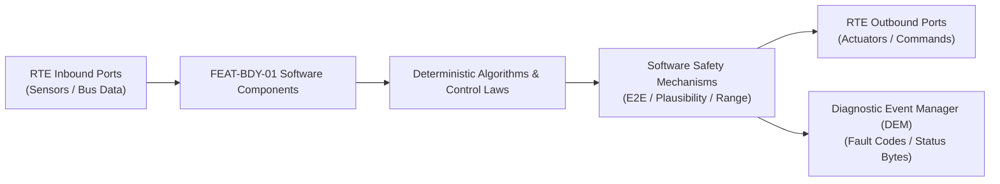

# Software Requirements Specification: Passive Entry Passive Start & Digital Key (PEPS)
**Feature ID:** `FEAT-BDY-01`  
**Domain:** Body, Lighting & Restraints  
**Target ASIL:** ASIL B / ISO 21434  
**Compliance Standard:** ISO 26262:2018 (Part 6 - Software Development) / ASPICE PAM v3.1 (SWE.1, SWE.2)  
**Parent System Specification:** [`FEAT-BDY-01_PEPS_SysReq.md`](file:///c:/Workset/AntiGravityProjects/TestOptimisationExperiement/system_requirements/FEAT-BDY-01_PEPS_SysReq.md)  
**Global Master Specification:** [`spec.md`](file:///c:/Workset/AntiGravityProjects/TestOptimisationExperiement/spec.md)

---

## 1. Software Architecture & Component Structure

This document specifies the AUTOSAR Software Components (SWCs), periodic runnables, algorithmic laws, safety mechanisms, and data ports implementing `FEAT-BDY-01` (Passive Entry Passive Start & Digital Key (PEPS)).

### AUTOSAR SWC Interaction Diagram

---

## 2. Detailed Software Requirements (SWR_REQ)
*(Multi-Software Requirement Partitioning derived from System Requirements)*

### `SWR-BDY-01-01`: UWB ToF Spherical Multilateration & Ranging Solver
- **Planned Release:** R100
- **ASIL Rating:** ASIL B
- **Parent System Requirement:** [`SYS-BDY-01-01`](file:///c:/Workset/AntiGravityProjects/TestOptimisationExperiement/system_requirements/FEAT-BDY-01_PEPS_SysReq.md#sys-bdy-01-01)
- **Allocated AUTOSAR SWC:** `PepsRanging_SWC`
- **Execution Rate / Trigger:** 50 ms
- **Worst-Case Execution Time (WCET):** 3.2 ms
- **Software Activation Condition:** Executed cyclically every 50 ms.
- **Algorithmic Description / Logic:**
  > Solves nonlinear least-squares sphere intersection: (x - x_i)^2 + (y - y_i)^2 + (z - z_i)^2 = d_i^2 for i = 1..4 anchors. Computes coordinate residual error; filters position via alpha-beta filter.
- **Software Safety Mechanism:** Residual error check: If residual norm > 20 cm, discard solution as multipath reflection.
- **Failure Reaction & DEM Diagnostic Event:** Fallback to nearest-anchor RSSI proximity zone if multilateration fails.
- **Software Port Inputs:** `Anchor_Distance_Mm[4], Anchor_Locations[4]`
- **Software Port Outputs:** `Key_Coordinates_Cm (struct Point3D_t), Position_Confidence_Pct`
- **Software Verification Criteria:** Unit test across 500 spatial coordinates surrounding vehicle perimeter.
- **Traceability Link:** Traces upward to [`SYS-BDY-01-01`](file:///c:/Workset/AntiGravityProjects/TestOptimisationExperiement/system_requirements/FEAT-BDY-01_PEPS_SysReq.md#sys-bdy-01-01) and [`FEAT-BDY-01`](file:///c:/Workset/AntiGravityProjects/TestOptimisationExperiement/spec.md).

### `SWR-BDY-01-02`: STS Cryptographic Timestamp Random Sequence Verifier
- **Planned Release:** R100
- **ASIL Rating:** ASIL B / ISO 21434
- **Parent System Requirement:** [`SYS-BDY-01-01`](file:///c:/Workset/AntiGravityProjects/TestOptimisationExperiement/system_requirements/FEAT-BDY-01_PEPS_SysReq.md#sys-bdy-01-01)
- **Allocated AUTOSAR SWC:** `PepsCryptoSts_SWC`
- **Execution Rate / Trigger:** 50 ms
- **Worst-Case Execution Time (WCET):** 1.4 ms
- **Software Activation Condition:** Executed on every incoming UWB pulse frame.
- **Algorithmic Description / Logic:**
  > Verifies hardware Scrambled Timestamp Sequence (STS) generated via AES-128 DRBG with shared session key. Validates pulse arrival timestamps matching expected pseudo-random sequence.
- **Software Safety Mechanism:** Replay prevention: Nonce rolled over every ranging round; timestamp window +-5 ns.
- **Failure Reaction & DEM Diagnostic Event:** Increment security attack counter and log intrusion event upon STS error.
- **Software Port Inputs:** `STS_Pulse_Data_Buffer, Expected_Session_Key_Handle`
- **Software Port Outputs:** `STS_Authentication_Passed (boolean)`
- **Software Verification Criteria:** Cryptographic test with delayed and injected spoofed RF pulses.
- **Traceability Link:** Traces upward to [`SYS-BDY-01-01`](file:///c:/Workset/AntiGravityProjects/TestOptimisationExperiement/system_requirements/FEAT-BDY-01_PEPS_SysReq.md#sys-bdy-01-01) and [`FEAT-BDY-01`](file:///c:/Workset/AntiGravityProjects/TestOptimisationExperiement/spec.md).

### `SWR-BDY-01-03`: Geofence Proximity Boundary Finite State Machine
- **Planned Release:** R100
- **ASIL Rating:** QM
- **Parent System Requirement:** [`SYS-BDY-01-02`](file:///c:/Workset/AntiGravityProjects/TestOptimisationExperiement/system_requirements/FEAT-BDY-01_PEPS_SysReq.md#sys-bdy-01-02)
- **Allocated AUTOSAR SWC:** `PepsZoneManager_SWC`
- **Execution Rate / Trigger:** 50 ms
- **Worst-Case Execution Time (WCET):** 0.8 ms
- **Software Activation Condition:** Executed every 50 ms on key coordinates.
- **Algorithmic Description / Logic:**
  > Evaluates Euclidean distance d = sqrt(x^2 + y^2). If d <= 3.0 m: Set Welcome_Lighting = ON. If d <= 1.5 m and Door_Handle_Touched == TRUE: Command Door_Unlock. If d >= 2.5 m for > 2.0s: Command Walk_Away_Lock.
- **Software Safety Mechanism:** Hysteresis window of 30 cm between lock and unlock thresholds prevents chatter.
- **Failure Reaction & DEM Diagnostic Event:** Inhibit walk-away lock if key coordinates are verified INSIDE vehicle interior.
- **Software Port Inputs:** `Key_Coordinates_Cm, Door_Handle_Capacitive_State`
- **Software Port Outputs:** `Unlock_Doors_Command (boolean), Lock_Doors_Command (boolean)`
- **Software Verification Criteria:** State machine transition test suite.
- **Traceability Link:** Traces upward to [`SYS-BDY-01-02`](file:///c:/Workset/AntiGravityProjects/TestOptimisationExperiement/system_requirements/FEAT-BDY-01_PEPS_SysReq.md#sys-bdy-01-02) and [`FEAT-BDY-01`](file:///c:/Workset/AntiGravityProjects/TestOptimisationExperiement/spec.md).

### `SWR-BDY-01-04`: AES-128 Challenge-Response Immobilizer Token Exchanger
- **Planned Release:** R100
- **ASIL Rating:** ASIL B
- **Parent System Requirement:** [`SYS-BDY-01-02`](file:///c:/Workset/AntiGravityProjects/TestOptimisationExperiement/system_requirements/FEAT-BDY-01_PEPS_SysReq.md#sys-bdy-01-02)
- **Allocated AUTOSAR SWC:** `PepsImmobilizer_SWC`
- **Execution Rate / Trigger:** 20 ms
- **Worst-Case Execution Time (WCET):** 4.5 ms
- **Software Activation Condition:** Executed when Start_Stop_Button is pressed.
- **Algorithmic Description / Logic:**
  > Verifies key coordinates fall strictly within cabin polygon bounds. Generates 128-bit random nonce R_car. Keyfob returns Enc_K(R_car). Upon match, transmits Start_Authorize_Token to VCU over SecOC CAN-FD.
- **Software Safety Mechanism:** Cabin boundary verification prevents vehicle drive-away if key is held by person outside window.
- **Failure Reaction & DEM Diagnostic Event:** Block start authorization if key is located outside interior perimeter.
- **Software Port Inputs:** `Start_Button_Pressed, Key_Coordinates_Cm, Inbound_Crypto_Token`
- **Software Port Outputs:** `VCU_Start_Authorize_PDU (CAN-FD buffer)`
- **Software Verification Criteria:** Boundary penetration tests verifying key detection at window perimeter.
- **Traceability Link:** Traces upward to [`SYS-BDY-01-02`](file:///c:/Workset/AntiGravityProjects/TestOptimisationExperiement/system_requirements/FEAT-BDY-01_PEPS_SysReq.md#sys-bdy-01-02) and [`FEAT-BDY-01`](file:///c:/Workset/AntiGravityProjects/TestOptimisationExperiement/spec.md).

### `SWR-BDY-01-05`: IEEE 802.15.4z Scrambled Timestamp Sequence (STS) Ranging Engine
- **Planned Release:** R100
- **ASIL Rating:** ASIL B
- **Parent System Requirement:** [`SYS-BDY-01-03`](file:///c:/Workset/AntiGravityProjects/TestOptimisationExperiement/system_requirements/FEAT-BDY-01_PEPS_SysReq.md#sys-bdy-01-03)
- **Allocated AUTOSAR SWC:** `PepsUwbRanging_SWC`
- **Execution Rate / Trigger:** 20 ms
- **Worst-Case Execution Time (WCET):** 1.2 ms
- **Software Activation Condition:** Active during digital key approach.
- **Algorithmic Description / Logic:**
  > Executes Two-Way Ranging (TWR) using AES-128 cryptographically randomized STS preamble symbols. Measures round-trip time: t_prop = 0.5 * (t_round - t_reply). Calculates physical distance d = c_light * t_prop. Rejects delayed packets.
- **Software Safety Mechanism:** Cryptographic nonce freshness verification to block replay attacks.
- **Failure Reaction & DEM Diagnostic Event:** Lock out digital key session for 30 seconds if MAC verification fails 3 times.
- **Software Port Inputs:** `UWB_RoundTrip_Time_Picoseconds, AES_STS_Seed_Key, UWB_Antenna_Index`
- **Software Port Outputs:** `Physical_Distance_Cm, Ranging_Integrity_Confirmed_Flag`
- **Software Verification Criteria:** RF chamber spoofing and intentional picosecond time-delay injection tests.
- **Traceability Link:** Traces upward to [`SYS-BDY-01-03`](file:///c:/Workset/AntiGravityProjects/TestOptimisationExperiement/system_requirements/FEAT-BDY-01_PEPS_SysReq.md#sys-bdy-01-03) and [`FEAT-BDY-01`](file:///c:/Workset/AntiGravityProjects/TestOptimisationExperiement/spec.md).

### `SWR-BDY-01-06`: Vehicle Perimeter 5-Antenna Zone Localization Triangulator
- **Planned Release:** R100
- **ASIL Rating:** ASIL B
- **Parent System Requirement:** [`SYS-BDY-01-03`](file:///c:/Workset/AntiGravityProjects/TestOptimisationExperiement/system_requirements/FEAT-BDY-01_PEPS_SysReq.md#sys-bdy-01-03)
- **Allocated AUTOSAR SWC:** `PepsZoneTriangulator_SWC`
- **Execution Rate / Trigger:** 20 ms
- **Worst-Case Execution Time (WCET):** 0.9 ms
- **Software Activation Condition:** Active upon valid ranging.
- **Algorithmic Description / Logic:**
  > Multilaterates 3D key position using 5 UWB nodes (Front bumper, B-pillars left/right, Rear bumper, Cabin dome). Classifies zone: Interior Cabin (Driver/Passenger/Rear) vs Exterior Perimeter (Left, Right, Tailgate, Welcome Zone).
- **Software Safety Mechanism:** Boundary certainty check: Requires >= 15 cm margin between interior and exterior classification.
- **Failure Reaction & DEM Diagnostic Event:** Prohibit vehicle engine start if key position ambiguity > 20 cm.
- **Software Port Inputs:** `UWB_Node_Distances[5], Vehicle_Coordinate_Origin_Offset`
- **Software Port Outputs:** `Key_3D_Coordinates_X_Y_Z, Precise_Zone_Enum`
- **Software Verification Criteria:** Grid layout test around vehicle doors and windows measuring zone accuracy.
- **Traceability Link:** Traces upward to [`SYS-BDY-01-03`](file:///c:/Workset/AntiGravityProjects/TestOptimisationExperiement/system_requirements/FEAT-BDY-01_PEPS_SysReq.md#sys-bdy-01-03) and [`FEAT-BDY-01`](file:///c:/Workset/AntiGravityProjects/TestOptimisationExperiement/spec.md).

### `SWR-BDY-01-07`: Exterior LED Dynamic Welcome Carpet Lighting Choreographer
- **Planned Release:** R200
- **ASIL Rating:** QM
- **Parent System Requirement:** [`SYS-BDY-01-04`](file:///c:/Workset/AntiGravityProjects/TestOptimisationExperiement/system_requirements/FEAT-BDY-01_PEPS_SysReq.md#sys-bdy-01-04)
- **Allocated AUTOSAR SWC:** `PepsWelcomeChoreographer_SWC`
- **Execution Rate / Trigger:** 50 ms
- **Worst-Case Execution Time (WCET):** 0.5 ms
- **Software Activation Condition:** Triggered when key enters 3.0 m welcome zone.
- **Algorithmic Description / Logic:**
  > Coordinates exterior lighting: Ramps mirror projector LEDs (0 to 100% PWM over 1.2s), illuminates flush door handle lights, and sweeps headlamp DRL light bars. Deploys flush motorized door handles.
- **Software Safety Mechanism:** Battery power guard: Inhibits welcome lighting if 12V battery voltage < 12.0V.
- **Failure Reaction & DEM Diagnostic Event:** Turn off welcome LEDs if key remains stationary in zone for > 60 seconds.
- **Software Port Inputs:** `Precise_Zone_Enum, Ambient_Lux_Sensor, Battery_12V_Voltage`
- **Software Port Outputs:** `Mirror_Carpet_LED_PWM_Duty, Door_Handle_Deploy_Cmd, DRL_Welcome_Sweep_Trigger`
- **Software Verification Criteria:** Optical illuminance and photometric fade timing test on ground surface.
- **Traceability Link:** Traces upward to [`SYS-BDY-01-04`](file:///c:/Workset/AntiGravityProjects/TestOptimisationExperiement/system_requirements/FEAT-BDY-01_PEPS_SysReq.md#sys-bdy-01-04) and [`FEAT-BDY-01`](file:///c:/Workset/AntiGravityProjects/TestOptimisationExperiement/spec.md).

### `SWR-BDY-01-08`: Walk-Away Distance Hysteresis & Automated Closure Sequencer
- **Planned Release:** R200
- **ASIL Rating:** ASIL B
- **Parent System Requirement:** [`SYS-BDY-01-04`](file:///c:/Workset/AntiGravityProjects/TestOptimisationExperiement/system_requirements/FEAT-BDY-01_PEPS_SysReq.md#sys-bdy-01-04)
- **Allocated AUTOSAR SWC:** `PepsWalkAwayManager_SWC`
- **Execution Rate / Trigger:** 100 ms
- **Worst-Case Execution Time (WCET):** 0.4 ms
- **Software Activation Condition:** Active after all vehicle doors are closed.
- **Algorithmic Description / Logic:**
  > Tracks key departing vehicle: When distance d > 2.5 m continuously for > 3.0s and zero keys remain inside cabin, asserts Auto_Lock_Command: Fires door lock solenoids, rolls up open windows, retracts door handles, and sounds confirmation horn chirp.
- **Software Safety Mechanism:** Key lock-in prevention: If interior antenna detects key inside cabin, sounds double horn alert and keeps doors unlocked.
- **Failure Reaction & DEM Diagnostic Event:** Send smartphone push notification if window cannot close due to anti-pinch obstruction.
- **Software Port Inputs:** `Key_3D_Coordinates_X_Y_Z, All_Doors_Closed_Microswitches, Window_Open_State_Bits`
- **Software Port Outputs:** `BCM_Master_Lock_Pulse_Cmd, Window_Global_Close_Cmd, Horn_Chirp_Req`
- **Software Verification Criteria:** Field testing walking away with keys under varied environmental conditions.
- **Traceability Link:** Traces upward to [`SYS-BDY-01-04`](file:///c:/Workset/AntiGravityProjects/TestOptimisationExperiement/system_requirements/FEAT-BDY-01_PEPS_SysReq.md#sys-bdy-01-04) and [`FEAT-BDY-01`](file:///c:/Workset/AntiGravityProjects/TestOptimisationExperiement/spec.md).

### `SWR-BDY-01-09`: Ultra-Wideband (UWB) Time-of-Flight Decimeter-Level Distance Ranging - Dynamic Observer & Signal Filter
- **Planned Release:** R200
- **ASIL Rating:** ASIL B
- **Parent System Requirement:** [`SYS-BDY-01-05`](file:///c:/Workset/AntiGravityProjects/TestOptimisationExperiement/system_requirements/FEAT-BDY-01_PEPS_SysReq.md#sys-bdy-01-05)
- **Allocated AUTOSAR SWC:** `PepsUwbRanging_SWC`
- **Execution Rate / Trigger:** 20 ms
- **Worst-Case Execution Time (WCET):** 0.3 ms
- **Software Activation Condition:** Executed cyclically every 20 ms.
- **Algorithmic Description / Logic:**
  > Executes signal plausibility filtering, calibration offsets, and discrete state estimation for Ultra-Wideband (UWB) Time-of-Flight Decimeter-Level Distance Ranging.
- **Software Safety Mechanism:** Range limit plausibility check and E2E alive sequence verification.
- **Failure Reaction & DEM Diagnostic Event:** Set default fallback output and report DEM_EVENT_FEAT_BDY_01_ERR.
- **Software Port Inputs:** `Raw sensor ADC/SENT/SPI values and RTE bus inputs.`
- **Software Port Outputs:** `Filtered physical signals and validity status bitmasks.`
- **Software Verification Criteria:** Unit test and HiL software integration test.
- **Traceability Link:** Traces upward to [`SYS-BDY-01-05`](file:///c:/Workset/AntiGravityProjects/TestOptimisationExperiement/system_requirements/FEAT-BDY-01_PEPS_SysReq.md#sys-bdy-01-05) and [`FEAT-BDY-01`](file:///c:/Workset/AntiGravityProjects/TestOptimisationExperiement/spec.md).

### `SWR-BDY-01-10`: Ultra-Wideband (UWB) Time-of-Flight Decimeter-Level Distance Ranging - Closed-Loop Control Law & Actuator Dispatch
- **Planned Release:** R200
- **ASIL Rating:** ASIL B
- **Parent System Requirement:** [`SYS-BDY-01-05`](file:///c:/Workset/AntiGravityProjects/TestOptimisationExperiement/system_requirements/FEAT-BDY-01_PEPS_SysReq.md#sys-bdy-01-05)
- **Allocated AUTOSAR SWC:** `PepsUwbRanging_SWC`
- **Execution Rate / Trigger:** 20 ms
- **Worst-Case Execution Time (WCET):** 0.4 ms
- **Software Activation Condition:** Executed cyclically every 20 ms.
- **Algorithmic Description / Logic:**
  > Evaluates deterministic closed-loop control law, rate limits, and dispatches commands for Ultra-Wideband (UWB) Time-of-Flight Decimeter-Level Distance Ranging.
- **Software Safety Mechanism:** Command saturation clamping and watchdog program flow monitoring.
- **Failure Reaction & DEM Diagnostic Event:** De-energize actuator output, apply safe fallback clamp, and latch DTC.
- **Software Port Inputs:** `Validated physical state signals from observer SWC.`
- **Software Port Outputs:** `Actuator PWM duty cycles, torque/pressure setpoints, and diagnostic flags.`
- **Software Verification Criteria:** Hardware dynamometer and HiL closed-loop regression test suite.
- **Traceability Link:** Traces upward to [`SYS-BDY-01-05`](file:///c:/Workset/AntiGravityProjects/TestOptimisationExperiement/system_requirements/FEAT-BDY-01_PEPS_SysReq.md#sys-bdy-01-05) and [`FEAT-BDY-01`](file:///c:/Workset/AntiGravityProjects/TestOptimisationExperiement/spec.md).

### `SWR-BDY-01-11`: Bluetooth Low Energy (BLE) RSSI Distance Proximity Channel Initiator - Dynamic Observer & Signal Filter
- **Planned Release:** R200
- **ASIL Rating:** ASIL B
- **Parent System Requirement:** [`SYS-BDY-01-06`](file:///c:/Workset/AntiGravityProjects/TestOptimisationExperiement/system_requirements/FEAT-BDY-01_PEPS_SysReq.md#sys-bdy-01-06)
- **Allocated AUTOSAR SWC:** `PepsBleProximity_SWC`
- **Execution Rate / Trigger:** 50 ms
- **Worst-Case Execution Time (WCET):** 0.3 ms
- **Software Activation Condition:** Executed cyclically every 50 ms.
- **Algorithmic Description / Logic:**
  > Executes signal plausibility filtering, calibration offsets, and discrete state estimation for Bluetooth Low Energy (BLE) RSSI Distance Proximity Channel Initiator.
- **Software Safety Mechanism:** Range limit plausibility check and E2E alive sequence verification.
- **Failure Reaction & DEM Diagnostic Event:** Set default fallback output and report DEM_EVENT_FEAT_BDY_01_ERR.
- **Software Port Inputs:** `Raw sensor ADC/SENT/SPI values and RTE bus inputs.`
- **Software Port Outputs:** `Filtered physical signals and validity status bitmasks.`
- **Software Verification Criteria:** Unit test and HiL software integration test.
- **Traceability Link:** Traces upward to [`SYS-BDY-01-06`](file:///c:/Workset/AntiGravityProjects/TestOptimisationExperiement/system_requirements/FEAT-BDY-01_PEPS_SysReq.md#sys-bdy-01-06) and [`FEAT-BDY-01`](file:///c:/Workset/AntiGravityProjects/TestOptimisationExperiement/spec.md).

### `SWR-BDY-01-12`: Bluetooth Low Energy (BLE) RSSI Distance Proximity Channel Initiator - Closed-Loop Control Law & Actuator Dispatch
- **Planned Release:** R200
- **ASIL Rating:** ASIL B
- **Parent System Requirement:** [`SYS-BDY-01-06`](file:///c:/Workset/AntiGravityProjects/TestOptimisationExperiement/system_requirements/FEAT-BDY-01_PEPS_SysReq.md#sys-bdy-01-06)
- **Allocated AUTOSAR SWC:** `PepsBleProximity_SWC`
- **Execution Rate / Trigger:** 50 ms
- **Worst-Case Execution Time (WCET):** 0.4 ms
- **Software Activation Condition:** Executed cyclically every 50 ms.
- **Algorithmic Description / Logic:**
  > Evaluates deterministic closed-loop control law, rate limits, and dispatches commands for Bluetooth Low Energy (BLE) RSSI Distance Proximity Channel Initiator.
- **Software Safety Mechanism:** Command saturation clamping and watchdog program flow monitoring.
- **Failure Reaction & DEM Diagnostic Event:** De-energize actuator output, apply safe fallback clamp, and latch DTC.
- **Software Port Inputs:** `Validated physical state signals from observer SWC.`
- **Software Port Outputs:** `Actuator PWM duty cycles, torque/pressure setpoints, and diagnostic flags.`
- **Software Verification Criteria:** Hardware dynamometer and HiL closed-loop regression test suite.
- **Traceability Link:** Traces upward to [`SYS-BDY-01-06`](file:///c:/Workset/AntiGravityProjects/TestOptimisationExperiement/system_requirements/FEAT-BDY-01_PEPS_SysReq.md#sys-bdy-01-06) and [`FEAT-BDY-01`](file:///c:/Workset/AntiGravityProjects/TestOptimisationExperiement/spec.md).

### `SWR-BDY-01-13`: Cryptographic Challenge-Response Rolling Code Anti-Relay Attack Validator - Dynamic Observer & Signal Filter
- **Planned Release:** R300
- **ASIL Rating:** ASIL B
- **Parent System Requirement:** [`SYS-BDY-01-07`](file:///c:/Workset/AntiGravityProjects/TestOptimisationExperiement/system_requirements/FEAT-BDY-01_PEPS_SysReq.md#sys-bdy-01-07)
- **Allocated AUTOSAR SWC:** `PepsCryptoValidator_SWC`
- **Execution Rate / Trigger:** 10 ms
- **Worst-Case Execution Time (WCET):** 0.3 ms
- **Software Activation Condition:** Executed cyclically every 10 ms.
- **Algorithmic Description / Logic:**
  > Executes signal plausibility filtering, calibration offsets, and discrete state estimation for Cryptographic Challenge-Response Rolling Code Anti-Relay Attack Validator.
- **Software Safety Mechanism:** Range limit plausibility check and E2E alive sequence verification.
- **Failure Reaction & DEM Diagnostic Event:** Set default fallback output and report DEM_EVENT_FEAT_BDY_01_ERR.
- **Software Port Inputs:** `Raw sensor ADC/SENT/SPI values and RTE bus inputs.`
- **Software Port Outputs:** `Filtered physical signals and validity status bitmasks.`
- **Software Verification Criteria:** Unit test and HiL software integration test.
- **Traceability Link:** Traces upward to [`SYS-BDY-01-07`](file:///c:/Workset/AntiGravityProjects/TestOptimisationExperiement/system_requirements/FEAT-BDY-01_PEPS_SysReq.md#sys-bdy-01-07) and [`FEAT-BDY-01`](file:///c:/Workset/AntiGravityProjects/TestOptimisationExperiement/spec.md).

### `SWR-BDY-01-14`: Cryptographic Challenge-Response Rolling Code Anti-Relay Attack Validator - Closed-Loop Control Law & Actuator Dispatch
- **Planned Release:** R300
- **ASIL Rating:** ASIL B
- **Parent System Requirement:** [`SYS-BDY-01-07`](file:///c:/Workset/AntiGravityProjects/TestOptimisationExperiement/system_requirements/FEAT-BDY-01_PEPS_SysReq.md#sys-bdy-01-07)
- **Allocated AUTOSAR SWC:** `PepsCryptoValidator_SWC`
- **Execution Rate / Trigger:** 10 ms
- **Worst-Case Execution Time (WCET):** 0.4 ms
- **Software Activation Condition:** Executed cyclically every 10 ms.
- **Algorithmic Description / Logic:**
  > Evaluates deterministic closed-loop control law, rate limits, and dispatches commands for Cryptographic Challenge-Response Rolling Code Anti-Relay Attack Validator.
- **Software Safety Mechanism:** Command saturation clamping and watchdog program flow monitoring.
- **Failure Reaction & DEM Diagnostic Event:** De-energize actuator output, apply safe fallback clamp, and latch DTC.
- **Software Port Inputs:** `Validated physical state signals from observer SWC.`
- **Software Port Outputs:** `Actuator PWM duty cycles, torque/pressure setpoints, and diagnostic flags.`
- **Software Verification Criteria:** Hardware dynamometer and HiL closed-loop regression test suite.
- **Traceability Link:** Traces upward to [`SYS-BDY-01-07`](file:///c:/Workset/AntiGravityProjects/TestOptimisationExperiement/system_requirements/FEAT-BDY-01_PEPS_SysReq.md#sys-bdy-01-07) and [`FEAT-BDY-01`](file:///c:/Workset/AntiGravityProjects/TestOptimisationExperiement/spec.md).

### `SWR-BDY-01-15`: Interior vs Exterior Transceiver Key Spatial Localization Classifier - Dynamic Observer & Signal Filter
- **Planned Release:** R300
- **ASIL Rating:** ASIL B
- **Parent System Requirement:** [`SYS-BDY-01-08`](file:///c:/Workset/AntiGravityProjects/TestOptimisationExperiement/system_requirements/FEAT-BDY-01_PEPS_SysReq.md#sys-bdy-01-08)
- **Allocated AUTOSAR SWC:** `PepsSpatialClassifier_SWC`
- **Execution Rate / Trigger:** 20 ms
- **Worst-Case Execution Time (WCET):** 0.3 ms
- **Software Activation Condition:** Executed cyclically every 20 ms.
- **Algorithmic Description / Logic:**
  > Executes signal plausibility filtering, calibration offsets, and discrete state estimation for Interior vs Exterior Transceiver Key Spatial Localization Classifier.
- **Software Safety Mechanism:** Range limit plausibility check and E2E alive sequence verification.
- **Failure Reaction & DEM Diagnostic Event:** Set default fallback output and report DEM_EVENT_FEAT_BDY_01_ERR.
- **Software Port Inputs:** `Raw sensor ADC/SENT/SPI values and RTE bus inputs.`
- **Software Port Outputs:** `Filtered physical signals and validity status bitmasks.`
- **Software Verification Criteria:** Unit test and HiL software integration test.
- **Traceability Link:** Traces upward to [`SYS-BDY-01-08`](file:///c:/Workset/AntiGravityProjects/TestOptimisationExperiement/system_requirements/FEAT-BDY-01_PEPS_SysReq.md#sys-bdy-01-08) and [`FEAT-BDY-01`](file:///c:/Workset/AntiGravityProjects/TestOptimisationExperiement/spec.md).

### `SWR-BDY-01-16`: Interior vs Exterior Transceiver Key Spatial Localization Classifier - Closed-Loop Control Law & Actuator Dispatch
- **Planned Release:** R300
- **ASIL Rating:** ASIL B
- **Parent System Requirement:** [`SYS-BDY-01-08`](file:///c:/Workset/AntiGravityProjects/TestOptimisationExperiement/system_requirements/FEAT-BDY-01_PEPS_SysReq.md#sys-bdy-01-08)
- **Allocated AUTOSAR SWC:** `PepsSpatialClassifier_SWC`
- **Execution Rate / Trigger:** 20 ms
- **Worst-Case Execution Time (WCET):** 0.4 ms
- **Software Activation Condition:** Executed cyclically every 20 ms.
- **Algorithmic Description / Logic:**
  > Evaluates deterministic closed-loop control law, rate limits, and dispatches commands for Interior vs Exterior Transceiver Key Spatial Localization Classifier.
- **Software Safety Mechanism:** Command saturation clamping and watchdog program flow monitoring.
- **Failure Reaction & DEM Diagnostic Event:** De-energize actuator output, apply safe fallback clamp, and latch DTC.
- **Software Port Inputs:** `Validated physical state signals from observer SWC.`
- **Software Port Outputs:** `Actuator PWM duty cycles, torque/pressure setpoints, and diagnostic flags.`
- **Software Verification Criteria:** Hardware dynamometer and HiL closed-loop regression test suite.
- **Traceability Link:** Traces upward to [`SYS-BDY-01-08`](file:///c:/Workset/AntiGravityProjects/TestOptimisationExperiement/system_requirements/FEAT-BDY-01_PEPS_SysReq.md#sys-bdy-01-08) and [`FEAT-BDY-01`](file:///c:/Workset/AntiGravityProjects/TestOptimisationExperiement/spec.md).

### `SWR-BDY-01-17`: Capacitive Door Handle Touch Sensor Approach & Grasp Debouncer - Dynamic Observer & Signal Filter
- **Planned Release:** R300
- **ASIL Rating:** ASIL B
- **Parent System Requirement:** [`SYS-BDY-01-09`](file:///c:/Workset/AntiGravityProjects/TestOptimisationExperiement/system_requirements/FEAT-BDY-01_PEPS_SysReq.md#sys-bdy-01-09)
- **Allocated AUTOSAR SWC:** `PepsTouchDebouncer_SWC`
- **Execution Rate / Trigger:** 10 ms
- **Worst-Case Execution Time (WCET):** 0.3 ms
- **Software Activation Condition:** Executed cyclically every 10 ms.
- **Algorithmic Description / Logic:**
  > Executes signal plausibility filtering, calibration offsets, and discrete state estimation for Capacitive Door Handle Touch Sensor Approach & Grasp Debouncer.
- **Software Safety Mechanism:** Range limit plausibility check and E2E alive sequence verification.
- **Failure Reaction & DEM Diagnostic Event:** Set default fallback output and report DEM_EVENT_FEAT_BDY_01_ERR.
- **Software Port Inputs:** `Raw sensor ADC/SENT/SPI values and RTE bus inputs.`
- **Software Port Outputs:** `Filtered physical signals and validity status bitmasks.`
- **Software Verification Criteria:** Unit test and HiL software integration test.
- **Traceability Link:** Traces upward to [`SYS-BDY-01-09`](file:///c:/Workset/AntiGravityProjects/TestOptimisationExperiement/system_requirements/FEAT-BDY-01_PEPS_SysReq.md#sys-bdy-01-09) and [`FEAT-BDY-01`](file:///c:/Workset/AntiGravityProjects/TestOptimisationExperiement/spec.md).

### `SWR-BDY-01-18`: Capacitive Door Handle Touch Sensor Approach & Grasp Debouncer - Closed-Loop Control Law & Actuator Dispatch
- **Planned Release:** R300
- **ASIL Rating:** ASIL B
- **Parent System Requirement:** [`SYS-BDY-01-09`](file:///c:/Workset/AntiGravityProjects/TestOptimisationExperiement/system_requirements/FEAT-BDY-01_PEPS_SysReq.md#sys-bdy-01-09)
- **Allocated AUTOSAR SWC:** `PepsTouchDebouncer_SWC`
- **Execution Rate / Trigger:** 10 ms
- **Worst-Case Execution Time (WCET):** 0.4 ms
- **Software Activation Condition:** Executed cyclically every 10 ms.
- **Algorithmic Description / Logic:**
  > Evaluates deterministic closed-loop control law, rate limits, and dispatches commands for Capacitive Door Handle Touch Sensor Approach & Grasp Debouncer.
- **Software Safety Mechanism:** Command saturation clamping and watchdog program flow monitoring.
- **Failure Reaction & DEM Diagnostic Event:** De-energize actuator output, apply safe fallback clamp, and latch DTC.
- **Software Port Inputs:** `Validated physical state signals from observer SWC.`
- **Software Port Outputs:** `Actuator PWM duty cycles, torque/pressure setpoints, and diagnostic flags.`
- **Software Verification Criteria:** Hardware dynamometer and HiL closed-loop regression test suite.
- **Traceability Link:** Traces upward to [`SYS-BDY-01-09`](file:///c:/Workset/AntiGravityProjects/TestOptimisationExperiement/system_requirements/FEAT-BDY-01_PEPS_SysReq.md#sys-bdy-01-09) and [`FEAT-BDY-01`](file:///c:/Workset/AntiGravityProjects/TestOptimisationExperiement/spec.md).

### `SWR-BDY-01-19`: Push-Button Start Ignition Relay Dual-Channel Interlock Supervisor - Dynamic Observer & Signal Filter
- **Planned Release:** R400
- **ASIL Rating:** ASIL B
- **Parent System Requirement:** [`SYS-BDY-01-10`](file:///c:/Workset/AntiGravityProjects/TestOptimisationExperiement/system_requirements/FEAT-BDY-01_PEPS_SysReq.md#sys-bdy-01-10)
- **Allocated AUTOSAR SWC:** `PepsIgnitionSupervisor_SWC`
- **Execution Rate / Trigger:** 10 ms
- **Worst-Case Execution Time (WCET):** 0.3 ms
- **Software Activation Condition:** Executed cyclically every 10 ms.
- **Algorithmic Description / Logic:**
  > Executes signal plausibility filtering, calibration offsets, and discrete state estimation for Push-Button Start Ignition Relay Dual-Channel Interlock Supervisor.
- **Software Safety Mechanism:** Range limit plausibility check and E2E alive sequence verification.
- **Failure Reaction & DEM Diagnostic Event:** Set default fallback output and report DEM_EVENT_FEAT_BDY_01_ERR.
- **Software Port Inputs:** `Raw sensor ADC/SENT/SPI values and RTE bus inputs.`
- **Software Port Outputs:** `Filtered physical signals and validity status bitmasks.`
- **Software Verification Criteria:** Unit test and HiL software integration test.
- **Traceability Link:** Traces upward to [`SYS-BDY-01-10`](file:///c:/Workset/AntiGravityProjects/TestOptimisationExperiement/system_requirements/FEAT-BDY-01_PEPS_SysReq.md#sys-bdy-01-10) and [`FEAT-BDY-01`](file:///c:/Workset/AntiGravityProjects/TestOptimisationExperiement/spec.md).

### `SWR-BDY-01-20`: Push-Button Start Ignition Relay Dual-Channel Interlock Supervisor - Closed-Loop Control Law & Actuator Dispatch
- **Planned Release:** R400
- **ASIL Rating:** ASIL B
- **Parent System Requirement:** [`SYS-BDY-01-10`](file:///c:/Workset/AntiGravityProjects/TestOptimisationExperiement/system_requirements/FEAT-BDY-01_PEPS_SysReq.md#sys-bdy-01-10)
- **Allocated AUTOSAR SWC:** `PepsIgnitionSupervisor_SWC`
- **Execution Rate / Trigger:** 10 ms
- **Worst-Case Execution Time (WCET):** 0.4 ms
- **Software Activation Condition:** Executed cyclically every 10 ms.
- **Algorithmic Description / Logic:**
  > Evaluates deterministic closed-loop control law, rate limits, and dispatches commands for Push-Button Start Ignition Relay Dual-Channel Interlock Supervisor.
- **Software Safety Mechanism:** Command saturation clamping and watchdog program flow monitoring.
- **Failure Reaction & DEM Diagnostic Event:** De-energize actuator output, apply safe fallback clamp, and latch DTC.
- **Software Port Inputs:** `Validated physical state signals from observer SWC.`
- **Software Port Outputs:** `Actuator PWM duty cycles, torque/pressure setpoints, and diagnostic flags.`
- **Software Verification Criteria:** Hardware dynamometer and HiL closed-loop regression test suite.
- **Traceability Link:** Traces upward to [`SYS-BDY-01-10`](file:///c:/Workset/AntiGravityProjects/TestOptimisationExperiement/system_requirements/FEAT-BDY-01_PEPS_SysReq.md#sys-bdy-01-10) and [`FEAT-BDY-01`](file:///c:/Workset/AntiGravityProjects/TestOptimisationExperiement/spec.md).

### `SWR-BDY-01-21`: Near-Field Communication (NFC) B-Pillar Backup Key Card Reader - Dynamic Observer & Signal Filter
- **Planned Release:** R400
- **ASIL Rating:** ASIL B
- **Parent System Requirement:** [`SYS-BDY-01-11`](file:///c:/Workset/AntiGravityProjects/TestOptimisationExperiement/system_requirements/FEAT-BDY-01_PEPS_SysReq.md#sys-bdy-01-11)
- **Allocated AUTOSAR SWC:** `PepsNfcReader_SWC`
- **Execution Rate / Trigger:** 20 ms
- **Worst-Case Execution Time (WCET):** 0.3 ms
- **Software Activation Condition:** Executed cyclically every 20 ms.
- **Algorithmic Description / Logic:**
  > Executes signal plausibility filtering, calibration offsets, and discrete state estimation for Near-Field Communication (NFC) B-Pillar Backup Key Card Reader.
- **Software Safety Mechanism:** Range limit plausibility check and E2E alive sequence verification.
- **Failure Reaction & DEM Diagnostic Event:** Set default fallback output and report DEM_EVENT_FEAT_BDY_01_ERR.
- **Software Port Inputs:** `Raw sensor ADC/SENT/SPI values and RTE bus inputs.`
- **Software Port Outputs:** `Filtered physical signals and validity status bitmasks.`
- **Software Verification Criteria:** Unit test and HiL software integration test.
- **Traceability Link:** Traces upward to [`SYS-BDY-01-11`](file:///c:/Workset/AntiGravityProjects/TestOptimisationExperiement/system_requirements/FEAT-BDY-01_PEPS_SysReq.md#sys-bdy-01-11) and [`FEAT-BDY-01`](file:///c:/Workset/AntiGravityProjects/TestOptimisationExperiement/spec.md).

### `SWR-BDY-01-22`: Near-Field Communication (NFC) B-Pillar Backup Key Card Reader - Closed-Loop Control Law & Actuator Dispatch
- **Planned Release:** R400
- **ASIL Rating:** ASIL B
- **Parent System Requirement:** [`SYS-BDY-01-11`](file:///c:/Workset/AntiGravityProjects/TestOptimisationExperiement/system_requirements/FEAT-BDY-01_PEPS_SysReq.md#sys-bdy-01-11)
- **Allocated AUTOSAR SWC:** `PepsNfcReader_SWC`
- **Execution Rate / Trigger:** 20 ms
- **Worst-Case Execution Time (WCET):** 0.4 ms
- **Software Activation Condition:** Executed cyclically every 20 ms.
- **Algorithmic Description / Logic:**
  > Evaluates deterministic closed-loop control law, rate limits, and dispatches commands for Near-Field Communication (NFC) B-Pillar Backup Key Card Reader.
- **Software Safety Mechanism:** Command saturation clamping and watchdog program flow monitoring.
- **Failure Reaction & DEM Diagnostic Event:** De-energize actuator output, apply safe fallback clamp, and latch DTC.
- **Software Port Inputs:** `Validated physical state signals from observer SWC.`
- **Software Port Outputs:** `Actuator PWM duty cycles, torque/pressure setpoints, and diagnostic flags.`
- **Software Verification Criteria:** Hardware dynamometer and HiL closed-loop regression test suite.
- **Traceability Link:** Traces upward to [`SYS-BDY-01-11`](file:///c:/Workset/AntiGravityProjects/TestOptimisationExperiement/system_requirements/FEAT-BDY-01_PEPS_SysReq.md#sys-bdy-01-11) and [`FEAT-BDY-01`](file:///c:/Workset/AntiGravityProjects/TestOptimisationExperiement/spec.md).

### `SWR-BDY-01-23`: Walk-Away Automatic Door Latch Locking & Perimeter Arming Governor - Dynamic Observer & Signal Filter
- **Planned Release:** R400
- **ASIL Rating:** ASIL B
- **Parent System Requirement:** [`SYS-BDY-01-12`](file:///c:/Workset/AntiGravityProjects/TestOptimisationExperiement/system_requirements/FEAT-BDY-01_PEPS_SysReq.md#sys-bdy-01-12)
- **Allocated AUTOSAR SWC:** `PepsWalkAwayLock_SWC`
- **Execution Rate / Trigger:** 100 ms
- **Worst-Case Execution Time (WCET):** 0.3 ms
- **Software Activation Condition:** Executed cyclically every 100 ms.
- **Algorithmic Description / Logic:**
  > Executes signal plausibility filtering, calibration offsets, and discrete state estimation for Walk-Away Automatic Door Latch Locking & Perimeter Arming Governor.
- **Software Safety Mechanism:** Range limit plausibility check and E2E alive sequence verification.
- **Failure Reaction & DEM Diagnostic Event:** Set default fallback output and report DEM_EVENT_FEAT_BDY_01_ERR.
- **Software Port Inputs:** `Raw sensor ADC/SENT/SPI values and RTE bus inputs.`
- **Software Port Outputs:** `Filtered physical signals and validity status bitmasks.`
- **Software Verification Criteria:** Unit test and HiL software integration test.
- **Traceability Link:** Traces upward to [`SYS-BDY-01-12`](file:///c:/Workset/AntiGravityProjects/TestOptimisationExperiement/system_requirements/FEAT-BDY-01_PEPS_SysReq.md#sys-bdy-01-12) and [`FEAT-BDY-01`](file:///c:/Workset/AntiGravityProjects/TestOptimisationExperiement/spec.md).

### `SWR-BDY-01-24`: Walk-Away Automatic Door Latch Locking & Perimeter Arming Governor - Closed-Loop Control Law & Actuator Dispatch
- **Planned Release:** R400
- **ASIL Rating:** ASIL B
- **Parent System Requirement:** [`SYS-BDY-01-12`](file:///c:/Workset/AntiGravityProjects/TestOptimisationExperiement/system_requirements/FEAT-BDY-01_PEPS_SysReq.md#sys-bdy-01-12)
- **Allocated AUTOSAR SWC:** `PepsWalkAwayLock_SWC`
- **Execution Rate / Trigger:** 100 ms
- **Worst-Case Execution Time (WCET):** 0.4 ms
- **Software Activation Condition:** Executed cyclically every 100 ms.
- **Algorithmic Description / Logic:**
  > Evaluates deterministic closed-loop control law, rate limits, and dispatches commands for Walk-Away Automatic Door Latch Locking & Perimeter Arming Governor.
- **Software Safety Mechanism:** Command saturation clamping and watchdog program flow monitoring.
- **Failure Reaction & DEM Diagnostic Event:** De-energize actuator output, apply safe fallback clamp, and latch DTC.
- **Software Port Inputs:** `Validated physical state signals from observer SWC.`
- **Software Port Outputs:** `Actuator PWM duty cycles, torque/pressure setpoints, and diagnostic flags.`
- **Software Verification Criteria:** Hardware dynamometer and HiL closed-loop regression test suite.
- **Traceability Link:** Traces upward to [`SYS-BDY-01-12`](file:///c:/Workset/AntiGravityProjects/TestOptimisationExperiement/system_requirements/FEAT-BDY-01_PEPS_SysReq.md#sys-bdy-01-12) and [`FEAT-BDY-01`](file:///c:/Workset/AntiGravityProjects/TestOptimisationExperiement/spec.md).

### `SWR-BDY-01-25`: Keyless Entry Battery Low State-of-Charge HMI Warning Dispatcher - Dynamic Observer & Signal Filter
- **Planned Release:** R500
- **ASIL Rating:** ASIL A
- **Parent System Requirement:** [`SYS-BDY-01-13`](file:///c:/Workset/AntiGravityProjects/TestOptimisationExperiement/system_requirements/FEAT-BDY-01_PEPS_SysReq.md#sys-bdy-01-13)
- **Allocated AUTOSAR SWC:** `PepsKeyFobBattery_SWC`
- **Execution Rate / Trigger:** 200 ms
- **Worst-Case Execution Time (WCET):** 0.3 ms
- **Software Activation Condition:** Executed cyclically every 200 ms.
- **Algorithmic Description / Logic:**
  > Executes signal plausibility filtering, calibration offsets, and discrete state estimation for Keyless Entry Battery Low State-of-Charge HMI Warning Dispatcher.
- **Software Safety Mechanism:** Range limit plausibility check and E2E alive sequence verification.
- **Failure Reaction & DEM Diagnostic Event:** Set default fallback output and report DEM_EVENT_FEAT_BDY_01_ERR.
- **Software Port Inputs:** `Raw sensor ADC/SENT/SPI values and RTE bus inputs.`
- **Software Port Outputs:** `Filtered physical signals and validity status bitmasks.`
- **Software Verification Criteria:** Unit test and HiL software integration test.
- **Traceability Link:** Traces upward to [`SYS-BDY-01-13`](file:///c:/Workset/AntiGravityProjects/TestOptimisationExperiement/system_requirements/FEAT-BDY-01_PEPS_SysReq.md#sys-bdy-01-13) and [`FEAT-BDY-01`](file:///c:/Workset/AntiGravityProjects/TestOptimisationExperiement/spec.md).

### `SWR-BDY-01-26`: Keyless Entry Battery Low State-of-Charge HMI Warning Dispatcher - Closed-Loop Control Law & Actuator Dispatch
- **Planned Release:** R500
- **ASIL Rating:** ASIL A
- **Parent System Requirement:** [`SYS-BDY-01-13`](file:///c:/Workset/AntiGravityProjects/TestOptimisationExperiement/system_requirements/FEAT-BDY-01_PEPS_SysReq.md#sys-bdy-01-13)
- **Allocated AUTOSAR SWC:** `PepsKeyFobBattery_SWC`
- **Execution Rate / Trigger:** 200 ms
- **Worst-Case Execution Time (WCET):** 0.4 ms
- **Software Activation Condition:** Executed cyclically every 200 ms.
- **Algorithmic Description / Logic:**
  > Evaluates deterministic closed-loop control law, rate limits, and dispatches commands for Keyless Entry Battery Low State-of-Charge HMI Warning Dispatcher.
- **Software Safety Mechanism:** Command saturation clamping and watchdog program flow monitoring.
- **Failure Reaction & DEM Diagnostic Event:** De-energize actuator output, apply safe fallback clamp, and latch DTC.
- **Software Port Inputs:** `Validated physical state signals from observer SWC.`
- **Software Port Outputs:** `Actuator PWM duty cycles, torque/pressure setpoints, and diagnostic flags.`
- **Software Verification Criteria:** Hardware dynamometer and HiL closed-loop regression test suite.
- **Traceability Link:** Traces upward to [`SYS-BDY-01-13`](file:///c:/Workset/AntiGravityProjects/TestOptimisationExperiement/system_requirements/FEAT-BDY-01_PEPS_SysReq.md#sys-bdy-01-13) and [`FEAT-BDY-01`](file:///c:/Workset/AntiGravityProjects/TestOptimisationExperiement/spec.md).

### `SWR-BDY-01-27`: DEM Digital Key Security Intrusion Diagnostics & Tamper Recorder - Dynamic Observer & Signal Filter
- **Planned Release:** R500
- **ASIL Rating:** ASIL B
- **Parent System Requirement:** [`SYS-BDY-01-14`](file:///c:/Workset/AntiGravityProjects/TestOptimisationExperiement/system_requirements/FEAT-BDY-01_PEPS_SysReq.md#sys-bdy-01-14)
- **Allocated AUTOSAR SWC:** `PepsDiagnosticManager_SWC`
- **Execution Rate / Trigger:** 50 ms
- **Worst-Case Execution Time (WCET):** 0.3 ms
- **Software Activation Condition:** Executed cyclically every 50 ms.
- **Algorithmic Description / Logic:**
  > Executes signal plausibility filtering, calibration offsets, and discrete state estimation for DEM Digital Key Security Intrusion Diagnostics & Tamper Recorder.
- **Software Safety Mechanism:** Range limit plausibility check and E2E alive sequence verification.
- **Failure Reaction & DEM Diagnostic Event:** Set default fallback output and report DEM_EVENT_FEAT_BDY_01_ERR.
- **Software Port Inputs:** `Raw sensor ADC/SENT/SPI values and RTE bus inputs.`
- **Software Port Outputs:** `Filtered physical signals and validity status bitmasks.`
- **Software Verification Criteria:** Unit test and HiL software integration test.
- **Traceability Link:** Traces upward to [`SYS-BDY-01-14`](file:///c:/Workset/AntiGravityProjects/TestOptimisationExperiement/system_requirements/FEAT-BDY-01_PEPS_SysReq.md#sys-bdy-01-14) and [`FEAT-BDY-01`](file:///c:/Workset/AntiGravityProjects/TestOptimisationExperiement/spec.md).

### `SWR-BDY-01-28`: DEM Digital Key Security Intrusion Diagnostics & Tamper Recorder - Closed-Loop Control Law & Actuator Dispatch
- **Planned Release:** R500
- **ASIL Rating:** ASIL B
- **Parent System Requirement:** [`SYS-BDY-01-14`](file:///c:/Workset/AntiGravityProjects/TestOptimisationExperiement/system_requirements/FEAT-BDY-01_PEPS_SysReq.md#sys-bdy-01-14)
- **Allocated AUTOSAR SWC:** `PepsDiagnosticManager_SWC`
- **Execution Rate / Trigger:** 50 ms
- **Worst-Case Execution Time (WCET):** 0.4 ms
- **Software Activation Condition:** Executed cyclically every 50 ms.
- **Algorithmic Description / Logic:**
  > Evaluates deterministic closed-loop control law, rate limits, and dispatches commands for DEM Digital Key Security Intrusion Diagnostics & Tamper Recorder.
- **Software Safety Mechanism:** Command saturation clamping and watchdog program flow monitoring.
- **Failure Reaction & DEM Diagnostic Event:** De-energize actuator output, apply safe fallback clamp, and latch DTC.
- **Software Port Inputs:** `Validated physical state signals from observer SWC.`
- **Software Port Outputs:** `Actuator PWM duty cycles, torque/pressure setpoints, and diagnostic flags.`
- **Software Verification Criteria:** Hardware dynamometer and HiL closed-loop regression test suite.
- **Traceability Link:** Traces upward to [`SYS-BDY-01-14`](file:///c:/Workset/AntiGravityProjects/TestOptimisationExperiement/system_requirements/FEAT-BDY-01_PEPS_SysReq.md#sys-bdy-01-14) and [`FEAT-BDY-01`](file:///c:/Workset/AntiGravityProjects/TestOptimisationExperiement/spec.md).

### `SWR-BDY-01-29`: Vehicle Anti-Theft Siren & Immobilizer High-Security Interlock - Dynamic Observer & Signal Filter
- **Planned Release:** R500
- **ASIL Rating:** ASIL B
- **Parent System Requirement:** [`SYS-BDY-01-15`](file:///c:/Workset/AntiGravityProjects/TestOptimisationExperiement/system_requirements/FEAT-BDY-01_PEPS_SysReq.md#sys-bdy-01-15)
- **Allocated AUTOSAR SWC:** `PepsImmobilizer_SWC`
- **Execution Rate / Trigger:** 10 ms
- **Worst-Case Execution Time (WCET):** 0.3 ms
- **Software Activation Condition:** Executed cyclically every 10 ms.
- **Algorithmic Description / Logic:**
  > Executes signal plausibility filtering, calibration offsets, and discrete state estimation for Vehicle Anti-Theft Siren & Immobilizer High-Security Interlock.
- **Software Safety Mechanism:** Range limit plausibility check and E2E alive sequence verification.
- **Failure Reaction & DEM Diagnostic Event:** Set default fallback output and report DEM_EVENT_FEAT_BDY_01_ERR.
- **Software Port Inputs:** `Raw sensor ADC/SENT/SPI values and RTE bus inputs.`
- **Software Port Outputs:** `Filtered physical signals and validity status bitmasks.`
- **Software Verification Criteria:** Unit test and HiL software integration test.
- **Traceability Link:** Traces upward to [`SYS-BDY-01-15`](file:///c:/Workset/AntiGravityProjects/TestOptimisationExperiement/system_requirements/FEAT-BDY-01_PEPS_SysReq.md#sys-bdy-01-15) and [`FEAT-BDY-01`](file:///c:/Workset/AntiGravityProjects/TestOptimisationExperiement/spec.md).

### `SWR-BDY-01-30`: Vehicle Anti-Theft Siren & Immobilizer High-Security Interlock - Closed-Loop Control Law & Actuator Dispatch
- **Planned Release:** R500
- **ASIL Rating:** ASIL B
- **Parent System Requirement:** [`SYS-BDY-01-15`](file:///c:/Workset/AntiGravityProjects/TestOptimisationExperiement/system_requirements/FEAT-BDY-01_PEPS_SysReq.md#sys-bdy-01-15)
- **Allocated AUTOSAR SWC:** `PepsImmobilizer_SWC`
- **Execution Rate / Trigger:** 10 ms
- **Worst-Case Execution Time (WCET):** 0.4 ms
- **Software Activation Condition:** Executed cyclically every 10 ms.
- **Algorithmic Description / Logic:**
  > Evaluates deterministic closed-loop control law, rate limits, and dispatches commands for Vehicle Anti-Theft Siren & Immobilizer High-Security Interlock.
- **Software Safety Mechanism:** Command saturation clamping and watchdog program flow monitoring.
- **Failure Reaction & DEM Diagnostic Event:** De-energize actuator output, apply safe fallback clamp, and latch DTC.
- **Software Port Inputs:** `Validated physical state signals from observer SWC.`
- **Software Port Outputs:** `Actuator PWM duty cycles, torque/pressure setpoints, and diagnostic flags.`
- **Software Verification Criteria:** Hardware dynamometer and HiL closed-loop regression test suite.
- **Traceability Link:** Traces upward to [`SYS-BDY-01-15`](file:///c:/Workset/AntiGravityProjects/TestOptimisationExperiement/system_requirements/FEAT-BDY-01_PEPS_SysReq.md#sys-bdy-01-15) and [`FEAT-BDY-01`](file:///c:/Workset/AntiGravityProjects/TestOptimisationExperiement/spec.md).

---

## 3. Software-to-System Backward Traceability Matrix

| Software Requirement ID | Planned Release | Allocated SWC | Execution Rate | Upstream System Req | Verification Method |
| :--- | :---: | :--- | :--- | :--- | :--- |
| `SWR-BDY-01-01` | **`R100`** | `PepsRanging_SWC` | 50 ms | [`SYS-BDY-01-01`](file:///c:/Workset/AntiGravityProjects/TestOptimisationExperiement/system_requirements/FEAT-BDY-01_PEPS_SysReq.md#sys-bdy-01-01) | Unit test across 500 spatial coordinates surrounding vehicle perimeter. |
| `SWR-BDY-01-02` | **`R100`** | `PepsCryptoSts_SWC` | 50 ms | [`SYS-BDY-01-01`](file:///c:/Workset/AntiGravityProjects/TestOptimisationExperiement/system_requirements/FEAT-BDY-01_PEPS_SysReq.md#sys-bdy-01-01) | Cryptographic test with delayed and injected spoofed RF pulses. |
| `SWR-BDY-01-03` | **`R100`** | `PepsZoneManager_SWC` | 50 ms | [`SYS-BDY-01-02`](file:///c:/Workset/AntiGravityProjects/TestOptimisationExperiement/system_requirements/FEAT-BDY-01_PEPS_SysReq.md#sys-bdy-01-02) | State machine transition test suite. |
| `SWR-BDY-01-04` | **`R100`** | `PepsImmobilizer_SWC` | 20 ms | [`SYS-BDY-01-02`](file:///c:/Workset/AntiGravityProjects/TestOptimisationExperiement/system_requirements/FEAT-BDY-01_PEPS_SysReq.md#sys-bdy-01-02) | Boundary penetration tests verifying key detection at window perimeter. |
| `SWR-BDY-01-05` | **`R100`** | `PepsUwbRanging_SWC` | 20 ms | [`SYS-BDY-01-03`](file:///c:/Workset/AntiGravityProjects/TestOptimisationExperiement/system_requirements/FEAT-BDY-01_PEPS_SysReq.md#sys-bdy-01-03) | RF chamber spoofing and intentional picosecond time-delay injection tests. |
| `SWR-BDY-01-06` | **`R100`** | `PepsZoneTriangulator_SWC` | 20 ms | [`SYS-BDY-01-03`](file:///c:/Workset/AntiGravityProjects/TestOptimisationExperiement/system_requirements/FEAT-BDY-01_PEPS_SysReq.md#sys-bdy-01-03) | Grid layout test around vehicle doors and windows measuring zone accuracy. |
| `SWR-BDY-01-07` | **`R200`** | `PepsWelcomeChoreographer_SWC` | 50 ms | [`SYS-BDY-01-04`](file:///c:/Workset/AntiGravityProjects/TestOptimisationExperiement/system_requirements/FEAT-BDY-01_PEPS_SysReq.md#sys-bdy-01-04) | Optical illuminance and photometric fade timing test on ground surface. |
| `SWR-BDY-01-08` | **`R200`** | `PepsWalkAwayManager_SWC` | 100 ms | [`SYS-BDY-01-04`](file:///c:/Workset/AntiGravityProjects/TestOptimisationExperiement/system_requirements/FEAT-BDY-01_PEPS_SysReq.md#sys-bdy-01-04) | Field testing walking away with keys under varied environmental conditions. |
| `SWR-BDY-01-09` | **`R200`** | `PepsUwbRanging_SWC` | 20 ms | [`SYS-BDY-01-05`](file:///c:/Workset/AntiGravityProjects/TestOptimisationExperiement/system_requirements/FEAT-BDY-01_PEPS_SysReq.md#sys-bdy-01-05) | Unit test and HiL software integration test. |
| `SWR-BDY-01-10` | **`R200`** | `PepsUwbRanging_SWC` | 20 ms | [`SYS-BDY-01-05`](file:///c:/Workset/AntiGravityProjects/TestOptimisationExperiement/system_requirements/FEAT-BDY-01_PEPS_SysReq.md#sys-bdy-01-05) | Hardware dynamometer and HiL closed-loop regression test suite. |
| `SWR-BDY-01-11` | **`R200`** | `PepsBleProximity_SWC` | 50 ms | [`SYS-BDY-01-06`](file:///c:/Workset/AntiGravityProjects/TestOptimisationExperiement/system_requirements/FEAT-BDY-01_PEPS_SysReq.md#sys-bdy-01-06) | Unit test and HiL software integration test. |
| `SWR-BDY-01-12` | **`R200`** | `PepsBleProximity_SWC` | 50 ms | [`SYS-BDY-01-06`](file:///c:/Workset/AntiGravityProjects/TestOptimisationExperiement/system_requirements/FEAT-BDY-01_PEPS_SysReq.md#sys-bdy-01-06) | Hardware dynamometer and HiL closed-loop regression test suite. |
| `SWR-BDY-01-13` | **`R300`** | `PepsCryptoValidator_SWC` | 10 ms | [`SYS-BDY-01-07`](file:///c:/Workset/AntiGravityProjects/TestOptimisationExperiement/system_requirements/FEAT-BDY-01_PEPS_SysReq.md#sys-bdy-01-07) | Unit test and HiL software integration test. |
| `SWR-BDY-01-14` | **`R300`** | `PepsCryptoValidator_SWC` | 10 ms | [`SYS-BDY-01-07`](file:///c:/Workset/AntiGravityProjects/TestOptimisationExperiement/system_requirements/FEAT-BDY-01_PEPS_SysReq.md#sys-bdy-01-07) | Hardware dynamometer and HiL closed-loop regression test suite. |
| `SWR-BDY-01-15` | **`R300`** | `PepsSpatialClassifier_SWC` | 20 ms | [`SYS-BDY-01-08`](file:///c:/Workset/AntiGravityProjects/TestOptimisationExperiement/system_requirements/FEAT-BDY-01_PEPS_SysReq.md#sys-bdy-01-08) | Unit test and HiL software integration test. |
| `SWR-BDY-01-16` | **`R300`** | `PepsSpatialClassifier_SWC` | 20 ms | [`SYS-BDY-01-08`](file:///c:/Workset/AntiGravityProjects/TestOptimisationExperiement/system_requirements/FEAT-BDY-01_PEPS_SysReq.md#sys-bdy-01-08) | Hardware dynamometer and HiL closed-loop regression test suite. |
| `SWR-BDY-01-17` | **`R300`** | `PepsTouchDebouncer_SWC` | 10 ms | [`SYS-BDY-01-09`](file:///c:/Workset/AntiGravityProjects/TestOptimisationExperiement/system_requirements/FEAT-BDY-01_PEPS_SysReq.md#sys-bdy-01-09) | Unit test and HiL software integration test. |
| `SWR-BDY-01-18` | **`R300`** | `PepsTouchDebouncer_SWC` | 10 ms | [`SYS-BDY-01-09`](file:///c:/Workset/AntiGravityProjects/TestOptimisationExperiement/system_requirements/FEAT-BDY-01_PEPS_SysReq.md#sys-bdy-01-09) | Hardware dynamometer and HiL closed-loop regression test suite. |
| `SWR-BDY-01-19` | **`R400`** | `PepsIgnitionSupervisor_SWC` | 10 ms | [`SYS-BDY-01-10`](file:///c:/Workset/AntiGravityProjects/TestOptimisationExperiement/system_requirements/FEAT-BDY-01_PEPS_SysReq.md#sys-bdy-01-10) | Unit test and HiL software integration test. |
| `SWR-BDY-01-20` | **`R400`** | `PepsIgnitionSupervisor_SWC` | 10 ms | [`SYS-BDY-01-10`](file:///c:/Workset/AntiGravityProjects/TestOptimisationExperiement/system_requirements/FEAT-BDY-01_PEPS_SysReq.md#sys-bdy-01-10) | Hardware dynamometer and HiL closed-loop regression test suite. |
| `SWR-BDY-01-21` | **`R400`** | `PepsNfcReader_SWC` | 20 ms | [`SYS-BDY-01-11`](file:///c:/Workset/AntiGravityProjects/TestOptimisationExperiement/system_requirements/FEAT-BDY-01_PEPS_SysReq.md#sys-bdy-01-11) | Unit test and HiL software integration test. |
| `SWR-BDY-01-22` | **`R400`** | `PepsNfcReader_SWC` | 20 ms | [`SYS-BDY-01-11`](file:///c:/Workset/AntiGravityProjects/TestOptimisationExperiement/system_requirements/FEAT-BDY-01_PEPS_SysReq.md#sys-bdy-01-11) | Hardware dynamometer and HiL closed-loop regression test suite. |
| `SWR-BDY-01-23` | **`R400`** | `PepsWalkAwayLock_SWC` | 100 ms | [`SYS-BDY-01-12`](file:///c:/Workset/AntiGravityProjects/TestOptimisationExperiement/system_requirements/FEAT-BDY-01_PEPS_SysReq.md#sys-bdy-01-12) | Unit test and HiL software integration test. |
| `SWR-BDY-01-24` | **`R400`** | `PepsWalkAwayLock_SWC` | 100 ms | [`SYS-BDY-01-12`](file:///c:/Workset/AntiGravityProjects/TestOptimisationExperiement/system_requirements/FEAT-BDY-01_PEPS_SysReq.md#sys-bdy-01-12) | Hardware dynamometer and HiL closed-loop regression test suite. |
| `SWR-BDY-01-25` | **`R500`** | `PepsKeyFobBattery_SWC` | 200 ms | [`SYS-BDY-01-13`](file:///c:/Workset/AntiGravityProjects/TestOptimisationExperiement/system_requirements/FEAT-BDY-01_PEPS_SysReq.md#sys-bdy-01-13) | Unit test and HiL software integration test. |
| `SWR-BDY-01-26` | **`R500`** | `PepsKeyFobBattery_SWC` | 200 ms | [`SYS-BDY-01-13`](file:///c:/Workset/AntiGravityProjects/TestOptimisationExperiement/system_requirements/FEAT-BDY-01_PEPS_SysReq.md#sys-bdy-01-13) | Hardware dynamometer and HiL closed-loop regression test suite. |
| `SWR-BDY-01-27` | **`R500`** | `PepsDiagnosticManager_SWC` | 50 ms | [`SYS-BDY-01-14`](file:///c:/Workset/AntiGravityProjects/TestOptimisationExperiement/system_requirements/FEAT-BDY-01_PEPS_SysReq.md#sys-bdy-01-14) | Unit test and HiL software integration test. |
| `SWR-BDY-01-28` | **`R500`** | `PepsDiagnosticManager_SWC` | 50 ms | [`SYS-BDY-01-14`](file:///c:/Workset/AntiGravityProjects/TestOptimisationExperiement/system_requirements/FEAT-BDY-01_PEPS_SysReq.md#sys-bdy-01-14) | Hardware dynamometer and HiL closed-loop regression test suite. |
| `SWR-BDY-01-29` | **`R500`** | `PepsImmobilizer_SWC` | 10 ms | [`SYS-BDY-01-15`](file:///c:/Workset/AntiGravityProjects/TestOptimisationExperiement/system_requirements/FEAT-BDY-01_PEPS_SysReq.md#sys-bdy-01-15) | Unit test and HiL software integration test. |
| `SWR-BDY-01-30` | **`R500`** | `PepsImmobilizer_SWC` | 10 ms | [`SYS-BDY-01-15`](file:///c:/Workset/AntiGravityProjects/TestOptimisationExperiement/system_requirements/FEAT-BDY-01_PEPS_SysReq.md#sys-bdy-01-15) | Hardware dynamometer and HiL closed-loop regression test suite. |

- **Parent System Specification Document:** [`FEAT-BDY-01_PEPS_SysReq.md`](file:///c:/Workset/AntiGravityProjects/TestOptimisationExperiement/system_requirements/FEAT-BDY-01_PEPS_SysReq.md)
- **Master Automotive Specification:** [`spec.md`](file:///c:/Workset/AntiGravityProjects/TestOptimisationExperiement/spec.md)
