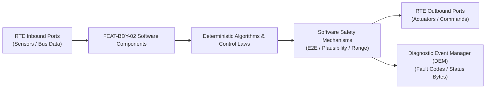

# Software Requirements Specification: Adaptive Driving Beam Matrix Headlights (ADB)
**Feature ID:** `FEAT-BDY-02`  
**Domain:** Body, Lighting & Restraints  
**Target ASIL:** ASIL B  
**Compliance Standard:** ISO 26262:2018 (Part 6 - Software Development) / ASPICE PAM v3.1 (SWE.1, SWE.2)  
**Parent System Specification:** [`FEAT-BDY-02_ADB_SysReq.md`](file:///c:/Workset/AntiGravityProjects/TestOptimisationExperiement/system_requirements/FEAT-BDY-02_ADB_SysReq.md)  
**Global Master Specification:** [`spec.md`](file:///c:/Workset/AntiGravityProjects/TestOptimisationExperiement/spec.md)

---

## 1. Software Architecture & Component Structure

This document specifies the AUTOSAR Software Components (SWCs), periodic runnables, algorithmic laws, safety mechanisms, and data ports implementing `FEAT-BDY-02` (Adaptive Driving Beam Matrix Headlights (ADB)).

### AUTOSAR SWC Interaction Diagram

---

## 2. Detailed Software Requirements (SWR_REQ)
*(Multi-Software Requirement Partitioning derived from System Requirements)*

### `SWR-BDY-02-01`: Azimuth Angle to LED Pixel Address Grid Transformation
- **Planned Release:** R100
- **ASIL Rating:** ASIL B
- **Parent System Requirement:** [`SYS-BDY-02-01`](file:///c:/Workset/AntiGravityProjects/TestOptimisationExperiement/system_requirements/FEAT-BDY-02_ADB_SysReq.md#sys-bdy-02-01)
- **Allocated AUTOSAR SWC:** `AdbMatrixMapper_SWC`
- **Execution Rate / Trigger:** 20 ms
- **Worst-Case Execution Time (WCET):** 1.2 ms
- **Software Activation Condition:** Executed cyclically every 20 ms.
- **Algorithmic Description / Logic:**
  > Converts object azimuth angles theta_az into headlamp pixel columns col = f(theta_az, optical_distortion). Adds a +1.5 deg lateral safety margin on both left and right edges to account for vehicle pitching.
- **Software Safety Mechanism:** Dynamic pitch compensation: Adjusts vertical row cutoff using suspension pitch angle.
- **Failure Reaction & DEM Diagnostic Event:** Expand shadow mask if vehicle traverses road crest or dip.
- **Software Port Inputs:** `Target_Azimuth_Angles[8], Target_Angular_Widths[8], Suspension_Pitch_Deg`
- **Software Port Outputs:** `Pixel_Mask_Bitmap_Left[32], Pixel_Mask_Bitmap_Right[32]`
- **Software Verification Criteria:** Mathematical unit test verifying coordinate transformation matrices.
- **Traceability Link:** Traces upward to [`SYS-BDY-02-01`](file:///c:/Workset/AntiGravityProjects/TestOptimisationExperiement/system_requirements/FEAT-BDY-02_ADB_SysReq.md#sys-bdy-02-01) and [`FEAT-BDY-02`](file:///c:/Workset/AntiGravityProjects/TestOptimisationExperiement/spec.md).

### `SWR-BDY-02-02`: Curvature Swivel & Bending Light Angle Calculator
- **Planned Release:** R100
- **ASIL Rating:** QM
- **Parent System Requirement:** [`SYS-BDY-02-01`](file:///c:/Workset/AntiGravityProjects/TestOptimisationExperiement/system_requirements/FEAT-BDY-02_ADB_SysReq.md#sys-bdy-02-01)
- **Allocated AUTOSAR SWC:** `AdbBendingLight_SWC`
- **Execution Rate / Trigger:** 20 ms
- **Worst-Case Execution Time (WCET):** 0.6 ms
- **Software Activation Condition:** Executed every 20 ms.
- **Algorithmic Description / Logic:**
  > Computes dynamic curve lighting offset: Theta_swivel = arctan(L_wheelbase * kappa) * K_speed(v_ego). Shifts high-beam illumination center into the inside of highway bends.
- **Software Safety Mechanism:** Swivel angle limited to maximum +-15 degrees.
- **Failure Reaction & DEM Diagnostic Event:** Center swivel angle to 0 degrees if steering sensor signal is lost.
- **Software Port Inputs:** `Steering_Angle_Deg, Vehicle_Speed_Mps, Road_Curvature`
- **Software Port Outputs:** `Swivel_Offset_Angle_Deg (float32)`
- **Software Verification Criteria:** SIL vehicle dynamics trajectory testing through tight curves.
- **Traceability Link:** Traces upward to [`SYS-BDY-02-01`](file:///c:/Workset/AntiGravityProjects/TestOptimisationExperiement/system_requirements/FEAT-BDY-02_ADB_SysReq.md#sys-bdy-02-01) and [`FEAT-BDY-02`](file:///c:/Workset/AntiGravityProjects/TestOptimisationExperiement/spec.md).

### `SWR-BDY-02-03`: Individual Matrix Pixel Low-Pass Smoothing & Anti-Flicker Filter
- **Planned Release:** R100
- **ASIL Rating:** ASIL B
- **Parent System Requirement:** [`SYS-BDY-02-02`](file:///c:/Workset/AntiGravityProjects/TestOptimisationExperiement/system_requirements/FEAT-BDY-02_ADB_SysReq.md#sys-bdy-02-02)
- **Allocated AUTOSAR SWC:** `AdbLedDriver_SWC`
- **Execution Rate / Trigger:** 20 ms
- **Worst-Case Execution Time (WCET):** 1.4 ms
- **Software Activation Condition:** Executed every 20 ms on Pixel_Mask_Bitmaps.
- **Algorithmic Description / Logic:**
  > Interpolates 8-bit pixel brightness values. Applies exponential low-pass filter: Duty[k] = Duty[k-1] + alpha * (Target_Duty - Duty[k-1]) with tau = 20 ms to provide smooth, organic light dimming.
- **Software Safety Mechanism:** Ensures extinguishing pixels dim faster (tau = 10 ms) than illuminating pixels (tau = 30 ms) to avoid glare.
- **Failure Reaction & DEM Diagnostic Event:** Force immediate zero duty on affected pixels if glare flag is set.
- **Software Port Inputs:** `Pixel_Mask_Bitmap_Left, Pixel_Mask_Bitmap_Right`
- **Software Port Outputs:** `LED_Duty_Cycles_Left[128], LED_Duty_Cycles_Right[128]`
- **Software Verification Criteria:** Photometric high-speed camera flicker test.
- **Traceability Link:** Traces upward to [`SYS-BDY-02-02`](file:///c:/Workset/AntiGravityProjects/TestOptimisationExperiement/system_requirements/FEAT-BDY-02_ADB_SysReq.md#sys-bdy-02-02) and [`FEAT-BDY-02`](file:///c:/Workset/AntiGravityProjects/TestOptimisationExperiement/spec.md).

### `SWR-BDY-02-04`: Matrix Driver SPI Frame Serializer & Open-Load Diagnostic
- **Planned Release:** R100
- **ASIL Rating:** ASIL B
- **Parent System Requirement:** [`SYS-BDY-02-02`](file:///c:/Workset/AntiGravityProjects/TestOptimisationExperiement/system_requirements/FEAT-BDY-02_ADB_SysReq.md#sys-bdy-02-02)
- **Allocated AUTOSAR SWC:** `AdbHardwareInterface_SWC`
- **Execution Rate / Trigger:** 10 ms
- **Worst-Case Execution Time (WCET):** 0.8 ms
- **Software Activation Condition:** Executed at 100 Hz.
- **Algorithmic Description / Logic:**
  > Formats serial data frames over high-speed CAN-FD / SPI to headlamp matrix LED drivers. Reads back open-load and short-circuit diagnostic status bytes. Inverts pixel duty if thermal limit reached.
- **Software Safety Mechanism:** Parity bit and checksum protection on serial communication lines.
- **Failure Reaction & DEM Diagnostic Event:** Report DTC B1452 if open circuit detected on matrix string.
- **Software Port Inputs:** `LED_Duty_Cycles_Left, LED_Duty_Cycles_Right, Diagnostic_Feedback_Bytes`
- **Software Port Outputs:** `Headlamp_SPI_Tx_Buffer, Headlamp_Diagnostic_Status_Enum`
- **Software Verification Criteria:** Electrical harness fault injection testing on headlamp bench.
- **Traceability Link:** Traces upward to [`SYS-BDY-02-02`](file:///c:/Workset/AntiGravityProjects/TestOptimisationExperiement/system_requirements/FEAT-BDY-02_ADB_SysReq.md#sys-bdy-02-02) and [`FEAT-BDY-02`](file:///c:/Workset/AntiGravityProjects/TestOptimisationExperiement/spec.md).

### `SWR-BDY-02-05`: Matrix LED Headlamp 84-Pixel Array Independent Dimming Controller - Dynamic Observer & Signal Filter
- **Planned Release:** R100
- **ASIL Rating:** ASIL B
- **Parent System Requirement:** [`SYS-BDY-02-03`](file:///c:/Workset/AntiGravityProjects/TestOptimisationExperiement/system_requirements/FEAT-BDY-02_ADB_SysReq.md#sys-bdy-02-03)
- **Allocated AUTOSAR SWC:** `AdbMatrixDimmer_SWC`
- **Execution Rate / Trigger:** 10 ms
- **Worst-Case Execution Time (WCET):** 0.3 ms
- **Software Activation Condition:** Executed cyclically every 10 ms.
- **Algorithmic Description / Logic:**
  > Executes signal plausibility filtering, calibration offsets, and discrete state estimation for Matrix LED Headlamp 84-Pixel Array Independent Dimming Controller.
- **Software Safety Mechanism:** Range limit plausibility check and E2E alive sequence verification.
- **Failure Reaction & DEM Diagnostic Event:** Set default fallback output and report DEM_EVENT_FEAT_BDY_02_ERR.
- **Software Port Inputs:** `Raw sensor ADC/SENT/SPI values and RTE bus inputs.`
- **Software Port Outputs:** `Filtered physical signals and validity status bitmasks.`
- **Software Verification Criteria:** Unit test and HiL software integration test.
- **Traceability Link:** Traces upward to [`SYS-BDY-02-03`](file:///c:/Workset/AntiGravityProjects/TestOptimisationExperiement/system_requirements/FEAT-BDY-02_ADB_SysReq.md#sys-bdy-02-03) and [`FEAT-BDY-02`](file:///c:/Workset/AntiGravityProjects/TestOptimisationExperiement/spec.md).

### `SWR-BDY-02-06`: Matrix LED Headlamp 84-Pixel Array Independent Dimming Controller - Closed-Loop Control Law & Actuator Dispatch
- **Planned Release:** R100
- **ASIL Rating:** ASIL B
- **Parent System Requirement:** [`SYS-BDY-02-03`](file:///c:/Workset/AntiGravityProjects/TestOptimisationExperiement/system_requirements/FEAT-BDY-02_ADB_SysReq.md#sys-bdy-02-03)
- **Allocated AUTOSAR SWC:** `AdbMatrixDimmer_SWC`
- **Execution Rate / Trigger:** 10 ms
- **Worst-Case Execution Time (WCET):** 0.4 ms
- **Software Activation Condition:** Executed cyclically every 10 ms.
- **Algorithmic Description / Logic:**
  > Evaluates deterministic closed-loop control law, rate limits, and dispatches commands for Matrix LED Headlamp 84-Pixel Array Independent Dimming Controller.
- **Software Safety Mechanism:** Command saturation clamping and watchdog program flow monitoring.
- **Failure Reaction & DEM Diagnostic Event:** De-energize actuator output, apply safe fallback clamp, and latch DTC.
- **Software Port Inputs:** `Validated physical state signals from observer SWC.`
- **Software Port Outputs:** `Actuator PWM duty cycles, torque/pressure setpoints, and diagnostic flags.`
- **Software Verification Criteria:** Hardware dynamometer and HiL closed-loop regression test suite.
- **Traceability Link:** Traces upward to [`SYS-BDY-02-03`](file:///c:/Workset/AntiGravityProjects/TestOptimisationExperiement/system_requirements/FEAT-BDY-02_ADB_SysReq.md#sys-bdy-02-03) and [`FEAT-BDY-02`](file:///c:/Workset/AntiGravityProjects/TestOptimisationExperiement/spec.md).

### `SWR-BDY-02-07`: Front Camera Oncoming & Preceding Vehicle Headlamp/Taillamp Tracker - Dynamic Observer & Signal Filter
- **Planned Release:** R200
- **ASIL Rating:** ASIL B
- **Parent System Requirement:** [`SYS-BDY-02-04`](file:///c:/Workset/AntiGravityProjects/TestOptimisationExperiement/system_requirements/FEAT-BDY-02_ADB_SysReq.md#sys-bdy-02-04)
- **Allocated AUTOSAR SWC:** `AdbVehicleTracker_SWC`
- **Execution Rate / Trigger:** 15 ms
- **Worst-Case Execution Time (WCET):** 0.3 ms
- **Software Activation Condition:** Executed cyclically every 15 ms.
- **Algorithmic Description / Logic:**
  > Executes signal plausibility filtering, calibration offsets, and discrete state estimation for Front Camera Oncoming & Preceding Vehicle Headlamp/Taillamp Tracker.
- **Software Safety Mechanism:** Range limit plausibility check and E2E alive sequence verification.
- **Failure Reaction & DEM Diagnostic Event:** Set default fallback output and report DEM_EVENT_FEAT_BDY_02_ERR.
- **Software Port Inputs:** `Raw sensor ADC/SENT/SPI values and RTE bus inputs.`
- **Software Port Outputs:** `Filtered physical signals and validity status bitmasks.`
- **Software Verification Criteria:** Unit test and HiL software integration test.
- **Traceability Link:** Traces upward to [`SYS-BDY-02-04`](file:///c:/Workset/AntiGravityProjects/TestOptimisationExperiement/system_requirements/FEAT-BDY-02_ADB_SysReq.md#sys-bdy-02-04) and [`FEAT-BDY-02`](file:///c:/Workset/AntiGravityProjects/TestOptimisationExperiement/spec.md).

### `SWR-BDY-02-08`: Front Camera Oncoming & Preceding Vehicle Headlamp/Taillamp Tracker - Closed-Loop Control Law & Actuator Dispatch
- **Planned Release:** R200
- **ASIL Rating:** ASIL B
- **Parent System Requirement:** [`SYS-BDY-02-04`](file:///c:/Workset/AntiGravityProjects/TestOptimisationExperiement/system_requirements/FEAT-BDY-02_ADB_SysReq.md#sys-bdy-02-04)
- **Allocated AUTOSAR SWC:** `AdbVehicleTracker_SWC`
- **Execution Rate / Trigger:** 15 ms
- **Worst-Case Execution Time (WCET):** 0.4 ms
- **Software Activation Condition:** Executed cyclically every 15 ms.
- **Algorithmic Description / Logic:**
  > Evaluates deterministic closed-loop control law, rate limits, and dispatches commands for Front Camera Oncoming & Preceding Vehicle Headlamp/Taillamp Tracker.
- **Software Safety Mechanism:** Command saturation clamping and watchdog program flow monitoring.
- **Failure Reaction & DEM Diagnostic Event:** De-energize actuator output, apply safe fallback clamp, and latch DTC.
- **Software Port Inputs:** `Validated physical state signals from observer SWC.`
- **Software Port Outputs:** `Actuator PWM duty cycles, torque/pressure setpoints, and diagnostic flags.`
- **Software Verification Criteria:** Hardware dynamometer and HiL closed-loop regression test suite.
- **Traceability Link:** Traces upward to [`SYS-BDY-02-04`](file:///c:/Workset/AntiGravityProjects/TestOptimisationExperiement/system_requirements/FEAT-BDY-02_ADB_SysReq.md#sys-bdy-02-04) and [`FEAT-BDY-02`](file:///c:/Workset/AntiGravityProjects/TestOptimisationExperiement/spec.md).

### `SWR-BDY-02-09`: High-Speed Dynamic Glare-Free Shadow Mask Polygon Generator - Dynamic Observer & Signal Filter
- **Planned Release:** R200
- **ASIL Rating:** ASIL B
- **Parent System Requirement:** [`SYS-BDY-02-05`](file:///c:/Workset/AntiGravityProjects/TestOptimisationExperiement/system_requirements/FEAT-BDY-02_ADB_SysReq.md#sys-bdy-02-05)
- **Allocated AUTOSAR SWC:** `AdbGlareFreePolygon_SWC`
- **Execution Rate / Trigger:** 10 ms
- **Worst-Case Execution Time (WCET):** 0.3 ms
- **Software Activation Condition:** Executed cyclically every 10 ms.
- **Algorithmic Description / Logic:**
  > Executes signal plausibility filtering, calibration offsets, and discrete state estimation for High-Speed Dynamic Glare-Free Shadow Mask Polygon Generator.
- **Software Safety Mechanism:** Range limit plausibility check and E2E alive sequence verification.
- **Failure Reaction & DEM Diagnostic Event:** Set default fallback output and report DEM_EVENT_FEAT_BDY_02_ERR.
- **Software Port Inputs:** `Raw sensor ADC/SENT/SPI values and RTE bus inputs.`
- **Software Port Outputs:** `Filtered physical signals and validity status bitmasks.`
- **Software Verification Criteria:** Unit test and HiL software integration test.
- **Traceability Link:** Traces upward to [`SYS-BDY-02-05`](file:///c:/Workset/AntiGravityProjects/TestOptimisationExperiement/system_requirements/FEAT-BDY-02_ADB_SysReq.md#sys-bdy-02-05) and [`FEAT-BDY-02`](file:///c:/Workset/AntiGravityProjects/TestOptimisationExperiement/spec.md).

### `SWR-BDY-02-10`: High-Speed Dynamic Glare-Free Shadow Mask Polygon Generator - Closed-Loop Control Law & Actuator Dispatch
- **Planned Release:** R200
- **ASIL Rating:** ASIL B
- **Parent System Requirement:** [`SYS-BDY-02-05`](file:///c:/Workset/AntiGravityProjects/TestOptimisationExperiement/system_requirements/FEAT-BDY-02_ADB_SysReq.md#sys-bdy-02-05)
- **Allocated AUTOSAR SWC:** `AdbGlareFreePolygon_SWC`
- **Execution Rate / Trigger:** 10 ms
- **Worst-Case Execution Time (WCET):** 0.4 ms
- **Software Activation Condition:** Executed cyclically every 10 ms.
- **Algorithmic Description / Logic:**
  > Evaluates deterministic closed-loop control law, rate limits, and dispatches commands for High-Speed Dynamic Glare-Free Shadow Mask Polygon Generator.
- **Software Safety Mechanism:** Command saturation clamping and watchdog program flow monitoring.
- **Failure Reaction & DEM Diagnostic Event:** De-energize actuator output, apply safe fallback clamp, and latch DTC.
- **Software Port Inputs:** `Validated physical state signals from observer SWC.`
- **Software Port Outputs:** `Actuator PWM duty cycles, torque/pressure setpoints, and diagnostic flags.`
- **Software Verification Criteria:** Hardware dynamometer and HiL closed-loop regression test suite.
- **Traceability Link:** Traces upward to [`SYS-BDY-02-05`](file:///c:/Workset/AntiGravityProjects/TestOptimisationExperiement/system_requirements/FEAT-BDY-02_ADB_SysReq.md#sys-bdy-02-05) and [`FEAT-BDY-02`](file:///c:/Workset/AntiGravityProjects/TestOptimisationExperiement/spec.md).

### `SWR-BDY-02-11`: Vehicle Pitch Dynamic Leveling Sensor Axle Deflection Compensator - Dynamic Observer & Signal Filter
- **Planned Release:** R200
- **ASIL Rating:** ASIL B
- **Parent System Requirement:** [`SYS-BDY-02-06`](file:///c:/Workset/AntiGravityProjects/TestOptimisationExperiement/system_requirements/FEAT-BDY-02_ADB_SysReq.md#sys-bdy-02-06)
- **Allocated AUTOSAR SWC:** `AdbPitchLeveler_SWC`
- **Execution Rate / Trigger:** 20 ms
- **Worst-Case Execution Time (WCET):** 0.3 ms
- **Software Activation Condition:** Executed cyclically every 20 ms.
- **Algorithmic Description / Logic:**
  > Executes signal plausibility filtering, calibration offsets, and discrete state estimation for Vehicle Pitch Dynamic Leveling Sensor Axle Deflection Compensator.
- **Software Safety Mechanism:** Range limit plausibility check and E2E alive sequence verification.
- **Failure Reaction & DEM Diagnostic Event:** Set default fallback output and report DEM_EVENT_FEAT_BDY_02_ERR.
- **Software Port Inputs:** `Raw sensor ADC/SENT/SPI values and RTE bus inputs.`
- **Software Port Outputs:** `Filtered physical signals and validity status bitmasks.`
- **Software Verification Criteria:** Unit test and HiL software integration test.
- **Traceability Link:** Traces upward to [`SYS-BDY-02-06`](file:///c:/Workset/AntiGravityProjects/TestOptimisationExperiement/system_requirements/FEAT-BDY-02_ADB_SysReq.md#sys-bdy-02-06) and [`FEAT-BDY-02`](file:///c:/Workset/AntiGravityProjects/TestOptimisationExperiement/spec.md).

### `SWR-BDY-02-12`: Vehicle Pitch Dynamic Leveling Sensor Axle Deflection Compensator - Closed-Loop Control Law & Actuator Dispatch
- **Planned Release:** R200
- **ASIL Rating:** ASIL B
- **Parent System Requirement:** [`SYS-BDY-02-06`](file:///c:/Workset/AntiGravityProjects/TestOptimisationExperiement/system_requirements/FEAT-BDY-02_ADB_SysReq.md#sys-bdy-02-06)
- **Allocated AUTOSAR SWC:** `AdbPitchLeveler_SWC`
- **Execution Rate / Trigger:** 20 ms
- **Worst-Case Execution Time (WCET):** 0.4 ms
- **Software Activation Condition:** Executed cyclically every 20 ms.
- **Algorithmic Description / Logic:**
  > Evaluates deterministic closed-loop control law, rate limits, and dispatches commands for Vehicle Pitch Dynamic Leveling Sensor Axle Deflection Compensator.
- **Software Safety Mechanism:** Command saturation clamping and watchdog program flow monitoring.
- **Failure Reaction & DEM Diagnostic Event:** De-energize actuator output, apply safe fallback clamp, and latch DTC.
- **Software Port Inputs:** `Validated physical state signals from observer SWC.`
- **Software Port Outputs:** `Actuator PWM duty cycles, torque/pressure setpoints, and diagnostic flags.`
- **Software Verification Criteria:** Hardware dynamometer and HiL closed-loop regression test suite.
- **Traceability Link:** Traces upward to [`SYS-BDY-02-06`](file:///c:/Workset/AntiGravityProjects/TestOptimisationExperiement/system_requirements/FEAT-BDY-02_ADB_SysReq.md#sys-bdy-02-06) and [`FEAT-BDY-02`](file:///c:/Workset/AntiGravityProjects/TestOptimisationExperiement/spec.md).

### `SWR-BDY-02-13`: Steering Angle Predictive Cornering Light Beam Swivel Commander - Dynamic Observer & Signal Filter
- **Planned Release:** R300
- **ASIL Rating:** ASIL B
- **Parent System Requirement:** [`SYS-BDY-02-07`](file:///c:/Workset/AntiGravityProjects/TestOptimisationExperiement/system_requirements/FEAT-BDY-02_ADB_SysReq.md#sys-bdy-02-07)
- **Allocated AUTOSAR SWC:** `AdbCorneringSwivel_SWC`
- **Execution Rate / Trigger:** 15 ms
- **Worst-Case Execution Time (WCET):** 0.3 ms
- **Software Activation Condition:** Executed cyclically every 15 ms.
- **Algorithmic Description / Logic:**
  > Executes signal plausibility filtering, calibration offsets, and discrete state estimation for Steering Angle Predictive Cornering Light Beam Swivel Commander.
- **Software Safety Mechanism:** Range limit plausibility check and E2E alive sequence verification.
- **Failure Reaction & DEM Diagnostic Event:** Set default fallback output and report DEM_EVENT_FEAT_BDY_02_ERR.
- **Software Port Inputs:** `Raw sensor ADC/SENT/SPI values and RTE bus inputs.`
- **Software Port Outputs:** `Filtered physical signals and validity status bitmasks.`
- **Software Verification Criteria:** Unit test and HiL software integration test.
- **Traceability Link:** Traces upward to [`SYS-BDY-02-07`](file:///c:/Workset/AntiGravityProjects/TestOptimisationExperiement/system_requirements/FEAT-BDY-02_ADB_SysReq.md#sys-bdy-02-07) and [`FEAT-BDY-02`](file:///c:/Workset/AntiGravityProjects/TestOptimisationExperiement/spec.md).

### `SWR-BDY-02-14`: Steering Angle Predictive Cornering Light Beam Swivel Commander - Closed-Loop Control Law & Actuator Dispatch
- **Planned Release:** R300
- **ASIL Rating:** ASIL B
- **Parent System Requirement:** [`SYS-BDY-02-07`](file:///c:/Workset/AntiGravityProjects/TestOptimisationExperiement/system_requirements/FEAT-BDY-02_ADB_SysReq.md#sys-bdy-02-07)
- **Allocated AUTOSAR SWC:** `AdbCorneringSwivel_SWC`
- **Execution Rate / Trigger:** 15 ms
- **Worst-Case Execution Time (WCET):** 0.4 ms
- **Software Activation Condition:** Executed cyclically every 15 ms.
- **Algorithmic Description / Logic:**
  > Evaluates deterministic closed-loop control law, rate limits, and dispatches commands for Steering Angle Predictive Cornering Light Beam Swivel Commander.
- **Software Safety Mechanism:** Command saturation clamping and watchdog program flow monitoring.
- **Failure Reaction & DEM Diagnostic Event:** De-energize actuator output, apply safe fallback clamp, and latch DTC.
- **Software Port Inputs:** `Validated physical state signals from observer SWC.`
- **Software Port Outputs:** `Actuator PWM duty cycles, torque/pressure setpoints, and diagnostic flags.`
- **Software Verification Criteria:** Hardware dynamometer and HiL closed-loop regression test suite.
- **Traceability Link:** Traces upward to [`SYS-BDY-02-07`](file:///c:/Workset/AntiGravityProjects/TestOptimisationExperiement/system_requirements/FEAT-BDY-02_ADB_SysReq.md#sys-bdy-02-07) and [`FEAT-BDY-02`](file:///c:/Workset/AntiGravityProjects/TestOptimisationExperiement/spec.md).

### `SWR-BDY-02-15`: Ambient Light & Twilight Automatic High-Beam Transition Sequencer - Dynamic Observer & Signal Filter
- **Planned Release:** R300
- **ASIL Rating:** ASIL B
- **Parent System Requirement:** [`SYS-BDY-02-08`](file:///c:/Workset/AntiGravityProjects/TestOptimisationExperiement/system_requirements/FEAT-BDY-02_ADB_SysReq.md#sys-bdy-02-08)
- **Allocated AUTOSAR SWC:** `AdbHighBeamSequencer_SWC`
- **Execution Rate / Trigger:** 50 ms
- **Worst-Case Execution Time (WCET):** 0.3 ms
- **Software Activation Condition:** Executed cyclically every 50 ms.
- **Algorithmic Description / Logic:**
  > Executes signal plausibility filtering, calibration offsets, and discrete state estimation for Ambient Light & Twilight Automatic High-Beam Transition Sequencer.
- **Software Safety Mechanism:** Range limit plausibility check and E2E alive sequence verification.
- **Failure Reaction & DEM Diagnostic Event:** Set default fallback output and report DEM_EVENT_FEAT_BDY_02_ERR.
- **Software Port Inputs:** `Raw sensor ADC/SENT/SPI values and RTE bus inputs.`
- **Software Port Outputs:** `Filtered physical signals and validity status bitmasks.`
- **Software Verification Criteria:** Unit test and HiL software integration test.
- **Traceability Link:** Traces upward to [`SYS-BDY-02-08`](file:///c:/Workset/AntiGravityProjects/TestOptimisationExperiement/system_requirements/FEAT-BDY-02_ADB_SysReq.md#sys-bdy-02-08) and [`FEAT-BDY-02`](file:///c:/Workset/AntiGravityProjects/TestOptimisationExperiement/spec.md).

### `SWR-BDY-02-16`: Ambient Light & Twilight Automatic High-Beam Transition Sequencer - Closed-Loop Control Law & Actuator Dispatch
- **Planned Release:** R300
- **ASIL Rating:** ASIL B
- **Parent System Requirement:** [`SYS-BDY-02-08`](file:///c:/Workset/AntiGravityProjects/TestOptimisationExperiement/system_requirements/FEAT-BDY-02_ADB_SysReq.md#sys-bdy-02-08)
- **Allocated AUTOSAR SWC:** `AdbHighBeamSequencer_SWC`
- **Execution Rate / Trigger:** 50 ms
- **Worst-Case Execution Time (WCET):** 0.4 ms
- **Software Activation Condition:** Executed cyclically every 50 ms.
- **Algorithmic Description / Logic:**
  > Evaluates deterministic closed-loop control law, rate limits, and dispatches commands for Ambient Light & Twilight Automatic High-Beam Transition Sequencer.
- **Software Safety Mechanism:** Command saturation clamping and watchdog program flow monitoring.
- **Failure Reaction & DEM Diagnostic Event:** De-energize actuator output, apply safe fallback clamp, and latch DTC.
- **Software Port Inputs:** `Validated physical state signals from observer SWC.`
- **Software Port Outputs:** `Actuator PWM duty cycles, torque/pressure setpoints, and diagnostic flags.`
- **Software Verification Criteria:** Hardware dynamometer and HiL closed-loop regression test suite.
- **Traceability Link:** Traces upward to [`SYS-BDY-02-08`](file:///c:/Workset/AntiGravityProjects/TestOptimisationExperiement/system_requirements/FEAT-BDY-02_ADB_SysReq.md#sys-bdy-02-08) and [`FEAT-BDY-02`](file:///c:/Workset/AntiGravityProjects/TestOptimisationExperiement/spec.md).

### `SWR-BDY-02-17`: City Low-Speed Broad Pedestrian Illumination Spread Optimizer - Dynamic Observer & Signal Filter
- **Planned Release:** R300
- **ASIL Rating:** ASIL B
- **Parent System Requirement:** [`SYS-BDY-02-09`](file:///c:/Workset/AntiGravityProjects/TestOptimisationExperiement/system_requirements/FEAT-BDY-02_ADB_SysReq.md#sys-bdy-02-09)
- **Allocated AUTOSAR SWC:** `AdbCitySpread_SWC`
- **Execution Rate / Trigger:** 50 ms
- **Worst-Case Execution Time (WCET):** 0.3 ms
- **Software Activation Condition:** Executed cyclically every 50 ms.
- **Algorithmic Description / Logic:**
  > Executes signal plausibility filtering, calibration offsets, and discrete state estimation for City Low-Speed Broad Pedestrian Illumination Spread Optimizer.
- **Software Safety Mechanism:** Range limit plausibility check and E2E alive sequence verification.
- **Failure Reaction & DEM Diagnostic Event:** Set default fallback output and report DEM_EVENT_FEAT_BDY_02_ERR.
- **Software Port Inputs:** `Raw sensor ADC/SENT/SPI values and RTE bus inputs.`
- **Software Port Outputs:** `Filtered physical signals and validity status bitmasks.`
- **Software Verification Criteria:** Unit test and HiL software integration test.
- **Traceability Link:** Traces upward to [`SYS-BDY-02-09`](file:///c:/Workset/AntiGravityProjects/TestOptimisationExperiement/system_requirements/FEAT-BDY-02_ADB_SysReq.md#sys-bdy-02-09) and [`FEAT-BDY-02`](file:///c:/Workset/AntiGravityProjects/TestOptimisationExperiement/spec.md).

### `SWR-BDY-02-18`: City Low-Speed Broad Pedestrian Illumination Spread Optimizer - Closed-Loop Control Law & Actuator Dispatch
- **Planned Release:** R300
- **ASIL Rating:** ASIL B
- **Parent System Requirement:** [`SYS-BDY-02-09`](file:///c:/Workset/AntiGravityProjects/TestOptimisationExperiement/system_requirements/FEAT-BDY-02_ADB_SysReq.md#sys-bdy-02-09)
- **Allocated AUTOSAR SWC:** `AdbCitySpread_SWC`
- **Execution Rate / Trigger:** 50 ms
- **Worst-Case Execution Time (WCET):** 0.4 ms
- **Software Activation Condition:** Executed cyclically every 50 ms.
- **Algorithmic Description / Logic:**
  > Evaluates deterministic closed-loop control law, rate limits, and dispatches commands for City Low-Speed Broad Pedestrian Illumination Spread Optimizer.
- **Software Safety Mechanism:** Command saturation clamping and watchdog program flow monitoring.
- **Failure Reaction & DEM Diagnostic Event:** De-energize actuator output, apply safe fallback clamp, and latch DTC.
- **Software Port Inputs:** `Validated physical state signals from observer SWC.`
- **Software Port Outputs:** `Actuator PWM duty cycles, torque/pressure setpoints, and diagnostic flags.`
- **Software Verification Criteria:** Hardware dynamometer and HiL closed-loop regression test suite.
- **Traceability Link:** Traces upward to [`SYS-BDY-02-09`](file:///c:/Workset/AntiGravityProjects/TestOptimisationExperiement/system_requirements/FEAT-BDY-02_ADB_SysReq.md#sys-bdy-02-09) and [`FEAT-BDY-02`](file:///c:/Workset/AntiGravityProjects/TestOptimisationExperiement/spec.md).

### `SWR-BDY-02-19`: Highway High-Speed Long-Distance Concentrated Beam Booster - Dynamic Observer & Signal Filter
- **Planned Release:** R400
- **ASIL Rating:** ASIL B
- **Parent System Requirement:** [`SYS-BDY-02-10`](file:///c:/Workset/AntiGravityProjects/TestOptimisationExperiement/system_requirements/FEAT-BDY-02_ADB_SysReq.md#sys-bdy-02-10)
- **Allocated AUTOSAR SWC:** `AdbHighwayBooster_SWC`
- **Execution Rate / Trigger:** 50 ms
- **Worst-Case Execution Time (WCET):** 0.3 ms
- **Software Activation Condition:** Executed cyclically every 50 ms.
- **Algorithmic Description / Logic:**
  > Executes signal plausibility filtering, calibration offsets, and discrete state estimation for Highway High-Speed Long-Distance Concentrated Beam Booster.
- **Software Safety Mechanism:** Range limit plausibility check and E2E alive sequence verification.
- **Failure Reaction & DEM Diagnostic Event:** Set default fallback output and report DEM_EVENT_FEAT_BDY_02_ERR.
- **Software Port Inputs:** `Raw sensor ADC/SENT/SPI values and RTE bus inputs.`
- **Software Port Outputs:** `Filtered physical signals and validity status bitmasks.`
- **Software Verification Criteria:** Unit test and HiL software integration test.
- **Traceability Link:** Traces upward to [`SYS-BDY-02-10`](file:///c:/Workset/AntiGravityProjects/TestOptimisationExperiement/system_requirements/FEAT-BDY-02_ADB_SysReq.md#sys-bdy-02-10) and [`FEAT-BDY-02`](file:///c:/Workset/AntiGravityProjects/TestOptimisationExperiement/spec.md).

### `SWR-BDY-02-20`: Highway High-Speed Long-Distance Concentrated Beam Booster - Closed-Loop Control Law & Actuator Dispatch
- **Planned Release:** R400
- **ASIL Rating:** ASIL B
- **Parent System Requirement:** [`SYS-BDY-02-10`](file:///c:/Workset/AntiGravityProjects/TestOptimisationExperiement/system_requirements/FEAT-BDY-02_ADB_SysReq.md#sys-bdy-02-10)
- **Allocated AUTOSAR SWC:** `AdbHighwayBooster_SWC`
- **Execution Rate / Trigger:** 50 ms
- **Worst-Case Execution Time (WCET):** 0.4 ms
- **Software Activation Condition:** Executed cyclically every 50 ms.
- **Algorithmic Description / Logic:**
  > Evaluates deterministic closed-loop control law, rate limits, and dispatches commands for Highway High-Speed Long-Distance Concentrated Beam Booster.
- **Software Safety Mechanism:** Command saturation clamping and watchdog program flow monitoring.
- **Failure Reaction & DEM Diagnostic Event:** De-energize actuator output, apply safe fallback clamp, and latch DTC.
- **Software Port Inputs:** `Validated physical state signals from observer SWC.`
- **Software Port Outputs:** `Actuator PWM duty cycles, torque/pressure setpoints, and diagnostic flags.`
- **Software Verification Criteria:** Hardware dynamometer and HiL closed-loop regression test suite.
- **Traceability Link:** Traces upward to [`SYS-BDY-02-10`](file:///c:/Workset/AntiGravityProjects/TestOptimisationExperiement/system_requirements/FEAT-BDY-02_ADB_SysReq.md#sys-bdy-02-10) and [`FEAT-BDY-02`](file:///c:/Workset/AntiGravityProjects/TestOptimisationExperiement/spec.md).

### `SWR-BDY-02-21`: Matrix Headlamp Heatsink Multi-Point Thermal Over-Temperature Derater - Dynamic Observer & Signal Filter
- **Planned Release:** R400
- **ASIL Rating:** ASIL B
- **Parent System Requirement:** [`SYS-BDY-02-11`](file:///c:/Workset/AntiGravityProjects/TestOptimisationExperiement/system_requirements/FEAT-BDY-02_ADB_SysReq.md#sys-bdy-02-11)
- **Allocated AUTOSAR SWC:** `AdbThermalDerater_SWC`
- **Execution Rate / Trigger:** 100 ms
- **Worst-Case Execution Time (WCET):** 0.3 ms
- **Software Activation Condition:** Executed cyclically every 100 ms.
- **Algorithmic Description / Logic:**
  > Executes signal plausibility filtering, calibration offsets, and discrete state estimation for Matrix Headlamp Heatsink Multi-Point Thermal Over-Temperature Derater.
- **Software Safety Mechanism:** Range limit plausibility check and E2E alive sequence verification.
- **Failure Reaction & DEM Diagnostic Event:** Set default fallback output and report DEM_EVENT_FEAT_BDY_02_ERR.
- **Software Port Inputs:** `Raw sensor ADC/SENT/SPI values and RTE bus inputs.`
- **Software Port Outputs:** `Filtered physical signals and validity status bitmasks.`
- **Software Verification Criteria:** Unit test and HiL software integration test.
- **Traceability Link:** Traces upward to [`SYS-BDY-02-11`](file:///c:/Workset/AntiGravityProjects/TestOptimisationExperiement/system_requirements/FEAT-BDY-02_ADB_SysReq.md#sys-bdy-02-11) and [`FEAT-BDY-02`](file:///c:/Workset/AntiGravityProjects/TestOptimisationExperiement/spec.md).

### `SWR-BDY-02-22`: Matrix Headlamp Heatsink Multi-Point Thermal Over-Temperature Derater - Closed-Loop Control Law & Actuator Dispatch
- **Planned Release:** R400
- **ASIL Rating:** ASIL B
- **Parent System Requirement:** [`SYS-BDY-02-11`](file:///c:/Workset/AntiGravityProjects/TestOptimisationExperiement/system_requirements/FEAT-BDY-02_ADB_SysReq.md#sys-bdy-02-11)
- **Allocated AUTOSAR SWC:** `AdbThermalDerater_SWC`
- **Execution Rate / Trigger:** 100 ms
- **Worst-Case Execution Time (WCET):** 0.4 ms
- **Software Activation Condition:** Executed cyclically every 100 ms.
- **Algorithmic Description / Logic:**
  > Evaluates deterministic closed-loop control law, rate limits, and dispatches commands for Matrix Headlamp Heatsink Multi-Point Thermal Over-Temperature Derater.
- **Software Safety Mechanism:** Command saturation clamping and watchdog program flow monitoring.
- **Failure Reaction & DEM Diagnostic Event:** De-energize actuator output, apply safe fallback clamp, and latch DTC.
- **Software Port Inputs:** `Validated physical state signals from observer SWC.`
- **Software Port Outputs:** `Actuator PWM duty cycles, torque/pressure setpoints, and diagnostic flags.`
- **Software Verification Criteria:** Hardware dynamometer and HiL closed-loop regression test suite.
- **Traceability Link:** Traces upward to [`SYS-BDY-02-11`](file:///c:/Workset/AntiGravityProjects/TestOptimisationExperiement/system_requirements/FEAT-BDY-02_ADB_SysReq.md#sys-bdy-02-11) and [`FEAT-BDY-02`](file:///c:/Workset/AntiGravityProjects/TestOptimisationExperiement/spec.md).

### `SWR-BDY-02-23`: Adverse Weather & Fog/Snow Back-Glare Light Dispersion Minimizer - Dynamic Observer & Signal Filter
- **Planned Release:** R400
- **ASIL Rating:** ASIL B
- **Parent System Requirement:** [`SYS-BDY-02-12`](file:///c:/Workset/AntiGravityProjects/TestOptimisationExperiement/system_requirements/FEAT-BDY-02_ADB_SysReq.md#sys-bdy-02-12)
- **Allocated AUTOSAR SWC:** `AdbWeatherDispersion_SWC`
- **Execution Rate / Trigger:** 100 ms
- **Worst-Case Execution Time (WCET):** 0.3 ms
- **Software Activation Condition:** Executed cyclically every 100 ms.
- **Algorithmic Description / Logic:**
  > Executes signal plausibility filtering, calibration offsets, and discrete state estimation for Adverse Weather & Fog/Snow Back-Glare Light Dispersion Minimizer.
- **Software Safety Mechanism:** Range limit plausibility check and E2E alive sequence verification.
- **Failure Reaction & DEM Diagnostic Event:** Set default fallback output and report DEM_EVENT_FEAT_BDY_02_ERR.
- **Software Port Inputs:** `Raw sensor ADC/SENT/SPI values and RTE bus inputs.`
- **Software Port Outputs:** `Filtered physical signals and validity status bitmasks.`
- **Software Verification Criteria:** Unit test and HiL software integration test.
- **Traceability Link:** Traces upward to [`SYS-BDY-02-12`](file:///c:/Workset/AntiGravityProjects/TestOptimisationExperiement/system_requirements/FEAT-BDY-02_ADB_SysReq.md#sys-bdy-02-12) and [`FEAT-BDY-02`](file:///c:/Workset/AntiGravityProjects/TestOptimisationExperiement/spec.md).

### `SWR-BDY-02-24`: Adverse Weather & Fog/Snow Back-Glare Light Dispersion Minimizer - Closed-Loop Control Law & Actuator Dispatch
- **Planned Release:** R400
- **ASIL Rating:** ASIL B
- **Parent System Requirement:** [`SYS-BDY-02-12`](file:///c:/Workset/AntiGravityProjects/TestOptimisationExperiement/system_requirements/FEAT-BDY-02_ADB_SysReq.md#sys-bdy-02-12)
- **Allocated AUTOSAR SWC:** `AdbWeatherDispersion_SWC`
- **Execution Rate / Trigger:** 100 ms
- **Worst-Case Execution Time (WCET):** 0.4 ms
- **Software Activation Condition:** Executed cyclically every 100 ms.
- **Algorithmic Description / Logic:**
  > Evaluates deterministic closed-loop control law, rate limits, and dispatches commands for Adverse Weather & Fog/Snow Back-Glare Light Dispersion Minimizer.
- **Software Safety Mechanism:** Command saturation clamping and watchdog program flow monitoring.
- **Failure Reaction & DEM Diagnostic Event:** De-energize actuator output, apply safe fallback clamp, and latch DTC.
- **Software Port Inputs:** `Validated physical state signals from observer SWC.`
- **Software Port Outputs:** `Actuator PWM duty cycles, torque/pressure setpoints, and diagnostic flags.`
- **Software Verification Criteria:** Hardware dynamometer and HiL closed-loop regression test suite.
- **Traceability Link:** Traces upward to [`SYS-BDY-02-12`](file:///c:/Workset/AntiGravityProjects/TestOptimisationExperiement/system_requirements/FEAT-BDY-02_ADB_SysReq.md#sys-bdy-02-12) and [`FEAT-BDY-02`](file:///c:/Workset/AntiGravityProjects/TestOptimisationExperiement/spec.md).

### `SWR-BDY-02-25`: Matrix LED Module Pixel Short/Open Circuit Hardware Safing Monitor - Dynamic Observer & Signal Filter
- **Planned Release:** R500
- **ASIL Rating:** ASIL B
- **Parent System Requirement:** [`SYS-BDY-02-13`](file:///c:/Workset/AntiGravityProjects/TestOptimisationExperiement/system_requirements/FEAT-BDY-02_ADB_SysReq.md#sys-bdy-02-13)
- **Allocated AUTOSAR SWC:** `AdbPixelFaultMonitor_SWC`
- **Execution Rate / Trigger:** 20 ms
- **Worst-Case Execution Time (WCET):** 0.3 ms
- **Software Activation Condition:** Executed cyclically every 20 ms.
- **Algorithmic Description / Logic:**
  > Executes signal plausibility filtering, calibration offsets, and discrete state estimation for Matrix LED Module Pixel Short/Open Circuit Hardware Safing Monitor.
- **Software Safety Mechanism:** Range limit plausibility check and E2E alive sequence verification.
- **Failure Reaction & DEM Diagnostic Event:** Set default fallback output and report DEM_EVENT_FEAT_BDY_02_ERR.
- **Software Port Inputs:** `Raw sensor ADC/SENT/SPI values and RTE bus inputs.`
- **Software Port Outputs:** `Filtered physical signals and validity status bitmasks.`
- **Software Verification Criteria:** Unit test and HiL software integration test.
- **Traceability Link:** Traces upward to [`SYS-BDY-02-13`](file:///c:/Workset/AntiGravityProjects/TestOptimisationExperiement/system_requirements/FEAT-BDY-02_ADB_SysReq.md#sys-bdy-02-13) and [`FEAT-BDY-02`](file:///c:/Workset/AntiGravityProjects/TestOptimisationExperiement/spec.md).

### `SWR-BDY-02-26`: Matrix LED Module Pixel Short/Open Circuit Hardware Safing Monitor - Closed-Loop Control Law & Actuator Dispatch
- **Planned Release:** R500
- **ASIL Rating:** ASIL B
- **Parent System Requirement:** [`SYS-BDY-02-13`](file:///c:/Workset/AntiGravityProjects/TestOptimisationExperiement/system_requirements/FEAT-BDY-02_ADB_SysReq.md#sys-bdy-02-13)
- **Allocated AUTOSAR SWC:** `AdbPixelFaultMonitor_SWC`
- **Execution Rate / Trigger:** 20 ms
- **Worst-Case Execution Time (WCET):** 0.4 ms
- **Software Activation Condition:** Executed cyclically every 20 ms.
- **Algorithmic Description / Logic:**
  > Evaluates deterministic closed-loop control law, rate limits, and dispatches commands for Matrix LED Module Pixel Short/Open Circuit Hardware Safing Monitor.
- **Software Safety Mechanism:** Command saturation clamping and watchdog program flow monitoring.
- **Failure Reaction & DEM Diagnostic Event:** De-energize actuator output, apply safe fallback clamp, and latch DTC.
- **Software Port Inputs:** `Validated physical state signals from observer SWC.`
- **Software Port Outputs:** `Actuator PWM duty cycles, torque/pressure setpoints, and diagnostic flags.`
- **Software Verification Criteria:** Hardware dynamometer and HiL closed-loop regression test suite.
- **Traceability Link:** Traces upward to [`SYS-BDY-02-13`](file:///c:/Workset/AntiGravityProjects/TestOptimisationExperiement/system_requirements/FEAT-BDY-02_ADB_SysReq.md#sys-bdy-02-13) and [`FEAT-BDY-02`](file:///c:/Workset/AntiGravityProjects/TestOptimisationExperiement/spec.md).

### `SWR-BDY-02-27`: DEM Matrix Lighting Diagnostic Event Manager & Fault Code Latcher - Dynamic Observer & Signal Filter
- **Planned Release:** R500
- **ASIL Rating:** ASIL B
- **Parent System Requirement:** [`SYS-BDY-02-14`](file:///c:/Workset/AntiGravityProjects/TestOptimisationExperiement/system_requirements/FEAT-BDY-02_ADB_SysReq.md#sys-bdy-02-14)
- **Allocated AUTOSAR SWC:** `AdbDiagnosticManager_SWC`
- **Execution Rate / Trigger:** 50 ms
- **Worst-Case Execution Time (WCET):** 0.3 ms
- **Software Activation Condition:** Executed cyclically every 50 ms.
- **Algorithmic Description / Logic:**
  > Executes signal plausibility filtering, calibration offsets, and discrete state estimation for DEM Matrix Lighting Diagnostic Event Manager & Fault Code Latcher.
- **Software Safety Mechanism:** Range limit plausibility check and E2E alive sequence verification.
- **Failure Reaction & DEM Diagnostic Event:** Set default fallback output and report DEM_EVENT_FEAT_BDY_02_ERR.
- **Software Port Inputs:** `Raw sensor ADC/SENT/SPI values and RTE bus inputs.`
- **Software Port Outputs:** `Filtered physical signals and validity status bitmasks.`
- **Software Verification Criteria:** Unit test and HiL software integration test.
- **Traceability Link:** Traces upward to [`SYS-BDY-02-14`](file:///c:/Workset/AntiGravityProjects/TestOptimisationExperiement/system_requirements/FEAT-BDY-02_ADB_SysReq.md#sys-bdy-02-14) and [`FEAT-BDY-02`](file:///c:/Workset/AntiGravityProjects/TestOptimisationExperiement/spec.md).

### `SWR-BDY-02-28`: DEM Matrix Lighting Diagnostic Event Manager & Fault Code Latcher - Closed-Loop Control Law & Actuator Dispatch
- **Planned Release:** R500
- **ASIL Rating:** ASIL B
- **Parent System Requirement:** [`SYS-BDY-02-14`](file:///c:/Workset/AntiGravityProjects/TestOptimisationExperiement/system_requirements/FEAT-BDY-02_ADB_SysReq.md#sys-bdy-02-14)
- **Allocated AUTOSAR SWC:** `AdbDiagnosticManager_SWC`
- **Execution Rate / Trigger:** 50 ms
- **Worst-Case Execution Time (WCET):** 0.4 ms
- **Software Activation Condition:** Executed cyclically every 50 ms.
- **Algorithmic Description / Logic:**
  > Evaluates deterministic closed-loop control law, rate limits, and dispatches commands for DEM Matrix Lighting Diagnostic Event Manager & Fault Code Latcher.
- **Software Safety Mechanism:** Command saturation clamping and watchdog program flow monitoring.
- **Failure Reaction & DEM Diagnostic Event:** De-energize actuator output, apply safe fallback clamp, and latch DTC.
- **Software Port Inputs:** `Validated physical state signals from observer SWC.`
- **Software Port Outputs:** `Actuator PWM duty cycles, torque/pressure setpoints, and diagnostic flags.`
- **Software Verification Criteria:** Hardware dynamometer and HiL closed-loop regression test suite.
- **Traceability Link:** Traces upward to [`SYS-BDY-02-14`](file:///c:/Workset/AntiGravityProjects/TestOptimisationExperiement/system_requirements/FEAT-BDY-02_ADB_SysReq.md#sys-bdy-02-14) and [`FEAT-BDY-02`](file:///c:/Workset/AntiGravityProjects/TestOptimisationExperiement/spec.md).

### `SWR-BDY-02-29`: Driver Matrix Lighting Mode Configuration & Instrument Cluster HMI - Dynamic Observer & Signal Filter
- **Planned Release:** R500
- **ASIL Rating:** ASIL A
- **Parent System Requirement:** [`SYS-BDY-02-15`](file:///c:/Workset/AntiGravityProjects/TestOptimisationExperiement/system_requirements/FEAT-BDY-02_ADB_SysReq.md#sys-bdy-02-15)
- **Allocated AUTOSAR SWC:** `AdbHmiDispatcher_SWC`
- **Execution Rate / Trigger:** 100 ms
- **Worst-Case Execution Time (WCET):** 0.3 ms
- **Software Activation Condition:** Executed cyclically every 100 ms.
- **Algorithmic Description / Logic:**
  > Executes signal plausibility filtering, calibration offsets, and discrete state estimation for Driver Matrix Lighting Mode Configuration & Instrument Cluster HMI.
- **Software Safety Mechanism:** Range limit plausibility check and E2E alive sequence verification.
- **Failure Reaction & DEM Diagnostic Event:** Set default fallback output and report DEM_EVENT_FEAT_BDY_02_ERR.
- **Software Port Inputs:** `Raw sensor ADC/SENT/SPI values and RTE bus inputs.`
- **Software Port Outputs:** `Filtered physical signals and validity status bitmasks.`
- **Software Verification Criteria:** Unit test and HiL software integration test.
- **Traceability Link:** Traces upward to [`SYS-BDY-02-15`](file:///c:/Workset/AntiGravityProjects/TestOptimisationExperiement/system_requirements/FEAT-BDY-02_ADB_SysReq.md#sys-bdy-02-15) and [`FEAT-BDY-02`](file:///c:/Workset/AntiGravityProjects/TestOptimisationExperiement/spec.md).

### `SWR-BDY-02-30`: Driver Matrix Lighting Mode Configuration & Instrument Cluster HMI - Closed-Loop Control Law & Actuator Dispatch
- **Planned Release:** R500
- **ASIL Rating:** ASIL A
- **Parent System Requirement:** [`SYS-BDY-02-15`](file:///c:/Workset/AntiGravityProjects/TestOptimisationExperiement/system_requirements/FEAT-BDY-02_ADB_SysReq.md#sys-bdy-02-15)
- **Allocated AUTOSAR SWC:** `AdbHmiDispatcher_SWC`
- **Execution Rate / Trigger:** 100 ms
- **Worst-Case Execution Time (WCET):** 0.4 ms
- **Software Activation Condition:** Executed cyclically every 100 ms.
- **Algorithmic Description / Logic:**
  > Evaluates deterministic closed-loop control law, rate limits, and dispatches commands for Driver Matrix Lighting Mode Configuration & Instrument Cluster HMI.
- **Software Safety Mechanism:** Command saturation clamping and watchdog program flow monitoring.
- **Failure Reaction & DEM Diagnostic Event:** De-energize actuator output, apply safe fallback clamp, and latch DTC.
- **Software Port Inputs:** `Validated physical state signals from observer SWC.`
- **Software Port Outputs:** `Actuator PWM duty cycles, torque/pressure setpoints, and diagnostic flags.`
- **Software Verification Criteria:** Hardware dynamometer and HiL closed-loop regression test suite.
- **Traceability Link:** Traces upward to [`SYS-BDY-02-15`](file:///c:/Workset/AntiGravityProjects/TestOptimisationExperiement/system_requirements/FEAT-BDY-02_ADB_SysReq.md#sys-bdy-02-15) and [`FEAT-BDY-02`](file:///c:/Workset/AntiGravityProjects/TestOptimisationExperiement/spec.md).

---

## 3. Software-to-System Backward Traceability Matrix

| Software Requirement ID | Planned Release | Allocated SWC | Execution Rate | Upstream System Req | Verification Method |
| :--- | :---: | :--- | :--- | :--- | :--- |
| `SWR-BDY-02-01` | **`R100`** | `AdbMatrixMapper_SWC` | 20 ms | [`SYS-BDY-02-01`](file:///c:/Workset/AntiGravityProjects/TestOptimisationExperiement/system_requirements/FEAT-BDY-02_ADB_SysReq.md#sys-bdy-02-01) | Mathematical unit test verifying coordinate transformation matrices. |
| `SWR-BDY-02-02` | **`R100`** | `AdbBendingLight_SWC` | 20 ms | [`SYS-BDY-02-01`](file:///c:/Workset/AntiGravityProjects/TestOptimisationExperiement/system_requirements/FEAT-BDY-02_ADB_SysReq.md#sys-bdy-02-01) | SIL vehicle dynamics trajectory testing through tight curves. |
| `SWR-BDY-02-03` | **`R100`** | `AdbLedDriver_SWC` | 20 ms | [`SYS-BDY-02-02`](file:///c:/Workset/AntiGravityProjects/TestOptimisationExperiement/system_requirements/FEAT-BDY-02_ADB_SysReq.md#sys-bdy-02-02) | Photometric high-speed camera flicker test. |
| `SWR-BDY-02-04` | **`R100`** | `AdbHardwareInterface_SWC` | 10 ms | [`SYS-BDY-02-02`](file:///c:/Workset/AntiGravityProjects/TestOptimisationExperiement/system_requirements/FEAT-BDY-02_ADB_SysReq.md#sys-bdy-02-02) | Electrical harness fault injection testing on headlamp bench. |
| `SWR-BDY-02-05` | **`R100`** | `AdbMatrixDimmer_SWC` | 10 ms | [`SYS-BDY-02-03`](file:///c:/Workset/AntiGravityProjects/TestOptimisationExperiement/system_requirements/FEAT-BDY-02_ADB_SysReq.md#sys-bdy-02-03) | Unit test and HiL software integration test. |
| `SWR-BDY-02-06` | **`R100`** | `AdbMatrixDimmer_SWC` | 10 ms | [`SYS-BDY-02-03`](file:///c:/Workset/AntiGravityProjects/TestOptimisationExperiement/system_requirements/FEAT-BDY-02_ADB_SysReq.md#sys-bdy-02-03) | Hardware dynamometer and HiL closed-loop regression test suite. |
| `SWR-BDY-02-07` | **`R200`** | `AdbVehicleTracker_SWC` | 15 ms | [`SYS-BDY-02-04`](file:///c:/Workset/AntiGravityProjects/TestOptimisationExperiement/system_requirements/FEAT-BDY-02_ADB_SysReq.md#sys-bdy-02-04) | Unit test and HiL software integration test. |
| `SWR-BDY-02-08` | **`R200`** | `AdbVehicleTracker_SWC` | 15 ms | [`SYS-BDY-02-04`](file:///c:/Workset/AntiGravityProjects/TestOptimisationExperiement/system_requirements/FEAT-BDY-02_ADB_SysReq.md#sys-bdy-02-04) | Hardware dynamometer and HiL closed-loop regression test suite. |
| `SWR-BDY-02-09` | **`R200`** | `AdbGlareFreePolygon_SWC` | 10 ms | [`SYS-BDY-02-05`](file:///c:/Workset/AntiGravityProjects/TestOptimisationExperiement/system_requirements/FEAT-BDY-02_ADB_SysReq.md#sys-bdy-02-05) | Unit test and HiL software integration test. |
| `SWR-BDY-02-10` | **`R200`** | `AdbGlareFreePolygon_SWC` | 10 ms | [`SYS-BDY-02-05`](file:///c:/Workset/AntiGravityProjects/TestOptimisationExperiement/system_requirements/FEAT-BDY-02_ADB_SysReq.md#sys-bdy-02-05) | Hardware dynamometer and HiL closed-loop regression test suite. |
| `SWR-BDY-02-11` | **`R200`** | `AdbPitchLeveler_SWC` | 20 ms | [`SYS-BDY-02-06`](file:///c:/Workset/AntiGravityProjects/TestOptimisationExperiement/system_requirements/FEAT-BDY-02_ADB_SysReq.md#sys-bdy-02-06) | Unit test and HiL software integration test. |
| `SWR-BDY-02-12` | **`R200`** | `AdbPitchLeveler_SWC` | 20 ms | [`SYS-BDY-02-06`](file:///c:/Workset/AntiGravityProjects/TestOptimisationExperiement/system_requirements/FEAT-BDY-02_ADB_SysReq.md#sys-bdy-02-06) | Hardware dynamometer and HiL closed-loop regression test suite. |
| `SWR-BDY-02-13` | **`R300`** | `AdbCorneringSwivel_SWC` | 15 ms | [`SYS-BDY-02-07`](file:///c:/Workset/AntiGravityProjects/TestOptimisationExperiement/system_requirements/FEAT-BDY-02_ADB_SysReq.md#sys-bdy-02-07) | Unit test and HiL software integration test. |
| `SWR-BDY-02-14` | **`R300`** | `AdbCorneringSwivel_SWC` | 15 ms | [`SYS-BDY-02-07`](file:///c:/Workset/AntiGravityProjects/TestOptimisationExperiement/system_requirements/FEAT-BDY-02_ADB_SysReq.md#sys-bdy-02-07) | Hardware dynamometer and HiL closed-loop regression test suite. |
| `SWR-BDY-02-15` | **`R300`** | `AdbHighBeamSequencer_SWC` | 50 ms | [`SYS-BDY-02-08`](file:///c:/Workset/AntiGravityProjects/TestOptimisationExperiement/system_requirements/FEAT-BDY-02_ADB_SysReq.md#sys-bdy-02-08) | Unit test and HiL software integration test. |
| `SWR-BDY-02-16` | **`R300`** | `AdbHighBeamSequencer_SWC` | 50 ms | [`SYS-BDY-02-08`](file:///c:/Workset/AntiGravityProjects/TestOptimisationExperiement/system_requirements/FEAT-BDY-02_ADB_SysReq.md#sys-bdy-02-08) | Hardware dynamometer and HiL closed-loop regression test suite. |
| `SWR-BDY-02-17` | **`R300`** | `AdbCitySpread_SWC` | 50 ms | [`SYS-BDY-02-09`](file:///c:/Workset/AntiGravityProjects/TestOptimisationExperiement/system_requirements/FEAT-BDY-02_ADB_SysReq.md#sys-bdy-02-09) | Unit test and HiL software integration test. |
| `SWR-BDY-02-18` | **`R300`** | `AdbCitySpread_SWC` | 50 ms | [`SYS-BDY-02-09`](file:///c:/Workset/AntiGravityProjects/TestOptimisationExperiement/system_requirements/FEAT-BDY-02_ADB_SysReq.md#sys-bdy-02-09) | Hardware dynamometer and HiL closed-loop regression test suite. |
| `SWR-BDY-02-19` | **`R400`** | `AdbHighwayBooster_SWC` | 50 ms | [`SYS-BDY-02-10`](file:///c:/Workset/AntiGravityProjects/TestOptimisationExperiement/system_requirements/FEAT-BDY-02_ADB_SysReq.md#sys-bdy-02-10) | Unit test and HiL software integration test. |
| `SWR-BDY-02-20` | **`R400`** | `AdbHighwayBooster_SWC` | 50 ms | [`SYS-BDY-02-10`](file:///c:/Workset/AntiGravityProjects/TestOptimisationExperiement/system_requirements/FEAT-BDY-02_ADB_SysReq.md#sys-bdy-02-10) | Hardware dynamometer and HiL closed-loop regression test suite. |
| `SWR-BDY-02-21` | **`R400`** | `AdbThermalDerater_SWC` | 100 ms | [`SYS-BDY-02-11`](file:///c:/Workset/AntiGravityProjects/TestOptimisationExperiement/system_requirements/FEAT-BDY-02_ADB_SysReq.md#sys-bdy-02-11) | Unit test and HiL software integration test. |
| `SWR-BDY-02-22` | **`R400`** | `AdbThermalDerater_SWC` | 100 ms | [`SYS-BDY-02-11`](file:///c:/Workset/AntiGravityProjects/TestOptimisationExperiement/system_requirements/FEAT-BDY-02_ADB_SysReq.md#sys-bdy-02-11) | Hardware dynamometer and HiL closed-loop regression test suite. |
| `SWR-BDY-02-23` | **`R400`** | `AdbWeatherDispersion_SWC` | 100 ms | [`SYS-BDY-02-12`](file:///c:/Workset/AntiGravityProjects/TestOptimisationExperiement/system_requirements/FEAT-BDY-02_ADB_SysReq.md#sys-bdy-02-12) | Unit test and HiL software integration test. |
| `SWR-BDY-02-24` | **`R400`** | `AdbWeatherDispersion_SWC` | 100 ms | [`SYS-BDY-02-12`](file:///c:/Workset/AntiGravityProjects/TestOptimisationExperiement/system_requirements/FEAT-BDY-02_ADB_SysReq.md#sys-bdy-02-12) | Hardware dynamometer and HiL closed-loop regression test suite. |
| `SWR-BDY-02-25` | **`R500`** | `AdbPixelFaultMonitor_SWC` | 20 ms | [`SYS-BDY-02-13`](file:///c:/Workset/AntiGravityProjects/TestOptimisationExperiement/system_requirements/FEAT-BDY-02_ADB_SysReq.md#sys-bdy-02-13) | Unit test and HiL software integration test. |
| `SWR-BDY-02-26` | **`R500`** | `AdbPixelFaultMonitor_SWC` | 20 ms | [`SYS-BDY-02-13`](file:///c:/Workset/AntiGravityProjects/TestOptimisationExperiement/system_requirements/FEAT-BDY-02_ADB_SysReq.md#sys-bdy-02-13) | Hardware dynamometer and HiL closed-loop regression test suite. |
| `SWR-BDY-02-27` | **`R500`** | `AdbDiagnosticManager_SWC` | 50 ms | [`SYS-BDY-02-14`](file:///c:/Workset/AntiGravityProjects/TestOptimisationExperiement/system_requirements/FEAT-BDY-02_ADB_SysReq.md#sys-bdy-02-14) | Unit test and HiL software integration test. |
| `SWR-BDY-02-28` | **`R500`** | `AdbDiagnosticManager_SWC` | 50 ms | [`SYS-BDY-02-14`](file:///c:/Workset/AntiGravityProjects/TestOptimisationExperiement/system_requirements/FEAT-BDY-02_ADB_SysReq.md#sys-bdy-02-14) | Hardware dynamometer and HiL closed-loop regression test suite. |
| `SWR-BDY-02-29` | **`R500`** | `AdbHmiDispatcher_SWC` | 100 ms | [`SYS-BDY-02-15`](file:///c:/Workset/AntiGravityProjects/TestOptimisationExperiement/system_requirements/FEAT-BDY-02_ADB_SysReq.md#sys-bdy-02-15) | Unit test and HiL software integration test. |
| `SWR-BDY-02-30` | **`R500`** | `AdbHmiDispatcher_SWC` | 100 ms | [`SYS-BDY-02-15`](file:///c:/Workset/AntiGravityProjects/TestOptimisationExperiement/system_requirements/FEAT-BDY-02_ADB_SysReq.md#sys-bdy-02-15) | Hardware dynamometer and HiL closed-loop regression test suite. |

- **Parent System Specification Document:** [`FEAT-BDY-02_ADB_SysReq.md`](file:///c:/Workset/AntiGravityProjects/TestOptimisationExperiement/system_requirements/FEAT-BDY-02_ADB_SysReq.md)
- **Master Automotive Specification:** [`spec.md`](file:///c:/Workset/AntiGravityProjects/TestOptimisationExperiement/spec.md)
