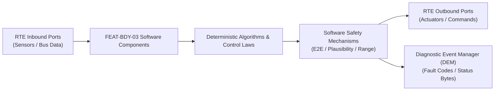

# Software Requirements Specification: Supplemental Restraint System & Airbag Deployment (SRS)
**Feature ID:** `FEAT-BDY-03`  
**Domain:** Body, Lighting & Restraints  
**Target ASIL:** ASIL D  
**Compliance Standard:** ISO 26262:2018 (Part 6 - Software Development) / ASPICE PAM v3.1 (SWE.1, SWE.2)  
**Parent System Specification:** [`FEAT-BDY-03_SRS_SysReq.md`](file:///c:/Workset/AntiGravityProjects/TestOptimisationExperiement/system_requirements/FEAT-BDY-03_SRS_SysReq.md)  
**Global Master Specification:** [`spec.md`](file:///c:/Workset/AntiGravityProjects/TestOptimisationExperiement/spec.md)

---

## 1. Software Architecture & Component Structure

This document specifies the AUTOSAR Software Components (SWCs), periodic runnables, algorithmic laws, safety mechanisms, and data ports implementing `FEAT-BDY-03` (Supplemental Restraint System & Airbag Deployment (SRS)).

### AUTOSAR SWC Interaction Diagram

---

## 2. Detailed Software Requirements (SWR_REQ)
*(Multi-Software Requirement Partitioning derived from System Requirements)*

### `SWR-BDY-03-01`: 4 kHz Crash Acceleration Integration & Delta-V Computation
- **Planned Release:** R100
- **ASIL Rating:** ASIL D
- **Parent System Requirement:** [`SYS-BDY-03-01`](file:///c:/Workset/AntiGravityProjects/TestOptimisationExperiement/system_requirements/FEAT-BDY-03_SRS_SysReq.md#sys-bdy-03-01)
- **Allocated AUTOSAR SWC:** `SrsCrashDiscrimination_SWC`
- **Execution Rate / Trigger:** 1 ms
- **Worst-Case Execution Time (WCET):** 0.25 ms
- **Software Activation Condition:** Executed in high-speed timer interrupt.
- **Algorithmic Description / Logic:**
  > Samples high-G acceleration a(t). Integrates velocity delta: Delta_V(t) = int(a(t) - a_bias dt). Computes displacement: s(t) = int(Delta_V dt). Evaluates against calibration velocity-displacement fire boundary curves.
- **Software Safety Mechanism:** Rough road / curb strike discriminator rejects high-frequency non-crash shocks.
- **Failure Reaction & DEM Diagnostic Event:** If raw acceleration exceeds 120g without velocity impulse, flag sensor clipping.
- **Software Port Inputs:** `Raw_HighG_Accel_X, Raw_HighG_Accel_Y, Lateral_Pressure_Sensor`
- **Software Port Outputs:** `Integrated_Delta_V_Mps (float32), Fire_Algorithm_Decision (boolean)`
- **Software Verification Criteria:** Crash pulse playback unit test across 250 real-world crash logs.
- **Traceability Link:** Traces upward to [`SYS-BDY-03-01`](file:///c:/Workset/AntiGravityProjects/TestOptimisationExperiement/system_requirements/FEAT-BDY-03_SRS_SysReq.md#sys-bdy-03-01) and [`FEAT-BDY-03`](file:///c:/Workset/AntiGravityProjects/TestOptimisationExperiement/spec.md).

### `SWR-BDY-03-02`: Occupant Classification & Child Seat Suppression Filter
- **Planned Release:** R100
- **ASIL Rating:** ASIL D
- **Parent System Requirement:** [`SYS-BDY-03-01`](file:///c:/Workset/AntiGravityProjects/TestOptimisationExperiement/system_requirements/FEAT-BDY-03_SRS_SysReq.md#sys-bdy-03-01)
- **Allocated AUTOSAR SWC:** `SrsOccupantClassifier_SWC`
- **Execution Rate / Trigger:** 100 ms
- **Worst-Case Execution Time (WCET):** 0.8 ms
- **Software Activation Condition:** Executed every 100 ms.
- **Algorithmic Description / Logic:**
  > Reads passenger seat strain-gauge weight sensor. If weight < 15 kg (child seat detected) OR Passenger_Airbag_Manual_Sw == OFF: Passenger_Front_Airbag_Suppressed = TRUE.
- **Software Safety Mechanism:** Hysteresis weight filtering prevents seat movement while driving from toggling state.
- **Failure Reaction & DEM Diagnostic Event:** Default to AIRBAG ENABLED if weight sensor communication is lost.
- **Software Port Inputs:** `Seat_Weight_Sensor_Kg, Manual_Airbag_Switch_State`
- **Software Port Outputs:** `Passenger_Airbag_Suppressed_Flag (boolean)`
- **Software Verification Criteria:** Occupant weight sensor calibration and suppression test suite.
- **Traceability Link:** Traces upward to [`SYS-BDY-03-01`](file:///c:/Workset/AntiGravityProjects/TestOptimisationExperiement/system_requirements/FEAT-BDY-03_SRS_SysReq.md#sys-bdy-03-01) and [`FEAT-BDY-03`](file:///c:/Workset/AntiGravityProjects/TestOptimisationExperiement/spec.md).

### `SWR-BDY-03-03`: Hardware Safing Logic AND-Gate Software Supervision
- **Planned Release:** R400
- **ASIL Rating:** ASIL D
- **Parent System Requirement:** [`SYS-BDY-03-02`](file:///c:/Workset/AntiGravityProjects/TestOptimisationExperiement/system_requirements/FEAT-BDY-03_SRS_SysReq.md#sys-bdy-03-02)
- **Allocated AUTOSAR SWC:** `SrsSafingMonitor_SWC`
- **Execution Rate / Trigger:** 1 ms
- **Worst-Case Execution Time (WCET):** 0.15 ms
- **Software Activation Condition:** Executed in crash interrupt routine.
- **Algorithmic Description / Logic:**
  > Reads independent hardware safing sensor line. Computes: Squib_Arm_Permit = (Fire_Algorithm_Decision == TRUE) && (Hardware_Safing_Line == CLOSED). High-side drivers cannot close without this condition.
- **Software Safety Mechanism:** Complete electrical isolation between MCU software trigger and safing sensor hardware path.
- **Failure Reaction & DEM Diagnostic Event:** Immediately de-assert squib drivers if safing sensor line goes OPEN.
- **Software Port Inputs:** `Fire_Algorithm_Decision, Hardware_Safing_Sensor_State`
- **Software Port Outputs:** `Squib_Arm_Permit (boolean)`
- **Software Verification Criteria:** Fault injection testing proving zero fire output when either signal is missing.
- **Traceability Link:** Traces upward to [`SYS-BDY-03-02`](file:///c:/Workset/AntiGravityProjects/TestOptimisationExperiement/system_requirements/FEAT-BDY-03_SRS_SysReq.md#sys-bdy-03-02) and [`FEAT-BDY-03`](file:///c:/Workset/AntiGravityProjects/TestOptimisationExperiement/spec.md).

### `SWR-BDY-03-04`: Squib Firing Pulse Sequencer & Crash Record Non-Volatile Freeze
- **Planned Release:** R400
- **ASIL Rating:** ASIL D
- **Parent System Requirement:** [`SYS-BDY-03-02`](file:///c:/Workset/AntiGravityProjects/TestOptimisationExperiement/system_requirements/FEAT-BDY-03_SRS_SysReq.md#sys-bdy-03-02)
- **Allocated AUTOSAR SWC:** `SrsSquibSequencer_SWC`
- **Execution Rate / Trigger:** 1 ms
- **Worst-Case Execution Time (WCET):** 0.3 ms
- **Software Activation Condition:** Executed upon confirmed fire trigger.
- **Algorithmic Description / Logic:**
  > Sequences firing pulses: t=0ms (Belt Pretensioners & Pyrofuse); t=5ms (Stage 1 Front Airbags & Curtains); t=15ms (Stage 2 Front Airbags). Writes crash event recording to locked non-volatile flash (EDR).
- **Software Safety Mechanism:** Hardware one-way programmable lock prevents overwriting Event Data Recorder (EDR) crash data.
- **Failure Reaction & DEM Diagnostic Event:** Broadcast emergency high-priority crash broadcast over CAN-FD and dispatch eCall.
- **Software Port Inputs:** `Squib_Arm_Permit, Crash_Severity_Index`
- **Software Port Outputs:** `Squib_Output_Drivers[16], EDR_Flash_Write_Trigger, Crash_CAN_Broadcast_PDU`
- **Software Verification Criteria:** EDR compliance verification against 49 CFR Part 563.
- **Traceability Link:** Traces upward to [`SYS-BDY-03-02`](file:///c:/Workset/AntiGravityProjects/TestOptimisationExperiement/system_requirements/FEAT-BDY-03_SRS_SysReq.md#sys-bdy-03-02) and [`FEAT-BDY-03`](file:///c:/Workset/AntiGravityProjects/TestOptimisationExperiement/spec.md).

### `SWR-BDY-03-06`: High-G Crash Acceleration Integral & Delta-V Core Algorithm
- **Planned Release:** R100
- **ASIL Rating:** ASIL D
- **Parent System Requirement:** [`SYS-BDY-03-03`](file:///c:/Workset/AntiGravityProjects/TestOptimisationExperiement/system_requirements/FEAT-BDY-03_SRS_SysReq.md#sys-bdy-03-03)
- **Allocated AUTOSAR SWC:** `SrsCrashClassifier_SWC`
- **Execution Rate / Trigger:** 0.5 ms
- **Worst-Case Execution Time (WCET):** 0.12 ms
- **Software Activation Condition:** Executed in 2 kHz high-priority hardware ISR.
- **Algorithmic Description / Logic:**
  > Computes velocity drop: Delta_V(t) = -integral(a_x * dt). Evaluates displacement s(t) = integral(Delta_V * dt). If Delta_V > 25 km/h within 30 ms AND Displacement s > 15 cm, asserts Fire_Decision_Frontal = TRUE.
- **Software Safety Mechanism:** Dual-core lockstep CPU verification: Requires identical deployment decision on lockstep Core B before firing.
- **Failure Reaction & DEM Diagnostic Event:** Inhibit firing if accelerometer self-test diagnostics fail.
- **Software Port Inputs:** `Raw_Axial_Acceleration_X_Y_Z[4], Crash_Window_Timer_Ms`
- **Software Port Outputs:** `Computed_Delta_V_Kmph, Crash_Severity_Tier_Enum`
- **Software Verification Criteria:** Playback of 250 real crash crash-test acceleration sensor records.
- **Traceability Link:** Traces upward to [`SYS-BDY-03-03`](file:///c:/Workset/AntiGravityProjects/TestOptimisationExperiement/system_requirements/FEAT-BDY-03_SRS_SysReq.md#sys-bdy-03-03) and [`FEAT-BDY-03`](file:///c:/Workset/AntiGravityProjects/TestOptimisationExperiement/spec.md).

### `SWR-BDY-03-07`: Rollover Angular Rate & Tilting Kinetic Energy Observer
- **Planned Release:** R100
- **ASIL Rating:** ASIL D
- **Parent System Requirement:** [`SYS-BDY-03-03`](file:///c:/Workset/AntiGravityProjects/TestOptimisationExperiement/system_requirements/FEAT-BDY-03_SRS_SysReq.md#sys-bdy-03-03)
- **Allocated AUTOSAR SWC:** `SrsRolloverClassifier_SWC`
- **Execution Rate / Trigger:** 2 ms
- **Worst-Case Execution Time (WCET):** 0.25 ms
- **Software Activation Condition:** Continuous rollover monitoring task.
- **Algorithmic Description / Logic:**
  > Evaluates rollover phase plane: Roll_Rate p vs Roll_Angle Phi. If (Phi / Phi_crit)^2 + (p / p_crit)^2 > 1.0 (indicating vehicle is tripping over), commands curtain airbag deployment to prevent occupant ejection.
- **Software Safety Mechanism:** Slow rollover distinction: Deploys side curtain airbags earlier in sand ditch roll vs high-speed barrel roll.
- **Failure Reaction & DEM Diagnostic Event:** Inhibit rollover deployment if lateral acceleration < 0.2g (banking road).
- **Software Port Inputs:** `Roll_Rate_RadS, Lateral_Accel_Y_G, Vehicle_Roll_Angle_Deg`
- **Software Port Outputs:** `Rollover_Deployment_Command (boolean), Curtain_Airbag_Deploy_Req`
- **Software Verification Criteria:** FMVSS 226 ejection mitigation testing on rollover dynamic carousel.
- **Traceability Link:** Traces upward to [`SYS-BDY-03-03`](file:///c:/Workset/AntiGravityProjects/TestOptimisationExperiement/system_requirements/FEAT-BDY-03_SRS_SysReq.md#sys-bdy-03-03) and [`FEAT-BDY-03`](file:///c:/Workset/AntiGravityProjects/TestOptimisationExperiement/spec.md).

### `SWR-BDY-03-08`: Dual-Stage Pyrotechnic Squib Delay Firing Sequencer
- **Planned Release:** R100
- **ASIL Rating:** ASIL D
- **Parent System Requirement:** [`SYS-BDY-03-04`](file:///c:/Workset/AntiGravityProjects/TestOptimisationExperiement/system_requirements/FEAT-BDY-03_SRS_SysReq.md#sys-bdy-03-04)
- **Allocated AUTOSAR SWC:** `SrsSquibSequencer_SWC`
- **Execution Rate / Trigger:** 1 ms
- **Worst-Case Execution Time (WCET):** 0.15 ms
- **Software Activation Condition:** Triggered on crash fire decision.
- **Algorithmic Description / Logic:**
  > Orders deployment sequence: t=0 ms: Seatbelt pretensioner squibs fired; t=5 ms: Frontal Stage 1 squibs fired (70% gas inflation); t=5ms + Delta_t: Stage 2 squib fired (100% inflation). Delay Delta_t dynamically adjusted between 15 ms and 40 ms based on occupant proximity.
- **Software Safety Mechanism:** High-side and low-side transistor interlock: Requires both independent drivers to close simultaneously to deliver 1.75A squib firing current.
- **Failure Reaction & DEM Diagnostic Event:** Limit squib firing pulse width to exactly 2.0 ms to avoid driver short-circuit burnout.
- **Software Port Inputs:** `Crash_Severity_Tier_Enum, Seat_Track_Position_Cm, Occupant_Mass_Kg`
- **Software Port Outputs:** `HighSide_Driver_Gates[16], LowSide_Driver_Gates[16], Squib_Pulse_Duration_Ms`
- **Software Verification Criteria:** Oscilloscope squib firing current profiling on resistive dummy loads.
- **Traceability Link:** Traces upward to [`SYS-BDY-03-04`](file:///c:/Workset/AntiGravityProjects/TestOptimisationExperiement/system_requirements/FEAT-BDY-03_SRS_SysReq.md#sys-bdy-03-04) and [`FEAT-BDY-03`](file:///c:/Workset/AntiGravityProjects/TestOptimisationExperiement/spec.md).

### `SWR-BDY-03-09`: Pyrotechnic Squib Diagnostic Impedance Periodic Poller
- **Planned Release:** R100
- **ASIL Rating:** ASIL D
- **Parent System Requirement:** [`SYS-BDY-03-04`](file:///c:/Workset/AntiGravityProjects/TestOptimisationExperiement/system_requirements/FEAT-BDY-03_SRS_SysReq.md#sys-bdy-03-04)
- **Allocated AUTOSAR SWC:** `SrsSquibDiagnostics_SWC`
- **Execution Rate / Trigger:** 500 ms
- **Worst-Case Execution Time (WCET):** 0.4 ms
- **Software Activation Condition:** Periodic background diagnostic task.
- **Algorithmic Description / Logic:**
  > Injects low-current measurement pulse (2 mA for 50 us, well below 50 mA non-fire limit) across every squib loop. Samples ADC voltage to calculate loop resistance R_squib. Valid range: [1.8, 4.2] ohms.
- **Software Safety Mechanism:** Hardware current clamp: Hardware prevents diagnostic current from ever exceeding 10 mA.
- **Failure Reaction & DEM Diagnostic Event:** If loop resistance < 1.0 ohm (short) or > 6.0 ohm (open), set latched DTC B0001 and illuminate red airbag tell-tale.
- **Software Port Inputs:** `Squib_Sense_ADC_Voltages[16], Diagnostic_Pulse_Permit_Flag`
- **Software Port Outputs:** `Measured_Squib_Resistance_Array[16], Squib_Loop_Fault_Mask`
- **Software Verification Criteria:** Precision resistor decade box fault injection testing.
- **Traceability Link:** Traces upward to [`SYS-BDY-03-04`](file:///c:/Workset/AntiGravityProjects/TestOptimisationExperiement/system_requirements/FEAT-BDY-03_SRS_SysReq.md#sys-bdy-03-04) and [`FEAT-BDY-03`](file:///c:/Workset/AntiGravityProjects/TestOptimisationExperiement/spec.md).

### `SWR-BDY-03-10`: FMVSS 208 Occupant Classification Bladder Weight Classifier
- **Planned Release:** R200
- **ASIL Rating:** ASIL D
- **Parent System Requirement:** [`SYS-BDY-03-05`](file:///c:/Workset/AntiGravityProjects/TestOptimisationExperiement/system_requirements/FEAT-BDY-03_SRS_SysReq.md#sys-bdy-03-05)
- **Allocated AUTOSAR SWC:** `SrsOccupantClassifier_SWC`
- **Execution Rate / Trigger:** 100 ms
- **Worst-Case Execution Time (WCET):** 0.6 ms
- **Software Activation Condition:** Active in vehicle running states.
- **Algorithmic Description / Logic:**
  > Samples passenger seat silicone fluid bladder pressure sensor: Filters vehicle road vibration. Classifies weight: Empty (< 3 kg), Child / Rear-Facing Child Seat (< 25 kg), Small Adult (25-50 kg), Large Adult (> 50 kg). Sets Passenger_Airbag_Suppress = TRUE if weight < 25 kg.
- **Software Safety Mechanism:** Hysteresis threshold: 2 kg hysteresis to prevent chattering between child seat and 5th percentile female.
- **Failure Reaction & DEM Diagnostic Event:** Illuminate 'Passenger Airbag OFF' light on overhead console if suppressed.
- **Software Port Inputs:** `Seat_Bladder_Pressure_Mbar, Seatbelt_Tension_Sensor_N`
- **Software Port Outputs:** `Occupant_Weight_Class_Enum, Passenger_Airbag_Suppressed_Flag`
- **Software Verification Criteria:** FMVSS 208 anthropomorphic test dummy (6-year-old child vs 5th percentile female) seating tests.
- **Traceability Link:** Traces upward to [`SYS-BDY-03-05`](file:///c:/Workset/AntiGravityProjects/TestOptimisationExperiement/system_requirements/FEAT-BDY-03_SRS_SysReq.md#sys-bdy-03-05) and [`FEAT-BDY-03`](file:///c:/Workset/AntiGravityProjects/TestOptimisationExperiement/spec.md).

### `SWR-BDY-03-11`: High-Voltage Pyrofuse Firing Pulse Discrete Output Driver
- **Planned Release:** R200
- **ASIL Rating:** ASIL D
- **Parent System Requirement:** [`SYS-BDY-03-05`](file:///c:/Workset/AntiGravityProjects/TestOptimisationExperiement/system_requirements/FEAT-BDY-03_SRS_SysReq.md#sys-bdy-03-05)
- **Allocated AUTOSAR SWC:** `SrsPyrofuseDriver_SWC`
- **Execution Rate / Trigger:** 1 ms
- **Worst-Case Execution Time (WCET):** 0.1 ms
- **Software Activation Condition:** Executed immediately upon crash deployment decision.
- **Algorithmic Description / Logic:**
  > Asserts dedicated hardwired discrete pulse line routed directly to High-Voltage Battery Pyrofuse detonator: Delivers 2.5A pulse for 5.0 ms, mechanically shearing high-voltage copper busbar within 1.5 ms to isolate traction battery.
- **Software Safety Mechanism:** Hardware latch circuit: Maintains fired state until battery pack is physically serviced.
- **Failure Reaction & DEM Diagnostic Event:** Broadcast redundant CAN-FD crash frame to BMS and VCU controllers.
- **Software Port Inputs:** `Crash_Confirmed_Deployment_Flag, Hardware_Igniter_Capacitor_Voltage`
- **Software Port Outputs:** `HV_Pyrofuse_Detonator_Gate_Cmd, Crash_Confirmation_CANFD_PDU`
- **Software Verification Criteria:** High-voltage battery destructive mechanical busbar shear testing under 600A load.
- **Traceability Link:** Traces upward to [`SYS-BDY-03-05`](file:///c:/Workset/AntiGravityProjects/TestOptimisationExperiement/system_requirements/FEAT-BDY-03_SRS_SysReq.md#sys-bdy-03-05) and [`FEAT-BDY-03`](file:///c:/Workset/AntiGravityProjects/TestOptimisationExperiement/spec.md).

### `SWR-BDY-03-11`: Central Crash Sensor 6-DOF IMU Accelerometer Longitudinal Impact Evaluator - Dynamic Observer & Signal Filter
- **Planned Release:** R200
- **ASIL Rating:** ASIL D
- **Parent System Requirement:** [`SYS-BDY-03-06`](file:///c:/Workset/AntiGravityProjects/TestOptimisationExperiement/system_requirements/FEAT-BDY-03_SRS_SysReq.md#sys-bdy-03-06)
- **Allocated AUTOSAR SWC:** `SrsImpactEvaluator_SWC`
- **Execution Rate / Trigger:** 0.2 ms
- **Worst-Case Execution Time (WCET):** 0.3 ms
- **Software Activation Condition:** Executed cyclically every 0.2 ms.
- **Algorithmic Description / Logic:**
  > Executes signal plausibility filtering, calibration offsets, and discrete state estimation for Central Crash Sensor 6-DOF IMU Accelerometer Longitudinal Impact Evaluator.
- **Software Safety Mechanism:** Range limit plausibility check and E2E alive sequence verification.
- **Failure Reaction & DEM Diagnostic Event:** Set default fallback output and report DEM_EVENT_FEAT_BDY_03_ERR.
- **Software Port Inputs:** `Raw sensor ADC/SENT/SPI values and RTE bus inputs.`
- **Software Port Outputs:** `Filtered physical signals and validity status bitmasks.`
- **Software Verification Criteria:** Unit test and HiL software integration test.
- **Traceability Link:** Traces upward to [`SYS-BDY-03-06`](file:///c:/Workset/AntiGravityProjects/TestOptimisationExperiement/system_requirements/FEAT-BDY-03_SRS_SysReq.md#sys-bdy-03-06) and [`FEAT-BDY-03`](file:///c:/Workset/AntiGravityProjects/TestOptimisationExperiement/spec.md).

### `SWR-BDY-03-12`: Central Crash Sensor 6-DOF IMU Accelerometer Longitudinal Impact Evaluator - Closed-Loop Control Law & Actuator Dispatch
- **Planned Release:** R200
- **ASIL Rating:** ASIL D
- **Parent System Requirement:** [`SYS-BDY-03-06`](file:///c:/Workset/AntiGravityProjects/TestOptimisationExperiement/system_requirements/FEAT-BDY-03_SRS_SysReq.md#sys-bdy-03-06)
- **Allocated AUTOSAR SWC:** `SrsImpactEvaluator_SWC`
- **Execution Rate / Trigger:** 0.2 ms
- **Worst-Case Execution Time (WCET):** 0.4 ms
- **Software Activation Condition:** Executed cyclically every 0.2 ms.
- **Algorithmic Description / Logic:**
  > Evaluates deterministic closed-loop control law, rate limits, and dispatches commands for Central Crash Sensor 6-DOF IMU Accelerometer Longitudinal Impact Evaluator.
- **Software Safety Mechanism:** Command saturation clamping and watchdog program flow monitoring.
- **Failure Reaction & DEM Diagnostic Event:** De-energize actuator output, apply safe fallback clamp, and latch DTC.
- **Software Port Inputs:** `Validated physical state signals from observer SWC.`
- **Software Port Outputs:** `Actuator PWM duty cycles, torque/pressure setpoints, and diagnostic flags.`
- **Software Verification Criteria:** Hardware dynamometer and HiL closed-loop regression test suite.
- **Traceability Link:** Traces upward to [`SYS-BDY-03-06`](file:///c:/Workset/AntiGravityProjects/TestOptimisationExperiement/system_requirements/FEAT-BDY-03_SRS_SysReq.md#sys-bdy-03-06) and [`FEAT-BDY-03`](file:///c:/Workset/AntiGravityProjects/TestOptimisationExperiement/spec.md).

### `SWR-BDY-03-13`: Front Bumper Left/Right Satellite Crash Accelerometer Cross-Checker - Dynamic Observer & Signal Filter
- **Planned Release:** R200
- **ASIL Rating:** ASIL D
- **Parent System Requirement:** [`SYS-BDY-03-07`](file:///c:/Workset/AntiGravityProjects/TestOptimisationExperiement/system_requirements/FEAT-BDY-03_SRS_SysReq.md#sys-bdy-03-07)
- **Allocated AUTOSAR SWC:** `SrsSatelliteCrossCheck_SWC`
- **Execution Rate / Trigger:** 0.2 ms
- **Worst-Case Execution Time (WCET):** 0.3 ms
- **Software Activation Condition:** Executed cyclically every 0.2 ms.
- **Algorithmic Description / Logic:**
  > Executes signal plausibility filtering, calibration offsets, and discrete state estimation for Front Bumper Left/Right Satellite Crash Accelerometer Cross-Checker.
- **Software Safety Mechanism:** Range limit plausibility check and E2E alive sequence verification.
- **Failure Reaction & DEM Diagnostic Event:** Set default fallback output and report DEM_EVENT_FEAT_BDY_03_ERR.
- **Software Port Inputs:** `Raw sensor ADC/SENT/SPI values and RTE bus inputs.`
- **Software Port Outputs:** `Filtered physical signals and validity status bitmasks.`
- **Software Verification Criteria:** Unit test and HiL software integration test.
- **Traceability Link:** Traces upward to [`SYS-BDY-03-07`](file:///c:/Workset/AntiGravityProjects/TestOptimisationExperiement/system_requirements/FEAT-BDY-03_SRS_SysReq.md#sys-bdy-03-07) and [`FEAT-BDY-03`](file:///c:/Workset/AntiGravityProjects/TestOptimisationExperiement/spec.md).

### `SWR-BDY-03-14`: Front Bumper Left/Right Satellite Crash Accelerometer Cross-Checker - Closed-Loop Control Law & Actuator Dispatch
- **Planned Release:** R200
- **ASIL Rating:** ASIL D
- **Parent System Requirement:** [`SYS-BDY-03-07`](file:///c:/Workset/AntiGravityProjects/TestOptimisationExperiement/system_requirements/FEAT-BDY-03_SRS_SysReq.md#sys-bdy-03-07)
- **Allocated AUTOSAR SWC:** `SrsSatelliteCrossCheck_SWC`
- **Execution Rate / Trigger:** 0.2 ms
- **Worst-Case Execution Time (WCET):** 0.4 ms
- **Software Activation Condition:** Executed cyclically every 0.2 ms.
- **Algorithmic Description / Logic:**
  > Evaluates deterministic closed-loop control law, rate limits, and dispatches commands for Front Bumper Left/Right Satellite Crash Accelerometer Cross-Checker.
- **Software Safety Mechanism:** Command saturation clamping and watchdog program flow monitoring.
- **Failure Reaction & DEM Diagnostic Event:** De-energize actuator output, apply safe fallback clamp, and latch DTC.
- **Software Port Inputs:** `Validated physical state signals from observer SWC.`
- **Software Port Outputs:** `Actuator PWM duty cycles, torque/pressure setpoints, and diagnostic flags.`
- **Software Verification Criteria:** Hardware dynamometer and HiL closed-loop regression test suite.
- **Traceability Link:** Traces upward to [`SYS-BDY-03-07`](file:///c:/Workset/AntiGravityProjects/TestOptimisationExperiement/system_requirements/FEAT-BDY-03_SRS_SysReq.md#sys-bdy-03-07) and [`FEAT-BDY-03`](file:///c:/Workset/AntiGravityProjects/TestOptimisationExperiement/spec.md).

### `SWR-BDY-03-15`: B-Pillar Side Impact Pressure Satellite Sensor Pulse Integrator - Dynamic Observer & Signal Filter
- **Planned Release:** R300
- **ASIL Rating:** ASIL D
- **Parent System Requirement:** [`SYS-BDY-03-08`](file:///c:/Workset/AntiGravityProjects/TestOptimisationExperiement/system_requirements/FEAT-BDY-03_SRS_SysReq.md#sys-bdy-03-08)
- **Allocated AUTOSAR SWC:** `SrsSidePressureIntegrator_SWC`
- **Execution Rate / Trigger:** 0.2 ms
- **Worst-Case Execution Time (WCET):** 0.3 ms
- **Software Activation Condition:** Executed cyclically every 0.2 ms.
- **Algorithmic Description / Logic:**
  > Executes signal plausibility filtering, calibration offsets, and discrete state estimation for B-Pillar Side Impact Pressure Satellite Sensor Pulse Integrator.
- **Software Safety Mechanism:** Range limit plausibility check and E2E alive sequence verification.
- **Failure Reaction & DEM Diagnostic Event:** Set default fallback output and report DEM_EVENT_FEAT_BDY_03_ERR.
- **Software Port Inputs:** `Raw sensor ADC/SENT/SPI values and RTE bus inputs.`
- **Software Port Outputs:** `Filtered physical signals and validity status bitmasks.`
- **Software Verification Criteria:** Unit test and HiL software integration test.
- **Traceability Link:** Traces upward to [`SYS-BDY-03-08`](file:///c:/Workset/AntiGravityProjects/TestOptimisationExperiement/system_requirements/FEAT-BDY-03_SRS_SysReq.md#sys-bdy-03-08) and [`FEAT-BDY-03`](file:///c:/Workset/AntiGravityProjects/TestOptimisationExperiement/spec.md).

### `SWR-BDY-03-16`: B-Pillar Side Impact Pressure Satellite Sensor Pulse Integrator - Closed-Loop Control Law & Actuator Dispatch
- **Planned Release:** R300
- **ASIL Rating:** ASIL D
- **Parent System Requirement:** [`SYS-BDY-03-08`](file:///c:/Workset/AntiGravityProjects/TestOptimisationExperiement/system_requirements/FEAT-BDY-03_SRS_SysReq.md#sys-bdy-03-08)
- **Allocated AUTOSAR SWC:** `SrsSidePressureIntegrator_SWC`
- **Execution Rate / Trigger:** 0.2 ms
- **Worst-Case Execution Time (WCET):** 0.4 ms
- **Software Activation Condition:** Executed cyclically every 0.2 ms.
- **Algorithmic Description / Logic:**
  > Evaluates deterministic closed-loop control law, rate limits, and dispatches commands for B-Pillar Side Impact Pressure Satellite Sensor Pulse Integrator.
- **Software Safety Mechanism:** Command saturation clamping and watchdog program flow monitoring.
- **Failure Reaction & DEM Diagnostic Event:** De-energize actuator output, apply safe fallback clamp, and latch DTC.
- **Software Port Inputs:** `Validated physical state signals from observer SWC.`
- **Software Port Outputs:** `Actuator PWM duty cycles, torque/pressure setpoints, and diagnostic flags.`
- **Software Verification Criteria:** Hardware dynamometer and HiL closed-loop regression test suite.
- **Traceability Link:** Traces upward to [`SYS-BDY-03-08`](file:///c:/Workset/AntiGravityProjects/TestOptimisationExperiement/system_requirements/FEAT-BDY-03_SRS_SysReq.md#sys-bdy-03-08) and [`FEAT-BDY-03`](file:///c:/Workset/AntiGravityProjects/TestOptimisationExperiement/spec.md).

### `SWR-BDY-03-17`: Hardware Safing Accelerometer Independent Analog Interlock Circuit - Dynamic Observer & Signal Filter
- **Planned Release:** R400
- **ASIL Rating:** ASIL D
- **Parent System Requirement:** [`SYS-BDY-03-09`](file:///c:/Workset/AntiGravityProjects/TestOptimisationExperiement/system_requirements/FEAT-BDY-03_SRS_SysReq.md#sys-bdy-03-09)
- **Allocated AUTOSAR SWC:** `SrsHardwareSafing_SWC`
- **Execution Rate / Trigger:** 0.1 ms
- **Worst-Case Execution Time (WCET):** 0.3 ms
- **Software Activation Condition:** Executed cyclically every 0.1 ms.
- **Algorithmic Description / Logic:**
  > Executes signal plausibility filtering, calibration offsets, and discrete state estimation for Hardware Safing Accelerometer Independent Analog Interlock Circuit.
- **Software Safety Mechanism:** Range limit plausibility check and E2E alive sequence verification.
- **Failure Reaction & DEM Diagnostic Event:** Set default fallback output and report DEM_EVENT_FEAT_BDY_03_ERR.
- **Software Port Inputs:** `Raw sensor ADC/SENT/SPI values and RTE bus inputs.`
- **Software Port Outputs:** `Filtered physical signals and validity status bitmasks.`
- **Software Verification Criteria:** Unit test and HiL software integration test.
- **Traceability Link:** Traces upward to [`SYS-BDY-03-09`](file:///c:/Workset/AntiGravityProjects/TestOptimisationExperiement/system_requirements/FEAT-BDY-03_SRS_SysReq.md#sys-bdy-03-09) and [`FEAT-BDY-03`](file:///c:/Workset/AntiGravityProjects/TestOptimisationExperiement/spec.md).

### `SWR-BDY-03-18`: Hardware Safing Accelerometer Independent Analog Interlock Circuit - Closed-Loop Control Law & Actuator Dispatch
- **Planned Release:** R400
- **ASIL Rating:** ASIL D
- **Parent System Requirement:** [`SYS-BDY-03-09`](file:///c:/Workset/AntiGravityProjects/TestOptimisationExperiement/system_requirements/FEAT-BDY-03_SRS_SysReq.md#sys-bdy-03-09)
- **Allocated AUTOSAR SWC:** `SrsHardwareSafing_SWC`
- **Execution Rate / Trigger:** 0.1 ms
- **Worst-Case Execution Time (WCET):** 0.4 ms
- **Software Activation Condition:** Executed cyclically every 0.1 ms.
- **Algorithmic Description / Logic:**
  > Evaluates deterministic closed-loop control law, rate limits, and dispatches commands for Hardware Safing Accelerometer Independent Analog Interlock Circuit.
- **Software Safety Mechanism:** Command saturation clamping and watchdog program flow monitoring.
- **Failure Reaction & DEM Diagnostic Event:** De-energize actuator output, apply safe fallback clamp, and latch DTC.
- **Software Port Inputs:** `Validated physical state signals from observer SWC.`
- **Software Port Outputs:** `Actuator PWM duty cycles, torque/pressure setpoints, and diagnostic flags.`
- **Software Verification Criteria:** Hardware dynamometer and HiL closed-loop regression test suite.
- **Traceability Link:** Traces upward to [`SYS-BDY-03-09`](file:///c:/Workset/AntiGravityProjects/TestOptimisationExperiement/system_requirements/FEAT-BDY-03_SRS_SysReq.md#sys-bdy-03-09) and [`FEAT-BDY-03`](file:///c:/Workset/AntiGravityProjects/TestOptimisationExperiement/spec.md).

### `SWR-BDY-03-19`: Dual-Stage Front Driver & Passenger Airbag Pyrotechnic Squib Firing Law - Dynamic Observer & Signal Filter
- **Planned Release:** R300
- **ASIL Rating:** ASIL D
- **Parent System Requirement:** [`SYS-BDY-03-10`](file:///c:/Workset/AntiGravityProjects/TestOptimisationExperiement/system_requirements/FEAT-BDY-03_SRS_SysReq.md#sys-bdy-03-10)
- **Allocated AUTOSAR SWC:** `SrsSquibFiringLaw_SWC`
- **Execution Rate / Trigger:** 0.2 ms
- **Worst-Case Execution Time (WCET):** 0.3 ms
- **Software Activation Condition:** Executed cyclically every 0.2 ms.
- **Algorithmic Description / Logic:**
  > Executes signal plausibility filtering, calibration offsets, and discrete state estimation for Dual-Stage Front Driver & Passenger Airbag Pyrotechnic Squib Firing Law.
- **Software Safety Mechanism:** Range limit plausibility check and E2E alive sequence verification.
- **Failure Reaction & DEM Diagnostic Event:** Set default fallback output and report DEM_EVENT_FEAT_BDY_03_ERR.
- **Software Port Inputs:** `Raw sensor ADC/SENT/SPI values and RTE bus inputs.`
- **Software Port Outputs:** `Filtered physical signals and validity status bitmasks.`
- **Software Verification Criteria:** Unit test and HiL software integration test.
- **Traceability Link:** Traces upward to [`SYS-BDY-03-10`](file:///c:/Workset/AntiGravityProjects/TestOptimisationExperiement/system_requirements/FEAT-BDY-03_SRS_SysReq.md#sys-bdy-03-10) and [`FEAT-BDY-03`](file:///c:/Workset/AntiGravityProjects/TestOptimisationExperiement/spec.md).

### `SWR-BDY-03-20`: Dual-Stage Front Driver & Passenger Airbag Pyrotechnic Squib Firing Law - Closed-Loop Control Law & Actuator Dispatch
- **Planned Release:** R300
- **ASIL Rating:** ASIL D
- **Parent System Requirement:** [`SYS-BDY-03-10`](file:///c:/Workset/AntiGravityProjects/TestOptimisationExperiement/system_requirements/FEAT-BDY-03_SRS_SysReq.md#sys-bdy-03-10)
- **Allocated AUTOSAR SWC:** `SrsSquibFiringLaw_SWC`
- **Execution Rate / Trigger:** 0.2 ms
- **Worst-Case Execution Time (WCET):** 0.4 ms
- **Software Activation Condition:** Executed cyclically every 0.2 ms.
- **Algorithmic Description / Logic:**
  > Evaluates deterministic closed-loop control law, rate limits, and dispatches commands for Dual-Stage Front Driver & Passenger Airbag Pyrotechnic Squib Firing Law.
- **Software Safety Mechanism:** Command saturation clamping and watchdog program flow monitoring.
- **Failure Reaction & DEM Diagnostic Event:** De-energize actuator output, apply safe fallback clamp, and latch DTC.
- **Software Port Inputs:** `Validated physical state signals from observer SWC.`
- **Software Port Outputs:** `Actuator PWM duty cycles, torque/pressure setpoints, and diagnostic flags.`
- **Software Verification Criteria:** Hardware dynamometer and HiL closed-loop regression test suite.
- **Traceability Link:** Traces upward to [`SYS-BDY-03-10`](file:///c:/Workset/AntiGravityProjects/TestOptimisationExperiement/system_requirements/FEAT-BDY-03_SRS_SysReq.md#sys-bdy-03-10) and [`FEAT-BDY-03`](file:///c:/Workset/AntiGravityProjects/TestOptimisationExperiement/spec.md).

### `SWR-BDY-03-21`: Side Curtain Airbag & Seat-Mounted Thorax Airbag Deployment Driver - Dynamic Observer & Signal Filter
- **Planned Release:** R300
- **ASIL Rating:** ASIL D
- **Parent System Requirement:** [`SYS-BDY-03-11`](file:///c:/Workset/AntiGravityProjects/TestOptimisationExperiement/system_requirements/FEAT-BDY-03_SRS_SysReq.md#sys-bdy-03-11)
- **Allocated AUTOSAR SWC:** `SrsCurtainDeployment_SWC`
- **Execution Rate / Trigger:** 0.2 ms
- **Worst-Case Execution Time (WCET):** 0.3 ms
- **Software Activation Condition:** Executed cyclically every 0.2 ms.
- **Algorithmic Description / Logic:**
  > Executes signal plausibility filtering, calibration offsets, and discrete state estimation for Side Curtain Airbag & Seat-Mounted Thorax Airbag Deployment Driver.
- **Software Safety Mechanism:** Range limit plausibility check and E2E alive sequence verification.
- **Failure Reaction & DEM Diagnostic Event:** Set default fallback output and report DEM_EVENT_FEAT_BDY_03_ERR.
- **Software Port Inputs:** `Raw sensor ADC/SENT/SPI values and RTE bus inputs.`
- **Software Port Outputs:** `Filtered physical signals and validity status bitmasks.`
- **Software Verification Criteria:** Unit test and HiL software integration test.
- **Traceability Link:** Traces upward to [`SYS-BDY-03-11`](file:///c:/Workset/AntiGravityProjects/TestOptimisationExperiement/system_requirements/FEAT-BDY-03_SRS_SysReq.md#sys-bdy-03-11) and [`FEAT-BDY-03`](file:///c:/Workset/AntiGravityProjects/TestOptimisationExperiement/spec.md).

### `SWR-BDY-03-22`: Side Curtain Airbag & Seat-Mounted Thorax Airbag Deployment Driver - Closed-Loop Control Law & Actuator Dispatch
- **Planned Release:** R300
- **ASIL Rating:** ASIL D
- **Parent System Requirement:** [`SYS-BDY-03-11`](file:///c:/Workset/AntiGravityProjects/TestOptimisationExperiement/system_requirements/FEAT-BDY-03_SRS_SysReq.md#sys-bdy-03-11)
- **Allocated AUTOSAR SWC:** `SrsCurtainDeployment_SWC`
- **Execution Rate / Trigger:** 0.2 ms
- **Worst-Case Execution Time (WCET):** 0.4 ms
- **Software Activation Condition:** Executed cyclically every 0.2 ms.
- **Algorithmic Description / Logic:**
  > Evaluates deterministic closed-loop control law, rate limits, and dispatches commands for Side Curtain Airbag & Seat-Mounted Thorax Airbag Deployment Driver.
- **Software Safety Mechanism:** Command saturation clamping and watchdog program flow monitoring.
- **Failure Reaction & DEM Diagnostic Event:** De-energize actuator output, apply safe fallback clamp, and latch DTC.
- **Software Port Inputs:** `Validated physical state signals from observer SWC.`
- **Software Port Outputs:** `Actuator PWM duty cycles, torque/pressure setpoints, and diagnostic flags.`
- **Software Verification Criteria:** Hardware dynamometer and HiL closed-loop regression test suite.
- **Traceability Link:** Traces upward to [`SYS-BDY-03-11`](file:///c:/Workset/AntiGravityProjects/TestOptimisationExperiement/system_requirements/FEAT-BDY-03_SRS_SysReq.md#sys-bdy-03-11) and [`FEAT-BDY-03`](file:///c:/Workset/AntiGravityProjects/TestOptimisationExperiement/spec.md).

### `SWR-BDY-03-23`: Pyrotechnic Seatbelt Pretensioner & Dynamic Load Limiter Trigger - Dynamic Observer & Signal Filter
- **Planned Release:** R400
- **ASIL Rating:** ASIL D
- **Parent System Requirement:** [`SYS-BDY-03-12`](file:///c:/Workset/AntiGravityProjects/TestOptimisationExperiement/system_requirements/FEAT-BDY-03_SRS_SysReq.md#sys-bdy-03-12)
- **Allocated AUTOSAR SWC:** `SrsPretensionerDriver_SWC`
- **Execution Rate / Trigger:** 0.2 ms
- **Worst-Case Execution Time (WCET):** 0.3 ms
- **Software Activation Condition:** Executed cyclically every 0.2 ms.
- **Algorithmic Description / Logic:**
  > Executes signal plausibility filtering, calibration offsets, and discrete state estimation for Pyrotechnic Seatbelt Pretensioner & Dynamic Load Limiter Trigger.
- **Software Safety Mechanism:** Range limit plausibility check and E2E alive sequence verification.
- **Failure Reaction & DEM Diagnostic Event:** Set default fallback output and report DEM_EVENT_FEAT_BDY_03_ERR.
- **Software Port Inputs:** `Raw sensor ADC/SENT/SPI values and RTE bus inputs.`
- **Software Port Outputs:** `Filtered physical signals and validity status bitmasks.`
- **Software Verification Criteria:** Unit test and HiL software integration test.
- **Traceability Link:** Traces upward to [`SYS-BDY-03-12`](file:///c:/Workset/AntiGravityProjects/TestOptimisationExperiement/system_requirements/FEAT-BDY-03_SRS_SysReq.md#sys-bdy-03-12) and [`FEAT-BDY-03`](file:///c:/Workset/AntiGravityProjects/TestOptimisationExperiement/spec.md).

### `SWR-BDY-03-24`: Pyrotechnic Seatbelt Pretensioner & Dynamic Load Limiter Trigger - Closed-Loop Control Law & Actuator Dispatch
- **Planned Release:** R400
- **ASIL Rating:** ASIL D
- **Parent System Requirement:** [`SYS-BDY-03-12`](file:///c:/Workset/AntiGravityProjects/TestOptimisationExperiement/system_requirements/FEAT-BDY-03_SRS_SysReq.md#sys-bdy-03-12)
- **Allocated AUTOSAR SWC:** `SrsPretensionerDriver_SWC`
- **Execution Rate / Trigger:** 0.2 ms
- **Worst-Case Execution Time (WCET):** 0.4 ms
- **Software Activation Condition:** Executed cyclically every 0.2 ms.
- **Algorithmic Description / Logic:**
  > Evaluates deterministic closed-loop control law, rate limits, and dispatches commands for Pyrotechnic Seatbelt Pretensioner & Dynamic Load Limiter Trigger.
- **Software Safety Mechanism:** Command saturation clamping and watchdog program flow monitoring.
- **Failure Reaction & DEM Diagnostic Event:** De-energize actuator output, apply safe fallback clamp, and latch DTC.
- **Software Port Inputs:** `Validated physical state signals from observer SWC.`
- **Software Port Outputs:** `Actuator PWM duty cycles, torque/pressure setpoints, and diagnostic flags.`
- **Software Verification Criteria:** Hardware dynamometer and HiL closed-loop regression test suite.
- **Traceability Link:** Traces upward to [`SYS-BDY-03-12`](file:///c:/Workset/AntiGravityProjects/TestOptimisationExperiement/system_requirements/FEAT-BDY-03_SRS_SysReq.md#sys-bdy-03-12) and [`FEAT-BDY-03`](file:///c:/Workset/AntiGravityProjects/TestOptimisationExperiement/spec.md).

### `SWR-BDY-03-25`: Passenger Seat Occupant Detection System (ODS) Weight & Child Seat Classifier - Dynamic Observer & Signal Filter
- **Planned Release:** R400
- **ASIL Rating:** ASIL B
- **Parent System Requirement:** [`SYS-BDY-03-13`](file:///c:/Workset/AntiGravityProjects/TestOptimisationExperiement/system_requirements/FEAT-BDY-03_SRS_SysReq.md#sys-bdy-03-13)
- **Allocated AUTOSAR SWC:** `SrsOdsClassifier_SWC`
- **Execution Rate / Trigger:** 50 ms
- **Worst-Case Execution Time (WCET):** 0.3 ms
- **Software Activation Condition:** Executed cyclically every 50 ms.
- **Algorithmic Description / Logic:**
  > Executes signal plausibility filtering, calibration offsets, and discrete state estimation for Passenger Seat Occupant Detection System (ODS) Weight & Child Seat Classifier.
- **Software Safety Mechanism:** Range limit plausibility check and E2E alive sequence verification.
- **Failure Reaction & DEM Diagnostic Event:** Set default fallback output and report DEM_EVENT_FEAT_BDY_03_ERR.
- **Software Port Inputs:** `Raw sensor ADC/SENT/SPI values and RTE bus inputs.`
- **Software Port Outputs:** `Filtered physical signals and validity status bitmasks.`
- **Software Verification Criteria:** Unit test and HiL software integration test.
- **Traceability Link:** Traces upward to [`SYS-BDY-03-13`](file:///c:/Workset/AntiGravityProjects/TestOptimisationExperiement/system_requirements/FEAT-BDY-03_SRS_SysReq.md#sys-bdy-03-13) and [`FEAT-BDY-03`](file:///c:/Workset/AntiGravityProjects/TestOptimisationExperiement/spec.md).

### `SWR-BDY-03-26`: Passenger Seat Occupant Detection System (ODS) Weight & Child Seat Classifier - Closed-Loop Control Law & Actuator Dispatch
- **Planned Release:** R400
- **ASIL Rating:** ASIL B
- **Parent System Requirement:** [`SYS-BDY-03-13`](file:///c:/Workset/AntiGravityProjects/TestOptimisationExperiement/system_requirements/FEAT-BDY-03_SRS_SysReq.md#sys-bdy-03-13)
- **Allocated AUTOSAR SWC:** `SrsOdsClassifier_SWC`
- **Execution Rate / Trigger:** 50 ms
- **Worst-Case Execution Time (WCET):** 0.4 ms
- **Software Activation Condition:** Executed cyclically every 50 ms.
- **Algorithmic Description / Logic:**
  > Evaluates deterministic closed-loop control law, rate limits, and dispatches commands for Passenger Seat Occupant Detection System (ODS) Weight & Child Seat Classifier.
- **Software Safety Mechanism:** Command saturation clamping and watchdog program flow monitoring.
- **Failure Reaction & DEM Diagnostic Event:** De-energize actuator output, apply safe fallback clamp, and latch DTC.
- **Software Port Inputs:** `Validated physical state signals from observer SWC.`
- **Software Port Outputs:** `Actuator PWM duty cycles, torque/pressure setpoints, and diagnostic flags.`
- **Software Verification Criteria:** Hardware dynamometer and HiL closed-loop regression test suite.
- **Traceability Link:** Traces upward to [`SYS-BDY-03-13`](file:///c:/Workset/AntiGravityProjects/TestOptimisationExperiement/system_requirements/FEAT-BDY-03_SRS_SysReq.md#sys-bdy-03-13) and [`FEAT-BDY-03`](file:///c:/Workset/AntiGravityProjects/TestOptimisationExperiement/spec.md).

### `SWR-BDY-03-27`: Deployment Energy Reserve Storage Capacitor Bank Voltage Monitor - Dynamic Observer & Signal Filter
- **Planned Release:** R400
- **ASIL Rating:** ASIL D
- **Parent System Requirement:** [`SYS-BDY-03-14`](file:///c:/Workset/AntiGravityProjects/TestOptimisationExperiement/system_requirements/FEAT-BDY-03_SRS_SysReq.md#sys-bdy-03-14)
- **Allocated AUTOSAR SWC:** `SrsCapacitorMonitor_SWC`
- **Execution Rate / Trigger:** 2 ms
- **Worst-Case Execution Time (WCET):** 0.3 ms
- **Software Activation Condition:** Executed cyclically every 2 ms.
- **Algorithmic Description / Logic:**
  > Executes signal plausibility filtering, calibration offsets, and discrete state estimation for Deployment Energy Reserve Storage Capacitor Bank Voltage Monitor.
- **Software Safety Mechanism:** Range limit plausibility check and E2E alive sequence verification.
- **Failure Reaction & DEM Diagnostic Event:** Set default fallback output and report DEM_EVENT_FEAT_BDY_03_ERR.
- **Software Port Inputs:** `Raw sensor ADC/SENT/SPI values and RTE bus inputs.`
- **Software Port Outputs:** `Filtered physical signals and validity status bitmasks.`
- **Software Verification Criteria:** Unit test and HiL software integration test.
- **Traceability Link:** Traces upward to [`SYS-BDY-03-14`](file:///c:/Workset/AntiGravityProjects/TestOptimisationExperiement/system_requirements/FEAT-BDY-03_SRS_SysReq.md#sys-bdy-03-14) and [`FEAT-BDY-03`](file:///c:/Workset/AntiGravityProjects/TestOptimisationExperiement/spec.md).

### `SWR-BDY-03-28`: Deployment Energy Reserve Storage Capacitor Bank Voltage Monitor - Closed-Loop Control Law & Actuator Dispatch
- **Planned Release:** R400
- **ASIL Rating:** ASIL D
- **Parent System Requirement:** [`SYS-BDY-03-14`](file:///c:/Workset/AntiGravityProjects/TestOptimisationExperiement/system_requirements/FEAT-BDY-03_SRS_SysReq.md#sys-bdy-03-14)
- **Allocated AUTOSAR SWC:** `SrsCapacitorMonitor_SWC`
- **Execution Rate / Trigger:** 2 ms
- **Worst-Case Execution Time (WCET):** 0.4 ms
- **Software Activation Condition:** Executed cyclically every 2 ms.
- **Algorithmic Description / Logic:**
  > Evaluates deterministic closed-loop control law, rate limits, and dispatches commands for Deployment Energy Reserve Storage Capacitor Bank Voltage Monitor.
- **Software Safety Mechanism:** Command saturation clamping and watchdog program flow monitoring.
- **Failure Reaction & DEM Diagnostic Event:** De-energize actuator output, apply safe fallback clamp, and latch DTC.
- **Software Port Inputs:** `Validated physical state signals from observer SWC.`
- **Software Port Outputs:** `Actuator PWM duty cycles, torque/pressure setpoints, and diagnostic flags.`
- **Software Verification Criteria:** Hardware dynamometer and HiL closed-loop regression test suite.
- **Traceability Link:** Traces upward to [`SYS-BDY-03-14`](file:///c:/Workset/AntiGravityProjects/TestOptimisationExperiement/system_requirements/FEAT-BDY-03_SRS_SysReq.md#sys-bdy-03-14) and [`FEAT-BDY-03`](file:///c:/Workset/AntiGravityProjects/TestOptimisationExperiement/spec.md).

### `SWR-BDY-03-29`: Post-Crash High-Voltage Battery Contactor Pyrofuse Immediate E-Trip - Dynamic Observer & Signal Filter
- **Planned Release:** R500
- **ASIL Rating:** ASIL D
- **Parent System Requirement:** [`SYS-BDY-03-15`](file:///c:/Workset/AntiGravityProjects/TestOptimisationExperiement/system_requirements/FEAT-BDY-03_SRS_SysReq.md#sys-bdy-03-15)
- **Allocated AUTOSAR SWC:** `SrsCrashEBusTrip_SWC`
- **Execution Rate / Trigger:** 0.5 ms
- **Worst-Case Execution Time (WCET):** 0.3 ms
- **Software Activation Condition:** Executed cyclically every 0.5 ms.
- **Algorithmic Description / Logic:**
  > Executes signal plausibility filtering, calibration offsets, and discrete state estimation for Post-Crash High-Voltage Battery Contactor Pyrofuse Immediate E-Trip.
- **Software Safety Mechanism:** Range limit plausibility check and E2E alive sequence verification.
- **Failure Reaction & DEM Diagnostic Event:** Set default fallback output and report DEM_EVENT_FEAT_BDY_03_ERR.
- **Software Port Inputs:** `Raw sensor ADC/SENT/SPI values and RTE bus inputs.`
- **Software Port Outputs:** `Filtered physical signals and validity status bitmasks.`
- **Software Verification Criteria:** Unit test and HiL software integration test.
- **Traceability Link:** Traces upward to [`SYS-BDY-03-15`](file:///c:/Workset/AntiGravityProjects/TestOptimisationExperiement/system_requirements/FEAT-BDY-03_SRS_SysReq.md#sys-bdy-03-15) and [`FEAT-BDY-03`](file:///c:/Workset/AntiGravityProjects/TestOptimisationExperiement/spec.md).

### `SWR-BDY-03-30`: Post-Crash High-Voltage Battery Contactor Pyrofuse Immediate E-Trip - Closed-Loop Control Law & Actuator Dispatch
- **Planned Release:** R500
- **ASIL Rating:** ASIL D
- **Parent System Requirement:** [`SYS-BDY-03-15`](file:///c:/Workset/AntiGravityProjects/TestOptimisationExperiement/system_requirements/FEAT-BDY-03_SRS_SysReq.md#sys-bdy-03-15)
- **Allocated AUTOSAR SWC:** `SrsCrashEBusTrip_SWC`
- **Execution Rate / Trigger:** 0.5 ms
- **Worst-Case Execution Time (WCET):** 0.4 ms
- **Software Activation Condition:** Executed cyclically every 0.5 ms.
- **Algorithmic Description / Logic:**
  > Evaluates deterministic closed-loop control law, rate limits, and dispatches commands for Post-Crash High-Voltage Battery Contactor Pyrofuse Immediate E-Trip.
- **Software Safety Mechanism:** Command saturation clamping and watchdog program flow monitoring.
- **Failure Reaction & DEM Diagnostic Event:** De-energize actuator output, apply safe fallback clamp, and latch DTC.
- **Software Port Inputs:** `Validated physical state signals from observer SWC.`
- **Software Port Outputs:** `Actuator PWM duty cycles, torque/pressure setpoints, and diagnostic flags.`
- **Software Verification Criteria:** Hardware dynamometer and HiL closed-loop regression test suite.
- **Traceability Link:** Traces upward to [`SYS-BDY-03-15`](file:///c:/Workset/AntiGravityProjects/TestOptimisationExperiement/system_requirements/FEAT-BDY-03_SRS_SysReq.md#sys-bdy-03-15) and [`FEAT-BDY-03`](file:///c:/Workset/AntiGravityProjects/TestOptimisationExperiement/spec.md).

### `SWR-BDY-03-31`: Post-Crash Automatic Door Unlock, Hazard Flashers & Interior Light Egress Trigger - Dynamic Observer & Signal Filter
- **Planned Release:** R500
- **ASIL Rating:** ASIL B
- **Parent System Requirement:** [`SYS-BDY-03-16`](file:///c:/Workset/AntiGravityProjects/TestOptimisationExperiement/system_requirements/FEAT-BDY-03_SRS_SysReq.md#sys-bdy-03-16)
- **Allocated AUTOSAR SWC:** `SrsPostCrashEgress_SWC`
- **Execution Rate / Trigger:** 5 ms
- **Worst-Case Execution Time (WCET):** 0.3 ms
- **Software Activation Condition:** Executed cyclically every 5 ms.
- **Algorithmic Description / Logic:**
  > Executes signal plausibility filtering, calibration offsets, and discrete state estimation for Post-Crash Automatic Door Unlock, Hazard Flashers & Interior Light Egress Trigger.
- **Software Safety Mechanism:** Range limit plausibility check and E2E alive sequence verification.
- **Failure Reaction & DEM Diagnostic Event:** Set default fallback output and report DEM_EVENT_FEAT_BDY_03_ERR.
- **Software Port Inputs:** `Raw sensor ADC/SENT/SPI values and RTE bus inputs.`
- **Software Port Outputs:** `Filtered physical signals and validity status bitmasks.`
- **Software Verification Criteria:** Unit test and HiL software integration test.
- **Traceability Link:** Traces upward to [`SYS-BDY-03-16`](file:///c:/Workset/AntiGravityProjects/TestOptimisationExperiement/system_requirements/FEAT-BDY-03_SRS_SysReq.md#sys-bdy-03-16) and [`FEAT-BDY-03`](file:///c:/Workset/AntiGravityProjects/TestOptimisationExperiement/spec.md).

### `SWR-BDY-03-32`: Post-Crash Automatic Door Unlock, Hazard Flashers & Interior Light Egress Trigger - Closed-Loop Control Law & Actuator Dispatch
- **Planned Release:** R500
- **ASIL Rating:** ASIL B
- **Parent System Requirement:** [`SYS-BDY-03-16`](file:///c:/Workset/AntiGravityProjects/TestOptimisationExperiement/system_requirements/FEAT-BDY-03_SRS_SysReq.md#sys-bdy-03-16)
- **Allocated AUTOSAR SWC:** `SrsPostCrashEgress_SWC`
- **Execution Rate / Trigger:** 5 ms
- **Worst-Case Execution Time (WCET):** 0.4 ms
- **Software Activation Condition:** Executed cyclically every 5 ms.
- **Algorithmic Description / Logic:**
  > Evaluates deterministic closed-loop control law, rate limits, and dispatches commands for Post-Crash Automatic Door Unlock, Hazard Flashers & Interior Light Egress Trigger.
- **Software Safety Mechanism:** Command saturation clamping and watchdog program flow monitoring.
- **Failure Reaction & DEM Diagnostic Event:** De-energize actuator output, apply safe fallback clamp, and latch DTC.
- **Software Port Inputs:** `Validated physical state signals from observer SWC.`
- **Software Port Outputs:** `Actuator PWM duty cycles, torque/pressure setpoints, and diagnostic flags.`
- **Software Verification Criteria:** Hardware dynamometer and HiL closed-loop regression test suite.
- **Traceability Link:** Traces upward to [`SYS-BDY-03-16`](file:///c:/Workset/AntiGravityProjects/TestOptimisationExperiement/system_requirements/FEAT-BDY-03_SRS_SysReq.md#sys-bdy-03-16) and [`FEAT-BDY-03`](file:///c:/Workset/AntiGravityProjects/TestOptimisationExperiement/spec.md).

### `SWR-BDY-03-33`: DEM Restraints Squib Resistance Line Continuity Diagnostic Monitor - Dynamic Observer & Signal Filter
- **Planned Release:** R500
- **ASIL Rating:** ASIL D
- **Parent System Requirement:** [`SYS-BDY-03-17`](file:///c:/Workset/AntiGravityProjects/TestOptimisationExperiement/system_requirements/FEAT-BDY-03_SRS_SysReq.md#sys-bdy-03-17)
- **Allocated AUTOSAR SWC:** `SrsDiagnosticManager_SWC`
- **Execution Rate / Trigger:** 20 ms
- **Worst-Case Execution Time (WCET):** 0.3 ms
- **Software Activation Condition:** Executed cyclically every 20 ms.
- **Algorithmic Description / Logic:**
  > Executes signal plausibility filtering, calibration offsets, and discrete state estimation for DEM Restraints Squib Resistance Line Continuity Diagnostic Monitor.
- **Software Safety Mechanism:** Range limit plausibility check and E2E alive sequence verification.
- **Failure Reaction & DEM Diagnostic Event:** Set default fallback output and report DEM_EVENT_FEAT_BDY_03_ERR.
- **Software Port Inputs:** `Raw sensor ADC/SENT/SPI values and RTE bus inputs.`
- **Software Port Outputs:** `Filtered physical signals and validity status bitmasks.`
- **Software Verification Criteria:** Unit test and HiL software integration test.
- **Traceability Link:** Traces upward to [`SYS-BDY-03-17`](file:///c:/Workset/AntiGravityProjects/TestOptimisationExperiement/system_requirements/FEAT-BDY-03_SRS_SysReq.md#sys-bdy-03-17) and [`FEAT-BDY-03`](file:///c:/Workset/AntiGravityProjects/TestOptimisationExperiement/spec.md).

### `SWR-BDY-03-34`: DEM Restraints Squib Resistance Line Continuity Diagnostic Monitor - Closed-Loop Control Law & Actuator Dispatch
- **Planned Release:** R500
- **ASIL Rating:** ASIL D
- **Parent System Requirement:** [`SYS-BDY-03-17`](file:///c:/Workset/AntiGravityProjects/TestOptimisationExperiement/system_requirements/FEAT-BDY-03_SRS_SysReq.md#sys-bdy-03-17)
- **Allocated AUTOSAR SWC:** `SrsDiagnosticManager_SWC`
- **Execution Rate / Trigger:** 20 ms
- **Worst-Case Execution Time (WCET):** 0.4 ms
- **Software Activation Condition:** Executed cyclically every 20 ms.
- **Algorithmic Description / Logic:**
  > Evaluates deterministic closed-loop control law, rate limits, and dispatches commands for DEM Restraints Squib Resistance Line Continuity Diagnostic Monitor.
- **Software Safety Mechanism:** Command saturation clamping and watchdog program flow monitoring.
- **Failure Reaction & DEM Diagnostic Event:** De-energize actuator output, apply safe fallback clamp, and latch DTC.
- **Software Port Inputs:** `Validated physical state signals from observer SWC.`
- **Software Port Outputs:** `Actuator PWM duty cycles, torque/pressure setpoints, and diagnostic flags.`
- **Software Verification Criteria:** Hardware dynamometer and HiL closed-loop regression test suite.
- **Traceability Link:** Traces upward to [`SYS-BDY-03-17`](file:///c:/Workset/AntiGravityProjects/TestOptimisationExperiement/system_requirements/FEAT-BDY-03_SRS_SysReq.md#sys-bdy-03-17) and [`FEAT-BDY-03`](file:///c:/Workset/AntiGravityProjects/TestOptimisationExperiement/spec.md).

---

## 3. Software-to-System Backward Traceability Matrix

| Software Requirement ID | Planned Release | Allocated SWC | Execution Rate | Upstream System Req | Verification Method |
| :--- | :---: | :--- | :--- | :--- | :--- |
| `SWR-BDY-03-01` | **`R100`** | `SrsCrashDiscrimination_SWC` | 1 ms | [`SYS-BDY-03-01`](file:///c:/Workset/AntiGravityProjects/TestOptimisationExperiement/system_requirements/FEAT-BDY-03_SRS_SysReq.md#sys-bdy-03-01) | Crash pulse playback unit test across 250 real-world crash logs. |
| `SWR-BDY-03-02` | **`R100`** | `SrsOccupantClassifier_SWC` | 100 ms | [`SYS-BDY-03-01`](file:///c:/Workset/AntiGravityProjects/TestOptimisationExperiement/system_requirements/FEAT-BDY-03_SRS_SysReq.md#sys-bdy-03-01) | Occupant weight sensor calibration and suppression test suite. |
| `SWR-BDY-03-03` | **`R400`** | `SrsSafingMonitor_SWC` | 1 ms | [`SYS-BDY-03-02`](file:///c:/Workset/AntiGravityProjects/TestOptimisationExperiement/system_requirements/FEAT-BDY-03_SRS_SysReq.md#sys-bdy-03-02) | Fault injection testing proving zero fire output when either signal is missing. |
| `SWR-BDY-03-04` | **`R400`** | `SrsSquibSequencer_SWC` | 1 ms | [`SYS-BDY-03-02`](file:///c:/Workset/AntiGravityProjects/TestOptimisationExperiement/system_requirements/FEAT-BDY-03_SRS_SysReq.md#sys-bdy-03-02) | EDR compliance verification against 49 CFR Part 563. |
| `SWR-BDY-03-06` | **`R100`** | `SrsCrashClassifier_SWC` | 0.5 ms | [`SYS-BDY-03-03`](file:///c:/Workset/AntiGravityProjects/TestOptimisationExperiement/system_requirements/FEAT-BDY-03_SRS_SysReq.md#sys-bdy-03-03) | Playback of 250 real crash crash-test acceleration sensor records. |
| `SWR-BDY-03-07` | **`R100`** | `SrsRolloverClassifier_SWC` | 2 ms | [`SYS-BDY-03-03`](file:///c:/Workset/AntiGravityProjects/TestOptimisationExperiement/system_requirements/FEAT-BDY-03_SRS_SysReq.md#sys-bdy-03-03) | FMVSS 226 ejection mitigation testing on rollover dynamic carousel. |
| `SWR-BDY-03-08` | **`R100`** | `SrsSquibSequencer_SWC` | 1 ms | [`SYS-BDY-03-04`](file:///c:/Workset/AntiGravityProjects/TestOptimisationExperiement/system_requirements/FEAT-BDY-03_SRS_SysReq.md#sys-bdy-03-04) | Oscilloscope squib firing current profiling on resistive dummy loads. |
| `SWR-BDY-03-09` | **`R100`** | `SrsSquibDiagnostics_SWC` | 500 ms | [`SYS-BDY-03-04`](file:///c:/Workset/AntiGravityProjects/TestOptimisationExperiement/system_requirements/FEAT-BDY-03_SRS_SysReq.md#sys-bdy-03-04) | Precision resistor decade box fault injection testing. |
| `SWR-BDY-03-10` | **`R200`** | `SrsOccupantClassifier_SWC` | 100 ms | [`SYS-BDY-03-05`](file:///c:/Workset/AntiGravityProjects/TestOptimisationExperiement/system_requirements/FEAT-BDY-03_SRS_SysReq.md#sys-bdy-03-05) | FMVSS 208 anthropomorphic test dummy (6-year-old child vs 5th percentile female) seating tests. |
| `SWR-BDY-03-11` | **`R200`** | `SrsPyrofuseDriver_SWC` | 1 ms | [`SYS-BDY-03-05`](file:///c:/Workset/AntiGravityProjects/TestOptimisationExperiement/system_requirements/FEAT-BDY-03_SRS_SysReq.md#sys-bdy-03-05) | High-voltage battery destructive mechanical busbar shear testing under 600A load. |
| `SWR-BDY-03-11` | **`R200`** | `SrsImpactEvaluator_SWC` | 0.2 ms | [`SYS-BDY-03-06`](file:///c:/Workset/AntiGravityProjects/TestOptimisationExperiement/system_requirements/FEAT-BDY-03_SRS_SysReq.md#sys-bdy-03-06) | Unit test and HiL software integration test. |
| `SWR-BDY-03-12` | **`R200`** | `SrsImpactEvaluator_SWC` | 0.2 ms | [`SYS-BDY-03-06`](file:///c:/Workset/AntiGravityProjects/TestOptimisationExperiement/system_requirements/FEAT-BDY-03_SRS_SysReq.md#sys-bdy-03-06) | Hardware dynamometer and HiL closed-loop regression test suite. |
| `SWR-BDY-03-13` | **`R200`** | `SrsSatelliteCrossCheck_SWC` | 0.2 ms | [`SYS-BDY-03-07`](file:///c:/Workset/AntiGravityProjects/TestOptimisationExperiement/system_requirements/FEAT-BDY-03_SRS_SysReq.md#sys-bdy-03-07) | Unit test and HiL software integration test. |
| `SWR-BDY-03-14` | **`R200`** | `SrsSatelliteCrossCheck_SWC` | 0.2 ms | [`SYS-BDY-03-07`](file:///c:/Workset/AntiGravityProjects/TestOptimisationExperiement/system_requirements/FEAT-BDY-03_SRS_SysReq.md#sys-bdy-03-07) | Hardware dynamometer and HiL closed-loop regression test suite. |
| `SWR-BDY-03-15` | **`R300`** | `SrsSidePressureIntegrator_SWC` | 0.2 ms | [`SYS-BDY-03-08`](file:///c:/Workset/AntiGravityProjects/TestOptimisationExperiement/system_requirements/FEAT-BDY-03_SRS_SysReq.md#sys-bdy-03-08) | Unit test and HiL software integration test. |
| `SWR-BDY-03-16` | **`R300`** | `SrsSidePressureIntegrator_SWC` | 0.2 ms | [`SYS-BDY-03-08`](file:///c:/Workset/AntiGravityProjects/TestOptimisationExperiement/system_requirements/FEAT-BDY-03_SRS_SysReq.md#sys-bdy-03-08) | Hardware dynamometer and HiL closed-loop regression test suite. |
| `SWR-BDY-03-17` | **`R400`** | `SrsHardwareSafing_SWC` | 0.1 ms | [`SYS-BDY-03-09`](file:///c:/Workset/AntiGravityProjects/TestOptimisationExperiement/system_requirements/FEAT-BDY-03_SRS_SysReq.md#sys-bdy-03-09) | Unit test and HiL software integration test. |
| `SWR-BDY-03-18` | **`R400`** | `SrsHardwareSafing_SWC` | 0.1 ms | [`SYS-BDY-03-09`](file:///c:/Workset/AntiGravityProjects/TestOptimisationExperiement/system_requirements/FEAT-BDY-03_SRS_SysReq.md#sys-bdy-03-09) | Hardware dynamometer and HiL closed-loop regression test suite. |
| `SWR-BDY-03-19` | **`R300`** | `SrsSquibFiringLaw_SWC` | 0.2 ms | [`SYS-BDY-03-10`](file:///c:/Workset/AntiGravityProjects/TestOptimisationExperiement/system_requirements/FEAT-BDY-03_SRS_SysReq.md#sys-bdy-03-10) | Unit test and HiL software integration test. |
| `SWR-BDY-03-20` | **`R300`** | `SrsSquibFiringLaw_SWC` | 0.2 ms | [`SYS-BDY-03-10`](file:///c:/Workset/AntiGravityProjects/TestOptimisationExperiement/system_requirements/FEAT-BDY-03_SRS_SysReq.md#sys-bdy-03-10) | Hardware dynamometer and HiL closed-loop regression test suite. |
| `SWR-BDY-03-21` | **`R300`** | `SrsCurtainDeployment_SWC` | 0.2 ms | [`SYS-BDY-03-11`](file:///c:/Workset/AntiGravityProjects/TestOptimisationExperiement/system_requirements/FEAT-BDY-03_SRS_SysReq.md#sys-bdy-03-11) | Unit test and HiL software integration test. |
| `SWR-BDY-03-22` | **`R300`** | `SrsCurtainDeployment_SWC` | 0.2 ms | [`SYS-BDY-03-11`](file:///c:/Workset/AntiGravityProjects/TestOptimisationExperiement/system_requirements/FEAT-BDY-03_SRS_SysReq.md#sys-bdy-03-11) | Hardware dynamometer and HiL closed-loop regression test suite. |
| `SWR-BDY-03-23` | **`R400`** | `SrsPretensionerDriver_SWC` | 0.2 ms | [`SYS-BDY-03-12`](file:///c:/Workset/AntiGravityProjects/TestOptimisationExperiement/system_requirements/FEAT-BDY-03_SRS_SysReq.md#sys-bdy-03-12) | Unit test and HiL software integration test. |
| `SWR-BDY-03-24` | **`R400`** | `SrsPretensionerDriver_SWC` | 0.2 ms | [`SYS-BDY-03-12`](file:///c:/Workset/AntiGravityProjects/TestOptimisationExperiement/system_requirements/FEAT-BDY-03_SRS_SysReq.md#sys-bdy-03-12) | Hardware dynamometer and HiL closed-loop regression test suite. |
| `SWR-BDY-03-25` | **`R400`** | `SrsOdsClassifier_SWC` | 50 ms | [`SYS-BDY-03-13`](file:///c:/Workset/AntiGravityProjects/TestOptimisationExperiement/system_requirements/FEAT-BDY-03_SRS_SysReq.md#sys-bdy-03-13) | Unit test and HiL software integration test. |
| `SWR-BDY-03-26` | **`R400`** | `SrsOdsClassifier_SWC` | 50 ms | [`SYS-BDY-03-13`](file:///c:/Workset/AntiGravityProjects/TestOptimisationExperiement/system_requirements/FEAT-BDY-03_SRS_SysReq.md#sys-bdy-03-13) | Hardware dynamometer and HiL closed-loop regression test suite. |
| `SWR-BDY-03-27` | **`R400`** | `SrsCapacitorMonitor_SWC` | 2 ms | [`SYS-BDY-03-14`](file:///c:/Workset/AntiGravityProjects/TestOptimisationExperiement/system_requirements/FEAT-BDY-03_SRS_SysReq.md#sys-bdy-03-14) | Unit test and HiL software integration test. |
| `SWR-BDY-03-28` | **`R400`** | `SrsCapacitorMonitor_SWC` | 2 ms | [`SYS-BDY-03-14`](file:///c:/Workset/AntiGravityProjects/TestOptimisationExperiement/system_requirements/FEAT-BDY-03_SRS_SysReq.md#sys-bdy-03-14) | Hardware dynamometer and HiL closed-loop regression test suite. |
| `SWR-BDY-03-29` | **`R500`** | `SrsCrashEBusTrip_SWC` | 0.5 ms | [`SYS-BDY-03-15`](file:///c:/Workset/AntiGravityProjects/TestOptimisationExperiement/system_requirements/FEAT-BDY-03_SRS_SysReq.md#sys-bdy-03-15) | Unit test and HiL software integration test. |
| `SWR-BDY-03-30` | **`R500`** | `SrsCrashEBusTrip_SWC` | 0.5 ms | [`SYS-BDY-03-15`](file:///c:/Workset/AntiGravityProjects/TestOptimisationExperiement/system_requirements/FEAT-BDY-03_SRS_SysReq.md#sys-bdy-03-15) | Hardware dynamometer and HiL closed-loop regression test suite. |
| `SWR-BDY-03-31` | **`R500`** | `SrsPostCrashEgress_SWC` | 5 ms | [`SYS-BDY-03-16`](file:///c:/Workset/AntiGravityProjects/TestOptimisationExperiement/system_requirements/FEAT-BDY-03_SRS_SysReq.md#sys-bdy-03-16) | Unit test and HiL software integration test. |
| `SWR-BDY-03-32` | **`R500`** | `SrsPostCrashEgress_SWC` | 5 ms | [`SYS-BDY-03-16`](file:///c:/Workset/AntiGravityProjects/TestOptimisationExperiement/system_requirements/FEAT-BDY-03_SRS_SysReq.md#sys-bdy-03-16) | Hardware dynamometer and HiL closed-loop regression test suite. |
| `SWR-BDY-03-33` | **`R500`** | `SrsDiagnosticManager_SWC` | 20 ms | [`SYS-BDY-03-17`](file:///c:/Workset/AntiGravityProjects/TestOptimisationExperiement/system_requirements/FEAT-BDY-03_SRS_SysReq.md#sys-bdy-03-17) | Unit test and HiL software integration test. |
| `SWR-BDY-03-34` | **`R500`** | `SrsDiagnosticManager_SWC` | 20 ms | [`SYS-BDY-03-17`](file:///c:/Workset/AntiGravityProjects/TestOptimisationExperiement/system_requirements/FEAT-BDY-03_SRS_SysReq.md#sys-bdy-03-17) | Hardware dynamometer and HiL closed-loop regression test suite. |

- **Parent System Specification Document:** [`FEAT-BDY-03_SRS_SysReq.md`](file:///c:/Workset/AntiGravityProjects/TestOptimisationExperiement/system_requirements/FEAT-BDY-03_SRS_SysReq.md)
- **Master Automotive Specification:** [`spec.md`](file:///c:/Workset/AntiGravityProjects/TestOptimisationExperiement/spec.md)
