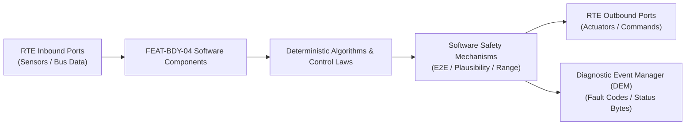

# Software Requirements Specification: Intelligent Multi-Zone HVAC & Cabin Air Quality (HVAC-AQ)
**Feature ID:** `FEAT-BDY-04`  
**Domain:** Body, Lighting & Restraints  
**Target ASIL:** ASIL A / QM  
**Compliance Standard:** ISO 26262:2018 (Part 6 - Software Development) / ASPICE PAM v3.1 (SWE.1, SWE.2)  
**Parent System Specification:** [`FEAT-BDY-04_HVAC_SysReq.md`](file:///c:/Workset/AntiGravityProjects/TestOptimisationExperiement/system_requirements/FEAT-BDY-04_HVAC_SysReq.md)  
**Global Master Specification:** [`spec.md`](file:///c:/Workset/AntiGravityProjects/TestOptimisationExperiement/spec.md)

---

## 1. Software Architecture & Component Structure

This document specifies the AUTOSAR Software Components (SWCs), periodic runnables, algorithmic laws, safety mechanisms, and data ports implementing `FEAT-BDY-04` (Intelligent Multi-Zone HVAC & Cabin Air Quality (HVAC-AQ)).

### AUTOSAR SWC Interaction Diagram

---

## 2. Detailed Software Requirements (SWR_REQ)
*(Multi-Software Requirement Partitioning derived from System Requirements)*

### `SWR-BDY-04-01`: Fanger PMV Cabin Thermal Comfort Thermodynamic Algorithm
- **Planned Release:** R100
- **ASIL Rating:** QM
- **Parent System Requirement:** [`SYS-BDY-04-01`](file:///c:/Workset/AntiGravityProjects/TestOptimisationExperiement/system_requirements/FEAT-BDY-04_HVAC_SysReq.md#sys-bdy-04-01)
- **Allocated AUTOSAR SWC:** `HvacComfortController_SWC`
- **Execution Rate / Trigger:** 100 ms
- **Worst-Case Execution Time (WCET):** 1.2 ms
- **Software Activation Condition:** Cyclic 100 ms task.
- **Algorithmic Description / Logic:**
  > Evaluates Fanger Predicted Mean Vote (PMV): PMV = f(T_air, T_radiant, v_air, Humidity, Metabolic_rate, Clothing_insulation). Runs PID to regulate discharge temperature: T_out = T_set - K_p * (T_cabin - T_set) - K_solar * I_sun * cos(Theta_incidence).
- **Software Safety Mechanism:** Discharge air temperature clamped between +4.0°C and +65.0°C to prevent frost bite or skin burns.
- **Failure Reaction & DEM Diagnostic Event:** Revert to linear feedforward look-up table upon humidity sensor failure.
- **Software Port Inputs:** `Zone_Temp_FL_FR_RL_RR, Setpoint_Temp_DegC, Solar_Flux_W_M2, Sun_Angle_Rad`
- **Software Port Outputs:** `Target_Mix_Flap_Position_Array[4], Desired_Evaporator_Temp_DegC`
- **Software Verification Criteria:** Automated regression testing against ASHRAE Standard 55 thermal comfort metrics.
- **Traceability Link:** Traces upward to [`SYS-BDY-04-01`](file:///c:/Workset/AntiGravityProjects/TestOptimisationExperiement/system_requirements/FEAT-BDY-04_HVAC_SysReq.md#sys-bdy-04-01) and [`FEAT-BDY-04`](file:///c:/Workset/AntiGravityProjects/TestOptimisationExperiement/spec.md).

### `SWR-BDY-04-02`: Brushless Blower PWM Motor Closed-Loop CFM Speed Governor
- **Planned Release:** R100
- **ASIL Rating:** QM
- **Parent System Requirement:** [`SYS-BDY-04-01`](file:///c:/Workset/AntiGravityProjects/TestOptimisationExperiement/system_requirements/FEAT-BDY-04_HVAC_SysReq.md#sys-bdy-04-01)
- **Allocated AUTOSAR SWC:** `HvacBlowerActuator_SWC`
- **Execution Rate / Trigger:** 20 ms
- **Worst-Case Execution Time (WCET):** 0.3 ms
- **Software Activation Condition:** Active when HVAC is on.
- **Algorithmic Description / Logic:**
  > Converts demanded air flow (CFM) to blower motor target RPM: RPM_target = CFM / K_duct. Computes PI duty cycle: Duty = K_p_blower * e_rpm + K_i_blower * int(e). Smooths RPM changes with 200 RPM/s slew rate limiter for acoustic luxury.
- **Software Safety Mechanism:** Motor stall current detector: If current > 25A for > 500 ms (debris in squirrel cage), shut down motor.
- **Failure Reaction & DEM Diagnostic Event:** Set DEM DTC B10C3 and retry soft restart after 5.0 seconds.
- **Software Port Inputs:** `Blower_Target_CFM, Blower_Hall_Speed_RPM, Blower_Current_A`
- **Software Port Outputs:** `Blower_HBridge_PWM_Duty, Blower_Status_Enum`
- **Software Verification Criteria:** Dynamometer bench testing under varying cabin backpressures.
- **Traceability Link:** Traces upward to [`SYS-BDY-04-01`](file:///c:/Workset/AntiGravityProjects/TestOptimisationExperiement/system_requirements/FEAT-BDY-04_HVAC_SysReq.md#sys-bdy-04-01) and [`FEAT-BDY-04`](file:///c:/Workset/AntiGravityProjects/TestOptimisationExperiement/spec.md).

### `SWR-BDY-04-03`: Dynamic Cabin Recirculation Flap Stepper Motor Coordinator
- **Planned Release:** R100
- **ASIL Rating:** ASIL A
- **Parent System Requirement:** [`SYS-BDY-04-02`](file:///c:/Workset/AntiGravityProjects/TestOptimisationExperiement/system_requirements/FEAT-BDY-04_HVAC_SysReq.md#sys-bdy-04-02)
- **Allocated AUTOSAR SWC:** `HvacFlapCoordinator_SWC`
- **Execution Rate / Trigger:** 50 ms
- **Worst-Case Execution Time (WCET):** 0.5 ms
- **Software Activation Condition:** Active upon air quality index change.
- **Algorithmic Description / Logic:**
  > Determines recirculation ratio: If PM25_Ambient > 75 ug/m³ OR Tunnel_Entry_GPS_Flag == TRUE, transition Recirc_Flap from 0% (Fresh) to 100% (Recirc) over 2.5 seconds. If CO2_Cabin > 1800 ppm, clamp max recirc to 70%.
- **Software Safety Mechanism:** Window defog priority: If windshield humidity sensor indicates fogging probability > 85%, windshield defog takes absolute precedence over air quality recirculation.
- **Failure Reaction & DEM Diagnostic Event:** Drive flap to 50% intermediate position if stepper home position lost.
- **Software Port Inputs:** `PM25_Ambient_Ug_M3, Cabin_CO2_PPM, Windshield_Fog_Risk_Pct, Tunnel_GPS_Flag`
- **Software Port Outputs:** `Recirc_Flap_Target_Angle_Deg, Stepper_Step_Direction_Bits`
- **Software Verification Criteria:** Windshield defogging regulatory test compliance (FMVSS 103).
- **Traceability Link:** Traces upward to [`SYS-BDY-04-02`](file:///c:/Workset/AntiGravityProjects/TestOptimisationExperiement/system_requirements/FEAT-BDY-04_HVAC_SysReq.md#sys-bdy-04-02) and [`FEAT-BDY-04`](file:///c:/Workset/AntiGravityProjects/TestOptimisationExperiement/spec.md).

### `SWR-BDY-04-04`: High-Voltage Plasma Bipolar Ionizer Pulse Duty Modulator
- **Planned Release:** R100
- **ASIL Rating:** QM
- **Parent System Requirement:** [`SYS-BDY-04-02`](file:///c:/Workset/AntiGravityProjects/TestOptimisationExperiement/system_requirements/FEAT-BDY-04_HVAC_SysReq.md#sys-bdy-04-02)
- **Allocated AUTOSAR SWC:** `HvacIonizerDriver_SWC`
- **Execution Rate / Trigger:** 100 ms
- **Worst-Case Execution Time (WCET):** 0.2 ms
- **Software Activation Condition:** Triggered when cabin air purification mode is engaged.
- **Algorithmic Description / Logic:**
  > Regulates high-voltage needle electrodes (-4.5 kV DC) to emit 2x10^6 ions/cm³: Modulates 20 kHz PWM generator duty cycle based on cabin PM2.5 level. Disables ionizer when blower speed is zero to prevent ozone accumulation.
- **Software Safety Mechanism:** Ozone concentration guard: Ionizer max continuous runtime capped to 15 minutes per drive cycle.
- **Failure Reaction & DEM Diagnostic Event:** De-energize HV converter if secondary arc discharge detected.
- **Software Port Inputs:** `Cabin_PM25_Ug_M3, Blower_Running_Flag, Ionizer_Arc_Fault_Sense`
- **Software Port Outputs:** `Ionizer_HV_PWM_Enable (boolean), Ionizer_Frequency_Khz`
- **Software Verification Criteria:** Gas chromatography ozone test (< 0.05 ppm) and aerosol neutralization laboratory test.
- **Traceability Link:** Traces upward to [`SYS-BDY-04-02`](file:///c:/Workset/AntiGravityProjects/TestOptimisationExperiement/system_requirements/FEAT-BDY-04_HVAC_SysReq.md#sys-bdy-04-02) and [`FEAT-BDY-04`](file:///c:/Workset/AntiGravityProjects/TestOptimisationExperiement/spec.md).

### `SWR-BDY-04-05`: Cabin 4-Zone Temperature Setpoint & Solar Radiation Flux Balancer - Dynamic Observer & Signal Filter
- **Planned Release:** R100
- **ASIL Rating:** ASIL A
- **Parent System Requirement:** [`SYS-BDY-04-03`](file:///c:/Workset/AntiGravityProjects/TestOptimisationExperiement/system_requirements/FEAT-BDY-04_HVAC_SysReq.md#sys-bdy-04-03)
- **Allocated AUTOSAR SWC:** `HvacZoneBalancer_SWC`
- **Execution Rate / Trigger:** 100 ms
- **Worst-Case Execution Time (WCET):** 0.3 ms
- **Software Activation Condition:** Executed cyclically every 100 ms.
- **Algorithmic Description / Logic:**
  > Executes signal plausibility filtering, calibration offsets, and discrete state estimation for Cabin 4-Zone Temperature Setpoint & Solar Radiation Flux Balancer.
- **Software Safety Mechanism:** Range limit plausibility check and E2E alive sequence verification.
- **Failure Reaction & DEM Diagnostic Event:** Set default fallback output and report DEM_EVENT_FEAT_BDY_04_ERR.
- **Software Port Inputs:** `Raw sensor ADC/SENT/SPI values and RTE bus inputs.`
- **Software Port Outputs:** `Filtered physical signals and validity status bitmasks.`
- **Software Verification Criteria:** Unit test and HiL software integration test.
- **Traceability Link:** Traces upward to [`SYS-BDY-04-03`](file:///c:/Workset/AntiGravityProjects/TestOptimisationExperiement/system_requirements/FEAT-BDY-04_HVAC_SysReq.md#sys-bdy-04-03) and [`FEAT-BDY-04`](file:///c:/Workset/AntiGravityProjects/TestOptimisationExperiement/spec.md).

### `SWR-BDY-04-06`: Cabin 4-Zone Temperature Setpoint & Solar Radiation Flux Balancer - Closed-Loop Control Law & Actuator Dispatch
- **Planned Release:** R100
- **ASIL Rating:** ASIL A
- **Parent System Requirement:** [`SYS-BDY-04-03`](file:///c:/Workset/AntiGravityProjects/TestOptimisationExperiement/system_requirements/FEAT-BDY-04_HVAC_SysReq.md#sys-bdy-04-03)
- **Allocated AUTOSAR SWC:** `HvacZoneBalancer_SWC`
- **Execution Rate / Trigger:** 100 ms
- **Worst-Case Execution Time (WCET):** 0.4 ms
- **Software Activation Condition:** Executed cyclically every 100 ms.
- **Algorithmic Description / Logic:**
  > Evaluates deterministic closed-loop control law, rate limits, and dispatches commands for Cabin 4-Zone Temperature Setpoint & Solar Radiation Flux Balancer.
- **Software Safety Mechanism:** Command saturation clamping and watchdog program flow monitoring.
- **Failure Reaction & DEM Diagnostic Event:** De-energize actuator output, apply safe fallback clamp, and latch DTC.
- **Software Port Inputs:** `Validated physical state signals from observer SWC.`
- **Software Port Outputs:** `Actuator PWM duty cycles, torque/pressure setpoints, and diagnostic flags.`
- **Software Verification Criteria:** Hardware dynamometer and HiL closed-loop regression test suite.
- **Traceability Link:** Traces upward to [`SYS-BDY-04-03`](file:///c:/Workset/AntiGravityProjects/TestOptimisationExperiement/system_requirements/FEAT-BDY-04_HVAC_SysReq.md#sys-bdy-04-03) and [`FEAT-BDY-04`](file:///c:/Workset/AntiGravityProjects/TestOptimisationExperiement/spec.md).

### `SWR-BDY-04-07`: Particulate Matter (PM2.5) & VOC Cabin Air Quality Sensor Observer - Dynamic Observer & Signal Filter
- **Planned Release:** R100
- **ASIL Rating:** ASIL A
- **Parent System Requirement:** [`SYS-BDY-04-04`](file:///c:/Workset/AntiGravityProjects/TestOptimisationExperiement/system_requirements/FEAT-BDY-04_HVAC_SysReq.md#sys-bdy-04-04)
- **Allocated AUTOSAR SWC:** `HvacAirQualityObserver_SWC`
- **Execution Rate / Trigger:** 200 ms
- **Worst-Case Execution Time (WCET):** 0.3 ms
- **Software Activation Condition:** Executed cyclically every 200 ms.
- **Algorithmic Description / Logic:**
  > Executes signal plausibility filtering, calibration offsets, and discrete state estimation for Particulate Matter (PM2.5) & VOC Cabin Air Quality Sensor Observer.
- **Software Safety Mechanism:** Range limit plausibility check and E2E alive sequence verification.
- **Failure Reaction & DEM Diagnostic Event:** Set default fallback output and report DEM_EVENT_FEAT_BDY_04_ERR.
- **Software Port Inputs:** `Raw sensor ADC/SENT/SPI values and RTE bus inputs.`
- **Software Port Outputs:** `Filtered physical signals and validity status bitmasks.`
- **Software Verification Criteria:** Unit test and HiL software integration test.
- **Traceability Link:** Traces upward to [`SYS-BDY-04-04`](file:///c:/Workset/AntiGravityProjects/TestOptimisationExperiement/system_requirements/FEAT-BDY-04_HVAC_SysReq.md#sys-bdy-04-04) and [`FEAT-BDY-04`](file:///c:/Workset/AntiGravityProjects/TestOptimisationExperiement/spec.md).

### `SWR-BDY-04-08`: Particulate Matter (PM2.5) & VOC Cabin Air Quality Sensor Observer - Closed-Loop Control Law & Actuator Dispatch
- **Planned Release:** R100
- **ASIL Rating:** ASIL A
- **Parent System Requirement:** [`SYS-BDY-04-04`](file:///c:/Workset/AntiGravityProjects/TestOptimisationExperiement/system_requirements/FEAT-BDY-04_HVAC_SysReq.md#sys-bdy-04-04)
- **Allocated AUTOSAR SWC:** `HvacAirQualityObserver_SWC`
- **Execution Rate / Trigger:** 200 ms
- **Worst-Case Execution Time (WCET):** 0.4 ms
- **Software Activation Condition:** Executed cyclically every 200 ms.
- **Algorithmic Description / Logic:**
  > Evaluates deterministic closed-loop control law, rate limits, and dispatches commands for Particulate Matter (PM2.5) & VOC Cabin Air Quality Sensor Observer.
- **Software Safety Mechanism:** Command saturation clamping and watchdog program flow monitoring.
- **Failure Reaction & DEM Diagnostic Event:** De-energize actuator output, apply safe fallback clamp, and latch DTC.
- **Software Port Inputs:** `Validated physical state signals from observer SWC.`
- **Software Port Outputs:** `Actuator PWM duty cycles, torque/pressure setpoints, and diagnostic flags.`
- **Software Verification Criteria:** Hardware dynamometer and HiL closed-loop regression test suite.
- **Traceability Link:** Traces upward to [`SYS-BDY-04-04`](file:///c:/Workset/AntiGravityProjects/TestOptimisationExperiement/system_requirements/FEAT-BDY-04_HVAC_SysReq.md#sys-bdy-04-04) and [`FEAT-BDY-04`](file:///c:/Workset/AntiGravityProjects/TestOptimisationExperiement/spec.md).

### `SWR-BDY-04-09`: Automated Fresh Air / Recirculation Damper Stepper Motor Servocontrol - Dynamic Observer & Signal Filter
- **Planned Release:** R200
- **ASIL Rating:** ASIL A
- **Parent System Requirement:** [`SYS-BDY-04-05`](file:///c:/Workset/AntiGravityProjects/TestOptimisationExperiement/system_requirements/FEAT-BDY-04_HVAC_SysReq.md#sys-bdy-04-05)
- **Allocated AUTOSAR SWC:** `HvacRecircDamper_SWC`
- **Execution Rate / Trigger:** 50 ms
- **Worst-Case Execution Time (WCET):** 0.3 ms
- **Software Activation Condition:** Executed cyclically every 50 ms.
- **Algorithmic Description / Logic:**
  > Executes signal plausibility filtering, calibration offsets, and discrete state estimation for Automated Fresh Air / Recirculation Damper Stepper Motor Servocontrol.
- **Software Safety Mechanism:** Range limit plausibility check and E2E alive sequence verification.
- **Failure Reaction & DEM Diagnostic Event:** Set default fallback output and report DEM_EVENT_FEAT_BDY_04_ERR.
- **Software Port Inputs:** `Raw sensor ADC/SENT/SPI values and RTE bus inputs.`
- **Software Port Outputs:** `Filtered physical signals and validity status bitmasks.`
- **Software Verification Criteria:** Unit test and HiL software integration test.
- **Traceability Link:** Traces upward to [`SYS-BDY-04-05`](file:///c:/Workset/AntiGravityProjects/TestOptimisationExperiement/system_requirements/FEAT-BDY-04_HVAC_SysReq.md#sys-bdy-04-05) and [`FEAT-BDY-04`](file:///c:/Workset/AntiGravityProjects/TestOptimisationExperiement/spec.md).

### `SWR-BDY-04-10`: Automated Fresh Air / Recirculation Damper Stepper Motor Servocontrol - Closed-Loop Control Law & Actuator Dispatch
- **Planned Release:** R200
- **ASIL Rating:** ASIL A
- **Parent System Requirement:** [`SYS-BDY-04-05`](file:///c:/Workset/AntiGravityProjects/TestOptimisationExperiement/system_requirements/FEAT-BDY-04_HVAC_SysReq.md#sys-bdy-04-05)
- **Allocated AUTOSAR SWC:** `HvacRecircDamper_SWC`
- **Execution Rate / Trigger:** 50 ms
- **Worst-Case Execution Time (WCET):** 0.4 ms
- **Software Activation Condition:** Executed cyclically every 50 ms.
- **Algorithmic Description / Logic:**
  > Evaluates deterministic closed-loop control law, rate limits, and dispatches commands for Automated Fresh Air / Recirculation Damper Stepper Motor Servocontrol.
- **Software Safety Mechanism:** Command saturation clamping and watchdog program flow monitoring.
- **Failure Reaction & DEM Diagnostic Event:** De-energize actuator output, apply safe fallback clamp, and latch DTC.
- **Software Port Inputs:** `Validated physical state signals from observer SWC.`
- **Software Port Outputs:** `Actuator PWM duty cycles, torque/pressure setpoints, and diagnostic flags.`
- **Software Verification Criteria:** Hardware dynamometer and HiL closed-loop regression test suite.
- **Traceability Link:** Traces upward to [`SYS-BDY-04-05`](file:///c:/Workset/AntiGravityProjects/TestOptimisationExperiement/system_requirements/FEAT-BDY-04_HVAC_SysReq.md#sys-bdy-04-05) and [`FEAT-BDY-04`](file:///c:/Workset/AntiGravityProjects/TestOptimisationExperiement/spec.md).

### `SWR-BDY-04-11`: Brushless Multi-Zone HVAC Blower Fan PWM Speed Governor - Dynamic Observer & Signal Filter
- **Planned Release:** R200
- **ASIL Rating:** ASIL A
- **Parent System Requirement:** [`SYS-BDY-04-06`](file:///c:/Workset/AntiGravityProjects/TestOptimisationExperiement/system_requirements/FEAT-BDY-04_HVAC_SysReq.md#sys-bdy-04-06)
- **Allocated AUTOSAR SWC:** `HvacBlowerGovernor_SWC`
- **Execution Rate / Trigger:** 50 ms
- **Worst-Case Execution Time (WCET):** 0.3 ms
- **Software Activation Condition:** Executed cyclically every 50 ms.
- **Algorithmic Description / Logic:**
  > Executes signal plausibility filtering, calibration offsets, and discrete state estimation for Brushless Multi-Zone HVAC Blower Fan PWM Speed Governor.
- **Software Safety Mechanism:** Range limit plausibility check and E2E alive sequence verification.
- **Failure Reaction & DEM Diagnostic Event:** Set default fallback output and report DEM_EVENT_FEAT_BDY_04_ERR.
- **Software Port Inputs:** `Raw sensor ADC/SENT/SPI values and RTE bus inputs.`
- **Software Port Outputs:** `Filtered physical signals and validity status bitmasks.`
- **Software Verification Criteria:** Unit test and HiL software integration test.
- **Traceability Link:** Traces upward to [`SYS-BDY-04-06`](file:///c:/Workset/AntiGravityProjects/TestOptimisationExperiement/system_requirements/FEAT-BDY-04_HVAC_SysReq.md#sys-bdy-04-06) and [`FEAT-BDY-04`](file:///c:/Workset/AntiGravityProjects/TestOptimisationExperiement/spec.md).

### `SWR-BDY-04-12`: Brushless Multi-Zone HVAC Blower Fan PWM Speed Governor - Closed-Loop Control Law & Actuator Dispatch
- **Planned Release:** R200
- **ASIL Rating:** ASIL A
- **Parent System Requirement:** [`SYS-BDY-04-06`](file:///c:/Workset/AntiGravityProjects/TestOptimisationExperiement/system_requirements/FEAT-BDY-04_HVAC_SysReq.md#sys-bdy-04-06)
- **Allocated AUTOSAR SWC:** `HvacBlowerGovernor_SWC`
- **Execution Rate / Trigger:** 50 ms
- **Worst-Case Execution Time (WCET):** 0.4 ms
- **Software Activation Condition:** Executed cyclically every 50 ms.
- **Algorithmic Description / Logic:**
  > Evaluates deterministic closed-loop control law, rate limits, and dispatches commands for Brushless Multi-Zone HVAC Blower Fan PWM Speed Governor.
- **Software Safety Mechanism:** Command saturation clamping and watchdog program flow monitoring.
- **Failure Reaction & DEM Diagnostic Event:** De-energize actuator output, apply safe fallback clamp, and latch DTC.
- **Software Port Inputs:** `Validated physical state signals from observer SWC.`
- **Software Port Outputs:** `Actuator PWM duty cycles, torque/pressure setpoints, and diagnostic flags.`
- **Software Verification Criteria:** Hardware dynamometer and HiL closed-loop regression test suite.
- **Traceability Link:** Traces upward to [`SYS-BDY-04-06`](file:///c:/Workset/AntiGravityProjects/TestOptimisationExperiement/system_requirements/FEAT-BDY-04_HVAC_SysReq.md#sys-bdy-04-06) and [`FEAT-BDY-04`](file:///c:/Workset/AntiGravityProjects/TestOptimisationExperiement/spec.md).

### `SWR-BDY-04-13`: Air Distribution Face, Footwell & Defrost Flap Actuator Synchronizer - Dynamic Observer & Signal Filter
- **Planned Release:** R300
- **ASIL Rating:** ASIL A
- **Parent System Requirement:** [`SYS-BDY-04-07`](file:///c:/Workset/AntiGravityProjects/TestOptimisationExperiement/system_requirements/FEAT-BDY-04_HVAC_SysReq.md#sys-bdy-04-07)
- **Allocated AUTOSAR SWC:** `HvacFlapSynchronizer_SWC`
- **Execution Rate / Trigger:** 50 ms
- **Worst-Case Execution Time (WCET):** 0.3 ms
- **Software Activation Condition:** Executed cyclically every 50 ms.
- **Algorithmic Description / Logic:**
  > Executes signal plausibility filtering, calibration offsets, and discrete state estimation for Air Distribution Face, Footwell & Defrost Flap Actuator Synchronizer.
- **Software Safety Mechanism:** Range limit plausibility check and E2E alive sequence verification.
- **Failure Reaction & DEM Diagnostic Event:** Set default fallback output and report DEM_EVENT_FEAT_BDY_04_ERR.
- **Software Port Inputs:** `Raw sensor ADC/SENT/SPI values and RTE bus inputs.`
- **Software Port Outputs:** `Filtered physical signals and validity status bitmasks.`
- **Software Verification Criteria:** Unit test and HiL software integration test.
- **Traceability Link:** Traces upward to [`SYS-BDY-04-07`](file:///c:/Workset/AntiGravityProjects/TestOptimisationExperiement/system_requirements/FEAT-BDY-04_HVAC_SysReq.md#sys-bdy-04-07) and [`FEAT-BDY-04`](file:///c:/Workset/AntiGravityProjects/TestOptimisationExperiement/spec.md).

### `SWR-BDY-04-14`: Air Distribution Face, Footwell & Defrost Flap Actuator Synchronizer - Closed-Loop Control Law & Actuator Dispatch
- **Planned Release:** R300
- **ASIL Rating:** ASIL A
- **Parent System Requirement:** [`SYS-BDY-04-07`](file:///c:/Workset/AntiGravityProjects/TestOptimisationExperiement/system_requirements/FEAT-BDY-04_HVAC_SysReq.md#sys-bdy-04-07)
- **Allocated AUTOSAR SWC:** `HvacFlapSynchronizer_SWC`
- **Execution Rate / Trigger:** 50 ms
- **Worst-Case Execution Time (WCET):** 0.4 ms
- **Software Activation Condition:** Executed cyclically every 50 ms.
- **Algorithmic Description / Logic:**
  > Evaluates deterministic closed-loop control law, rate limits, and dispatches commands for Air Distribution Face, Footwell & Defrost Flap Actuator Synchronizer.
- **Software Safety Mechanism:** Command saturation clamping and watchdog program flow monitoring.
- **Failure Reaction & DEM Diagnostic Event:** De-energize actuator output, apply safe fallback clamp, and latch DTC.
- **Software Port Inputs:** `Validated physical state signals from observer SWC.`
- **Software Port Outputs:** `Actuator PWM duty cycles, torque/pressure setpoints, and diagnostic flags.`
- **Software Verification Criteria:** Hardware dynamometer and HiL closed-loop regression test suite.
- **Traceability Link:** Traces upward to [`SYS-BDY-04-07`](file:///c:/Workset/AntiGravityProjects/TestOptimisationExperiement/system_requirements/FEAT-BDY-04_HVAC_SysReq.md#sys-bdy-04-07) and [`FEAT-BDY-04`](file:///c:/Workset/AntiGravityProjects/TestOptimisationExperiement/spec.md).

### `SWR-BDY-04-15`: Windshield Humidity Sensor & Predictive Glass Defogging Governor - Dynamic Observer & Signal Filter
- **Planned Release:** R300
- **ASIL Rating:** ASIL A
- **Parent System Requirement:** [`SYS-BDY-04-08`](file:///c:/Workset/AntiGravityProjects/TestOptimisationExperiement/system_requirements/FEAT-BDY-04_HVAC_SysReq.md#sys-bdy-04-08)
- **Allocated AUTOSAR SWC:** `HvacDefogGovernor_SWC`
- **Execution Rate / Trigger:** 100 ms
- **Worst-Case Execution Time (WCET):** 0.3 ms
- **Software Activation Condition:** Executed cyclically every 100 ms.
- **Algorithmic Description / Logic:**
  > Executes signal plausibility filtering, calibration offsets, and discrete state estimation for Windshield Humidity Sensor & Predictive Glass Defogging Governor.
- **Software Safety Mechanism:** Range limit plausibility check and E2E alive sequence verification.
- **Failure Reaction & DEM Diagnostic Event:** Set default fallback output and report DEM_EVENT_FEAT_BDY_04_ERR.
- **Software Port Inputs:** `Raw sensor ADC/SENT/SPI values and RTE bus inputs.`
- **Software Port Outputs:** `Filtered physical signals and validity status bitmasks.`
- **Software Verification Criteria:** Unit test and HiL software integration test.
- **Traceability Link:** Traces upward to [`SYS-BDY-04-08`](file:///c:/Workset/AntiGravityProjects/TestOptimisationExperiement/system_requirements/FEAT-BDY-04_HVAC_SysReq.md#sys-bdy-04-08) and [`FEAT-BDY-04`](file:///c:/Workset/AntiGravityProjects/TestOptimisationExperiement/spec.md).

### `SWR-BDY-04-16`: Windshield Humidity Sensor & Predictive Glass Defogging Governor - Closed-Loop Control Law & Actuator Dispatch
- **Planned Release:** R300
- **ASIL Rating:** ASIL A
- **Parent System Requirement:** [`SYS-BDY-04-08`](file:///c:/Workset/AntiGravityProjects/TestOptimisationExperiement/system_requirements/FEAT-BDY-04_HVAC_SysReq.md#sys-bdy-04-08)
- **Allocated AUTOSAR SWC:** `HvacDefogGovernor_SWC`
- **Execution Rate / Trigger:** 100 ms
- **Worst-Case Execution Time (WCET):** 0.4 ms
- **Software Activation Condition:** Executed cyclically every 100 ms.
- **Algorithmic Description / Logic:**
  > Evaluates deterministic closed-loop control law, rate limits, and dispatches commands for Windshield Humidity Sensor & Predictive Glass Defogging Governor.
- **Software Safety Mechanism:** Command saturation clamping and watchdog program flow monitoring.
- **Failure Reaction & DEM Diagnostic Event:** De-energize actuator output, apply safe fallback clamp, and latch DTC.
- **Software Port Inputs:** `Validated physical state signals from observer SWC.`
- **Software Port Outputs:** `Actuator PWM duty cycles, torque/pressure setpoints, and diagnostic flags.`
- **Software Verification Criteria:** Hardware dynamometer and HiL closed-loop regression test suite.
- **Traceability Link:** Traces upward to [`SYS-BDY-04-08`](file:///c:/Workset/AntiGravityProjects/TestOptimisationExperiement/system_requirements/FEAT-BDY-04_HVAC_SysReq.md#sys-bdy-04-08) and [`FEAT-BDY-04`](file:///c:/Workset/AntiGravityProjects/TestOptimisationExperiement/spec.md).

### `SWR-BDY-04-17`: High-Voltage Cabin Air Electric Ionizer & Fragrance Dispenser Driver - Dynamic Observer & Signal Filter
- **Planned Release:** R300
- **ASIL Rating:** ASIL A
- **Parent System Requirement:** [`SYS-BDY-04-09`](file:///c:/Workset/AntiGravityProjects/TestOptimisationExperiement/system_requirements/FEAT-BDY-04_HVAC_SysReq.md#sys-bdy-04-09)
- **Allocated AUTOSAR SWC:** `HvacIonizerDriver_SWC`
- **Execution Rate / Trigger:** 200 ms
- **Worst-Case Execution Time (WCET):** 0.3 ms
- **Software Activation Condition:** Executed cyclically every 200 ms.
- **Algorithmic Description / Logic:**
  > Executes signal plausibility filtering, calibration offsets, and discrete state estimation for High-Voltage Cabin Air Electric Ionizer & Fragrance Dispenser Driver.
- **Software Safety Mechanism:** Range limit plausibility check and E2E alive sequence verification.
- **Failure Reaction & DEM Diagnostic Event:** Set default fallback output and report DEM_EVENT_FEAT_BDY_04_ERR.
- **Software Port Inputs:** `Raw sensor ADC/SENT/SPI values and RTE bus inputs.`
- **Software Port Outputs:** `Filtered physical signals and validity status bitmasks.`
- **Software Verification Criteria:** Unit test and HiL software integration test.
- **Traceability Link:** Traces upward to [`SYS-BDY-04-09`](file:///c:/Workset/AntiGravityProjects/TestOptimisationExperiement/system_requirements/FEAT-BDY-04_HVAC_SysReq.md#sys-bdy-04-09) and [`FEAT-BDY-04`](file:///c:/Workset/AntiGravityProjects/TestOptimisationExperiement/spec.md).

### `SWR-BDY-04-18`: High-Voltage Cabin Air Electric Ionizer & Fragrance Dispenser Driver - Closed-Loop Control Law & Actuator Dispatch
- **Planned Release:** R300
- **ASIL Rating:** ASIL A
- **Parent System Requirement:** [`SYS-BDY-04-09`](file:///c:/Workset/AntiGravityProjects/TestOptimisationExperiement/system_requirements/FEAT-BDY-04_HVAC_SysReq.md#sys-bdy-04-09)
- **Allocated AUTOSAR SWC:** `HvacIonizerDriver_SWC`
- **Execution Rate / Trigger:** 200 ms
- **Worst-Case Execution Time (WCET):** 0.4 ms
- **Software Activation Condition:** Executed cyclically every 200 ms.
- **Algorithmic Description / Logic:**
  > Evaluates deterministic closed-loop control law, rate limits, and dispatches commands for High-Voltage Cabin Air Electric Ionizer & Fragrance Dispenser Driver.
- **Software Safety Mechanism:** Command saturation clamping and watchdog program flow monitoring.
- **Failure Reaction & DEM Diagnostic Event:** De-energize actuator output, apply safe fallback clamp, and latch DTC.
- **Software Port Inputs:** `Validated physical state signals from observer SWC.`
- **Software Port Outputs:** `Actuator PWM duty cycles, torque/pressure setpoints, and diagnostic flags.`
- **Software Verification Criteria:** Hardware dynamometer and HiL closed-loop regression test suite.
- **Traceability Link:** Traces upward to [`SYS-BDY-04-09`](file:///c:/Workset/AntiGravityProjects/TestOptimisationExperiement/system_requirements/FEAT-BDY-04_HVAC_SysReq.md#sys-bdy-04-09) and [`FEAT-BDY-04`](file:///c:/Workset/AntiGravityProjects/TestOptimisationExperiement/spec.md).

### `SWR-BDY-04-19`: Heated Steering Wheel & Multi-Stage Heated/Ventilated Seat Coordinator - Dynamic Observer & Signal Filter
- **Planned Release:** R400
- **ASIL Rating:** ASIL A
- **Parent System Requirement:** [`SYS-BDY-04-10`](file:///c:/Workset/AntiGravityProjects/TestOptimisationExperiement/system_requirements/FEAT-BDY-04_HVAC_SysReq.md#sys-bdy-04-10)
- **Allocated AUTOSAR SWC:** `HvacSeatComfort_SWC`
- **Execution Rate / Trigger:** 100 ms
- **Worst-Case Execution Time (WCET):** 0.3 ms
- **Software Activation Condition:** Executed cyclically every 100 ms.
- **Algorithmic Description / Logic:**
  > Executes signal plausibility filtering, calibration offsets, and discrete state estimation for Heated Steering Wheel & Multi-Stage Heated/Ventilated Seat Coordinator.
- **Software Safety Mechanism:** Range limit plausibility check and E2E alive sequence verification.
- **Failure Reaction & DEM Diagnostic Event:** Set default fallback output and report DEM_EVENT_FEAT_BDY_04_ERR.
- **Software Port Inputs:** `Raw sensor ADC/SENT/SPI values and RTE bus inputs.`
- **Software Port Outputs:** `Filtered physical signals and validity status bitmasks.`
- **Software Verification Criteria:** Unit test and HiL software integration test.
- **Traceability Link:** Traces upward to [`SYS-BDY-04-10`](file:///c:/Workset/AntiGravityProjects/TestOptimisationExperiement/system_requirements/FEAT-BDY-04_HVAC_SysReq.md#sys-bdy-04-10) and [`FEAT-BDY-04`](file:///c:/Workset/AntiGravityProjects/TestOptimisationExperiement/spec.md).

### `SWR-BDY-04-20`: Heated Steering Wheel & Multi-Stage Heated/Ventilated Seat Coordinator - Closed-Loop Control Law & Actuator Dispatch
- **Planned Release:** R400
- **ASIL Rating:** ASIL A
- **Parent System Requirement:** [`SYS-BDY-04-10`](file:///c:/Workset/AntiGravityProjects/TestOptimisationExperiement/system_requirements/FEAT-BDY-04_HVAC_SysReq.md#sys-bdy-04-10)
- **Allocated AUTOSAR SWC:** `HvacSeatComfort_SWC`
- **Execution Rate / Trigger:** 100 ms
- **Worst-Case Execution Time (WCET):** 0.4 ms
- **Software Activation Condition:** Executed cyclically every 100 ms.
- **Algorithmic Description / Logic:**
  > Evaluates deterministic closed-loop control law, rate limits, and dispatches commands for Heated Steering Wheel & Multi-Stage Heated/Ventilated Seat Coordinator.
- **Software Safety Mechanism:** Command saturation clamping and watchdog program flow monitoring.
- **Failure Reaction & DEM Diagnostic Event:** De-energize actuator output, apply safe fallback clamp, and latch DTC.
- **Software Port Inputs:** `Validated physical state signals from observer SWC.`
- **Software Port Outputs:** `Actuator PWM duty cycles, torque/pressure setpoints, and diagnostic flags.`
- **Software Verification Criteria:** Hardware dynamometer and HiL closed-loop regression test suite.
- **Traceability Link:** Traces upward to [`SYS-BDY-04-10`](file:///c:/Workset/AntiGravityProjects/TestOptimisationExperiement/system_requirements/FEAT-BDY-04_HVAC_SysReq.md#sys-bdy-04-10) and [`FEAT-BDY-04`](file:///c:/Workset/AntiGravityProjects/TestOptimisationExperiement/spec.md).

### `SWR-BDY-04-21`: Sub-Zero Ambient Heat Pump Auxiliary Heating Mode Request Arbitrator - Dynamic Observer & Signal Filter
- **Planned Release:** R400
- **ASIL Rating:** ASIL B
- **Parent System Requirement:** [`SYS-BDY-04-11`](file:///c:/Workset/AntiGravityProjects/TestOptimisationExperiement/system_requirements/FEAT-BDY-04_HVAC_SysReq.md#sys-bdy-04-11)
- **Allocated AUTOSAR SWC:** `HvacHeatRequest_SWC`
- **Execution Rate / Trigger:** 200 ms
- **Worst-Case Execution Time (WCET):** 0.3 ms
- **Software Activation Condition:** Executed cyclically every 200 ms.
- **Algorithmic Description / Logic:**
  > Executes signal plausibility filtering, calibration offsets, and discrete state estimation for Sub-Zero Ambient Heat Pump Auxiliary Heating Mode Request Arbitrator.
- **Software Safety Mechanism:** Range limit plausibility check and E2E alive sequence verification.
- **Failure Reaction & DEM Diagnostic Event:** Set default fallback output and report DEM_EVENT_FEAT_BDY_04_ERR.
- **Software Port Inputs:** `Raw sensor ADC/SENT/SPI values and RTE bus inputs.`
- **Software Port Outputs:** `Filtered physical signals and validity status bitmasks.`
- **Software Verification Criteria:** Unit test and HiL software integration test.
- **Traceability Link:** Traces upward to [`SYS-BDY-04-11`](file:///c:/Workset/AntiGravityProjects/TestOptimisationExperiement/system_requirements/FEAT-BDY-04_HVAC_SysReq.md#sys-bdy-04-11) and [`FEAT-BDY-04`](file:///c:/Workset/AntiGravityProjects/TestOptimisationExperiement/spec.md).

### `SWR-BDY-04-22`: Sub-Zero Ambient Heat Pump Auxiliary Heating Mode Request Arbitrator - Closed-Loop Control Law & Actuator Dispatch
- **Planned Release:** R400
- **ASIL Rating:** ASIL B
- **Parent System Requirement:** [`SYS-BDY-04-11`](file:///c:/Workset/AntiGravityProjects/TestOptimisationExperiement/system_requirements/FEAT-BDY-04_HVAC_SysReq.md#sys-bdy-04-11)
- **Allocated AUTOSAR SWC:** `HvacHeatRequest_SWC`
- **Execution Rate / Trigger:** 200 ms
- **Worst-Case Execution Time (WCET):** 0.4 ms
- **Software Activation Condition:** Executed cyclically every 200 ms.
- **Algorithmic Description / Logic:**
  > Evaluates deterministic closed-loop control law, rate limits, and dispatches commands for Sub-Zero Ambient Heat Pump Auxiliary Heating Mode Request Arbitrator.
- **Software Safety Mechanism:** Command saturation clamping and watchdog program flow monitoring.
- **Failure Reaction & DEM Diagnostic Event:** De-energize actuator output, apply safe fallback clamp, and latch DTC.
- **Software Port Inputs:** `Validated physical state signals from observer SWC.`
- **Software Port Outputs:** `Actuator PWM duty cycles, torque/pressure setpoints, and diagnostic flags.`
- **Software Verification Criteria:** Hardware dynamometer and HiL closed-loop regression test suite.
- **Traceability Link:** Traces upward to [`SYS-BDY-04-11`](file:///c:/Workset/AntiGravityProjects/TestOptimisationExperiement/system_requirements/FEAT-BDY-04_HVAC_SysReq.md#sys-bdy-04-11) and [`FEAT-BDY-04`](file:///c:/Workset/AntiGravityProjects/TestOptimisationExperiement/spec.md).

### `SWR-BDY-04-23`: Eco-Mode Cabin Occupancy-Based Thermal Zone Energy Conservator - Dynamic Observer & Signal Filter
- **Planned Release:** R400
- **ASIL Rating:** ASIL A
- **Parent System Requirement:** [`SYS-BDY-04-12`](file:///c:/Workset/AntiGravityProjects/TestOptimisationExperiement/system_requirements/FEAT-BDY-04_HVAC_SysReq.md#sys-bdy-04-12)
- **Allocated AUTOSAR SWC:** `HvacEcoConservator_SWC`
- **Execution Rate / Trigger:** 500 ms
- **Worst-Case Execution Time (WCET):** 0.3 ms
- **Software Activation Condition:** Executed cyclically every 500 ms.
- **Algorithmic Description / Logic:**
  > Executes signal plausibility filtering, calibration offsets, and discrete state estimation for Eco-Mode Cabin Occupancy-Based Thermal Zone Energy Conservator.
- **Software Safety Mechanism:** Range limit plausibility check and E2E alive sequence verification.
- **Failure Reaction & DEM Diagnostic Event:** Set default fallback output and report DEM_EVENT_FEAT_BDY_04_ERR.
- **Software Port Inputs:** `Raw sensor ADC/SENT/SPI values and RTE bus inputs.`
- **Software Port Outputs:** `Filtered physical signals and validity status bitmasks.`
- **Software Verification Criteria:** Unit test and HiL software integration test.
- **Traceability Link:** Traces upward to [`SYS-BDY-04-12`](file:///c:/Workset/AntiGravityProjects/TestOptimisationExperiement/system_requirements/FEAT-BDY-04_HVAC_SysReq.md#sys-bdy-04-12) and [`FEAT-BDY-04`](file:///c:/Workset/AntiGravityProjects/TestOptimisationExperiement/spec.md).

### `SWR-BDY-04-24`: Eco-Mode Cabin Occupancy-Based Thermal Zone Energy Conservator - Closed-Loop Control Law & Actuator Dispatch
- **Planned Release:** R400
- **ASIL Rating:** ASIL A
- **Parent System Requirement:** [`SYS-BDY-04-12`](file:///c:/Workset/AntiGravityProjects/TestOptimisationExperiement/system_requirements/FEAT-BDY-04_HVAC_SysReq.md#sys-bdy-04-12)
- **Allocated AUTOSAR SWC:** `HvacEcoConservator_SWC`
- **Execution Rate / Trigger:** 500 ms
- **Worst-Case Execution Time (WCET):** 0.4 ms
- **Software Activation Condition:** Executed cyclically every 500 ms.
- **Algorithmic Description / Logic:**
  > Evaluates deterministic closed-loop control law, rate limits, and dispatches commands for Eco-Mode Cabin Occupancy-Based Thermal Zone Energy Conservator.
- **Software Safety Mechanism:** Command saturation clamping and watchdog program flow monitoring.
- **Failure Reaction & DEM Diagnostic Event:** De-energize actuator output, apply safe fallback clamp, and latch DTC.
- **Software Port Inputs:** `Validated physical state signals from observer SWC.`
- **Software Port Outputs:** `Actuator PWM duty cycles, torque/pressure setpoints, and diagnostic flags.`
- **Software Verification Criteria:** Hardware dynamometer and HiL closed-loop regression test suite.
- **Traceability Link:** Traces upward to [`SYS-BDY-04-12`](file:///c:/Workset/AntiGravityProjects/TestOptimisationExperiement/system_requirements/FEAT-BDY-04_HVAC_SysReq.md#sys-bdy-04-12) and [`FEAT-BDY-04`](file:///c:/Workset/AntiGravityProjects/TestOptimisationExperiement/spec.md).

### `SWR-BDY-04-25`: HVAC LIN Stepper Motor Jam & Flap Travel Endpoint Self-Calibration - Dynamic Observer & Signal Filter
- **Planned Release:** R500
- **ASIL Rating:** ASIL A
- **Parent System Requirement:** [`SYS-BDY-04-13`](file:///c:/Workset/AntiGravityProjects/TestOptimisationExperiement/system_requirements/FEAT-BDY-04_HVAC_SysReq.md#sys-bdy-04-13)
- **Allocated AUTOSAR SWC:** `HvacFlapCalibrator_SWC`
- **Execution Rate / Trigger:** 500 ms
- **Worst-Case Execution Time (WCET):** 0.3 ms
- **Software Activation Condition:** Executed cyclically every 500 ms.
- **Algorithmic Description / Logic:**
  > Executes signal plausibility filtering, calibration offsets, and discrete state estimation for HVAC LIN Stepper Motor Jam & Flap Travel Endpoint Self-Calibration.
- **Software Safety Mechanism:** Range limit plausibility check and E2E alive sequence verification.
- **Failure Reaction & DEM Diagnostic Event:** Set default fallback output and report DEM_EVENT_FEAT_BDY_04_ERR.
- **Software Port Inputs:** `Raw sensor ADC/SENT/SPI values and RTE bus inputs.`
- **Software Port Outputs:** `Filtered physical signals and validity status bitmasks.`
- **Software Verification Criteria:** Unit test and HiL software integration test.
- **Traceability Link:** Traces upward to [`SYS-BDY-04-13`](file:///c:/Workset/AntiGravityProjects/TestOptimisationExperiement/system_requirements/FEAT-BDY-04_HVAC_SysReq.md#sys-bdy-04-13) and [`FEAT-BDY-04`](file:///c:/Workset/AntiGravityProjects/TestOptimisationExperiement/spec.md).

### `SWR-BDY-04-26`: HVAC LIN Stepper Motor Jam & Flap Travel Endpoint Self-Calibration - Closed-Loop Control Law & Actuator Dispatch
- **Planned Release:** R500
- **ASIL Rating:** ASIL A
- **Parent System Requirement:** [`SYS-BDY-04-13`](file:///c:/Workset/AntiGravityProjects/TestOptimisationExperiement/system_requirements/FEAT-BDY-04_HVAC_SysReq.md#sys-bdy-04-13)
- **Allocated AUTOSAR SWC:** `HvacFlapCalibrator_SWC`
- **Execution Rate / Trigger:** 500 ms
- **Worst-Case Execution Time (WCET):** 0.4 ms
- **Software Activation Condition:** Executed cyclically every 500 ms.
- **Algorithmic Description / Logic:**
  > Evaluates deterministic closed-loop control law, rate limits, and dispatches commands for HVAC LIN Stepper Motor Jam & Flap Travel Endpoint Self-Calibration.
- **Software Safety Mechanism:** Command saturation clamping and watchdog program flow monitoring.
- **Failure Reaction & DEM Diagnostic Event:** De-energize actuator output, apply safe fallback clamp, and latch DTC.
- **Software Port Inputs:** `Validated physical state signals from observer SWC.`
- **Software Port Outputs:** `Actuator PWM duty cycles, torque/pressure setpoints, and diagnostic flags.`
- **Software Verification Criteria:** Hardware dynamometer and HiL closed-loop regression test suite.
- **Traceability Link:** Traces upward to [`SYS-BDY-04-13`](file:///c:/Workset/AntiGravityProjects/TestOptimisationExperiement/system_requirements/FEAT-BDY-04_HVAC_SysReq.md#sys-bdy-04-13) and [`FEAT-BDY-04`](file:///c:/Workset/AntiGravityProjects/TestOptimisationExperiement/spec.md).

### `SWR-BDY-04-27`: DEM HVAC Climate Sensor Diagnostic Event Manager & Fault Logger - Dynamic Observer & Signal Filter
- **Planned Release:** R500
- **ASIL Rating:** ASIL A
- **Parent System Requirement:** [`SYS-BDY-04-14`](file:///c:/Workset/AntiGravityProjects/TestOptimisationExperiement/system_requirements/FEAT-BDY-04_HVAC_SysReq.md#sys-bdy-04-14)
- **Allocated AUTOSAR SWC:** `HvacDiagnosticManager_SWC`
- **Execution Rate / Trigger:** 100 ms
- **Worst-Case Execution Time (WCET):** 0.3 ms
- **Software Activation Condition:** Executed cyclically every 100 ms.
- **Algorithmic Description / Logic:**
  > Executes signal plausibility filtering, calibration offsets, and discrete state estimation for DEM HVAC Climate Sensor Diagnostic Event Manager & Fault Logger.
- **Software Safety Mechanism:** Range limit plausibility check and E2E alive sequence verification.
- **Failure Reaction & DEM Diagnostic Event:** Set default fallback output and report DEM_EVENT_FEAT_BDY_04_ERR.
- **Software Port Inputs:** `Raw sensor ADC/SENT/SPI values and RTE bus inputs.`
- **Software Port Outputs:** `Filtered physical signals and validity status bitmasks.`
- **Software Verification Criteria:** Unit test and HiL software integration test.
- **Traceability Link:** Traces upward to [`SYS-BDY-04-14`](file:///c:/Workset/AntiGravityProjects/TestOptimisationExperiement/system_requirements/FEAT-BDY-04_HVAC_SysReq.md#sys-bdy-04-14) and [`FEAT-BDY-04`](file:///c:/Workset/AntiGravityProjects/TestOptimisationExperiement/spec.md).

### `SWR-BDY-04-28`: DEM HVAC Climate Sensor Diagnostic Event Manager & Fault Logger - Closed-Loop Control Law & Actuator Dispatch
- **Planned Release:** R500
- **ASIL Rating:** ASIL A
- **Parent System Requirement:** [`SYS-BDY-04-14`](file:///c:/Workset/AntiGravityProjects/TestOptimisationExperiement/system_requirements/FEAT-BDY-04_HVAC_SysReq.md#sys-bdy-04-14)
- **Allocated AUTOSAR SWC:** `HvacDiagnosticManager_SWC`
- **Execution Rate / Trigger:** 100 ms
- **Worst-Case Execution Time (WCET):** 0.4 ms
- **Software Activation Condition:** Executed cyclically every 100 ms.
- **Algorithmic Description / Logic:**
  > Evaluates deterministic closed-loop control law, rate limits, and dispatches commands for DEM HVAC Climate Sensor Diagnostic Event Manager & Fault Logger.
- **Software Safety Mechanism:** Command saturation clamping and watchdog program flow monitoring.
- **Failure Reaction & DEM Diagnostic Event:** De-energize actuator output, apply safe fallback clamp, and latch DTC.
- **Software Port Inputs:** `Validated physical state signals from observer SWC.`
- **Software Port Outputs:** `Actuator PWM duty cycles, torque/pressure setpoints, and diagnostic flags.`
- **Software Verification Criteria:** Hardware dynamometer and HiL closed-loop regression test suite.
- **Traceability Link:** Traces upward to [`SYS-BDY-04-14`](file:///c:/Workset/AntiGravityProjects/TestOptimisationExperiement/system_requirements/FEAT-BDY-04_HVAC_SysReq.md#sys-bdy-04-14) and [`FEAT-BDY-04`](file:///c:/Workset/AntiGravityProjects/TestOptimisationExperiement/spec.md).

### `SWR-BDY-04-29`: Driver Central Touchscreen Climate Control HMI & Voice Command Interface - Dynamic Observer & Signal Filter
- **Planned Release:** R500
- **ASIL Rating:** ASIL A
- **Parent System Requirement:** [`SYS-BDY-04-15`](file:///c:/Workset/AntiGravityProjects/TestOptimisationExperiement/system_requirements/FEAT-BDY-04_HVAC_SysReq.md#sys-bdy-04-15)
- **Allocated AUTOSAR SWC:** `HvacHmiDispatcher_SWC`
- **Execution Rate / Trigger:** 50 ms
- **Worst-Case Execution Time (WCET):** 0.3 ms
- **Software Activation Condition:** Executed cyclically every 50 ms.
- **Algorithmic Description / Logic:**
  > Executes signal plausibility filtering, calibration offsets, and discrete state estimation for Driver Central Touchscreen Climate Control HMI & Voice Command Interface.
- **Software Safety Mechanism:** Range limit plausibility check and E2E alive sequence verification.
- **Failure Reaction & DEM Diagnostic Event:** Set default fallback output and report DEM_EVENT_FEAT_BDY_04_ERR.
- **Software Port Inputs:** `Raw sensor ADC/SENT/SPI values and RTE bus inputs.`
- **Software Port Outputs:** `Filtered physical signals and validity status bitmasks.`
- **Software Verification Criteria:** Unit test and HiL software integration test.
- **Traceability Link:** Traces upward to [`SYS-BDY-04-15`](file:///c:/Workset/AntiGravityProjects/TestOptimisationExperiement/system_requirements/FEAT-BDY-04_HVAC_SysReq.md#sys-bdy-04-15) and [`FEAT-BDY-04`](file:///c:/Workset/AntiGravityProjects/TestOptimisationExperiement/spec.md).

### `SWR-BDY-04-30`: Driver Central Touchscreen Climate Control HMI & Voice Command Interface - Closed-Loop Control Law & Actuator Dispatch
- **Planned Release:** R500
- **ASIL Rating:** ASIL A
- **Parent System Requirement:** [`SYS-BDY-04-15`](file:///c:/Workset/AntiGravityProjects/TestOptimisationExperiement/system_requirements/FEAT-BDY-04_HVAC_SysReq.md#sys-bdy-04-15)
- **Allocated AUTOSAR SWC:** `HvacHmiDispatcher_SWC`
- **Execution Rate / Trigger:** 50 ms
- **Worst-Case Execution Time (WCET):** 0.4 ms
- **Software Activation Condition:** Executed cyclically every 50 ms.
- **Algorithmic Description / Logic:**
  > Evaluates deterministic closed-loop control law, rate limits, and dispatches commands for Driver Central Touchscreen Climate Control HMI & Voice Command Interface.
- **Software Safety Mechanism:** Command saturation clamping and watchdog program flow monitoring.
- **Failure Reaction & DEM Diagnostic Event:** De-energize actuator output, apply safe fallback clamp, and latch DTC.
- **Software Port Inputs:** `Validated physical state signals from observer SWC.`
- **Software Port Outputs:** `Actuator PWM duty cycles, torque/pressure setpoints, and diagnostic flags.`
- **Software Verification Criteria:** Hardware dynamometer and HiL closed-loop regression test suite.
- **Traceability Link:** Traces upward to [`SYS-BDY-04-15`](file:///c:/Workset/AntiGravityProjects/TestOptimisationExperiement/system_requirements/FEAT-BDY-04_HVAC_SysReq.md#sys-bdy-04-15) and [`FEAT-BDY-04`](file:///c:/Workset/AntiGravityProjects/TestOptimisationExperiement/spec.md).

---

## 3. Software-to-System Backward Traceability Matrix

| Software Requirement ID | Planned Release | Allocated SWC | Execution Rate | Upstream System Req | Verification Method |
| :--- | :---: | :--- | :--- | :--- | :--- |
| `SWR-BDY-04-01` | **`R100`** | `HvacComfortController_SWC` | 100 ms | [`SYS-BDY-04-01`](file:///c:/Workset/AntiGravityProjects/TestOptimisationExperiement/system_requirements/FEAT-BDY-04_HVAC_SysReq.md#sys-bdy-04-01) | Automated regression testing against ASHRAE Standard 55 thermal comfort metrics. |
| `SWR-BDY-04-02` | **`R100`** | `HvacBlowerActuator_SWC` | 20 ms | [`SYS-BDY-04-01`](file:///c:/Workset/AntiGravityProjects/TestOptimisationExperiement/system_requirements/FEAT-BDY-04_HVAC_SysReq.md#sys-bdy-04-01) | Dynamometer bench testing under varying cabin backpressures. |
| `SWR-BDY-04-03` | **`R100`** | `HvacFlapCoordinator_SWC` | 50 ms | [`SYS-BDY-04-02`](file:///c:/Workset/AntiGravityProjects/TestOptimisationExperiement/system_requirements/FEAT-BDY-04_HVAC_SysReq.md#sys-bdy-04-02) | Windshield defogging regulatory test compliance (FMVSS 103). |
| `SWR-BDY-04-04` | **`R100`** | `HvacIonizerDriver_SWC` | 100 ms | [`SYS-BDY-04-02`](file:///c:/Workset/AntiGravityProjects/TestOptimisationExperiement/system_requirements/FEAT-BDY-04_HVAC_SysReq.md#sys-bdy-04-02) | Gas chromatography ozone test (< 0.05 ppm) and aerosol neutralization laboratory test. |
| `SWR-BDY-04-05` | **`R100`** | `HvacZoneBalancer_SWC` | 100 ms | [`SYS-BDY-04-03`](file:///c:/Workset/AntiGravityProjects/TestOptimisationExperiement/system_requirements/FEAT-BDY-04_HVAC_SysReq.md#sys-bdy-04-03) | Unit test and HiL software integration test. |
| `SWR-BDY-04-06` | **`R100`** | `HvacZoneBalancer_SWC` | 100 ms | [`SYS-BDY-04-03`](file:///c:/Workset/AntiGravityProjects/TestOptimisationExperiement/system_requirements/FEAT-BDY-04_HVAC_SysReq.md#sys-bdy-04-03) | Hardware dynamometer and HiL closed-loop regression test suite. |
| `SWR-BDY-04-07` | **`R100`** | `HvacAirQualityObserver_SWC` | 200 ms | [`SYS-BDY-04-04`](file:///c:/Workset/AntiGravityProjects/TestOptimisationExperiement/system_requirements/FEAT-BDY-04_HVAC_SysReq.md#sys-bdy-04-04) | Unit test and HiL software integration test. |
| `SWR-BDY-04-08` | **`R100`** | `HvacAirQualityObserver_SWC` | 200 ms | [`SYS-BDY-04-04`](file:///c:/Workset/AntiGravityProjects/TestOptimisationExperiement/system_requirements/FEAT-BDY-04_HVAC_SysReq.md#sys-bdy-04-04) | Hardware dynamometer and HiL closed-loop regression test suite. |
| `SWR-BDY-04-09` | **`R200`** | `HvacRecircDamper_SWC` | 50 ms | [`SYS-BDY-04-05`](file:///c:/Workset/AntiGravityProjects/TestOptimisationExperiement/system_requirements/FEAT-BDY-04_HVAC_SysReq.md#sys-bdy-04-05) | Unit test and HiL software integration test. |
| `SWR-BDY-04-10` | **`R200`** | `HvacRecircDamper_SWC` | 50 ms | [`SYS-BDY-04-05`](file:///c:/Workset/AntiGravityProjects/TestOptimisationExperiement/system_requirements/FEAT-BDY-04_HVAC_SysReq.md#sys-bdy-04-05) | Hardware dynamometer and HiL closed-loop regression test suite. |
| `SWR-BDY-04-11` | **`R200`** | `HvacBlowerGovernor_SWC` | 50 ms | [`SYS-BDY-04-06`](file:///c:/Workset/AntiGravityProjects/TestOptimisationExperiement/system_requirements/FEAT-BDY-04_HVAC_SysReq.md#sys-bdy-04-06) | Unit test and HiL software integration test. |
| `SWR-BDY-04-12` | **`R200`** | `HvacBlowerGovernor_SWC` | 50 ms | [`SYS-BDY-04-06`](file:///c:/Workset/AntiGravityProjects/TestOptimisationExperiement/system_requirements/FEAT-BDY-04_HVAC_SysReq.md#sys-bdy-04-06) | Hardware dynamometer and HiL closed-loop regression test suite. |
| `SWR-BDY-04-13` | **`R300`** | `HvacFlapSynchronizer_SWC` | 50 ms | [`SYS-BDY-04-07`](file:///c:/Workset/AntiGravityProjects/TestOptimisationExperiement/system_requirements/FEAT-BDY-04_HVAC_SysReq.md#sys-bdy-04-07) | Unit test and HiL software integration test. |
| `SWR-BDY-04-14` | **`R300`** | `HvacFlapSynchronizer_SWC` | 50 ms | [`SYS-BDY-04-07`](file:///c:/Workset/AntiGravityProjects/TestOptimisationExperiement/system_requirements/FEAT-BDY-04_HVAC_SysReq.md#sys-bdy-04-07) | Hardware dynamometer and HiL closed-loop regression test suite. |
| `SWR-BDY-04-15` | **`R300`** | `HvacDefogGovernor_SWC` | 100 ms | [`SYS-BDY-04-08`](file:///c:/Workset/AntiGravityProjects/TestOptimisationExperiement/system_requirements/FEAT-BDY-04_HVAC_SysReq.md#sys-bdy-04-08) | Unit test and HiL software integration test. |
| `SWR-BDY-04-16` | **`R300`** | `HvacDefogGovernor_SWC` | 100 ms | [`SYS-BDY-04-08`](file:///c:/Workset/AntiGravityProjects/TestOptimisationExperiement/system_requirements/FEAT-BDY-04_HVAC_SysReq.md#sys-bdy-04-08) | Hardware dynamometer and HiL closed-loop regression test suite. |
| `SWR-BDY-04-17` | **`R300`** | `HvacIonizerDriver_SWC` | 200 ms | [`SYS-BDY-04-09`](file:///c:/Workset/AntiGravityProjects/TestOptimisationExperiement/system_requirements/FEAT-BDY-04_HVAC_SysReq.md#sys-bdy-04-09) | Unit test and HiL software integration test. |
| `SWR-BDY-04-18` | **`R300`** | `HvacIonizerDriver_SWC` | 200 ms | [`SYS-BDY-04-09`](file:///c:/Workset/AntiGravityProjects/TestOptimisationExperiement/system_requirements/FEAT-BDY-04_HVAC_SysReq.md#sys-bdy-04-09) | Hardware dynamometer and HiL closed-loop regression test suite. |
| `SWR-BDY-04-19` | **`R400`** | `HvacSeatComfort_SWC` | 100 ms | [`SYS-BDY-04-10`](file:///c:/Workset/AntiGravityProjects/TestOptimisationExperiement/system_requirements/FEAT-BDY-04_HVAC_SysReq.md#sys-bdy-04-10) | Unit test and HiL software integration test. |
| `SWR-BDY-04-20` | **`R400`** | `HvacSeatComfort_SWC` | 100 ms | [`SYS-BDY-04-10`](file:///c:/Workset/AntiGravityProjects/TestOptimisationExperiement/system_requirements/FEAT-BDY-04_HVAC_SysReq.md#sys-bdy-04-10) | Hardware dynamometer and HiL closed-loop regression test suite. |
| `SWR-BDY-04-21` | **`R400`** | `HvacHeatRequest_SWC` | 200 ms | [`SYS-BDY-04-11`](file:///c:/Workset/AntiGravityProjects/TestOptimisationExperiement/system_requirements/FEAT-BDY-04_HVAC_SysReq.md#sys-bdy-04-11) | Unit test and HiL software integration test. |
| `SWR-BDY-04-22` | **`R400`** | `HvacHeatRequest_SWC` | 200 ms | [`SYS-BDY-04-11`](file:///c:/Workset/AntiGravityProjects/TestOptimisationExperiement/system_requirements/FEAT-BDY-04_HVAC_SysReq.md#sys-bdy-04-11) | Hardware dynamometer and HiL closed-loop regression test suite. |
| `SWR-BDY-04-23` | **`R400`** | `HvacEcoConservator_SWC` | 500 ms | [`SYS-BDY-04-12`](file:///c:/Workset/AntiGravityProjects/TestOptimisationExperiement/system_requirements/FEAT-BDY-04_HVAC_SysReq.md#sys-bdy-04-12) | Unit test and HiL software integration test. |
| `SWR-BDY-04-24` | **`R400`** | `HvacEcoConservator_SWC` | 500 ms | [`SYS-BDY-04-12`](file:///c:/Workset/AntiGravityProjects/TestOptimisationExperiement/system_requirements/FEAT-BDY-04_HVAC_SysReq.md#sys-bdy-04-12) | Hardware dynamometer and HiL closed-loop regression test suite. |
| `SWR-BDY-04-25` | **`R500`** | `HvacFlapCalibrator_SWC` | 500 ms | [`SYS-BDY-04-13`](file:///c:/Workset/AntiGravityProjects/TestOptimisationExperiement/system_requirements/FEAT-BDY-04_HVAC_SysReq.md#sys-bdy-04-13) | Unit test and HiL software integration test. |
| `SWR-BDY-04-26` | **`R500`** | `HvacFlapCalibrator_SWC` | 500 ms | [`SYS-BDY-04-13`](file:///c:/Workset/AntiGravityProjects/TestOptimisationExperiement/system_requirements/FEAT-BDY-04_HVAC_SysReq.md#sys-bdy-04-13) | Hardware dynamometer and HiL closed-loop regression test suite. |
| `SWR-BDY-04-27` | **`R500`** | `HvacDiagnosticManager_SWC` | 100 ms | [`SYS-BDY-04-14`](file:///c:/Workset/AntiGravityProjects/TestOptimisationExperiement/system_requirements/FEAT-BDY-04_HVAC_SysReq.md#sys-bdy-04-14) | Unit test and HiL software integration test. |
| `SWR-BDY-04-28` | **`R500`** | `HvacDiagnosticManager_SWC` | 100 ms | [`SYS-BDY-04-14`](file:///c:/Workset/AntiGravityProjects/TestOptimisationExperiement/system_requirements/FEAT-BDY-04_HVAC_SysReq.md#sys-bdy-04-14) | Hardware dynamometer and HiL closed-loop regression test suite. |
| `SWR-BDY-04-29` | **`R500`** | `HvacHmiDispatcher_SWC` | 50 ms | [`SYS-BDY-04-15`](file:///c:/Workset/AntiGravityProjects/TestOptimisationExperiement/system_requirements/FEAT-BDY-04_HVAC_SysReq.md#sys-bdy-04-15) | Unit test and HiL software integration test. |
| `SWR-BDY-04-30` | **`R500`** | `HvacHmiDispatcher_SWC` | 50 ms | [`SYS-BDY-04-15`](file:///c:/Workset/AntiGravityProjects/TestOptimisationExperiement/system_requirements/FEAT-BDY-04_HVAC_SysReq.md#sys-bdy-04-15) | Hardware dynamometer and HiL closed-loop regression test suite. |

- **Parent System Specification Document:** [`FEAT-BDY-04_HVAC_SysReq.md`](file:///c:/Workset/AntiGravityProjects/TestOptimisationExperiement/system_requirements/FEAT-BDY-04_HVAC_SysReq.md)
- **Master Automotive Specification:** [`spec.md`](file:///c:/Workset/AntiGravityProjects/TestOptimisationExperiement/spec.md)
