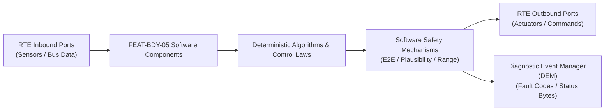

# Software Requirements Specification: Smart Power Closures with Anti-Pinch Protection (SPC)
**Feature ID:** `FEAT-BDY-05`  
**Domain:** Body, Lighting & Restraints  
**Target ASIL:** ASIL B / FMVSS 118  
**Compliance Standard:** ISO 26262:2018 (Part 6 - Software Development) / ASPICE PAM v3.1 (SWE.1, SWE.2)  
**Parent System Specification:** [`FEAT-BDY-05_SPC_SysReq.md`](file:///c:/Workset/AntiGravityProjects/TestOptimisationExperiement/system_requirements/FEAT-BDY-05_SPC_SysReq.md)  
**Global Master Specification:** [`spec.md`](file:///c:/Workset/AntiGravityProjects/TestOptimisationExperiement/spec.md)

---

## 1. Software Architecture & Component Structure

This document specifies the AUTOSAR Software Components (SWCs), periodic runnables, algorithmic laws, safety mechanisms, and data ports implementing `FEAT-BDY-05` (Smart Power Closures with Anti-Pinch Protection (SPC)).

### AUTOSAR SWC Interaction Diagram

---

## 2. Detailed Software Requirements (SWR_REQ)
*(Multi-Software Requirement Partitioning derived from System Requirements)*

### `SWR-BDY-05-01`: Dual-Electrode Capacitive Waveform Dynamic Gesture Classifier
- **Planned Release:** R100
- **ASIL Rating:** QM
- **Parent System Requirement:** [`SYS-BDY-05-01`](file:///c:/Workset/AntiGravityProjects/TestOptimisationExperiement/system_requirements/FEAT-BDY-05_SPC_SysReq.md#sys-bdy-05-01)
- **Allocated AUTOSAR SWC:** `SpcGestureRecognizer_SWC`
- **Execution Rate / Trigger:** 20 ms
- **Worst-Case Execution Time (WCET):** 0.4 ms
- **Software Activation Condition:** Cyclic 20 ms task in vehicle parked state.
- **Algorithmic Description / Logic:**
  > Computes capacitance shift Delta_C_up, Delta_C_low. Verifies kicking signature: Delta_C_low rises first (> 15 pF), followed by Delta_C_up (> 20 pF) within 150 ms, followed by return to baseline in < 300 ms. Rejects static drift (standing near bumper).
- **Software Safety Mechanism:** PEPS cross-check: Kick event is ignored unless PEPS UWB confirms digital key is within 1.2 m of rear bumper.
- **Failure Reaction & DEM Diagnostic Event:** Reset gesture state machine if duration exceeds 800 ms without completion.
- **Software Port Inputs:** `Cap_Sensor_Upper_Pf, Cap_Sensor_Lower_Pf, Digital_Key_Distance_M`
- **Software Port Outputs:** `Valid_Kick_Gesture_Flag (boolean), Gesture_Confidence_Score`
- **Software Verification Criteria:** HIL testing with synthetic capacitance profile playback.
- **Traceability Link:** Traces upward to [`SYS-BDY-05-01`](file:///c:/Workset/AntiGravityProjects/TestOptimisationExperiement/system_requirements/FEAT-BDY-05_SPC_SysReq.md#sys-bdy-05-01) and [`FEAT-BDY-05`](file:///c:/Workset/AntiGravityProjects/TestOptimisationExperiement/spec.md).

### `SWR-BDY-05-02`: Tailgate PEPS UWB Proximity Authorizer & Kick Interlock Guard
- **Planned Release:** R100
- **ASIL Rating:** QM
- **Parent System Requirement:** [`SYS-BDY-05-01`](file:///c:/Workset/AntiGravityProjects/TestOptimisationExperiement/system_requirements/FEAT-BDY-05_SPC_SysReq.md#sys-bdy-05-01)
- **Allocated AUTOSAR SWC:** `SpcUwbAuthorizer_SWC`
- **Execution Rate / Trigger:** 20 ms
- **Worst-Case Execution Time (WCET):** 0.3 ms
- **Software Activation Condition:** Executed when kick gesture detected.
- **Algorithmic Description / Logic:**
  > Interrogates PEPS UWB transceiver channel at vehicle rear. Verifies smartphone or key fob distance <= 1.2 m and authenticated cryptographic session token. Inhibits latch release if key is inside cabin.
- **Software Safety Mechanism:** False-opening lockout: Inhibits gesture recognition while vehicle gear is in DRIVE or REVERSE.
- **Failure Reaction & DEM Diagnostic Event:** Reject kick command if UWB ranging status reports multi-path spoofing risk.
- **Software Port Inputs:** `UWB_Distance_Rear_M, Key_Location_Zone_Enum, Transmission_PRND`
- **Software Port Outputs:** `Tailgate_Unlock_Permit_Flag (boolean), PEPS_Session_Status`
- **Software Verification Criteria:** Proximity boundary testing around vehicle perimeter with calibrated RF positioning.
- **Traceability Link:** Traces upward to [`SYS-BDY-05-01`](file:///c:/Workset/AntiGravityProjects/TestOptimisationExperiement/system_requirements/FEAT-BDY-05_SPC_SysReq.md#sys-bdy-05-01) and [`FEAT-BDY-05`](file:///c:/Workset/AntiGravityProjects/TestOptimisationExperiement/spec.md).

### `SWR-BDY-05-03`: Dual Spindle Hall Pulse S-Curve Motion Profiler & Position Sync
- **Planned Release:** R100
- **ASIL Rating:** ASIL B
- **Parent System Requirement:** [`SYS-BDY-05-02`](file:///c:/Workset/AntiGravityProjects/TestOptimisationExperiement/system_requirements/FEAT-BDY-05_SPC_SysReq.md#sys-bdy-05-02)
- **Allocated AUTOSAR SWC:** `SpcMotionProfiler_SWC`
- **Execution Rate / Trigger:** 10 ms
- **Worst-Case Execution Time (WCET):** 0.5 ms
- **Software Activation Condition:** Executed during spindle movement.
- **Algorithmic Description / Logic:**
  > Generates 5th-order jerk-limited S-curve position profile: s(t) = a5*t^5 + a4*t^4 + a3*t^3. Tracks quadrature hall counts: s_left = counts_L * k_pitch, s_right = counts_R * k_pitch. Regulates spindle skew: Delta_s = s_left - s_right; adjusts PWM duty cycles to maintain |Delta_s| <= 3.0 mm.
- **Software Safety Mechanism:** Spindle desynchronization guard: If |Delta_s| > 8.0 mm for > 100 ms, immediately shut off both motors to prevent tailgate twisting.
- **Failure Reaction & DEM Diagnostic Event:** Stop motors and record fault code B14E1.
- **Software Port Inputs:** `Hall_Pulse_A_L, Hall_Pulse_B_L, Hall_Pulse_A_R, Hall_Pulse_B_R, Target_Angle_Deg`
- **Software Port Outputs:** `PWM_Spindle_Left_Duty, PWM_Spindle_Right_Duty, Tailgate_Position_Deg`
- **Software Verification Criteria:** Spindle test rig measuring mechanical twist angle during synchronized travel.
- **Traceability Link:** Traces upward to [`SYS-BDY-05-02`](file:///c:/Workset/AntiGravityProjects/TestOptimisationExperiement/system_requirements/FEAT-BDY-05_SPC_SysReq.md#sys-bdy-05-02) and [`FEAT-BDY-05`](file:///c:/Workset/AntiGravityProjects/TestOptimisationExperiement/spec.md).

### `SWR-BDY-05-04`: Secondary Striker Electric Cinch Motor Puller & Microswitch Supervisor
- **Planned Release:** R100
- **ASIL Rating:** ASIL B
- **Parent System Requirement:** [`SYS-BDY-05-02`](file:///c:/Workset/AntiGravityProjects/TestOptimisationExperiement/system_requirements/FEAT-BDY-05_SPC_SysReq.md#sys-bdy-05-02)
- **Allocated AUTOSAR SWC:** `SpcCinchController_SWC`
- **Execution Rate / Trigger:** 10 ms
- **Worst-Case Execution Time (WCET):** 0.3 ms
- **Software Activation Condition:** Executed when tailgate reaches 5 degrees from full latch.
- **Algorithmic Description / Logic:**
  > Detects primary latch pawl contact via dual microswitches. Energizes 12V DC cinch gearmotor to pull striker 12 mm into secondary fully-latched position in <= 800 ms. Verifies pawl closed switch.
- **Software Safety Mechanism:** Cinch stall timer: Cuts motor power after 1200 ms maximum continuous run.
- **Failure Reaction & DEM Diagnostic Event:** Reverse cinch motor to release striker if latch switch does not confirm closure.
- **Software Port Inputs:** `Primary_Latch_Switch_State, Secondary_Latch_Switch_State, Cinch_Motor_Current_A`
- **Software Port Outputs:** `Cinch_Motor_Drive_Cmd, Tailgate_Fully_Closed_Flag (boolean)`
- **Software Verification Criteria:** Latch endurance test across 10,000 cycles with cold chamber soak (-40°C).
- **Traceability Link:** Traces upward to [`SYS-BDY-05-02`](file:///c:/Workset/AntiGravityProjects/TestOptimisationExperiement/system_requirements/FEAT-BDY-05_SPC_SysReq.md#sys-bdy-05-02) and [`FEAT-BDY-05`](file:///c:/Workset/AntiGravityProjects/TestOptimisationExperiement/spec.md).

### `SWR-BDY-05-05`: High-Speed Resistive Edge Optical Pinch Comparator
- **Planned Release:** R100
- **ASIL Rating:** ASIL B
- **Parent System Requirement:** [`SYS-BDY-05-03`](file:///c:/Workset/AntiGravityProjects/TestOptimisationExperiement/system_requirements/FEAT-BDY-05_SPC_SysReq.md#sys-bdy-05-03)
- **Allocated AUTOSAR SWC:** `SpcPinchMonitor_SWC`
- **Execution Rate / Trigger:** 2 ms
- **Worst-Case Execution Time (WCET):** 0.15 ms
- **Software Activation Condition:** Executed in 500 Hz high-priority ISR during closing.
- **Algorithmic Description / Logic:**
  > Samples ADC voltage across resistive strip. If resistance drops below 1200 ohms (indicating physical compression of rubber profile), immediately asserts Emergency_Reverse_Flag in <= 4 ms.
- **Software Safety Mechanism:** End-of-line resistor supervision: Senses diagnostic resistor (10 kOhm) to detect wire cut or short to ground.
- **Failure Reaction & DEM Diagnostic Event:** If circuit resistance is open (> 50 kOhm) or shorted (< 100 Ohm), latch Pinch_Sensor_Defect.
- **Software Port Inputs:** `ADC_Pinch_Strip_Voltage, V_Ref_Supply`
- **Software Port Outputs:** `Hardware_Pinch_Detected_Flag (boolean), Strip_Integrity_Status`
- **Software Verification Criteria:** Impact testing with ISO 100 N test cylinder at 10%, 50%, and 90% travel.
- **Traceability Link:** Traces upward to [`SYS-BDY-05-03`](file:///c:/Workset/AntiGravityProjects/TestOptimisationExperiement/system_requirements/FEAT-BDY-05_SPC_SysReq.md#sys-bdy-05-03) and [`FEAT-BDY-05`](file:///c:/Workset/AntiGravityProjects/TestOptimisationExperiement/spec.md).

### `SWR-BDY-05-06`: Motor Current Ripple Frequency Observer & Mechanical Force Estimator
- **Planned Release:** R100
- **ASIL Rating:** ASIL B
- **Parent System Requirement:** [`SYS-BDY-05-03`](file:///c:/Workset/AntiGravityProjects/TestOptimisationExperiement/system_requirements/FEAT-BDY-05_SPC_SysReq.md#sys-bdy-05-03)
- **Allocated AUTOSAR SWC:** `SpcForceObserver_SWC`
- **Execution Rate / Trigger:** 5 ms
- **Worst-Case Execution Time (WCET):** 0.35 ms
- **Software Activation Condition:** Active during power close travel.
- **Algorithmic Description / Logic:**
  > Extracts commutator ripple frequency from motor current to estimate instantaneous motor velocity omega. Computes electromechanical resisting force: F_pinch = (K_torque * I_motor - J * d(omega)/dt - F_gravity(theta) - F_gas_spring(theta)) / R_spindle. If F_pinch > 90 N for >= 15 ms, triggers pinch reversal.
- **Software Safety Mechanism:** Dynamic baseline adaptation: Learns seal stiffness and ambient temperature variations over vehicle lifetime.
- **Failure Reaction & DEM Diagnostic Event:** Trigger reversal if current rate-of-rise dI/dt > 40 A/s.
- **Software Port Inputs:** `Motor_Current_A, Tailgate_Angle_Theta_Deg, Ambient_Temperature_DegC`
- **Software Port Outputs:** `Estimated_Pinch_Force_N, Motor_Ripple_Reverse_Cmd (boolean)`
- **Software Verification Criteria:** Bench testing against FMVSS 118 compliance testing apparatus across -20°C to +50°C.
- **Traceability Link:** Traces upward to [`SYS-BDY-05-03`](file:///c:/Workset/AntiGravityProjects/TestOptimisationExperiement/system_requirements/FEAT-BDY-05_SPC_SysReq.md#sys-bdy-05-03) and [`FEAT-BDY-05`](file:///c:/Workset/AntiGravityProjects/TestOptimisationExperiement/spec.md).

### `SWR-BDY-05-07`: Power Liftgate & Window Dual Hall Sensor Position & Velocity Tracker - Dynamic Observer & Signal Filter
- **Planned Release:** R100
- **ASIL Rating:** ASIL B
- **Parent System Requirement:** [`SYS-BDY-05-04`](file:///c:/Workset/AntiGravityProjects/TestOptimisationExperiement/system_requirements/FEAT-BDY-05_SPC_SysReq.md#sys-bdy-05-04)
- **Allocated AUTOSAR SWC:** `SpcHallTracker_SWC`
- **Execution Rate / Trigger:** 2 ms
- **Worst-Case Execution Time (WCET):** 0.3 ms
- **Software Activation Condition:** Executed cyclically every 2 ms.
- **Algorithmic Description / Logic:**
  > Executes signal plausibility filtering, calibration offsets, and discrete state estimation for Power Liftgate & Window Dual Hall Sensor Position & Velocity Tracker.
- **Software Safety Mechanism:** Range limit plausibility check and E2E alive sequence verification.
- **Failure Reaction & DEM Diagnostic Event:** Set default fallback output and report DEM_EVENT_FEAT_BDY_05_ERR.
- **Software Port Inputs:** `Raw sensor ADC/SENT/SPI values and RTE bus inputs.`
- **Software Port Outputs:** `Filtered physical signals and validity status bitmasks.`
- **Software Verification Criteria:** Unit test and HiL software integration test.
- **Traceability Link:** Traces upward to [`SYS-BDY-05-04`](file:///c:/Workset/AntiGravityProjects/TestOptimisationExperiement/system_requirements/FEAT-BDY-05_SPC_SysReq.md#sys-bdy-05-04) and [`FEAT-BDY-05`](file:///c:/Workset/AntiGravityProjects/TestOptimisationExperiement/spec.md).

### `SWR-BDY-05-08`: Power Liftgate & Window Dual Hall Sensor Position & Velocity Tracker - Closed-Loop Control Law & Actuator Dispatch
- **Planned Release:** R100
- **ASIL Rating:** ASIL B
- **Parent System Requirement:** [`SYS-BDY-05-04`](file:///c:/Workset/AntiGravityProjects/TestOptimisationExperiement/system_requirements/FEAT-BDY-05_SPC_SysReq.md#sys-bdy-05-04)
- **Allocated AUTOSAR SWC:** `SpcHallTracker_SWC`
- **Execution Rate / Trigger:** 2 ms
- **Worst-Case Execution Time (WCET):** 0.4 ms
- **Software Activation Condition:** Executed cyclically every 2 ms.
- **Algorithmic Description / Logic:**
  > Evaluates deterministic closed-loop control law, rate limits, and dispatches commands for Power Liftgate & Window Dual Hall Sensor Position & Velocity Tracker.
- **Software Safety Mechanism:** Command saturation clamping and watchdog program flow monitoring.
- **Failure Reaction & DEM Diagnostic Event:** De-energize actuator output, apply safe fallback clamp, and latch DTC.
- **Software Port Inputs:** `Validated physical state signals from observer SWC.`
- **Software Port Outputs:** `Actuator PWM duty cycles, torque/pressure setpoints, and diagnostic flags.`
- **Software Verification Criteria:** Hardware dynamometer and HiL closed-loop regression test suite.
- **Traceability Link:** Traces upward to [`SYS-BDY-05-04`](file:///c:/Workset/AntiGravityProjects/TestOptimisationExperiement/system_requirements/FEAT-BDY-05_SPC_SysReq.md#sys-bdy-05-04) and [`FEAT-BDY-05`](file:///c:/Workset/AntiGravityProjects/TestOptimisationExperiement/spec.md).

### `SWR-BDY-05-09`: FMVSS 118 Compliance Non-Reversal Anti-Pinch Force Observer - Dynamic Observer & Signal Filter
- **Planned Release:** R200
- **ASIL Rating:** ASIL B
- **Parent System Requirement:** [`SYS-BDY-05-05`](file:///c:/Workset/AntiGravityProjects/TestOptimisationExperiement/system_requirements/FEAT-BDY-05_SPC_SysReq.md#sys-bdy-05-05)
- **Allocated AUTOSAR SWC:** `SpcAntiPinchObserver_SWC`
- **Execution Rate / Trigger:** 1 ms
- **Worst-Case Execution Time (WCET):** 0.3 ms
- **Software Activation Condition:** Executed cyclically every 1 ms.
- **Algorithmic Description / Logic:**
  > Executes signal plausibility filtering, calibration offsets, and discrete state estimation for FMVSS 118 Compliance Non-Reversal Anti-Pinch Force Observer.
- **Software Safety Mechanism:** Range limit plausibility check and E2E alive sequence verification.
- **Failure Reaction & DEM Diagnostic Event:** Set default fallback output and report DEM_EVENT_FEAT_BDY_05_ERR.
- **Software Port Inputs:** `Raw sensor ADC/SENT/SPI values and RTE bus inputs.`
- **Software Port Outputs:** `Filtered physical signals and validity status bitmasks.`
- **Software Verification Criteria:** Unit test and HiL software integration test.
- **Traceability Link:** Traces upward to [`SYS-BDY-05-05`](file:///c:/Workset/AntiGravityProjects/TestOptimisationExperiement/system_requirements/FEAT-BDY-05_SPC_SysReq.md#sys-bdy-05-05) and [`FEAT-BDY-05`](file:///c:/Workset/AntiGravityProjects/TestOptimisationExperiement/spec.md).

### `SWR-BDY-05-10`: FMVSS 118 Compliance Non-Reversal Anti-Pinch Force Observer - Closed-Loop Control Law & Actuator Dispatch
- **Planned Release:** R200
- **ASIL Rating:** ASIL B
- **Parent System Requirement:** [`SYS-BDY-05-05`](file:///c:/Workset/AntiGravityProjects/TestOptimisationExperiement/system_requirements/FEAT-BDY-05_SPC_SysReq.md#sys-bdy-05-05)
- **Allocated AUTOSAR SWC:** `SpcAntiPinchObserver_SWC`
- **Execution Rate / Trigger:** 1 ms
- **Worst-Case Execution Time (WCET):** 0.4 ms
- **Software Activation Condition:** Executed cyclically every 1 ms.
- **Algorithmic Description / Logic:**
  > Evaluates deterministic closed-loop control law, rate limits, and dispatches commands for FMVSS 118 Compliance Non-Reversal Anti-Pinch Force Observer.
- **Software Safety Mechanism:** Command saturation clamping and watchdog program flow monitoring.
- **Failure Reaction & DEM Diagnostic Event:** De-energize actuator output, apply safe fallback clamp, and latch DTC.
- **Software Port Inputs:** `Validated physical state signals from observer SWC.`
- **Software Port Outputs:** `Actuator PWM duty cycles, torque/pressure setpoints, and diagnostic flags.`
- **Software Verification Criteria:** Hardware dynamometer and HiL closed-loop regression test suite.
- **Traceability Link:** Traces upward to [`SYS-BDY-05-05`](file:///c:/Workset/AntiGravityProjects/TestOptimisationExperiement/system_requirements/FEAT-BDY-05_SPC_SysReq.md#sys-bdy-05-05) and [`FEAT-BDY-05`](file:///c:/Workset/AntiGravityProjects/TestOptimisationExperiement/spec.md).

### `SWR-BDY-05-11`: Optical Infrared & Capacitive Seal Contactless Obstacle Detector - Dynamic Observer & Signal Filter
- **Planned Release:** R200
- **ASIL Rating:** ASIL B
- **Parent System Requirement:** [`SYS-BDY-05-06`](file:///c:/Workset/AntiGravityProjects/TestOptimisationExperiement/system_requirements/FEAT-BDY-05_SPC_SysReq.md#sys-bdy-05-06)
- **Allocated AUTOSAR SWC:** `SpcContactlessSensor_SWC`
- **Execution Rate / Trigger:** 5 ms
- **Worst-Case Execution Time (WCET):** 0.3 ms
- **Software Activation Condition:** Executed cyclically every 5 ms.
- **Algorithmic Description / Logic:**
  > Executes signal plausibility filtering, calibration offsets, and discrete state estimation for Optical Infrared & Capacitive Seal Contactless Obstacle Detector.
- **Software Safety Mechanism:** Range limit plausibility check and E2E alive sequence verification.
- **Failure Reaction & DEM Diagnostic Event:** Set default fallback output and report DEM_EVENT_FEAT_BDY_05_ERR.
- **Software Port Inputs:** `Raw sensor ADC/SENT/SPI values and RTE bus inputs.`
- **Software Port Outputs:** `Filtered physical signals and validity status bitmasks.`
- **Software Verification Criteria:** Unit test and HiL software integration test.
- **Traceability Link:** Traces upward to [`SYS-BDY-05-06`](file:///c:/Workset/AntiGravityProjects/TestOptimisationExperiement/system_requirements/FEAT-BDY-05_SPC_SysReq.md#sys-bdy-05-06) and [`FEAT-BDY-05`](file:///c:/Workset/AntiGravityProjects/TestOptimisationExperiement/spec.md).

### `SWR-BDY-05-12`: Optical Infrared & Capacitive Seal Contactless Obstacle Detector - Closed-Loop Control Law & Actuator Dispatch
- **Planned Release:** R200
- **ASIL Rating:** ASIL B
- **Parent System Requirement:** [`SYS-BDY-05-06`](file:///c:/Workset/AntiGravityProjects/TestOptimisationExperiement/system_requirements/FEAT-BDY-05_SPC_SysReq.md#sys-bdy-05-06)
- **Allocated AUTOSAR SWC:** `SpcContactlessSensor_SWC`
- **Execution Rate / Trigger:** 5 ms
- **Worst-Case Execution Time (WCET):** 0.4 ms
- **Software Activation Condition:** Executed cyclically every 5 ms.
- **Algorithmic Description / Logic:**
  > Evaluates deterministic closed-loop control law, rate limits, and dispatches commands for Optical Infrared & Capacitive Seal Contactless Obstacle Detector.
- **Software Safety Mechanism:** Command saturation clamping and watchdog program flow monitoring.
- **Failure Reaction & DEM Diagnostic Event:** De-energize actuator output, apply safe fallback clamp, and latch DTC.
- **Software Port Inputs:** `Validated physical state signals from observer SWC.`
- **Software Port Outputs:** `Actuator PWM duty cycles, torque/pressure setpoints, and diagnostic flags.`
- **Software Verification Criteria:** Hardware dynamometer and HiL closed-loop regression test suite.
- **Traceability Link:** Traces upward to [`SYS-BDY-05-06`](file:///c:/Workset/AntiGravityProjects/TestOptimisationExperiement/system_requirements/FEAT-BDY-05_SPC_SysReq.md#sys-bdy-05-06) and [`FEAT-BDY-05`](file:///c:/Workset/AntiGravityProjects/TestOptimisationExperiement/spec.md).

### `SWR-BDY-05-13`: Power Liftgate Spindle Drive DC Motor H-Bridge PWM Driver - Dynamic Observer & Signal Filter
- **Planned Release:** R300
- **ASIL Rating:** ASIL B
- **Parent System Requirement:** [`SYS-BDY-05-07`](file:///c:/Workset/AntiGravityProjects/TestOptimisationExperiement/system_requirements/FEAT-BDY-05_SPC_SysReq.md#sys-bdy-05-07)
- **Allocated AUTOSAR SWC:** `SpcSpindleDriver_SWC`
- **Execution Rate / Trigger:** 2 ms
- **Worst-Case Execution Time (WCET):** 0.3 ms
- **Software Activation Condition:** Executed cyclically every 2 ms.
- **Algorithmic Description / Logic:**
  > Executes signal plausibility filtering, calibration offsets, and discrete state estimation for Power Liftgate Spindle Drive DC Motor H-Bridge PWM Driver.
- **Software Safety Mechanism:** Range limit plausibility check and E2E alive sequence verification.
- **Failure Reaction & DEM Diagnostic Event:** Set default fallback output and report DEM_EVENT_FEAT_BDY_05_ERR.
- **Software Port Inputs:** `Raw sensor ADC/SENT/SPI values and RTE bus inputs.`
- **Software Port Outputs:** `Filtered physical signals and validity status bitmasks.`
- **Software Verification Criteria:** Unit test and HiL software integration test.
- **Traceability Link:** Traces upward to [`SYS-BDY-05-07`](file:///c:/Workset/AntiGravityProjects/TestOptimisationExperiement/system_requirements/FEAT-BDY-05_SPC_SysReq.md#sys-bdy-05-07) and [`FEAT-BDY-05`](file:///c:/Workset/AntiGravityProjects/TestOptimisationExperiement/spec.md).

### `SWR-BDY-05-14`: Power Liftgate Spindle Drive DC Motor H-Bridge PWM Driver - Closed-Loop Control Law & Actuator Dispatch
- **Planned Release:** R300
- **ASIL Rating:** ASIL B
- **Parent System Requirement:** [`SYS-BDY-05-07`](file:///c:/Workset/AntiGravityProjects/TestOptimisationExperiement/system_requirements/FEAT-BDY-05_SPC_SysReq.md#sys-bdy-05-07)
- **Allocated AUTOSAR SWC:** `SpcSpindleDriver_SWC`
- **Execution Rate / Trigger:** 2 ms
- **Worst-Case Execution Time (WCET):** 0.4 ms
- **Software Activation Condition:** Executed cyclically every 2 ms.
- **Algorithmic Description / Logic:**
  > Evaluates deterministic closed-loop control law, rate limits, and dispatches commands for Power Liftgate Spindle Drive DC Motor H-Bridge PWM Driver.
- **Software Safety Mechanism:** Command saturation clamping and watchdog program flow monitoring.
- **Failure Reaction & DEM Diagnostic Event:** De-energize actuator output, apply safe fallback clamp, and latch DTC.
- **Software Port Inputs:** `Validated physical state signals from observer SWC.`
- **Software Port Outputs:** `Actuator PWM duty cycles, torque/pressure setpoints, and diagnostic flags.`
- **Software Verification Criteria:** Hardware dynamometer and HiL closed-loop regression test suite.
- **Traceability Link:** Traces upward to [`SYS-BDY-05-07`](file:///c:/Workset/AntiGravityProjects/TestOptimisationExperiement/system_requirements/FEAT-BDY-05_SPC_SysReq.md#sys-bdy-05-07) and [`FEAT-BDY-05`](file:///c:/Workset/AntiGravityProjects/TestOptimisationExperiement/spec.md).

### `SWR-BDY-05-15`: Automatic Power Cincher Latch Motor Pull-In Sequence Governor - Dynamic Observer & Signal Filter
- **Planned Release:** R300
- **ASIL Rating:** ASIL B
- **Parent System Requirement:** [`SYS-BDY-05-08`](file:///c:/Workset/AntiGravityProjects/TestOptimisationExperiement/system_requirements/FEAT-BDY-05_SPC_SysReq.md#sys-bdy-05-08)
- **Allocated AUTOSAR SWC:** `SpcCincherGovernor_SWC`
- **Execution Rate / Trigger:** 10 ms
- **Worst-Case Execution Time (WCET):** 0.3 ms
- **Software Activation Condition:** Executed cyclically every 10 ms.
- **Algorithmic Description / Logic:**
  > Executes signal plausibility filtering, calibration offsets, and discrete state estimation for Automatic Power Cincher Latch Motor Pull-In Sequence Governor.
- **Software Safety Mechanism:** Range limit plausibility check and E2E alive sequence verification.
- **Failure Reaction & DEM Diagnostic Event:** Set default fallback output and report DEM_EVENT_FEAT_BDY_05_ERR.
- **Software Port Inputs:** `Raw sensor ADC/SENT/SPI values and RTE bus inputs.`
- **Software Port Outputs:** `Filtered physical signals and validity status bitmasks.`
- **Software Verification Criteria:** Unit test and HiL software integration test.
- **Traceability Link:** Traces upward to [`SYS-BDY-05-08`](file:///c:/Workset/AntiGravityProjects/TestOptimisationExperiement/system_requirements/FEAT-BDY-05_SPC_SysReq.md#sys-bdy-05-08) and [`FEAT-BDY-05`](file:///c:/Workset/AntiGravityProjects/TestOptimisationExperiement/spec.md).

### `SWR-BDY-05-16`: Automatic Power Cincher Latch Motor Pull-In Sequence Governor - Closed-Loop Control Law & Actuator Dispatch
- **Planned Release:** R300
- **ASIL Rating:** ASIL B
- **Parent System Requirement:** [`SYS-BDY-05-08`](file:///c:/Workset/AntiGravityProjects/TestOptimisationExperiement/system_requirements/FEAT-BDY-05_SPC_SysReq.md#sys-bdy-05-08)
- **Allocated AUTOSAR SWC:** `SpcCincherGovernor_SWC`
- **Execution Rate / Trigger:** 10 ms
- **Worst-Case Execution Time (WCET):** 0.4 ms
- **Software Activation Condition:** Executed cyclically every 10 ms.
- **Algorithmic Description / Logic:**
  > Evaluates deterministic closed-loop control law, rate limits, and dispatches commands for Automatic Power Cincher Latch Motor Pull-In Sequence Governor.
- **Software Safety Mechanism:** Command saturation clamping and watchdog program flow monitoring.
- **Failure Reaction & DEM Diagnostic Event:** De-energize actuator output, apply safe fallback clamp, and latch DTC.
- **Software Port Inputs:** `Validated physical state signals from observer SWC.`
- **Software Port Outputs:** `Actuator PWM duty cycles, torque/pressure setpoints, and diagnostic flags.`
- **Software Verification Criteria:** Hardware dynamometer and HiL closed-loop regression test suite.
- **Traceability Link:** Traces upward to [`SYS-BDY-05-08`](file:///c:/Workset/AntiGravityProjects/TestOptimisationExperiement/system_requirements/FEAT-BDY-05_SPC_SysReq.md#sys-bdy-05-08) and [`FEAT-BDY-05`](file:///c:/Workset/AntiGravityProjects/TestOptimisationExperiement/spec.md).

### `SWR-BDY-05-17`: Vehicle Motion Interlock Speed Gatekeeper (Door/Trunk Lockout) - Dynamic Observer & Signal Filter
- **Planned Release:** R300
- **ASIL Rating:** ASIL B
- **Parent System Requirement:** [`SYS-BDY-05-09`](file:///c:/Workset/AntiGravityProjects/TestOptimisationExperiement/system_requirements/FEAT-BDY-05_SPC_SysReq.md#sys-bdy-05-09)
- **Allocated AUTOSAR SWC:** `SpcSpeedGatekeeper_SWC`
- **Execution Rate / Trigger:** 10 ms
- **Worst-Case Execution Time (WCET):** 0.3 ms
- **Software Activation Condition:** Executed cyclically every 10 ms.
- **Algorithmic Description / Logic:**
  > Executes signal plausibility filtering, calibration offsets, and discrete state estimation for Vehicle Motion Interlock Speed Gatekeeper (Door/Trunk Lockout).
- **Software Safety Mechanism:** Range limit plausibility check and E2E alive sequence verification.
- **Failure Reaction & DEM Diagnostic Event:** Set default fallback output and report DEM_EVENT_FEAT_BDY_05_ERR.
- **Software Port Inputs:** `Raw sensor ADC/SENT/SPI values and RTE bus inputs.`
- **Software Port Outputs:** `Filtered physical signals and validity status bitmasks.`
- **Software Verification Criteria:** Unit test and HiL software integration test.
- **Traceability Link:** Traces upward to [`SYS-BDY-05-09`](file:///c:/Workset/AntiGravityProjects/TestOptimisationExperiement/system_requirements/FEAT-BDY-05_SPC_SysReq.md#sys-bdy-05-09) and [`FEAT-BDY-05`](file:///c:/Workset/AntiGravityProjects/TestOptimisationExperiement/spec.md).

### `SWR-BDY-05-18`: Vehicle Motion Interlock Speed Gatekeeper (Door/Trunk Lockout) - Closed-Loop Control Law & Actuator Dispatch
- **Planned Release:** R300
- **ASIL Rating:** ASIL B
- **Parent System Requirement:** [`SYS-BDY-05-09`](file:///c:/Workset/AntiGravityProjects/TestOptimisationExperiement/system_requirements/FEAT-BDY-05_SPC_SysReq.md#sys-bdy-05-09)
- **Allocated AUTOSAR SWC:** `SpcSpeedGatekeeper_SWC`
- **Execution Rate / Trigger:** 10 ms
- **Worst-Case Execution Time (WCET):** 0.4 ms
- **Software Activation Condition:** Executed cyclically every 10 ms.
- **Algorithmic Description / Logic:**
  > Evaluates deterministic closed-loop control law, rate limits, and dispatches commands for Vehicle Motion Interlock Speed Gatekeeper (Door/Trunk Lockout).
- **Software Safety Mechanism:** Command saturation clamping and watchdog program flow monitoring.
- **Failure Reaction & DEM Diagnostic Event:** De-energize actuator output, apply safe fallback clamp, and latch DTC.
- **Software Port Inputs:** `Validated physical state signals from observer SWC.`
- **Software Port Outputs:** `Actuator PWM duty cycles, torque/pressure setpoints, and diagnostic flags.`
- **Software Verification Criteria:** Hardware dynamometer and HiL closed-loop regression test suite.
- **Traceability Link:** Traces upward to [`SYS-BDY-05-09`](file:///c:/Workset/AntiGravityProjects/TestOptimisationExperiement/system_requirements/FEAT-BDY-05_SPC_SysReq.md#sys-bdy-05-09) and [`FEAT-BDY-05`](file:///c:/Workset/AntiGravityProjects/TestOptimisationExperiement/spec.md).

### `SWR-BDY-05-19`: Tailgate Hands-Free Foot Kick Ultrasonic Sensor Gesture Recognizer - Dynamic Observer & Signal Filter
- **Planned Release:** R400
- **ASIL Rating:** ASIL B
- **Parent System Requirement:** [`SYS-BDY-05-10`](file:///c:/Workset/AntiGravityProjects/TestOptimisationExperiement/system_requirements/FEAT-BDY-05_SPC_SysReq.md#sys-bdy-05-10)
- **Allocated AUTOSAR SWC:** `SpcKickRecognizer_SWC`
- **Execution Rate / Trigger:** 20 ms
- **Worst-Case Execution Time (WCET):** 0.3 ms
- **Software Activation Condition:** Executed cyclically every 20 ms.
- **Algorithmic Description / Logic:**
  > Executes signal plausibility filtering, calibration offsets, and discrete state estimation for Tailgate Hands-Free Foot Kick Ultrasonic Sensor Gesture Recognizer.
- **Software Safety Mechanism:** Range limit plausibility check and E2E alive sequence verification.
- **Failure Reaction & DEM Diagnostic Event:** Set default fallback output and report DEM_EVENT_FEAT_BDY_05_ERR.
- **Software Port Inputs:** `Raw sensor ADC/SENT/SPI values and RTE bus inputs.`
- **Software Port Outputs:** `Filtered physical signals and validity status bitmasks.`
- **Software Verification Criteria:** Unit test and HiL software integration test.
- **Traceability Link:** Traces upward to [`SYS-BDY-05-10`](file:///c:/Workset/AntiGravityProjects/TestOptimisationExperiement/system_requirements/FEAT-BDY-05_SPC_SysReq.md#sys-bdy-05-10) and [`FEAT-BDY-05`](file:///c:/Workset/AntiGravityProjects/TestOptimisationExperiement/spec.md).

### `SWR-BDY-05-20`: Tailgate Hands-Free Foot Kick Ultrasonic Sensor Gesture Recognizer - Closed-Loop Control Law & Actuator Dispatch
- **Planned Release:** R400
- **ASIL Rating:** ASIL B
- **Parent System Requirement:** [`SYS-BDY-05-10`](file:///c:/Workset/AntiGravityProjects/TestOptimisationExperiement/system_requirements/FEAT-BDY-05_SPC_SysReq.md#sys-bdy-05-10)
- **Allocated AUTOSAR SWC:** `SpcKickRecognizer_SWC`
- **Execution Rate / Trigger:** 20 ms
- **Worst-Case Execution Time (WCET):** 0.4 ms
- **Software Activation Condition:** Executed cyclically every 20 ms.
- **Algorithmic Description / Logic:**
  > Evaluates deterministic closed-loop control law, rate limits, and dispatches commands for Tailgate Hands-Free Foot Kick Ultrasonic Sensor Gesture Recognizer.
- **Software Safety Mechanism:** Command saturation clamping and watchdog program flow monitoring.
- **Failure Reaction & DEM Diagnostic Event:** De-energize actuator output, apply safe fallback clamp, and latch DTC.
- **Software Port Inputs:** `Validated physical state signals from observer SWC.`
- **Software Port Outputs:** `Actuator PWM duty cycles, torque/pressure setpoints, and diagnostic flags.`
- **Software Verification Criteria:** Hardware dynamometer and HiL closed-loop regression test suite.
- **Traceability Link:** Traces upward to [`SYS-BDY-05-10`](file:///c:/Workset/AntiGravityProjects/TestOptimisationExperiement/system_requirements/FEAT-BDY-05_SPC_SysReq.md#sys-bdy-05-10) and [`FEAT-BDY-05`](file:///c:/Workset/AntiGravityProjects/TestOptimisationExperiement/spec.md).

### `SWR-BDY-05-21`: Door Mechanical Resistance Wind Gust & Inclined Parking Gravity Compensator - Dynamic Observer & Signal Filter
- **Planned Release:** R400
- **ASIL Rating:** ASIL B
- **Parent System Requirement:** [`SYS-BDY-05-11`](file:///c:/Workset/AntiGravityProjects/TestOptimisationExperiement/system_requirements/FEAT-BDY-05_SPC_SysReq.md#sys-bdy-05-11)
- **Allocated AUTOSAR SWC:** `SpcGravityCompensator_SWC`
- **Execution Rate / Trigger:** 10 ms
- **Worst-Case Execution Time (WCET):** 0.3 ms
- **Software Activation Condition:** Executed cyclically every 10 ms.
- **Algorithmic Description / Logic:**
  > Executes signal plausibility filtering, calibration offsets, and discrete state estimation for Door Mechanical Resistance Wind Gust & Inclined Parking Gravity Compensator.
- **Software Safety Mechanism:** Range limit plausibility check and E2E alive sequence verification.
- **Failure Reaction & DEM Diagnostic Event:** Set default fallback output and report DEM_EVENT_FEAT_BDY_05_ERR.
- **Software Port Inputs:** `Raw sensor ADC/SENT/SPI values and RTE bus inputs.`
- **Software Port Outputs:** `Filtered physical signals and validity status bitmasks.`
- **Software Verification Criteria:** Unit test and HiL software integration test.
- **Traceability Link:** Traces upward to [`SYS-BDY-05-11`](file:///c:/Workset/AntiGravityProjects/TestOptimisationExperiement/system_requirements/FEAT-BDY-05_SPC_SysReq.md#sys-bdy-05-11) and [`FEAT-BDY-05`](file:///c:/Workset/AntiGravityProjects/TestOptimisationExperiement/spec.md).

### `SWR-BDY-05-22`: Door Mechanical Resistance Wind Gust & Inclined Parking Gravity Compensator - Closed-Loop Control Law & Actuator Dispatch
- **Planned Release:** R400
- **ASIL Rating:** ASIL B
- **Parent System Requirement:** [`SYS-BDY-05-11`](file:///c:/Workset/AntiGravityProjects/TestOptimisationExperiement/system_requirements/FEAT-BDY-05_SPC_SysReq.md#sys-bdy-05-11)
- **Allocated AUTOSAR SWC:** `SpcGravityCompensator_SWC`
- **Execution Rate / Trigger:** 10 ms
- **Worst-Case Execution Time (WCET):** 0.4 ms
- **Software Activation Condition:** Executed cyclically every 10 ms.
- **Algorithmic Description / Logic:**
  > Evaluates deterministic closed-loop control law, rate limits, and dispatches commands for Door Mechanical Resistance Wind Gust & Inclined Parking Gravity Compensator.
- **Software Safety Mechanism:** Command saturation clamping and watchdog program flow monitoring.
- **Failure Reaction & DEM Diagnostic Event:** De-energize actuator output, apply safe fallback clamp, and latch DTC.
- **Software Port Inputs:** `Validated physical state signals from observer SWC.`
- **Software Port Outputs:** `Actuator PWM duty cycles, torque/pressure setpoints, and diagnostic flags.`
- **Software Verification Criteria:** Hardware dynamometer and HiL closed-loop regression test suite.
- **Traceability Link:** Traces upward to [`SYS-BDY-05-11`](file:///c:/Workset/AntiGravityProjects/TestOptimisationExperiement/system_requirements/FEAT-BDY-05_SPC_SysReq.md#sys-bdy-05-11) and [`FEAT-BDY-05`](file:///c:/Workset/AntiGravityProjects/TestOptimisationExperiement/spec.md).

### `SWR-BDY-05-23`: Power Closure DC Motor Thermal Overload Duty Cycle Guard - Dynamic Observer & Signal Filter
- **Planned Release:** R400
- **ASIL Rating:** ASIL B
- **Parent System Requirement:** [`SYS-BDY-05-12`](file:///c:/Workset/AntiGravityProjects/TestOptimisationExperiement/system_requirements/FEAT-BDY-05_SPC_SysReq.md#sys-bdy-05-12)
- **Allocated AUTOSAR SWC:** `SpcThermalGuard_SWC`
- **Execution Rate / Trigger:** 50 ms
- **Worst-Case Execution Time (WCET):** 0.3 ms
- **Software Activation Condition:** Executed cyclically every 50 ms.
- **Algorithmic Description / Logic:**
  > Executes signal plausibility filtering, calibration offsets, and discrete state estimation for Power Closure DC Motor Thermal Overload Duty Cycle Guard.
- **Software Safety Mechanism:** Range limit plausibility check and E2E alive sequence verification.
- **Failure Reaction & DEM Diagnostic Event:** Set default fallback output and report DEM_EVENT_FEAT_BDY_05_ERR.
- **Software Port Inputs:** `Raw sensor ADC/SENT/SPI values and RTE bus inputs.`
- **Software Port Outputs:** `Filtered physical signals and validity status bitmasks.`
- **Software Verification Criteria:** Unit test and HiL software integration test.
- **Traceability Link:** Traces upward to [`SYS-BDY-05-12`](file:///c:/Workset/AntiGravityProjects/TestOptimisationExperiement/system_requirements/FEAT-BDY-05_SPC_SysReq.md#sys-bdy-05-12) and [`FEAT-BDY-05`](file:///c:/Workset/AntiGravityProjects/TestOptimisationExperiement/spec.md).

### `SWR-BDY-05-24`: Power Closure DC Motor Thermal Overload Duty Cycle Guard - Closed-Loop Control Law & Actuator Dispatch
- **Planned Release:** R400
- **ASIL Rating:** ASIL B
- **Parent System Requirement:** [`SYS-BDY-05-12`](file:///c:/Workset/AntiGravityProjects/TestOptimisationExperiement/system_requirements/FEAT-BDY-05_SPC_SysReq.md#sys-bdy-05-12)
- **Allocated AUTOSAR SWC:** `SpcThermalGuard_SWC`
- **Execution Rate / Trigger:** 50 ms
- **Worst-Case Execution Time (WCET):** 0.4 ms
- **Software Activation Condition:** Executed cyclically every 50 ms.
- **Algorithmic Description / Logic:**
  > Evaluates deterministic closed-loop control law, rate limits, and dispatches commands for Power Closure DC Motor Thermal Overload Duty Cycle Guard.
- **Software Safety Mechanism:** Command saturation clamping and watchdog program flow monitoring.
- **Failure Reaction & DEM Diagnostic Event:** De-energize actuator output, apply safe fallback clamp, and latch DTC.
- **Software Port Inputs:** `Validated physical state signals from observer SWC.`
- **Software Port Outputs:** `Actuator PWM duty cycles, torque/pressure setpoints, and diagnostic flags.`
- **Software Verification Criteria:** Hardware dynamometer and HiL closed-loop regression test suite.
- **Traceability Link:** Traces upward to [`SYS-BDY-05-12`](file:///c:/Workset/AntiGravityProjects/TestOptimisationExperiement/system_requirements/FEAT-BDY-05_SPC_SysReq.md#sys-bdy-05-12) and [`FEAT-BDY-05`](file:///c:/Workset/AntiGravityProjects/TestOptimisationExperiement/spec.md).

### `SWR-BDY-05-25`: Power Window Emergency Express-Up Window Closure Safe Stop Logic - Dynamic Observer & Signal Filter
- **Planned Release:** R500
- **ASIL Rating:** ASIL B
- **Parent System Requirement:** [`SYS-BDY-05-13`](file:///c:/Workset/AntiGravityProjects/TestOptimisationExperiement/system_requirements/FEAT-BDY-05_SPC_SysReq.md#sys-bdy-05-13)
- **Allocated AUTOSAR SWC:** `SpcExpressUpController_SWC`
- **Execution Rate / Trigger:** 5 ms
- **Worst-Case Execution Time (WCET):** 0.3 ms
- **Software Activation Condition:** Executed cyclically every 5 ms.
- **Algorithmic Description / Logic:**
  > Executes signal plausibility filtering, calibration offsets, and discrete state estimation for Power Window Emergency Express-Up Window Closure Safe Stop Logic.
- **Software Safety Mechanism:** Range limit plausibility check and E2E alive sequence verification.
- **Failure Reaction & DEM Diagnostic Event:** Set default fallback output and report DEM_EVENT_FEAT_BDY_05_ERR.
- **Software Port Inputs:** `Raw sensor ADC/SENT/SPI values and RTE bus inputs.`
- **Software Port Outputs:** `Filtered physical signals and validity status bitmasks.`
- **Software Verification Criteria:** Unit test and HiL software integration test.
- **Traceability Link:** Traces upward to [`SYS-BDY-05-13`](file:///c:/Workset/AntiGravityProjects/TestOptimisationExperiement/system_requirements/FEAT-BDY-05_SPC_SysReq.md#sys-bdy-05-13) and [`FEAT-BDY-05`](file:///c:/Workset/AntiGravityProjects/TestOptimisationExperiement/spec.md).

### `SWR-BDY-05-26`: Power Window Emergency Express-Up Window Closure Safe Stop Logic - Closed-Loop Control Law & Actuator Dispatch
- **Planned Release:** R500
- **ASIL Rating:** ASIL B
- **Parent System Requirement:** [`SYS-BDY-05-13`](file:///c:/Workset/AntiGravityProjects/TestOptimisationExperiement/system_requirements/FEAT-BDY-05_SPC_SysReq.md#sys-bdy-05-13)
- **Allocated AUTOSAR SWC:** `SpcExpressUpController_SWC`
- **Execution Rate / Trigger:** 5 ms
- **Worst-Case Execution Time (WCET):** 0.4 ms
- **Software Activation Condition:** Executed cyclically every 5 ms.
- **Algorithmic Description / Logic:**
  > Evaluates deterministic closed-loop control law, rate limits, and dispatches commands for Power Window Emergency Express-Up Window Closure Safe Stop Logic.
- **Software Safety Mechanism:** Command saturation clamping and watchdog program flow monitoring.
- **Failure Reaction & DEM Diagnostic Event:** De-energize actuator output, apply safe fallback clamp, and latch DTC.
- **Software Port Inputs:** `Validated physical state signals from observer SWC.`
- **Software Port Outputs:** `Actuator PWM duty cycles, torque/pressure setpoints, and diagnostic flags.`
- **Software Verification Criteria:** Hardware dynamometer and HiL closed-loop regression test suite.
- **Traceability Link:** Traces upward to [`SYS-BDY-05-13`](file:///c:/Workset/AntiGravityProjects/TestOptimisationExperiement/system_requirements/FEAT-BDY-05_SPC_SysReq.md#sys-bdy-05-13) and [`FEAT-BDY-05`](file:///c:/Workset/AntiGravityProjects/TestOptimisationExperiement/spec.md).

### `SWR-BDY-05-27`: DEM Power Closures Hall Sensor Fault Diagnostics & DTC Latcher - Dynamic Observer & Signal Filter
- **Planned Release:** R500
- **ASIL Rating:** ASIL B
- **Parent System Requirement:** [`SYS-BDY-05-14`](file:///c:/Workset/AntiGravityProjects/TestOptimisationExperiement/system_requirements/FEAT-BDY-05_SPC_SysReq.md#sys-bdy-05-14)
- **Allocated AUTOSAR SWC:** `SpcDiagnosticManager_SWC`
- **Execution Rate / Trigger:** 20 ms
- **Worst-Case Execution Time (WCET):** 0.3 ms
- **Software Activation Condition:** Executed cyclically every 20 ms.
- **Algorithmic Description / Logic:**
  > Executes signal plausibility filtering, calibration offsets, and discrete state estimation for DEM Power Closures Hall Sensor Fault Diagnostics & DTC Latcher.
- **Software Safety Mechanism:** Range limit plausibility check and E2E alive sequence verification.
- **Failure Reaction & DEM Diagnostic Event:** Set default fallback output and report DEM_EVENT_FEAT_BDY_05_ERR.
- **Software Port Inputs:** `Raw sensor ADC/SENT/SPI values and RTE bus inputs.`
- **Software Port Outputs:** `Filtered physical signals and validity status bitmasks.`
- **Software Verification Criteria:** Unit test and HiL software integration test.
- **Traceability Link:** Traces upward to [`SYS-BDY-05-14`](file:///c:/Workset/AntiGravityProjects/TestOptimisationExperiement/system_requirements/FEAT-BDY-05_SPC_SysReq.md#sys-bdy-05-14) and [`FEAT-BDY-05`](file:///c:/Workset/AntiGravityProjects/TestOptimisationExperiement/spec.md).

### `SWR-BDY-05-28`: DEM Power Closures Hall Sensor Fault Diagnostics & DTC Latcher - Closed-Loop Control Law & Actuator Dispatch
- **Planned Release:** R500
- **ASIL Rating:** ASIL B
- **Parent System Requirement:** [`SYS-BDY-05-14`](file:///c:/Workset/AntiGravityProjects/TestOptimisationExperiement/system_requirements/FEAT-BDY-05_SPC_SysReq.md#sys-bdy-05-14)
- **Allocated AUTOSAR SWC:** `SpcDiagnosticManager_SWC`
- **Execution Rate / Trigger:** 20 ms
- **Worst-Case Execution Time (WCET):** 0.4 ms
- **Software Activation Condition:** Executed cyclically every 20 ms.
- **Algorithmic Description / Logic:**
  > Evaluates deterministic closed-loop control law, rate limits, and dispatches commands for DEM Power Closures Hall Sensor Fault Diagnostics & DTC Latcher.
- **Software Safety Mechanism:** Command saturation clamping and watchdog program flow monitoring.
- **Failure Reaction & DEM Diagnostic Event:** De-energize actuator output, apply safe fallback clamp, and latch DTC.
- **Software Port Inputs:** `Validated physical state signals from observer SWC.`
- **Software Port Outputs:** `Actuator PWM duty cycles, torque/pressure setpoints, and diagnostic flags.`
- **Software Verification Criteria:** Hardware dynamometer and HiL closed-loop regression test suite.
- **Traceability Link:** Traces upward to [`SYS-BDY-05-14`](file:///c:/Workset/AntiGravityProjects/TestOptimisationExperiement/system_requirements/FEAT-BDY-05_SPC_SysReq.md#sys-bdy-05-14) and [`FEAT-BDY-05`](file:///c:/Workset/AntiGravityProjects/TestOptimisationExperiement/spec.md).

### `SWR-BDY-05-29`: Acoustic Warning Chime & Exterior Lamp Flasher Annunciation Driver - Dynamic Observer & Signal Filter
- **Planned Release:** R500
- **ASIL Rating:** ASIL A
- **Parent System Requirement:** [`SYS-BDY-05-15`](file:///c:/Workset/AntiGravityProjects/TestOptimisationExperiement/system_requirements/FEAT-BDY-05_SPC_SysReq.md#sys-bdy-05-15)
- **Allocated AUTOSAR SWC:** `SpcWarningChime_SWC`
- **Execution Rate / Trigger:** 20 ms
- **Worst-Case Execution Time (WCET):** 0.3 ms
- **Software Activation Condition:** Executed cyclically every 20 ms.
- **Algorithmic Description / Logic:**
  > Executes signal plausibility filtering, calibration offsets, and discrete state estimation for Acoustic Warning Chime & Exterior Lamp Flasher Annunciation Driver.
- **Software Safety Mechanism:** Range limit plausibility check and E2E alive sequence verification.
- **Failure Reaction & DEM Diagnostic Event:** Set default fallback output and report DEM_EVENT_FEAT_BDY_05_ERR.
- **Software Port Inputs:** `Raw sensor ADC/SENT/SPI values and RTE bus inputs.`
- **Software Port Outputs:** `Filtered physical signals and validity status bitmasks.`
- **Software Verification Criteria:** Unit test and HiL software integration test.
- **Traceability Link:** Traces upward to [`SYS-BDY-05-15`](file:///c:/Workset/AntiGravityProjects/TestOptimisationExperiement/system_requirements/FEAT-BDY-05_SPC_SysReq.md#sys-bdy-05-15) and [`FEAT-BDY-05`](file:///c:/Workset/AntiGravityProjects/TestOptimisationExperiement/spec.md).

### `SWR-BDY-05-30`: Acoustic Warning Chime & Exterior Lamp Flasher Annunciation Driver - Closed-Loop Control Law & Actuator Dispatch
- **Planned Release:** R500
- **ASIL Rating:** ASIL A
- **Parent System Requirement:** [`SYS-BDY-05-15`](file:///c:/Workset/AntiGravityProjects/TestOptimisationExperiement/system_requirements/FEAT-BDY-05_SPC_SysReq.md#sys-bdy-05-15)
- **Allocated AUTOSAR SWC:** `SpcWarningChime_SWC`
- **Execution Rate / Trigger:** 20 ms
- **Worst-Case Execution Time (WCET):** 0.4 ms
- **Software Activation Condition:** Executed cyclically every 20 ms.
- **Algorithmic Description / Logic:**
  > Evaluates deterministic closed-loop control law, rate limits, and dispatches commands for Acoustic Warning Chime & Exterior Lamp Flasher Annunciation Driver.
- **Software Safety Mechanism:** Command saturation clamping and watchdog program flow monitoring.
- **Failure Reaction & DEM Diagnostic Event:** De-energize actuator output, apply safe fallback clamp, and latch DTC.
- **Software Port Inputs:** `Validated physical state signals from observer SWC.`
- **Software Port Outputs:** `Actuator PWM duty cycles, torque/pressure setpoints, and diagnostic flags.`
- **Software Verification Criteria:** Hardware dynamometer and HiL closed-loop regression test suite.
- **Traceability Link:** Traces upward to [`SYS-BDY-05-15`](file:///c:/Workset/AntiGravityProjects/TestOptimisationExperiement/system_requirements/FEAT-BDY-05_SPC_SysReq.md#sys-bdy-05-15) and [`FEAT-BDY-05`](file:///c:/Workset/AntiGravityProjects/TestOptimisationExperiement/spec.md).

---

## 3. Software-to-System Backward Traceability Matrix

| Software Requirement ID | Planned Release | Allocated SWC | Execution Rate | Upstream System Req | Verification Method |
| :--- | :---: | :--- | :--- | :--- | :--- |
| `SWR-BDY-05-01` | **`R100`** | `SpcGestureRecognizer_SWC` | 20 ms | [`SYS-BDY-05-01`](file:///c:/Workset/AntiGravityProjects/TestOptimisationExperiement/system_requirements/FEAT-BDY-05_SPC_SysReq.md#sys-bdy-05-01) | HIL testing with synthetic capacitance profile playback. |
| `SWR-BDY-05-02` | **`R100`** | `SpcUwbAuthorizer_SWC` | 20 ms | [`SYS-BDY-05-01`](file:///c:/Workset/AntiGravityProjects/TestOptimisationExperiement/system_requirements/FEAT-BDY-05_SPC_SysReq.md#sys-bdy-05-01) | Proximity boundary testing around vehicle perimeter with calibrated RF positioning. |
| `SWR-BDY-05-03` | **`R100`** | `SpcMotionProfiler_SWC` | 10 ms | [`SYS-BDY-05-02`](file:///c:/Workset/AntiGravityProjects/TestOptimisationExperiement/system_requirements/FEAT-BDY-05_SPC_SysReq.md#sys-bdy-05-02) | Spindle test rig measuring mechanical twist angle during synchronized travel. |
| `SWR-BDY-05-04` | **`R100`** | `SpcCinchController_SWC` | 10 ms | [`SYS-BDY-05-02`](file:///c:/Workset/AntiGravityProjects/TestOptimisationExperiement/system_requirements/FEAT-BDY-05_SPC_SysReq.md#sys-bdy-05-02) | Latch endurance test across 10,000 cycles with cold chamber soak (-40°C). |
| `SWR-BDY-05-05` | **`R100`** | `SpcPinchMonitor_SWC` | 2 ms | [`SYS-BDY-05-03`](file:///c:/Workset/AntiGravityProjects/TestOptimisationExperiement/system_requirements/FEAT-BDY-05_SPC_SysReq.md#sys-bdy-05-03) | Impact testing with ISO 100 N test cylinder at 10%, 50%, and 90% travel. |
| `SWR-BDY-05-06` | **`R100`** | `SpcForceObserver_SWC` | 5 ms | [`SYS-BDY-05-03`](file:///c:/Workset/AntiGravityProjects/TestOptimisationExperiement/system_requirements/FEAT-BDY-05_SPC_SysReq.md#sys-bdy-05-03) | Bench testing against FMVSS 118 compliance testing apparatus across -20°C to +50°C. |
| `SWR-BDY-05-07` | **`R100`** | `SpcHallTracker_SWC` | 2 ms | [`SYS-BDY-05-04`](file:///c:/Workset/AntiGravityProjects/TestOptimisationExperiement/system_requirements/FEAT-BDY-05_SPC_SysReq.md#sys-bdy-05-04) | Unit test and HiL software integration test. |
| `SWR-BDY-05-08` | **`R100`** | `SpcHallTracker_SWC` | 2 ms | [`SYS-BDY-05-04`](file:///c:/Workset/AntiGravityProjects/TestOptimisationExperiement/system_requirements/FEAT-BDY-05_SPC_SysReq.md#sys-bdy-05-04) | Hardware dynamometer and HiL closed-loop regression test suite. |
| `SWR-BDY-05-09` | **`R200`** | `SpcAntiPinchObserver_SWC` | 1 ms | [`SYS-BDY-05-05`](file:///c:/Workset/AntiGravityProjects/TestOptimisationExperiement/system_requirements/FEAT-BDY-05_SPC_SysReq.md#sys-bdy-05-05) | Unit test and HiL software integration test. |
| `SWR-BDY-05-10` | **`R200`** | `SpcAntiPinchObserver_SWC` | 1 ms | [`SYS-BDY-05-05`](file:///c:/Workset/AntiGravityProjects/TestOptimisationExperiement/system_requirements/FEAT-BDY-05_SPC_SysReq.md#sys-bdy-05-05) | Hardware dynamometer and HiL closed-loop regression test suite. |
| `SWR-BDY-05-11` | **`R200`** | `SpcContactlessSensor_SWC` | 5 ms | [`SYS-BDY-05-06`](file:///c:/Workset/AntiGravityProjects/TestOptimisationExperiement/system_requirements/FEAT-BDY-05_SPC_SysReq.md#sys-bdy-05-06) | Unit test and HiL software integration test. |
| `SWR-BDY-05-12` | **`R200`** | `SpcContactlessSensor_SWC` | 5 ms | [`SYS-BDY-05-06`](file:///c:/Workset/AntiGravityProjects/TestOptimisationExperiement/system_requirements/FEAT-BDY-05_SPC_SysReq.md#sys-bdy-05-06) | Hardware dynamometer and HiL closed-loop regression test suite. |
| `SWR-BDY-05-13` | **`R300`** | `SpcSpindleDriver_SWC` | 2 ms | [`SYS-BDY-05-07`](file:///c:/Workset/AntiGravityProjects/TestOptimisationExperiement/system_requirements/FEAT-BDY-05_SPC_SysReq.md#sys-bdy-05-07) | Unit test and HiL software integration test. |
| `SWR-BDY-05-14` | **`R300`** | `SpcSpindleDriver_SWC` | 2 ms | [`SYS-BDY-05-07`](file:///c:/Workset/AntiGravityProjects/TestOptimisationExperiement/system_requirements/FEAT-BDY-05_SPC_SysReq.md#sys-bdy-05-07) | Hardware dynamometer and HiL closed-loop regression test suite. |
| `SWR-BDY-05-15` | **`R300`** | `SpcCincherGovernor_SWC` | 10 ms | [`SYS-BDY-05-08`](file:///c:/Workset/AntiGravityProjects/TestOptimisationExperiement/system_requirements/FEAT-BDY-05_SPC_SysReq.md#sys-bdy-05-08) | Unit test and HiL software integration test. |
| `SWR-BDY-05-16` | **`R300`** | `SpcCincherGovernor_SWC` | 10 ms | [`SYS-BDY-05-08`](file:///c:/Workset/AntiGravityProjects/TestOptimisationExperiement/system_requirements/FEAT-BDY-05_SPC_SysReq.md#sys-bdy-05-08) | Hardware dynamometer and HiL closed-loop regression test suite. |
| `SWR-BDY-05-17` | **`R300`** | `SpcSpeedGatekeeper_SWC` | 10 ms | [`SYS-BDY-05-09`](file:///c:/Workset/AntiGravityProjects/TestOptimisationExperiement/system_requirements/FEAT-BDY-05_SPC_SysReq.md#sys-bdy-05-09) | Unit test and HiL software integration test. |
| `SWR-BDY-05-18` | **`R300`** | `SpcSpeedGatekeeper_SWC` | 10 ms | [`SYS-BDY-05-09`](file:///c:/Workset/AntiGravityProjects/TestOptimisationExperiement/system_requirements/FEAT-BDY-05_SPC_SysReq.md#sys-bdy-05-09) | Hardware dynamometer and HiL closed-loop regression test suite. |
| `SWR-BDY-05-19` | **`R400`** | `SpcKickRecognizer_SWC` | 20 ms | [`SYS-BDY-05-10`](file:///c:/Workset/AntiGravityProjects/TestOptimisationExperiement/system_requirements/FEAT-BDY-05_SPC_SysReq.md#sys-bdy-05-10) | Unit test and HiL software integration test. |
| `SWR-BDY-05-20` | **`R400`** | `SpcKickRecognizer_SWC` | 20 ms | [`SYS-BDY-05-10`](file:///c:/Workset/AntiGravityProjects/TestOptimisationExperiement/system_requirements/FEAT-BDY-05_SPC_SysReq.md#sys-bdy-05-10) | Hardware dynamometer and HiL closed-loop regression test suite. |
| `SWR-BDY-05-21` | **`R400`** | `SpcGravityCompensator_SWC` | 10 ms | [`SYS-BDY-05-11`](file:///c:/Workset/AntiGravityProjects/TestOptimisationExperiement/system_requirements/FEAT-BDY-05_SPC_SysReq.md#sys-bdy-05-11) | Unit test and HiL software integration test. |
| `SWR-BDY-05-22` | **`R400`** | `SpcGravityCompensator_SWC` | 10 ms | [`SYS-BDY-05-11`](file:///c:/Workset/AntiGravityProjects/TestOptimisationExperiement/system_requirements/FEAT-BDY-05_SPC_SysReq.md#sys-bdy-05-11) | Hardware dynamometer and HiL closed-loop regression test suite. |
| `SWR-BDY-05-23` | **`R400`** | `SpcThermalGuard_SWC` | 50 ms | [`SYS-BDY-05-12`](file:///c:/Workset/AntiGravityProjects/TestOptimisationExperiement/system_requirements/FEAT-BDY-05_SPC_SysReq.md#sys-bdy-05-12) | Unit test and HiL software integration test. |
| `SWR-BDY-05-24` | **`R400`** | `SpcThermalGuard_SWC` | 50 ms | [`SYS-BDY-05-12`](file:///c:/Workset/AntiGravityProjects/TestOptimisationExperiement/system_requirements/FEAT-BDY-05_SPC_SysReq.md#sys-bdy-05-12) | Hardware dynamometer and HiL closed-loop regression test suite. |
| `SWR-BDY-05-25` | **`R500`** | `SpcExpressUpController_SWC` | 5 ms | [`SYS-BDY-05-13`](file:///c:/Workset/AntiGravityProjects/TestOptimisationExperiement/system_requirements/FEAT-BDY-05_SPC_SysReq.md#sys-bdy-05-13) | Unit test and HiL software integration test. |
| `SWR-BDY-05-26` | **`R500`** | `SpcExpressUpController_SWC` | 5 ms | [`SYS-BDY-05-13`](file:///c:/Workset/AntiGravityProjects/TestOptimisationExperiement/system_requirements/FEAT-BDY-05_SPC_SysReq.md#sys-bdy-05-13) | Hardware dynamometer and HiL closed-loop regression test suite. |
| `SWR-BDY-05-27` | **`R500`** | `SpcDiagnosticManager_SWC` | 20 ms | [`SYS-BDY-05-14`](file:///c:/Workset/AntiGravityProjects/TestOptimisationExperiement/system_requirements/FEAT-BDY-05_SPC_SysReq.md#sys-bdy-05-14) | Unit test and HiL software integration test. |
| `SWR-BDY-05-28` | **`R500`** | `SpcDiagnosticManager_SWC` | 20 ms | [`SYS-BDY-05-14`](file:///c:/Workset/AntiGravityProjects/TestOptimisationExperiement/system_requirements/FEAT-BDY-05_SPC_SysReq.md#sys-bdy-05-14) | Hardware dynamometer and HiL closed-loop regression test suite. |
| `SWR-BDY-05-29` | **`R500`** | `SpcWarningChime_SWC` | 20 ms | [`SYS-BDY-05-15`](file:///c:/Workset/AntiGravityProjects/TestOptimisationExperiement/system_requirements/FEAT-BDY-05_SPC_SysReq.md#sys-bdy-05-15) | Unit test and HiL software integration test. |
| `SWR-BDY-05-30` | **`R500`** | `SpcWarningChime_SWC` | 20 ms | [`SYS-BDY-05-15`](file:///c:/Workset/AntiGravityProjects/TestOptimisationExperiement/system_requirements/FEAT-BDY-05_SPC_SysReq.md#sys-bdy-05-15) | Hardware dynamometer and HiL closed-loop regression test suite. |

- **Parent System Specification Document:** [`FEAT-BDY-05_SPC_SysReq.md`](file:///c:/Workset/AntiGravityProjects/TestOptimisationExperiement/system_requirements/FEAT-BDY-05_SPC_SysReq.md)
- **Master Automotive Specification:** [`spec.md`](file:///c:/Workset/AntiGravityProjects/TestOptimisationExperiement/spec.md)
