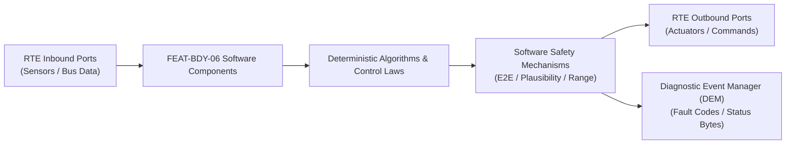

# Software Requirements Specification: Dynamic Electrochromic Smart Glass Roof (EC-ROOF)
**Feature ID:** `FEAT-BDY-06`  
**Domain:** Body, Lighting & Restraints  
**Target ASIL:** ASIL A / QM  
**Compliance Standard:** ISO 26262:2018 (Part 6 - Software Development) / ASPICE PAM v3.1 (SWE.1, SWE.2)  
**Parent System Specification:** [`FEAT-BDY-06_EC-ROOF_SysReq.md`](file:///c:/Workset/AntiGravityProjects/TestOptimisationExperiement/system_requirements/FEAT-BDY-06_EC-ROOF_SysReq.md)  
**Global Master Specification:** [`spec.md`](file:///c:/Workset/AntiGravityProjects/TestOptimisationExperiement/spec.md)

---

## 1. Software Architecture & Component Structure

This document specifies the AUTOSAR Software Components (SWCs), periodic runnables, algorithmic laws, safety mechanisms, and data ports implementing `FEAT-BDY-06` (Dynamic Electrochromic Smart Glass Roof (EC-ROOF)).

### AUTOSAR SWC Interaction Diagram

---

## 2. Detailed Software Requirements (SWR_REQ)
*(Multi-Software Requirement Partitioning derived from System Requirements)*

### `SWR-BDY-06-01`: Electrochromic Temperature-Compensated AC Voltage Modulator
- **Planned Release:** R100
- **ASIL Rating:** QM
- **Parent System Requirement:** [`SYS-BDY-06-01`](file:///c:/Workset/AntiGravityProjects/TestOptimisationExperiement/system_requirements/FEAT-BDY-06_EC-ROOF_SysReq.md#sys-bdy-06-01)
- **Allocated AUTOSAR SWC:** `SmartGlassController_SWC`
- **Execution Rate / Trigger:** 20 ms
- **Worst-Case Execution Time (WCET):** 0.3 ms
- **Software Activation Condition:** Cyclic 20 ms task.
- **Algorithmic Description / Logic:**
  > Computes target AC voltage from desired transmittance Tau: V_ac = V_max * sqrt(Tau / Tau_max) * K_temp(T_glass). At cold temperatures (-20°C), increases alignment frequency to 500 Hz to overcome liquid suspension viscosity.
- **Software Safety Mechanism:** Voltage limiter: Hard-clamps peak voltage to <= 115V AC RMS to prevent dielectric breakdown of the conductive ITO coating.
- **Failure Reaction & DEM Diagnostic Event:** Ramp down voltage to 0V upon over-temperature (> 85°C).
- **Software Port Inputs:** `Target_Transmittance_Pct, Glass_Temp_Thermistor_DegC`
- **Software Port Outputs:** `Target_AC_Voltage_Vrms, Inverter_Carrier_Frequency_Hz`
- **Software Verification Criteria:** Environmental climatic chamber optical response bench test.
- **Traceability Link:** Traces upward to [`SYS-BDY-06-01`](file:///c:/Workset/AntiGravityProjects/TestOptimisationExperiement/system_requirements/FEAT-BDY-06_EC-ROOF_SysReq.md#sys-bdy-06-01) and [`FEAT-BDY-06`](file:///c:/Workset/AntiGravityProjects/TestOptimisationExperiement/spec.md).

### `SWR-BDY-06-02`: Multi-Segment Matrix Triac Switching & Privacy Shading Sequencer
- **Planned Release:** R100
- **ASIL Rating:** QM
- **Parent System Requirement:** [`SYS-BDY-06-01`](file:///c:/Workset/AntiGravityProjects/TestOptimisationExperiement/system_requirements/FEAT-BDY-06_EC-ROOF_SysReq.md#sys-bdy-06-01)
- **Allocated AUTOSAR SWC:** `SmartGlassMatrix_SWC`
- **Execution Rate / Trigger:** 50 ms
- **Worst-Case Execution Time (WCET):** 0.4 ms
- **Software Activation Condition:** Active upon segment zone tint change.
- **Algorithmic Description / Logic:**
  > Synchronizes Triac phase firing angles with 400 Hz AC zero-crossing to prevent electrical switching transients. Manages independent tint zones: Driver row, Passenger row, Rear Executive row.
- **Software Safety Mechanism:** Zero-crossing switching only: Inhibits triac gating if zero-crossing pulse is missing.
- **Failure Reaction & DEM Diagnostic Event:** De-energize affected segment triac if segment load current drops to zero.
- **Software Port Inputs:** `Segment_Tint_Array[9], Zero_Crossing_Detect_Interrupt`
- **Software Port Outputs:** `Triac_Gate_Pulses[9], Active_Segment_Status_Word`
- **Software Verification Criteria:** Oscilloscope transient analysis verifying zero voltage switching.
- **Traceability Link:** Traces upward to [`SYS-BDY-06-01`](file:///c:/Workset/AntiGravityProjects/TestOptimisationExperiement/system_requirements/FEAT-BDY-06_EC-ROOF_SysReq.md#sys-bdy-06-01) and [`FEAT-BDY-06`](file:///c:/Workset/AntiGravityProjects/TestOptimisationExperiement/spec.md).

### `SWR-BDY-06-03`: Infrared Solar Heat Rejection & HVAC Energy Optimizer
- **Planned Release:** R100
- **ASIL Rating:** QM
- **Parent System Requirement:** [`SYS-BDY-06-02`](file:///c:/Workset/AntiGravityProjects/TestOptimisationExperiement/system_requirements/FEAT-BDY-06_EC-ROOF_SysReq.md#sys-bdy-06-02)
- **Allocated AUTOSAR SWC:** `SmartGlassThermalOptimizer_SWC`
- **Execution Rate / Trigger:** 500 ms
- **Worst-Case Execution Time (WCET):** 0.5 ms
- **Software Activation Condition:** Cyclic 500 ms task.
- **Algorithmic Description / Logic:**
  > Predicts thermal solar heat gain Q_solar = Area * I_sun * SHGC(Tau). If cabin HVAC cooling is active and solar flux > 400 W/m², automatically increases roof tint opacity, reducing solar heat gain by up to 1.8 kW.
- **Software Safety Mechanism:** User manual preference priority: If user manually set a tint within past 15 minutes, auto-solar adaptation is postponed.
- **Failure Reaction & DEM Diagnostic Event:** Inhibit auto-tint if solar pyranometer communication times out.
- **Software Port Inputs:** `Solar_Irradiance_W_M2, Hvac_Cooling_Power_Demand_W, User_Manual_Override_Timer`
- **Software Port Outputs:** `Recommended_Solar_Tint_Pct, Solar_Thermal_Load_Saved_W`
- **Software Verification Criteria:** Vehicle solar simulator thermal soak test (DIN 75220).
- **Traceability Link:** Traces upward to [`SYS-BDY-06-02`](file:///c:/Workset/AntiGravityProjects/TestOptimisationExperiement/system_requirements/FEAT-BDY-06_EC-ROOF_SysReq.md#sys-bdy-06-02) and [`FEAT-BDY-06`](file:///c:/Workset/AntiGravityProjects/TestOptimisationExperiement/spec.md).

### `SWR-BDY-06-04`: High-Frequency 400 Hz Galvanic Chassis Leakage Current Supervisor
- **Planned Release:** R100
- **ASIL Rating:** ASIL A
- **Parent System Requirement:** [`SYS-BDY-06-02`](file:///c:/Workset/AntiGravityProjects/TestOptimisationExperiement/system_requirements/FEAT-BDY-06_EC-ROOF_SysReq.md#sys-bdy-06-02)
- **Allocated AUTOSAR SWC:** `SmartGlassSafetySupervisor_SWC`
- **Execution Rate / Trigger:** 5 ms
- **Worst-Case Execution Time (WCET):** 0.2 ms
- **Software Activation Condition:** Continuous safety supervisory ISR.
- **Algorithmic Description / Logic:**
  > Samples differential current between AC inverter feed and return lines. If I_leakage = abs(I_feed - I_return) > 1.0 mA RMS for > 15 ms, immediately cuts PWM gate drive and opens isolation relay.
- **Software Safety Mechanism:** Dual-hardware comparator redundant trip line routed directly to gate drive shutdown.
- **Failure Reaction & DEM Diagnostic Event:** Latch DTC B18A1 (Smart Glass High Voltage Chassis Leakage) and lock out inverter.
- **Software Port Inputs:** `AC_Feed_Current_ADC, AC_Return_Current_ADC, Inverter_DC_Bus_V`
- **Software Port Outputs:** `Inverter_Shutdown_Signal (boolean), Chassis_Leakage_mA`
- **Software Verification Criteria:** Dielectric breakdown and intentional human-impedance leakage fault injection.
- **Traceability Link:** Traces upward to [`SYS-BDY-06-02`](file:///c:/Workset/AntiGravityProjects/TestOptimisationExperiement/system_requirements/FEAT-BDY-06_EC-ROOF_SysReq.md#sys-bdy-06-02) and [`FEAT-BDY-06`](file:///c:/Workset/AntiGravityProjects/TestOptimisationExperiement/spec.md).

### `SWR-BDY-06-05`: Electrochromic Glass Segmented Suspended Particle Device (SPD) PWM Driver - Dynamic Observer & Signal Filter
- **Planned Release:** R100
- **ASIL Rating:** ASIL A
- **Parent System Requirement:** [`SYS-BDY-06-03`](file:///c:/Workset/AntiGravityProjects/TestOptimisationExperiement/system_requirements/FEAT-BDY-06_EC-ROOF_SysReq.md#sys-bdy-06-03)
- **Allocated AUTOSAR SWC:** `EcRoofPwmDriver_SWC`
- **Execution Rate / Trigger:** 10 ms
- **Worst-Case Execution Time (WCET):** 0.3 ms
- **Software Activation Condition:** Executed cyclically every 10 ms.
- **Algorithmic Description / Logic:**
  > Executes signal plausibility filtering, calibration offsets, and discrete state estimation for Electrochromic Glass Segmented Suspended Particle Device (SPD) PWM Driver.
- **Software Safety Mechanism:** Range limit plausibility check and E2E alive sequence verification.
- **Failure Reaction & DEM Diagnostic Event:** Set default fallback output and report DEM_EVENT_FEAT_BDY_06_ERR.
- **Software Port Inputs:** `Raw sensor ADC/SENT/SPI values and RTE bus inputs.`
- **Software Port Outputs:** `Filtered physical signals and validity status bitmasks.`
- **Software Verification Criteria:** Unit test and HiL software integration test.
- **Traceability Link:** Traces upward to [`SYS-BDY-06-03`](file:///c:/Workset/AntiGravityProjects/TestOptimisationExperiement/system_requirements/FEAT-BDY-06_EC-ROOF_SysReq.md#sys-bdy-06-03) and [`FEAT-BDY-06`](file:///c:/Workset/AntiGravityProjects/TestOptimisationExperiement/spec.md).

### `SWR-BDY-06-06`: Electrochromic Glass Segmented Suspended Particle Device (SPD) PWM Driver - Closed-Loop Control Law & Actuator Dispatch
- **Planned Release:** R100
- **ASIL Rating:** ASIL A
- **Parent System Requirement:** [`SYS-BDY-06-03`](file:///c:/Workset/AntiGravityProjects/TestOptimisationExperiement/system_requirements/FEAT-BDY-06_EC-ROOF_SysReq.md#sys-bdy-06-03)
- **Allocated AUTOSAR SWC:** `EcRoofPwmDriver_SWC`
- **Execution Rate / Trigger:** 10 ms
- **Worst-Case Execution Time (WCET):** 0.4 ms
- **Software Activation Condition:** Executed cyclically every 10 ms.
- **Algorithmic Description / Logic:**
  > Evaluates deterministic closed-loop control law, rate limits, and dispatches commands for Electrochromic Glass Segmented Suspended Particle Device (SPD) PWM Driver.
- **Software Safety Mechanism:** Command saturation clamping and watchdog program flow monitoring.
- **Failure Reaction & DEM Diagnostic Event:** De-energize actuator output, apply safe fallback clamp, and latch DTC.
- **Software Port Inputs:** `Validated physical state signals from observer SWC.`
- **Software Port Outputs:** `Actuator PWM duty cycles, torque/pressure setpoints, and diagnostic flags.`
- **Software Verification Criteria:** Hardware dynamometer and HiL closed-loop regression test suite.
- **Traceability Link:** Traces upward to [`SYS-BDY-06-03`](file:///c:/Workset/AntiGravityProjects/TestOptimisationExperiement/system_requirements/FEAT-BDY-06_EC-ROOF_SysReq.md#sys-bdy-06-03) and [`FEAT-BDY-06`](file:///c:/Workset/AntiGravityProjects/TestOptimisationExperiement/spec.md).

### `SWR-BDY-06-07`: Multi-Zone Glass Roof Segment Independent Opacity Area Controller - Dynamic Observer & Signal Filter
- **Planned Release:** R200
- **ASIL Rating:** ASIL A
- **Parent System Requirement:** [`SYS-BDY-06-04`](file:///c:/Workset/AntiGravityProjects/TestOptimisationExperiement/system_requirements/FEAT-BDY-06_EC-ROOF_SysReq.md#sys-bdy-06-04)
- **Allocated AUTOSAR SWC:** `EcRoofZoneController_SWC`
- **Execution Rate / Trigger:** 20 ms
- **Worst-Case Execution Time (WCET):** 0.3 ms
- **Software Activation Condition:** Executed cyclically every 20 ms.
- **Algorithmic Description / Logic:**
  > Executes signal plausibility filtering, calibration offsets, and discrete state estimation for Multi-Zone Glass Roof Segment Independent Opacity Area Controller.
- **Software Safety Mechanism:** Range limit plausibility check and E2E alive sequence verification.
- **Failure Reaction & DEM Diagnostic Event:** Set default fallback output and report DEM_EVENT_FEAT_BDY_06_ERR.
- **Software Port Inputs:** `Raw sensor ADC/SENT/SPI values and RTE bus inputs.`
- **Software Port Outputs:** `Filtered physical signals and validity status bitmasks.`
- **Software Verification Criteria:** Unit test and HiL software integration test.
- **Traceability Link:** Traces upward to [`SYS-BDY-06-04`](file:///c:/Workset/AntiGravityProjects/TestOptimisationExperiement/system_requirements/FEAT-BDY-06_EC-ROOF_SysReq.md#sys-bdy-06-04) and [`FEAT-BDY-06`](file:///c:/Workset/AntiGravityProjects/TestOptimisationExperiement/spec.md).

### `SWR-BDY-06-08`: Multi-Zone Glass Roof Segment Independent Opacity Area Controller - Closed-Loop Control Law & Actuator Dispatch
- **Planned Release:** R200
- **ASIL Rating:** ASIL A
- **Parent System Requirement:** [`SYS-BDY-06-04`](file:///c:/Workset/AntiGravityProjects/TestOptimisationExperiement/system_requirements/FEAT-BDY-06_EC-ROOF_SysReq.md#sys-bdy-06-04)
- **Allocated AUTOSAR SWC:** `EcRoofZoneController_SWC`
- **Execution Rate / Trigger:** 20 ms
- **Worst-Case Execution Time (WCET):** 0.4 ms
- **Software Activation Condition:** Executed cyclically every 20 ms.
- **Algorithmic Description / Logic:**
  > Evaluates deterministic closed-loop control law, rate limits, and dispatches commands for Multi-Zone Glass Roof Segment Independent Opacity Area Controller.
- **Software Safety Mechanism:** Command saturation clamping and watchdog program flow monitoring.
- **Failure Reaction & DEM Diagnostic Event:** De-energize actuator output, apply safe fallback clamp, and latch DTC.
- **Software Port Inputs:** `Validated physical state signals from observer SWC.`
- **Software Port Outputs:** `Actuator PWM duty cycles, torque/pressure setpoints, and diagnostic flags.`
- **Software Verification Criteria:** Hardware dynamometer and HiL closed-loop regression test suite.
- **Traceability Link:** Traces upward to [`SYS-BDY-06-04`](file:///c:/Workset/AntiGravityProjects/TestOptimisationExperiement/system_requirements/FEAT-BDY-06_EC-ROOF_SysReq.md#sys-bdy-06-04) and [`FEAT-BDY-06`](file:///c:/Workset/AntiGravityProjects/TestOptimisationExperiement/spec.md).

### `SWR-BDY-06-09`: Ambient Sunlight Pyranometer Sensor Light Intensity Auto-Tinter - Dynamic Observer & Signal Filter
- **Planned Release:** R200
- **ASIL Rating:** ASIL A
- **Parent System Requirement:** [`SYS-BDY-06-05`](file:///c:/Workset/AntiGravityProjects/TestOptimisationExperiement/system_requirements/FEAT-BDY-06_EC-ROOF_SysReq.md#sys-bdy-06-05)
- **Allocated AUTOSAR SWC:** `EcRoofAutoTinter_SWC`
- **Execution Rate / Trigger:** 100 ms
- **Worst-Case Execution Time (WCET):** 0.3 ms
- **Software Activation Condition:** Executed cyclically every 100 ms.
- **Algorithmic Description / Logic:**
  > Executes signal plausibility filtering, calibration offsets, and discrete state estimation for Ambient Sunlight Pyranometer Sensor Light Intensity Auto-Tinter.
- **Software Safety Mechanism:** Range limit plausibility check and E2E alive sequence verification.
- **Failure Reaction & DEM Diagnostic Event:** Set default fallback output and report DEM_EVENT_FEAT_BDY_06_ERR.
- **Software Port Inputs:** `Raw sensor ADC/SENT/SPI values and RTE bus inputs.`
- **Software Port Outputs:** `Filtered physical signals and validity status bitmasks.`
- **Software Verification Criteria:** Unit test and HiL software integration test.
- **Traceability Link:** Traces upward to [`SYS-BDY-06-05`](file:///c:/Workset/AntiGravityProjects/TestOptimisationExperiement/system_requirements/FEAT-BDY-06_EC-ROOF_SysReq.md#sys-bdy-06-05) and [`FEAT-BDY-06`](file:///c:/Workset/AntiGravityProjects/TestOptimisationExperiement/spec.md).

### `SWR-BDY-06-10`: Ambient Sunlight Pyranometer Sensor Light Intensity Auto-Tinter - Closed-Loop Control Law & Actuator Dispatch
- **Planned Release:** R200
- **ASIL Rating:** ASIL A
- **Parent System Requirement:** [`SYS-BDY-06-05`](file:///c:/Workset/AntiGravityProjects/TestOptimisationExperiement/system_requirements/FEAT-BDY-06_EC-ROOF_SysReq.md#sys-bdy-06-05)
- **Allocated AUTOSAR SWC:** `EcRoofAutoTinter_SWC`
- **Execution Rate / Trigger:** 100 ms
- **Worst-Case Execution Time (WCET):** 0.4 ms
- **Software Activation Condition:** Executed cyclically every 100 ms.
- **Algorithmic Description / Logic:**
  > Evaluates deterministic closed-loop control law, rate limits, and dispatches commands for Ambient Sunlight Pyranometer Sensor Light Intensity Auto-Tinter.
- **Software Safety Mechanism:** Command saturation clamping and watchdog program flow monitoring.
- **Failure Reaction & DEM Diagnostic Event:** De-energize actuator output, apply safe fallback clamp, and latch DTC.
- **Software Port Inputs:** `Validated physical state signals from observer SWC.`
- **Software Port Outputs:** `Actuator PWM duty cycles, torque/pressure setpoints, and diagnostic flags.`
- **Software Verification Criteria:** Hardware dynamometer and HiL closed-loop regression test suite.
- **Traceability Link:** Traces upward to [`SYS-BDY-06-05`](file:///c:/Workset/AntiGravityProjects/TestOptimisationExperiement/system_requirements/FEAT-BDY-06_EC-ROOF_SysReq.md#sys-bdy-06-05) and [`FEAT-BDY-06`](file:///c:/Workset/AntiGravityProjects/TestOptimisationExperiement/spec.md).

### `SWR-BDY-06-11`: Cabin Thermal Heat Load Reduction & HVAC Efficiency Coordinator - Dynamic Observer & Signal Filter
- **Planned Release:** R200
- **ASIL Rating:** ASIL A
- **Parent System Requirement:** [`SYS-BDY-06-06`](file:///c:/Workset/AntiGravityProjects/TestOptimisationExperiement/system_requirements/FEAT-BDY-06_EC-ROOF_SysReq.md#sys-bdy-06-06)
- **Allocated AUTOSAR SWC:** `EcRoofThermalCoordinator_SWC`
- **Execution Rate / Trigger:** 200 ms
- **Worst-Case Execution Time (WCET):** 0.3 ms
- **Software Activation Condition:** Executed cyclically every 200 ms.
- **Algorithmic Description / Logic:**
  > Executes signal plausibility filtering, calibration offsets, and discrete state estimation for Cabin Thermal Heat Load Reduction & HVAC Efficiency Coordinator.
- **Software Safety Mechanism:** Range limit plausibility check and E2E alive sequence verification.
- **Failure Reaction & DEM Diagnostic Event:** Set default fallback output and report DEM_EVENT_FEAT_BDY_06_ERR.
- **Software Port Inputs:** `Raw sensor ADC/SENT/SPI values and RTE bus inputs.`
- **Software Port Outputs:** `Filtered physical signals and validity status bitmasks.`
- **Software Verification Criteria:** Unit test and HiL software integration test.
- **Traceability Link:** Traces upward to [`SYS-BDY-06-06`](file:///c:/Workset/AntiGravityProjects/TestOptimisationExperiement/system_requirements/FEAT-BDY-06_EC-ROOF_SysReq.md#sys-bdy-06-06) and [`FEAT-BDY-06`](file:///c:/Workset/AntiGravityProjects/TestOptimisationExperiement/spec.md).

### `SWR-BDY-06-12`: Cabin Thermal Heat Load Reduction & HVAC Efficiency Coordinator - Closed-Loop Control Law & Actuator Dispatch
- **Planned Release:** R200
- **ASIL Rating:** ASIL A
- **Parent System Requirement:** [`SYS-BDY-06-06`](file:///c:/Workset/AntiGravityProjects/TestOptimisationExperiement/system_requirements/FEAT-BDY-06_EC-ROOF_SysReq.md#sys-bdy-06-06)
- **Allocated AUTOSAR SWC:** `EcRoofThermalCoordinator_SWC`
- **Execution Rate / Trigger:** 200 ms
- **Worst-Case Execution Time (WCET):** 0.4 ms
- **Software Activation Condition:** Executed cyclically every 200 ms.
- **Algorithmic Description / Logic:**
  > Evaluates deterministic closed-loop control law, rate limits, and dispatches commands for Cabin Thermal Heat Load Reduction & HVAC Efficiency Coordinator.
- **Software Safety Mechanism:** Command saturation clamping and watchdog program flow monitoring.
- **Failure Reaction & DEM Diagnostic Event:** De-energize actuator output, apply safe fallback clamp, and latch DTC.
- **Software Port Inputs:** `Validated physical state signals from observer SWC.`
- **Software Port Outputs:** `Actuator PWM duty cycles, torque/pressure setpoints, and diagnostic flags.`
- **Software Verification Criteria:** Hardware dynamometer and HiL closed-loop regression test suite.
- **Traceability Link:** Traces upward to [`SYS-BDY-06-06`](file:///c:/Workset/AntiGravityProjects/TestOptimisationExperiement/system_requirements/FEAT-BDY-06_EC-ROOF_SysReq.md#sys-bdy-06-06) and [`FEAT-BDY-06`](file:///c:/Workset/AntiGravityProjects/TestOptimisationExperiement/spec.md).

### `SWR-BDY-06-13`: Vehicle Parked Anti-Thermal Sunshield Automatic Darkening State Engine - Dynamic Observer & Signal Filter
- **Planned Release:** R300
- **ASIL Rating:** ASIL A
- **Parent System Requirement:** [`SYS-BDY-06-07`](file:///c:/Workset/AntiGravityProjects/TestOptimisationExperiement/system_requirements/FEAT-BDY-06_EC-ROOF_SysReq.md#sys-bdy-06-07)
- **Allocated AUTOSAR SWC:** `EcRoofParkedShade_SWC`
- **Execution Rate / Trigger:** 500 ms
- **Worst-Case Execution Time (WCET):** 0.3 ms
- **Software Activation Condition:** Executed cyclically every 500 ms.
- **Algorithmic Description / Logic:**
  > Executes signal plausibility filtering, calibration offsets, and discrete state estimation for Vehicle Parked Anti-Thermal Sunshield Automatic Darkening State Engine.
- **Software Safety Mechanism:** Range limit plausibility check and E2E alive sequence verification.
- **Failure Reaction & DEM Diagnostic Event:** Set default fallback output and report DEM_EVENT_FEAT_BDY_06_ERR.
- **Software Port Inputs:** `Raw sensor ADC/SENT/SPI values and RTE bus inputs.`
- **Software Port Outputs:** `Filtered physical signals and validity status bitmasks.`
- **Software Verification Criteria:** Unit test and HiL software integration test.
- **Traceability Link:** Traces upward to [`SYS-BDY-06-07`](file:///c:/Workset/AntiGravityProjects/TestOptimisationExperiement/system_requirements/FEAT-BDY-06_EC-ROOF_SysReq.md#sys-bdy-06-07) and [`FEAT-BDY-06`](file:///c:/Workset/AntiGravityProjects/TestOptimisationExperiement/spec.md).

### `SWR-BDY-06-14`: Vehicle Parked Anti-Thermal Sunshield Automatic Darkening State Engine - Closed-Loop Control Law & Actuator Dispatch
- **Planned Release:** R300
- **ASIL Rating:** ASIL A
- **Parent System Requirement:** [`SYS-BDY-06-07`](file:///c:/Workset/AntiGravityProjects/TestOptimisationExperiement/system_requirements/FEAT-BDY-06_EC-ROOF_SysReq.md#sys-bdy-06-07)
- **Allocated AUTOSAR SWC:** `EcRoofParkedShade_SWC`
- **Execution Rate / Trigger:** 500 ms
- **Worst-Case Execution Time (WCET):** 0.4 ms
- **Software Activation Condition:** Executed cyclically every 500 ms.
- **Algorithmic Description / Logic:**
  > Evaluates deterministic closed-loop control law, rate limits, and dispatches commands for Vehicle Parked Anti-Thermal Sunshield Automatic Darkening State Engine.
- **Software Safety Mechanism:** Command saturation clamping and watchdog program flow monitoring.
- **Failure Reaction & DEM Diagnostic Event:** De-energize actuator output, apply safe fallback clamp, and latch DTC.
- **Software Port Inputs:** `Validated physical state signals from observer SWC.`
- **Software Port Outputs:** `Actuator PWM duty cycles, torque/pressure setpoints, and diagnostic flags.`
- **Software Verification Criteria:** Hardware dynamometer and HiL closed-loop regression test suite.
- **Traceability Link:** Traces upward to [`SYS-BDY-06-07`](file:///c:/Workset/AntiGravityProjects/TestOptimisationExperiement/system_requirements/FEAT-BDY-06_EC-ROOF_SysReq.md#sys-bdy-06-07) and [`FEAT-BDY-06`](file:///c:/Workset/AntiGravityProjects/TestOptimisationExperiement/spec.md).

### `SWR-BDY-06-15`: Sub-Zero Ambient Glass Film Switching Latency Temperature Compensator - Dynamic Observer & Signal Filter
- **Planned Release:** R300
- **ASIL Rating:** ASIL A
- **Parent System Requirement:** [`SYS-BDY-06-08`](file:///c:/Workset/AntiGravityProjects/TestOptimisationExperiement/system_requirements/FEAT-BDY-06_EC-ROOF_SysReq.md#sys-bdy-06-08)
- **Allocated AUTOSAR SWC:** `EcRoofColdCompensator_SWC`
- **Execution Rate / Trigger:** 200 ms
- **Worst-Case Execution Time (WCET):** 0.3 ms
- **Software Activation Condition:** Executed cyclically every 200 ms.
- **Algorithmic Description / Logic:**
  > Executes signal plausibility filtering, calibration offsets, and discrete state estimation for Sub-Zero Ambient Glass Film Switching Latency Temperature Compensator.
- **Software Safety Mechanism:** Range limit plausibility check and E2E alive sequence verification.
- **Failure Reaction & DEM Diagnostic Event:** Set default fallback output and report DEM_EVENT_FEAT_BDY_06_ERR.
- **Software Port Inputs:** `Raw sensor ADC/SENT/SPI values and RTE bus inputs.`
- **Software Port Outputs:** `Filtered physical signals and validity status bitmasks.`
- **Software Verification Criteria:** Unit test and HiL software integration test.
- **Traceability Link:** Traces upward to [`SYS-BDY-06-08`](file:///c:/Workset/AntiGravityProjects/TestOptimisationExperiement/system_requirements/FEAT-BDY-06_EC-ROOF_SysReq.md#sys-bdy-06-08) and [`FEAT-BDY-06`](file:///c:/Workset/AntiGravityProjects/TestOptimisationExperiement/spec.md).

### `SWR-BDY-06-16`: Sub-Zero Ambient Glass Film Switching Latency Temperature Compensator - Closed-Loop Control Law & Actuator Dispatch
- **Planned Release:** R300
- **ASIL Rating:** ASIL A
- **Parent System Requirement:** [`SYS-BDY-06-08`](file:///c:/Workset/AntiGravityProjects/TestOptimisationExperiement/system_requirements/FEAT-BDY-06_EC-ROOF_SysReq.md#sys-bdy-06-08)
- **Allocated AUTOSAR SWC:** `EcRoofColdCompensator_SWC`
- **Execution Rate / Trigger:** 200 ms
- **Worst-Case Execution Time (WCET):** 0.4 ms
- **Software Activation Condition:** Executed cyclically every 200 ms.
- **Algorithmic Description / Logic:**
  > Evaluates deterministic closed-loop control law, rate limits, and dispatches commands for Sub-Zero Ambient Glass Film Switching Latency Temperature Compensator.
- **Software Safety Mechanism:** Command saturation clamping and watchdog program flow monitoring.
- **Failure Reaction & DEM Diagnostic Event:** De-energize actuator output, apply safe fallback clamp, and latch DTC.
- **Software Port Inputs:** `Validated physical state signals from observer SWC.`
- **Software Port Outputs:** `Actuator PWM duty cycles, torque/pressure setpoints, and diagnostic flags.`
- **Software Verification Criteria:** Hardware dynamometer and HiL closed-loop regression test suite.
- **Traceability Link:** Traces upward to [`SYS-BDY-06-08`](file:///c:/Workset/AntiGravityProjects/TestOptimisationExperiement/system_requirements/FEAT-BDY-06_EC-ROOF_SysReq.md#sys-bdy-06-08) and [`FEAT-BDY-06`](file:///c:/Workset/AntiGravityProjects/TestOptimisationExperiement/spec.md).

### `SWR-BDY-06-17`: Electrochromic High-Voltage Inverter Circuit Short-Circuit Hardware Safing - Dynamic Observer & Signal Filter
- **Planned Release:** R400
- **ASIL Rating:** ASIL B
- **Parent System Requirement:** [`SYS-BDY-06-09`](file:///c:/Workset/AntiGravityProjects/TestOptimisationExperiement/system_requirements/FEAT-BDY-06_EC-ROOF_SysReq.md#sys-bdy-06-09)
- **Allocated AUTOSAR SWC:** `EcRoofHardwareSafing_SWC`
- **Execution Rate / Trigger:** 1 ms
- **Worst-Case Execution Time (WCET):** 0.3 ms
- **Software Activation Condition:** Executed cyclically every 1 ms.
- **Algorithmic Description / Logic:**
  > Executes signal plausibility filtering, calibration offsets, and discrete state estimation for Electrochromic High-Voltage Inverter Circuit Short-Circuit Hardware Safing.
- **Software Safety Mechanism:** Range limit plausibility check and E2E alive sequence verification.
- **Failure Reaction & DEM Diagnostic Event:** Set default fallback output and report DEM_EVENT_FEAT_BDY_06_ERR.
- **Software Port Inputs:** `Raw sensor ADC/SENT/SPI values and RTE bus inputs.`
- **Software Port Outputs:** `Filtered physical signals and validity status bitmasks.`
- **Software Verification Criteria:** Unit test and HiL software integration test.
- **Traceability Link:** Traces upward to [`SYS-BDY-06-09`](file:///c:/Workset/AntiGravityProjects/TestOptimisationExperiement/system_requirements/FEAT-BDY-06_EC-ROOF_SysReq.md#sys-bdy-06-09) and [`FEAT-BDY-06`](file:///c:/Workset/AntiGravityProjects/TestOptimisationExperiement/spec.md).

### `SWR-BDY-06-18`: Electrochromic High-Voltage Inverter Circuit Short-Circuit Hardware Safing - Closed-Loop Control Law & Actuator Dispatch
- **Planned Release:** R400
- **ASIL Rating:** ASIL B
- **Parent System Requirement:** [`SYS-BDY-06-09`](file:///c:/Workset/AntiGravityProjects/TestOptimisationExperiement/system_requirements/FEAT-BDY-06_EC-ROOF_SysReq.md#sys-bdy-06-09)
- **Allocated AUTOSAR SWC:** `EcRoofHardwareSafing_SWC`
- **Execution Rate / Trigger:** 1 ms
- **Worst-Case Execution Time (WCET):** 0.4 ms
- **Software Activation Condition:** Executed cyclically every 1 ms.
- **Algorithmic Description / Logic:**
  > Evaluates deterministic closed-loop control law, rate limits, and dispatches commands for Electrochromic High-Voltage Inverter Circuit Short-Circuit Hardware Safing.
- **Software Safety Mechanism:** Command saturation clamping and watchdog program flow monitoring.
- **Failure Reaction & DEM Diagnostic Event:** De-energize actuator output, apply safe fallback clamp, and latch DTC.
- **Software Port Inputs:** `Validated physical state signals from observer SWC.`
- **Software Port Outputs:** `Actuator PWM duty cycles, torque/pressure setpoints, and diagnostic flags.`
- **Software Verification Criteria:** Hardware dynamometer and HiL closed-loop regression test suite.
- **Traceability Link:** Traces upward to [`SYS-BDY-06-09`](file:///c:/Workset/AntiGravityProjects/TestOptimisationExperiement/system_requirements/FEAT-BDY-06_EC-ROOF_SysReq.md#sys-bdy-06-09) and [`FEAT-BDY-06`](file:///c:/Workset/AntiGravityProjects/TestOptimisationExperiement/spec.md).

### `SWR-BDY-06-19`: Glass Film Leakage Current Resistance Insulation Fault Monitor - Dynamic Observer & Signal Filter
- **Planned Release:** R400
- **ASIL Rating:** ASIL B
- **Parent System Requirement:** [`SYS-BDY-06-10`](file:///c:/Workset/AntiGravityProjects/TestOptimisationExperiement/system_requirements/FEAT-BDY-06_EC-ROOF_SysReq.md#sys-bdy-06-10)
- **Allocated AUTOSAR SWC:** `EcRoofInsulationMonitor_SWC`
- **Execution Rate / Trigger:** 20 ms
- **Worst-Case Execution Time (WCET):** 0.3 ms
- **Software Activation Condition:** Executed cyclically every 20 ms.
- **Algorithmic Description / Logic:**
  > Executes signal plausibility filtering, calibration offsets, and discrete state estimation for Glass Film Leakage Current Resistance Insulation Fault Monitor.
- **Software Safety Mechanism:** Range limit plausibility check and E2E alive sequence verification.
- **Failure Reaction & DEM Diagnostic Event:** Set default fallback output and report DEM_EVENT_FEAT_BDY_06_ERR.
- **Software Port Inputs:** `Raw sensor ADC/SENT/SPI values and RTE bus inputs.`
- **Software Port Outputs:** `Filtered physical signals and validity status bitmasks.`
- **Software Verification Criteria:** Unit test and HiL software integration test.
- **Traceability Link:** Traces upward to [`SYS-BDY-06-10`](file:///c:/Workset/AntiGravityProjects/TestOptimisationExperiement/system_requirements/FEAT-BDY-06_EC-ROOF_SysReq.md#sys-bdy-06-10) and [`FEAT-BDY-06`](file:///c:/Workset/AntiGravityProjects/TestOptimisationExperiement/spec.md).

### `SWR-BDY-06-20`: Glass Film Leakage Current Resistance Insulation Fault Monitor - Closed-Loop Control Law & Actuator Dispatch
- **Planned Release:** R400
- **ASIL Rating:** ASIL B
- **Parent System Requirement:** [`SYS-BDY-06-10`](file:///c:/Workset/AntiGravityProjects/TestOptimisationExperiement/system_requirements/FEAT-BDY-06_EC-ROOF_SysReq.md#sys-bdy-06-10)
- **Allocated AUTOSAR SWC:** `EcRoofInsulationMonitor_SWC`
- **Execution Rate / Trigger:** 20 ms
- **Worst-Case Execution Time (WCET):** 0.4 ms
- **Software Activation Condition:** Executed cyclically every 20 ms.
- **Algorithmic Description / Logic:**
  > Evaluates deterministic closed-loop control law, rate limits, and dispatches commands for Glass Film Leakage Current Resistance Insulation Fault Monitor.
- **Software Safety Mechanism:** Command saturation clamping and watchdog program flow monitoring.
- **Failure Reaction & DEM Diagnostic Event:** De-energize actuator output, apply safe fallback clamp, and latch DTC.
- **Software Port Inputs:** `Validated physical state signals from observer SWC.`
- **Software Port Outputs:** `Actuator PWM duty cycles, torque/pressure setpoints, and diagnostic flags.`
- **Software Verification Criteria:** Hardware dynamometer and HiL closed-loop regression test suite.
- **Traceability Link:** Traces upward to [`SYS-BDY-06-10`](file:///c:/Workset/AntiGravityProjects/TestOptimisationExperiement/system_requirements/FEAT-BDY-06_EC-ROOF_SysReq.md#sys-bdy-06-10) and [`FEAT-BDY-06`](file:///c:/Workset/AntiGravityProjects/TestOptimisationExperiement/spec.md).

### `SWR-BDY-06-21`: Driver Overhead Console Gesture & Slide Touch Control Interface - Dynamic Observer & Signal Filter
- **Planned Release:** R400
- **ASIL Rating:** ASIL A
- **Parent System Requirement:** [`SYS-BDY-06-11`](file:///c:/Workset/AntiGravityProjects/TestOptimisationExperiement/system_requirements/FEAT-BDY-06_EC-ROOF_SysReq.md#sys-bdy-06-11)
- **Allocated AUTOSAR SWC:** `EcRoofGestureInterface_SWC`
- **Execution Rate / Trigger:** 20 ms
- **Worst-Case Execution Time (WCET):** 0.3 ms
- **Software Activation Condition:** Executed cyclically every 20 ms.
- **Algorithmic Description / Logic:**
  > Executes signal plausibility filtering, calibration offsets, and discrete state estimation for Driver Overhead Console Gesture & Slide Touch Control Interface.
- **Software Safety Mechanism:** Range limit plausibility check and E2E alive sequence verification.
- **Failure Reaction & DEM Diagnostic Event:** Set default fallback output and report DEM_EVENT_FEAT_BDY_06_ERR.
- **Software Port Inputs:** `Raw sensor ADC/SENT/SPI values and RTE bus inputs.`
- **Software Port Outputs:** `Filtered physical signals and validity status bitmasks.`
- **Software Verification Criteria:** Unit test and HiL software integration test.
- **Traceability Link:** Traces upward to [`SYS-BDY-06-11`](file:///c:/Workset/AntiGravityProjects/TestOptimisationExperiement/system_requirements/FEAT-BDY-06_EC-ROOF_SysReq.md#sys-bdy-06-11) and [`FEAT-BDY-06`](file:///c:/Workset/AntiGravityProjects/TestOptimisationExperiement/spec.md).

### `SWR-BDY-06-22`: Driver Overhead Console Gesture & Slide Touch Control Interface - Closed-Loop Control Law & Actuator Dispatch
- **Planned Release:** R400
- **ASIL Rating:** ASIL A
- **Parent System Requirement:** [`SYS-BDY-06-11`](file:///c:/Workset/AntiGravityProjects/TestOptimisationExperiement/system_requirements/FEAT-BDY-06_EC-ROOF_SysReq.md#sys-bdy-06-11)
- **Allocated AUTOSAR SWC:** `EcRoofGestureInterface_SWC`
- **Execution Rate / Trigger:** 20 ms
- **Worst-Case Execution Time (WCET):** 0.4 ms
- **Software Activation Condition:** Executed cyclically every 20 ms.
- **Algorithmic Description / Logic:**
  > Evaluates deterministic closed-loop control law, rate limits, and dispatches commands for Driver Overhead Console Gesture & Slide Touch Control Interface.
- **Software Safety Mechanism:** Command saturation clamping and watchdog program flow monitoring.
- **Failure Reaction & DEM Diagnostic Event:** De-energize actuator output, apply safe fallback clamp, and latch DTC.
- **Software Port Inputs:** `Validated physical state signals from observer SWC.`
- **Software Port Outputs:** `Actuator PWM duty cycles, torque/pressure setpoints, and diagnostic flags.`
- **Software Verification Criteria:** Hardware dynamometer and HiL closed-loop regression test suite.
- **Traceability Link:** Traces upward to [`SYS-BDY-06-11`](file:///c:/Workset/AntiGravityProjects/TestOptimisationExperiement/system_requirements/FEAT-BDY-06_EC-ROOF_SysReq.md#sys-bdy-06-11) and [`FEAT-BDY-06`](file:///c:/Workset/AntiGravityProjects/TestOptimisationExperiement/spec.md).

### `SWR-BDY-06-23`: Vehicle Crash Emergency Roof Instantaneous Clear Transparency Interlock - Dynamic Observer & Signal Filter
- **Planned Release:** R400
- **ASIL Rating:** ASIL A
- **Parent System Requirement:** [`SYS-BDY-06-12`](file:///c:/Workset/AntiGravityProjects/TestOptimisationExperiement/system_requirements/FEAT-BDY-06_EC-ROOF_SysReq.md#sys-bdy-06-12)
- **Allocated AUTOSAR SWC:** `EcRoofCrashUnlock_SWC`
- **Execution Rate / Trigger:** 5 ms
- **Worst-Case Execution Time (WCET):** 0.3 ms
- **Software Activation Condition:** Executed cyclically every 5 ms.
- **Algorithmic Description / Logic:**
  > Executes signal plausibility filtering, calibration offsets, and discrete state estimation for Vehicle Crash Emergency Roof Instantaneous Clear Transparency Interlock.
- **Software Safety Mechanism:** Range limit plausibility check and E2E alive sequence verification.
- **Failure Reaction & DEM Diagnostic Event:** Set default fallback output and report DEM_EVENT_FEAT_BDY_06_ERR.
- **Software Port Inputs:** `Raw sensor ADC/SENT/SPI values and RTE bus inputs.`
- **Software Port Outputs:** `Filtered physical signals and validity status bitmasks.`
- **Software Verification Criteria:** Unit test and HiL software integration test.
- **Traceability Link:** Traces upward to [`SYS-BDY-06-12`](file:///c:/Workset/AntiGravityProjects/TestOptimisationExperiement/system_requirements/FEAT-BDY-06_EC-ROOF_SysReq.md#sys-bdy-06-12) and [`FEAT-BDY-06`](file:///c:/Workset/AntiGravityProjects/TestOptimisationExperiement/spec.md).

### `SWR-BDY-06-24`: Vehicle Crash Emergency Roof Instantaneous Clear Transparency Interlock - Closed-Loop Control Law & Actuator Dispatch
- **Planned Release:** R400
- **ASIL Rating:** ASIL A
- **Parent System Requirement:** [`SYS-BDY-06-12`](file:///c:/Workset/AntiGravityProjects/TestOptimisationExperiement/system_requirements/FEAT-BDY-06_EC-ROOF_SysReq.md#sys-bdy-06-12)
- **Allocated AUTOSAR SWC:** `EcRoofCrashUnlock_SWC`
- **Execution Rate / Trigger:** 5 ms
- **Worst-Case Execution Time (WCET):** 0.4 ms
- **Software Activation Condition:** Executed cyclically every 5 ms.
- **Algorithmic Description / Logic:**
  > Evaluates deterministic closed-loop control law, rate limits, and dispatches commands for Vehicle Crash Emergency Roof Instantaneous Clear Transparency Interlock.
- **Software Safety Mechanism:** Command saturation clamping and watchdog program flow monitoring.
- **Failure Reaction & DEM Diagnostic Event:** De-energize actuator output, apply safe fallback clamp, and latch DTC.
- **Software Port Inputs:** `Validated physical state signals from observer SWC.`
- **Software Port Outputs:** `Actuator PWM duty cycles, torque/pressure setpoints, and diagnostic flags.`
- **Software Verification Criteria:** Hardware dynamometer and HiL closed-loop regression test suite.
- **Traceability Link:** Traces upward to [`SYS-BDY-06-12`](file:///c:/Workset/AntiGravityProjects/TestOptimisationExperiement/system_requirements/FEAT-BDY-06_EC-ROOF_SysReq.md#sys-bdy-06-12) and [`FEAT-BDY-06`](file:///c:/Workset/AntiGravityProjects/TestOptimisationExperiement/spec.md).

### `SWR-BDY-06-25`: DEM Electrochromic Roof Power Supply Diagnostics & DTC Logger - Dynamic Observer & Signal Filter
- **Planned Release:** R500
- **ASIL Rating:** ASIL A
- **Parent System Requirement:** [`SYS-BDY-06-13`](file:///c:/Workset/AntiGravityProjects/TestOptimisationExperiement/system_requirements/FEAT-BDY-06_EC-ROOF_SysReq.md#sys-bdy-06-13)
- **Allocated AUTOSAR SWC:** `EcRoofDiagnosticManager_SWC`
- **Execution Rate / Trigger:** 50 ms
- **Worst-Case Execution Time (WCET):** 0.3 ms
- **Software Activation Condition:** Executed cyclically every 50 ms.
- **Algorithmic Description / Logic:**
  > Executes signal plausibility filtering, calibration offsets, and discrete state estimation for DEM Electrochromic Roof Power Supply Diagnostics & DTC Logger.
- **Software Safety Mechanism:** Range limit plausibility check and E2E alive sequence verification.
- **Failure Reaction & DEM Diagnostic Event:** Set default fallback output and report DEM_EVENT_FEAT_BDY_06_ERR.
- **Software Port Inputs:** `Raw sensor ADC/SENT/SPI values and RTE bus inputs.`
- **Software Port Outputs:** `Filtered physical signals and validity status bitmasks.`
- **Software Verification Criteria:** Unit test and HiL software integration test.
- **Traceability Link:** Traces upward to [`SYS-BDY-06-13`](file:///c:/Workset/AntiGravityProjects/TestOptimisationExperiement/system_requirements/FEAT-BDY-06_EC-ROOF_SysReq.md#sys-bdy-06-13) and [`FEAT-BDY-06`](file:///c:/Workset/AntiGravityProjects/TestOptimisationExperiement/spec.md).

### `SWR-BDY-06-26`: DEM Electrochromic Roof Power Supply Diagnostics & DTC Logger - Closed-Loop Control Law & Actuator Dispatch
- **Planned Release:** R500
- **ASIL Rating:** ASIL A
- **Parent System Requirement:** [`SYS-BDY-06-13`](file:///c:/Workset/AntiGravityProjects/TestOptimisationExperiement/system_requirements/FEAT-BDY-06_EC-ROOF_SysReq.md#sys-bdy-06-13)
- **Allocated AUTOSAR SWC:** `EcRoofDiagnosticManager_SWC`
- **Execution Rate / Trigger:** 50 ms
- **Worst-Case Execution Time (WCET):** 0.4 ms
- **Software Activation Condition:** Executed cyclically every 50 ms.
- **Algorithmic Description / Logic:**
  > Evaluates deterministic closed-loop control law, rate limits, and dispatches commands for DEM Electrochromic Roof Power Supply Diagnostics & DTC Logger.
- **Software Safety Mechanism:** Command saturation clamping and watchdog program flow monitoring.
- **Failure Reaction & DEM Diagnostic Event:** De-energize actuator output, apply safe fallback clamp, and latch DTC.
- **Software Port Inputs:** `Validated physical state signals from observer SWC.`
- **Software Port Outputs:** `Actuator PWM duty cycles, torque/pressure setpoints, and diagnostic flags.`
- **Software Verification Criteria:** Hardware dynamometer and HiL closed-loop regression test suite.
- **Traceability Link:** Traces upward to [`SYS-BDY-06-13`](file:///c:/Workset/AntiGravityProjects/TestOptimisationExperiement/system_requirements/FEAT-BDY-06_EC-ROOF_SysReq.md#sys-bdy-06-13) and [`FEAT-BDY-06`](file:///c:/Workset/AntiGravityProjects/TestOptimisationExperiement/spec.md).

### `SWR-BDY-06-27`: Central Touchscreen Roof Opacity Slider Graphic Display Serializer - Dynamic Observer & Signal Filter
- **Planned Release:** R500
- **ASIL Rating:** ASIL A
- **Parent System Requirement:** [`SYS-BDY-06-14`](file:///c:/Workset/AntiGravityProjects/TestOptimisationExperiement/system_requirements/FEAT-BDY-06_EC-ROOF_SysReq.md#sys-bdy-06-14)
- **Allocated AUTOSAR SWC:** `EcRoofHmiDispatcher_SWC`
- **Execution Rate / Trigger:** 50 ms
- **Worst-Case Execution Time (WCET):** 0.3 ms
- **Software Activation Condition:** Executed cyclically every 50 ms.
- **Algorithmic Description / Logic:**
  > Executes signal plausibility filtering, calibration offsets, and discrete state estimation for Central Touchscreen Roof Opacity Slider Graphic Display Serializer.
- **Software Safety Mechanism:** Range limit plausibility check and E2E alive sequence verification.
- **Failure Reaction & DEM Diagnostic Event:** Set default fallback output and report DEM_EVENT_FEAT_BDY_06_ERR.
- **Software Port Inputs:** `Raw sensor ADC/SENT/SPI values and RTE bus inputs.`
- **Software Port Outputs:** `Filtered physical signals and validity status bitmasks.`
- **Software Verification Criteria:** Unit test and HiL software integration test.
- **Traceability Link:** Traces upward to [`SYS-BDY-06-14`](file:///c:/Workset/AntiGravityProjects/TestOptimisationExperiement/system_requirements/FEAT-BDY-06_EC-ROOF_SysReq.md#sys-bdy-06-14) and [`FEAT-BDY-06`](file:///c:/Workset/AntiGravityProjects/TestOptimisationExperiement/spec.md).

### `SWR-BDY-06-28`: Central Touchscreen Roof Opacity Slider Graphic Display Serializer - Closed-Loop Control Law & Actuator Dispatch
- **Planned Release:** R500
- **ASIL Rating:** ASIL A
- **Parent System Requirement:** [`SYS-BDY-06-14`](file:///c:/Workset/AntiGravityProjects/TestOptimisationExperiement/system_requirements/FEAT-BDY-06_EC-ROOF_SysReq.md#sys-bdy-06-14)
- **Allocated AUTOSAR SWC:** `EcRoofHmiDispatcher_SWC`
- **Execution Rate / Trigger:** 50 ms
- **Worst-Case Execution Time (WCET):** 0.4 ms
- **Software Activation Condition:** Executed cyclically every 50 ms.
- **Algorithmic Description / Logic:**
  > Evaluates deterministic closed-loop control law, rate limits, and dispatches commands for Central Touchscreen Roof Opacity Slider Graphic Display Serializer.
- **Software Safety Mechanism:** Command saturation clamping and watchdog program flow monitoring.
- **Failure Reaction & DEM Diagnostic Event:** De-energize actuator output, apply safe fallback clamp, and latch DTC.
- **Software Port Inputs:** `Validated physical state signals from observer SWC.`
- **Software Port Outputs:** `Actuator PWM duty cycles, torque/pressure setpoints, and diagnostic flags.`
- **Software Verification Criteria:** Hardware dynamometer and HiL closed-loop regression test suite.
- **Traceability Link:** Traces upward to [`SYS-BDY-06-14`](file:///c:/Workset/AntiGravityProjects/TestOptimisationExperiement/system_requirements/FEAT-BDY-06_EC-ROOF_SysReq.md#sys-bdy-06-14) and [`FEAT-BDY-06`](file:///c:/Workset/AntiGravityProjects/TestOptimisationExperiement/spec.md).

### `SWR-BDY-06-29`: Non-Volatile Electrochromic Glass Cumulative Operating Hours Tracker - Dynamic Observer & Signal Filter
- **Planned Release:** R500
- **ASIL Rating:** ASIL A
- **Parent System Requirement:** [`SYS-BDY-06-15`](file:///c:/Workset/AntiGravityProjects/TestOptimisationExperiement/system_requirements/FEAT-BDY-06_EC-ROOF_SysReq.md#sys-bdy-06-15)
- **Allocated AUTOSAR SWC:** `EcRoofDutyCycleLogger_SWC`
- **Execution Rate / Trigger:** 1000 ms
- **Worst-Case Execution Time (WCET):** 0.3 ms
- **Software Activation Condition:** Executed cyclically every 1000 ms.
- **Algorithmic Description / Logic:**
  > Executes signal plausibility filtering, calibration offsets, and discrete state estimation for Non-Volatile Electrochromic Glass Cumulative Operating Hours Tracker.
- **Software Safety Mechanism:** Range limit plausibility check and E2E alive sequence verification.
- **Failure Reaction & DEM Diagnostic Event:** Set default fallback output and report DEM_EVENT_FEAT_BDY_06_ERR.
- **Software Port Inputs:** `Raw sensor ADC/SENT/SPI values and RTE bus inputs.`
- **Software Port Outputs:** `Filtered physical signals and validity status bitmasks.`
- **Software Verification Criteria:** Unit test and HiL software integration test.
- **Traceability Link:** Traces upward to [`SYS-BDY-06-15`](file:///c:/Workset/AntiGravityProjects/TestOptimisationExperiement/system_requirements/FEAT-BDY-06_EC-ROOF_SysReq.md#sys-bdy-06-15) and [`FEAT-BDY-06`](file:///c:/Workset/AntiGravityProjects/TestOptimisationExperiement/spec.md).

### `SWR-BDY-06-30`: Non-Volatile Electrochromic Glass Cumulative Operating Hours Tracker - Closed-Loop Control Law & Actuator Dispatch
- **Planned Release:** R500
- **ASIL Rating:** ASIL A
- **Parent System Requirement:** [`SYS-BDY-06-15`](file:///c:/Workset/AntiGravityProjects/TestOptimisationExperiement/system_requirements/FEAT-BDY-06_EC-ROOF_SysReq.md#sys-bdy-06-15)
- **Allocated AUTOSAR SWC:** `EcRoofDutyCycleLogger_SWC`
- **Execution Rate / Trigger:** 1000 ms
- **Worst-Case Execution Time (WCET):** 0.4 ms
- **Software Activation Condition:** Executed cyclically every 1000 ms.
- **Algorithmic Description / Logic:**
  > Evaluates deterministic closed-loop control law, rate limits, and dispatches commands for Non-Volatile Electrochromic Glass Cumulative Operating Hours Tracker.
- **Software Safety Mechanism:** Command saturation clamping and watchdog program flow monitoring.
- **Failure Reaction & DEM Diagnostic Event:** De-energize actuator output, apply safe fallback clamp, and latch DTC.
- **Software Port Inputs:** `Validated physical state signals from observer SWC.`
- **Software Port Outputs:** `Actuator PWM duty cycles, torque/pressure setpoints, and diagnostic flags.`
- **Software Verification Criteria:** Hardware dynamometer and HiL closed-loop regression test suite.
- **Traceability Link:** Traces upward to [`SYS-BDY-06-15`](file:///c:/Workset/AntiGravityProjects/TestOptimisationExperiement/system_requirements/FEAT-BDY-06_EC-ROOF_SysReq.md#sys-bdy-06-15) and [`FEAT-BDY-06`](file:///c:/Workset/AntiGravityProjects/TestOptimisationExperiement/spec.md).

---

## 3. Software-to-System Backward Traceability Matrix

| Software Requirement ID | Planned Release | Allocated SWC | Execution Rate | Upstream System Req | Verification Method |
| :--- | :---: | :--- | :--- | :--- | :--- |
| `SWR-BDY-06-01` | **`R100`** | `SmartGlassController_SWC` | 20 ms | [`SYS-BDY-06-01`](file:///c:/Workset/AntiGravityProjects/TestOptimisationExperiement/system_requirements/FEAT-BDY-06_EC-ROOF_SysReq.md#sys-bdy-06-01) | Environmental climatic chamber optical response bench test. |
| `SWR-BDY-06-02` | **`R100`** | `SmartGlassMatrix_SWC` | 50 ms | [`SYS-BDY-06-01`](file:///c:/Workset/AntiGravityProjects/TestOptimisationExperiement/system_requirements/FEAT-BDY-06_EC-ROOF_SysReq.md#sys-bdy-06-01) | Oscilloscope transient analysis verifying zero voltage switching. |
| `SWR-BDY-06-03` | **`R100`** | `SmartGlassThermalOptimizer_SWC` | 500 ms | [`SYS-BDY-06-02`](file:///c:/Workset/AntiGravityProjects/TestOptimisationExperiement/system_requirements/FEAT-BDY-06_EC-ROOF_SysReq.md#sys-bdy-06-02) | Vehicle solar simulator thermal soak test (DIN 75220). |
| `SWR-BDY-06-04` | **`R100`** | `SmartGlassSafetySupervisor_SWC` | 5 ms | [`SYS-BDY-06-02`](file:///c:/Workset/AntiGravityProjects/TestOptimisationExperiement/system_requirements/FEAT-BDY-06_EC-ROOF_SysReq.md#sys-bdy-06-02) | Dielectric breakdown and intentional human-impedance leakage fault injection. |
| `SWR-BDY-06-05` | **`R100`** | `EcRoofPwmDriver_SWC` | 10 ms | [`SYS-BDY-06-03`](file:///c:/Workset/AntiGravityProjects/TestOptimisationExperiement/system_requirements/FEAT-BDY-06_EC-ROOF_SysReq.md#sys-bdy-06-03) | Unit test and HiL software integration test. |
| `SWR-BDY-06-06` | **`R100`** | `EcRoofPwmDriver_SWC` | 10 ms | [`SYS-BDY-06-03`](file:///c:/Workset/AntiGravityProjects/TestOptimisationExperiement/system_requirements/FEAT-BDY-06_EC-ROOF_SysReq.md#sys-bdy-06-03) | Hardware dynamometer and HiL closed-loop regression test suite. |
| `SWR-BDY-06-07` | **`R200`** | `EcRoofZoneController_SWC` | 20 ms | [`SYS-BDY-06-04`](file:///c:/Workset/AntiGravityProjects/TestOptimisationExperiement/system_requirements/FEAT-BDY-06_EC-ROOF_SysReq.md#sys-bdy-06-04) | Unit test and HiL software integration test. |
| `SWR-BDY-06-08` | **`R200`** | `EcRoofZoneController_SWC` | 20 ms | [`SYS-BDY-06-04`](file:///c:/Workset/AntiGravityProjects/TestOptimisationExperiement/system_requirements/FEAT-BDY-06_EC-ROOF_SysReq.md#sys-bdy-06-04) | Hardware dynamometer and HiL closed-loop regression test suite. |
| `SWR-BDY-06-09` | **`R200`** | `EcRoofAutoTinter_SWC` | 100 ms | [`SYS-BDY-06-05`](file:///c:/Workset/AntiGravityProjects/TestOptimisationExperiement/system_requirements/FEAT-BDY-06_EC-ROOF_SysReq.md#sys-bdy-06-05) | Unit test and HiL software integration test. |
| `SWR-BDY-06-10` | **`R200`** | `EcRoofAutoTinter_SWC` | 100 ms | [`SYS-BDY-06-05`](file:///c:/Workset/AntiGravityProjects/TestOptimisationExperiement/system_requirements/FEAT-BDY-06_EC-ROOF_SysReq.md#sys-bdy-06-05) | Hardware dynamometer and HiL closed-loop regression test suite. |
| `SWR-BDY-06-11` | **`R200`** | `EcRoofThermalCoordinator_SWC` | 200 ms | [`SYS-BDY-06-06`](file:///c:/Workset/AntiGravityProjects/TestOptimisationExperiement/system_requirements/FEAT-BDY-06_EC-ROOF_SysReq.md#sys-bdy-06-06) | Unit test and HiL software integration test. |
| `SWR-BDY-06-12` | **`R200`** | `EcRoofThermalCoordinator_SWC` | 200 ms | [`SYS-BDY-06-06`](file:///c:/Workset/AntiGravityProjects/TestOptimisationExperiement/system_requirements/FEAT-BDY-06_EC-ROOF_SysReq.md#sys-bdy-06-06) | Hardware dynamometer and HiL closed-loop regression test suite. |
| `SWR-BDY-06-13` | **`R300`** | `EcRoofParkedShade_SWC` | 500 ms | [`SYS-BDY-06-07`](file:///c:/Workset/AntiGravityProjects/TestOptimisationExperiement/system_requirements/FEAT-BDY-06_EC-ROOF_SysReq.md#sys-bdy-06-07) | Unit test and HiL software integration test. |
| `SWR-BDY-06-14` | **`R300`** | `EcRoofParkedShade_SWC` | 500 ms | [`SYS-BDY-06-07`](file:///c:/Workset/AntiGravityProjects/TestOptimisationExperiement/system_requirements/FEAT-BDY-06_EC-ROOF_SysReq.md#sys-bdy-06-07) | Hardware dynamometer and HiL closed-loop regression test suite. |
| `SWR-BDY-06-15` | **`R300`** | `EcRoofColdCompensator_SWC` | 200 ms | [`SYS-BDY-06-08`](file:///c:/Workset/AntiGravityProjects/TestOptimisationExperiement/system_requirements/FEAT-BDY-06_EC-ROOF_SysReq.md#sys-bdy-06-08) | Unit test and HiL software integration test. |
| `SWR-BDY-06-16` | **`R300`** | `EcRoofColdCompensator_SWC` | 200 ms | [`SYS-BDY-06-08`](file:///c:/Workset/AntiGravityProjects/TestOptimisationExperiement/system_requirements/FEAT-BDY-06_EC-ROOF_SysReq.md#sys-bdy-06-08) | Hardware dynamometer and HiL closed-loop regression test suite. |
| `SWR-BDY-06-17` | **`R400`** | `EcRoofHardwareSafing_SWC` | 1 ms | [`SYS-BDY-06-09`](file:///c:/Workset/AntiGravityProjects/TestOptimisationExperiement/system_requirements/FEAT-BDY-06_EC-ROOF_SysReq.md#sys-bdy-06-09) | Unit test and HiL software integration test. |
| `SWR-BDY-06-18` | **`R400`** | `EcRoofHardwareSafing_SWC` | 1 ms | [`SYS-BDY-06-09`](file:///c:/Workset/AntiGravityProjects/TestOptimisationExperiement/system_requirements/FEAT-BDY-06_EC-ROOF_SysReq.md#sys-bdy-06-09) | Hardware dynamometer and HiL closed-loop regression test suite. |
| `SWR-BDY-06-19` | **`R400`** | `EcRoofInsulationMonitor_SWC` | 20 ms | [`SYS-BDY-06-10`](file:///c:/Workset/AntiGravityProjects/TestOptimisationExperiement/system_requirements/FEAT-BDY-06_EC-ROOF_SysReq.md#sys-bdy-06-10) | Unit test and HiL software integration test. |
| `SWR-BDY-06-20` | **`R400`** | `EcRoofInsulationMonitor_SWC` | 20 ms | [`SYS-BDY-06-10`](file:///c:/Workset/AntiGravityProjects/TestOptimisationExperiement/system_requirements/FEAT-BDY-06_EC-ROOF_SysReq.md#sys-bdy-06-10) | Hardware dynamometer and HiL closed-loop regression test suite. |
| `SWR-BDY-06-21` | **`R400`** | `EcRoofGestureInterface_SWC` | 20 ms | [`SYS-BDY-06-11`](file:///c:/Workset/AntiGravityProjects/TestOptimisationExperiement/system_requirements/FEAT-BDY-06_EC-ROOF_SysReq.md#sys-bdy-06-11) | Unit test and HiL software integration test. |
| `SWR-BDY-06-22` | **`R400`** | `EcRoofGestureInterface_SWC` | 20 ms | [`SYS-BDY-06-11`](file:///c:/Workset/AntiGravityProjects/TestOptimisationExperiement/system_requirements/FEAT-BDY-06_EC-ROOF_SysReq.md#sys-bdy-06-11) | Hardware dynamometer and HiL closed-loop regression test suite. |
| `SWR-BDY-06-23` | **`R400`** | `EcRoofCrashUnlock_SWC` | 5 ms | [`SYS-BDY-06-12`](file:///c:/Workset/AntiGravityProjects/TestOptimisationExperiement/system_requirements/FEAT-BDY-06_EC-ROOF_SysReq.md#sys-bdy-06-12) | Unit test and HiL software integration test. |
| `SWR-BDY-06-24` | **`R400`** | `EcRoofCrashUnlock_SWC` | 5 ms | [`SYS-BDY-06-12`](file:///c:/Workset/AntiGravityProjects/TestOptimisationExperiement/system_requirements/FEAT-BDY-06_EC-ROOF_SysReq.md#sys-bdy-06-12) | Hardware dynamometer and HiL closed-loop regression test suite. |
| `SWR-BDY-06-25` | **`R500`** | `EcRoofDiagnosticManager_SWC` | 50 ms | [`SYS-BDY-06-13`](file:///c:/Workset/AntiGravityProjects/TestOptimisationExperiement/system_requirements/FEAT-BDY-06_EC-ROOF_SysReq.md#sys-bdy-06-13) | Unit test and HiL software integration test. |
| `SWR-BDY-06-26` | **`R500`** | `EcRoofDiagnosticManager_SWC` | 50 ms | [`SYS-BDY-06-13`](file:///c:/Workset/AntiGravityProjects/TestOptimisationExperiement/system_requirements/FEAT-BDY-06_EC-ROOF_SysReq.md#sys-bdy-06-13) | Hardware dynamometer and HiL closed-loop regression test suite. |
| `SWR-BDY-06-27` | **`R500`** | `EcRoofHmiDispatcher_SWC` | 50 ms | [`SYS-BDY-06-14`](file:///c:/Workset/AntiGravityProjects/TestOptimisationExperiement/system_requirements/FEAT-BDY-06_EC-ROOF_SysReq.md#sys-bdy-06-14) | Unit test and HiL software integration test. |
| `SWR-BDY-06-28` | **`R500`** | `EcRoofHmiDispatcher_SWC` | 50 ms | [`SYS-BDY-06-14`](file:///c:/Workset/AntiGravityProjects/TestOptimisationExperiement/system_requirements/FEAT-BDY-06_EC-ROOF_SysReq.md#sys-bdy-06-14) | Hardware dynamometer and HiL closed-loop regression test suite. |
| `SWR-BDY-06-29` | **`R500`** | `EcRoofDutyCycleLogger_SWC` | 1000 ms | [`SYS-BDY-06-15`](file:///c:/Workset/AntiGravityProjects/TestOptimisationExperiement/system_requirements/FEAT-BDY-06_EC-ROOF_SysReq.md#sys-bdy-06-15) | Unit test and HiL software integration test. |
| `SWR-BDY-06-30` | **`R500`** | `EcRoofDutyCycleLogger_SWC` | 1000 ms | [`SYS-BDY-06-15`](file:///c:/Workset/AntiGravityProjects/TestOptimisationExperiement/system_requirements/FEAT-BDY-06_EC-ROOF_SysReq.md#sys-bdy-06-15) | Hardware dynamometer and HiL closed-loop regression test suite. |

- **Parent System Specification Document:** [`FEAT-BDY-06_EC-ROOF_SysReq.md`](file:///c:/Workset/AntiGravityProjects/TestOptimisationExperiement/system_requirements/FEAT-BDY-06_EC-ROOF_SysReq.md)
- **Master Automotive Specification:** [`spec.md`](file:///c:/Workset/AntiGravityProjects/TestOptimisationExperiement/spec.md)
