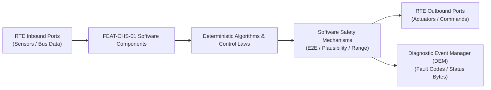

# Software Requirements Specification: Electronic Stability Control (ESC)
**Feature ID:** `FEAT-CHS-01`  
**Domain:** Vehicle Motion & Chassis Control  
**Target ASIL:** ASIL D  
**Compliance Standard:** ISO 26262:2018 (Part 6 - Software Development) / ASPICE PAM v3.1 (SWE.1, SWE.2)  
**Parent System Specification:** [`FEAT-CHS-01_ESC_SysReq.md`](file:///c:/Workset/AntiGravityProjects/TestOptimisationExperiement/system_requirements/FEAT-CHS-01_ESC_SysReq.md)  
**Global Master Specification:** [`spec.md`](file:///c:/Workset/AntiGravityProjects/TestOptimisationExperiement/spec.md)

---

## 1. Software Architecture & Component Structure

This document specifies the AUTOSAR Software Components (SWCs), periodic runnables, algorithmic laws, safety mechanisms, and data ports implementing `FEAT-CHS-01` (Electronic Stability Control (ESC)).

### AUTOSAR SWC Interaction Diagram

---

## 2. Detailed Software Requirements (SWR_REQ)
*(Multi-Software Requirement Partitioning derived from System Requirements)*

### `SWR-CHS-01-01`: Bicycle Linear Vehicle Dynamics Reference Model
- **Planned Release:** R100
- **ASIL Rating:** ASIL D
- **Parent System Requirement:** [`SYS-CHS-01-01`](file:///c:/Workset/AntiGravityProjects/TestOptimisationExperiement/system_requirements/FEAT-CHS-01_ESC_SysReq.md#sys-chs-01-01)
- **Allocated AUTOSAR SWC:** `EscReferenceModel_SWC`
- **Execution Rate / Trigger:** 10 ms
- **Worst-Case Execution Time (WCET):** 1.2 ms
- **Software Activation Condition:** Executed cyclically every 10 ms.
- **Algorithmic Description / Logic:**
  > Computes nominal steady-state yaw rate: Psi_dot_ref = (v_x / (L + K_us * v_x^2)) * delta_w. Saturates Psi_dot_ref by physical tire road friction limit: |Psi_dot_ref| <= (mu * g / v_x).
- **Software Safety Mechanism:** Friction adaptation: mu estimated continuously from longitudinal slip stiffness.
- **Failure Reaction & DEM Diagnostic Event:** If velocity v_x < 5 km/h, set target yaw rate to 0.0 rad/s.
- **Software Port Inputs:** `Steering_Angle_Deg, Longitudinal_Velocity_Mps, Estimated_Mu`
- **Software Port Outputs:** `Target_Yaw_Rate_RadS (float32)`
- **Software Verification Criteria:** Unit test verifying steady-state cornering gain across speeds 10 to 200 km/h.
- **Traceability Link:** Traces upward to [`SYS-CHS-01-01`](file:///c:/Workset/AntiGravityProjects/TestOptimisationExperiement/system_requirements/FEAT-CHS-01_ESC_SysReq.md#sys-chs-01-01) and [`FEAT-CHS-01`](file:///c:/Workset/AntiGravityProjects/TestOptimisationExperiement/spec.md).

### `SWR-CHS-01-02`: Extended Kalman Filter Body Sideslip Angle (Beta) Observer
- **Planned Release:** R100
- **ASIL Rating:** ASIL D
- **Parent System Requirement:** [`SYS-CHS-01-01`](file:///c:/Workset/AntiGravityProjects/TestOptimisationExperiement/system_requirements/FEAT-CHS-01_ESC_SysReq.md#sys-chs-01-01)
- **Allocated AUTOSAR SWC:** `EscSideslipObserver_SWC`
- **Execution Rate / Trigger:** 10 ms
- **Worst-Case Execution Time (WCET):** 2.4 ms
- **Software Activation Condition:** Executed every 10 ms.
- **Algorithmic Description / Logic:**
  > Integrates kinematics equation: dBeta/dt = (a_y / v_x) - yaw_rate. Uses tire lateral force models to update Kalman covariance, correcting drift during prolonged cornering.
- **Software Safety Mechanism:** Integration drift limiter: Decays Beta towards zero during straight-line driving.
- **Failure Reaction & DEM Diagnostic Event:** Flag sideslip estimation invalid if lateral accelerometer reports saturation.
- **Software Port Inputs:** `IMU_Lat_Accel_Mps2, IMU_Yaw_Rate_RadS, Longitudinal_Velocity_Mps`
- **Software Port Outputs:** `Estimated_Sideslip_Beta_Rad (float32), Observer_Confidence`
- **Software Verification Criteria:** SIL verification on high-speed lane change maneuvers against CarSim ground truth.
- **Traceability Link:** Traces upward to [`SYS-CHS-01-01`](file:///c:/Workset/AntiGravityProjects/TestOptimisationExperiement/system_requirements/FEAT-CHS-01_ESC_SysReq.md#sys-chs-01-01) and [`FEAT-CHS-01`](file:///c:/Workset/AntiGravityProjects/TestOptimisationExperiement/spec.md).

### `SWR-CHS-01-03`: Oversteer/Understeer Phase-Plane Restoring Moment Controller
- **Planned Release:** R500
- **ASIL Rating:** ASIL D
- **Parent System Requirement:** [`SYS-CHS-01-02`](file:///c:/Workset/AntiGravityProjects/TestOptimisationExperiement/system_requirements/FEAT-CHS-01_ESC_SysReq.md#sys-chs-01-02)
- **Allocated AUTOSAR SWC:** `EscYawMomentController_SWC`
- **Execution Rate / Trigger:** 5 ms
- **Worst-Case Execution Time (WCET):** 1.5 ms
- **Software Activation Condition:** Executed every 5 ms.
- **Algorithmic Description / Logic:**
  > Calculates restoring yaw moment: M_z = C_psi * (Yaw_Rate_Meas - Target_Yaw_Rate) + C_beta * Beta. Phase plane classifier determines intervention wheel: Oversteer -> Outer Front Wheel; Understeer -> Inner Rear Wheel.
- **Software Safety Mechanism:** Pressure gradient limiter: Rate of pressure increase clamped to <= 1000 bar/s.
- **Failure Reaction & DEM Diagnostic Event:** Inhibit intervention if driver counter-steering aligns with vehicle slide.
- **Software Port Inputs:** `Yaw_Rate_Meas, Target_Yaw_Rate, Estimated_Sideslip_Beta_Rad`
- **Software Port Outputs:** `Delta_Pressure_FL, FR, RL, RR (float32 in bar)`
- **Software Verification Criteria:** Phase-plane stability boundary unit test.
- **Traceability Link:** Traces upward to [`SYS-CHS-01-02`](file:///c:/Workset/AntiGravityProjects/TestOptimisationExperiement/system_requirements/FEAT-CHS-01_ESC_SysReq.md#sys-chs-01-02) and [`FEAT-CHS-01`](file:///c:/Workset/AntiGravityProjects/TestOptimisationExperiement/spec.md).

### `SWR-CHS-01-04`: VCU Fast Torque Clamping Dispatcher with E2E CRC
- **Planned Release:** R500
- **ASIL Rating:** ASIL D
- **Parent System Requirement:** [`SYS-CHS-01-02`](file:///c:/Workset/AntiGravityProjects/TestOptimisationExperiement/system_requirements/FEAT-CHS-01_ESC_SysReq.md#sys-chs-01-02)
- **Allocated AUTOSAR SWC:** `EscTorqueReduction_SWC`
- **Execution Rate / Trigger:** 10 ms
- **Worst-Case Execution Time (WCET):** 0.6 ms
- **Software Activation Condition:** Executed during ESC intervention.
- **Algorithmic Description / Logic:**
  > Calculates maximum allowable engine/motor torque: T_max_allowed = F(M_z, Lateral_Slip). Transmits ESC_Torque_Clamp_PDU over chassis CAN-FD with 8-bit alive rolling counter and CRC-8.
- **Software Safety Mechanism:** Message transmission confirmed via VCU mirror acknowledgment frame.
- **Failure Reaction & DEM Diagnostic Event:** If VCU fails to clamp torque, escalate brake caliper pressures to compensate.
- **Software Port Inputs:** `M_z, Current_Engine_Torque_Nm`
- **Software Port Outputs:** `ESC_Torque_Clamp_PDU (CAN-FD buffer)`
- **Software Verification Criteria:** E2E communication protocol conformance and packet loss injection testing.
- **Traceability Link:** Traces upward to [`SYS-CHS-01-02`](file:///c:/Workset/AntiGravityProjects/TestOptimisationExperiement/system_requirements/FEAT-CHS-01_ESC_SysReq.md#sys-chs-01-02) and [`FEAT-CHS-01`](file:///c:/Workset/AntiGravityProjects/TestOptimisationExperiement/spec.md).

### `SWR-CHS-01-05`: Split-Mu Yaw Disturbance Moment Dynamic Observer
- **Planned Release:** R100
- **ASIL Rating:** ASIL D
- **Parent System Requirement:** [`SYS-CHS-01-03`](file:///c:/Workset/AntiGravityProjects/TestOptimisationExperiement/system_requirements/FEAT-CHS-01_ESC_SysReq.md#sys-chs-01-03)
- **Allocated AUTOSAR SWC:** `EscSplitMuObserver_SWC`
- **Execution Rate / Trigger:** 10 ms
- **Worst-Case Execution Time (WCET):** 0.6 ms
- **Software Activation Condition:** Executed during braking.
- **Algorithmic Description / Logic:**
  > Estimates yaw disturbance moment induced by split friction: M_disturb = (F_x_left - F_x_right) * Track_Width / 2. Calculates restorative EPS counter-steering angle demand: Delta_steer = -K_split * M_disturb / (v_ego + 5.0).
- **Software Safety Mechanism:** Counter-steer torque limiter: Capped to maximum +-2.5 Nm to prevent snatching wheel from driver.
- **Failure Reaction & DEM Diagnostic Event:** Zero counter-steer demand if vehicle yaw rate opposes disturbance.
- **Software Port Inputs:** `Wheel_Acceleration_FL_FR_RL_RR, Master_Pressure_Bar, Steering_Angle_Deg`
- **Software Port Outputs:** `Split_Mu_Yaw_Moment_Nm, Restorative_Steering_Torque_Nm`
- **Software Verification Criteria:** Skidpad split-friction braking simulation with ice/concrete interface.
- **Traceability Link:** Traces upward to [`SYS-CHS-01-03`](file:///c:/Workset/AntiGravityProjects/TestOptimisationExperiement/system_requirements/FEAT-CHS-01_ESC_SysReq.md#sys-chs-01-03) and [`FEAT-CHS-01`](file:///c:/Workset/AntiGravityProjects/TestOptimisationExperiement/spec.md).

### `SWR-CHS-01-06`: High-Friction Caliper Pressure Gradient Regulator
- **Planned Release:** R100
- **ASIL Rating:** ASIL D
- **Parent System Requirement:** [`SYS-CHS-01-03`](file:///c:/Workset/AntiGravityProjects/TestOptimisationExperiement/system_requirements/FEAT-CHS-01_ESC_SysReq.md#sys-chs-01-03)
- **Allocated AUTOSAR SWC:** `EscSplitMuBraker_SWC`
- **Execution Rate / Trigger:** 10 ms
- **Worst-Case Execution Time (WCET):** 0.4 ms
- **Software Activation Condition:** Active during split-mu braking.
- **Algorithmic Description / Logic:**
  > Modulates high-friction caliper pressure rise rate: Limits dP_high/dt to <= 120 bar/s to give driver time to react with steering before full yaw moment develops. Ramps to full braking as vehicle yaw stabilizes.
- **Software Safety Mechanism:** Stopping distance preservation: If vehicle heading deviation < 1.0 deg, allows full braking.
- **Failure Reaction & DEM Diagnostic Event:** Default to standard ABS pressure modulation if gradient controller faults.
- **Software Port Inputs:** `Restorative_Steering_Torque_Nm, Driver_Handwheel_Angle_Deg`
- **Software Port Outputs:** `Target_HighMu_Caliper_Pressure_Bar, Gradient_Limiter_Active_Flag`
- **Software Verification Criteria:** Straight-line split-mu stop distance and heading drift evaluation.
- **Traceability Link:** Traces upward to [`SYS-CHS-01-03`](file:///c:/Workset/AntiGravityProjects/TestOptimisationExperiement/system_requirements/FEAT-CHS-01_ESC_SysReq.md#sys-chs-01-03) and [`FEAT-CHS-01`](file:///c:/Workset/AntiGravityProjects/TestOptimisationExperiement/spec.md).

### `SWR-CHS-01-07`: Multi-Sensor Roll Angle & Wheel Lift Probability Estimator
- **Planned Release:** R100
- **ASIL Rating:** ASIL D
- **Parent System Requirement:** [`SYS-CHS-01-04`](file:///c:/Workset/AntiGravityProjects/TestOptimisationExperiement/system_requirements/FEAT-CHS-01_ESC_SysReq.md#sys-chs-01-04)
- **Allocated AUTOSAR SWC:** `EscRollEstimator_SWC`
- **Execution Rate / Trigger:** 10 ms
- **Worst-Case Execution Time (WCET):** 0.7 ms
- **Software Activation Condition:** Cyclic 10 ms task.
- **Algorithmic Description / Logic:**
  > Integrates IMU roll rate p and lateral acceleration a_y via complementary filter: Phi_roll = (1 - alpha)*(Phi_prev + p*dT) + alpha * (a_y / g). Calculates Roll Energy index: E_roll = 0.5 * J_xx * p^2 + m * g * h_cg * (1 - cos(Phi)). Flags wheel lift if E_roll > 0.8 * E_crit.
- **Software Safety Mechanism:** Sensor redundancy check: Compares integrated roll angle against suspension height sensor differential.
- **Failure Reaction & DEM Diagnostic Event:** Inhibit ARM intervention if vehicle is on steep banked curve (speedway track).
- **Software Port Inputs:** `IMU_Roll_Rate_RadS, IMU_Lateral_Accel_Mps2, Suspension_Height_Diff_FL_FR`
- **Software Port Outputs:** `Estimated_Vehicle_Roll_Angle_Rad, Wheel_Lift_Risk_Probability`
- **Software Verification Criteria:** Fishhook dynamic maneuver testing on ISO 7401 vehicle dynamics bench.
- **Traceability Link:** Traces upward to [`SYS-CHS-01-04`](file:///c:/Workset/AntiGravityProjects/TestOptimisationExperiement/system_requirements/FEAT-CHS-01_ESC_SysReq.md#sys-chs-01-04) and [`FEAT-CHS-01`](file:///c:/Workset/AntiGravityProjects/TestOptimisationExperiement/spec.md).

### `SWR-CHS-01-08`: Outer Front Caliper Fast Hydraulic Pressurizer & Torque Cut
- **Planned Release:** R100
- **ASIL Rating:** ASIL D
- **Parent System Requirement:** [`SYS-CHS-01-04`](file:///c:/Workset/AntiGravityProjects/TestOptimisationExperiement/system_requirements/FEAT-CHS-01_ESC_SysReq.md#sys-chs-01-04)
- **Allocated AUTOSAR SWC:** `EscArmActuator_SWC`
- **Execution Rate / Trigger:** 5 ms
- **Worst-Case Execution Time (WCET):** 0.3 ms
- **Software Activation Condition:** Triggered when Wheel_Lift_Risk_Probability > 0.85.
- **Algorithmic Description / Logic:**
  > Immediately commands ESC hydraulic return pump: Pressurizes outer front brake caliper to 80 bar in <= 80 ms to induce stabilizing understeer and drop lateral G. Broadcasts zero-torque demand to powertrain.
- **Software Safety Mechanism:** Pulse duration limiter: Clamps maximum ARM brake pulse to <= 1200 ms.
- **Failure Reaction & DEM Diagnostic Event:** Release brake pressure once lateral acceleration drops below 0.6g.
- **Software Port Inputs:** `Wheel_Lift_Risk_Probability, Outer_Front_Wheel_Enum`
- **Software Port Outputs:** `ARM_Brake_Command_Bar, VCU_Torque_Override_Zero_Req (boolean)`
- **Software Verification Criteria:** Proving ground dynamic rollover limit tests with outrigger wheels.
- **Traceability Link:** Traces upward to [`SYS-CHS-01-04`](file:///c:/Workset/AntiGravityProjects/TestOptimisationExperiement/system_requirements/FEAT-CHS-01_ESC_SysReq.md#sys-chs-01-04) and [`FEAT-CHS-01`](file:///c:/Workset/AntiGravityProjects/TestOptimisationExperiement/spec.md).

### `SWR-CHS-01-09`: Driver Panic Brake Depression Velocity Gradient Detector
- **Planned Release:** R200
- **ASIL Rating:** ASIL D
- **Parent System Requirement:** [`SYS-CHS-01-05`](file:///c:/Workset/AntiGravityProjects/TestOptimisationExperiement/system_requirements/FEAT-CHS-01_ESC_SysReq.md#sys-chs-01-05)
- **Allocated AUTOSAR SWC:** `EscHbaDetector_SWC`
- **Execution Rate / Trigger:** 5 ms
- **Worst-Case Execution Time (WCET):** 0.2 ms
- **Software Activation Condition:** Continuous pedal monitoring.
- **Algorithmic Description / Logic:**
  > Calculates pedal depression speed: v_pedal = (Travel[k] - Travel[k-1]) / dT. If v_pedal > 300 %/s AND Master_Pressure > 15 bar within 80 ms, confirms panic emergency stop condition.
- **Software Safety Mechanism:** Threshold speed adaptation: Lowers threshold from 300 %/s to 200 %/s at highway speeds (> 100 km/h).
- **Failure Reaction & DEM Diagnostic Event:** Ignore HBA if accelerator pedal is simultaneously depressed.
- **Software Port Inputs:** `Brake_Pedal_Travel_Pct, Master_Cylinder_Pressure_Bar, Vehicle_Speed_Kmph`
- **Software Port Outputs:** `Panic_Braking_Detected_Flag (boolean), HBA_Trigger_Timestamp`
- **Software Verification Criteria:** Pedal robot dynamic impact testing measuring gradient detection latency.
- **Traceability Link:** Traces upward to [`SYS-CHS-01-05`](file:///c:/Workset/AntiGravityProjects/TestOptimisationExperiement/system_requirements/FEAT-CHS-01_ESC_SysReq.md#sys-chs-01-05) and [`FEAT-CHS-01`](file:///c:/Workset/AntiGravityProjects/TestOptimisationExperiement/spec.md).

### `SWR-CHS-01-10`: Electronic Brake Booster Full Lock-Limit Pressure Commander
- **Planned Release:** R200
- **ASIL Rating:** ASIL D
- **Parent System Requirement:** [`SYS-CHS-01-05`](file:///c:/Workset/AntiGravityProjects/TestOptimisationExperiement/system_requirements/FEAT-CHS-01_ESC_SysReq.md#sys-chs-01-05)
- **Allocated AUTOSAR SWC:** `EscHbaActuator_SWC`
- **Execution Rate / Trigger:** 5 ms
- **Worst-Case Execution Time (WCET):** 0.3 ms
- **Software Activation Condition:** Active upon Panic_Braking_Detected_Flag.
- **Algorithmic Description / Logic:**
  > Overrides driver manual pedal effort: Commands electric booster motor to maximum force, delivering 120 bar hydraulic line pressure to all 4 calipers in <= 60 ms. Transitions seamlessly to ABS slip regulation.
- **Software Safety Mechanism:** Driver release override: If master cylinder pressure drops below 8 bar (driver removes foot), cancels HBA instantly.
- **Failure Reaction & DEM Diagnostic Event:** Revert to standard base hydraulic assist upon booster motor overtemperature.
- **Software Port Inputs:** `Panic_Braking_Detected_Flag, Driver_Master_Pressure_Bar, ABS_Active_Status`
- **Software Port Outputs:** `HBA_Boosted_Pressure_Cmd_Bar, HBA_Active_State_Enum`
- **Software Verification Criteria:** Stopping distance reduction verification according to ECE R13H Annex 9.
- **Traceability Link:** Traces upward to [`SYS-CHS-01-05`](file:///c:/Workset/AntiGravityProjects/TestOptimisationExperiement/system_requirements/FEAT-CHS-01_ESC_SysReq.md#sys-chs-01-05) and [`FEAT-CHS-01`](file:///c:/Workset/AntiGravityProjects/TestOptimisationExperiement/spec.md).

### `SWR-CHS-01-11`: TCS Driven Wheel Slip Ratio Observer
- **Planned Release:** R200
- **ASIL Rating:** ASIL D
- **Parent System Requirement:** [`SYS-CHS-01-06`](file:///c:/Workset/AntiGravityProjects/TestOptimisationExperiement/system_requirements/FEAT-CHS-01_ESC_SysReq.md#sys-chs-01-06)
- **Allocated AUTOSAR SWC:** `EscTcsObserver_SWC`
- **Execution Rate / Trigger:** 10 ms
- **Worst-Case Execution Time (WCET):** 0.8 ms
- **Software Activation Condition:** Executed cyclically every 10 ms.
- **Algorithmic Description / Logic:**
  > Computes driven wheel longitudinal slip ratio: S = (V_wheel - V_ego) / V_ego. Applies deadband filter (2.0%) to reject tire radial vibration.
- **Software Safety Mechanism:** Range limit, plausibility checks, and Dem diagnostic reporting.
- **Failure Reaction & DEM Diagnostic Event:** Default to safe state and log DEM fault code.
- **Software Port Inputs:** `Sensor readings and vehicle state data via RTE.`
- **Software Port Outputs:** `Control commands and diagnostic flags via RTE.`
- **Software Verification Criteria:** HiL test bench automated pass/fail verification.
- **Traceability Link:** Traces upward to [`SYS-CHS-01-06`](file:///c:/Workset/AntiGravityProjects/TestOptimisationExperiement/system_requirements/FEAT-CHS-01_ESC_SysReq.md#sys-chs-01-06) and [`FEAT-CHS-01`](file:///c:/Workset/AntiGravityProjects/TestOptimisationExperiement/spec.md).

### `SWR-CHS-01-12`: TCS Powertrain Fast Torque Clamp & Caliper Regulator
- **Planned Release:** R200
- **ASIL Rating:** ASIL D
- **Parent System Requirement:** [`SYS-CHS-01-06`](file:///c:/Workset/AntiGravityProjects/TestOptimisationExperiement/system_requirements/FEAT-CHS-01_ESC_SysReq.md#sys-chs-01-06)
- **Allocated AUTOSAR SWC:** `EscTcsController_SWC`
- **Execution Rate / Trigger:** 10 ms
- **Worst-Case Execution Time (WCET):** 1.1 ms
- **Software Activation Condition:** Executed cyclically every 10 ms.
- **Algorithmic Description / Logic:**
  > Calculates required torque reduction Delta_T = K_slip * (S - S_target) + D_slip * dS/dt. Transmits fast torque reduction frame to VCU via CAN-FD in <= 10 ms.
- **Software Safety Mechanism:** Range limit, plausibility checks, and Dem diagnostic reporting.
- **Failure Reaction & DEM Diagnostic Event:** Default to safe state and log DEM fault code.
- **Software Port Inputs:** `Sensor readings and vehicle state data via RTE.`
- **Software Port Outputs:** `Control commands and diagnostic flags via RTE.`
- **Software Verification Criteria:** HiL test bench automated pass/fail verification.
- **Traceability Link:** Traces upward to [`SYS-CHS-01-06`](file:///c:/Workset/AntiGravityProjects/TestOptimisationExperiement/system_requirements/FEAT-CHS-01_ESC_SysReq.md#sys-chs-01-06) and [`FEAT-CHS-01`](file:///c:/Workset/AntiGravityProjects/TestOptimisationExperiement/spec.md).

### `SWR-CHS-01-13`: EBD Dynamic Axle Load Transfer Estimator
- **Planned Release:** R200
- **ASIL Rating:** ASIL D
- **Parent System Requirement:** [`SYS-CHS-01-07`](file:///c:/Workset/AntiGravityProjects/TestOptimisationExperiement/system_requirements/FEAT-CHS-01_ESC_SysReq.md#sys-chs-01-07)
- **Allocated AUTOSAR SWC:** `EscEbdEstimator_SWC`
- **Execution Rate / Trigger:** 10 ms
- **Worst-Case Execution Time (WCET):** 0.6 ms
- **Software Activation Condition:** Executed cyclically every 10 ms.
- **Algorithmic Description / Logic:**
  > Calculates instantaneous dynamic front/rear normal loads: Fz_rear = (M_vehicle * g * L_front - M_vehicle * a_x * h_cg) / Wheelbase. Enforces rear normal load threshold.
- **Software Safety Mechanism:** Range limit, plausibility checks, and Dem diagnostic reporting.
- **Failure Reaction & DEM Diagnostic Event:** Default to safe state and log DEM fault code.
- **Software Port Inputs:** `Sensor readings and vehicle state data via RTE.`
- **Software Port Outputs:** `Control commands and diagnostic flags via RTE.`
- **Software Verification Criteria:** HiL test bench automated pass/fail verification.
- **Traceability Link:** Traces upward to [`SYS-CHS-01-07`](file:///c:/Workset/AntiGravityProjects/TestOptimisationExperiement/system_requirements/FEAT-CHS-01_ESC_SysReq.md#sys-chs-01-07) and [`FEAT-CHS-01`](file:///c:/Workset/AntiGravityProjects/TestOptimisationExperiement/spec.md).

### `SWR-CHS-01-14`: EBD Rear Inlet Valve Pulse Modulator
- **Planned Release:** R200
- **ASIL Rating:** ASIL D
- **Parent System Requirement:** [`SYS-CHS-01-07`](file:///c:/Workset/AntiGravityProjects/TestOptimisationExperiement/system_requirements/FEAT-CHS-01_ESC_SysReq.md#sys-chs-01-07)
- **Allocated AUTOSAR SWC:** `EscEbdActuator_SWC`
- **Execution Rate / Trigger:** 5 ms
- **Worst-Case Execution Time (WCET):** 0.4 ms
- **Software Activation Condition:** Executed cyclically every 5 ms.
- **Algorithmic Description / Logic:**
  > Monitors rear wheel slip relative to front wheels: If rear wheel slip exceeds front wheel slip by > 3.0%, pulses rear inlet solenoid valves CLOSED to freeze rear caliper pressure.
- **Software Safety Mechanism:** Range limit, plausibility checks, and Dem diagnostic reporting.
- **Failure Reaction & DEM Diagnostic Event:** Default to safe state and log DEM fault code.
- **Software Port Inputs:** `Sensor readings and vehicle state data via RTE.`
- **Software Port Outputs:** `Control commands and diagnostic flags via RTE.`
- **Software Verification Criteria:** HiL test bench automated pass/fail verification.
- **Traceability Link:** Traces upward to [`SYS-CHS-01-07`](file:///c:/Workset/AntiGravityProjects/TestOptimisationExperiement/system_requirements/FEAT-CHS-01_ESC_SysReq.md#sys-chs-01-07) and [`FEAT-CHS-01`](file:///c:/Workset/AntiGravityProjects/TestOptimisationExperiement/spec.md).

### `SWR-CHS-01-15`: ABS 5-Phase Wheel State Machine Logic
- **Planned Release:** R300
- **ASIL Rating:** ASIL D
- **Parent System Requirement:** [`SYS-CHS-01-08`](file:///c:/Workset/AntiGravityProjects/TestOptimisationExperiement/system_requirements/FEAT-CHS-01_ESC_SysReq.md#sys-chs-01-08)
- **Allocated AUTOSAR SWC:** `EscAbsStateMachine_SWC`
- **Execution Rate / Trigger:** 5 ms
- **Worst-Case Execution Time (WCET):** 0.9 ms
- **Software Activation Condition:** Executed cyclically every 5 ms.
- **Algorithmic Description / Logic:**
  > Implements 5-phase ABS regulation cycle: Phase 0 (Apply), Phase 1 (Hold), Phase 2 (Fast Dump), Phase 3 (Slow Dump), Phase 4 (Staircase Pulse Re-apply) based on wheel acceleration thresholds.
- **Software Safety Mechanism:** Range limit, plausibility checks, and Dem diagnostic reporting.
- **Failure Reaction & DEM Diagnostic Event:** Default to safe state and log DEM fault code.
- **Software Port Inputs:** `Sensor readings and vehicle state data via RTE.`
- **Software Port Outputs:** `Control commands and diagnostic flags via RTE.`
- **Software Verification Criteria:** HiL test bench automated pass/fail verification.
- **Traceability Link:** Traces upward to [`SYS-CHS-01-08`](file:///c:/Workset/AntiGravityProjects/TestOptimisationExperiement/system_requirements/FEAT-CHS-01_ESC_SysReq.md#sys-chs-01-08) and [`FEAT-CHS-01`](file:///c:/Workset/AntiGravityProjects/TestOptimisationExperiement/spec.md).

### `SWR-CHS-01-16`: ABS Hydraulic Return Pump DC Motor Driver
- **Planned Release:** R300
- **ASIL Rating:** ASIL D
- **Parent System Requirement:** [`SYS-CHS-01-08`](file:///c:/Workset/AntiGravityProjects/TestOptimisationExperiement/system_requirements/FEAT-CHS-01_ESC_SysReq.md#sys-chs-01-08)
- **Allocated AUTOSAR SWC:** `EscAbsPumpDriver_SWC`
- **Execution Rate / Trigger:** 5 ms
- **Worst-Case Execution Time (WCET):** 0.3 ms
- **Software Activation Condition:** Executed cyclically every 5 ms.
- **Algorithmic Description / Logic:**
  > Commands brushless DC hydraulic return pump motor to maximum speed during ABS pressure dump phases to evacuate brake fluid from low-pressure accumulators back to master cylinder.
- **Software Safety Mechanism:** Range limit, plausibility checks, and Dem diagnostic reporting.
- **Failure Reaction & DEM Diagnostic Event:** Default to safe state and log DEM fault code.
- **Software Port Inputs:** `Sensor readings and vehicle state data via RTE.`
- **Software Port Outputs:** `Control commands and diagnostic flags via RTE.`
- **Software Verification Criteria:** HiL test bench automated pass/fail verification.
- **Traceability Link:** Traces upward to [`SYS-CHS-01-08`](file:///c:/Workset/AntiGravityProjects/TestOptimisationExperiement/system_requirements/FEAT-CHS-01_ESC_SysReq.md#sys-chs-01-08) and [`FEAT-CHS-01`](file:///c:/Workset/AntiGravityProjects/TestOptimisationExperiement/spec.md).

### `SWR-CHS-01-17`: HSA Road Incline & Static Roll-Back Resistance Evaluator
- **Planned Release:** R300
- **ASIL Rating:** ASIL B
- **Parent System Requirement:** [`SYS-CHS-01-09`](file:///c:/Workset/AntiGravityProjects/TestOptimisationExperiement/system_requirements/FEAT-CHS-01_ESC_SysReq.md#sys-chs-01-09)
- **Allocated AUTOSAR SWC:** `EscHsaEstimator_SWC`
- **Execution Rate / Trigger:** 10 ms
- **Worst-Case Execution Time (WCET):** 0.4 ms
- **Software Activation Condition:** Executed cyclically every 10 ms.
- **Algorithmic Description / Logic:**
  > Computes gravity roll-back force: F_roll = M_vehicle * g * sin(Theta_pitch). Computes minimum hydraulic caliper pressure required to overcome roll-back: P_hold = F_roll / (Caliper_Area * Eff).
- **Software Safety Mechanism:** Range limit, plausibility checks, and Dem diagnostic reporting.
- **Failure Reaction & DEM Diagnostic Event:** Default to safe state and log DEM fault code.
- **Software Port Inputs:** `Sensor readings and vehicle state data via RTE.`
- **Software Port Outputs:** `Control commands and diagnostic flags via RTE.`
- **Software Verification Criteria:** HiL test bench automated pass/fail verification.
- **Traceability Link:** Traces upward to [`SYS-CHS-01-09`](file:///c:/Workset/AntiGravityProjects/TestOptimisationExperiement/system_requirements/FEAT-CHS-01_ESC_SysReq.md#sys-chs-01-09) and [`FEAT-CHS-01`](file:///c:/Workset/AntiGravityProjects/TestOptimisationExperiement/spec.md).

### `SWR-CHS-01-18`: HSA Smooth Drive-Off Pressure Ramp-Down Governor
- **Planned Release:** R300
- **ASIL Rating:** ASIL B
- **Parent System Requirement:** [`SYS-CHS-01-09`](file:///c:/Workset/AntiGravityProjects/TestOptimisationExperiement/system_requirements/FEAT-CHS-01_ESC_SysReq.md#sys-chs-01-09)
- **Allocated AUTOSAR SWC:** `EscHsaRelease_SWC`
- **Execution Rate / Trigger:** 10 ms
- **Worst-Case Execution Time (WCET):** 0.5 ms
- **Software Activation Condition:** Executed cyclically every 10 ms.
- **Algorithmic Description / Logic:**
  > Monitors motor delivered drive torque: When delivered motor torque matches F_roll * Wheel_Radius, ramps hydraulic hold pressure to 0 bar at a controlled rate of 80 bar/s to prevent jerky launch.
- **Software Safety Mechanism:** Range limit, plausibility checks, and Dem diagnostic reporting.
- **Failure Reaction & DEM Diagnostic Event:** Default to safe state and log DEM fault code.
- **Software Port Inputs:** `Sensor readings and vehicle state data via RTE.`
- **Software Port Outputs:** `Control commands and diagnostic flags via RTE.`
- **Software Verification Criteria:** HiL test bench automated pass/fail verification.
- **Traceability Link:** Traces upward to [`SYS-CHS-01-09`](file:///c:/Workset/AntiGravityProjects/TestOptimisationExperiement/system_requirements/FEAT-CHS-01_ESC_SysReq.md#sys-chs-01-09) and [`FEAT-CHS-01`](file:///c:/Workset/AntiGravityProjects/TestOptimisationExperiement/spec.md).

### `SWR-CHS-01-19`: HBFC Brake Rotor Lumped-Capacitance Thermal Observer
- **Planned Release:** R300
- **ASIL Rating:** ASIL D
- **Parent System Requirement:** [`SYS-CHS-01-10`](file:///c:/Workset/AntiGravityProjects/TestOptimisationExperiement/system_requirements/FEAT-CHS-01_ESC_SysReq.md#sys-chs-01-10)
- **Allocated AUTOSAR SWC:** `EscHbfcObserver_SWC`
- **Execution Rate / Trigger:** 100 ms
- **Worst-Case Execution Time (WCET):** 0.5 ms
- **Software Activation Condition:** Executed cyclically every 100 ms.
- **Algorithmic Description / Logic:**
  > Calculates accumulated thermal energy: Q_in = int(P_brake * v_ego * dT). Subtracts convective cooling Q_out = h_conv(v_ego) * (T_rotor - T_ambient). Flags brake fade if T_rotor > 450 °C.
- **Software Safety Mechanism:** Range limit, plausibility checks, and Dem diagnostic reporting.
- **Failure Reaction & DEM Diagnostic Event:** Default to safe state and log DEM fault code.
- **Software Port Inputs:** `Sensor readings and vehicle state data via RTE.`
- **Software Port Outputs:** `Control commands and diagnostic flags via RTE.`
- **Software Verification Criteria:** HiL test bench automated pass/fail verification.
- **Traceability Link:** Traces upward to [`SYS-CHS-01-10`](file:///c:/Workset/AntiGravityProjects/TestOptimisationExperiement/system_requirements/FEAT-CHS-01_ESC_SysReq.md#sys-chs-01-10) and [`FEAT-CHS-01`](file:///c:/Workset/AntiGravityProjects/TestOptimisationExperiement/spec.md).

### `SWR-CHS-01-20`: HBFC Supplementary Hydraulic Boost Dispatcher
- **Planned Release:** R300
- **ASIL Rating:** ASIL D
- **Parent System Requirement:** [`SYS-CHS-01-10`](file:///c:/Workset/AntiGravityProjects/TestOptimisationExperiement/system_requirements/FEAT-CHS-01_ESC_SysReq.md#sys-chs-01-10)
- **Allocated AUTOSAR SWC:** `EscHbfcActuator_SWC`
- **Execution Rate / Trigger:** 10 ms
- **Worst-Case Execution Time (WCET):** 0.7 ms
- **Software Activation Condition:** Executed cyclically every 10 ms.
- **Algorithmic Description / Logic:**
  > When brake fade is active and pedal force is applied, activates hydraulic pump to boost caliper pressure by up to +40 bar above master cylinder pressure to restore expected vehicle deceleration.
- **Software Safety Mechanism:** Range limit, plausibility checks, and Dem diagnostic reporting.
- **Failure Reaction & DEM Diagnostic Event:** Default to safe state and log DEM fault code.
- **Software Port Inputs:** `Sensor readings and vehicle state data via RTE.`
- **Software Port Outputs:** `Control commands and diagnostic flags via RTE.`
- **Software Verification Criteria:** HiL test bench automated pass/fail verification.
- **Traceability Link:** Traces upward to [`SYS-CHS-01-10`](file:///c:/Workset/AntiGravityProjects/TestOptimisationExperiement/system_requirements/FEAT-CHS-01_ESC_SysReq.md#sys-chs-01-10) and [`FEAT-CHS-01`](file:///c:/Workset/AntiGravityProjects/TestOptimisationExperiement/spec.md).

### `SWR-CHS-01-21`: TSA Trailer Yaw Oscillation Spectral Analyzer
- **Planned Release:** R400
- **ASIL Rating:** ASIL D
- **Parent System Requirement:** [`SYS-CHS-01-11`](file:///c:/Workset/AntiGravityProjects/TestOptimisationExperiement/system_requirements/FEAT-CHS-01_ESC_SysReq.md#sys-chs-01-11)
- **Allocated AUTOSAR SWC:** `EscTsaDetector_SWC`
- **Execution Rate / Trigger:** 10 ms
- **Worst-Case Execution Time (WCET):** 0.8 ms
- **Software Activation Condition:** Executed cyclically every 10 ms.
- **Algorithmic Description / Logic:**
  > Applies bandpass filter (0.5 Hz - 2.0 Hz) to IMU yaw rate signal. Computes moving Fourier energy: If peak energy in 0.8-1.5 Hz exceeds threshold for 3 full cycles, confirms trailer snaking oscillation.
- **Software Safety Mechanism:** Range limit, plausibility checks, and Dem diagnostic reporting.
- **Failure Reaction & DEM Diagnostic Event:** Default to safe state and log DEM fault code.
- **Software Port Inputs:** `Sensor readings and vehicle state data via RTE.`
- **Software Port Outputs:** `Control commands and diagnostic flags via RTE.`
- **Software Verification Criteria:** HiL test bench automated pass/fail verification.
- **Traceability Link:** Traces upward to [`SYS-CHS-01-11`](file:///c:/Workset/AntiGravityProjects/TestOptimisationExperiement/system_requirements/FEAT-CHS-01_ESC_SysReq.md#sys-chs-01-11) and [`FEAT-CHS-01`](file:///c:/Workset/AntiGravityProjects/TestOptimisationExperiement/spec.md).

### `SWR-CHS-01-22`: TSA Anti-Snaking Differential Caliper Pulse Controller
- **Planned Release:** R400
- **ASIL Rating:** ASIL D
- **Parent System Requirement:** [`SYS-CHS-01-11`](file:///c:/Workset/AntiGravityProjects/TestOptimisationExperiement/system_requirements/FEAT-CHS-01_ESC_SysReq.md#sys-chs-01-11)
- **Allocated AUTOSAR SWC:** `EscTsaActuator_SWC`
- **Execution Rate / Trigger:** 10 ms
- **Worst-Case Execution Time (WCET):** 0.9 ms
- **Software Activation Condition:** Executed cyclically every 10 ms.
- **Algorithmic Description / Logic:**
  > Applies out-of-phase differential braking pulses (+-25 bar) to front left/right calipers alternating with yaw oscillation period, combined with gentle 50% engine torque cut, restoring trailer alignment.
- **Software Safety Mechanism:** Range limit, plausibility checks, and Dem diagnostic reporting.
- **Failure Reaction & DEM Diagnostic Event:** Default to safe state and log DEM fault code.
- **Software Port Inputs:** `Sensor readings and vehicle state data via RTE.`
- **Software Port Outputs:** `Control commands and diagnostic flags via RTE.`
- **Software Verification Criteria:** HiL test bench automated pass/fail verification.
- **Traceability Link:** Traces upward to [`SYS-CHS-01-11`](file:///c:/Workset/AntiGravityProjects/TestOptimisationExperiement/system_requirements/FEAT-CHS-01_ESC_SysReq.md#sys-chs-01-11) and [`FEAT-CHS-01`](file:///c:/Workset/AntiGravityProjects/TestOptimisationExperiement/spec.md).

### `SWR-CHS-01-23`: BDW Wiper Signal Debouncer & Speed Threshold Gate
- **Planned Release:** R400
- **ASIL Rating:** ASIL B
- **Parent System Requirement:** [`SYS-CHS-01-12`](file:///c:/Workset/AntiGravityProjects/TestOptimisationExperiement/system_requirements/FEAT-CHS-01_ESC_SysReq.md#sys-chs-01-12)
- **Allocated AUTOSAR SWC:** `EscBdwSupervisor_SWC`
- **Execution Rate / Trigger:** 100 ms
- **Worst-Case Execution Time (WCET):** 0.2 ms
- **Software Activation Condition:** Executed cyclically every 100 ms.
- **Algorithmic Description / Logic:**
  > Debounces wiper active signals over CAN-FD: Confirms continuous wiper operation for > 10 seconds and vehicle speed > 50 km/h before issuing cyclic wiping trigger tokens.
- **Software Safety Mechanism:** Range limit, plausibility checks, and Dem diagnostic reporting.
- **Failure Reaction & DEM Diagnostic Event:** Default to safe state and log DEM fault code.
- **Software Port Inputs:** `Sensor readings and vehicle state data via RTE.`
- **Software Port Outputs:** `Control commands and diagnostic flags via RTE.`
- **Software Verification Criteria:** HiL test bench automated pass/fail verification.
- **Traceability Link:** Traces upward to [`SYS-CHS-01-12`](file:///c:/Workset/AntiGravityProjects/TestOptimisationExperiement/system_requirements/FEAT-CHS-01_ESC_SysReq.md#sys-chs-01-12) and [`FEAT-CHS-01`](file:///c:/Workset/AntiGravityProjects/TestOptimisationExperiement/spec.md).

### `SWR-CHS-01-24`: BDW Low-Pressure Micro-Wipe Pulse Regulator
- **Planned Release:** R400
- **ASIL Rating:** ASIL B
- **Parent System Requirement:** [`SYS-CHS-01-12`](file:///c:/Workset/AntiGravityProjects/TestOptimisationExperiement/system_requirements/FEAT-CHS-01_ESC_SysReq.md#sys-chs-01-12)
- **Allocated AUTOSAR SWC:** `EscBdwActuator_SWC`
- **Execution Rate / Trigger:** 10 ms
- **Worst-Case Execution Time (WCET):** 0.3 ms
- **Software Activation Condition:** Executed cyclically every 10 ms.
- **Algorithmic Description / Logic:**
  > Executes gentle 1.5 bar hydraulic caliper pressure apply for exactly 500 ms across all 4 wheels. Monitors wheel speed difference to ensure vehicle speed does not drop by > 0.05 km/h during wipe.
- **Software Safety Mechanism:** Range limit, plausibility checks, and Dem diagnostic reporting.
- **Failure Reaction & DEM Diagnostic Event:** Default to safe state and log DEM fault code.
- **Software Port Inputs:** `Sensor readings and vehicle state data via RTE.`
- **Software Port Outputs:** `Control commands and diagnostic flags via RTE.`
- **Software Verification Criteria:** HiL test bench automated pass/fail verification.
- **Traceability Link:** Traces upward to [`SYS-CHS-01-12`](file:///c:/Workset/AntiGravityProjects/TestOptimisationExperiement/system_requirements/FEAT-CHS-01_ESC_SysReq.md#sys-chs-01-12) and [`FEAT-CHS-01`](file:///c:/Workset/AntiGravityProjects/TestOptimisationExperiement/spec.md).

### `SWR-CHS-01-25`: ESC AEB Deceleration Target Pressure Convertor
- **Planned Release:** R500
- **ASIL Rating:** ASIL D
- **Parent System Requirement:** [`SYS-CHS-01-13`](file:///c:/Workset/AntiGravityProjects/TestOptimisationExperiement/system_requirements/FEAT-CHS-01_ESC_SysReq.md#sys-chs-01-13)
- **Allocated AUTOSAR SWC:** `EscAebInterface_SWC`
- **Execution Rate / Trigger:** 5 ms
- **Worst-Case Execution Time (WCET):** 0.5 ms
- **Software Activation Condition:** Executed cyclically every 5 ms.
- **Algorithmic Description / Logic:**
  > Converts external AEB target deceleration request (m/s²) into required caliper pressure using vehicle mass, tire rolling radius, and brake caliper torque factor: P_target = (a_target * M * R) / (4 * K_brake).
- **Software Safety Mechanism:** Range limit, plausibility checks, and Dem diagnostic reporting.
- **Failure Reaction & DEM Diagnostic Event:** Default to safe state and log DEM fault code.
- **Software Port Inputs:** `Sensor readings and vehicle state data via RTE.`
- **Software Port Outputs:** `Control commands and diagnostic flags via RTE.`
- **Software Verification Criteria:** HiL test bench automated pass/fail verification.
- **Traceability Link:** Traces upward to [`SYS-CHS-01-13`](file:///c:/Workset/AntiGravityProjects/TestOptimisationExperiement/system_requirements/FEAT-CHS-01_ESC_SysReq.md#sys-chs-01-13) and [`FEAT-CHS-01`](file:///c:/Workset/AntiGravityProjects/TestOptimisationExperiement/spec.md).

### `SWR-CHS-01-26`: ESC AEB Pre-Fill High-Speed Pressure Commander
- **Planned Release:** R500
- **ASIL Rating:** ASIL D
- **Parent System Requirement:** [`SYS-CHS-01-13`](file:///c:/Workset/AntiGravityProjects/TestOptimisationExperiement/system_requirements/FEAT-CHS-01_ESC_SysReq.md#sys-chs-01-13)
- **Allocated AUTOSAR SWC:** `EscAebActuator_SWC`
- **Execution Rate / Trigger:** 2 ms
- **Worst-Case Execution Time (WCET):** 0.4 ms
- **Software Activation Condition:** Executed cyclically every 2 ms.
- **Algorithmic Description / Logic:**
  > Upon receiving early AEB prefill warning, applies 4.0 bar pressure in <= 30 ms to eliminate caliper pad clearance gap, reducing subsequent full braking response time by 80 ms.
- **Software Safety Mechanism:** Range limit, plausibility checks, and Dem diagnostic reporting.
- **Failure Reaction & DEM Diagnostic Event:** Default to safe state and log DEM fault code.
- **Software Port Inputs:** `Sensor readings and vehicle state data via RTE.`
- **Software Port Outputs:** `Control commands and diagnostic flags via RTE.`
- **Software Verification Criteria:** HiL test bench automated pass/fail verification.
- **Traceability Link:** Traces upward to [`SYS-CHS-01-13`](file:///c:/Workset/AntiGravityProjects/TestOptimisationExperiement/system_requirements/FEAT-CHS-01_ESC_SysReq.md#sys-chs-01-13) and [`FEAT-CHS-01`](file:///c:/Workset/AntiGravityProjects/TestOptimisationExperiement/spec.md).

### `SWR-CHS-01-27`: TVB Lateral G & Understeer Gradient Monitor
- **Planned Release:** R500
- **ASIL Rating:** ASIL B
- **Parent System Requirement:** [`SYS-CHS-01-14`](file:///c:/Workset/AntiGravityProjects/TestOptimisationExperiement/system_requirements/FEAT-CHS-01_ESC_SysReq.md#sys-chs-01-14)
- **Allocated AUTOSAR SWC:** `EscTvbMonitor_SWC`
- **Execution Rate / Trigger:** 10 ms
- **Worst-Case Execution Time (WCET):** 0.6 ms
- **Software Activation Condition:** Executed cyclically every 10 ms.
- **Algorithmic Description / Logic:**
  > Calculates instantaneous understeer angle: Delta_understeer = Steering_Angle - L * Yaw_Rate / v_ego. If Delta_understeer > 2.0° and lateral acceleration > 0.4g, arms torque vectoring braking.
- **Software Safety Mechanism:** Range limit, plausibility checks, and Dem diagnostic reporting.
- **Failure Reaction & DEM Diagnostic Event:** Default to safe state and log DEM fault code.
- **Software Port Inputs:** `Sensor readings and vehicle state data via RTE.`
- **Software Port Outputs:** `Control commands and diagnostic flags via RTE.`
- **Software Verification Criteria:** HiL test bench automated pass/fail verification.
- **Traceability Link:** Traces upward to [`SYS-CHS-01-14`](file:///c:/Workset/AntiGravityProjects/TestOptimisationExperiement/system_requirements/FEAT-CHS-01_ESC_SysReq.md#sys-chs-01-14) and [`FEAT-CHS-01`](file:///c:/Workset/AntiGravityProjects/TestOptimisationExperiement/spec.md).

### `SWR-CHS-01-28`: TVB Inside Rear Wheel Caliper Pressure Modulator
- **Planned Release:** R500
- **ASIL Rating:** ASIL B
- **Parent System Requirement:** [`SYS-CHS-01-14`](file:///c:/Workset/AntiGravityProjects/TestOptimisationExperiement/system_requirements/FEAT-CHS-01_ESC_SysReq.md#sys-chs-01-14)
- **Allocated AUTOSAR SWC:** `EscTvbActuator_SWC`
- **Execution Rate / Trigger:** 10 ms
- **Worst-Case Execution Time (WCET):** 0.5 ms
- **Software Activation Condition:** Executed cyclically every 10 ms.
- **Algorithmic Description / Logic:**
  > Commands inside rear caliper inlet valve to modulate pressure between 5 and 25 bar proportionally to understeer angle, inducing restorative yaw moment while compensating powertrain torque.
- **Software Safety Mechanism:** Range limit, plausibility checks, and Dem diagnostic reporting.
- **Failure Reaction & DEM Diagnostic Event:** Default to safe state and log DEM fault code.
- **Software Port Inputs:** `Sensor readings and vehicle state data via RTE.`
- **Software Port Outputs:** `Control commands and diagnostic flags via RTE.`
- **Software Verification Criteria:** HiL test bench automated pass/fail verification.
- **Traceability Link:** Traces upward to [`SYS-CHS-01-14`](file:///c:/Workset/AntiGravityProjects/TestOptimisationExperiement/system_requirements/FEAT-CHS-01_ESC_SysReq.md#sys-chs-01-14) and [`FEAT-CHS-01`](file:///c:/Workset/AntiGravityProjects/TestOptimisationExperiement/spec.md).

### `SWR-CHS-01-29`: ESC Dual Lockstep Core Token Comparator
- **Planned Release:** R400
- **ASIL Rating:** ASIL D
- **Parent System Requirement:** [`SYS-CHS-01-15`](file:///c:/Workset/AntiGravityProjects/TestOptimisationExperiement/system_requirements/FEAT-CHS-01_ESC_SysReq.md#sys-chs-01-15)
- **Allocated AUTOSAR SWC:** `EscCoreSupervisor_SWC`
- **Execution Rate / Trigger:** 1 ms
- **Worst-Case Execution Time (WCET):** 0.15 ms
- **Software Activation Condition:** Executed cyclically every 1 ms.
- **Algorithmic Description / Logic:**
  > Compares execution tokens generated by Core 0 and Core 1 at every 1 ms cycle. If token CRC differs, halts instruction execution and asserts Core_Compare_Fault_Line to hardware safing chip.
- **Software Safety Mechanism:** Range limit, plausibility checks, and Dem diagnostic reporting.
- **Failure Reaction & DEM Diagnostic Event:** Default to safe state and log DEM fault code.
- **Software Port Inputs:** `Sensor readings and vehicle state data via RTE.`
- **Software Port Outputs:** `Control commands and diagnostic flags via RTE.`
- **Software Verification Criteria:** HiL test bench automated pass/fail verification.
- **Traceability Link:** Traces upward to [`SYS-CHS-01-15`](file:///c:/Workset/AntiGravityProjects/TestOptimisationExperiement/system_requirements/FEAT-CHS-01_ESC_SysReq.md#sys-chs-01-15) and [`FEAT-CHS-01`](file:///c:/Workset/AntiGravityProjects/TestOptimisationExperiement/spec.md).

### `SWR-CHS-01-30`: ESC Program Flow Deadline & Execution Budget Guard
- **Planned Release:** R400
- **ASIL Rating:** ASIL D
- **Parent System Requirement:** [`SYS-CHS-01-15`](file:///c:/Workset/AntiGravityProjects/TestOptimisationExperiement/system_requirements/FEAT-CHS-01_ESC_SysReq.md#sys-chs-01-15)
- **Allocated AUTOSAR SWC:** `EscWdgMonitor_SWC`
- **Execution Rate / Trigger:** 1 ms
- **Worst-Case Execution Time (WCET):** 0.15 ms
- **Software Activation Condition:** Executed cyclically every 1 ms.
- **Algorithmic Description / Logic:**
  > Implements AUTOSAR WdgM checkpoint monitoring across all critical control runnables: If any runnable exceeds 2.0 ms execution budget, triggers watchdog reset.
- **Software Safety Mechanism:** Range limit, plausibility checks, and Dem diagnostic reporting.
- **Failure Reaction & DEM Diagnostic Event:** Default to safe state and log DEM fault code.
- **Software Port Inputs:** `Sensor readings and vehicle state data via RTE.`
- **Software Port Outputs:** `Control commands and diagnostic flags via RTE.`
- **Software Verification Criteria:** HiL test bench automated pass/fail verification.
- **Traceability Link:** Traces upward to [`SYS-CHS-01-15`](file:///c:/Workset/AntiGravityProjects/TestOptimisationExperiement/system_requirements/FEAT-CHS-01_ESC_SysReq.md#sys-chs-01-15) and [`FEAT-CHS-01`](file:///c:/Workset/AntiGravityProjects/TestOptimisationExperiement/spec.md).

### `SWR-CHS-01-31`: ESC Hardware Safing Solenoid Power Cut Relay Driver
- **Planned Release:** R400
- **ASIL Rating:** ASIL D
- **Parent System Requirement:** [`SYS-CHS-01-15`](file:///c:/Workset/AntiGravityProjects/TestOptimisationExperiement/system_requirements/FEAT-CHS-01_ESC_SysReq.md#sys-chs-01-15)
- **Allocated AUTOSAR SWC:** `EscSafingRelay_SWC`
- **Execution Rate / Trigger:** 1 ms
- **Worst-Case Execution Time (WCET):** 0.1 ms
- **Software Activation Condition:** Executed cyclically every 1 ms.
- **Algorithmic Description / Logic:**
  > Controls high-side power MOSFET switch supplying 12V to all hydraulic solenoid valve coils: Inverts gate drive within <= 2.0 ms upon any hardware safing fault.
- **Software Safety Mechanism:** Range limit, plausibility checks, and Dem diagnostic reporting.
- **Failure Reaction & DEM Diagnostic Event:** Default to safe state and log DEM fault code.
- **Software Port Inputs:** `Sensor readings and vehicle state data via RTE.`
- **Software Port Outputs:** `Control commands and diagnostic flags via RTE.`
- **Software Verification Criteria:** HiL test bench automated pass/fail verification.
- **Traceability Link:** Traces upward to [`SYS-CHS-01-15`](file:///c:/Workset/AntiGravityProjects/TestOptimisationExperiement/system_requirements/FEAT-CHS-01_ESC_SysReq.md#sys-chs-01-15) and [`FEAT-CHS-01`](file:///c:/Workset/AntiGravityProjects/TestOptimisationExperiement/spec.md).

### `SWR-CHS-01-32`: ESC Solenoid Coil Inductive Decay Pulse Evaluator
- **Planned Release:** R500
- **ASIL Rating:** ASIL D
- **Parent System Requirement:** [`SYS-CHS-01-16`](file:///c:/Workset/AntiGravityProjects/TestOptimisationExperiement/system_requirements/FEAT-CHS-01_ESC_SysReq.md#sys-chs-01-16)
- **Allocated AUTOSAR SWC:** `EscValveDiag_SWC`
- **Execution Rate / Trigger:** 10 ms
- **Worst-Case Execution Time (WCET):** 0.4 ms
- **Software Activation Condition:** Executed cyclically every 10 ms.
- **Algorithmic Description / Logic:**
  > Applies 200 µs test voltage pulse to each valve coil during power-on self test, reads ADC current decay curve, and checks coil inductance (L in 8.0 mH - 14.0 mH) and resistance (R in 6.0 - 9.0 Ohm).
- **Software Safety Mechanism:** Range limit, plausibility checks, and Dem diagnostic reporting.
- **Failure Reaction & DEM Diagnostic Event:** Default to safe state and log DEM fault code.
- **Software Port Inputs:** `Sensor readings and vehicle state data via RTE.`
- **Software Port Outputs:** `Control commands and diagnostic flags via RTE.`
- **Software Verification Criteria:** HiL test bench automated pass/fail verification.
- **Traceability Link:** Traces upward to [`SYS-CHS-01-16`](file:///c:/Workset/AntiGravityProjects/TestOptimisationExperiement/system_requirements/FEAT-CHS-01_ESC_SysReq.md#sys-chs-01-16) and [`FEAT-CHS-01`](file:///c:/Workset/AntiGravityProjects/TestOptimisationExperiement/spec.md).

### `SWR-CHS-01-33`: ESC Pressure Sensor Plausibility & Drift Monitor
- **Planned Release:** R500
- **ASIL Rating:** ASIL D
- **Parent System Requirement:** [`SYS-CHS-01-16`](file:///c:/Workset/AntiGravityProjects/TestOptimisationExperiement/system_requirements/FEAT-CHS-01_ESC_SysReq.md#sys-chs-01-16)
- **Allocated AUTOSAR SWC:** `EscPressureDiag_SWC`
- **Execution Rate / Trigger:** 10 ms
- **Worst-Case Execution Time (WCET):** 0.4 ms
- **Software Activation Condition:** Executed cyclically every 10 ms.
- **Algorithmic Description / Logic:**
  > Monitors master cylinder and caliper pressure sensor readings at zero pedal apply: If sensor offset exceeds +-1.5 bar for > 500 ms, flags DEM_EVENT_PRESSURE_SENSOR_DRIFT.
- **Software Safety Mechanism:** Range limit, plausibility checks, and Dem diagnostic reporting.
- **Failure Reaction & DEM Diagnostic Event:** Default to safe state and log DEM fault code.
- **Software Port Inputs:** `Sensor readings and vehicle state data via RTE.`
- **Software Port Outputs:** `Control commands and diagnostic flags via RTE.`
- **Software Verification Criteria:** HiL test bench automated pass/fail verification.
- **Traceability Link:** Traces upward to [`SYS-CHS-01-16`](file:///c:/Workset/AntiGravityProjects/TestOptimisationExperiement/system_requirements/FEAT-CHS-01_ESC_SysReq.md#sys-chs-01-16) and [`FEAT-CHS-01`](file:///c:/Workset/AntiGravityProjects/TestOptimisationExperiement/spec.md).

### `SWR-CHS-01-34`: ESC Wheel Speed Sensor Signal Edge & Air Gap Monitor
- **Planned Release:** R500
- **ASIL Rating:** ASIL D
- **Parent System Requirement:** [`SYS-CHS-01-16`](file:///c:/Workset/AntiGravityProjects/TestOptimisationExperiement/system_requirements/FEAT-CHS-01_ESC_SysReq.md#sys-chs-01-16)
- **Allocated AUTOSAR SWC:** `EscWheelSpeedDiag_SWC`
- **Execution Rate / Trigger:** 10 ms
- **Worst-Case Execution Time (WCET):** 0.5 ms
- **Software Activation Condition:** Executed cyclically every 10 ms.
- **Algorithmic Description / Logic:**
  > Monitors magnetic encoder pulse duty cycle and amplitude: If wheel speed amplitude drops below 2.5 mA (hall sensor air gap expansion > 1.8 mm), reports DTC C1015.
- **Software Safety Mechanism:** Range limit, plausibility checks, and Dem diagnostic reporting.
- **Failure Reaction & DEM Diagnostic Event:** Default to safe state and log DEM fault code.
- **Software Port Inputs:** `Sensor readings and vehicle state data via RTE.`
- **Software Port Outputs:** `Control commands and diagnostic flags via RTE.`
- **Software Verification Criteria:** HiL test bench automated pass/fail verification.
- **Traceability Link:** Traces upward to [`SYS-CHS-01-16`](file:///c:/Workset/AntiGravityProjects/TestOptimisationExperiement/system_requirements/FEAT-CHS-01_ESC_SysReq.md#sys-chs-01-16) and [`FEAT-CHS-01`](file:///c:/Workset/AntiGravityProjects/TestOptimisationExperiement/spec.md).

### `SWR-CHS-01-35`: ESC UDS Diagnostic Freeze-Frame Recorder
- **Planned Release:** R500
- **ASIL Rating:** ASIL D
- **Parent System Requirement:** [`SYS-CHS-01-16`](file:///c:/Workset/AntiGravityProjects/TestOptimisationExperiement/system_requirements/FEAT-CHS-01_ESC_SysReq.md#sys-chs-01-16)
- **Allocated AUTOSAR SWC:** `EscFreezeFrame_SWC`
- **Execution Rate / Trigger:** 10 ms
- **Worst-Case Execution Time (WCET):** 0.6 ms
- **Software Activation Condition:** Executed cyclically every 10 ms.
- **Algorithmic Description / Logic:**
  > Captures 64-byte diagnostic freeze-frame snapshot (Vehicle Speed, Yaw Rate, Master Pressure, Lateral Accel, Steering Angle, DTC ID) and writes to EEPROM upon any ASIL D fault.
- **Software Safety Mechanism:** Range limit, plausibility checks, and Dem diagnostic reporting.
- **Failure Reaction & DEM Diagnostic Event:** Default to safe state and log DEM fault code.
- **Software Port Inputs:** `Sensor readings and vehicle state data via RTE.`
- **Software Port Outputs:** `Control commands and diagnostic flags via RTE.`
- **Software Verification Criteria:** HiL test bench automated pass/fail verification.
- **Traceability Link:** Traces upward to [`SYS-CHS-01-16`](file:///c:/Workset/AntiGravityProjects/TestOptimisationExperiement/system_requirements/FEAT-CHS-01_ESC_SysReq.md#sys-chs-01-16) and [`FEAT-CHS-01`](file:///c:/Workset/AntiGravityProjects/TestOptimisationExperiement/spec.md).

### `SWR-CHS-01-36`: ESC Tell-Tale Lamp & Cluster Warning Dispatcher
- **Planned Release:** R500
- **ASIL Rating:** ASIL B
- **Parent System Requirement:** [`SYS-CHS-01-16`](file:///c:/Workset/AntiGravityProjects/TestOptimisationExperiement/system_requirements/FEAT-CHS-01_ESC_SysReq.md#sys-chs-01-16)
- **Allocated AUTOSAR SWC:** `EscHmiAlert_SWC`
- **Execution Rate / Trigger:** 20 ms
- **Worst-Case Execution Time (WCET):** 0.3 ms
- **Software Activation Condition:** Executed cyclically every 20 ms.
- **Algorithmic Description / Logic:**
  > Serializes ESC operational status and intervention state over CAN-FD: Commands flashing amber ESC icon during active intervention, solid amber on fault, and chime prompt on complete shutdown.
- **Software Safety Mechanism:** Range limit, plausibility checks, and Dem diagnostic reporting.
- **Failure Reaction & DEM Diagnostic Event:** Default to safe state and log DEM fault code.
- **Software Port Inputs:** `Sensor readings and vehicle state data via RTE.`
- **Software Port Outputs:** `Control commands and diagnostic flags via RTE.`
- **Software Verification Criteria:** HiL test bench automated pass/fail verification.
- **Traceability Link:** Traces upward to [`SYS-CHS-01-16`](file:///c:/Workset/AntiGravityProjects/TestOptimisationExperiement/system_requirements/FEAT-CHS-01_ESC_SysReq.md#sys-chs-01-16) and [`FEAT-CHS-01`](file:///c:/Workset/AntiGravityProjects/TestOptimisationExperiement/spec.md).

---

## 3. Software-to-System Backward Traceability Matrix

| Software Requirement ID | Planned Release | Allocated SWC | Execution Rate | Upstream System Req | Verification Method |
| :--- | :---: | :--- | :--- | :--- | :--- |
| `SWR-CHS-01-01` | **`R100`** | `EscReferenceModel_SWC` | 10 ms | [`SYS-CHS-01-01`](file:///c:/Workset/AntiGravityProjects/TestOptimisationExperiement/system_requirements/FEAT-CHS-01_ESC_SysReq.md#sys-chs-01-01) | Unit test verifying steady-state cornering gain across speeds 10 to 200 km/h. |
| `SWR-CHS-01-02` | **`R100`** | `EscSideslipObserver_SWC` | 10 ms | [`SYS-CHS-01-01`](file:///c:/Workset/AntiGravityProjects/TestOptimisationExperiement/system_requirements/FEAT-CHS-01_ESC_SysReq.md#sys-chs-01-01) | SIL verification on high-speed lane change maneuvers against CarSim ground truth. |
| `SWR-CHS-01-03` | **`R500`** | `EscYawMomentController_SWC` | 5 ms | [`SYS-CHS-01-02`](file:///c:/Workset/AntiGravityProjects/TestOptimisationExperiement/system_requirements/FEAT-CHS-01_ESC_SysReq.md#sys-chs-01-02) | Phase-plane stability boundary unit test. |
| `SWR-CHS-01-04` | **`R500`** | `EscTorqueReduction_SWC` | 10 ms | [`SYS-CHS-01-02`](file:///c:/Workset/AntiGravityProjects/TestOptimisationExperiement/system_requirements/FEAT-CHS-01_ESC_SysReq.md#sys-chs-01-02) | E2E communication protocol conformance and packet loss injection testing. |
| `SWR-CHS-01-05` | **`R100`** | `EscSplitMuObserver_SWC` | 10 ms | [`SYS-CHS-01-03`](file:///c:/Workset/AntiGravityProjects/TestOptimisationExperiement/system_requirements/FEAT-CHS-01_ESC_SysReq.md#sys-chs-01-03) | Skidpad split-friction braking simulation with ice/concrete interface. |
| `SWR-CHS-01-06` | **`R100`** | `EscSplitMuBraker_SWC` | 10 ms | [`SYS-CHS-01-03`](file:///c:/Workset/AntiGravityProjects/TestOptimisationExperiement/system_requirements/FEAT-CHS-01_ESC_SysReq.md#sys-chs-01-03) | Straight-line split-mu stop distance and heading drift evaluation. |
| `SWR-CHS-01-07` | **`R100`** | `EscRollEstimator_SWC` | 10 ms | [`SYS-CHS-01-04`](file:///c:/Workset/AntiGravityProjects/TestOptimisationExperiement/system_requirements/FEAT-CHS-01_ESC_SysReq.md#sys-chs-01-04) | Fishhook dynamic maneuver testing on ISO 7401 vehicle dynamics bench. |
| `SWR-CHS-01-08` | **`R100`** | `EscArmActuator_SWC` | 5 ms | [`SYS-CHS-01-04`](file:///c:/Workset/AntiGravityProjects/TestOptimisationExperiement/system_requirements/FEAT-CHS-01_ESC_SysReq.md#sys-chs-01-04) | Proving ground dynamic rollover limit tests with outrigger wheels. |
| `SWR-CHS-01-09` | **`R200`** | `EscHbaDetector_SWC` | 5 ms | [`SYS-CHS-01-05`](file:///c:/Workset/AntiGravityProjects/TestOptimisationExperiement/system_requirements/FEAT-CHS-01_ESC_SysReq.md#sys-chs-01-05) | Pedal robot dynamic impact testing measuring gradient detection latency. |
| `SWR-CHS-01-10` | **`R200`** | `EscHbaActuator_SWC` | 5 ms | [`SYS-CHS-01-05`](file:///c:/Workset/AntiGravityProjects/TestOptimisationExperiement/system_requirements/FEAT-CHS-01_ESC_SysReq.md#sys-chs-01-05) | Stopping distance reduction verification according to ECE R13H Annex 9. |
| `SWR-CHS-01-11` | **`R200`** | `EscTcsObserver_SWC` | 10 ms | [`SYS-CHS-01-06`](file:///c:/Workset/AntiGravityProjects/TestOptimisationExperiement/system_requirements/FEAT-CHS-01_ESC_SysReq.md#sys-chs-01-06) | HiL test bench automated pass/fail verification. |
| `SWR-CHS-01-12` | **`R200`** | `EscTcsController_SWC` | 10 ms | [`SYS-CHS-01-06`](file:///c:/Workset/AntiGravityProjects/TestOptimisationExperiement/system_requirements/FEAT-CHS-01_ESC_SysReq.md#sys-chs-01-06) | HiL test bench automated pass/fail verification. |
| `SWR-CHS-01-13` | **`R200`** | `EscEbdEstimator_SWC` | 10 ms | [`SYS-CHS-01-07`](file:///c:/Workset/AntiGravityProjects/TestOptimisationExperiement/system_requirements/FEAT-CHS-01_ESC_SysReq.md#sys-chs-01-07) | HiL test bench automated pass/fail verification. |
| `SWR-CHS-01-14` | **`R200`** | `EscEbdActuator_SWC` | 5 ms | [`SYS-CHS-01-07`](file:///c:/Workset/AntiGravityProjects/TestOptimisationExperiement/system_requirements/FEAT-CHS-01_ESC_SysReq.md#sys-chs-01-07) | HiL test bench automated pass/fail verification. |
| `SWR-CHS-01-15` | **`R300`** | `EscAbsStateMachine_SWC` | 5 ms | [`SYS-CHS-01-08`](file:///c:/Workset/AntiGravityProjects/TestOptimisationExperiement/system_requirements/FEAT-CHS-01_ESC_SysReq.md#sys-chs-01-08) | HiL test bench automated pass/fail verification. |
| `SWR-CHS-01-16` | **`R300`** | `EscAbsPumpDriver_SWC` | 5 ms | [`SYS-CHS-01-08`](file:///c:/Workset/AntiGravityProjects/TestOptimisationExperiement/system_requirements/FEAT-CHS-01_ESC_SysReq.md#sys-chs-01-08) | HiL test bench automated pass/fail verification. |
| `SWR-CHS-01-17` | **`R300`** | `EscHsaEstimator_SWC` | 10 ms | [`SYS-CHS-01-09`](file:///c:/Workset/AntiGravityProjects/TestOptimisationExperiement/system_requirements/FEAT-CHS-01_ESC_SysReq.md#sys-chs-01-09) | HiL test bench automated pass/fail verification. |
| `SWR-CHS-01-18` | **`R300`** | `EscHsaRelease_SWC` | 10 ms | [`SYS-CHS-01-09`](file:///c:/Workset/AntiGravityProjects/TestOptimisationExperiement/system_requirements/FEAT-CHS-01_ESC_SysReq.md#sys-chs-01-09) | HiL test bench automated pass/fail verification. |
| `SWR-CHS-01-19` | **`R300`** | `EscHbfcObserver_SWC` | 100 ms | [`SYS-CHS-01-10`](file:///c:/Workset/AntiGravityProjects/TestOptimisationExperiement/system_requirements/FEAT-CHS-01_ESC_SysReq.md#sys-chs-01-10) | HiL test bench automated pass/fail verification. |
| `SWR-CHS-01-20` | **`R300`** | `EscHbfcActuator_SWC` | 10 ms | [`SYS-CHS-01-10`](file:///c:/Workset/AntiGravityProjects/TestOptimisationExperiement/system_requirements/FEAT-CHS-01_ESC_SysReq.md#sys-chs-01-10) | HiL test bench automated pass/fail verification. |
| `SWR-CHS-01-21` | **`R400`** | `EscTsaDetector_SWC` | 10 ms | [`SYS-CHS-01-11`](file:///c:/Workset/AntiGravityProjects/TestOptimisationExperiement/system_requirements/FEAT-CHS-01_ESC_SysReq.md#sys-chs-01-11) | HiL test bench automated pass/fail verification. |
| `SWR-CHS-01-22` | **`R400`** | `EscTsaActuator_SWC` | 10 ms | [`SYS-CHS-01-11`](file:///c:/Workset/AntiGravityProjects/TestOptimisationExperiement/system_requirements/FEAT-CHS-01_ESC_SysReq.md#sys-chs-01-11) | HiL test bench automated pass/fail verification. |
| `SWR-CHS-01-23` | **`R400`** | `EscBdwSupervisor_SWC` | 100 ms | [`SYS-CHS-01-12`](file:///c:/Workset/AntiGravityProjects/TestOptimisationExperiement/system_requirements/FEAT-CHS-01_ESC_SysReq.md#sys-chs-01-12) | HiL test bench automated pass/fail verification. |
| `SWR-CHS-01-24` | **`R400`** | `EscBdwActuator_SWC` | 10 ms | [`SYS-CHS-01-12`](file:///c:/Workset/AntiGravityProjects/TestOptimisationExperiement/system_requirements/FEAT-CHS-01_ESC_SysReq.md#sys-chs-01-12) | HiL test bench automated pass/fail verification. |
| `SWR-CHS-01-25` | **`R500`** | `EscAebInterface_SWC` | 5 ms | [`SYS-CHS-01-13`](file:///c:/Workset/AntiGravityProjects/TestOptimisationExperiement/system_requirements/FEAT-CHS-01_ESC_SysReq.md#sys-chs-01-13) | HiL test bench automated pass/fail verification. |
| `SWR-CHS-01-26` | **`R500`** | `EscAebActuator_SWC` | 2 ms | [`SYS-CHS-01-13`](file:///c:/Workset/AntiGravityProjects/TestOptimisationExperiement/system_requirements/FEAT-CHS-01_ESC_SysReq.md#sys-chs-01-13) | HiL test bench automated pass/fail verification. |
| `SWR-CHS-01-27` | **`R500`** | `EscTvbMonitor_SWC` | 10 ms | [`SYS-CHS-01-14`](file:///c:/Workset/AntiGravityProjects/TestOptimisationExperiement/system_requirements/FEAT-CHS-01_ESC_SysReq.md#sys-chs-01-14) | HiL test bench automated pass/fail verification. |
| `SWR-CHS-01-28` | **`R500`** | `EscTvbActuator_SWC` | 10 ms | [`SYS-CHS-01-14`](file:///c:/Workset/AntiGravityProjects/TestOptimisationExperiement/system_requirements/FEAT-CHS-01_ESC_SysReq.md#sys-chs-01-14) | HiL test bench automated pass/fail verification. |
| `SWR-CHS-01-29` | **`R400`** | `EscCoreSupervisor_SWC` | 1 ms | [`SYS-CHS-01-15`](file:///c:/Workset/AntiGravityProjects/TestOptimisationExperiement/system_requirements/FEAT-CHS-01_ESC_SysReq.md#sys-chs-01-15) | HiL test bench automated pass/fail verification. |
| `SWR-CHS-01-30` | **`R400`** | `EscWdgMonitor_SWC` | 1 ms | [`SYS-CHS-01-15`](file:///c:/Workset/AntiGravityProjects/TestOptimisationExperiement/system_requirements/FEAT-CHS-01_ESC_SysReq.md#sys-chs-01-15) | HiL test bench automated pass/fail verification. |
| `SWR-CHS-01-31` | **`R400`** | `EscSafingRelay_SWC` | 1 ms | [`SYS-CHS-01-15`](file:///c:/Workset/AntiGravityProjects/TestOptimisationExperiement/system_requirements/FEAT-CHS-01_ESC_SysReq.md#sys-chs-01-15) | HiL test bench automated pass/fail verification. |
| `SWR-CHS-01-32` | **`R500`** | `EscValveDiag_SWC` | 10 ms | [`SYS-CHS-01-16`](file:///c:/Workset/AntiGravityProjects/TestOptimisationExperiement/system_requirements/FEAT-CHS-01_ESC_SysReq.md#sys-chs-01-16) | HiL test bench automated pass/fail verification. |
| `SWR-CHS-01-33` | **`R500`** | `EscPressureDiag_SWC` | 10 ms | [`SYS-CHS-01-16`](file:///c:/Workset/AntiGravityProjects/TestOptimisationExperiement/system_requirements/FEAT-CHS-01_ESC_SysReq.md#sys-chs-01-16) | HiL test bench automated pass/fail verification. |
| `SWR-CHS-01-34` | **`R500`** | `EscWheelSpeedDiag_SWC` | 10 ms | [`SYS-CHS-01-16`](file:///c:/Workset/AntiGravityProjects/TestOptimisationExperiement/system_requirements/FEAT-CHS-01_ESC_SysReq.md#sys-chs-01-16) | HiL test bench automated pass/fail verification. |
| `SWR-CHS-01-35` | **`R500`** | `EscFreezeFrame_SWC` | 10 ms | [`SYS-CHS-01-16`](file:///c:/Workset/AntiGravityProjects/TestOptimisationExperiement/system_requirements/FEAT-CHS-01_ESC_SysReq.md#sys-chs-01-16) | HiL test bench automated pass/fail verification. |
| `SWR-CHS-01-36` | **`R500`** | `EscHmiAlert_SWC` | 20 ms | [`SYS-CHS-01-16`](file:///c:/Workset/AntiGravityProjects/TestOptimisationExperiement/system_requirements/FEAT-CHS-01_ESC_SysReq.md#sys-chs-01-16) | HiL test bench automated pass/fail verification. |

- **Parent System Specification Document:** [`FEAT-CHS-01_ESC_SysReq.md`](file:///c:/Workset/AntiGravityProjects/TestOptimisationExperiement/system_requirements/FEAT-CHS-01_ESC_SysReq.md)
- **Master Automotive Specification:** [`spec.md`](file:///c:/Workset/AntiGravityProjects/TestOptimisationExperiement/spec.md)
