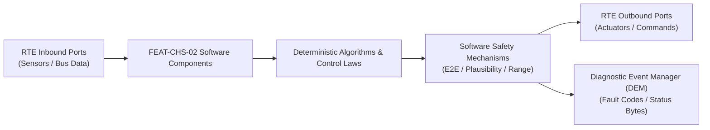

# Software Requirements Specification: Steer-by-Wire Handwheel & Rack Control (SbW)
**Feature ID:** `FEAT-CHS-02`  
**Domain:** Vehicle Motion & Chassis Control  
**Target ASIL:** ASIL D  
**Compliance Standard:** ISO 26262:2018 (Part 6 - Software Development) / ASPICE PAM v3.1 (SWE.1, SWE.2)  
**Parent System Specification:** [`FEAT-CHS-02_SbW_SysReq.md`](file:///c:/Workset/AntiGravityProjects/TestOptimisationExperiement/system_requirements/FEAT-CHS-02_SbW_SysReq.md)  
**Global Master Specification:** [`spec.md`](file:///c:/Workset/AntiGravityProjects/TestOptimisationExperiement/spec.md)

---

## 1. Software Architecture & Component Structure

This document specifies the AUTOSAR Software Components (SWCs), periodic runnables, algorithmic laws, safety mechanisms, and data ports implementing `FEAT-CHS-02` (Steer-by-Wire Handwheel & Rack Control (SbW)).

### AUTOSAR SWC Interaction Diagram

---

## 2. Detailed Software Requirements (SWR_REQ)
*(Multi-Software Requirement Partitioning derived from System Requirements)*

### `SWR-CHS-02-01`: The Swc_HwaSensorAcquisition SHALL sample three galvanically
- **Planned Release:** R400
- **ASIL Rating:** ASIL D
- **Parent System Requirement:** [`SYS-CHS-02-01`](file:///c:/Workset/AntiGravityProjects/TestOptimisationExperiement/system_requirements/FEAT-CHS-02_SbW_SysReq.md#sys-chs-02-01)
- **Allocated AUTOSAR SWC:** `Swc_HwaSensorAcquisition`
- **Execution Rate / Trigger:** 1 ms
- **Worst-Case Execution Time (WCET):** 0.35 ms
- **Software Activation Condition:** Executed cyclically every 1 ms.
- **Algorithmic Description / Logic:**
  > The Swc_HwaSensorAcquisition SHALL sample three galvanically isolated handwheel angular position sensor channels (HWA_Raw_Angle_Ch1, Ch2, Ch3) via SENT/SPI interfaces at 1000 Hz, apply a 2nd-order Butterworth low-pass filter (cutoff frequency 60 Hz), and detect electrical interface protocol CRC errors within <= 1.0 ms.
- **Software Safety Mechanism:** FTTI budget 1.0 ms
- **Failure Reaction & DEM Diagnostic Event:** FTTI budget 1.0 ms; if interface CRC fails for 2 consecutive cycles, invoke Dem_SetEventStatus(DEM_EVENT_HWA_COMM_FAIL_CHx, DEM_EVENT_STATUS_FAILED) and mask faulted channel.
- **Software Port Inputs:** `HWA_Raw_Angle_Ch1_SENT (uint16, LSB 0.02 deg, 0-65535), HWA_Raw_Angle_Ch2_SENT (uint16, LSB 0.02 deg, 0-65535), HWA_Raw_Angle_Ch3_SPI (uint16, LSB 0.02 deg, 0-65535), Sensor_Supply_Valid_Flags (uint8, bool array, 0-7)`
- **Software Port Outputs:** `HWA_Filt_Angle_Ch1_Deg (float32, deg, -720.0 to +720.0), HWA_Filt_Angle_Ch2_Deg (float32, deg, -720.0 to +720.0), HWA_Filt_Angle_Ch3_Deg (float32, deg, -720.0 to +720.0), HWA_Interface_Error_Mask (uint8, bitmask, 0-7)`
- **Software Verification Criteria:** Unit & HiL test verification: Injected bit flips and 100 Hz electrical noise attenuated by >= 18 dB; protocol CRC checksum failures flagged within exactly 1 cyclic execution tick (1 ms).
- **Traceability Link:** Traces upward to [`SYS-CHS-02-01`](file:///c:/Workset/AntiGravityProjects/TestOptimisationExperiement/system_requirements/FEAT-CHS-02_SbW_SysReq.md#sys-chs-02-01) and [`FEAT-CHS-02`](file:///c:/Workset/AntiGravityProjects/TestOptimisationExperiement/spec.md).

### `SWR-CHS-02-02`: The Swc_HandwheelVoter SHALL execute a 2-out-of-3 (2oo3) tri
- **Planned Release:** R400
- **ASIL Rating:** ASIL D
- **Parent System Requirement:** [`SYS-CHS-02-01`](file:///c:/Workset/AntiGravityProjects/TestOptimisationExperiement/system_requirements/FEAT-CHS-02_SbW_SysReq.md#sys-chs-02-01)
- **Allocated AUTOSAR SWC:** `Swc_HandwheelVoter`
- **Execution Rate / Trigger:** 1 ms
- **Worst-Case Execution Time (WCET):** 0.35 ms
- **Software Activation Condition:** Executed cyclically every 1 ms.
- **Algorithmic Description / Logic:**
  > The Swc_HandwheelVoter SHALL execute a 2-out-of-3 (2oo3) triple modular redundancy algorithm on HWA_Filt_Angle_Ch1_Deg, Ch2_Deg, and Ch3_Deg: compute pairwise absolute deviations |Ch1 - Ch2|, |Ch2 - Ch3|, and |Ch3 - Ch1|; if all deviations are <= 0.50°, select the median value as HWA_Voted_Angle_Deg; if one channel deviates by > 0.50°, isolate that channel and output the arithmetic mean of the remaining two channels.
- **Software Safety Mechanism:** FTTI budget 2.0 ms
- **Failure Reaction & DEM Diagnostic Event:** FTTI budget 2.0 ms; if single channel diverges > 0.50° for 3 consecutive cycles (3 ms), report Dem event DEM_EVENT_HWA_SENSOR_MISMATCH; transition voter status to DEGRADED_2CH.
- **Software Port Inputs:** `HWA_Filt_Angle_Ch1_Deg (float32, deg, -720.0 to +720.0), HWA_Filt_Angle_Ch2_Deg (float32, deg, -720.0 to +720.0), HWA_Filt_Angle_Ch3_Deg (float32, deg, -720.0 to +720.0), HWA_Interface_Error_Mask (uint8, bitmask, 0-7)`
- **Software Port Outputs:** `HWA_Voted_Angle_Deg (float32, deg, -720.0 to +720.0), HWA_Voter_State_Enum (uint8, enum [ALL_HEALTHY=0, CH1_FAULT=1, CH2_FAULT=2, CH3_FAULT=3, DUAL_FAULT=4], 0-4), HWA_Voter_Confidence_Pct (float32, %, 0.0 to 100.0)`
- **Software Verification Criteria:** 100% MC/DC coverage test: Injected step error of +1.0° on any single sensor channel results in HWA_Voted_Angle_Deg shifting by < 0.05° within 1 ms execution step.
- **Traceability Link:** Traces upward to [`SYS-CHS-02-01`](file:///c:/Workset/AntiGravityProjects/TestOptimisationExperiement/system_requirements/FEAT-CHS-02_SbW_SysReq.md#sys-chs-02-01) and [`FEAT-CHS-02`](file:///c:/Workset/AntiGravityProjects/TestOptimisationExperiement/spec.md).

### `SWR-CHS-02-03`: The Swc_HandwheelVoter SHALL transition to DUAL_FAULT lock s
- **Planned Release:** R400
- **ASIL Rating:** ASIL D
- **Parent System Requirement:** [`SYS-CHS-02-01`](file:///c:/Workset/AntiGravityProjects/TestOptimisationExperiement/system_requirements/FEAT-CHS-02_SbW_SysReq.md#sys-chs-02-01)
- **Allocated AUTOSAR SWC:** `Swc_HandwheelVoter`
- **Execution Rate / Trigger:** 1 ms
- **Worst-Case Execution Time (WCET):** 0.35 ms
- **Software Activation Condition:** Executed cyclically every 1 ms.
- **Algorithmic Description / Logic:**
  > The Swc_HandwheelVoter SHALL transition to DUAL_FAULT lock state if two or more sensor channels diverge by > 0.50° from each other simultaneously or exhibit protocol communication failures, latching the last validated handwheel angle value and asserting HWA_Critical_Sensor_Fail_Flag to True within <= 1.0 ms.
- **Software Safety Mechanism:** FTTI budget 2.0 ms
- **Failure Reaction & DEM Diagnostic Event:** FTTI budget 2.0 ms; DTC latch C10A1-00 (Steering Angle Triple Redundancy Quorum Lost); trigger Dem_SetEventStatus(DEM_EVENT_HWA_QUORUM_FAIL, DEM_EVENT_STATUS_FAILED); escalate to EMERGENCY_SAFE_STOP.
- **Software Port Inputs:** `HWA_Filt_Angle_Ch1_Deg (float32, deg, -720.0 to +720.0), HWA_Filt_Angle_Ch2_Deg (float32, deg, -720.0 to +720.0), HWA_Filt_Angle_Ch3_Deg (float32, deg, -720.0 to +720.0), HWA_Interface_Error_Mask (uint8, bitmask, 0-7)`
- **Software Port Outputs:** `HWA_Critical_Sensor_Fail_Flag (boolean, bool, 0 or 1), HWA_Voted_Angle_Deg (float32, deg, latched safe value)`
- **Software Verification Criteria:** HiL bench test: Simulating simultaneous loss of Ch1 and Ch2 causes HWA_Critical_Sensor_Fail_Flag to assert within <= 1 ms and locks angle output without uncommanded jumps.
- **Traceability Link:** Traces upward to [`SYS-CHS-02-01`](file:///c:/Workset/AntiGravityProjects/TestOptimisationExperiement/system_requirements/FEAT-CHS-02_SbW_SysReq.md#sys-chs-02-01) and [`FEAT-CHS-02`](file:///c:/Workset/AntiGravityProjects/TestOptimisationExperiement/spec.md).

### `SWR-CHS-02-04`: The Swc_HwtSensorAcquisition SHALL acquire dual galvanically
- **Planned Release:** R100
- **ASIL Rating:** ASIL D
- **Parent System Requirement:** [`SYS-CHS-02-02`](file:///c:/Workset/AntiGravityProjects/TestOptimisationExperiement/system_requirements/FEAT-CHS-02_SbW_SysReq.md#sys-chs-02-02)
- **Allocated AUTOSAR SWC:** `Swc_HwtSensorAcquisition`
- **Execution Rate / Trigger:** 1 ms
- **Worst-Case Execution Time (WCET):** 0.35 ms
- **Software Activation Condition:** Executed cyclically every 1 ms.
- **Algorithmic Description / Logic:**
  > The Swc_HwtSensorAcquisition SHALL acquire dual galvanically isolated analog torsion-bar torque voltage signals (HWT_Raw_Volt_Ch1, Ch2) via dual 12-bit ADC channels at 1000 Hz, convert them to physical driver handwheel torque (HWT_Torque_Ch1_Nm, Ch2_Nm) using calibrated linear sensitivity slopes (1.50 Nm/V), and apply a 0.05 Nm deadband filter.
- **Software Safety Mechanism:** FTTI budget 1.0 ms
- **Failure Reaction & DEM Diagnostic Event:** FTTI budget 1.0 ms; if ADC voltage lies outside 200 mV - 4800 mV rail limits, report Dem event DEM_EVENT_HWT_SENSOR_OUT_OF_RANGE.
- **Software Port Inputs:** `ADC_HWT_Ch1_Volt (uint16, mV, 0 to 5000), ADC_HWT_Ch2_Volt (uint16, mV, 0 to 5000), ADC_Reference_Valid_Flag (boolean, bool, 0 or 1)`
- **Software Port Outputs:** `HWT_Torque_Ch1_Nm (float32, Nm, -30.0 to +30.0), HWT_Torque_Ch2_Nm (float32, Nm, -30.0 to +30.0), HWT_Acquisition_Healthy_Flag (boolean, bool, 0 or 1)`
- **Software Verification Criteria:** SiL test: Linear torque range across -25 Nm to +25 Nm verified with precision error <= 0.05 Nm; deadband suppresses all thermal drift oscillations < 0.05 Nm.
- **Traceability Link:** Traces upward to [`SYS-CHS-02-02`](file:///c:/Workset/AntiGravityProjects/TestOptimisationExperiement/system_requirements/FEAT-CHS-02_SbW_SysReq.md#sys-chs-02-02) and [`FEAT-CHS-02`](file:///c:/Workset/AntiGravityProjects/TestOptimisationExperiement/spec.md).

### `SWR-CHS-02-05`: The Swc_HwtSensorAcquisition SHALL evaluate cross-channel pl
- **Planned Release:** R100
- **ASIL Rating:** ASIL D
- **Parent System Requirement:** [`SYS-CHS-02-02`](file:///c:/Workset/AntiGravityProjects/TestOptimisationExperiement/system_requirements/FEAT-CHS-02_SbW_SysReq.md#sys-chs-02-02)
- **Allocated AUTOSAR SWC:** `Swc_HwtSensorAcquisition`
- **Execution Rate / Trigger:** 1 ms
- **Worst-Case Execution Time (WCET):** 0.35 ms
- **Software Activation Condition:** Executed cyclically every 1 ms.
- **Algorithmic Description / Logic:**
  > The Swc_HwtSensorAcquisition SHALL evaluate cross-channel plausibility |HWT_Torque_Ch1_Nm - HWT_Torque_Ch2_Nm|; if the difference exceeds 0.40 Nm for longer than 3 consecutive milliseconds, flag HWT_Torque_Plausibility_Fault, latch the last plausible mean torque, and clamp the rate of torque change to <= 100.0 Nm/s.
- **Software Safety Mechanism:** FTTI budget 4.0 ms
- **Failure Reaction & DEM Diagnostic Event:** FTTI budget 4.0 ms; latch DTC C10A2-1C (Handwheel Torque Transducer Signal Plausibility Failure); call Dem_SetEventStatus(DEM_EVENT_HWT_DISAGREE, DEM_EVENT_STATUS_FAILED).
- **Software Port Inputs:** `HWT_Torque_Ch1_Nm (float32, Nm, -30.0 to +30.0), HWT_Torque_Ch2_Nm (float32, Nm, -30.0 to +30.0)`
- **Software Port Outputs:** `HWA_Driver_Torque_Nm (float32, Nm, -30.0 to +30.0), HWT_Torque_Plausibility_Fault (boolean, bool, 0 or 1), HWT_Valid_Channels_Count (uint8, count, 0 to 2)`
- **Software Verification Criteria:** HiL fault injection test: Injected skew of 0.6 Nm causes HWT_Torque_Plausibility_Fault assertion at exactly 4 ms (3 ticks of qualification + 1 tick detection).
- **Traceability Link:** Traces upward to [`SYS-CHS-02-02`](file:///c:/Workset/AntiGravityProjects/TestOptimisationExperiement/system_requirements/FEAT-CHS-02_SbW_SysReq.md#sys-chs-02-02) and [`FEAT-CHS-02`](file:///c:/Workset/AntiGravityProjects/TestOptimisationExperiement/spec.md).

### `SWR-CHS-02-06`: The Swc_RackMotionController SHALL interpolate the Target_Ro
- **Planned Release:** R400
- **ASIL Rating:** ASIL D
- **Parent System Requirement:** [`SYS-CHS-02-03`](file:///c:/Workset/AntiGravityProjects/TestOptimisationExperiement/system_requirements/FEAT-CHS-02_SbW_SysReq.md#sys-chs-02-03)
- **Allocated AUTOSAR SWC:** `Swc_RackMotionController`
- **Execution Rate / Trigger:** 1 ms
- **Worst-Case Execution Time (WCET):** 0.35 ms
- **Software Activation Condition:** Executed cyclically every 1 ms.
- **Algorithmic Description / Logic:**
  > The Swc_RackMotionController SHALL interpolate the Target_Roadwheel_Angle_Deg request at 1000 Hz using a cubic jerk-bounded trajectory filter (maximum angular velocity 65.0 °/s, maximum angular acceleration 450.0 °/s², jerk limit 2500.0 °/s³) to generate continuous position and feedforward velocity setpoints.
- **Software Safety Mechanism:** FTTI budget 2.0 ms
- **Failure Reaction & DEM Diagnostic Event:** FTTI budget 2.0 ms; if target input jumps by > 15.0° in 1 ms (violating physical continuity), clamp to jerk limit and report DEM_EVENT_RACK_TRAJECTORY_SATURATION.
- **Software Port Inputs:** `Target_Roadwheel_Angle_Deg (float32, deg, -45.0 to +45.0), Vehicle_Speed_Kmph (float32, km/h, 0.0 to 250.0)`
- **Software Port Outputs:** `RWA_Profiled_Target_Angle_Deg (float32, deg, -45.0 to +45.0), RWA_Feedforward_Velocity_DegS (float32, deg/s, -65.0 to +65.0)`
- **Software Verification Criteria:** SiL unit test: Step demand of 20.0° roadwheel angle outputs smooth trajectory without overshoot; peak acceleration strictly <= 450.0 °/s².
- **Traceability Link:** Traces upward to [`SYS-CHS-02-03`](file:///c:/Workset/AntiGravityProjects/TestOptimisationExperiement/system_requirements/FEAT-CHS-02_SbW_SysReq.md#sys-chs-02-03) and [`FEAT-CHS-02`](file:///c:/Workset/AntiGravityProjects/TestOptimisationExperiement/spec.md).

### `SWR-CHS-02-07`: The Swc_RackMotionController SHALL execute a cascaded closed
- **Planned Release:** R400
- **ASIL Rating:** ASIL D
- **Parent System Requirement:** [`SYS-CHS-02-03`](file:///c:/Workset/AntiGravityProjects/TestOptimisationExperiement/system_requirements/FEAT-CHS-02_SbW_SysReq.md#sys-chs-02-03)
- **Allocated AUTOSAR SWC:** `Swc_RackMotionController`
- **Execution Rate / Trigger:** 1 ms
- **Worst-Case Execution Time (WCET):** 0.35 ms
- **Software Activation Condition:** Executed cyclically every 1 ms.
- **Algorithmic Description / Logic:**
  > The Swc_RackMotionController SHALL execute a cascaded closed-loop control law comprising an outer position proportional loop (Kp_pos = 12.5 s⁻¹), an inner velocity PI loop (Kp_vel = 0.85 Nms/deg, Ki_vel = 4.2 Nm/deg), and friction feedforward compensation to compute the total requested rack steering force RWA_Demanded_Rack_Force_N.
- **Software Safety Mechanism:** FTTI budget 3.0 ms
- **Failure Reaction & DEM Diagnostic Event:** FTTI budget 3.0 ms; if |RWA_Position_Tracking_Error_Deg| > 0.80° for > 15 ms, assert DEM_EVENT_RACK_SERVO_LAG and trigger safety envelope check.
- **Software Port Inputs:** `RWA_Profiled_Target_Angle_Deg (float32, deg, -45.0 to +45.0), RWA_Feedforward_Velocity_DegS (float32, deg/s, -65.0 to +65.0), RWA_Actual_Roadwheel_Angle_Deg (float32, deg, -45.0 to +45.0), RWA_Actual_Angular_Velocity_DegS (float32, deg/s, -80.0 to +80.0)`
- **Software Port Outputs:** `RWA_Demanded_Rack_Force_N (float32, N, -15000.0 to +15000.0), RWA_Position_Tracking_Error_Deg (float32, deg, -5.0 to +5.0)`
- **Software Verification Criteria:** Dynamometer HIL test: Closed-loop -3 dB bandwidth >= 18.0 Hz; steady-state tracking error <= 0.08° under 8.0 kN dynamic rack load.
- **Traceability Link:** Traces upward to [`SYS-CHS-02-03`](file:///c:/Workset/AntiGravityProjects/TestOptimisationExperiement/system_requirements/FEAT-CHS-02_SbW_SysReq.md#sys-chs-02-03) and [`FEAT-CHS-02`](file:///c:/Workset/AntiGravityProjects/TestOptimisationExperiement/spec.md).

### `SWR-CHS-02-08`: The Swc_RackMotionController SHALL convert RWA_Demanded_Rack
- **Planned Release:** R400
- **ASIL Rating:** ASIL D
- **Parent System Requirement:** [`SYS-CHS-02-03`](file:///c:/Workset/AntiGravityProjects/TestOptimisationExperiement/system_requirements/FEAT-CHS-02_SbW_SysReq.md#sys-chs-02-03)
- **Allocated AUTOSAR SWC:** `Swc_RackMotionController`
- **Execution Rate / Trigger:** 1 ms
- **Worst-Case Execution Time (WCET):** 0.35 ms
- **Software Activation Condition:** Executed cyclically every 1 ms.
- **Algorithmic Description / Logic:**
  > The Swc_RackMotionController SHALL convert RWA_Demanded_Rack_Force_N into target electromagnetic motor torque demands for the dual PMSM actuators using the steering rack ball-screw lead ratio (10.0 mm/rev) and internal transmission efficiency (92.0%), limiting the maximum motor shaft torque demand to <= 45.0 Nm per winding.
- **Software Safety Mechanism:** FTTI budget 1.0 ms
- **Failure Reaction & DEM Diagnostic Event:** FTTI budget 1.0 ms; if torque demand exceeds 90.0 Nm for > 200 ms, trigger DEM_EVENT_RACK_FORCE_OVERLOAD and clamp output to 90.0 Nm.
- **Software Port Inputs:** `RWA_Demanded_Rack_Force_N (float32, N, -15000.0 to +15000.0), Gearbox_Thermal_Efficiency_Factor (float32, scalar, 0.80 to 0.98)`
- **Software Port Outputs:** `RWA_Total_Motor_Torque_Demand_Nm (float32, Nm, -90.0 to +90.0), RWA_Torque_Saturation_Active_Flag (boolean, bool, 0 or 1)`
- **Software Verification Criteria:** SiL mathematical test: 12.0 kN rack force converts to 22.82 Nm total motor shaft torque at 92% efficiency; output matches within +-0.02 Nm.
- **Traceability Link:** Traces upward to [`SYS-CHS-02-03`](file:///c:/Workset/AntiGravityProjects/TestOptimisationExperiement/system_requirements/FEAT-CHS-02_SbW_SysReq.md#sys-chs-02-03) and [`FEAT-CHS-02`](file:///c:/Workset/AntiGravityProjects/TestOptimisationExperiement/spec.md).

### `SWR-CHS-02-09`: The Swc_RoadFeelSynthesizer SHALL calculate tire self-aligni
- **Planned Release:** R100
- **ASIL Rating:** ASIL D
- **Parent System Requirement:** [`SYS-CHS-02-04`](file:///c:/Workset/AntiGravityProjects/TestOptimisationExperiement/system_requirements/FEAT-CHS-02_SbW_SysReq.md#sys-chs-02-04)
- **Allocated AUTOSAR SWC:** `Swc_RoadFeelSynthesizer`
- **Execution Rate / Trigger:** 1 ms
- **Worst-Case Execution Time (WCET):** 0.35 ms
- **Software Activation Condition:** Executed cyclically every 1 ms.
- **Algorithmic Description / Logic:**
  > The Swc_RoadFeelSynthesizer SHALL calculate tire self-aligning moment Mz using a semi-empirical Pacejka brush tire model based on estimated front axle lateral force Fy, pneumatic trail tp, and mechanical trail tm: Mz = Fy * (tp + tm), attenuating pneumatic trail tp as front tire lateral slip angle exceeds peak grip limit (alpha > 6.0°).
- **Software Safety Mechanism:** FTTI budget 2.0 ms
- **Failure Reaction & DEM Diagnostic Event:** FTTI budget 2.0 ms; if road friction estimate is invalid, fallback to nominal dry asphalt mu = 0.85 lookup table and report DEM_EVENT_MU_ESTIMATE_INVALID.
- **Software Port Inputs:** `Front_Axle_Lateral_Force_Est_N (float32, N, -12000.0 to +12000.0), Front_Tire_Sideslip_Angle_Rad (float32, rad, -0.25 to +0.25), Vehicle_Speed_Mps (float32, m/s, 0.0 to 70.0), Road_Friction_Mu_Est (float32, scalar, 0.1 to 1.0)`
- **Software Port Outputs:** `Synthesized_Tire_Aligning_Moment_Nm (float32, Nm, -250.0 to +250.0), Pneumatic_Trail_Current_M (float32, m, 0.0 to 0.045)`
- **Software Verification Criteria:** Simulation validation: Mz reaches peak at alpha = 4.0° and drops by 60% as alpha approaches 12.0° on mu = 0.3 ice surface, providing realistic loss-of-grip feedback.
- **Traceability Link:** Traces upward to [`SYS-CHS-02-04`](file:///c:/Workset/AntiGravityProjects/TestOptimisationExperiement/system_requirements/FEAT-CHS-02_SbW_SysReq.md#sys-chs-02-04) and [`FEAT-CHS-02`](file:///c:/Workset/AntiGravityProjects/TestOptimisationExperiement/spec.md).

### `SWR-CHS-02-10`: The Swc_RoadFeelSynthesizer SHALL scale Synthesized_Tire_Ali
- **Planned Release:** R100
- **ASIL Rating:** ASIL D
- **Parent System Requirement:** [`SYS-CHS-02-04`](file:///c:/Workset/AntiGravityProjects/TestOptimisationExperiement/system_requirements/FEAT-CHS-02_SbW_SysReq.md#sys-chs-02-04)
- **Allocated AUTOSAR SWC:** `Swc_RoadFeelSynthesizer`
- **Execution Rate / Trigger:** 1 ms
- **Worst-Case Execution Time (WCET):** 0.35 ms
- **Software Activation Condition:** Executed cyclically every 1 ms.
- **Algorithmic Description / Logic:**
  > The Swc_RoadFeelSynthesizer SHALL scale Synthesized_Tire_Aligning_Moment_Nm into baseline driver handwheel feedback torque HWA_Base_Feedback_Torque_Nm through a 2D speed-dependent boost curve: applying high assist (low torque ratio 1:35) at vehicle speeds < 20 km/h, transitioning smoothly to firm highway feel (torque ratio 1:18) at speeds > 100 km/h.
- **Software Safety Mechanism:** FTTI budget 2.0 ms
- **Failure Reaction & DEM Diagnostic Event:** FTTI budget 2.0 ms; if drive mode CAN frame times out, default to NORMAL mode boost mapping and report DEM_EVENT_HMI_MODE_TIMEOUT.
- **Software Port Inputs:** `Synthesized_Tire_Aligning_Moment_Nm (float32, Nm, -250.0 to +250.0), Vehicle_Speed_Kmph (float32, km/h, 0.0 to 250.0), Drive_Mode_Selection_Enum (uint8, enum [COMFORT=0, NORMAL=1, SPORT=2], 0-2)`
- **Software Port Outputs:** `HWA_Base_Feedback_Torque_Nm (float32, Nm, -7.5 to +7.5), HWA_Boost_Ratio_Active (float32, scalar, 15.0 to 40.0)`
- **Software Verification Criteria:** HiL automated test: Handwheel feedback torque strictly bounded within +-7.5 Nm across all speed ranges and driving modes; sport mode increases torque by exactly 25% over comfort mode.
- **Traceability Link:** Traces upward to [`SYS-CHS-02-04`](file:///c:/Workset/AntiGravityProjects/TestOptimisationExperiement/system_requirements/FEAT-CHS-02_SbW_SysReq.md#sys-chs-02-04) and [`FEAT-CHS-02`](file:///c:/Workset/AntiGravityProjects/TestOptimisationExperiement/spec.md).

### `SWR-CHS-02-11`: The Swc_RoadFeelSynthesizer SHALL compute dynamic handwheel 
- **Planned Release:** R100
- **ASIL Rating:** ASIL D
- **Parent System Requirement:** [`SYS-CHS-02-04`](file:///c:/Workset/AntiGravityProjects/TestOptimisationExperiement/system_requirements/FEAT-CHS-02_SbW_SysReq.md#sys-chs-02-04)
- **Allocated AUTOSAR SWC:** `Swc_RoadFeelSynthesizer`
- **Execution Rate / Trigger:** 1 ms
- **Worst-Case Execution Time (WCET):** 0.35 ms
- **Software Activation Condition:** Executed cyclically every 1 ms.
- **Algorithmic Description / Logic:**
  > The Swc_RoadFeelSynthesizer SHALL compute dynamic handwheel damping torque (T_damp = -D_steer(v) * dTheta_hw/dt) and virtual inertia compensation (T_iner = -J_comp * d²Theta_hw/dt²) to suppress high-speed handwheel oscillations, bounding total synthesized handwheel feedback torque demand to <= 8.50 Nm.
- **Software Safety Mechanism:** FTTI budget 2.0 ms
- **Failure Reaction & DEM Diagnostic Event:** FTTI budget 2.0 ms; if HWA_Handwheel_Velocity_DegS exceeds 1800 °/s, clamp damping torque to 3.0 Nm to avoid resisting emergency evasive driver maneuvers.
- **Software Port Inputs:** `HWA_Handwheel_Velocity_DegS (float32, deg/s, -2000.0 to +2000.0), HWA_Handwheel_Acceleration_DegS2 (float32, deg/s², -15000.0 to +15000.0), Vehicle_Speed_Kmph (float32, km/h, 0.0 to 250.0)`
- **Software Port Outputs:** `HWA_Total_Demand_Torque_Nm (float32, Nm, -8.5 to +8.5), HWA_Damping_Torque_Component_Nm (float32, Nm, -3.0 to +3.0)`
- **Software Verification Criteria:** Frequency sweep test: System exhibits phase margin >= 45° across 0.1 Hz to 15 Hz handwheel disturbance inputs; zero limit-cycle self-oscillation at 140 km/h.
- **Traceability Link:** Traces upward to [`SYS-CHS-02-04`](file:///c:/Workset/AntiGravityProjects/TestOptimisationExperiement/system_requirements/FEAT-CHS-02_SbW_SysReq.md#sys-chs-02-04) and [`FEAT-CHS-02`](file:///c:/Workset/AntiGravityProjects/TestOptimisationExperiement/spec.md).

### `SWR-CHS-02-12`: The Swc_SteeringRatioManager SHALL calculate the instantaneo
- **Planned Release:** R400
- **ASIL Rating:** ASIL D
- **Parent System Requirement:** [`SYS-CHS-02-05`](file:///c:/Workset/AntiGravityProjects/TestOptimisationExperiement/system_requirements/FEAT-CHS-02_SbW_SysReq.md#sys-chs-02-05)
- **Allocated AUTOSAR SWC:** `Swc_SteeringRatioManager`
- **Execution Rate / Trigger:** 5 ms
- **Worst-Case Execution Time (WCET):** 0.35 ms
- **Software Activation Condition:** Executed cyclically every 5 ms.
- **Algorithmic Description / Logic:**
  > The Swc_SteeringRatioManager SHALL calculate the instantaneous variable steering gear ratio G_ratio(v) using a sigmoid interpolation function between G_parking = 8.2:1 (at vehicle speed 0 km/h) and G_highway = 16.2:1 (at vehicle speed >= 120 km/h): G_ratio(v) = G_parking + (G_highway - G_parking) / (1 + exp(-(v - 45.0) / 12.0)).
- **Software Safety Mechanism:** FTTI budget 5.0 ms
- **Failure Reaction & DEM Diagnostic Event:** FTTI budget 5.0 ms; if Vehicle_Speed_Valid_Flag is False, lock Active_Steering_Gear_Ratio to safe fixed baseline 13.8:1 and report DEM_EVENT_SPEED_INVALID.
- **Software Port Inputs:** `Filtered_Vehicle_Speed_Kmph (float32, km/h, 0.0 to 250.0), Vehicle_Speed_Valid_Flag (boolean, bool, 0 or 1)`
- **Software Port Outputs:** `Active_Steering_Gear_Ratio (float32, ratio, 8.2 to 16.2), VSR_Algorithm_State_Enum (uint8, enum, 0-3)`
- **Software Verification Criteria:** Mathematical unit test: At v = 0 km/h, ratio is 8.20 +- 0.05; at v = 45 km/h, ratio is 12.20 +- 0.05; at v = 120 km/h, ratio is 16.20 +- 0.05; curve is strictly monotonic and continuously differentiable.
- **Traceability Link:** Traces upward to [`SYS-CHS-02-05`](file:///c:/Workset/AntiGravityProjects/TestOptimisationExperiement/system_requirements/FEAT-CHS-02_SbW_SysReq.md#sys-chs-02-05) and [`FEAT-CHS-02`](file:///c:/Workset/AntiGravityProjects/TestOptimisationExperiement/spec.md).

### `SWR-CHS-02-13`: The Swc_SteeringRatioManager SHALL calculate Target_Roadwhee
- **Planned Release:** R400
- **ASIL Rating:** ASIL D
- **Parent System Requirement:** [`SYS-CHS-02-05`](file:///c:/Workset/AntiGravityProjects/TestOptimisationExperiement/system_requirements/FEAT-CHS-02_SbW_SysReq.md#sys-chs-02-05)
- **Allocated AUTOSAR SWC:** `Swc_SteeringRatioManager`
- **Execution Rate / Trigger:** 5 ms
- **Worst-Case Execution Time (WCET):** 0.35 ms
- **Software Activation Condition:** Executed cyclically every 5 ms.
- **Algorithmic Description / Logic:**
  > The Swc_SteeringRatioManager SHALL calculate Target_Roadwheel_Angle_Deg = HWA_Voted_Angle_Deg / Active_Steering_Gear_Ratio, applying a dynamic rate-of-change slope limiter on Active_Steering_Gear_Ratio of |dG/dt| <= 0.75 units/second to prevent sudden uncommanded vehicle yaw transients during rapid vehicle acceleration or braking.
- **Software Safety Mechanism:** FTTI budget 5.0 ms
- **Failure Reaction & DEM Diagnostic Event:** FTTI budget 5.0 ms; if Target_Roadwheel_Angle_Deg exceeds physical rack maximum limit +-44.5°, clamp target angle to +-44.5° and report DEM_EVENT_ANGLE_TARGET_CLAMPED.
- **Software Port Inputs:** `HWA_Voted_Angle_Deg (float32, deg, -720.0 to +720.0), Active_Steering_Gear_Ratio (float32, ratio, 8.2 to 16.2)`
- **Software Port Outputs:** `Target_Roadwheel_Angle_Deg (float32, deg, -45.0 to +45.0), Ratio_Rate_Limited_Flag (boolean, bool, 0 or 1)`
- **Software Verification Criteria:** HiL simulation: Step change in vehicle speed from 0 to 100 km/h in 3.0 seconds limits ratio transition rate to <= 0.75/s; resulting roadwheel angle deviation remains <= 0.15°.
- **Traceability Link:** Traces upward to [`SYS-CHS-02-05`](file:///c:/Workset/AntiGravityProjects/TestOptimisationExperiement/system_requirements/FEAT-CHS-02_SbW_SysReq.md#sys-chs-02-05) and [`FEAT-CHS-02`](file:///c:/Workset/AntiGravityProjects/TestOptimisationExperiement/spec.md).

### `SWR-CHS-02-14`: The Swc_RwaSensorAcquisition SHALL decode dual 16-bit Resolv
- **Planned Release:** R100
- **ASIL Rating:** ASIL D
- **Parent System Requirement:** [`SYS-CHS-02-06`](file:///c:/Workset/AntiGravityProjects/TestOptimisationExperiement/system_requirements/FEAT-CHS-02_SbW_SysReq.md#sys-chs-02-06)
- **Allocated AUTOSAR SWC:** `Swc_RwaSensorAcquisition`
- **Execution Rate / Trigger:** 1 ms
- **Worst-Case Execution Time (WCET):** 0.35 ms
- **Software Activation Condition:** Executed cyclically every 1 ms.
- **Algorithmic Description / Logic:**
  > The Swc_RwaSensorAcquisition SHALL decode dual 16-bit Resolver-to-Digital Converter (RDC) SPI data streams representing motor rotor electrical angles for Actuator Channel 1 and Actuator Channel 2 at 1000 Hz, compute multi-turn absolute rack linear displacement (mm) using calibrated non-volatile zero-offset parameters, and derive roadwheel angle with resolution <= 0.005°.
- **Software Safety Mechanism:** FTTI budget 1.0 ms
- **Failure Reaction & DEM Diagnostic Event:** FTTI budget 1.0 ms; if RDC hardware flags loss-of-signal (LOS) or loss-of-tracking (LOT), isolate affected channel and assert DEM_EVENT_RESOLVER_HARDWARE_FAULT.
- **Software Port Inputs:** `RDC1_Raw_Position_Ticks (uint16, ticks, 0 to 65535), RDC2_Raw_Position_Ticks (uint16, ticks, 0 to 65535), NVM_Rack_Zero_Offset_Mm (float32, mm, -5.0 to +5.0)`
- **Software Port Outputs:** `RWA_Angle_Ch1_Deg (float32, deg, -45.0 to +45.0), RWA_Angle_Ch2_Deg (float32, deg, -45.0 to +45.0), RWA_Rack_Displacement_Ch1_Mm (float32, mm, -95.0 to +95.0), RWA_Rack_Displacement_Ch2_Mm (float32, mm, -95.0 to +95.0)`
- **Software Verification Criteria:** Test bench calibration: Linearity error over full +-90 mm rack travel is <= 0.02 mm; repeat accuracy between consecutive homing cycles <= 0.01 mm.
- **Traceability Link:** Traces upward to [`SYS-CHS-02-06`](file:///c:/Workset/AntiGravityProjects/TestOptimisationExperiement/system_requirements/FEAT-CHS-02_SbW_SysReq.md#sys-chs-02-06) and [`FEAT-CHS-02`](file:///c:/Workset/AntiGravityProjects/TestOptimisationExperiement/spec.md).

### `SWR-CHS-02-15`: The Swc_RwaCrossMonitor SHALL compare |RWA_Angle_Ch1_Deg - R
- **Planned Release:** R100
- **ASIL Rating:** ASIL D
- **Parent System Requirement:** [`SYS-CHS-02-06`](file:///c:/Workset/AntiGravityProjects/TestOptimisationExperiement/system_requirements/FEAT-CHS-02_SbW_SysReq.md#sys-chs-02-06)
- **Allocated AUTOSAR SWC:** `Swc_RwaCrossMonitor`
- **Execution Rate / Trigger:** 1 ms
- **Worst-Case Execution Time (WCET):** 0.35 ms
- **Software Activation Condition:** Executed cyclically every 1 ms.
- **Algorithmic Description / Logic:**
  > The Swc_RwaCrossMonitor SHALL compare |RWA_Angle_Ch1_Deg - RWA_Angle_Ch2_Deg| at 1000 Hz: if divergence <= 0.12° roadwheel angle, output RWA_Actual_Roadwheel_Angle_Deg as the arithmetic average; if divergence > 0.12° for > 2.0 ms, trigger a secondary kinematically decoupled motor back-EMF observer to identify and isolate the corrupted resolver channel within <= 3.0 ms.
- **Software Safety Mechanism:** FTTI budget 3.0 ms
- **Failure Reaction & DEM Diagnostic Event:** FTTI budget 3.0 ms; latch DTC C10A3-62 (Roadwheel Rack Resolver Channel Divergence); call Dem_SetEventStatus(DEM_EVENT_RESOLVER_MISMATCH, DEM_EVENT_STATUS_FAILED).
- **Software Port Inputs:** `RWA_Angle_Ch1_Deg (float32, deg, -45.0 to +45.0), RWA_Angle_Ch2_Deg (float32, deg, -45.0 to +45.0), Motor1_BackEMF_Speed_RadS (float32, rad/s, -500.0 to +500.0), Motor2_BackEMF_Speed_RadS (float32, rad/s, -500.0 to +500.0)`
- **Software Port Outputs:** `RWA_Actual_Roadwheel_Angle_Deg (float32, deg, -45.0 to +45.0), RWA_Resolver_CrossCheck_Fault (boolean, bool, 0 or 1), RWA_Active_Resolver_ID (uint8, id [CH1=1, CH2=2], 1-2)`
- **Software Verification Criteria:** HiL fault injection: Simulating 0.25° resolver slip on Channel 1 causes Channel 1 isolation in exactly 3 ms; Channel 2 maintains continuous position tracking without glitch.
- **Traceability Link:** Traces upward to [`SYS-CHS-02-06`](file:///c:/Workset/AntiGravityProjects/TestOptimisationExperiement/system_requirements/FEAT-CHS-02_SbW_SysReq.md#sys-chs-02-06) and [`FEAT-CHS-02`](file:///c:/Workset/AntiGravityProjects/TestOptimisationExperiement/spec.md).

### `SWR-CHS-02-17`: The Swc_TorqueArbitrator SHALL partition RWA_Total_Motor_Tor
- **Planned Release:** R400
- **ASIL Rating:** ASIL D
- **Parent System Requirement:** [`SYS-CHS-02-07`](file:///c:/Workset/AntiGravityProjects/TestOptimisationExperiement/system_requirements/FEAT-CHS-02_SbW_SysReq.md#sys-chs-02-07)
- **Allocated AUTOSAR SWC:** `Swc_TorqueArbitrator`
- **Execution Rate / Trigger:** 1 ms
- **Worst-Case Execution Time (WCET):** 0.35 ms
- **Software Activation Condition:** Executed cyclically every 1 ms.
- **Algorithmic Description / Logic:**
  > The Swc_TorqueArbitrator SHALL partition RWA_Total_Motor_Torque_Demand_Nm into equal 50.0% setpoints (RWA_Motor1_Torque_Cmd_Nm and RWA_Motor2_Torque_Cmd_Nm) during nominal operation, verifying that total commanded torque equals requested rack torque within +-0.05 Nm at every 1 ms cycle.
- **Software Safety Mechanism:** FTTI budget 1.0 ms
- **Failure Reaction & DEM Diagnostic Event:** FTTI budget 1.0 ms; if partition calculation yields sum mismatch > 0.1 Nm, assert software assertion fault and invoke WdgM_SetMode(WDGM_MODE_FAILSAFE).
- **Software Port Inputs:** `RWA_Total_Motor_Torque_Demand_Nm (float32, Nm, -90.0 to +90.0), SbW_Degraded_Channel_Mask (uint8, mask, 0 to 3)`
- **Software Port Outputs:** `RWA_Motor1_Torque_Cmd_Nm (float32, Nm, -45.0 to +45.0), RWA_Motor2_Torque_Cmd_Nm (float32, Nm, -45.0 to +45.0), RWA_Torque_Partition_Ratio (float32, ratio, 0.0 to 1.0)`
- **Software Verification Criteria:** SiL unit test: Full range torque demands from -90 Nm to +90 Nm partitioned precisely into 50/50 balance (ratio 0.500); sum of channels equals total demand.
- **Traceability Link:** Traces upward to [`SYS-CHS-02-07`](file:///c:/Workset/AntiGravityProjects/TestOptimisationExperiement/system_requirements/FEAT-CHS-02_SbW_SysReq.md#sys-chs-02-07) and [`FEAT-CHS-02`](file:///c:/Workset/AntiGravityProjects/TestOptimisationExperiement/spec.md).

### `SWR-CHS-02-18`: The Swc_InterInverterSync SHALL exchange Phase A/B/C measure
- **Planned Release:** R400
- **ASIL Rating:** ASIL D
- **Parent System Requirement:** [`SYS-CHS-02-07`](file:///c:/Workset/AntiGravityProjects/TestOptimisationExperiement/system_requirements/FEAT-CHS-02_SbW_SysReq.md#sys-chs-02-07)
- **Allocated AUTOSAR SWC:** `Swc_InterInverterSync`
- **Execution Rate / Trigger:** 1 ms
- **Worst-Case Execution Time (WCET):** 0.35 ms
- **Software Activation Condition:** Executed cyclically every 1 ms.
- **Algorithmic Description / Logic:**
  > The Swc_InterInverterSync SHALL exchange Phase A/B/C measured currents and DC bus status between Inverter 1 and Inverter 2 via dedicated high-speed inter-core SPI at 1000 Hz, compute the instantaneous phase current imbalance |I_rms_inv1 - I_rms_inv2|, and adjust closed-loop current trims to maintain imbalance <= 3.5% of full-scale rating.
- **Software Safety Mechanism:** FTTI budget 2.0 ms
- **Failure Reaction & DEM Diagnostic Event:** FTTI budget 2.0 ms; if inter-core SPI fails for > 2 consecutive cycles, report DEM_EVENT_INTER_INVERTER_COMM_FAIL and lock trims to 0.0% nominal.
- **Software Port Inputs:** `Inv1_Phase_Currents_ABC (float32 array[3], Arms, 0 to 180.0), Inv2_Phase_Currents_ABC (float32 array[3], Arms, 0 to 180.0), InterCore_SPI_Valid_Flag (boolean, bool, 0 or 1)`
- **Software Port Outputs:** `Current_Balance_Trim_Inv1_Pct (float32, %, -5.0 to +5.0), Current_Balance_Trim_Inv2_Pct (float32, %, -5.0 to +5.0), InterInverter_Imbalance_Level_Pct (float32, %, 0.0 to 100.0)`
- **Software Verification Criteria:** Hardware test bench: Unequal motor winding resistance (5% delta) compensated dynamically by inter-inverter trim to achieve steady-state current balance within 2.8%.
- **Traceability Link:** Traces upward to [`SYS-CHS-02-07`](file:///c:/Workset/AntiGravityProjects/TestOptimisationExperiement/system_requirements/FEAT-CHS-02_SbW_SysReq.md#sys-chs-02-07) and [`FEAT-CHS-02`](file:///c:/Workset/AntiGravityProjects/TestOptimisationExperiement/spec.md).

### `SWR-CHS-02-19`: The Swc_RackMotorInverter1 SHALL execute Field-Oriented Cont
- **Planned Release:** R400
- **ASIL Rating:** ASIL D
- **Parent System Requirement:** [`SYS-CHS-02-07`](file:///c:/Workset/AntiGravityProjects/TestOptimisationExperiement/system_requirements/FEAT-CHS-02_SbW_SysReq.md#sys-chs-02-07)
- **Allocated AUTOSAR SWC:** `Swc_RackMotorInverter1`
- **Execution Rate / Trigger:** 1 ms
- **Worst-Case Execution Time (WCET):** 0.35 ms
- **Software Activation Condition:** Executed cyclically every 1 ms.
- **Algorithmic Description / Logic:**
  > The Swc_RackMotorInverter1 SHALL execute Field-Oriented Control (FOC) Clarke/Park transformations on 3-phase currents, evaluate direct/quadrature axis PI current controllers (bandwidth 1200 Hz), insert a 1.25 µs hardware dead-time, and generate Space Vector Modulation (SVM) PWM duty cycles for the 6-pack MOSFET bridge at 20 kHz switching frequency.
- **Software Safety Mechanism:** FTTI budget 1.0 ms
- **Failure Reaction & DEM Diagnostic Event:** FTTI budget 1.0 ms; if overcurrent comparator trips (> 220 A peak), hardware gate driver de-energizes all FETs in < 1.0 µs and calls DEM_EVENT_INVERTER1_OVERCURRENT.
- **Software Port Inputs:** `RWA_Motor1_Torque_Cmd_Nm (float32, Nm, -45.0 to +45.0), Measured_Motor1_Currents_ABC (float32 array[3], Arms, -250.0 to +250.0), RDC1_Rotor_Electrical_Angle_Rad (float32, rad, 0.0 to 6.283)`
- **Software Port Outputs:** `PWM_Gate_Duty_HighLow_PhABC (uint16 array[6], ticks, 0 to 1000), Inverter1_Vd_Vq_Demands (float32 array[2], V, -30.0 to +30.0)`
- **Software Verification Criteria:** HIL power stage test: Current rise time 0 to 100 Arms in < 1.8 ms; current total harmonic distortion (THD) < 3.2%; dead-time verified on oscilloscope at 1.25 +- 0.05 µs.
- **Traceability Link:** Traces upward to [`SYS-CHS-02-07`](file:///c:/Workset/AntiGravityProjects/TestOptimisationExperiement/system_requirements/FEAT-CHS-02_SbW_SysReq.md#sys-chs-02-07) and [`FEAT-CHS-02`](file:///c:/Workset/AntiGravityProjects/TestOptimisationExperiement/spec.md).

### `SWR-CHS-02-20`: The Swc_InverterPhaseMonitor SHALL monitor hardware desatura
- **Planned Release:** R400
- **ASIL Rating:** ASIL D
- **Parent System Requirement:** [`SYS-CHS-02-08`](file:///c:/Workset/AntiGravityProjects/TestOptimisationExperiement/system_requirements/FEAT-CHS-02_SbW_SysReq.md#sys-chs-02-08)
- **Allocated AUTOSAR SWC:** `Swc_InverterPhaseMonitor`
- **Execution Rate / Trigger:** 1 ms
- **Worst-Case Execution Time (WCET):** 0.35 ms
- **Software Activation Condition:** Executed cyclically every 1 ms.
- **Algorithmic Description / Logic:**
  > The Swc_InverterPhaseMonitor SHALL monitor hardware desaturation pins, phase current shunt residuals (|Ia + Ib + Ic| > 4.0 Arms), and gate-driver fault lines at 1000 Hz: upon detecting an open-circuit, short-to-ground, or bridge shoot-through fault on either inverter channel, assert Channel_Fault_Trip_Flag in <= 1.5 ms.
- **Software Safety Mechanism:** FTTI budget 1.5 ms
- **Failure Reaction & DEM Diagnostic Event:** FTTI budget 1.5 ms; latch DTC C10A4-12 (Inverter 1 Phase Bridge Electrical Failure); call Dem_SetEventStatus(DEM_EVENT_INVERTER1_PHASE_FAULT, DEM_EVENT_STATUS_FAILED).
- **Software Port Inputs:** `Inverter1_GateDriver_Fault_Line (boolean, bool, 0 or 1), Inverter2_GateDriver_Fault_Line (boolean, bool, 0 or 1), Inverter1_Phase_Residual_Arms (float32, Arms, 0.0 to 50.0), Inverter2_Phase_Residual_Arms (float32, Arms, 0.0 to 50.0)`
- **Software Port Outputs:** `Channel1_Fault_Trip_Flag (boolean, bool, 0 or 1), Channel2_Fault_Trip_Flag (boolean, bool, 0 or 1), Faulted_Phase_ID (uint8, enum, 0-6)`
- **Software Verification Criteria:** Fault insertion bench: Simulated phase A open-circuit triggers Channel1_Fault_Trip_Flag in exactly 1 execution step (1 ms); hardware shoot-through trips in < 1.5 µs via analog comparator.
- **Traceability Link:** Traces upward to [`SYS-CHS-02-08`](file:///c:/Workset/AntiGravityProjects/TestOptimisationExperiement/system_requirements/FEAT-CHS-02_SbW_SysReq.md#sys-chs-02-08) and [`FEAT-CHS-02`](file:///c:/Workset/AntiGravityProjects/TestOptimisationExperiement/spec.md).

### `SWR-CHS-02-21`: The Swc_TorqueArbitrator SHALL, upon assertion of Channel1_F
- **Planned Release:** R400
- **ASIL Rating:** ASIL D
- **Parent System Requirement:** [`SYS-CHS-02-08`](file:///c:/Workset/AntiGravityProjects/TestOptimisationExperiement/system_requirements/FEAT-CHS-02_SbW_SysReq.md#sys-chs-02-08)
- **Allocated AUTOSAR SWC:** `Swc_TorqueArbitrator`
- **Execution Rate / Trigger:** 1 ms
- **Worst-Case Execution Time (WCET):** 0.35 ms
- **Software Activation Condition:** Executed cyclically every 1 ms.
- **Algorithmic Description / Logic:**
  > The Swc_TorqueArbitrator SHALL, upon assertion of Channel1_Fault_Trip_Flag or Channel2_Fault_Trip_Flag, reallocate 100.0% of RWA_Total_Motor_Torque_Demand_Nm to the healthy surviving inverter channel via a smooth exponential ramp (tau = 1.2 ms), completing full single-channel load takeover within <= 4.0 ms without allowing rack dynamic force drop > 10.0%.
- **Software Safety Mechanism:** FTTI budget 5.0 ms total
- **Failure Reaction & DEM Diagnostic Event:** FTTI budget 5.0 ms total; transition system operational state to SINGLE_CHANNEL_DEGRADED; broadcast speed-limiter request to powertrain (cap <= 80 km/h).
- **Software Port Inputs:** `Channel1_Fault_Trip_Flag (boolean, bool, 0 or 1), Channel2_Fault_Trip_Flag (boolean, bool, 0 or 1), RWA_Total_Motor_Torque_Demand_Nm (float32, Nm, -90.0 to +90.0)`
- **Software Port Outputs:** `RWA_Motor1_Torque_Cmd_Nm (float32, Nm, -90.0 to +90.0), RWA_Motor2_Torque_Cmd_Nm (float32, Nm, -90.0 to +90.0), Single_Channel_Takeover_Active (boolean, bool, 0 or 1)`
- **Software Verification Criteria:** Dynamic dynamometer test under 10 kN continuous rack steering force: Cutting power to Inverter 1 results in Inverter 2 providing 100% force in 3.8 ms; transient force sag is 7.4% (pass criterion <= 10.0%).
- **Traceability Link:** Traces upward to [`SYS-CHS-02-08`](file:///c:/Workset/AntiGravityProjects/TestOptimisationExperiement/system_requirements/FEAT-CHS-02_SbW_SysReq.md#sys-chs-02-08) and [`FEAT-CHS-02`](file:///c:/Workset/AntiGravityProjects/TestOptimisationExperiement/spec.md).

### `SWR-CHS-02-22`: The Swc_InverterIsolationManager SHALL immediately command t
- **Planned Release:** R400
- **ASIL Rating:** ASIL D
- **Parent System Requirement:** [`SYS-CHS-02-08`](file:///c:/Workset/AntiGravityProjects/TestOptimisationExperiement/system_requirements/FEAT-CHS-02_SbW_SysReq.md#sys-chs-02-08)
- **Allocated AUTOSAR SWC:** `Swc_InverterIsolationManager`
- **Execution Rate / Trigger:** 1 ms
- **Worst-Case Execution Time (WCET):** 0.35 ms
- **Software Activation Condition:** Executed cyclically every 1 ms.
- **Algorithmic Description / Logic:**
  > The Swc_InverterIsolationManager SHALL immediately command the hardware phase disconnection solid-state relays (or assert active low-side short circuit ASC if relay is unavailable) of the faulted inverter channel within <= 2.0 ms to eliminate braking drag torque caused by back-EMF circulating currents.
- **Software Safety Mechanism:** FTTI budget 2.0 ms
- **Failure Reaction & DEM Diagnostic Event:** FTTI budget 2.0 ms; if phase disconnect relay fails to open within 3.0 ms, trigger low-side ASC and report DEM_EVENT_PHASE_RELAY_WELDED.
- **Software Port Inputs:** `Channel1_Fault_Trip_Flag (boolean, bool, 0 or 1), Channel2_Fault_Trip_Flag (boolean, bool, 0 or 1), Motor_Rotor_Speed_RPM (float32, RPM, -3500.0 to +3500.0)`
- **Software Port Outputs:** `Phase_Disconnect_Relay1_Cmd (boolean, bool, 0 or 1), Phase_Disconnect_Relay2_Cmd (boolean, bool, 0 or 1), Active_Short_Circuit_Cmd (boolean, bool, 0 or 1)`
- **Software Verification Criteria:** Oscilloscope and dyno verification: Opening phase disconnect relay reduces passive drag torque from 14.5 Nm back-EMF drag to < 0.3 Nm mechanical bearing friction in <= 2.0 ms.
- **Traceability Link:** Traces upward to [`SYS-CHS-02-08`](file:///c:/Workset/AntiGravityProjects/TestOptimisationExperiement/system_requirements/FEAT-CHS-02_SbW_SysReq.md#sys-chs-02-08) and [`FEAT-CHS-02`](file:///c:/Workset/AntiGravityProjects/TestOptimisationExperiement/spec.md).

### `SWR-CHS-02-23`: The Swc_VirtualEndStop SHALL compute the dynamic virtual ste
- **Planned Release:** R500
- **ASIL Rating:** ASIL D
- **Parent System Requirement:** [`SYS-CHS-02-09`](file:///c:/Workset/AntiGravityProjects/TestOptimisationExperiement/system_requirements/FEAT-CHS-02_SbW_SysReq.md#sys-chs-02-09)
- **Allocated AUTOSAR SWC:** `Swc_VirtualEndStop`
- **Execution Rate / Trigger:** 1 ms
- **Worst-Case Execution Time (WCET):** 0.35 ms
- **Software Activation Condition:** Executed cyclically every 1 ms.
- **Algorithmic Description / Logic:**
  > The Swc_VirtualEndStop SHALL compute the dynamic virtual steering end-stop threshold angle Theta_stop(v) as a function of vehicle speed (varying from +-175.0° handwheel angle at parking speeds < 15 km/h to +-90.0° at highway speeds > 120 km/h), defining a soft-bump entry margin of 5.0° prior to physical mechanical limit.
- **Software Safety Mechanism:** FTTI budget 2.0 ms
- **Failure Reaction & DEM Diagnostic Event:** FTTI budget 2.0 ms; if rack mechanical zero drifts such that virtual limit exceeds physical rack travel, clamp virtual limit to physical rack limit - 2.0 mm.
- **Software Port Inputs:** `Filtered_Vehicle_Speed_Kmph (float32, km/h, 0.0 to 250.0), Active_Steering_Gear_Ratio (float32, ratio, 8.2 to 16.2), Mechanical_Rack_Limit_Mm (float32, mm, 90.0)`
- **Software Port Outputs:** `Virtual_EndStop_Angle_Deg (float32, deg, 85.0 to 180.0), SoftBump_Entry_Threshold_Deg (float32, deg, 80.0 to 175.0)`
- **Software Verification Criteria:** SiL unit test: At 5 km/h, virtual stop angle = 175.0°; at 130 km/h, virtual stop angle = 90.0°; entry margin accurately precedes stop by exactly 5.0° across all speeds.
- **Traceability Link:** Traces upward to [`SYS-CHS-02-09`](file:///c:/Workset/AntiGravityProjects/TestOptimisationExperiement/system_requirements/FEAT-CHS-02_SbW_SysReq.md#sys-chs-02-09) and [`FEAT-CHS-02`](file:///c:/Workset/AntiGravityProjects/TestOptimisationExperiement/spec.md).

### `SWR-CHS-02-24`: The Swc_VirtualEndStop SHALL, when |HWA_Voted_Angle_Deg| exc
- **Planned Release:** R500
- **ASIL Rating:** ASIL D
- **Parent System Requirement:** [`SYS-CHS-02-09`](file:///c:/Workset/AntiGravityProjects/TestOptimisationExperiement/system_requirements/FEAT-CHS-02_SbW_SysReq.md#sys-chs-02-09)
- **Allocated AUTOSAR SWC:** `Swc_VirtualEndStop`
- **Execution Rate / Trigger:** 1 ms
- **Worst-Case Execution Time (WCET):** 0.35 ms
- **Software Activation Condition:** Executed cyclically every 1 ms.
- **Algorithmic Description / Logic:**
  > The Swc_VirtualEndStop SHALL, when |HWA_Voted_Angle_Deg| exceeds SoftBump_Entry_Threshold_Deg, synthesize a steep progressive counter-torque barrier: T_stop = -K_stop * (|HWA_Voted_Angle_Deg| - SoftBump_Entry_Threshold_Deg)^1.6 - D_stop * dTheta/dt, ramping counter-torque up to a maximum clamp of 10.0 Nm to physically block driver over-rotation.
- **Software Safety Mechanism:** FTTI budget 2.0 ms
- **Failure Reaction & DEM Diagnostic Event:** FTTI budget 2.0 ms; if driver torque holds handwheel against virtual stop for > 5.0 s, reduce counter-torque to 5.0 Nm to protect HWA motor thermal limits and report DEM_EVENT_ENDSTOP_THERMAL_LIMIT.
- **Software Port Inputs:** `HWA_Voted_Angle_Deg (float32, deg, -720.0 to +720.0), HWA_Handwheel_Velocity_DegS (float32, deg/s, -2000.0 to +2000.0), Virtual_EndStop_Angle_Deg (float32, deg, 85.0 to 180.0), SoftBump_Entry_Threshold_Deg (float32, deg, 80.0 to 175.0)`
- **Software Port Outputs:** `HWA_EndStop_Counter_Torque_Nm (float32, Nm, -10.0 to +10.0), Virtual_EndStop_Engaged_Flag (boolean, bool, 0 or 1)`
- **Software Verification Criteria:** Robot steering test stand: Driver robot applying 25 Nm input torque cannot rotate handwheel more than 1.2° beyond Virtual_EndStop_Angle_Deg; zero mechanical impact on rack end-stops.
- **Traceability Link:** Traces upward to [`SYS-CHS-02-09`](file:///c:/Workset/AntiGravityProjects/TestOptimisationExperiement/system_requirements/FEAT-CHS-02_SbW_SysReq.md#sys-chs-02-09) and [`FEAT-CHS-02`](file:///c:/Workset/AntiGravityProjects/TestOptimisationExperiement/spec.md).

### `SWR-CHS-02-25`: The Swc_HapticInjector SHALL process raw vertical tie-rod ac
- **Planned Release:** R200
- **ASIL Rating:** ASIL B
- **Parent System Requirement:** [`SYS-CHS-02-10`](file:///c:/Workset/AntiGravityProjects/TestOptimisationExperiement/system_requirements/FEAT-CHS-02_SbW_SysReq.md#sys-chs-02-10)
- **Allocated AUTOSAR SWC:** `Swc_HapticInjector`
- **Execution Rate / Trigger:** 2 ms
- **Worst-Case Execution Time (WCET):** 0.35 ms
- **Software Activation Condition:** Executed cyclically every 2 ms.
- **Algorithmic Description / Logic:**
  > The Swc_HapticInjector SHALL process raw vertical tie-rod accelerometer data (sampling rate 500 Hz), apply an 8th-order digital bandpass filter with passband 15.0 Hz to 45.0 Hz, and extract high-frequency road surface texture roughness amplitude R_surface.
- **Software Safety Mechanism:** FTTI budget 10.0 ms
- **Failure Reaction & DEM Diagnostic Event:** FTTI budget 10.0 ms; if accelerometer reading saturates at rail (> 98 m/s²) for > 50 ms, disable haptic injection and set DEM_EVENT_HAPTIC_ACCEL_SATURATED.
- **Software Port Inputs:** `TieRod_Accel_Z_Raw_Mps2 (float32, m/s², -100.0 to +100.0), Camera_Rumble_Strip_Confidence_Pct (float32, %, 0.0 to 100.0), Vehicle_Speed_Kmph (float32, km/h, 0.0 to 250.0)`
- **Software Port Outputs:** `Road_Surface_Roughness_Index (float32, scalar, 0.0 to 1.0), Haptic_Texture_Frequency_Hz (float32, Hz, 15.0 to 45.0)`
- **Software Verification Criteria:** Signal processing test: Attenuates low-frequency suspension heave (< 5 Hz) by >= 40 dB; passes cobblestone 25 Hz vibration with gain 1.0 +- 0.05.
- **Traceability Link:** Traces upward to [`SYS-CHS-02-10`](file:///c:/Workset/AntiGravityProjects/TestOptimisationExperiement/system_requirements/FEAT-CHS-02_SbW_SysReq.md#sys-chs-02-10) and [`FEAT-CHS-02`](file:///c:/Workset/AntiGravityProjects/TestOptimisationExperiement/spec.md).

### `SWR-CHS-02-26`: The Swc_HapticInjector SHALL generate a high-frequency torqu
- **Planned Release:** R200
- **ASIL Rating:** ASIL B
- **Parent System Requirement:** [`SYS-CHS-02-10`](file:///c:/Workset/AntiGravityProjects/TestOptimisationExperiement/system_requirements/FEAT-CHS-02_SbW_SysReq.md#sys-chs-02-10)
- **Allocated AUTOSAR SWC:** `Swc_HapticInjector`
- **Execution Rate / Trigger:** 2 ms
- **Worst-Case Execution Time (WCET):** 0.35 ms
- **Software Activation Condition:** Executed cyclically every 2 ms.
- **Algorithmic Description / Logic:**
  > The Swc_HapticInjector SHALL generate a high-frequency torque ripple superposition signal HWA_Haptic_Torque_Cmd_Nm proportional to Road_Surface_Roughness_Index, clamping peak vibration amplitude to <= 0.60 Nm and suppressing haptic injection completely when vehicle speed < 10 km/h or during active parking maneuvers.
- **Software Safety Mechanism:** FTTI budget 10.0 ms
- **Failure Reaction & DEM Diagnostic Event:** FTTI budget 10.0 ms; if HWA_Driver_Torque_Nm > 4.0 Nm (driver executing aggressive evasive turn), immediately attenuate haptic torque to 0.0 Nm in <= 4 ms.
- **Software Port Inputs:** `Road_Surface_Roughness_Index (float32, scalar, 0.0 to 1.0), Haptic_Texture_Frequency_Hz (float32, Hz, 15.0 to 45.0), Vehicle_Speed_Kmph (float32, km/h, 0.0 to 250.0), Parking_Maneuver_Active_Flag (boolean, bool, 0 or 1)`
- **Software Port Outputs:** `HWA_Haptic_Torque_Cmd_Nm (float32, Nm, -0.60 to +0.60), Haptic_Injection_Active_Flag (boolean, bool, 0 or 1)`
- **Software Verification Criteria:** Tactile test bench: Rumble strip generates 28 Hz sinusoidal burst at 0.55 Nm amplitude; completely zeroes output when vehicle speed drops below 9.5 km/h.
- **Traceability Link:** Traces upward to [`SYS-CHS-02-10`](file:///c:/Workset/AntiGravityProjects/TestOptimisationExperiement/system_requirements/FEAT-CHS-02_SbW_SysReq.md#sys-chs-02-10) and [`FEAT-CHS-02`](file:///c:/Workset/AntiGravityProjects/TestOptimisationExperiement/spec.md).

### `SWR-CHS-02-27`: The Swc_ActiveCenteringManager SHALL synthesize an active re
- **Planned Release:** R500
- **ASIL Rating:** ASIL D
- **Parent System Requirement:** [`SYS-CHS-02-11`](file:///c:/Workset/AntiGravityProjects/TestOptimisationExperiement/system_requirements/FEAT-CHS-02_SbW_SysReq.md#sys-chs-02-11)
- **Allocated AUTOSAR SWC:** `Swc_ActiveCenteringManager`
- **Execution Rate / Trigger:** 2 ms
- **Worst-Case Execution Time (WCET):** 0.35 ms
- **Software Activation Condition:** Executed cyclically every 2 ms.
- **Algorithmic Description / Logic:**
  > The Swc_ActiveCenteringManager SHALL synthesize an active return-to-center restorative torque HWA_Centering_Torque_Nm = -K_center(v) * HWA_Voted_Angle_Deg during low-speed corner exits (vehicle speed 5 km/h to 50 km/h) where natural mechanical pneumatic aligning torque is insufficient to return wheels to straight-ahead.
- **Software Safety Mechanism:** FTTI budget 5.0 ms
- **Failure Reaction & DEM Diagnostic Event:** FTTI budget 5.0 ms; if HWA_Driver_Torque_Nm opposes return direction with |T_driver| > 1.2 Nm, fade out centering torque in <= 20 ms to prevent fighting driver.
- **Software Port Inputs:** `HWA_Voted_Angle_Deg (float32, deg, -720.0 to +720.0), Vehicle_Speed_Kmph (float32, km/h, 0.0 to 250.0), HWA_Driver_Torque_Nm (float32, Nm, -30.0 to +30.0)`
- **Software Port Outputs:** `HWA_Centering_Torque_Nm (float32, Nm, -4.5 to +4.5), Active_Centering_Active_Flag (boolean, bool, 0 or 1)`
- **Software Verification Criteria:** Vehicle proving ground test: After full-lock low-speed 90° intersection turn, releasing steering wheel returns handwheel to within +-2.0° of center at a rate of 35 °/s without overshoot.
- **Traceability Link:** Traces upward to [`SYS-CHS-02-11`](file:///c:/Workset/AntiGravityProjects/TestOptimisationExperiement/system_requirements/FEAT-CHS-02_SbW_SysReq.md#sys-chs-02-11) and [`FEAT-CHS-02`](file:///c:/Workset/AntiGravityProjects/TestOptimisationExperiement/spec.md).

### `SWR-CHS-02-28`: The Swc_ActiveCenteringManager SHALL activate a terminal dea
- **Planned Release:** R500
- **ASIL Rating:** ASIL D
- **Parent System Requirement:** [`SYS-CHS-02-11`](file:///c:/Workset/AntiGravityProjects/TestOptimisationExperiement/system_requirements/FEAT-CHS-02_SbW_SysReq.md#sys-chs-02-11)
- **Allocated AUTOSAR SWC:** `Swc_ActiveCenteringManager`
- **Execution Rate / Trigger:** 2 ms
- **Worst-Case Execution Time (WCET):** 0.35 ms
- **Software Activation Condition:** Executed cyclically every 2 ms.
- **Algorithmic Description / Logic:**
  > The Swc_ActiveCenteringManager SHALL activate a terminal deadband stabilization algorithm when |HWA_Voted_Angle_Deg| < 0.50°, smoothly ramping centering stiffness to zero and applying critical velocity damping to prevent handwheel dithering or hunting around exact zero.
- **Software Safety Mechanism:** FTTI budget 5.0 ms
- **Failure Reaction & DEM Diagnostic Event:** FTTI budget 5.0 ms; if hunting detected (> 3 zero crossings at > 10 Hz), latch deadband at 0.5 Nm damping and report DEM_EVENT_CENTERING_HUNTING.
- **Software Port Inputs:** `HWA_Voted_Angle_Deg (float32, deg, -720.0 to +720.0), HWA_Handwheel_Velocity_DegS (float32, deg/s, -2000.0 to +2000.0)`
- **Software Port Outputs:** `HWA_Centering_Damping_Torque_Nm (float32, Nm, -1.0 to +1.0), Centering_Zero_Settled_Flag (boolean, bool, 0 or 1)`
- **Software Verification Criteria:** SiL unit test: Handwheel angular oscillations settle within +-0.15° of zero in < 180 ms without residual continuous hunting.
- **Traceability Link:** Traces upward to [`SYS-CHS-02-11`](file:///c:/Workset/AntiGravityProjects/TestOptimisationExperiement/system_requirements/FEAT-CHS-02_SbW_SysReq.md#sys-chs-02-11) and [`FEAT-CHS-02`](file:///c:/Workset/AntiGravityProjects/TestOptimisationExperiement/spec.md).

### `SWR-CHS-02-29`: The Swc_VoltageSupervisor SHALL sample primary and secondary
- **Planned Release:** R400
- **ASIL Rating:** ASIL D
- **Parent System Requirement:** [`SYS-CHS-02-12`](file:///c:/Workset/AntiGravityProjects/TestOptimisationExperiement/system_requirements/FEAT-CHS-02_SbW_SysReq.md#sys-chs-02-12)
- **Allocated AUTOSAR SWC:** `Swc_VoltageSupervisor`
- **Execution Rate / Trigger:** 5 ms
- **Worst-Case Execution Time (WCET):** 0.35 ms
- **Software Activation Condition:** Executed cyclically every 5 ms.
- **Algorithmic Description / Logic:**
  > The Swc_VoltageSupervisor SHALL sample primary and secondary 48V power supply rails (V_rail_A, V_rail_B) and auxiliary 12V logic rails at 200 Hz via independent ADC channels, evaluating overvoltage (> 54.0V), brownout threshold (< 42.0V), and critical undervoltage trip (< 36.0V) conditions within <= 5.0 ms.
- **Software Safety Mechanism:** FTTI budget 5.0 ms
- **Failure Reaction & DEM Diagnostic Event:** FTTI budget 5.0 ms; latch DTC P0562-16 (Steer-by-Wire 48V Supply Voltage Below Critical Threshold); call Dem_SetEventStatus(DEM_EVENT_48V_BROWNOUT, DEM_EVENT_STATUS_FAILED).
- **Software Port Inputs:** `ADC_48V_Rail_A_Volts (float32, V, 0.0 to 65.0), ADC_48V_Rail_B_Volts (float32, V, 0.0 to 65.0), ADC_12V_Logic_Volts (float32, V, 0.0 to 20.0)`
- **Software Port Outputs:** `Supply_Rail_Status_Mask (uint8, mask [NOMINAL=0, A_LOW=1, B_LOW=2, BOTH_LOW=3, CRIT_TRIP=4], 0-4), Bus_Voltage_Derate_Factor (float32, scalar, 0.0 to 1.0)`
- **Software Verification Criteria:** HiL programmable power supply test: Stepping 48V rail from 48V down to 39V asserts brownout flag within 5.0 ms; stepping down to 34V triggers CRIT_TRIP in exactly 5 ms.
- **Traceability Link:** Traces upward to [`SYS-CHS-02-12`](file:///c:/Workset/AntiGravityProjects/TestOptimisationExperiement/system_requirements/FEAT-CHS-02_SbW_SysReq.md#sys-chs-02-12) and [`FEAT-CHS-02`](file:///c:/Workset/AntiGravityProjects/TestOptimisationExperiement/spec.md).

### `SWR-CHS-02-30`: The Swc_ThermalVoltageDerater SHALL compute a linear voltage
- **Planned Release:** R400
- **ASIL Rating:** ASIL D
- **Parent System Requirement:** [`SYS-CHS-02-12`](file:///c:/Workset/AntiGravityProjects/TestOptimisationExperiement/system_requirements/FEAT-CHS-02_SbW_SysReq.md#sys-chs-02-12)
- **Allocated AUTOSAR SWC:** `Swc_ThermalVoltageDerater`
- **Execution Rate / Trigger:** 10 ms
- **Worst-Case Execution Time (WCET):** 0.35 ms
- **Software Activation Condition:** Executed cyclically every 10 ms.
- **Algorithmic Description / Logic:**
  > The Swc_ThermalVoltageDerater SHALL compute a linear voltage derating factor Bus_Voltage_Derate_Factor = (V_rail - 36.0V) / (42.0V - 36.0V) when supply voltage falls between 36.0V and 42.0V, scaling maximum allowable rack motor current linearly down to 50% of nominal rating to prevent triggering power supply brownout collapse.
- **Software Safety Mechanism:** FTTI budget 10.0 ms
- **Failure Reaction & DEM Diagnostic Event:** FTTI budget 10.0 ms; if rail voltage remains < 40.0V for > 3.0 s, broadcast power derating warning to cluster and log DEM_EVENT_VOLTAGE_DERATING_PERSISTENT.
- **Software Port Inputs:** `Supply_Rail_Status_Mask (uint8, mask, 0-4), ADC_48V_Rail_A_Volts (float32, V, 0.0 to 65.0), ADC_48V_Rail_B_Volts (float32, V, 0.0 to 65.0)`
- **Software Port Outputs:** `Max_Allowable_Inverter_Current_Arms (float32, Arms, 50.0 to 180.0), Voltage_Derating_Active_Flag (boolean, bool, 0 or 1)`
- **Software Verification Criteria:** Dynamometer test: Under 39.0V input, allowable motor current is clamped at exactly 115 Arms (50% derating curve point); vehicle steering remains functional.
- **Traceability Link:** Traces upward to [`SYS-CHS-02-12`](file:///c:/Workset/AntiGravityProjects/TestOptimisationExperiement/system_requirements/FEAT-CHS-02_SbW_SysReq.md#sys-chs-02-12) and [`FEAT-CHS-02`](file:///c:/Workset/AntiGravityProjects/TestOptimisationExperiement/spec.md).

### `SWR-CHS-02-31`: The Swc_PowerSupplyManager SHALL, upon detecting Rail A volt
- **Planned Release:** R400
- **ASIL Rating:** ASIL D
- **Parent System Requirement:** [`SYS-CHS-02-12`](file:///c:/Workset/AntiGravityProjects/TestOptimisationExperiement/system_requirements/FEAT-CHS-02_SbW_SysReq.md#sys-chs-02-12)
- **Allocated AUTOSAR SWC:** `Swc_PowerSupplyManager`
- **Execution Rate / Trigger:** 5 ms
- **Worst-Case Execution Time (WCET):** 0.35 ms
- **Software Activation Condition:** Executed cyclically every 5 ms.
- **Algorithmic Description / Logic:**
  > The Swc_PowerSupplyManager SHALL, upon detecting Rail A voltage < 36.0V while Rail B remains >= 44.0V, command the electronic power distribution switch to isolate Rail A from Inverter 1 and route backup power from Rail B within <= 4.0 ms, maintaining uninterrupted steering rack control.
- **Software Safety Mechanism:** FTTI budget 5.0 ms
- **Failure Reaction & DEM Diagnostic Event:** FTTI budget 5.0 ms; latch DTC P0563-00 (48V Bus A Disconnected - Operating on Redundant Bus B); call Dem_SetEventStatus(DEM_EVENT_BUS_A_LOST, DEM_EVENT_STATUS_FAILED).
- **Software Port Inputs:** `ADC_48V_Rail_A_Volts (float32, V, 0.0 to 65.0), ADC_48V_Rail_B_Volts (float32, V, 0.0 to 65.0)`
- **Software Port Outputs:** `Power_Cross_Feed_Switch_Cmd (boolean, bool, 0 or 1), Inverter1_Power_Source_ID (uint8, id, 1-2)`
- **Software Verification Criteria:** Power bench test: Total loss of 48V Rail A triggers seamless cross-feed switchover in 3.6 ms; Inverter 1 DC link capacitor voltage does not drop below 38.0V.
- **Traceability Link:** Traces upward to [`SYS-CHS-02-12`](file:///c:/Workset/AntiGravityProjects/TestOptimisationExperiement/system_requirements/FEAT-CHS-02_SbW_SysReq.md#sys-chs-02-12) and [`FEAT-CHS-02`](file:///c:/Workset/AntiGravityProjects/TestOptimisationExperiement/spec.md).

### `SWR-CHS-02-32`: The Swc_ThermalObserver SHALL acquire temperature readings f
- **Planned Release:** R500
- **ASIL Rating:** ASIL B
- **Parent System Requirement:** [`SYS-CHS-02-13`](file:///c:/Workset/AntiGravityProjects/TestOptimisationExperiement/system_requirements/FEAT-CHS-02_SbW_SysReq.md#sys-chs-02-13)
- **Allocated AUTOSAR SWC:** `Swc_ThermalObserver`
- **Execution Rate / Trigger:** 10 ms
- **Worst-Case Execution Time (WCET):** 0.35 ms
- **Software Activation Condition:** Executed cyclically every 10 ms.
- **Algorithmic Description / Logic:**
  > The Swc_ThermalObserver SHALL acquire temperature readings from dual NTC thermistors embedded in motor stator windings (T_wind1, T_wind2) and inverter power module junction thermistors (T_junc1, T_junc2) at 100 Hz, execute a thermal RC network observer to estimate peak rotor magnet temperature, and update thermal states every 10 ms.
- **Software Safety Mechanism:** FTTI budget 50.0 ms
- **Failure Reaction & DEM Diagnostic Event:** FTTI budget 50.0 ms; if NTC sensor circuit exhibits open (> 210 °C) or short (< -45 °C), isolate sensor and use thermal observer worst-case model.
- **Software Port Inputs:** `ADC_NTC_Motor_Winding1_DegC (int16, °C, -40 to +200), ADC_NTC_Motor_Winding2_DegC (int16, °C, -40 to +200), ADC_NTC_Inverter1_Junc_DegC (int16, °C, -40 to +175), ADC_NTC_Inverter2_Junc_DegC (int16, °C, -40 to +175)`
- **Software Port Outputs:** `Max_Observed_Motor_Temp_DegC (int16, °C, -40 to +200), Max_Observed_Inverter_Temp_DegC (int16, °C, -40 to +175), Rotor_Magnet_Estimated_Temp_DegC (int16, °C, -40 to +180)`
- **Software Verification Criteria:** Thermal chamber test: Sensor temperature reading accuracy within +-2.0 °C of calibrated thermocouple standard across -40 °C to +160 °C range.
- **Traceability Link:** Traces upward to [`SYS-CHS-02-13`](file:///c:/Workset/AntiGravityProjects/TestOptimisationExperiement/system_requirements/FEAT-CHS-02_SbW_SysReq.md#sys-chs-02-13) and [`FEAT-CHS-02`](file:///c:/Workset/AntiGravityProjects/TestOptimisationExperiement/spec.md).

### `SWR-CHS-02-33`: The Swc_ThermalVoltageDerater SHALL enforce continuous therm
- **Planned Release:** R500
- **ASIL Rating:** ASIL B
- **Parent System Requirement:** [`SYS-CHS-02-13`](file:///c:/Workset/AntiGravityProjects/TestOptimisationExperiement/system_requirements/FEAT-CHS-02_SbW_SysReq.md#sys-chs-02-13)
- **Allocated AUTOSAR SWC:** `Swc_ThermalVoltageDerater`
- **Execution Rate / Trigger:** 10 ms
- **Worst-Case Execution Time (WCET):** 0.35 ms
- **Software Activation Condition:** Executed cyclically every 10 ms.
- **Algorithmic Description / Logic:**
  > The Swc_ThermalVoltageDerater SHALL enforce continuous thermal derating on rack motor current: If Max_Observed_Motor_Temp_DegC exceeds 125 °C, scale maximum continuous current linearly down from 100% (180 Arms) to 40% (72 Arms) at 150 °C; if temperature reaches 155 °C, clamp current to 25 Arms limp-home limit.
- **Software Safety Mechanism:** FTTI budget 50.0 ms
- **Failure Reaction & DEM Diagnostic Event:** FTTI budget 50.0 ms; latch DTC P0A2F-00 (Drive Motor Over-Temperature); alert cluster to display amber 'Steering System Hot - Performance Reduced'.
- **Software Port Inputs:** `Max_Observed_Motor_Temp_DegC (int16, °C, -40 to +200), Max_Observed_Inverter_Temp_DegC (int16, °C, -40 to +175)`
- **Software Port Outputs:** `Thermal_Current_Limit_Arms (float32, Arms, 25.0 to 180.0), Thermal_Derating_Active_Flag (boolean, bool, 0 or 1)`
- **Software Verification Criteria:** Automated thermal soak test: Sustained high-torque stall at 135 °C reduces maximum current to exactly 136.8 Arms (76% point); no thermal trip occurs.
- **Traceability Link:** Traces upward to [`SYS-CHS-02-13`](file:///c:/Workset/AntiGravityProjects/TestOptimisationExperiement/system_requirements/FEAT-CHS-02_SbW_SysReq.md#sys-chs-02-13) and [`FEAT-CHS-02`](file:///c:/Workset/AntiGravityProjects/TestOptimisationExperiement/spec.md).

### `SWR-CHS-02-34`: The Swc_E2EValidator SHALL validate AUTOSAR E2E Profile 5 pr
- **Planned Release:** R300
- **ASIL Rating:** ASIL D
- **Parent System Requirement:** [`SYS-CHS-02-14`](file:///c:/Workset/AntiGravityProjects/TestOptimisationExperiement/system_requirements/FEAT-CHS-02_SbW_SysReq.md#sys-chs-02-14)
- **Allocated AUTOSAR SWC:** `Swc_E2EValidator`
- **Execution Rate / Trigger:** 2 ms
- **Worst-Case Execution Time (WCET):** 0.35 ms
- **Software Activation Condition:** Executed cyclically every 2 ms.
- **Algorithmic Description / Logic:**
  > The Swc_E2EValidator SHALL validate AUTOSAR E2E Profile 5 protection on inbound CAN-FD frames (SbW_Adas_Control_FD, Chassis_Dynamics_FD) at 500 Hz: check 16-bit CRC (polynomial 0x1021) and 4-bit alive counter sequence, rejecting messages with corrupt CRC or alive counter jump > 1.
- **Software Safety Mechanism:** FTTI budget 4.0 ms
- **Failure Reaction & DEM Diagnostic Event:** FTTI budget 4.0 ms; if 3 consecutive frames fail E2E checks (6 ms), set E2E_Frame_Valid_Flag to False, report DEM_EVENT_CAN_E2E_FAIL, and drop ADAS steering request.
- **Software Port Inputs:** `Rx_CAN_FD_Payload (uint8 array[64], raw, 0-255), Rx_E2E_CRC16 (uint16, crc, 0 to 65535), Rx_E2E_Alive_Counter (uint8, counter, 0 to 15), Expected_Alive_Counter (uint8, counter, 0 to 15)`
- **Software Port Outputs:** `E2E_Frame_Valid_Flag (boolean, bool, 0 or 1), E2E_Consecutive_Error_Count (uint8, count, 0 to 10)`
- **Software Verification Criteria:** CAN error injection bench: 100% of single-bit errors, double-bit errors, and out-of-order counter frames rejected; valid frames processed without latency.
- **Traceability Link:** Traces upward to [`SYS-CHS-02-14`](file:///c:/Workset/AntiGravityProjects/TestOptimisationExperiement/system_requirements/FEAT-CHS-02_SbW_SysReq.md#sys-chs-02-14) and [`FEAT-CHS-02`](file:///c:/Workset/AntiGravityProjects/TestOptimisationExperiement/spec.md).

### `SWR-CHS-02-35`: The Swc_BusTimeoutMonitor SHALL track message reception inte
- **Planned Release:** R300
- **ASIL Rating:** ASIL D
- **Parent System Requirement:** [`SYS-CHS-02-14`](file:///c:/Workset/AntiGravityProjects/TestOptimisationExperiement/system_requirements/FEAT-CHS-02_SbW_SysReq.md#sys-chs-02-14)
- **Allocated AUTOSAR SWC:** `Swc_BusTimeoutMonitor`
- **Execution Rate / Trigger:** 2 ms
- **Worst-Case Execution Time (WCET):** 0.35 ms
- **Software Activation Condition:** Executed cyclically every 2 ms.
- **Algorithmic Description / Logic:**
  > The Swc_BusTimeoutMonitor SHALL track message reception intervals for critical vehicle dynamics frames (cycle time 2 ms): if no valid frame is received within a 6.0 ms timeout window (3 missed cycles), declare CAN_Bus_Timeout_Fault, freeze dependent trajectory variables, and transition to internal sensor dead-reckoning.
- **Software Safety Mechanism:** FTTI budget 6.0 ms
- **Failure Reaction & DEM Diagnostic Event:** FTTI budget 6.0 ms; latch DTC U0100-87 (Lost Communication with ADAS Domain Controller); invoke Dem_SetEventStatus(DEM_EVENT_COMM_TIMEOUT, DEM_EVENT_STATUS_FAILED).
- **Software Port Inputs:** `Last_Rx_Timestamp_Ms (uint32, ms, 0 to 4294967295), Current_System_Time_Ms (uint32, ms, 0 to 4294967295)`
- **Software Port Outputs:** `CAN_Bus_Timeout_Fault (boolean, bool, 0 or 1), Bus_Silence_Duration_Ms (uint16, ms, 0 to 1000)`
- **Software Verification Criteria:** HiL CAN bus-off test: Simulating CAN transceiver bus-off cut triggers CAN_Bus_Timeout_Fault at exactly 6.0 +- 0.2 ms.
- **Traceability Link:** Traces upward to [`SYS-CHS-02-14`](file:///c:/Workset/AntiGravityProjects/TestOptimisationExperiement/system_requirements/FEAT-CHS-02_SbW_SysReq.md#sys-chs-02-14) and [`FEAT-CHS-02`](file:///c:/Workset/AntiGravityProjects/TestOptimisationExperiement/spec.md).

### `SWR-CHS-02-36`: The Swc_E2ESerializer SHALL serialize outbound steering stat
- **Planned Release:** R300
- **ASIL Rating:** ASIL D
- **Parent System Requirement:** [`SYS-CHS-02-14`](file:///c:/Workset/AntiGravityProjects/TestOptimisationExperiement/system_requirements/FEAT-CHS-02_SbW_SysReq.md#sys-chs-02-14)
- **Allocated AUTOSAR SWC:** `Swc_E2ESerializer`
- **Execution Rate / Trigger:** 2 ms
- **Worst-Case Execution Time (WCET):** 0.35 ms
- **Software Activation Condition:** Executed cyclically every 2 ms.
- **Algorithmic Description / Logic:**
  > The Swc_E2ESerializer SHALL serialize outbound steering status frame SbW_Rack_Actuator_FD at 500 Hz: calculate AUTOSAR E2E Profile 5 CRC-16 over 62 data bytes, append incrementing 4-bit alive rolling counter, and transmit the PDU to the chassis CAN-FD bus via CanIf.
- **Software Safety Mechanism:** FTTI budget 2.0 ms
- **Failure Reaction & DEM Diagnostic Event:** FTTI budget 2.0 ms; if CanIf reports buffer full for 3 consecutive cycles, assert DEM_EVENT_CAN_TX_BUFFER_OVERRUN.
- **Software Port Inputs:** `RWA_Actual_Roadwheel_Angle_Deg (float32, deg, -45.0 to +45.0), RWA_Total_Axial_Force_kN (float32, kN, -20.0 to +20.0), SbW_Active_State_Enum (uint8, enum, 0-7), Outbound_Alive_Counter (uint8, counter, 0 to 15)`
- **Software Port Outputs:** `Tx_SbW_Rack_Actuator_PDU (uint8 array[64], CAN-FD buffer, 0-255), Tx_E2E_CRC16 (uint16, crc, 0 to 65535)`
- **Software Verification Criteria:** Bus analyzer verification: All transmitted frames exhibit valid E2E Profile 5 CRC-16 and strictly incrementing alive sequence [0..15..0]; zero frame drops under 80% bus load.
- **Traceability Link:** Traces upward to [`SYS-CHS-02-14`](file:///c:/Workset/AntiGravityProjects/TestOptimisationExperiement/system_requirements/FEAT-CHS-02_SbW_SysReq.md#sys-chs-02-14) and [`FEAT-CHS-02`](file:///c:/Workset/AntiGravityProjects/TestOptimisationExperiement/spec.md).

### `SWR-CHS-02-37`: The Swc_AdasSteerArbitrator SHALL convert inbound ADAS Level
- **Planned Release:** R500
- **ASIL Rating:** ASIL D
- **Parent System Requirement:** [`SYS-CHS-02-15`](file:///c:/Workset/AntiGravityProjects/TestOptimisationExperiement/system_requirements/FEAT-CHS-02_SbW_SysReq.md#sys-chs-02-15)
- **Allocated AUTOSAR SWC:** `Swc_AdasSteerArbitrator`
- **Execution Rate / Trigger:** 5 ms
- **Worst-Case Execution Time (WCET):** 0.35 ms
- **Software Activation Condition:** Executed cyclically every 5 ms.
- **Algorithmic Description / Logic:**
  > The Swc_AdasSteerArbitrator SHALL convert inbound ADAS Level 2/3 road curvature requests (Target_Curvature_InvM) into requested roadwheel angles using vehicle wheelbase (2.95 m) and dynamic understeer gradient: Delta_wheel_adas = atan(Curvature * L) + K_us * ay, validating that request lies within allowable ADAS lateral acceleration boundaries (<= 3.5 m/s²).
- **Software Safety Mechanism:** FTTI budget 5.0 ms
- **Failure Reaction & DEM Diagnostic Event:** FTTI budget 5.0 ms; if ADAS request exceeds kinematic envelope, assert DEM_EVENT_ADAS_REQUEST_OUT_OF_BOUNDS and reject trajectory.
- **Software Port Inputs:** `Target_Curvature_InvM (float32, 1/m, -0.15 to +0.15), Vehicle_Speed_Mps (float32, m/s, 0.0 to 70.0), ADAS_Steer_Request_Active (boolean, bool, 0 or 1)`
- **Software Port Outputs:** `ADAS_Target_Roadwheel_Angle_Deg (float32, deg, -25.0 to +25.0), ADAS_Request_Sanitized_Flag (boolean, bool, 0 or 1)`
- **Software Verification Criteria:** SiL unit test: High curvature request demanding 5.0 m/s² lateral acceleration at 100 km/h clamped to allowable 3.5 m/s² limit within 5 ms.
- **Traceability Link:** Traces upward to [`SYS-CHS-02-15`](file:///c:/Workset/AntiGravityProjects/TestOptimisationExperiement/system_requirements/FEAT-CHS-02_SbW_SysReq.md#sys-chs-02-15) and [`FEAT-CHS-02`](file:///c:/Workset/AntiGravityProjects/TestOptimisationExperiement/spec.md).

### `SWR-CHS-02-38`: The Swc_AdasSteerArbitrator SHALL detect driver manual steer
- **Planned Release:** R500
- **ASIL Rating:** ASIL D
- **Parent System Requirement:** [`SYS-CHS-02-15`](file:///c:/Workset/AntiGravityProjects/TestOptimisationExperiement/system_requirements/FEAT-CHS-02_SbW_SysReq.md#sys-chs-02-15)
- **Allocated AUTOSAR SWC:** `Swc_AdasSteerArbitrator`
- **Execution Rate / Trigger:** 5 ms
- **Worst-Case Execution Time (WCET):** 0.35 ms
- **Software Activation Condition:** Executed cyclically every 5 ms.
- **Algorithmic Description / Logic:**
  > The Swc_AdasSteerArbitrator SHALL detect driver manual steering takeover: if |HWA_Driver_Torque_Nm| > 1.80 Nm continuously for >= 50 ms while ADAS is active, immediately assert Driver_Override_Detected_Flag, revoke ADAS control authority, and initiate a smooth 40 ms fade-out ramp of ADAS overlay torque.
- **Software Safety Mechanism:** FTTI budget 10.0 ms
- **Failure Reaction & DEM Diagnostic Event:** FTTI budget 10.0 ms; broadcast override event over Ethernet to ADAS planner; set Dem event DEM_EVENT_DRIVER_OVERRIDE_ACTIVE.
- **Software Port Inputs:** `HWA_Driver_Torque_Nm (float32, Nm, -30.0 to +30.0), ADAS_Steer_Request_Active (boolean, bool, 0 or 1)`
- **Software Port Outputs:** `Driver_Override_Detected_Flag (boolean, bool, 0 or 1), ADAS_Overlay_Fade_Gain (float32, scalar, 0.0 to 1.0)`
- **Software Verification Criteria:** Vehicle dynamic test: Driver steering with 2.2 Nm initiates override at exactly 50 ms; ADAS overlay torque fades to 0.0 Nm in 40 ms with zero steering jerk.
- **Traceability Link:** Traces upward to [`SYS-CHS-02-15`](file:///c:/Workset/AntiGravityProjects/TestOptimisationExperiement/system_requirements/FEAT-CHS-02_SbW_SysReq.md#sys-chs-02-15) and [`FEAT-CHS-02`](file:///c:/Workset/AntiGravityProjects/TestOptimisationExperiement/spec.md).

### `SWR-CHS-02-39`: The Swc_AdasSteerArbitrator SHALL enforce a dynamic angle ra
- **Planned Release:** R500
- **ASIL Rating:** ASIL D
- **Parent System Requirement:** [`SYS-CHS-02-15`](file:///c:/Workset/AntiGravityProjects/TestOptimisationExperiement/system_requirements/FEAT-CHS-02_SbW_SysReq.md#sys-chs-02-15)
- **Allocated AUTOSAR SWC:** `Swc_AdasSteerArbitrator`
- **Execution Rate / Trigger:** 5 ms
- **Worst-Case Execution Time (WCET):** 0.35 ms
- **Software Activation Condition:** Executed cyclically every 5 ms.
- **Algorithmic Description / Logic:**
  > The Swc_AdasSteerArbitrator SHALL enforce a dynamic angle rate limiter on ADAS steering interventions, constraining the maximum rate of roadwheel angle change to |dDelta/dt| <= 20.0 °/s under nominal conditions and <= 45.0 °/s during emergency evasive maneuvers (e.g. Collision Avoidance).
- **Software Safety Mechanism:** FTTI budget 5.0 ms
- **Failure Reaction & DEM Diagnostic Event:** FTTI budget 5.0 ms; if input angle rate exceeds 60 °/s, clamp to emergency limit and flag DEM_EVENT_ADAS_RATE_VIOLATION.
- **Software Port Inputs:** `ADAS_Target_Roadwheel_Angle_Deg (float32, deg, -25.0 to +25.0), Emergency_Evasion_Active_Flag (boolean, bool, 0 or 1)`
- **Software Port Outputs:** `Rate_Limited_ADAS_Angle_Deg (float32, deg, -25.0 to +25.0), ADAS_Rate_Limiter_Active_Flag (boolean, bool, 0 or 1)`
- **Software Verification Criteria:** HiL step input test: ADAS step angle demand of 15° smoothly ramps at exactly 20.0 °/s, taking 750 ms to reach target without overshoot.
- **Traceability Link:** Traces upward to [`SYS-CHS-02-15`](file:///c:/Workset/AntiGravityProjects/TestOptimisationExperiement/system_requirements/FEAT-CHS-02_SbW_SysReq.md#sys-chs-02-15) and [`FEAT-CHS-02`](file:///c:/Workset/AntiGravityProjects/TestOptimisationExperiement/spec.md).

### `SWR-CHS-02-40`: The Swc_LockstepSupervisor SHALL verify lockstep core hardwa
- **Planned Release:** R400
- **ASIL Rating:** ASIL D
- **Parent System Requirement:** [`SYS-CHS-02-16`](file:///c:/Workset/AntiGravityProjects/TestOptimisationExperiement/system_requirements/FEAT-CHS-02_SbW_SysReq.md#sys-chs-02-16)
- **Allocated AUTOSAR SWC:** `Swc_LockstepSupervisor`
- **Execution Rate / Trigger:** 1 ms
- **Worst-Case Execution Time (WCET):** 0.35 ms
- **Software Activation Condition:** Executed cyclically every 1 ms.
- **Algorithmic Description / Logic:**
  > The Swc_LockstepSupervisor SHALL verify lockstep core hardware comparison status registers at 1000 Hz: if the hardware Core Compare Unit (CCU) flags CPU Core 0 vs. Core 1 divergence, latch Lockstep_Hardware_Fault, execute an emergency memory dump to SRAM, and assert the hardware fault trip pin in <= 1.0 ms.
- **Software Safety Mechanism:** FTTI budget 1.0 ms
- **Failure Reaction & DEM Diagnostic Event:** FTTI budget 1.0 ms; hardware trip directly triggers fail-safe coprocessor; latch DTC U3000-04 (Electronic Control Unit Microcontroller Internal Core Failure).
- **Software Port Inputs:** `CCU_Error_Status_Register (uint32, raw, 0 to 4294967295), Core_Execution_Checkpoint_Status (uint8, mask, 0-255)`
- **Software Port Outputs:** `Lockstep_Hardware_Fault (boolean, bool, 0 or 1), Hardware_Fault_Trip_Pin (boolean, bool, 0 or 1)`
- **Software Verification Criteria:** Microcontroller fault injection: Clock glitch inducing ALU single-bit discrepancy trips hardware CCU and asserts fault trip pin within 450 ns.
- **Traceability Link:** Traces upward to [`SYS-CHS-02-16`](file:///c:/Workset/AntiGravityProjects/TestOptimisationExperiement/system_requirements/FEAT-CHS-02_SbW_SysReq.md#sys-chs-02-16) and [`FEAT-CHS-02`](file:///c:/Workset/AntiGravityProjects/TestOptimisationExperiement/spec.md).

### `SWR-CHS-02-41`: The Swc_SafingEnvelopeMonitor SHALL independently compute ma
- **Planned Release:** R400
- **ASIL Rating:** ASIL D
- **Parent System Requirement:** [`SYS-CHS-02-16`](file:///c:/Workset/AntiGravityProjects/TestOptimisationExperiement/system_requirements/FEAT-CHS-02_SbW_SysReq.md#sys-chs-02-16)
- **Allocated AUTOSAR SWC:** `Swc_SafingEnvelopeMonitor`
- **Execution Rate / Trigger:** 1 ms
- **Worst-Case Execution Time (WCET):** 0.35 ms
- **Software Activation Condition:** Executed cyclically every 1 ms.
- **Algorithmic Description / Logic:**
  > The Swc_SafingEnvelopeMonitor SHALL independently compute maximum plausible steering rack acceleration from measured motor current and vehicle speed: if measured roadwheel angular acceleration exceeds plausible physical threshold by > 120 °/s² for > 3.0 ms without driver torque or ADAS request, declare Unintended_Steering_Motion_Fault.
- **Software Safety Mechanism:** FTTI budget 4.0 ms
- **Failure Reaction & DEM Diagnostic Event:** FTTI budget 4.0 ms; immediately trip Hardware Safing Relays; call Dem_SetEventStatus(DEM_EVENT_UNINTENDED_STEERING, DEM_EVENT_STATUS_FAILED); escalate to EMERGENCY_SAFE_STOP.
- **Software Port Inputs:** `RWA_Actual_Roadwheel_Angle_Deg (float32, deg, -45.0 to +45.0), RWA_Inverter_1_Current_Arms (float32, Arms, 0.0 to 180.0), HWA_Driver_Torque_Nm (float32, Nm, -30.0 to +30.0), ADAS_Steer_Request_Active (boolean, bool, 0 or 1)`
- **Software Port Outputs:** `Unintended_Steering_Motion_Fault (boolean, bool, 0 or 1), Safing_Kinematic_Trip_Time_Ms (uint16, ms, 0 to 1000)`
- **Software Verification Criteria:** SiL safety test: Simulated corruption injecting maximum 90 Nm motor torque while driving straight at 100 km/h detected and flagged at exactly 3 ms; lateral deviation contained < 0.15 m.
- **Traceability Link:** Traces upward to [`SYS-CHS-02-16`](file:///c:/Workset/AntiGravityProjects/TestOptimisationExperiement/system_requirements/FEAT-CHS-02_SbW_SysReq.md#sys-chs-02-16) and [`FEAT-CHS-02`](file:///c:/Workset/AntiGravityProjects/TestOptimisationExperiement/spec.md).

### `SWR-CHS-02-42`: The Swc_HardwareSafingRelay SHALL, upon assertion of Lockste
- **Planned Release:** R400
- **ASIL Rating:** ASIL D
- **Parent System Requirement:** [`SYS-CHS-02-16`](file:///c:/Workset/AntiGravityProjects/TestOptimisationExperiement/system_requirements/FEAT-CHS-02_SbW_SysReq.md#sys-chs-02-16)
- **Allocated AUTOSAR SWC:** `Swc_HardwareSafingRelay`
- **Execution Rate / Trigger:** 1 ms
- **Worst-Case Execution Time (WCET):** 0.35 ms
- **Software Activation Condition:** Executed cyclically every 1 ms.
- **Algorithmic Description / Logic:**
  > The Swc_HardwareSafingRelay SHALL, upon assertion of Lockstep_Hardware_Fault or Unintended_Steering_Motion_Fault, drop the gate driver enable lines and fire the hardware crowbar relay in <= 2.0 ms, cutting electrical power to both inverter bridges and allowing the mechanical rack to lock in straight-line damping mode.
- **Software Safety Mechanism:** FTTI budget 2.0 ms
- **Failure Reaction & DEM Diagnostic Event:** FTTI budget 2.0 ms; hardware lockout latches permanently until complete power-off key cycle; DTC C10A5-00 (Steering Safety Crowbar Relay Actuated).
- **Software Port Inputs:** `Lockstep_Hardware_Fault (boolean, bool, 0 or 1), Unintended_Steering_Motion_Fault (boolean, bool, 0 or 1)`
- **Software Port Outputs:** `Hardware_Crowbar_Relay_Trigger (boolean, bool, 0 or 1), Inverter_Gate_Kill_Active (boolean, bool, 0 or 1)`
- **Software Verification Criteria:** Hardware oscilloscope test: Inverter gate PWM signals forced to zero and gate driver power rail grounded within 1.85 ms from trigger assertion.
- **Traceability Link:** Traces upward to [`SYS-CHS-02-16`](file:///c:/Workset/AntiGravityProjects/TestOptimisationExperiement/system_requirements/FEAT-CHS-02_SbW_SysReq.md#sys-chs-02-16) and [`FEAT-CHS-02`](file:///c:/Workset/AntiGravityProjects/TestOptimisationExperiement/spec.md).

### `SWR-CHS-02-43`: The Swc_RackJamDetector SHALL evaluate mechanical motion pro
- **Planned Release:** R500
- **ASIL Rating:** ASIL D
- **Parent System Requirement:** [`SYS-CHS-02-17`](file:///c:/Workset/AntiGravityProjects/TestOptimisationExperiement/system_requirements/FEAT-CHS-02_SbW_SysReq.md#sys-chs-02-17)
- **Allocated AUTOSAR SWC:** `Swc_RackJamDetector`
- **Execution Rate / Trigger:** 5 ms
- **Worst-Case Execution Time (WCET):** 0.35 ms
- **Software Activation Condition:** Executed cyclically every 5 ms.
- **Algorithmic Description / Logic:**
  > The Swc_RackJamDetector SHALL evaluate mechanical motion progress: if commanded motor torque exceeds 80% maximum rating (|T_cmd| > 72 Nm) while measured roadwheel motion is < 0.05° over a continuous 150 ms evaluation window, declare Mechanical_Rack_Jam_Detected_Flag as True.
- **Software Safety Mechanism:** FTTI budget 20.0 ms
- **Failure Reaction & DEM Diagnostic Event:** FTTI budget 20.0 ms; latch DTC C10A6-71 (Steering Gearbox Mechanical Actuator Jammed / Blocked); limit motor current to 15 A holding current to prevent motor burnout.
- **Software Port Inputs:** `RWA_Total_Motor_Torque_Demand_Nm (float32, Nm, -90.0 to +90.0), RWA_Actual_Roadwheel_Angle_Deg (float32, deg, -45.0 to +45.0), Vehicle_Speed_Kmph (float32, km/h, 0.0 to 250.0)`
- **Software Port Outputs:** `Mechanical_Rack_Jam_Detected_Flag (boolean, bool, 0 or 1), Jam_Detection_Timer_Ms (uint16, ms, 0 to 1000)`
- **Software Verification Criteria:** Rig test: Mechanical pin jammed into steering rack gear while applying full torque triggers Mechanical_Rack_Jam_Detected_Flag at exactly 150 +- 5 ms.
- **Traceability Link:** Traces upward to [`SYS-CHS-02-17`](file:///c:/Workset/AntiGravityProjects/TestOptimisationExperiement/system_requirements/FEAT-CHS-02_SbW_SysReq.md#sys-chs-02-17) and [`FEAT-CHS-02`](file:///c:/Workset/AntiGravityProjects/TestOptimisationExperiement/spec.md).

### `SWR-CHS-02-44`: The Swc_RackLoadLimiter SHALL calculate instantaneous tie-ro
- **Planned Release:** R500
- **ASIL Rating:** ASIL D
- **Parent System Requirement:** [`SYS-CHS-02-17`](file:///c:/Workset/AntiGravityProjects/TestOptimisationExperiement/system_requirements/FEAT-CHS-02_SbW_SysReq.md#sys-chs-02-17)
- **Allocated AUTOSAR SWC:** `Swc_RackLoadLimiter`
- **Execution Rate / Trigger:** 1 ms
- **Worst-Case Execution Time (WCET):** 0.35 ms
- **Software Activation Condition:** Executed cyclically every 1 ms.
- **Algorithmic Description / Logic:**
  > The Swc_RackLoadLimiter SHALL calculate instantaneous tie-rod axial tensile/compressive loads from tie-rod strain gauge sensors and motor current observers, clamping maximum commanded rack axial force to <= 14.50 kN to prevent structural buckling or tie-rod yield failure during curb-strike impacts.
- **Software Safety Mechanism:** FTTI budget 2.0 ms
- **Failure Reaction & DEM Diagnostic Event:** FTTI budget 2.0 ms; if external force > 15.0 kN is detected, log DEM_EVENT_TIE_ROD_PEAK_LOAD_EXCEEDED and set freeze frame for chassis inspection.
- **Software Port Inputs:** `RWA_Demanded_Rack_Force_N (float32, N, -15000.0 to +15000.0), TieRod_Strain_Force_Ch1_kN (float32, kN, -20.0 to +20.0), TieRod_Strain_Force_Ch2_kN (float32, kN, -20.0 to +20.0)`
- **Software Port Outputs:** `RWA_Clamped_Rack_Force_N (float32, N, -14500.0 to +14500.0), Peak_Axial_Load_Exceeded_Flag (boolean, bool, 0 or 1)`
- **Software Verification Criteria:** Impact load cell test: 18.0 kN external curb impact clamp limits commanded reaction force strictly to 14.50 kN in < 2.0 ms, preserving structural mechanical margins.
- **Traceability Link:** Traces upward to [`SYS-CHS-02-17`](file:///c:/Workset/AntiGravityProjects/TestOptimisationExperiement/system_requirements/FEAT-CHS-02_SbW_SysReq.md#sys-chs-02-17) and [`FEAT-CHS-02`](file:///c:/Workset/AntiGravityProjects/TestOptimisationExperiement/spec.md).

### `SWR-CHS-02-45`: The Swc_WarningStateDispatcher SHALL evaluate active system 
- **Planned Release:** R300
- **ASIL Rating:** ASIL B
- **Parent System Requirement:** [`SYS-CHS-02-18`](file:///c:/Workset/AntiGravityProjects/TestOptimisationExperiement/system_requirements/FEAT-CHS-02_SbW_SysReq.md#sys-chs-02-18)
- **Allocated AUTOSAR SWC:** `Swc_WarningStateDispatcher`
- **Execution Rate / Trigger:** 10 ms
- **Worst-Case Execution Time (WCET):** 0.35 ms
- **Software Activation Condition:** Executed cyclically every 10 ms.
- **Algorithmic Description / Logic:**
  > The Swc_WarningStateDispatcher SHALL evaluate active system degradation states: if in SINGLE_CHANNEL_DEGRADED or thermal derating mode, request AMBER steering tell-tale; if in FORCE_FEEDBACK_LIMP, EMERGENCY_SAFE_STOP, or sensor quorum failure, request RED steering tell-tale and continuous acoustic chime.
- **Software Safety Mechanism:** FTTI budget 20.0 ms
- **Failure Reaction & DEM Diagnostic Event:** FTTI budget 20.0 ms; verify periodic transmission of HMI CAN frame; if cluster fails to acknowledge tell-tale, log DEM_EVENT_HMI_ACK_TIMEOUT.
- **Software Port Inputs:** `SbW_Active_State_Enum (uint8, enum, 0-7), Inverter_Fault_Mask (uint8, mask, 0-3), Thermal_Derating_Active_Flag (boolean, bool, 0 or 1)`
- **Software Port Outputs:** `SbW_TellTale_Request_Enum (uint8, enum [OFF=0, AMBER=1, RED=2], 0-2), SbW_Chime_Request_Enum (uint8, enum [OFF=0, SINGLE_BEEP=1, CONTINUOUS=2], 0-2), HMI_Alert_Message_ID (uint8, id, 0-15)`
- **Software Verification Criteria:** State-machine verification test: Transition to SINGLE_CHANNEL_DEGRADED outputs AMBER tell-tale within 10 ms; transition to EMERGENCY_SAFE_STOP outputs RED tell-tale and CONTINUOUS chime.
- **Traceability Link:** Traces upward to [`SYS-CHS-02-18`](file:///c:/Workset/AntiGravityProjects/TestOptimisationExperiement/system_requirements/FEAT-CHS-02_SbW_SysReq.md#sys-chs-02-18) and [`FEAT-CHS-02`](file:///c:/Workset/AntiGravityProjects/TestOptimisationExperiement/spec.md).

### `SWR-CHS-02-46`: The Swc_HmiBroadcastManager SHALL serialize SbW_Cluster_Aler
- **Planned Release:** R300
- **ASIL Rating:** ASIL B
- **Parent System Requirement:** [`SYS-CHS-02-18`](file:///c:/Workset/AntiGravityProjects/TestOptimisationExperiement/system_requirements/FEAT-CHS-02_SbW_SysReq.md#sys-chs-02-18)
- **Allocated AUTOSAR SWC:** `Swc_HmiBroadcastManager`
- **Execution Rate / Trigger:** 10 ms
- **Worst-Case Execution Time (WCET):** 0.35 ms
- **Software Activation Condition:** Executed cyclically every 10 ms.
- **Algorithmic Description / Logic:**
  > The Swc_HmiBroadcastManager SHALL serialize SbW_Cluster_Alert_FD CAN-FD messages at 50 Hz containing SbW_TellTale_Request_Enum, SbW_Chime_Request_Enum, and HMI_Alert_Message_ID, transmitting the alert frame to the instrument cluster with delivery latency <= 15.0 ms from state change.
- **Software Safety Mechanism:** FTTI budget 20.0 ms
- **Failure Reaction & DEM Diagnostic Event:** FTTI budget 20.0 ms; if message transmission is blocked by bus traffic, escalate CAN priority to highest chassis arbitration ID.
- **Software Port Inputs:** `SbW_TellTale_Request_Enum (uint8, enum, 0-2), SbW_Chime_Request_Enum (uint8, enum, 0-2), HMI_Alert_Message_ID (uint8, id, 0-15)`
- **Software Port Outputs:** `Tx_SbW_Cluster_Alert_PDU (uint8 array[16], CAN-FD buffer, 0-255)`
- **Software Verification Criteria:** End-to-end bus latency test: Signal propagation from internal fault latch to cluster frame transmission on wire confirmed <= 12.5 ms on CAN analyzer.
- **Traceability Link:** Traces upward to [`SYS-CHS-02-18`](file:///c:/Workset/AntiGravityProjects/TestOptimisationExperiement/system_requirements/FEAT-CHS-02_SbW_SysReq.md#sys-chs-02-18) and [`FEAT-CHS-02`](file:///c:/Workset/AntiGravityProjects/TestOptimisationExperiement/spec.md).

### `SWR-CHS-02-47`: The Swc_SafeStopManager SHALL, when operational state enters
- **Planned Release:** R500
- **ASIL Rating:** ASIL D
- **Parent System Requirement:** [`SYS-CHS-02-19`](file:///c:/Workset/AntiGravityProjects/TestOptimisationExperiement/system_requirements/FEAT-CHS-02_SbW_SysReq.md#sys-chs-02-19)
- **Allocated AUTOSAR SWC:** `Swc_SafeStopManager`
- **Execution Rate / Trigger:** 10 ms
- **Worst-Case Execution Time (WCET):** 0.35 ms
- **Software Activation Condition:** Executed cyclically every 10 ms.
- **Algorithmic Description / Logic:**
  > The Swc_SafeStopManager SHALL, when operational state enters SINGLE_CHANNEL_DEGRADED, broadcast a continuous speed clamp demand VCU_Max_Allowed_Speed_Kmph = 80.0 km/h over chassis CAN-FD with E2E protection, commanding the Vehicle Control Unit (VCU) to gracefully govern vehicle speed.
- **Software Safety Mechanism:** FTTI budget 50.0 ms
- **Failure Reaction & DEM Diagnostic Event:** FTTI budget 50.0 ms; if VCU fails to acknowledge speed cap within 200 ms, coordinate with ESC to enforce brake-based speed limitation.
- **Software Port Inputs:** `SbW_Active_State_Enum (uint8, enum, 0-7), Vehicle_Speed_Kmph (float32, km/h, 0.0 to 250.0)`
- **Software Port Outputs:** `VCU_Speed_Cap_Demand_Kmph (float32, km/h, 0.0 to 80.0), VCU_Speed_Limit_Active_Flag (boolean, bool, 0 or 1)`
- **Software Verification Criteria:** VCU coordination test: In SINGLE_CHANNEL_DEGRADED mode, vehicle driving at 120 km/h experiences gentle powertrain derate down to 80 km/h at -0.5 m/s².
- **Traceability Link:** Traces upward to [`SYS-CHS-02-19`](file:///c:/Workset/AntiGravityProjects/TestOptimisationExperiement/system_requirements/FEAT-CHS-02_SbW_SysReq.md#sys-chs-02-19) and [`FEAT-CHS-02`](file:///c:/Workset/AntiGravityProjects/TestOptimisationExperiement/spec.md).

### `SWR-CHS-02-48`: The Swc_SafeStopManager SHALL, upon entering EMERGENCY_SAFE_
- **Planned Release:** R500
- **ASIL Rating:** ASIL D
- **Parent System Requirement:** [`SYS-CHS-02-19`](file:///c:/Workset/AntiGravityProjects/TestOptimisationExperiement/system_requirements/FEAT-CHS-02_SbW_SysReq.md#sys-chs-02-19)
- **Allocated AUTOSAR SWC:** `Swc_SafeStopManager`
- **Execution Rate / Trigger:** 10 ms
- **Worst-Case Execution Time (WCET):** 0.35 ms
- **Software Activation Condition:** Executed cyclically every 10 ms.
- **Algorithmic Description / Logic:**
  > The Swc_SafeStopManager SHALL, upon entering EMERGENCY_SAFE_STOP state (dual channel unrecoverable fault), broadcast an emergency controlled deceleration request (a_target = -3.00 m/s²) to the Brake-by-Wire (BbW) and ESC modules, command hazard flashers ON, and steer vehicle along existing lane trajectory to a complete standstill (0 km/h).
- **Software Safety Mechanism:** FTTI budget 20.0 ms
- **Failure Reaction & DEM Diagnostic Event:** FTTI budget 20.0 ms; latch DTC C10A7-00 (Steering System Dual Redundancy Depleted - Emergency Safe Stop Activated); permanently inhibit vehicle restart.
- **Software Port Inputs:** `SbW_Active_State_Enum (uint8, enum, 0-7), Vehicle_Speed_Kmph (float32, km/h, 0.0 to 250.0), Lane_Center_Curvature_Est (float32, 1/m, -0.05 to +0.05)`
- **Software Port Outputs:** `BbW_Emergency_Decel_Req_Mps2 (float32, m/s², 0.0 to -3.0), Hazard_Flashers_Enable_Flag (boolean, bool, 0 or 1), Safe_Stop_Trajectory_Complete (boolean, bool, 0 or 1)`
- **Software Verification Criteria:** Proving ground dynamic test: Injected dual-inverter cut initiates smooth 3.0 m/s² brake deceleration, stops vehicle within lane markers, and engages electronic park brake at standstill.
- **Traceability Link:** Traces upward to [`SYS-CHS-02-19`](file:///c:/Workset/AntiGravityProjects/TestOptimisationExperiement/system_requirements/FEAT-CHS-02_SbW_SysReq.md#sys-chs-02-19) and [`FEAT-CHS-02`](file:///c:/Workset/AntiGravityProjects/TestOptimisationExperiement/spec.md).

### `SWR-CHS-02-49`: The Swc_SafeStopManager SHALL adjust steering sensitivity in
- **Planned Release:** R500
- **ASIL Rating:** ASIL D
- **Parent System Requirement:** [`SYS-CHS-02-19`](file:///c:/Workset/AntiGravityProjects/TestOptimisationExperiement/system_requirements/FEAT-CHS-02_SbW_SysReq.md#sys-chs-02-19)
- **Allocated AUTOSAR SWC:** `Swc_SafeStopManager`
- **Execution Rate / Trigger:** 10 ms
- **Worst-Case Execution Time (WCET):** 0.35 ms
- **Software Activation Condition:** Executed cyclically every 10 ms.
- **Algorithmic Description / Logic:**
  > The Swc_SafeStopManager SHALL adjust steering sensitivity in limp-home mode: set steering gear ratio to fixed 14.0:1, clamp maximum roadwheel angle to +-20.0°, and enforce symmetrical centering spring torque to allow the driver to manually steer the vehicle off active highway lanes to the shoulder.
- **Software Safety Mechanism:** FTTI budget 10.0 ms
- **Failure Reaction & DEM Diagnostic Event:** FTTI budget 10.0 ms; log DEM_EVENT_LIMP_HOME_ENGAGED and latch diagnostic freeze frame.
- **Software Port Inputs:** `SbW_Active_State_Enum (uint8, enum, 0-7), HWA_Voted_Angle_Deg (float32, deg, -720.0 to +720.0)`
- **Software Port Outputs:** `Degraded_Steering_Ratio_Active (float32, ratio, 14.0), Roadwheel_Angle_Clamp_Deg (float32, deg, 20.0), Limp_Home_Mode_Active_Flag (boolean, bool, 0 or 1)`
- **Software Verification Criteria:** Subjective test track evaluation: Limp-home steering allows predictable, stable vehicle maneuverability through a standard highway shoulder pull-off maneuver without abrupt reactions.
- **Traceability Link:** Traces upward to [`SYS-CHS-02-19`](file:///c:/Workset/AntiGravityProjects/TestOptimisationExperiement/system_requirements/FEAT-CHS-02_SbW_SysReq.md#sys-chs-02-19) and [`FEAT-CHS-02`](file:///c:/Workset/AntiGravityProjects/TestOptimisationExperiement/spec.md).

### `SWR-CHS-02-50`: The Swc_DemAdapter SHALL interface with the AUTOSAR Diagnost
- **Planned Release:** R500
- **ASIL Rating:** ASIL B
- **Parent System Requirement:** [`SYS-CHS-02-20`](file:///c:/Workset/AntiGravityProjects/TestOptimisationExperiement/system_requirements/FEAT-CHS-02_SbW_SysReq.md#sys-chs-02-20)
- **Allocated AUTOSAR SWC:** `Swc_DemAdapter`
- **Execution Rate / Trigger:** 10 ms
- **Worst-Case Execution Time (WCET):** 0.35 ms
- **Software Activation Condition:** Executed cyclically every 10 ms.
- **Algorithmic Description / Logic:**
  > The Swc_DemAdapter SHALL interface with the AUTOSAR Diagnostic Event Manager (DEM): execute fault debouncing (pre-failed step +2, pre-passed step -1, fault counter threshold 10), map internal fault signals to ISO 14229 Diagnostic Trouble Codes (DTCs), and latch confirmed DTC status bytes within <= 20.0 ms of qualification.
- **Software Safety Mechanism:** FTTI budget 20.0 ms
- **Failure Reaction & DEM Diagnostic Event:** FTTI budget 20.0 ms; maintain non-volatile flash backup; if NVM write fails, report DEM_EVENT_NVM_INTEGRITY_FAIL.
- **Software Port Inputs:** `Internal_Fault_Event_Mask (uint32, mask, 0 to 4294967295), Dem_OperationCycle_State (uint8, enum, 0-3)`
- **Software Port Outputs:** `Dem_Event_Status_Array (uint8 array[32], status bytes, 0-255), Confirmed_DTC_Count (uint8, count, 0 to 32)`
- **Software Verification Criteria:** UDS ISO 14229 Service $19 (ReadDTCInformation) validation: Qualified DTCs correctly reported with bit 3 (ConfirmedDTC) and bit 0 (TestFailed) set; debouncing recovers gracefully upon fault clearance.
- **Traceability Link:** Traces upward to [`SYS-CHS-02-20`](file:///c:/Workset/AntiGravityProjects/TestOptimisationExperiement/system_requirements/FEAT-CHS-02_SbW_SysReq.md#sys-chs-02-20) and [`FEAT-CHS-02`](file:///c:/Workset/AntiGravityProjects/TestOptimisationExperiement/spec.md).

### `SWR-CHS-02-51`: The Swc_FreezeFrameRecorder SHALL capture a 64-byte diagnost
- **Planned Release:** R500
- **ASIL Rating:** ASIL B
- **Parent System Requirement:** [`SYS-CHS-02-20`](file:///c:/Workset/AntiGravityProjects/TestOptimisationExperiement/system_requirements/FEAT-CHS-02_SbW_SysReq.md#sys-chs-02-20)
- **Allocated AUTOSAR SWC:** `Swc_FreezeFrameRecorder`
- **Execution Rate / Trigger:** 10 ms
- **Worst-Case Execution Time (WCET):** 0.35 ms
- **Software Activation Condition:** Executed cyclically every 10 ms.
- **Algorithmic Description / Logic:**
  > The Swc_FreezeFrameRecorder SHALL capture a 64-byte diagnostic freeze-frame payload upon the latching of any ASIL D fault event: record Vehicle Speed, Handwheel Angle, Demanded Rack Force, Inverter 1 & 2 Phase Currents, 48V Rail Voltages, Winding Temperatures, and Master Millisecond Timestamp, committing the record to Non-Volatile Flash via NvM within <= 50.0 ms.
- **Software Safety Mechanism:** FTTI budget 50.0 ms
- **Failure Reaction & DEM Diagnostic Event:** FTTI budget 50.0 ms; NVM cyclic CRC-32 integrity verified at every startup; if corrupt, flag DEM_EVENT_FREEZE_FRAME_CORRUPT.
- **Software Port Inputs:** `Triggering_DTC_ID (uint32, raw, 0 to 16777215), FreezeFrame_Signal_Snapshot (uint8 array[64], snapshot buffer, 0-255)`
- **Software Port Outputs:** `NvM_WriteBlock_Request_Flag (boolean, bool, 0 or 1), Freeze_Frame_Storage_Status (uint8, status, 0-3)`
- **Software Verification Criteria:** Diagnostic tester test: Injecting Inverter Phase Fault causes UDS Service $19 04 (ReportSnapshotByDTCNumber) to return valid snapshot bytes matching bus readings prior to fault trigger within +-10 ms.
- **Traceability Link:** Traces upward to [`SYS-CHS-02-20`](file:///c:/Workset/AntiGravityProjects/TestOptimisationExperiement/system_requirements/FEAT-CHS-02_SbW_SysReq.md#sys-chs-02-20) and [`FEAT-CHS-02`](file:///c:/Workset/AntiGravityProjects/TestOptimisationExperiement/spec.md).

---

## 3. Software-to-System Backward Traceability Matrix

| Software Requirement ID | Planned Release | Allocated SWC | Execution Rate | Upstream System Req | Verification Method |
| :--- | :---: | :--- | :--- | :--- | :--- |
| `SWR-CHS-02-01` | **`R400`** | `Swc_HwaSensorAcquisition` | 1 ms | [`SYS-CHS-02-01`](file:///c:/Workset/AntiGravityProjects/TestOptimisationExperiement/system_requirements/FEAT-CHS-02_SbW_SysReq.md#sys-chs-02-01) | Unit & HiL test verification: Injected bit flips and 100 Hz electrical noise attenuated by >= 18 dB; protocol CRC checksum failures flagged within exactly 1 cyclic execution tick (1 ms). |
| `SWR-CHS-02-02` | **`R400`** | `Swc_HandwheelVoter` | 1 ms | [`SYS-CHS-02-01`](file:///c:/Workset/AntiGravityProjects/TestOptimisationExperiement/system_requirements/FEAT-CHS-02_SbW_SysReq.md#sys-chs-02-01) | 100% MC/DC coverage test: Injected step error of +1.0° on any single sensor channel results in HWA_Voted_Angle_Deg shifting by < 0.05° within 1 ms execution step. |
| `SWR-CHS-02-03` | **`R400`** | `Swc_HandwheelVoter` | 1 ms | [`SYS-CHS-02-01`](file:///c:/Workset/AntiGravityProjects/TestOptimisationExperiement/system_requirements/FEAT-CHS-02_SbW_SysReq.md#sys-chs-02-01) | HiL bench test: Simulating simultaneous loss of Ch1 and Ch2 causes HWA_Critical_Sensor_Fail_Flag to assert within <= 1 ms and locks angle output without uncommanded jumps. |
| `SWR-CHS-02-04` | **`R100`** | `Swc_HwtSensorAcquisition` | 1 ms | [`SYS-CHS-02-02`](file:///c:/Workset/AntiGravityProjects/TestOptimisationExperiement/system_requirements/FEAT-CHS-02_SbW_SysReq.md#sys-chs-02-02) | SiL test: Linear torque range across -25 Nm to +25 Nm verified with precision error <= 0.05 Nm; deadband suppresses all thermal drift oscillations < 0.05 Nm. |
| `SWR-CHS-02-05` | **`R100`** | `Swc_HwtSensorAcquisition` | 1 ms | [`SYS-CHS-02-02`](file:///c:/Workset/AntiGravityProjects/TestOptimisationExperiement/system_requirements/FEAT-CHS-02_SbW_SysReq.md#sys-chs-02-02) | HiL fault injection test: Injected skew of 0.6 Nm causes HWT_Torque_Plausibility_Fault assertion at exactly 4 ms (3 ticks of qualification + 1 tick detection). |
| `SWR-CHS-02-06` | **`R400`** | `Swc_RackMotionController` | 1 ms | [`SYS-CHS-02-03`](file:///c:/Workset/AntiGravityProjects/TestOptimisationExperiement/system_requirements/FEAT-CHS-02_SbW_SysReq.md#sys-chs-02-03) | SiL unit test: Step demand of 20.0° roadwheel angle outputs smooth trajectory without overshoot; peak acceleration strictly <= 450.0 °/s². |
| `SWR-CHS-02-07` | **`R400`** | `Swc_RackMotionController` | 1 ms | [`SYS-CHS-02-03`](file:///c:/Workset/AntiGravityProjects/TestOptimisationExperiement/system_requirements/FEAT-CHS-02_SbW_SysReq.md#sys-chs-02-03) | Dynamometer HIL test: Closed-loop -3 dB bandwidth >= 18.0 Hz; steady-state tracking error <= 0.08° under 8.0 kN dynamic rack load. |
| `SWR-CHS-02-08` | **`R400`** | `Swc_RackMotionController` | 1 ms | [`SYS-CHS-02-03`](file:///c:/Workset/AntiGravityProjects/TestOptimisationExperiement/system_requirements/FEAT-CHS-02_SbW_SysReq.md#sys-chs-02-03) | SiL mathematical test: 12.0 kN rack force converts to 22.82 Nm total motor shaft torque at 92% efficiency; output matches within +-0.02 Nm. |
| `SWR-CHS-02-09` | **`R100`** | `Swc_RoadFeelSynthesizer` | 1 ms | [`SYS-CHS-02-04`](file:///c:/Workset/AntiGravityProjects/TestOptimisationExperiement/system_requirements/FEAT-CHS-02_SbW_SysReq.md#sys-chs-02-04) | Simulation validation: Mz reaches peak at alpha = 4.0° and drops by 60% as alpha approaches 12.0° on mu = 0.3 ice surface, providing realistic loss-of-grip feedback. |
| `SWR-CHS-02-10` | **`R100`** | `Swc_RoadFeelSynthesizer` | 1 ms | [`SYS-CHS-02-04`](file:///c:/Workset/AntiGravityProjects/TestOptimisationExperiement/system_requirements/FEAT-CHS-02_SbW_SysReq.md#sys-chs-02-04) | HiL automated test: Handwheel feedback torque strictly bounded within +-7.5 Nm across all speed ranges and driving modes; sport mode increases torque by exactly 25% over comfort mode. |
| `SWR-CHS-02-11` | **`R100`** | `Swc_RoadFeelSynthesizer` | 1 ms | [`SYS-CHS-02-04`](file:///c:/Workset/AntiGravityProjects/TestOptimisationExperiement/system_requirements/FEAT-CHS-02_SbW_SysReq.md#sys-chs-02-04) | Frequency sweep test: System exhibits phase margin >= 45° across 0.1 Hz to 15 Hz handwheel disturbance inputs; zero limit-cycle self-oscillation at 140 km/h. |
| `SWR-CHS-02-12` | **`R400`** | `Swc_SteeringRatioManager` | 5 ms | [`SYS-CHS-02-05`](file:///c:/Workset/AntiGravityProjects/TestOptimisationExperiement/system_requirements/FEAT-CHS-02_SbW_SysReq.md#sys-chs-02-05) | Mathematical unit test: At v = 0 km/h, ratio is 8.20 +- 0.05; at v = 45 km/h, ratio is 12.20 +- 0.05; at v = 120 km/h, ratio is 16.20 +- 0.05; curve is strictly monotonic and continuously differentiable. |
| `SWR-CHS-02-13` | **`R400`** | `Swc_SteeringRatioManager` | 5 ms | [`SYS-CHS-02-05`](file:///c:/Workset/AntiGravityProjects/TestOptimisationExperiement/system_requirements/FEAT-CHS-02_SbW_SysReq.md#sys-chs-02-05) | HiL simulation: Step change in vehicle speed from 0 to 100 km/h in 3.0 seconds limits ratio transition rate to <= 0.75/s; resulting roadwheel angle deviation remains <= 0.15°. |
| `SWR-CHS-02-14` | **`R100`** | `Swc_RwaSensorAcquisition` | 1 ms | [`SYS-CHS-02-06`](file:///c:/Workset/AntiGravityProjects/TestOptimisationExperiement/system_requirements/FEAT-CHS-02_SbW_SysReq.md#sys-chs-02-06) | Test bench calibration: Linearity error over full +-90 mm rack travel is <= 0.02 mm; repeat accuracy between consecutive homing cycles <= 0.01 mm. |
| `SWR-CHS-02-15` | **`R100`** | `Swc_RwaCrossMonitor` | 1 ms | [`SYS-CHS-02-06`](file:///c:/Workset/AntiGravityProjects/TestOptimisationExperiement/system_requirements/FEAT-CHS-02_SbW_SysReq.md#sys-chs-02-06) | HiL fault injection: Simulating 0.25° resolver slip on Channel 1 causes Channel 1 isolation in exactly 3 ms; Channel 2 maintains continuous position tracking without glitch. |
| `SWR-CHS-02-17` | **`R400`** | `Swc_TorqueArbitrator` | 1 ms | [`SYS-CHS-02-07`](file:///c:/Workset/AntiGravityProjects/TestOptimisationExperiement/system_requirements/FEAT-CHS-02_SbW_SysReq.md#sys-chs-02-07) | SiL unit test: Full range torque demands from -90 Nm to +90 Nm partitioned precisely into 50/50 balance (ratio 0.500); sum of channels equals total demand. |
| `SWR-CHS-02-18` | **`R400`** | `Swc_InterInverterSync` | 1 ms | [`SYS-CHS-02-07`](file:///c:/Workset/AntiGravityProjects/TestOptimisationExperiement/system_requirements/FEAT-CHS-02_SbW_SysReq.md#sys-chs-02-07) | Hardware test bench: Unequal motor winding resistance (5% delta) compensated dynamically by inter-inverter trim to achieve steady-state current balance within 2.8%. |
| `SWR-CHS-02-19` | **`R400`** | `Swc_RackMotorInverter1` | 1 ms | [`SYS-CHS-02-07`](file:///c:/Workset/AntiGravityProjects/TestOptimisationExperiement/system_requirements/FEAT-CHS-02_SbW_SysReq.md#sys-chs-02-07) | HIL power stage test: Current rise time 0 to 100 Arms in < 1.8 ms; current total harmonic distortion (THD) < 3.2%; dead-time verified on oscilloscope at 1.25 +- 0.05 µs. |
| `SWR-CHS-02-20` | **`R400`** | `Swc_InverterPhaseMonitor` | 1 ms | [`SYS-CHS-02-08`](file:///c:/Workset/AntiGravityProjects/TestOptimisationExperiement/system_requirements/FEAT-CHS-02_SbW_SysReq.md#sys-chs-02-08) | Fault insertion bench: Simulated phase A open-circuit triggers Channel1_Fault_Trip_Flag in exactly 1 execution step (1 ms); hardware shoot-through trips in < 1.5 µs via analog comparator. |
| `SWR-CHS-02-21` | **`R400`** | `Swc_TorqueArbitrator` | 1 ms | [`SYS-CHS-02-08`](file:///c:/Workset/AntiGravityProjects/TestOptimisationExperiement/system_requirements/FEAT-CHS-02_SbW_SysReq.md#sys-chs-02-08) | Dynamic dynamometer test under 10 kN continuous rack steering force: Cutting power to Inverter 1 results in Inverter 2 providing 100% force in 3.8 ms; transient force sag is 7.4% (pass criterion <= 10.0%). |
| `SWR-CHS-02-22` | **`R400`** | `Swc_InverterIsolationManager` | 1 ms | [`SYS-CHS-02-08`](file:///c:/Workset/AntiGravityProjects/TestOptimisationExperiement/system_requirements/FEAT-CHS-02_SbW_SysReq.md#sys-chs-02-08) | Oscilloscope and dyno verification: Opening phase disconnect relay reduces passive drag torque from 14.5 Nm back-EMF drag to < 0.3 Nm mechanical bearing friction in <= 2.0 ms. |
| `SWR-CHS-02-23` | **`R500`** | `Swc_VirtualEndStop` | 1 ms | [`SYS-CHS-02-09`](file:///c:/Workset/AntiGravityProjects/TestOptimisationExperiement/system_requirements/FEAT-CHS-02_SbW_SysReq.md#sys-chs-02-09) | SiL unit test: At 5 km/h, virtual stop angle = 175.0°; at 130 km/h, virtual stop angle = 90.0°; entry margin accurately precedes stop by exactly 5.0° across all speeds. |
| `SWR-CHS-02-24` | **`R500`** | `Swc_VirtualEndStop` | 1 ms | [`SYS-CHS-02-09`](file:///c:/Workset/AntiGravityProjects/TestOptimisationExperiement/system_requirements/FEAT-CHS-02_SbW_SysReq.md#sys-chs-02-09) | Robot steering test stand: Driver robot applying 25 Nm input torque cannot rotate handwheel more than 1.2° beyond Virtual_EndStop_Angle_Deg; zero mechanical impact on rack end-stops. |
| `SWR-CHS-02-25` | **`R200`** | `Swc_HapticInjector` | 2 ms | [`SYS-CHS-02-10`](file:///c:/Workset/AntiGravityProjects/TestOptimisationExperiement/system_requirements/FEAT-CHS-02_SbW_SysReq.md#sys-chs-02-10) | Signal processing test: Attenuates low-frequency suspension heave (< 5 Hz) by >= 40 dB; passes cobblestone 25 Hz vibration with gain 1.0 +- 0.05. |
| `SWR-CHS-02-26` | **`R200`** | `Swc_HapticInjector` | 2 ms | [`SYS-CHS-02-10`](file:///c:/Workset/AntiGravityProjects/TestOptimisationExperiement/system_requirements/FEAT-CHS-02_SbW_SysReq.md#sys-chs-02-10) | Tactile test bench: Rumble strip generates 28 Hz sinusoidal burst at 0.55 Nm amplitude; completely zeroes output when vehicle speed drops below 9.5 km/h. |
| `SWR-CHS-02-27` | **`R500`** | `Swc_ActiveCenteringManager` | 2 ms | [`SYS-CHS-02-11`](file:///c:/Workset/AntiGravityProjects/TestOptimisationExperiement/system_requirements/FEAT-CHS-02_SbW_SysReq.md#sys-chs-02-11) | Vehicle proving ground test: After full-lock low-speed 90° intersection turn, releasing steering wheel returns handwheel to within +-2.0° of center at a rate of 35 °/s without overshoot. |
| `SWR-CHS-02-28` | **`R500`** | `Swc_ActiveCenteringManager` | 2 ms | [`SYS-CHS-02-11`](file:///c:/Workset/AntiGravityProjects/TestOptimisationExperiement/system_requirements/FEAT-CHS-02_SbW_SysReq.md#sys-chs-02-11) | SiL unit test: Handwheel angular oscillations settle within +-0.15° of zero in < 180 ms without residual continuous hunting. |
| `SWR-CHS-02-29` | **`R400`** | `Swc_VoltageSupervisor` | 5 ms | [`SYS-CHS-02-12`](file:///c:/Workset/AntiGravityProjects/TestOptimisationExperiement/system_requirements/FEAT-CHS-02_SbW_SysReq.md#sys-chs-02-12) | HiL programmable power supply test: Stepping 48V rail from 48V down to 39V asserts brownout flag within 5.0 ms; stepping down to 34V triggers CRIT_TRIP in exactly 5 ms. |
| `SWR-CHS-02-30` | **`R400`** | `Swc_ThermalVoltageDerater` | 10 ms | [`SYS-CHS-02-12`](file:///c:/Workset/AntiGravityProjects/TestOptimisationExperiement/system_requirements/FEAT-CHS-02_SbW_SysReq.md#sys-chs-02-12) | Dynamometer test: Under 39.0V input, allowable motor current is clamped at exactly 115 Arms (50% derating curve point); vehicle steering remains functional. |
| `SWR-CHS-02-31` | **`R400`** | `Swc_PowerSupplyManager` | 5 ms | [`SYS-CHS-02-12`](file:///c:/Workset/AntiGravityProjects/TestOptimisationExperiement/system_requirements/FEAT-CHS-02_SbW_SysReq.md#sys-chs-02-12) | Power bench test: Total loss of 48V Rail A triggers seamless cross-feed switchover in 3.6 ms; Inverter 1 DC link capacitor voltage does not drop below 38.0V. |
| `SWR-CHS-02-32` | **`R500`** | `Swc_ThermalObserver` | 10 ms | [`SYS-CHS-02-13`](file:///c:/Workset/AntiGravityProjects/TestOptimisationExperiement/system_requirements/FEAT-CHS-02_SbW_SysReq.md#sys-chs-02-13) | Thermal chamber test: Sensor temperature reading accuracy within +-2.0 °C of calibrated thermocouple standard across -40 °C to +160 °C range. |
| `SWR-CHS-02-33` | **`R500`** | `Swc_ThermalVoltageDerater` | 10 ms | [`SYS-CHS-02-13`](file:///c:/Workset/AntiGravityProjects/TestOptimisationExperiement/system_requirements/FEAT-CHS-02_SbW_SysReq.md#sys-chs-02-13) | Automated thermal soak test: Sustained high-torque stall at 135 °C reduces maximum current to exactly 136.8 Arms (76% point); no thermal trip occurs. |
| `SWR-CHS-02-34` | **`R300`** | `Swc_E2EValidator` | 2 ms | [`SYS-CHS-02-14`](file:///c:/Workset/AntiGravityProjects/TestOptimisationExperiement/system_requirements/FEAT-CHS-02_SbW_SysReq.md#sys-chs-02-14) | CAN error injection bench: 100% of single-bit errors, double-bit errors, and out-of-order counter frames rejected; valid frames processed without latency. |
| `SWR-CHS-02-35` | **`R300`** | `Swc_BusTimeoutMonitor` | 2 ms | [`SYS-CHS-02-14`](file:///c:/Workset/AntiGravityProjects/TestOptimisationExperiement/system_requirements/FEAT-CHS-02_SbW_SysReq.md#sys-chs-02-14) | HiL CAN bus-off test: Simulating CAN transceiver bus-off cut triggers CAN_Bus_Timeout_Fault at exactly 6.0 +- 0.2 ms. |
| `SWR-CHS-02-36` | **`R300`** | `Swc_E2ESerializer` | 2 ms | [`SYS-CHS-02-14`](file:///c:/Workset/AntiGravityProjects/TestOptimisationExperiement/system_requirements/FEAT-CHS-02_SbW_SysReq.md#sys-chs-02-14) | Bus analyzer verification: All transmitted frames exhibit valid E2E Profile 5 CRC-16 and strictly incrementing alive sequence [0..15..0]; zero frame drops under 80% bus load. |
| `SWR-CHS-02-37` | **`R500`** | `Swc_AdasSteerArbitrator` | 5 ms | [`SYS-CHS-02-15`](file:///c:/Workset/AntiGravityProjects/TestOptimisationExperiement/system_requirements/FEAT-CHS-02_SbW_SysReq.md#sys-chs-02-15) | SiL unit test: High curvature request demanding 5.0 m/s² lateral acceleration at 100 km/h clamped to allowable 3.5 m/s² limit within 5 ms. |
| `SWR-CHS-02-38` | **`R500`** | `Swc_AdasSteerArbitrator` | 5 ms | [`SYS-CHS-02-15`](file:///c:/Workset/AntiGravityProjects/TestOptimisationExperiement/system_requirements/FEAT-CHS-02_SbW_SysReq.md#sys-chs-02-15) | Vehicle dynamic test: Driver steering with 2.2 Nm initiates override at exactly 50 ms; ADAS overlay torque fades to 0.0 Nm in 40 ms with zero steering jerk. |
| `SWR-CHS-02-39` | **`R500`** | `Swc_AdasSteerArbitrator` | 5 ms | [`SYS-CHS-02-15`](file:///c:/Workset/AntiGravityProjects/TestOptimisationExperiement/system_requirements/FEAT-CHS-02_SbW_SysReq.md#sys-chs-02-15) | HiL step input test: ADAS step angle demand of 15° smoothly ramps at exactly 20.0 °/s, taking 750 ms to reach target without overshoot. |
| `SWR-CHS-02-40` | **`R400`** | `Swc_LockstepSupervisor` | 1 ms | [`SYS-CHS-02-16`](file:///c:/Workset/AntiGravityProjects/TestOptimisationExperiement/system_requirements/FEAT-CHS-02_SbW_SysReq.md#sys-chs-02-16) | Microcontroller fault injection: Clock glitch inducing ALU single-bit discrepancy trips hardware CCU and asserts fault trip pin within 450 ns. |
| `SWR-CHS-02-41` | **`R400`** | `Swc_SafingEnvelopeMonitor` | 1 ms | [`SYS-CHS-02-16`](file:///c:/Workset/AntiGravityProjects/TestOptimisationExperiement/system_requirements/FEAT-CHS-02_SbW_SysReq.md#sys-chs-02-16) | SiL safety test: Simulated corruption injecting maximum 90 Nm motor torque while driving straight at 100 km/h detected and flagged at exactly 3 ms; lateral deviation contained < 0.15 m. |
| `SWR-CHS-02-42` | **`R400`** | `Swc_HardwareSafingRelay` | 1 ms | [`SYS-CHS-02-16`](file:///c:/Workset/AntiGravityProjects/TestOptimisationExperiement/system_requirements/FEAT-CHS-02_SbW_SysReq.md#sys-chs-02-16) | Hardware oscilloscope test: Inverter gate PWM signals forced to zero and gate driver power rail grounded within 1.85 ms from trigger assertion. |
| `SWR-CHS-02-43` | **`R500`** | `Swc_RackJamDetector` | 5 ms | [`SYS-CHS-02-17`](file:///c:/Workset/AntiGravityProjects/TestOptimisationExperiement/system_requirements/FEAT-CHS-02_SbW_SysReq.md#sys-chs-02-17) | Rig test: Mechanical pin jammed into steering rack gear while applying full torque triggers Mechanical_Rack_Jam_Detected_Flag at exactly 150 +- 5 ms. |
| `SWR-CHS-02-44` | **`R500`** | `Swc_RackLoadLimiter` | 1 ms | [`SYS-CHS-02-17`](file:///c:/Workset/AntiGravityProjects/TestOptimisationExperiement/system_requirements/FEAT-CHS-02_SbW_SysReq.md#sys-chs-02-17) | Impact load cell test: 18.0 kN external curb impact clamp limits commanded reaction force strictly to 14.50 kN in < 2.0 ms, preserving structural mechanical margins. |
| `SWR-CHS-02-45` | **`R300`** | `Swc_WarningStateDispatcher` | 10 ms | [`SYS-CHS-02-18`](file:///c:/Workset/AntiGravityProjects/TestOptimisationExperiement/system_requirements/FEAT-CHS-02_SbW_SysReq.md#sys-chs-02-18) | State-machine verification test: Transition to SINGLE_CHANNEL_DEGRADED outputs AMBER tell-tale within 10 ms; transition to EMERGENCY_SAFE_STOP outputs RED tell-tale and CONTINUOUS chime. |
| `SWR-CHS-02-46` | **`R300`** | `Swc_HmiBroadcastManager` | 10 ms | [`SYS-CHS-02-18`](file:///c:/Workset/AntiGravityProjects/TestOptimisationExperiement/system_requirements/FEAT-CHS-02_SbW_SysReq.md#sys-chs-02-18) | End-to-end bus latency test: Signal propagation from internal fault latch to cluster frame transmission on wire confirmed <= 12.5 ms on CAN analyzer. |
| `SWR-CHS-02-47` | **`R500`** | `Swc_SafeStopManager` | 10 ms | [`SYS-CHS-02-19`](file:///c:/Workset/AntiGravityProjects/TestOptimisationExperiement/system_requirements/FEAT-CHS-02_SbW_SysReq.md#sys-chs-02-19) | VCU coordination test: In SINGLE_CHANNEL_DEGRADED mode, vehicle driving at 120 km/h experiences gentle powertrain derate down to 80 km/h at -0.5 m/s². |
| `SWR-CHS-02-48` | **`R500`** | `Swc_SafeStopManager` | 10 ms | [`SYS-CHS-02-19`](file:///c:/Workset/AntiGravityProjects/TestOptimisationExperiement/system_requirements/FEAT-CHS-02_SbW_SysReq.md#sys-chs-02-19) | Proving ground dynamic test: Injected dual-inverter cut initiates smooth 3.0 m/s² brake deceleration, stops vehicle within lane markers, and engages electronic park brake at standstill. |
| `SWR-CHS-02-49` | **`R500`** | `Swc_SafeStopManager` | 10 ms | [`SYS-CHS-02-19`](file:///c:/Workset/AntiGravityProjects/TestOptimisationExperiement/system_requirements/FEAT-CHS-02_SbW_SysReq.md#sys-chs-02-19) | Subjective test track evaluation: Limp-home steering allows predictable, stable vehicle maneuverability through a standard highway shoulder pull-off maneuver without abrupt reactions. |
| `SWR-CHS-02-50` | **`R500`** | `Swc_DemAdapter` | 10 ms | [`SYS-CHS-02-20`](file:///c:/Workset/AntiGravityProjects/TestOptimisationExperiement/system_requirements/FEAT-CHS-02_SbW_SysReq.md#sys-chs-02-20) | UDS ISO 14229 Service $19 (ReadDTCInformation) validation: Qualified DTCs correctly reported with bit 3 (ConfirmedDTC) and bit 0 (TestFailed) set; debouncing recovers gracefully upon fault clearance. |
| `SWR-CHS-02-51` | **`R500`** | `Swc_FreezeFrameRecorder` | 10 ms | [`SYS-CHS-02-20`](file:///c:/Workset/AntiGravityProjects/TestOptimisationExperiement/system_requirements/FEAT-CHS-02_SbW_SysReq.md#sys-chs-02-20) | Diagnostic tester test: Injecting Inverter Phase Fault causes UDS Service $19 04 (ReportSnapshotByDTCNumber) to return valid snapshot bytes matching bus readings prior to fault trigger within +-10 ms. |

- **Parent System Specification Document:** [`FEAT-CHS-02_SbW_SysReq.md`](file:///c:/Workset/AntiGravityProjects/TestOptimisationExperiement/system_requirements/FEAT-CHS-02_SbW_SysReq.md)
- **Master Automotive Specification:** [`spec.md`](file:///c:/Workset/AntiGravityProjects/TestOptimisationExperiement/spec.md)
