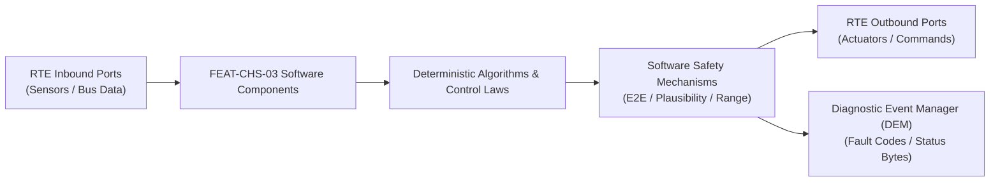

# Software Requirements Specification: Electro-Hydraulic Brake-by-Wire Deceleration (BbW)
**Feature ID:** `FEAT-CHS-03`  
**Domain:** Vehicle Motion & Chassis Control  
**Target ASIL:** ASIL D  
**Compliance Standard:** ISO 26262:2018 (Part 6 - Software Development) / ASPICE PAM v3.1 (SWE.1, SWE.2)  
**Parent System Specification:** [`FEAT-CHS-03_BbW_SysReq.md`](file:///c:/Workset/AntiGravityProjects/TestOptimisationExperiement/system_requirements/FEAT-CHS-03_BbW_SysReq.md)  
**Global Master Specification:** [`spec.md`](file:///c:/Workset/AntiGravityProjects/TestOptimisationExperiement/spec.md)

---

## 1. Software Architecture & Component Structure

This document specifies the AUTOSAR Software Components (SWCs), periodic runnables, algorithmic laws, safety mechanisms, and data ports implementing `FEAT-CHS-03` (Electro-Hydraulic Brake-by-Wire Deceleration (BbW)).

### AUTOSAR SWC Interaction Diagram

---

## 2. Detailed Software Requirements (SWR_REQ)
*(Multi-Software Requirement Partitioning derived from System Requirements)*

### `SWR-CHS-03-01`: Brake Pedal Dual-Sensor Cross-Check & Nonlinear Stroke Mapping
- **Planned Release:** R100
- **ASIL Rating:** ASIL D
- **Parent System Requirement:** [`SYS-CHS-03-01`](file:///c:/Workset/AntiGravityProjects/TestOptimisationExperiement/system_requirements/FEAT-CHS-03_BbW_SysReq.md#sys-chs-03-01)
- **Allocated AUTOSAR SWC:** `BbwPedalDecoder_SWC`
- **Execution Rate / Trigger:** 2 ms
- **Worst-Case Execution Time (WCET):** 0.4 ms
- **Software Activation Condition:** Executed cyclically every 2 ms.
- **Algorithmic Description / Logic:**
  > Samples Stroke 1 and Stroke 2. Checks delta = |S1 - S2| <= 2.0 mm. Maps stroke through progressive 2-stage curve: Initial soft pedal bite (0-15 mm: 0 to -0.15g), firm deceleration (15-45 mm: -0.15g to -1.0g).
- **Software Safety Mechanism:** Cross-check against hydraulic master cylinder pressure sensor echo.
- **Failure Reaction & DEM Diagnostic Event:** If stroke sensors fail, compute deceleration purely from hydraulic pressure sensor.
- **Software Port Inputs:** `ADC_Stroke_Sensor_1, ADC_Stroke_Sensor_2, Pressure_Sensor_Bar`
- **Software Port Outputs:** `Validated_Pedal_Decel_Cmd_Mps2 (float32)`
- **Software Verification Criteria:** Unit test across entire 0 to 60 mm brake pedal stroke travel.
- **Traceability Link:** Traces upward to [`SYS-CHS-03-01`](file:///c:/Workset/AntiGravityProjects/TestOptimisationExperiement/system_requirements/FEAT-CHS-03_BbW_SysReq.md#sys-chs-03-01) and [`FEAT-CHS-03`](file:///c:/Workset/AntiGravityProjects/TestOptimisationExperiement/spec.md).

### `SWR-CHS-03-02`: Pedal Feel Simulator Hydraulic Chamber Isolation Supervisor
- **Planned Release:** R100
- **ASIL Rating:** ASIL D
- **Parent System Requirement:** [`SYS-CHS-03-01`](file:///c:/Workset/AntiGravityProjects/TestOptimisationExperiement/system_requirements/FEAT-CHS-03_BbW_SysReq.md#sys-chs-03-01)
- **Allocated AUTOSAR SWC:** `BbwSimulatorManager_SWC`
- **Execution Rate / Trigger:** 5 ms
- **Worst-Case Execution Time (WCET):** 0.3 ms
- **Software Activation Condition:** Executed during normal brake-by-wire operation.
- **Algorithmic Description / Logic:**
  > Maintains Simulator Valve CLOSED during normal drive to route driver fluid into mechanical spring-loaded simulator chamber. Upon system fault, opens Simulator Valve and opens Separation Valve in < 15 ms.
- **Software Safety Mechanism:** Normally-open mechanical separation valve ensures safe unpowered push-through.
- **Failure Reaction & DEM Diagnostic Event:** De-energize solenoid coils to physically drop into mechanical backup mode.
- **Software Port Inputs:** `System_Health_Status_Enum, Ignition_Power_Good_Flag`
- **Software Port Outputs:** `Simulator_Valve_Driver_Pin, Separation_Valve_Driver_Pin`
- **Software Verification Criteria:** Power-loss test evaluating separation valve transition timing.
- **Traceability Link:** Traces upward to [`SYS-CHS-03-01`](file:///c:/Workset/AntiGravityProjects/TestOptimisationExperiement/system_requirements/FEAT-CHS-03_BbW_SysReq.md#sys-chs-03-01) and [`FEAT-CHS-03`](file:///c:/Workset/AntiGravityProjects/TestOptimisationExperiement/spec.md).

### `SWR-CHS-03-03`: Brushless Electric Plunger Pressure Closed-Loop Servoloop
- **Planned Release:** R100
- **ASIL Rating:** ASIL D
- **Parent System Requirement:** [`SYS-CHS-03-02`](file:///c:/Workset/AntiGravityProjects/TestOptimisationExperiement/system_requirements/FEAT-CHS-03_BbW_SysReq.md#sys-chs-03-02)
- **Allocated AUTOSAR SWC:** `BbwPressureController_SWC`
- **Execution Rate / Trigger:** 1 ms
- **Worst-Case Execution Time (WCET):** 0.35 ms
- **Software Activation Condition:** Executed at 1000 Hz.
- **Algorithmic Description / Logic:**
  > Implements gain-scheduled PID with feedforward: PWM_plunger = K_p * e_p + K_i * int(e_p) + K_d * de_p/dt + F_ff(P_target). Compares target pressure against high-pressure sensor feedback.
- **Software Safety Mechanism:** Overpressure protection: Plunger motor current cut if pressure exceeds 180 bar.
- **Failure Reaction & DEM Diagnostic Event:** If pressure fails to reach target within 200 ms, report plunger motor stall.
- **Software Port Inputs:** `Target_Pressure_Bar, Measured_Pressure_Bar, Plunger_Position_Mm`
- **Software Port Outputs:** `Plunger_Motor_PWM_Duty (float32)`
- **Software Verification Criteria:** Pressure rise-time and step-response verification in HIL environment.
- **Traceability Link:** Traces upward to [`SYS-CHS-03-02`](file:///c:/Workset/AntiGravityProjects/TestOptimisationExperiement/system_requirements/FEAT-CHS-03_BbW_SysReq.md#sys-chs-03-02) and [`FEAT-CHS-03`](file:///c:/Workset/AntiGravityProjects/TestOptimisationExperiement/spec.md).

### `SWR-CHS-03-04`: Independent Four-Corner Caliper Pressure Proportioning
- **Planned Release:** R100
- **ASIL Rating:** ASIL D
- **Parent System Requirement:** [`SYS-CHS-03-02`](file:///c:/Workset/AntiGravityProjects/TestOptimisationExperiement/system_requirements/FEAT-CHS-03_BbW_SysReq.md#sys-chs-03-02)
- **Allocated AUTOSAR SWC:** `BbwPressureDistributor_SWC`
- **Execution Rate / Trigger:** 2 ms
- **Worst-Case Execution Time (WCET):** 0.6 ms
- **Software Activation Condition:** Executed every 2 ms on plunger pressure output.
- **Algorithmic Description / Logic:**
  > Applies Dynamic Rear Proportioning (EBD) to prevent rear wheel lockup: P_rear = min(P_front, F_ebd(v_ego, a_x)). Modulates high-speed inlet and outlet valves for each wheel caliper.
- **Software Safety Mechanism:** Rear brake pressure capped by dynamic load transfer curve based on longitudinal deceleration.
- **Failure Reaction & DEM Diagnostic Event:** If one wheel valve fails, lock valve open and regulate pressure via plunger.
- **Software Port Inputs:** `Target_Plunger_Pressure, Vehicle_Decel_Mps2, Individual_Wheel_Slip[4]`
- **Software Port Outputs:** `Valve_PWM_FL, FR, RL, RR (uint16 array)`
- **Software Verification Criteria:** Automated EBD braking test on high and low friction surfaces.
- **Traceability Link:** Traces upward to [`SYS-CHS-03-02`](file:///c:/Workset/AntiGravityProjects/TestOptimisationExperiement/system_requirements/FEAT-CHS-03_BbW_SysReq.md#sys-chs-03-02) and [`FEAT-CHS-03`](file:///c:/Workset/AntiGravityProjects/TestOptimisationExperiement/spec.md).

### `SWR-CHS-03-05`: Non-Linear Pedal Force-Travel Characteristic Curve Mapper
- **Planned Release:** R100
- **ASIL Rating:** ASIL D
- **Parent System Requirement:** [`SYS-CHS-03-03`](file:///c:/Workset/AntiGravityProjects/TestOptimisationExperiement/system_requirements/FEAT-CHS-03_BbW_SysReq.md#sys-chs-03-03)
- **Allocated AUTOSAR SWC:** `BbwPedalFeel_SWC`
- **Execution Rate / Trigger:** 5 ms
- **Worst-Case Execution Time (WCET):** 0.3 ms
- **Software Activation Condition:** Active during pedal depression.
- **Algorithmic Description / Logic:**
  > Maps pedal travel s to target driver deceleration request: a_req = K_initial * s for s < 15 mm (soft bite point); a_req = K_mid * s^1.8 for 15 mm <= s <= 45 mm (linear modulation zone); a_req = -10.0 m/s² for s > 50 mm (panic stop).
- **Software Safety Mechanism:** Redundant force-travel cross check: Discards travel reading if measured force is zero.
- **Failure Reaction & DEM Diagnostic Event:** Default to pure force-based deceleration mapping if travel sensor faults.
- **Software Port Inputs:** `Pedal_Travel_Sensor_Mm, Pedal_Force_Sensor_N, Vehicle_Speed_Mps`
- **Software Port Outputs:** `Driver_Demanded_Deceleration_Mps2, Pedal_Displacement_Zone_Enum`
- **Software Verification Criteria:** Automated pedal robot repeatability test across 10,000 brake cycles.
- **Traceability Link:** Traces upward to [`SYS-CHS-03-03`](file:///c:/Workset/AntiGravityProjects/TestOptimisationExperiement/system_requirements/FEAT-CHS-03_BbW_SysReq.md#sys-chs-03-03) and [`FEAT-CHS-03`](file:///c:/Workset/AntiGravityProjects/TestOptimisationExperiement/spec.md).

### `SWR-CHS-03-06`: Hydraulic Pedal Simulator Damping & Return Hysteresis Modulator
- **Planned Release:** R100
- **ASIL Rating:** ASIL B
- **Parent System Requirement:** [`SYS-CHS-03-03`](file:///c:/Workset/AntiGravityProjects/TestOptimisationExperiement/system_requirements/FEAT-CHS-03_BbW_SysReq.md#sys-chs-03-03)
- **Allocated AUTOSAR SWC:** `BbwSimulatorDamping_SWC`
- **Execution Rate / Trigger:** 10 ms
- **Worst-Case Execution Time (WCET):** 0.3 ms
- **Software Activation Condition:** Active during pedal motion.
- **Algorithmic Description / Logic:**
  > Modulates hydraulic orifice restrictor valve in simulator cylinder: Delivers 15% hysteresis between push and release cycles to mimic physical brake fluid viscous friction, preventing pedal bounce during fast release.
- **Software Safety Mechanism:** Simulator pressure relief valve opens mechanically at 80 bar to protect seals.
- **Failure Reaction & DEM Diagnostic Event:** Open restrictor valve fully if coil current fluctuates.
- **Software Port Inputs:** `Pedal_Travel_Velocity_Mm_S, Simulator_Fluid_Temp_DegC`
- **Software Port Outputs:** `Simulator_Orifice_PWM_Duty, Return_Damping_Active_Flag`
- **Software Verification Criteria:** Brake pedal subjective release feel and acoustic NVH testing.
- **Traceability Link:** Traces upward to [`SYS-CHS-03-03`](file:///c:/Workset/AntiGravityProjects/TestOptimisationExperiement/system_requirements/FEAT-CHS-03_BbW_SysReq.md#sys-chs-03-03) and [`FEAT-CHS-03`](file:///c:/Workset/AntiGravityProjects/TestOptimisationExperiement/spec.md).

### `SWR-CHS-03-07`: Normally-Open Fallback Hydraulic Solenoid Valve Driver
- **Planned Release:** R100
- **ASIL Rating:** ASIL D
- **Parent System Requirement:** [`SYS-CHS-03-04`](file:///c:/Workset/AntiGravityProjects/TestOptimisationExperiement/system_requirements/FEAT-CHS-03_BbW_SysReq.md#sys-chs-03-04)
- **Allocated AUTOSAR SWC:** `BbwFallbackDriver_SWC`
- **Execution Rate / Trigger:** 1 ms
- **Worst-Case Execution Time (WCET):** 0.15 ms
- **Software Activation Condition:** Executed in 1 kHz supervisory ISR.
- **Algorithmic Description / Logic:**
  > Continuously powers normally-open isolation valves to keep mechanical pushrod decoupled during normal drive-by-wire operation. Upon hardware fault signal or watchdog trip, cuts gate drive in <= 3 ms, allowing internal spring to snap valve open.
- **Software Safety Mechanism:** Hardware pull-down: De-energizes coil automatically if microcontroller resets.
- **Failure Reaction & DEM Diagnostic Event:** Latch fallback state and prohibit re-engagement until complete key cycle.
- **Software Port Inputs:** `Watchdog_Heartbeat_Status, Hardware_Fault_Trip_Bit, 12V_Supply_Rail_ADC`
- **Software Port Outputs:** `Isolation_Valve_Coil_Drive_Pin, Mechanical_PassThrough_Active_Flag`
- **Software Verification Criteria:** Power cut-off valve de-energization response time testing (< 5 ms).
- **Traceability Link:** Traces upward to [`SYS-CHS-03-04`](file:///c:/Workset/AntiGravityProjects/TestOptimisationExperiement/system_requirements/FEAT-CHS-03_BbW_SysReq.md#sys-chs-03-04) and [`FEAT-CHS-03`](file:///c:/Workset/AntiGravityProjects/TestOptimisationExperiement/spec.md).

### `SWR-CHS-03-08`: Dual-Circuit Hydraulic Brake Balance & Splitter Supervisor
- **Planned Release:** R100
- **ASIL Rating:** ASIL D
- **Parent System Requirement:** [`SYS-CHS-03-04`](file:///c:/Workset/AntiGravityProjects/TestOptimisationExperiement/system_requirements/FEAT-CHS-03_BbW_SysReq.md#sys-chs-03-04)
- **Allocated AUTOSAR SWC:** `BbwCircuitSupervisor_SWC`
- **Execution Rate / Trigger:** 5 ms
- **Worst-Case Execution Time (WCET):** 0.3 ms
- **Software Activation Condition:** Supervises hydraulic circuit integrity.
- **Algorithmic Description / Logic:**
  > Monitors primary (Front) and secondary (Rear) circuit pressures: P_front vs P_rear. If one circuit leaks (pressure < 5 bar while booster pumping), isolates leaky circuit via shuttle valve and maintains 100% braking on intact axle.
- **Software Safety Mechanism:** Brake fluid level reservoir reed switch read every 10 ms.
- **Failure Reaction & DEM Diagnostic Event:** Set DTC C1102 (Brake Hydraulic Circuit Leak) and illuminate red Master Brake tell-tale.
- **Software Port Inputs:** `Pressure_Sensor_Circuit_A_Bar, Pressure_Sensor_Circuit_B_Bar, Fluid_Reservoir_Level_Switch`
- **Software Port Outputs:** `Hydraulic_Circuit_Isolated_Mask, Brake_Fluid_Low_Warning_Flag`
- **Software Verification Criteria:** Intentional hydraulic line puncture test on high-speed proving ground.
- **Traceability Link:** Traces upward to [`SYS-CHS-03-04`](file:///c:/Workset/AntiGravityProjects/TestOptimisationExperiement/system_requirements/FEAT-CHS-03_BbW_SysReq.md#sys-chs-03-04) and [`FEAT-CHS-03`](file:///c:/Workset/AntiGravityProjects/TestOptimisationExperiement/spec.md).

### `SWR-CHS-03-09`: Dual Redundant Hydraulic Circuit Pressure Transducer Cross-Monitor - Dynamic Observer & Signal Filter
- **Planned Release:** R200
- **ASIL Rating:** ASIL D
- **Parent System Requirement:** [`SYS-CHS-03-05`](file:///c:/Workset/AntiGravityProjects/TestOptimisationExperiement/system_requirements/FEAT-CHS-03_BbW_SysReq.md#sys-chs-03-05)
- **Allocated AUTOSAR SWC:** `BbwPressureCrossCheck_SWC`
- **Execution Rate / Trigger:** 2 ms
- **Worst-Case Execution Time (WCET):** 0.3 ms
- **Software Activation Condition:** Executed cyclically every 2 ms.
- **Algorithmic Description / Logic:**
  > Executes signal plausibility filtering, calibration offsets, and discrete state estimation for Dual Redundant Hydraulic Circuit Pressure Transducer Cross-Monitor.
- **Software Safety Mechanism:** Range limit plausibility check and E2E alive sequence verification.
- **Failure Reaction & DEM Diagnostic Event:** Set default fallback output and report DEM_EVENT_FEAT_CHS_03_ERR.
- **Software Port Inputs:** `Raw sensor ADC/SENT/SPI values and RTE bus inputs.`
- **Software Port Outputs:** `Filtered physical signals and validity status bitmasks.`
- **Software Verification Criteria:** Unit test and HiL software integration test.
- **Traceability Link:** Traces upward to [`SYS-CHS-03-05`](file:///c:/Workset/AntiGravityProjects/TestOptimisationExperiement/system_requirements/FEAT-CHS-03_BbW_SysReq.md#sys-chs-03-05) and [`FEAT-CHS-03`](file:///c:/Workset/AntiGravityProjects/TestOptimisationExperiement/spec.md).

### `SWR-CHS-03-10`: Dual Redundant Hydraulic Circuit Pressure Transducer Cross-Monitor - Closed-Loop Control Law & Actuator Dispatch
- **Planned Release:** R200
- **ASIL Rating:** ASIL D
- **Parent System Requirement:** [`SYS-CHS-03-05`](file:///c:/Workset/AntiGravityProjects/TestOptimisationExperiement/system_requirements/FEAT-CHS-03_BbW_SysReq.md#sys-chs-03-05)
- **Allocated AUTOSAR SWC:** `BbwPressureCrossCheck_SWC`
- **Execution Rate / Trigger:** 2 ms
- **Worst-Case Execution Time (WCET):** 0.4 ms
- **Software Activation Condition:** Executed cyclically every 2 ms.
- **Algorithmic Description / Logic:**
  > Evaluates deterministic closed-loop control law, rate limits, and dispatches commands for Dual Redundant Hydraulic Circuit Pressure Transducer Cross-Monitor.
- **Software Safety Mechanism:** Command saturation clamping and watchdog program flow monitoring.
- **Failure Reaction & DEM Diagnostic Event:** De-energize actuator output, apply safe fallback clamp, and latch DTC.
- **Software Port Inputs:** `Validated physical state signals from observer SWC.`
- **Software Port Outputs:** `Actuator PWM duty cycles, torque/pressure setpoints, and diagnostic flags.`
- **Software Verification Criteria:** Hardware dynamometer and HiL closed-loop regression test suite.
- **Traceability Link:** Traces upward to [`SYS-CHS-03-05`](file:///c:/Workset/AntiGravityProjects/TestOptimisationExperiement/system_requirements/FEAT-CHS-03_BbW_SysReq.md#sys-chs-03-05) and [`FEAT-CHS-03`](file:///c:/Workset/AntiGravityProjects/TestOptimisationExperiement/spec.md).

### `SWR-CHS-03-11`: Electric Brake Plunger Motor Hall & Resolver Angle Decoupled Decoder - Dynamic Observer & Signal Filter
- **Planned Release:** R200
- **ASIL Rating:** ASIL D
- **Parent System Requirement:** [`SYS-CHS-03-06`](file:///c:/Workset/AntiGravityProjects/TestOptimisationExperiement/system_requirements/FEAT-CHS-03_BbW_SysReq.md#sys-chs-03-06)
- **Allocated AUTOSAR SWC:** `BbwPlungerResolver_SWC`
- **Execution Rate / Trigger:** 0.5 ms
- **Worst-Case Execution Time (WCET):** 0.3 ms
- **Software Activation Condition:** Executed cyclically every 0.5 ms.
- **Algorithmic Description / Logic:**
  > Executes signal plausibility filtering, calibration offsets, and discrete state estimation for Electric Brake Plunger Motor Hall & Resolver Angle Decoupled Decoder.
- **Software Safety Mechanism:** Range limit plausibility check and E2E alive sequence verification.
- **Failure Reaction & DEM Diagnostic Event:** Set default fallback output and report DEM_EVENT_FEAT_CHS_03_ERR.
- **Software Port Inputs:** `Raw sensor ADC/SENT/SPI values and RTE bus inputs.`
- **Software Port Outputs:** `Filtered physical signals and validity status bitmasks.`
- **Software Verification Criteria:** Unit test and HiL software integration test.
- **Traceability Link:** Traces upward to [`SYS-CHS-03-06`](file:///c:/Workset/AntiGravityProjects/TestOptimisationExperiement/system_requirements/FEAT-CHS-03_BbW_SysReq.md#sys-chs-03-06) and [`FEAT-CHS-03`](file:///c:/Workset/AntiGravityProjects/TestOptimisationExperiement/spec.md).

### `SWR-CHS-03-12`: Electric Brake Plunger Motor Hall & Resolver Angle Decoupled Decoder - Closed-Loop Control Law & Actuator Dispatch
- **Planned Release:** R200
- **ASIL Rating:** ASIL D
- **Parent System Requirement:** [`SYS-CHS-03-06`](file:///c:/Workset/AntiGravityProjects/TestOptimisationExperiement/system_requirements/FEAT-CHS-03_BbW_SysReq.md#sys-chs-03-06)
- **Allocated AUTOSAR SWC:** `BbwPlungerResolver_SWC`
- **Execution Rate / Trigger:** 0.5 ms
- **Worst-Case Execution Time (WCET):** 0.4 ms
- **Software Activation Condition:** Executed cyclically every 0.5 ms.
- **Algorithmic Description / Logic:**
  > Evaluates deterministic closed-loop control law, rate limits, and dispatches commands for Electric Brake Plunger Motor Hall & Resolver Angle Decoupled Decoder.
- **Software Safety Mechanism:** Command saturation clamping and watchdog program flow monitoring.
- **Failure Reaction & DEM Diagnostic Event:** De-energize actuator output, apply safe fallback clamp, and latch DTC.
- **Software Port Inputs:** `Validated physical state signals from observer SWC.`
- **Software Port Outputs:** `Actuator PWM duty cycles, torque/pressure setpoints, and diagnostic flags.`
- **Software Verification Criteria:** Hardware dynamometer and HiL closed-loop regression test suite.
- **Traceability Link:** Traces upward to [`SYS-CHS-03-06`](file:///c:/Workset/AntiGravityProjects/TestOptimisationExperiement/system_requirements/FEAT-CHS-03_BbW_SysReq.md#sys-chs-03-06) and [`FEAT-CHS-03`](file:///c:/Workset/AntiGravityProjects/TestOptimisationExperiement/spec.md).

### `SWR-CHS-03-13`: Decoupled Brake Pedal Force-Displacement Active Hysteresis Shaper - Dynamic Observer & Signal Filter
- **Planned Release:** R200
- **ASIL Rating:** ASIL D
- **Parent System Requirement:** [`SYS-CHS-03-07`](file:///c:/Workset/AntiGravityProjects/TestOptimisationExperiement/system_requirements/FEAT-CHS-03_BbW_SysReq.md#sys-chs-03-07)
- **Allocated AUTOSAR SWC:** `BbwPedalHysteresis_SWC`
- **Execution Rate / Trigger:** 5 ms
- **Worst-Case Execution Time (WCET):** 0.3 ms
- **Software Activation Condition:** Executed cyclically every 5 ms.
- **Algorithmic Description / Logic:**
  > Executes signal plausibility filtering, calibration offsets, and discrete state estimation for Decoupled Brake Pedal Force-Displacement Active Hysteresis Shaper.
- **Software Safety Mechanism:** Range limit plausibility check and E2E alive sequence verification.
- **Failure Reaction & DEM Diagnostic Event:** Set default fallback output and report DEM_EVENT_FEAT_CHS_03_ERR.
- **Software Port Inputs:** `Raw sensor ADC/SENT/SPI values and RTE bus inputs.`
- **Software Port Outputs:** `Filtered physical signals and validity status bitmasks.`
- **Software Verification Criteria:** Unit test and HiL software integration test.
- **Traceability Link:** Traces upward to [`SYS-CHS-03-07`](file:///c:/Workset/AntiGravityProjects/TestOptimisationExperiement/system_requirements/FEAT-CHS-03_BbW_SysReq.md#sys-chs-03-07) and [`FEAT-CHS-03`](file:///c:/Workset/AntiGravityProjects/TestOptimisationExperiement/spec.md).

### `SWR-CHS-03-14`: Decoupled Brake Pedal Force-Displacement Active Hysteresis Shaper - Closed-Loop Control Law & Actuator Dispatch
- **Planned Release:** R200
- **ASIL Rating:** ASIL D
- **Parent System Requirement:** [`SYS-CHS-03-07`](file:///c:/Workset/AntiGravityProjects/TestOptimisationExperiement/system_requirements/FEAT-CHS-03_BbW_SysReq.md#sys-chs-03-07)
- **Allocated AUTOSAR SWC:** `BbwPedalHysteresis_SWC`
- **Execution Rate / Trigger:** 5 ms
- **Worst-Case Execution Time (WCET):** 0.4 ms
- **Software Activation Condition:** Executed cyclically every 5 ms.
- **Algorithmic Description / Logic:**
  > Evaluates deterministic closed-loop control law, rate limits, and dispatches commands for Decoupled Brake Pedal Force-Displacement Active Hysteresis Shaper.
- **Software Safety Mechanism:** Command saturation clamping and watchdog program flow monitoring.
- **Failure Reaction & DEM Diagnostic Event:** De-energize actuator output, apply safe fallback clamp, and latch DTC.
- **Software Port Inputs:** `Validated physical state signals from observer SWC.`
- **Software Port Outputs:** `Actuator PWM duty cycles, torque/pressure setpoints, and diagnostic flags.`
- **Software Verification Criteria:** Hardware dynamometer and HiL closed-loop regression test suite.
- **Traceability Link:** Traces upward to [`SYS-CHS-03-07`](file:///c:/Workset/AntiGravityProjects/TestOptimisationExperiement/system_requirements/FEAT-CHS-03_BbW_SysReq.md#sys-chs-03-07) and [`FEAT-CHS-03`](file:///c:/Workset/AntiGravityProjects/TestOptimisationExperiement/spec.md).

### `SWR-CHS-03-15`: Foundation Caliper Pad Knock-Back Clearance Active Eliminator - Dynamic Observer & Signal Filter
- **Planned Release:** R300
- **ASIL Rating:** ASIL D
- **Parent System Requirement:** [`SYS-CHS-03-08`](file:///c:/Workset/AntiGravityProjects/TestOptimisationExperiement/system_requirements/FEAT-CHS-03_BbW_SysReq.md#sys-chs-03-08)
- **Allocated AUTOSAR SWC:** `BbwPadClearance_SWC`
- **Execution Rate / Trigger:** 5 ms
- **Worst-Case Execution Time (WCET):** 0.3 ms
- **Software Activation Condition:** Executed cyclically every 5 ms.
- **Algorithmic Description / Logic:**
  > Executes signal plausibility filtering, calibration offsets, and discrete state estimation for Foundation Caliper Pad Knock-Back Clearance Active Eliminator.
- **Software Safety Mechanism:** Range limit plausibility check and E2E alive sequence verification.
- **Failure Reaction & DEM Diagnostic Event:** Set default fallback output and report DEM_EVENT_FEAT_CHS_03_ERR.
- **Software Port Inputs:** `Raw sensor ADC/SENT/SPI values and RTE bus inputs.`
- **Software Port Outputs:** `Filtered physical signals and validity status bitmasks.`
- **Software Verification Criteria:** Unit test and HiL software integration test.
- **Traceability Link:** Traces upward to [`SYS-CHS-03-08`](file:///c:/Workset/AntiGravityProjects/TestOptimisationExperiement/system_requirements/FEAT-CHS-03_BbW_SysReq.md#sys-chs-03-08) and [`FEAT-CHS-03`](file:///c:/Workset/AntiGravityProjects/TestOptimisationExperiement/spec.md).

### `SWR-CHS-03-16`: Foundation Caliper Pad Knock-Back Clearance Active Eliminator - Closed-Loop Control Law & Actuator Dispatch
- **Planned Release:** R300
- **ASIL Rating:** ASIL D
- **Parent System Requirement:** [`SYS-CHS-03-08`](file:///c:/Workset/AntiGravityProjects/TestOptimisationExperiement/system_requirements/FEAT-CHS-03_BbW_SysReq.md#sys-chs-03-08)
- **Allocated AUTOSAR SWC:** `BbwPadClearance_SWC`
- **Execution Rate / Trigger:** 5 ms
- **Worst-Case Execution Time (WCET):** 0.4 ms
- **Software Activation Condition:** Executed cyclically every 5 ms.
- **Algorithmic Description / Logic:**
  > Evaluates deterministic closed-loop control law, rate limits, and dispatches commands for Foundation Caliper Pad Knock-Back Clearance Active Eliminator.
- **Software Safety Mechanism:** Command saturation clamping and watchdog program flow monitoring.
- **Failure Reaction & DEM Diagnostic Event:** De-energize actuator output, apply safe fallback clamp, and latch DTC.
- **Software Port Inputs:** `Validated physical state signals from observer SWC.`
- **Software Port Outputs:** `Actuator PWM duty cycles, torque/pressure setpoints, and diagnostic flags.`
- **Software Verification Criteria:** Hardware dynamometer and HiL closed-loop regression test suite.
- **Traceability Link:** Traces upward to [`SYS-CHS-03-08`](file:///c:/Workset/AntiGravityProjects/TestOptimisationExperiement/system_requirements/FEAT-CHS-03_BbW_SysReq.md#sys-chs-03-08) and [`FEAT-CHS-03`](file:///c:/Workset/AntiGravityProjects/TestOptimisationExperiement/spec.md).

### `SWR-CHS-03-17`: Brake Fluid Vaporization & Temperature Dependent Pressure Compensator - Dynamic Observer & Signal Filter
- **Planned Release:** R300
- **ASIL Rating:** ASIL D
- **Parent System Requirement:** [`SYS-CHS-03-09`](file:///c:/Workset/AntiGravityProjects/TestOptimisationExperiement/system_requirements/FEAT-CHS-03_BbW_SysReq.md#sys-chs-03-09)
- **Allocated AUTOSAR SWC:** `BbwFluidCompensation_SWC`
- **Execution Rate / Trigger:** 20 ms
- **Worst-Case Execution Time (WCET):** 0.3 ms
- **Software Activation Condition:** Executed cyclically every 20 ms.
- **Algorithmic Description / Logic:**
  > Executes signal plausibility filtering, calibration offsets, and discrete state estimation for Brake Fluid Vaporization & Temperature Dependent Pressure Compensator.
- **Software Safety Mechanism:** Range limit plausibility check and E2E alive sequence verification.
- **Failure Reaction & DEM Diagnostic Event:** Set default fallback output and report DEM_EVENT_FEAT_CHS_03_ERR.
- **Software Port Inputs:** `Raw sensor ADC/SENT/SPI values and RTE bus inputs.`
- **Software Port Outputs:** `Filtered physical signals and validity status bitmasks.`
- **Software Verification Criteria:** Unit test and HiL software integration test.
- **Traceability Link:** Traces upward to [`SYS-CHS-03-09`](file:///c:/Workset/AntiGravityProjects/TestOptimisationExperiement/system_requirements/FEAT-CHS-03_BbW_SysReq.md#sys-chs-03-09) and [`FEAT-CHS-03`](file:///c:/Workset/AntiGravityProjects/TestOptimisationExperiement/spec.md).

### `SWR-CHS-03-18`: Brake Fluid Vaporization & Temperature Dependent Pressure Compensator - Closed-Loop Control Law & Actuator Dispatch
- **Planned Release:** R300
- **ASIL Rating:** ASIL D
- **Parent System Requirement:** [`SYS-CHS-03-09`](file:///c:/Workset/AntiGravityProjects/TestOptimisationExperiement/system_requirements/FEAT-CHS-03_BbW_SysReq.md#sys-chs-03-09)
- **Allocated AUTOSAR SWC:** `BbwFluidCompensation_SWC`
- **Execution Rate / Trigger:** 20 ms
- **Worst-Case Execution Time (WCET):** 0.4 ms
- **Software Activation Condition:** Executed cyclically every 20 ms.
- **Algorithmic Description / Logic:**
  > Evaluates deterministic closed-loop control law, rate limits, and dispatches commands for Brake Fluid Vaporization & Temperature Dependent Pressure Compensator.
- **Software Safety Mechanism:** Command saturation clamping and watchdog program flow monitoring.
- **Failure Reaction & DEM Diagnostic Event:** De-energize actuator output, apply safe fallback clamp, and latch DTC.
- **Software Port Inputs:** `Validated physical state signals from observer SWC.`
- **Software Port Outputs:** `Actuator PWM duty cycles, torque/pressure setpoints, and diagnostic flags.`
- **Software Verification Criteria:** Hardware dynamometer and HiL closed-loop regression test suite.
- **Traceability Link:** Traces upward to [`SYS-CHS-03-09`](file:///c:/Workset/AntiGravityProjects/TestOptimisationExperiement/system_requirements/FEAT-CHS-03_BbW_SysReq.md#sys-chs-03-09) and [`FEAT-CHS-03`](file:///c:/Workset/AntiGravityProjects/TestOptimisationExperiement/spec.md).

### `SWR-CHS-03-19`: Passive Hydraulic Mechanical Push-Through Solenoid Power Cut Safing - Dynamic Observer & Signal Filter
- **Planned Release:** R400
- **ASIL Rating:** ASIL D
- **Parent System Requirement:** [`SYS-CHS-03-10`](file:///c:/Workset/AntiGravityProjects/TestOptimisationExperiement/system_requirements/FEAT-CHS-03_BbW_SysReq.md#sys-chs-03-10)
- **Allocated AUTOSAR SWC:** `BbwMechanicalSafing_SWC`
- **Execution Rate / Trigger:** 1 ms
- **Worst-Case Execution Time (WCET):** 0.3 ms
- **Software Activation Condition:** Executed cyclically every 1 ms.
- **Algorithmic Description / Logic:**
  > Executes signal plausibility filtering, calibration offsets, and discrete state estimation for Passive Hydraulic Mechanical Push-Through Solenoid Power Cut Safing.
- **Software Safety Mechanism:** Range limit plausibility check and E2E alive sequence verification.
- **Failure Reaction & DEM Diagnostic Event:** Set default fallback output and report DEM_EVENT_FEAT_CHS_03_ERR.
- **Software Port Inputs:** `Raw sensor ADC/SENT/SPI values and RTE bus inputs.`
- **Software Port Outputs:** `Filtered physical signals and validity status bitmasks.`
- **Software Verification Criteria:** Unit test and HiL software integration test.
- **Traceability Link:** Traces upward to [`SYS-CHS-03-10`](file:///c:/Workset/AntiGravityProjects/TestOptimisationExperiement/system_requirements/FEAT-CHS-03_BbW_SysReq.md#sys-chs-03-10) and [`FEAT-CHS-03`](file:///c:/Workset/AntiGravityProjects/TestOptimisationExperiement/spec.md).

### `SWR-CHS-03-20`: Passive Hydraulic Mechanical Push-Through Solenoid Power Cut Safing - Closed-Loop Control Law & Actuator Dispatch
- **Planned Release:** R400
- **ASIL Rating:** ASIL D
- **Parent System Requirement:** [`SYS-CHS-03-10`](file:///c:/Workset/AntiGravityProjects/TestOptimisationExperiement/system_requirements/FEAT-CHS-03_BbW_SysReq.md#sys-chs-03-10)
- **Allocated AUTOSAR SWC:** `BbwMechanicalSafing_SWC`
- **Execution Rate / Trigger:** 1 ms
- **Worst-Case Execution Time (WCET):** 0.4 ms
- **Software Activation Condition:** Executed cyclically every 1 ms.
- **Algorithmic Description / Logic:**
  > Evaluates deterministic closed-loop control law, rate limits, and dispatches commands for Passive Hydraulic Mechanical Push-Through Solenoid Power Cut Safing.
- **Software Safety Mechanism:** Command saturation clamping and watchdog program flow monitoring.
- **Failure Reaction & DEM Diagnostic Event:** De-energize actuator output, apply safe fallback clamp, and latch DTC.
- **Software Port Inputs:** `Validated physical state signals from observer SWC.`
- **Software Port Outputs:** `Actuator PWM duty cycles, torque/pressure setpoints, and diagnostic flags.`
- **Software Verification Criteria:** Hardware dynamometer and HiL closed-loop regression test suite.
- **Traceability Link:** Traces upward to [`SYS-CHS-03-10`](file:///c:/Workset/AntiGravityProjects/TestOptimisationExperiement/system_requirements/FEAT-CHS-03_BbW_SysReq.md#sys-chs-03-10) and [`FEAT-CHS-03`](file:///c:/Workset/AntiGravityProjects/TestOptimisationExperiement/spec.md).

### `SWR-CHS-03-21`: Brake Fluid Low Level Reservoir Reed Switch Debouncer & Warning Gate - Dynamic Observer & Signal Filter
- **Planned Release:** R400
- **ASIL Rating:** ASIL B
- **Parent System Requirement:** [`SYS-CHS-03-11`](file:///c:/Workset/AntiGravityProjects/TestOptimisationExperiement/system_requirements/FEAT-CHS-03_BbW_SysReq.md#sys-chs-03-11)
- **Allocated AUTOSAR SWC:** `BbwFluidLevelMonitor_SWC`
- **Execution Rate / Trigger:** 50 ms
- **Worst-Case Execution Time (WCET):** 0.3 ms
- **Software Activation Condition:** Executed cyclically every 50 ms.
- **Algorithmic Description / Logic:**
  > Executes signal plausibility filtering, calibration offsets, and discrete state estimation for Brake Fluid Low Level Reservoir Reed Switch Debouncer & Warning Gate.
- **Software Safety Mechanism:** Range limit plausibility check and E2E alive sequence verification.
- **Failure Reaction & DEM Diagnostic Event:** Set default fallback output and report DEM_EVENT_FEAT_CHS_03_ERR.
- **Software Port Inputs:** `Raw sensor ADC/SENT/SPI values and RTE bus inputs.`
- **Software Port Outputs:** `Filtered physical signals and validity status bitmasks.`
- **Software Verification Criteria:** Unit test and HiL software integration test.
- **Traceability Link:** Traces upward to [`SYS-CHS-03-11`](file:///c:/Workset/AntiGravityProjects/TestOptimisationExperiement/system_requirements/FEAT-CHS-03_BbW_SysReq.md#sys-chs-03-11) and [`FEAT-CHS-03`](file:///c:/Workset/AntiGravityProjects/TestOptimisationExperiement/spec.md).

### `SWR-CHS-03-22`: Brake Fluid Low Level Reservoir Reed Switch Debouncer & Warning Gate - Closed-Loop Control Law & Actuator Dispatch
- **Planned Release:** R400
- **ASIL Rating:** ASIL B
- **Parent System Requirement:** [`SYS-CHS-03-11`](file:///c:/Workset/AntiGravityProjects/TestOptimisationExperiement/system_requirements/FEAT-CHS-03_BbW_SysReq.md#sys-chs-03-11)
- **Allocated AUTOSAR SWC:** `BbwFluidLevelMonitor_SWC`
- **Execution Rate / Trigger:** 50 ms
- **Worst-Case Execution Time (WCET):** 0.4 ms
- **Software Activation Condition:** Executed cyclically every 50 ms.
- **Algorithmic Description / Logic:**
  > Evaluates deterministic closed-loop control law, rate limits, and dispatches commands for Brake Fluid Low Level Reservoir Reed Switch Debouncer & Warning Gate.
- **Software Safety Mechanism:** Command saturation clamping and watchdog program flow monitoring.
- **Failure Reaction & DEM Diagnostic Event:** De-energize actuator output, apply safe fallback clamp, and latch DTC.
- **Software Port Inputs:** `Validated physical state signals from observer SWC.`
- **Software Port Outputs:** `Actuator PWM duty cycles, torque/pressure setpoints, and diagnostic flags.`
- **Software Verification Criteria:** Hardware dynamometer and HiL closed-loop regression test suite.
- **Traceability Link:** Traces upward to [`SYS-CHS-03-11`](file:///c:/Workset/AntiGravityProjects/TestOptimisationExperiement/system_requirements/FEAT-CHS-03_BbW_SysReq.md#sys-chs-03-11) and [`FEAT-CHS-03`](file:///c:/Workset/AntiGravityProjects/TestOptimisationExperiement/spec.md).

### `SWR-CHS-03-23`: Dynamic Electronic Brake Proportioning (EBD) Under Variable Payloads - Dynamic Observer & Signal Filter
- **Planned Release:** R400
- **ASIL Rating:** ASIL D
- **Parent System Requirement:** [`SYS-CHS-03-12`](file:///c:/Workset/AntiGravityProjects/TestOptimisationExperiement/system_requirements/FEAT-CHS-03_BbW_SysReq.md#sys-chs-03-12)
- **Allocated AUTOSAR SWC:** `BbwEbdRegulator_SWC`
- **Execution Rate / Trigger:** 5 ms
- **Worst-Case Execution Time (WCET):** 0.3 ms
- **Software Activation Condition:** Executed cyclically every 5 ms.
- **Algorithmic Description / Logic:**
  > Executes signal plausibility filtering, calibration offsets, and discrete state estimation for Dynamic Electronic Brake Proportioning (EBD) Under Variable Payloads.
- **Software Safety Mechanism:** Range limit plausibility check and E2E alive sequence verification.
- **Failure Reaction & DEM Diagnostic Event:** Set default fallback output and report DEM_EVENT_FEAT_CHS_03_ERR.
- **Software Port Inputs:** `Raw sensor ADC/SENT/SPI values and RTE bus inputs.`
- **Software Port Outputs:** `Filtered physical signals and validity status bitmasks.`
- **Software Verification Criteria:** Unit test and HiL software integration test.
- **Traceability Link:** Traces upward to [`SYS-CHS-03-12`](file:///c:/Workset/AntiGravityProjects/TestOptimisationExperiement/system_requirements/FEAT-CHS-03_BbW_SysReq.md#sys-chs-03-12) and [`FEAT-CHS-03`](file:///c:/Workset/AntiGravityProjects/TestOptimisationExperiement/spec.md).

### `SWR-CHS-03-24`: Dynamic Electronic Brake Proportioning (EBD) Under Variable Payloads - Closed-Loop Control Law & Actuator Dispatch
- **Planned Release:** R400
- **ASIL Rating:** ASIL D
- **Parent System Requirement:** [`SYS-CHS-03-12`](file:///c:/Workset/AntiGravityProjects/TestOptimisationExperiement/system_requirements/FEAT-CHS-03_BbW_SysReq.md#sys-chs-03-12)
- **Allocated AUTOSAR SWC:** `BbwEbdRegulator_SWC`
- **Execution Rate / Trigger:** 5 ms
- **Worst-Case Execution Time (WCET):** 0.4 ms
- **Software Activation Condition:** Executed cyclically every 5 ms.
- **Algorithmic Description / Logic:**
  > Evaluates deterministic closed-loop control law, rate limits, and dispatches commands for Dynamic Electronic Brake Proportioning (EBD) Under Variable Payloads.
- **Software Safety Mechanism:** Command saturation clamping and watchdog program flow monitoring.
- **Failure Reaction & DEM Diagnostic Event:** De-energize actuator output, apply safe fallback clamp, and latch DTC.
- **Software Port Inputs:** `Validated physical state signals from observer SWC.`
- **Software Port Outputs:** `Actuator PWM duty cycles, torque/pressure setpoints, and diagnostic flags.`
- **Software Verification Criteria:** Hardware dynamometer and HiL closed-loop regression test suite.
- **Traceability Link:** Traces upward to [`SYS-CHS-03-12`](file:///c:/Workset/AntiGravityProjects/TestOptimisationExperiement/system_requirements/FEAT-CHS-03_BbW_SysReq.md#sys-chs-03-12) and [`FEAT-CHS-03`](file:///c:/Workset/AntiGravityProjects/TestOptimisationExperiement/spec.md).

### `SWR-CHS-03-25`: Secondary Brake Boost Redundant Channel Autonomous Takeover Engine - Dynamic Observer & Signal Filter
- **Planned Release:** R400
- **ASIL Rating:** ASIL D
- **Parent System Requirement:** [`SYS-CHS-03-13`](file:///c:/Workset/AntiGravityProjects/TestOptimisationExperiement/system_requirements/FEAT-CHS-03_BbW_SysReq.md#sys-chs-03-13)
- **Allocated AUTOSAR SWC:** `BbwRedundantTakeover_SWC`
- **Execution Rate / Trigger:** 2 ms
- **Worst-Case Execution Time (WCET):** 0.3 ms
- **Software Activation Condition:** Executed cyclically every 2 ms.
- **Algorithmic Description / Logic:**
  > Executes signal plausibility filtering, calibration offsets, and discrete state estimation for Secondary Brake Boost Redundant Channel Autonomous Takeover Engine.
- **Software Safety Mechanism:** Range limit plausibility check and E2E alive sequence verification.
- **Failure Reaction & DEM Diagnostic Event:** Set default fallback output and report DEM_EVENT_FEAT_CHS_03_ERR.
- **Software Port Inputs:** `Raw sensor ADC/SENT/SPI values and RTE bus inputs.`
- **Software Port Outputs:** `Filtered physical signals and validity status bitmasks.`
- **Software Verification Criteria:** Unit test and HiL software integration test.
- **Traceability Link:** Traces upward to [`SYS-CHS-03-13`](file:///c:/Workset/AntiGravityProjects/TestOptimisationExperiement/system_requirements/FEAT-CHS-03_BbW_SysReq.md#sys-chs-03-13) and [`FEAT-CHS-03`](file:///c:/Workset/AntiGravityProjects/TestOptimisationExperiement/spec.md).

### `SWR-CHS-03-26`: Secondary Brake Boost Redundant Channel Autonomous Takeover Engine - Closed-Loop Control Law & Actuator Dispatch
- **Planned Release:** R400
- **ASIL Rating:** ASIL D
- **Parent System Requirement:** [`SYS-CHS-03-13`](file:///c:/Workset/AntiGravityProjects/TestOptimisationExperiement/system_requirements/FEAT-CHS-03_BbW_SysReq.md#sys-chs-03-13)
- **Allocated AUTOSAR SWC:** `BbwRedundantTakeover_SWC`
- **Execution Rate / Trigger:** 2 ms
- **Worst-Case Execution Time (WCET):** 0.4 ms
- **Software Activation Condition:** Executed cyclically every 2 ms.
- **Algorithmic Description / Logic:**
  > Evaluates deterministic closed-loop control law, rate limits, and dispatches commands for Secondary Brake Boost Redundant Channel Autonomous Takeover Engine.
- **Software Safety Mechanism:** Command saturation clamping and watchdog program flow monitoring.
- **Failure Reaction & DEM Diagnostic Event:** De-energize actuator output, apply safe fallback clamp, and latch DTC.
- **Software Port Inputs:** `Validated physical state signals from observer SWC.`
- **Software Port Outputs:** `Actuator PWM duty cycles, torque/pressure setpoints, and diagnostic flags.`
- **Software Verification Criteria:** Hardware dynamometer and HiL closed-loop regression test suite.
- **Traceability Link:** Traces upward to [`SYS-CHS-03-13`](file:///c:/Workset/AntiGravityProjects/TestOptimisationExperiement/system_requirements/FEAT-CHS-03_BbW_SysReq.md#sys-chs-03-13) and [`FEAT-CHS-03`](file:///c:/Workset/AntiGravityProjects/TestOptimisationExperiement/spec.md).

### `SWR-CHS-03-27`: Dual Core Lockstep CPU Execution Flow & Watchdog Supervisor - Dynamic Observer & Signal Filter
- **Planned Release:** R400
- **ASIL Rating:** ASIL D
- **Parent System Requirement:** [`SYS-CHS-03-14`](file:///c:/Workset/AntiGravityProjects/TestOptimisationExperiement/system_requirements/FEAT-CHS-03_BbW_SysReq.md#sys-chs-03-14)
- **Allocated AUTOSAR SWC:** `BbwLockstepSupervisor_SWC`
- **Execution Rate / Trigger:** 1 ms
- **Worst-Case Execution Time (WCET):** 0.3 ms
- **Software Activation Condition:** Executed cyclically every 1 ms.
- **Algorithmic Description / Logic:**
  > Executes signal plausibility filtering, calibration offsets, and discrete state estimation for Dual Core Lockstep CPU Execution Flow & Watchdog Supervisor.
- **Software Safety Mechanism:** Range limit plausibility check and E2E alive sequence verification.
- **Failure Reaction & DEM Diagnostic Event:** Set default fallback output and report DEM_EVENT_FEAT_CHS_03_ERR.
- **Software Port Inputs:** `Raw sensor ADC/SENT/SPI values and RTE bus inputs.`
- **Software Port Outputs:** `Filtered physical signals and validity status bitmasks.`
- **Software Verification Criteria:** Unit test and HiL software integration test.
- **Traceability Link:** Traces upward to [`SYS-CHS-03-14`](file:///c:/Workset/AntiGravityProjects/TestOptimisationExperiement/system_requirements/FEAT-CHS-03_BbW_SysReq.md#sys-chs-03-14) and [`FEAT-CHS-03`](file:///c:/Workset/AntiGravityProjects/TestOptimisationExperiement/spec.md).

### `SWR-CHS-03-28`: Dual Core Lockstep CPU Execution Flow & Watchdog Supervisor - Closed-Loop Control Law & Actuator Dispatch
- **Planned Release:** R400
- **ASIL Rating:** ASIL D
- **Parent System Requirement:** [`SYS-CHS-03-14`](file:///c:/Workset/AntiGravityProjects/TestOptimisationExperiement/system_requirements/FEAT-CHS-03_BbW_SysReq.md#sys-chs-03-14)
- **Allocated AUTOSAR SWC:** `BbwLockstepSupervisor_SWC`
- **Execution Rate / Trigger:** 1 ms
- **Worst-Case Execution Time (WCET):** 0.4 ms
- **Software Activation Condition:** Executed cyclically every 1 ms.
- **Algorithmic Description / Logic:**
  > Evaluates deterministic closed-loop control law, rate limits, and dispatches commands for Dual Core Lockstep CPU Execution Flow & Watchdog Supervisor.
- **Software Safety Mechanism:** Command saturation clamping and watchdog program flow monitoring.
- **Failure Reaction & DEM Diagnostic Event:** De-energize actuator output, apply safe fallback clamp, and latch DTC.
- **Software Port Inputs:** `Validated physical state signals from observer SWC.`
- **Software Port Outputs:** `Actuator PWM duty cycles, torque/pressure setpoints, and diagnostic flags.`
- **Software Verification Criteria:** Hardware dynamometer and HiL closed-loop regression test suite.
- **Traceability Link:** Traces upward to [`SYS-CHS-03-14`](file:///c:/Workset/AntiGravityProjects/TestOptimisationExperiement/system_requirements/FEAT-CHS-03_BbW_SysReq.md#sys-chs-03-14) and [`FEAT-CHS-03`](file:///c:/Workset/AntiGravityProjects/TestOptimisationExperiement/spec.md).

### `SWR-CHS-03-29`: DEM Brake System Hydraulic Leakage Diagnostics & Freeze-Frame Storage - Dynamic Observer & Signal Filter
- **Planned Release:** R500
- **ASIL Rating:** ASIL D
- **Parent System Requirement:** [`SYS-CHS-03-15`](file:///c:/Workset/AntiGravityProjects/TestOptimisationExperiement/system_requirements/FEAT-CHS-03_BbW_SysReq.md#sys-chs-03-15)
- **Allocated AUTOSAR SWC:** `BbwDiagnosticManager_SWC`
- **Execution Rate / Trigger:** 10 ms
- **Worst-Case Execution Time (WCET):** 0.3 ms
- **Software Activation Condition:** Executed cyclically every 10 ms.
- **Algorithmic Description / Logic:**
  > Executes signal plausibility filtering, calibration offsets, and discrete state estimation for DEM Brake System Hydraulic Leakage Diagnostics & Freeze-Frame Storage.
- **Software Safety Mechanism:** Range limit plausibility check and E2E alive sequence verification.
- **Failure Reaction & DEM Diagnostic Event:** Set default fallback output and report DEM_EVENT_FEAT_CHS_03_ERR.
- **Software Port Inputs:** `Raw sensor ADC/SENT/SPI values and RTE bus inputs.`
- **Software Port Outputs:** `Filtered physical signals and validity status bitmasks.`
- **Software Verification Criteria:** Unit test and HiL software integration test.
- **Traceability Link:** Traces upward to [`SYS-CHS-03-15`](file:///c:/Workset/AntiGravityProjects/TestOptimisationExperiement/system_requirements/FEAT-CHS-03_BbW_SysReq.md#sys-chs-03-15) and [`FEAT-CHS-03`](file:///c:/Workset/AntiGravityProjects/TestOptimisationExperiement/spec.md).

### `SWR-CHS-03-30`: DEM Brake System Hydraulic Leakage Diagnostics & Freeze-Frame Storage - Closed-Loop Control Law & Actuator Dispatch
- **Planned Release:** R500
- **ASIL Rating:** ASIL D
- **Parent System Requirement:** [`SYS-CHS-03-15`](file:///c:/Workset/AntiGravityProjects/TestOptimisationExperiement/system_requirements/FEAT-CHS-03_BbW_SysReq.md#sys-chs-03-15)
- **Allocated AUTOSAR SWC:** `BbwDiagnosticManager_SWC`
- **Execution Rate / Trigger:** 10 ms
- **Worst-Case Execution Time (WCET):** 0.4 ms
- **Software Activation Condition:** Executed cyclically every 10 ms.
- **Algorithmic Description / Logic:**
  > Evaluates deterministic closed-loop control law, rate limits, and dispatches commands for DEM Brake System Hydraulic Leakage Diagnostics & Freeze-Frame Storage.
- **Software Safety Mechanism:** Command saturation clamping and watchdog program flow monitoring.
- **Failure Reaction & DEM Diagnostic Event:** De-energize actuator output, apply safe fallback clamp, and latch DTC.
- **Software Port Inputs:** `Validated physical state signals from observer SWC.`
- **Software Port Outputs:** `Actuator PWM duty cycles, torque/pressure setpoints, and diagnostic flags.`
- **Software Verification Criteria:** Hardware dynamometer and HiL closed-loop regression test suite.
- **Traceability Link:** Traces upward to [`SYS-CHS-03-15`](file:///c:/Workset/AntiGravityProjects/TestOptimisationExperiement/system_requirements/FEAT-CHS-03_BbW_SysReq.md#sys-chs-03-15) and [`FEAT-CHS-03`](file:///c:/Workset/AntiGravityProjects/TestOptimisationExperiement/spec.md).

### `SWR-CHS-03-31`: Non-Volatile Brake Service Duty Cycles & Caliper Wear Buffer - Dynamic Observer & Signal Filter
- **Planned Release:** R500
- **ASIL Rating:** ASIL B
- **Parent System Requirement:** [`SYS-CHS-03-16`](file:///c:/Workset/AntiGravityProjects/TestOptimisationExperiement/system_requirements/FEAT-CHS-03_BbW_SysReq.md#sys-chs-03-16)
- **Allocated AUTOSAR SWC:** `BbwServiceLogger_SWC`
- **Execution Rate / Trigger:** 500 ms
- **Worst-Case Execution Time (WCET):** 0.3 ms
- **Software Activation Condition:** Executed cyclically every 500 ms.
- **Algorithmic Description / Logic:**
  > Executes signal plausibility filtering, calibration offsets, and discrete state estimation for Non-Volatile Brake Service Duty Cycles & Caliper Wear Buffer.
- **Software Safety Mechanism:** Range limit plausibility check and E2E alive sequence verification.
- **Failure Reaction & DEM Diagnostic Event:** Set default fallback output and report DEM_EVENT_FEAT_CHS_03_ERR.
- **Software Port Inputs:** `Raw sensor ADC/SENT/SPI values and RTE bus inputs.`
- **Software Port Outputs:** `Filtered physical signals and validity status bitmasks.`
- **Software Verification Criteria:** Unit test and HiL software integration test.
- **Traceability Link:** Traces upward to [`SYS-CHS-03-16`](file:///c:/Workset/AntiGravityProjects/TestOptimisationExperiement/system_requirements/FEAT-CHS-03_BbW_SysReq.md#sys-chs-03-16) and [`FEAT-CHS-03`](file:///c:/Workset/AntiGravityProjects/TestOptimisationExperiement/spec.md).

### `SWR-CHS-03-32`: Non-Volatile Brake Service Duty Cycles & Caliper Wear Buffer - Closed-Loop Control Law & Actuator Dispatch
- **Planned Release:** R500
- **ASIL Rating:** ASIL B
- **Parent System Requirement:** [`SYS-CHS-03-16`](file:///c:/Workset/AntiGravityProjects/TestOptimisationExperiement/system_requirements/FEAT-CHS-03_BbW_SysReq.md#sys-chs-03-16)
- **Allocated AUTOSAR SWC:** `BbwServiceLogger_SWC`
- **Execution Rate / Trigger:** 500 ms
- **Worst-Case Execution Time (WCET):** 0.4 ms
- **Software Activation Condition:** Executed cyclically every 500 ms.
- **Algorithmic Description / Logic:**
  > Evaluates deterministic closed-loop control law, rate limits, and dispatches commands for Non-Volatile Brake Service Duty Cycles & Caliper Wear Buffer.
- **Software Safety Mechanism:** Command saturation clamping and watchdog program flow monitoring.
- **Failure Reaction & DEM Diagnostic Event:** De-energize actuator output, apply safe fallback clamp, and latch DTC.
- **Software Port Inputs:** `Validated physical state signals from observer SWC.`
- **Software Port Outputs:** `Actuator PWM duty cycles, torque/pressure setpoints, and diagnostic flags.`
- **Software Verification Criteria:** Hardware dynamometer and HiL closed-loop regression test suite.
- **Traceability Link:** Traces upward to [`SYS-CHS-03-16`](file:///c:/Workset/AntiGravityProjects/TestOptimisationExperiement/system_requirements/FEAT-CHS-03_BbW_SysReq.md#sys-chs-03-16) and [`FEAT-CHS-03`](file:///c:/Workset/AntiGravityProjects/TestOptimisationExperiement/spec.md).

---

## 3. Software-to-System Backward Traceability Matrix

| Software Requirement ID | Planned Release | Allocated SWC | Execution Rate | Upstream System Req | Verification Method |
| :--- | :---: | :--- | :--- | :--- | :--- |
| `SWR-CHS-03-01` | **`R100`** | `BbwPedalDecoder_SWC` | 2 ms | [`SYS-CHS-03-01`](file:///c:/Workset/AntiGravityProjects/TestOptimisationExperiement/system_requirements/FEAT-CHS-03_BbW_SysReq.md#sys-chs-03-01) | Unit test across entire 0 to 60 mm brake pedal stroke travel. |
| `SWR-CHS-03-02` | **`R100`** | `BbwSimulatorManager_SWC` | 5 ms | [`SYS-CHS-03-01`](file:///c:/Workset/AntiGravityProjects/TestOptimisationExperiement/system_requirements/FEAT-CHS-03_BbW_SysReq.md#sys-chs-03-01) | Power-loss test evaluating separation valve transition timing. |
| `SWR-CHS-03-03` | **`R100`** | `BbwPressureController_SWC` | 1 ms | [`SYS-CHS-03-02`](file:///c:/Workset/AntiGravityProjects/TestOptimisationExperiement/system_requirements/FEAT-CHS-03_BbW_SysReq.md#sys-chs-03-02) | Pressure rise-time and step-response verification in HIL environment. |
| `SWR-CHS-03-04` | **`R100`** | `BbwPressureDistributor_SWC` | 2 ms | [`SYS-CHS-03-02`](file:///c:/Workset/AntiGravityProjects/TestOptimisationExperiement/system_requirements/FEAT-CHS-03_BbW_SysReq.md#sys-chs-03-02) | Automated EBD braking test on high and low friction surfaces. |
| `SWR-CHS-03-05` | **`R100`** | `BbwPedalFeel_SWC` | 5 ms | [`SYS-CHS-03-03`](file:///c:/Workset/AntiGravityProjects/TestOptimisationExperiement/system_requirements/FEAT-CHS-03_BbW_SysReq.md#sys-chs-03-03) | Automated pedal robot repeatability test across 10,000 brake cycles. |
| `SWR-CHS-03-06` | **`R100`** | `BbwSimulatorDamping_SWC` | 10 ms | [`SYS-CHS-03-03`](file:///c:/Workset/AntiGravityProjects/TestOptimisationExperiement/system_requirements/FEAT-CHS-03_BbW_SysReq.md#sys-chs-03-03) | Brake pedal subjective release feel and acoustic NVH testing. |
| `SWR-CHS-03-07` | **`R100`** | `BbwFallbackDriver_SWC` | 1 ms | [`SYS-CHS-03-04`](file:///c:/Workset/AntiGravityProjects/TestOptimisationExperiement/system_requirements/FEAT-CHS-03_BbW_SysReq.md#sys-chs-03-04) | Power cut-off valve de-energization response time testing (< 5 ms). |
| `SWR-CHS-03-08` | **`R100`** | `BbwCircuitSupervisor_SWC` | 5 ms | [`SYS-CHS-03-04`](file:///c:/Workset/AntiGravityProjects/TestOptimisationExperiement/system_requirements/FEAT-CHS-03_BbW_SysReq.md#sys-chs-03-04) | Intentional hydraulic line puncture test on high-speed proving ground. |
| `SWR-CHS-03-09` | **`R200`** | `BbwPressureCrossCheck_SWC` | 2 ms | [`SYS-CHS-03-05`](file:///c:/Workset/AntiGravityProjects/TestOptimisationExperiement/system_requirements/FEAT-CHS-03_BbW_SysReq.md#sys-chs-03-05) | Unit test and HiL software integration test. |
| `SWR-CHS-03-10` | **`R200`** | `BbwPressureCrossCheck_SWC` | 2 ms | [`SYS-CHS-03-05`](file:///c:/Workset/AntiGravityProjects/TestOptimisationExperiement/system_requirements/FEAT-CHS-03_BbW_SysReq.md#sys-chs-03-05) | Hardware dynamometer and HiL closed-loop regression test suite. |
| `SWR-CHS-03-11` | **`R200`** | `BbwPlungerResolver_SWC` | 0.5 ms | [`SYS-CHS-03-06`](file:///c:/Workset/AntiGravityProjects/TestOptimisationExperiement/system_requirements/FEAT-CHS-03_BbW_SysReq.md#sys-chs-03-06) | Unit test and HiL software integration test. |
| `SWR-CHS-03-12` | **`R200`** | `BbwPlungerResolver_SWC` | 0.5 ms | [`SYS-CHS-03-06`](file:///c:/Workset/AntiGravityProjects/TestOptimisationExperiement/system_requirements/FEAT-CHS-03_BbW_SysReq.md#sys-chs-03-06) | Hardware dynamometer and HiL closed-loop regression test suite. |
| `SWR-CHS-03-13` | **`R200`** | `BbwPedalHysteresis_SWC` | 5 ms | [`SYS-CHS-03-07`](file:///c:/Workset/AntiGravityProjects/TestOptimisationExperiement/system_requirements/FEAT-CHS-03_BbW_SysReq.md#sys-chs-03-07) | Unit test and HiL software integration test. |
| `SWR-CHS-03-14` | **`R200`** | `BbwPedalHysteresis_SWC` | 5 ms | [`SYS-CHS-03-07`](file:///c:/Workset/AntiGravityProjects/TestOptimisationExperiement/system_requirements/FEAT-CHS-03_BbW_SysReq.md#sys-chs-03-07) | Hardware dynamometer and HiL closed-loop regression test suite. |
| `SWR-CHS-03-15` | **`R300`** | `BbwPadClearance_SWC` | 5 ms | [`SYS-CHS-03-08`](file:///c:/Workset/AntiGravityProjects/TestOptimisationExperiement/system_requirements/FEAT-CHS-03_BbW_SysReq.md#sys-chs-03-08) | Unit test and HiL software integration test. |
| `SWR-CHS-03-16` | **`R300`** | `BbwPadClearance_SWC` | 5 ms | [`SYS-CHS-03-08`](file:///c:/Workset/AntiGravityProjects/TestOptimisationExperiement/system_requirements/FEAT-CHS-03_BbW_SysReq.md#sys-chs-03-08) | Hardware dynamometer and HiL closed-loop regression test suite. |
| `SWR-CHS-03-17` | **`R300`** | `BbwFluidCompensation_SWC` | 20 ms | [`SYS-CHS-03-09`](file:///c:/Workset/AntiGravityProjects/TestOptimisationExperiement/system_requirements/FEAT-CHS-03_BbW_SysReq.md#sys-chs-03-09) | Unit test and HiL software integration test. |
| `SWR-CHS-03-18` | **`R300`** | `BbwFluidCompensation_SWC` | 20 ms | [`SYS-CHS-03-09`](file:///c:/Workset/AntiGravityProjects/TestOptimisationExperiement/system_requirements/FEAT-CHS-03_BbW_SysReq.md#sys-chs-03-09) | Hardware dynamometer and HiL closed-loop regression test suite. |
| `SWR-CHS-03-19` | **`R400`** | `BbwMechanicalSafing_SWC` | 1 ms | [`SYS-CHS-03-10`](file:///c:/Workset/AntiGravityProjects/TestOptimisationExperiement/system_requirements/FEAT-CHS-03_BbW_SysReq.md#sys-chs-03-10) | Unit test and HiL software integration test. |
| `SWR-CHS-03-20` | **`R400`** | `BbwMechanicalSafing_SWC` | 1 ms | [`SYS-CHS-03-10`](file:///c:/Workset/AntiGravityProjects/TestOptimisationExperiement/system_requirements/FEAT-CHS-03_BbW_SysReq.md#sys-chs-03-10) | Hardware dynamometer and HiL closed-loop regression test suite. |
| `SWR-CHS-03-21` | **`R400`** | `BbwFluidLevelMonitor_SWC` | 50 ms | [`SYS-CHS-03-11`](file:///c:/Workset/AntiGravityProjects/TestOptimisationExperiement/system_requirements/FEAT-CHS-03_BbW_SysReq.md#sys-chs-03-11) | Unit test and HiL software integration test. |
| `SWR-CHS-03-22` | **`R400`** | `BbwFluidLevelMonitor_SWC` | 50 ms | [`SYS-CHS-03-11`](file:///c:/Workset/AntiGravityProjects/TestOptimisationExperiement/system_requirements/FEAT-CHS-03_BbW_SysReq.md#sys-chs-03-11) | Hardware dynamometer and HiL closed-loop regression test suite. |
| `SWR-CHS-03-23` | **`R400`** | `BbwEbdRegulator_SWC` | 5 ms | [`SYS-CHS-03-12`](file:///c:/Workset/AntiGravityProjects/TestOptimisationExperiement/system_requirements/FEAT-CHS-03_BbW_SysReq.md#sys-chs-03-12) | Unit test and HiL software integration test. |
| `SWR-CHS-03-24` | **`R400`** | `BbwEbdRegulator_SWC` | 5 ms | [`SYS-CHS-03-12`](file:///c:/Workset/AntiGravityProjects/TestOptimisationExperiement/system_requirements/FEAT-CHS-03_BbW_SysReq.md#sys-chs-03-12) | Hardware dynamometer and HiL closed-loop regression test suite. |
| `SWR-CHS-03-25` | **`R400`** | `BbwRedundantTakeover_SWC` | 2 ms | [`SYS-CHS-03-13`](file:///c:/Workset/AntiGravityProjects/TestOptimisationExperiement/system_requirements/FEAT-CHS-03_BbW_SysReq.md#sys-chs-03-13) | Unit test and HiL software integration test. |
| `SWR-CHS-03-26` | **`R400`** | `BbwRedundantTakeover_SWC` | 2 ms | [`SYS-CHS-03-13`](file:///c:/Workset/AntiGravityProjects/TestOptimisationExperiement/system_requirements/FEAT-CHS-03_BbW_SysReq.md#sys-chs-03-13) | Hardware dynamometer and HiL closed-loop regression test suite. |
| `SWR-CHS-03-27` | **`R400`** | `BbwLockstepSupervisor_SWC` | 1 ms | [`SYS-CHS-03-14`](file:///c:/Workset/AntiGravityProjects/TestOptimisationExperiement/system_requirements/FEAT-CHS-03_BbW_SysReq.md#sys-chs-03-14) | Unit test and HiL software integration test. |
| `SWR-CHS-03-28` | **`R400`** | `BbwLockstepSupervisor_SWC` | 1 ms | [`SYS-CHS-03-14`](file:///c:/Workset/AntiGravityProjects/TestOptimisationExperiement/system_requirements/FEAT-CHS-03_BbW_SysReq.md#sys-chs-03-14) | Hardware dynamometer and HiL closed-loop regression test suite. |
| `SWR-CHS-03-29` | **`R500`** | `BbwDiagnosticManager_SWC` | 10 ms | [`SYS-CHS-03-15`](file:///c:/Workset/AntiGravityProjects/TestOptimisationExperiement/system_requirements/FEAT-CHS-03_BbW_SysReq.md#sys-chs-03-15) | Unit test and HiL software integration test. |
| `SWR-CHS-03-30` | **`R500`** | `BbwDiagnosticManager_SWC` | 10 ms | [`SYS-CHS-03-15`](file:///c:/Workset/AntiGravityProjects/TestOptimisationExperiement/system_requirements/FEAT-CHS-03_BbW_SysReq.md#sys-chs-03-15) | Hardware dynamometer and HiL closed-loop regression test suite. |
| `SWR-CHS-03-31` | **`R500`** | `BbwServiceLogger_SWC` | 500 ms | [`SYS-CHS-03-16`](file:///c:/Workset/AntiGravityProjects/TestOptimisationExperiement/system_requirements/FEAT-CHS-03_BbW_SysReq.md#sys-chs-03-16) | Unit test and HiL software integration test. |
| `SWR-CHS-03-32` | **`R500`** | `BbwServiceLogger_SWC` | 500 ms | [`SYS-CHS-03-16`](file:///c:/Workset/AntiGravityProjects/TestOptimisationExperiement/system_requirements/FEAT-CHS-03_BbW_SysReq.md#sys-chs-03-16) | Hardware dynamometer and HiL closed-loop regression test suite. |

- **Parent System Specification Document:** [`FEAT-CHS-03_BbW_SysReq.md`](file:///c:/Workset/AntiGravityProjects/TestOptimisationExperiement/system_requirements/FEAT-CHS-03_BbW_SysReq.md)
- **Master Automotive Specification:** [`spec.md`](file:///c:/Workset/AntiGravityProjects/TestOptimisationExperiement/spec.md)
