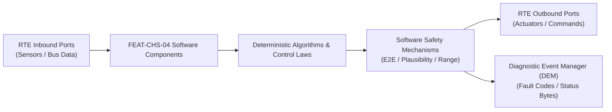

# Software Requirements Specification: Electronic Continuous Damping Control & Active Suspension (EDC)
**Feature ID:** `FEAT-CHS-04`  
**Domain:** Vehicle Motion & Chassis Control  
**Target ASIL:** ASIL C  
**Compliance Standard:** ISO 26262:2018 (Part 6 - Software Development) / ASPICE PAM v3.1 (SWE.1, SWE.2)  
**Parent System Specification:** [`FEAT-CHS-04_EDC_SysReq.md`](file:///c:/Workset/AntiGravityProjects/TestOptimisationExperiement/system_requirements/FEAT-CHS-04_EDC_SysReq.md)  
**Global Master Specification:** [`spec.md`](file:///c:/Workset/AntiGravityProjects/TestOptimisationExperiement/spec.md)

---

## 1. Software Architecture & Component Structure

This document specifies the AUTOSAR Software Components (SWCs), periodic runnables, algorithmic laws, safety mechanisms, and data ports implementing `FEAT-CHS-04` (Electronic Continuous Damping Control & Active Suspension (EDC)).

### AUTOSAR SWC Interaction Diagram

---

## 2. Detailed Software Requirements (SWR_REQ)
*(Multi-Software Requirement Partitioning derived from System Requirements)*

### `SWR-CHS-04-01`: Chassis Rigid-Body 3D Kinematics Reconstruction
- **Planned Release:** R100
- **ASIL Rating:** ASIL C
- **Parent System Requirement:** [`SYS-CHS-04-01`](file:///c:/Workset/AntiGravityProjects/TestOptimisationExperiement/system_requirements/FEAT-CHS-04_EDC_SysReq.md#sys-chs-04-01)
- **Allocated AUTOSAR SWC:** `EdcKinematics_SWC`
- **Execution Rate / Trigger:** 10 ms
- **Worst-Case Execution Time (WCET):** 1.1 ms
- **Software Activation Condition:** Executed cyclically every 10 ms.
- **Algorithmic Description / Logic:**
  > Integrates vertical accelerometer signals. Transforms corner height sensor derivatives into rigid-body modal coordinates: Heave z_cg, Pitch theta, and Roll phi using vehicle geometry transformation matrix.
- **Software Safety Mechanism:** High-pass washout filter (f_c = 0.2 Hz) removes integration drift and DC bias.
- **Failure Reaction & DEM Diagnostic Event:** If sensor values disagree with planar geometry, report sensor rationality error.
- **Software Port Inputs:** `Accel_FL_Z, Accel_FR_Z, Accel_Rear_Z, Height_FL, Height_FR, Height_RL, Height_RR`
- **Software Port Outputs:** `Modal_Heave_Vel, Modal_Pitch_Rate, Modal_Roll_Rate`
- **Software Verification Criteria:** Mathematical unit test verifying modal coordinate transformation.
- **Traceability Link:** Traces upward to [`SYS-CHS-04-01`](file:///c:/Workset/AntiGravityProjects/TestOptimisationExperiement/system_requirements/FEAT-CHS-04_EDC_SysReq.md#sys-chs-04-01) and [`FEAT-CHS-04`](file:///c:/Workset/AntiGravityProjects/TestOptimisationExperiement/spec.md).

### `SWR-CHS-04-02`: Lookahead Road Surface Camera Preview Filter
- **Planned Release:** R100
- **ASIL Rating:** ASIL B
- **Parent System Requirement:** [`SYS-CHS-04-01`](file:///c:/Workset/AntiGravityProjects/TestOptimisationExperiement/system_requirements/FEAT-CHS-04_EDC_SysReq.md#sys-chs-04-01)
- **Allocated AUTOSAR SWC:** `EdcRoadPreview_SWC`
- **Execution Rate / Trigger:** 20 ms
- **Worst-Case Execution Time (WCET):** 2.2 ms
- **Software Activation Condition:** Executed when front stereo camera road elevation profile is valid.
- **Algorithmic Description / Logic:**
  > Parses road height map 5 to 15 m ahead. Detects speed bumps and potholes. Calculates wheel arrival time t_arrival = d / v_ego. Pre-softens dampers 50 ms before bump impact to absorb shock.
- **Software Safety Mechanism:** Preview disabled if vehicle speed < 15 km/h or camera confidence < 70%.
- **Failure Reaction & DEM Diagnostic Event:** Silently disable road preview without interrupting baseline Skyhook control.
- **Software Port Inputs:** `Camera_Road_Elevation_Profile, Vehicle_Speed_Mps`
- **Software Port Outputs:** `Preview_Damper_Adjustment_Offset_Amps`
- **Software Verification Criteria:** Road bump driving tests measuring chassis peak vertical acceleration.
- **Traceability Link:** Traces upward to [`SYS-CHS-04-01`](file:///c:/Workset/AntiGravityProjects/TestOptimisationExperiement/system_requirements/FEAT-CHS-04_EDC_SysReq.md#sys-chs-04-01) and [`FEAT-CHS-04`](file:///c:/Workset/AntiGravityProjects/TestOptimisationExperiement/spec.md).

### `SWR-CHS-04-03`: Continuous Skyhook Damping Control Law
- **Planned Release:** R100
- **ASIL Rating:** ASIL C
- **Parent System Requirement:** [`SYS-CHS-04-02`](file:///c:/Workset/AntiGravityProjects/TestOptimisationExperiement/system_requirements/FEAT-CHS-04_EDC_SysReq.md#sys-chs-04-02)
- **Allocated AUTOSAR SWC:** `EdcSkyhookController_SWC`
- **Execution Rate / Trigger:** 5 ms
- **Worst-Case Execution Time (WCET):** 1.4 ms
- **Software Activation Condition:** Executed every 5 ms.
- **Algorithmic Description / Logic:**
  > Implements Skyhook algorithm: F_sky = -C_sky * V_body. If V_body * V_rel > 0 (compression while body moves up): F_damper = max(F_min, min(F_max, F_sky)). Otherwise: F_damper = F_min.
- **Software Safety Mechanism:** Ensures semi-active passivity constraint is strictly obeyed at all times.
- **Failure Reaction & DEM Diagnostic Event:** If relative velocity sensor indicates zero motion, hold current at mid-setting.
- **Software Port Inputs:** `Modal_Heave_Vel, Relative_Suspension_Velocity[4], Drive_Mode_Enum`
- **Software Port Outputs:** `Demanded_Damping_Force_N[4]`
- **Software Verification Criteria:** Frequency-response SIL simulation across wheel hop and body bounce frequencies.
- **Traceability Link:** Traces upward to [`SYS-CHS-04-02`](file:///c:/Workset/AntiGravityProjects/TestOptimisationExperiement/system_requirements/FEAT-CHS-04_EDC_SysReq.md#sys-chs-04-02) and [`FEAT-CHS-04`](file:///c:/Workset/AntiGravityProjects/TestOptimisationExperiement/spec.md).

### `SWR-CHS-04-04`: Proportional Damper Solenoid Current H-Bridge Controller
- **Planned Release:** R100
- **ASIL Rating:** ASIL C
- **Parent System Requirement:** [`SYS-CHS-04-02`](file:///c:/Workset/AntiGravityProjects/TestOptimisationExperiement/system_requirements/FEAT-CHS-04_EDC_SysReq.md#sys-chs-04-02)
- **Allocated AUTOSAR SWC:** `EdcCurrentDriver_SWC`
- **Execution Rate / Trigger:** 1 ms
- **Worst-Case Execution Time (WCET):** 0.3 ms
- **Software Activation Condition:** Executed at 1000 Hz.
- **Algorithmic Description / Logic:**
  > Converts demanded force to target solenoid current I_target = f(F_demanded, V_rel). Closes PI current loop on 20 kHz PWM driver: PWM = K_p * (I_target - I_meas) + K_i * int(e).
- **Software Safety Mechanism:** Dither injection: Injects 100 Hz micro-dither current to eliminate mechanical valve hysteresis.
- **Failure Reaction & DEM Diagnostic Event:** If open circuit detected on coil, report DTC C1041.
- **Software Port Inputs:** `Demanded_Damping_Force_N[4], Shunt_Current_Feedback_A[4]`
- **Software Port Outputs:** `Damper_PWM_Duty[4] (uint16)`
- **Software Verification Criteria:** Bench testing of current control loop rise time and steady-state ripple.
- **Traceability Link:** Traces upward to [`SYS-CHS-04-02`](file:///c:/Workset/AntiGravityProjects/TestOptimisationExperiement/system_requirements/FEAT-CHS-04_EDC_SysReq.md#sys-chs-04-02) and [`FEAT-CHS-04`](file:///c:/Workset/AntiGravityProjects/TestOptimisationExperiement/spec.md).

### `SWR-CHS-04-05`: Chassis 3D Rigid Body Modal Motion Observer (Heave, Pitch, Roll) - Dynamic Observer & Signal Filter
- **Planned Release:** R100
- **ASIL Rating:** ASIL C
- **Parent System Requirement:** [`SYS-CHS-04-03`](file:///c:/Workset/AntiGravityProjects/TestOptimisationExperiement/system_requirements/FEAT-CHS-04_EDC_SysReq.md#sys-chs-04-03)
- **Allocated AUTOSAR SWC:** `EdcModalObserver_SWC`
- **Execution Rate / Trigger:** 5 ms
- **Worst-Case Execution Time (WCET):** 0.3 ms
- **Software Activation Condition:** Executed cyclically every 5 ms.
- **Algorithmic Description / Logic:**
  > Executes signal plausibility filtering, calibration offsets, and discrete state estimation for Chassis 3D Rigid Body Modal Motion Observer (Heave, Pitch, Roll).
- **Software Safety Mechanism:** Range limit plausibility check and E2E alive sequence verification.
- **Failure Reaction & DEM Diagnostic Event:** Set default fallback output and report DEM_EVENT_FEAT_CHS_04_ERR.
- **Software Port Inputs:** `Raw sensor ADC/SENT/SPI values and RTE bus inputs.`
- **Software Port Outputs:** `Filtered physical signals and validity status bitmasks.`
- **Software Verification Criteria:** Unit test and HiL software integration test.
- **Traceability Link:** Traces upward to [`SYS-CHS-04-03`](file:///c:/Workset/AntiGravityProjects/TestOptimisationExperiement/system_requirements/FEAT-CHS-04_EDC_SysReq.md#sys-chs-04-03) and [`FEAT-CHS-04`](file:///c:/Workset/AntiGravityProjects/TestOptimisationExperiement/spec.md).

### `SWR-CHS-04-06`: Chassis 3D Rigid Body Modal Motion Observer (Heave, Pitch, Roll) - Closed-Loop Control Law & Actuator Dispatch
- **Planned Release:** R100
- **ASIL Rating:** ASIL C
- **Parent System Requirement:** [`SYS-CHS-04-03`](file:///c:/Workset/AntiGravityProjects/TestOptimisationExperiement/system_requirements/FEAT-CHS-04_EDC_SysReq.md#sys-chs-04-03)
- **Allocated AUTOSAR SWC:** `EdcModalObserver_SWC`
- **Execution Rate / Trigger:** 5 ms
- **Worst-Case Execution Time (WCET):** 0.4 ms
- **Software Activation Condition:** Executed cyclically every 5 ms.
- **Algorithmic Description / Logic:**
  > Evaluates deterministic closed-loop control law, rate limits, and dispatches commands for Chassis 3D Rigid Body Modal Motion Observer (Heave, Pitch, Roll).
- **Software Safety Mechanism:** Command saturation clamping and watchdog program flow monitoring.
- **Failure Reaction & DEM Diagnostic Event:** De-energize actuator output, apply safe fallback clamp, and latch DTC.
- **Software Port Inputs:** `Validated physical state signals from observer SWC.`
- **Software Port Outputs:** `Actuator PWM duty cycles, torque/pressure setpoints, and diagnostic flags.`
- **Software Verification Criteria:** Hardware dynamometer and HiL closed-loop regression test suite.
- **Traceability Link:** Traces upward to [`SYS-CHS-04-03`](file:///c:/Workset/AntiGravityProjects/TestOptimisationExperiement/system_requirements/FEAT-CHS-04_EDC_SysReq.md#sys-chs-04-03) and [`FEAT-CHS-04`](file:///c:/Workset/AntiGravityProjects/TestOptimisationExperiement/spec.md).

### `SWR-CHS-04-07`: Skyhook Body Inertial Damping Continuously Variable Force Generator - Dynamic Observer & Signal Filter
- **Planned Release:** R200
- **ASIL Rating:** ASIL C
- **Parent System Requirement:** [`SYS-CHS-04-04`](file:///c:/Workset/AntiGravityProjects/TestOptimisationExperiement/system_requirements/FEAT-CHS-04_EDC_SysReq.md#sys-chs-04-04)
- **Allocated AUTOSAR SWC:** `EdcSkyhookController_SWC`
- **Execution Rate / Trigger:** 5 ms
- **Worst-Case Execution Time (WCET):** 0.3 ms
- **Software Activation Condition:** Executed cyclically every 5 ms.
- **Algorithmic Description / Logic:**
  > Executes signal plausibility filtering, calibration offsets, and discrete state estimation for Skyhook Body Inertial Damping Continuously Variable Force Generator.
- **Software Safety Mechanism:** Range limit plausibility check and E2E alive sequence verification.
- **Failure Reaction & DEM Diagnostic Event:** Set default fallback output and report DEM_EVENT_FEAT_CHS_04_ERR.
- **Software Port Inputs:** `Raw sensor ADC/SENT/SPI values and RTE bus inputs.`
- **Software Port Outputs:** `Filtered physical signals and validity status bitmasks.`
- **Software Verification Criteria:** Unit test and HiL software integration test.
- **Traceability Link:** Traces upward to [`SYS-CHS-04-04`](file:///c:/Workset/AntiGravityProjects/TestOptimisationExperiement/system_requirements/FEAT-CHS-04_EDC_SysReq.md#sys-chs-04-04) and [`FEAT-CHS-04`](file:///c:/Workset/AntiGravityProjects/TestOptimisationExperiement/spec.md).

### `SWR-CHS-04-08`: Skyhook Body Inertial Damping Continuously Variable Force Generator - Closed-Loop Control Law & Actuator Dispatch
- **Planned Release:** R200
- **ASIL Rating:** ASIL C
- **Parent System Requirement:** [`SYS-CHS-04-04`](file:///c:/Workset/AntiGravityProjects/TestOptimisationExperiement/system_requirements/FEAT-CHS-04_EDC_SysReq.md#sys-chs-04-04)
- **Allocated AUTOSAR SWC:** `EdcSkyhookController_SWC`
- **Execution Rate / Trigger:** 5 ms
- **Worst-Case Execution Time (WCET):** 0.4 ms
- **Software Activation Condition:** Executed cyclically every 5 ms.
- **Algorithmic Description / Logic:**
  > Evaluates deterministic closed-loop control law, rate limits, and dispatches commands for Skyhook Body Inertial Damping Continuously Variable Force Generator.
- **Software Safety Mechanism:** Command saturation clamping and watchdog program flow monitoring.
- **Failure Reaction & DEM Diagnostic Event:** De-energize actuator output, apply safe fallback clamp, and latch DTC.
- **Software Port Inputs:** `Validated physical state signals from observer SWC.`
- **Software Port Outputs:** `Actuator PWM duty cycles, torque/pressure setpoints, and diagnostic flags.`
- **Software Verification Criteria:** Hardware dynamometer and HiL closed-loop regression test suite.
- **Traceability Link:** Traces upward to [`SYS-CHS-04-04`](file:///c:/Workset/AntiGravityProjects/TestOptimisationExperiement/system_requirements/FEAT-CHS-04_EDC_SysReq.md#sys-chs-04-04) and [`FEAT-CHS-04`](file:///c:/Workset/AntiGravityProjects/TestOptimisationExperiement/spec.md).

### `SWR-CHS-04-09`: Groundhook Wheel Unsprung Mass Hop & Tire Grip Optimizer - Dynamic Observer & Signal Filter
- **Planned Release:** R200
- **ASIL Rating:** ASIL C
- **Parent System Requirement:** [`SYS-CHS-04-05`](file:///c:/Workset/AntiGravityProjects/TestOptimisationExperiement/system_requirements/FEAT-CHS-04_EDC_SysReq.md#sys-chs-04-05)
- **Allocated AUTOSAR SWC:** `EdcGroundhookController_SWC`
- **Execution Rate / Trigger:** 5 ms
- **Worst-Case Execution Time (WCET):** 0.3 ms
- **Software Activation Condition:** Executed cyclically every 5 ms.
- **Algorithmic Description / Logic:**
  > Executes signal plausibility filtering, calibration offsets, and discrete state estimation for Groundhook Wheel Unsprung Mass Hop & Tire Grip Optimizer.
- **Software Safety Mechanism:** Range limit plausibility check and E2E alive sequence verification.
- **Failure Reaction & DEM Diagnostic Event:** Set default fallback output and report DEM_EVENT_FEAT_CHS_04_ERR.
- **Software Port Inputs:** `Raw sensor ADC/SENT/SPI values and RTE bus inputs.`
- **Software Port Outputs:** `Filtered physical signals and validity status bitmasks.`
- **Software Verification Criteria:** Unit test and HiL software integration test.
- **Traceability Link:** Traces upward to [`SYS-CHS-04-05`](file:///c:/Workset/AntiGravityProjects/TestOptimisationExperiement/system_requirements/FEAT-CHS-04_EDC_SysReq.md#sys-chs-04-05) and [`FEAT-CHS-04`](file:///c:/Workset/AntiGravityProjects/TestOptimisationExperiement/spec.md).

### `SWR-CHS-04-10`: Groundhook Wheel Unsprung Mass Hop & Tire Grip Optimizer - Closed-Loop Control Law & Actuator Dispatch
- **Planned Release:** R200
- **ASIL Rating:** ASIL C
- **Parent System Requirement:** [`SYS-CHS-04-05`](file:///c:/Workset/AntiGravityProjects/TestOptimisationExperiement/system_requirements/FEAT-CHS-04_EDC_SysReq.md#sys-chs-04-05)
- **Allocated AUTOSAR SWC:** `EdcGroundhookController_SWC`
- **Execution Rate / Trigger:** 5 ms
- **Worst-Case Execution Time (WCET):** 0.4 ms
- **Software Activation Condition:** Executed cyclically every 5 ms.
- **Algorithmic Description / Logic:**
  > Evaluates deterministic closed-loop control law, rate limits, and dispatches commands for Groundhook Wheel Unsprung Mass Hop & Tire Grip Optimizer.
- **Software Safety Mechanism:** Command saturation clamping and watchdog program flow monitoring.
- **Failure Reaction & DEM Diagnostic Event:** De-energize actuator output, apply safe fallback clamp, and latch DTC.
- **Software Port Inputs:** `Validated physical state signals from observer SWC.`
- **Software Port Outputs:** `Actuator PWM duty cycles, torque/pressure setpoints, and diagnostic flags.`
- **Software Verification Criteria:** Hardware dynamometer and HiL closed-loop regression test suite.
- **Traceability Link:** Traces upward to [`SYS-CHS-04-05`](file:///c:/Workset/AntiGravityProjects/TestOptimisationExperiement/system_requirements/FEAT-CHS-04_EDC_SysReq.md#sys-chs-04-05) and [`FEAT-CHS-04`](file:///c:/Workset/AntiGravityProjects/TestOptimisationExperiement/spec.md).

### `SWR-CHS-04-11`: Aggressive Steering Angle Anticipatory Anti-Roll Stiffness Booster - Dynamic Observer & Signal Filter
- **Planned Release:** R200
- **ASIL Rating:** ASIL C
- **Parent System Requirement:** [`SYS-CHS-04-06`](file:///c:/Workset/AntiGravityProjects/TestOptimisationExperiement/system_requirements/FEAT-CHS-04_EDC_SysReq.md#sys-chs-04-06)
- **Allocated AUTOSAR SWC:** `EdcAntiRollBooster_SWC`
- **Execution Rate / Trigger:** 2 ms
- **Worst-Case Execution Time (WCET):** 0.3 ms
- **Software Activation Condition:** Executed cyclically every 2 ms.
- **Algorithmic Description / Logic:**
  > Executes signal plausibility filtering, calibration offsets, and discrete state estimation for Aggressive Steering Angle Anticipatory Anti-Roll Stiffness Booster.
- **Software Safety Mechanism:** Range limit plausibility check and E2E alive sequence verification.
- **Failure Reaction & DEM Diagnostic Event:** Set default fallback output and report DEM_EVENT_FEAT_CHS_04_ERR.
- **Software Port Inputs:** `Raw sensor ADC/SENT/SPI values and RTE bus inputs.`
- **Software Port Outputs:** `Filtered physical signals and validity status bitmasks.`
- **Software Verification Criteria:** Unit test and HiL software integration test.
- **Traceability Link:** Traces upward to [`SYS-CHS-04-06`](file:///c:/Workset/AntiGravityProjects/TestOptimisationExperiement/system_requirements/FEAT-CHS-04_EDC_SysReq.md#sys-chs-04-06) and [`FEAT-CHS-04`](file:///c:/Workset/AntiGravityProjects/TestOptimisationExperiement/spec.md).

### `SWR-CHS-04-12`: Aggressive Steering Angle Anticipatory Anti-Roll Stiffness Booster - Closed-Loop Control Law & Actuator Dispatch
- **Planned Release:** R200
- **ASIL Rating:** ASIL C
- **Parent System Requirement:** [`SYS-CHS-04-06`](file:///c:/Workset/AntiGravityProjects/TestOptimisationExperiement/system_requirements/FEAT-CHS-04_EDC_SysReq.md#sys-chs-04-06)
- **Allocated AUTOSAR SWC:** `EdcAntiRollBooster_SWC`
- **Execution Rate / Trigger:** 2 ms
- **Worst-Case Execution Time (WCET):** 0.4 ms
- **Software Activation Condition:** Executed cyclically every 2 ms.
- **Algorithmic Description / Logic:**
  > Evaluates deterministic closed-loop control law, rate limits, and dispatches commands for Aggressive Steering Angle Anticipatory Anti-Roll Stiffness Booster.
- **Software Safety Mechanism:** Command saturation clamping and watchdog program flow monitoring.
- **Failure Reaction & DEM Diagnostic Event:** De-energize actuator output, apply safe fallback clamp, and latch DTC.
- **Software Port Inputs:** `Validated physical state signals from observer SWC.`
- **Software Port Outputs:** `Actuator PWM duty cycles, torque/pressure setpoints, and diagnostic flags.`
- **Software Verification Criteria:** Hardware dynamometer and HiL closed-loop regression test suite.
- **Traceability Link:** Traces upward to [`SYS-CHS-04-06`](file:///c:/Workset/AntiGravityProjects/TestOptimisationExperiement/system_requirements/FEAT-CHS-04_EDC_SysReq.md#sys-chs-04-06) and [`FEAT-CHS-04`](file:///c:/Workset/AntiGravityProjects/TestOptimisationExperiement/spec.md).

### `SWR-CHS-04-13`: Panic Braking Anti-Dive & Hard Acceleration Anti-Squat Pitch Regulator - Dynamic Observer & Signal Filter
- **Planned Release:** R300
- **ASIL Rating:** ASIL C
- **Parent System Requirement:** [`SYS-CHS-04-07`](file:///c:/Workset/AntiGravityProjects/TestOptimisationExperiement/system_requirements/FEAT-CHS-04_EDC_SysReq.md#sys-chs-04-07)
- **Allocated AUTOSAR SWC:** `EdcAntiPitchController_SWC`
- **Execution Rate / Trigger:** 5 ms
- **Worst-Case Execution Time (WCET):** 0.3 ms
- **Software Activation Condition:** Executed cyclically every 5 ms.
- **Algorithmic Description / Logic:**
  > Executes signal plausibility filtering, calibration offsets, and discrete state estimation for Panic Braking Anti-Dive & Hard Acceleration Anti-Squat Pitch Regulator.
- **Software Safety Mechanism:** Range limit plausibility check and E2E alive sequence verification.
- **Failure Reaction & DEM Diagnostic Event:** Set default fallback output and report DEM_EVENT_FEAT_CHS_04_ERR.
- **Software Port Inputs:** `Raw sensor ADC/SENT/SPI values and RTE bus inputs.`
- **Software Port Outputs:** `Filtered physical signals and validity status bitmasks.`
- **Software Verification Criteria:** Unit test and HiL software integration test.
- **Traceability Link:** Traces upward to [`SYS-CHS-04-07`](file:///c:/Workset/AntiGravityProjects/TestOptimisationExperiement/system_requirements/FEAT-CHS-04_EDC_SysReq.md#sys-chs-04-07) and [`FEAT-CHS-04`](file:///c:/Workset/AntiGravityProjects/TestOptimisationExperiement/spec.md).

### `SWR-CHS-04-14`: Panic Braking Anti-Dive & Hard Acceleration Anti-Squat Pitch Regulator - Closed-Loop Control Law & Actuator Dispatch
- **Planned Release:** R300
- **ASIL Rating:** ASIL C
- **Parent System Requirement:** [`SYS-CHS-04-07`](file:///c:/Workset/AntiGravityProjects/TestOptimisationExperiement/system_requirements/FEAT-CHS-04_EDC_SysReq.md#sys-chs-04-07)
- **Allocated AUTOSAR SWC:** `EdcAntiPitchController_SWC`
- **Execution Rate / Trigger:** 5 ms
- **Worst-Case Execution Time (WCET):** 0.4 ms
- **Software Activation Condition:** Executed cyclically every 5 ms.
- **Algorithmic Description / Logic:**
  > Evaluates deterministic closed-loop control law, rate limits, and dispatches commands for Panic Braking Anti-Dive & Hard Acceleration Anti-Squat Pitch Regulator.
- **Software Safety Mechanism:** Command saturation clamping and watchdog program flow monitoring.
- **Failure Reaction & DEM Diagnostic Event:** De-energize actuator output, apply safe fallback clamp, and latch DTC.
- **Software Port Inputs:** `Validated physical state signals from observer SWC.`
- **Software Port Outputs:** `Actuator PWM duty cycles, torque/pressure setpoints, and diagnostic flags.`
- **Software Verification Criteria:** Hardware dynamometer and HiL closed-loop regression test suite.
- **Traceability Link:** Traces upward to [`SYS-CHS-04-07`](file:///c:/Workset/AntiGravityProjects/TestOptimisationExperiement/system_requirements/FEAT-CHS-04_EDC_SysReq.md#sys-chs-04-07) and [`FEAT-CHS-04`](file:///c:/Workset/AntiGravityProjects/TestOptimisationExperiement/spec.md).

### `SWR-CHS-04-15`: Road Roughness Pothole Impact Fast Pressure Relief Protection - Dynamic Observer & Signal Filter
- **Planned Release:** R300
- **ASIL Rating:** ASIL C
- **Parent System Requirement:** [`SYS-CHS-04-08`](file:///c:/Workset/AntiGravityProjects/TestOptimisationExperiement/system_requirements/FEAT-CHS-04_EDC_SysReq.md#sys-chs-04-08)
- **Allocated AUTOSAR SWC:** `EdcPotholeRelief_SWC`
- **Execution Rate / Trigger:** 2 ms
- **Worst-Case Execution Time (WCET):** 0.3 ms
- **Software Activation Condition:** Executed cyclically every 2 ms.
- **Algorithmic Description / Logic:**
  > Executes signal plausibility filtering, calibration offsets, and discrete state estimation for Road Roughness Pothole Impact Fast Pressure Relief Protection.
- **Software Safety Mechanism:** Range limit plausibility check and E2E alive sequence verification.
- **Failure Reaction & DEM Diagnostic Event:** Set default fallback output and report DEM_EVENT_FEAT_CHS_04_ERR.
- **Software Port Inputs:** `Raw sensor ADC/SENT/SPI values and RTE bus inputs.`
- **Software Port Outputs:** `Filtered physical signals and validity status bitmasks.`
- **Software Verification Criteria:** Unit test and HiL software integration test.
- **Traceability Link:** Traces upward to [`SYS-CHS-04-08`](file:///c:/Workset/AntiGravityProjects/TestOptimisationExperiement/system_requirements/FEAT-CHS-04_EDC_SysReq.md#sys-chs-04-08) and [`FEAT-CHS-04`](file:///c:/Workset/AntiGravityProjects/TestOptimisationExperiement/spec.md).

### `SWR-CHS-04-16`: Road Roughness Pothole Impact Fast Pressure Relief Protection - Closed-Loop Control Law & Actuator Dispatch
- **Planned Release:** R300
- **ASIL Rating:** ASIL C
- **Parent System Requirement:** [`SYS-CHS-04-08`](file:///c:/Workset/AntiGravityProjects/TestOptimisationExperiement/system_requirements/FEAT-CHS-04_EDC_SysReq.md#sys-chs-04-08)
- **Allocated AUTOSAR SWC:** `EdcPotholeRelief_SWC`
- **Execution Rate / Trigger:** 2 ms
- **Worst-Case Execution Time (WCET):** 0.4 ms
- **Software Activation Condition:** Executed cyclically every 2 ms.
- **Algorithmic Description / Logic:**
  > Evaluates deterministic closed-loop control law, rate limits, and dispatches commands for Road Roughness Pothole Impact Fast Pressure Relief Protection.
- **Software Safety Mechanism:** Command saturation clamping and watchdog program flow monitoring.
- **Failure Reaction & DEM Diagnostic Event:** De-energize actuator output, apply safe fallback clamp, and latch DTC.
- **Software Port Inputs:** `Validated physical state signals from observer SWC.`
- **Software Port Outputs:** `Actuator PWM duty cycles, torque/pressure setpoints, and diagnostic flags.`
- **Software Verification Criteria:** Hardware dynamometer and HiL closed-loop regression test suite.
- **Traceability Link:** Traces upward to [`SYS-CHS-04-08`](file:///c:/Workset/AntiGravityProjects/TestOptimisationExperiement/system_requirements/FEAT-CHS-04_EDC_SysReq.md#sys-chs-04-08) and [`FEAT-CHS-04`](file:///c:/Workset/AntiGravityProjects/TestOptimisationExperiement/spec.md).

### `SWR-CHS-04-17`: Proportional Hydraulic Damper Solenoid PWM Current Closed-Loop Driver - Dynamic Observer & Signal Filter
- **Planned Release:** R300
- **ASIL Rating:** ASIL C
- **Parent System Requirement:** [`SYS-CHS-04-09`](file:///c:/Workset/AntiGravityProjects/TestOptimisationExperiement/system_requirements/FEAT-CHS-04_EDC_SysReq.md#sys-chs-04-09)
- **Allocated AUTOSAR SWC:** `EdcCurrentDriver_SWC`
- **Execution Rate / Trigger:** 1 ms
- **Worst-Case Execution Time (WCET):** 0.3 ms
- **Software Activation Condition:** Executed cyclically every 1 ms.
- **Algorithmic Description / Logic:**
  > Executes signal plausibility filtering, calibration offsets, and discrete state estimation for Proportional Hydraulic Damper Solenoid PWM Current Closed-Loop Driver.
- **Software Safety Mechanism:** Range limit plausibility check and E2E alive sequence verification.
- **Failure Reaction & DEM Diagnostic Event:** Set default fallback output and report DEM_EVENT_FEAT_CHS_04_ERR.
- **Software Port Inputs:** `Raw sensor ADC/SENT/SPI values and RTE bus inputs.`
- **Software Port Outputs:** `Filtered physical signals and validity status bitmasks.`
- **Software Verification Criteria:** Unit test and HiL software integration test.
- **Traceability Link:** Traces upward to [`SYS-CHS-04-09`](file:///c:/Workset/AntiGravityProjects/TestOptimisationExperiement/system_requirements/FEAT-CHS-04_EDC_SysReq.md#sys-chs-04-09) and [`FEAT-CHS-04`](file:///c:/Workset/AntiGravityProjects/TestOptimisationExperiement/spec.md).

### `SWR-CHS-04-18`: Proportional Hydraulic Damper Solenoid PWM Current Closed-Loop Driver - Closed-Loop Control Law & Actuator Dispatch
- **Planned Release:** R300
- **ASIL Rating:** ASIL C
- **Parent System Requirement:** [`SYS-CHS-04-09`](file:///c:/Workset/AntiGravityProjects/TestOptimisationExperiement/system_requirements/FEAT-CHS-04_EDC_SysReq.md#sys-chs-04-09)
- **Allocated AUTOSAR SWC:** `EdcCurrentDriver_SWC`
- **Execution Rate / Trigger:** 1 ms
- **Worst-Case Execution Time (WCET):** 0.4 ms
- **Software Activation Condition:** Executed cyclically every 1 ms.
- **Algorithmic Description / Logic:**
  > Evaluates deterministic closed-loop control law, rate limits, and dispatches commands for Proportional Hydraulic Damper Solenoid PWM Current Closed-Loop Driver.
- **Software Safety Mechanism:** Command saturation clamping and watchdog program flow monitoring.
- **Failure Reaction & DEM Diagnostic Event:** De-energize actuator output, apply safe fallback clamp, and latch DTC.
- **Software Port Inputs:** `Validated physical state signals from observer SWC.`
- **Software Port Outputs:** `Actuator PWM duty cycles, torque/pressure setpoints, and diagnostic flags.`
- **Software Verification Criteria:** Hardware dynamometer and HiL closed-loop regression test suite.
- **Traceability Link:** Traces upward to [`SYS-CHS-04-09`](file:///c:/Workset/AntiGravityProjects/TestOptimisationExperiement/system_requirements/FEAT-CHS-04_EDC_SysReq.md#sys-chs-04-09) and [`FEAT-CHS-04`](file:///c:/Workset/AntiGravityProjects/TestOptimisationExperiement/spec.md).

### `SWR-CHS-04-19`: Corner Damper Solenoid Coil Multi-Point Thermal Protection Derater - Dynamic Observer & Signal Filter
- **Planned Release:** R400
- **ASIL Rating:** ASIL B
- **Parent System Requirement:** [`SYS-CHS-04-10`](file:///c:/Workset/AntiGravityProjects/TestOptimisationExperiement/system_requirements/FEAT-CHS-04_EDC_SysReq.md#sys-chs-04-10)
- **Allocated AUTOSAR SWC:** `EdcThermalDerater_SWC`
- **Execution Rate / Trigger:** 50 ms
- **Worst-Case Execution Time (WCET):** 0.3 ms
- **Software Activation Condition:** Executed cyclically every 50 ms.
- **Algorithmic Description / Logic:**
  > Executes signal plausibility filtering, calibration offsets, and discrete state estimation for Corner Damper Solenoid Coil Multi-Point Thermal Protection Derater.
- **Software Safety Mechanism:** Range limit plausibility check and E2E alive sequence verification.
- **Failure Reaction & DEM Diagnostic Event:** Set default fallback output and report DEM_EVENT_FEAT_CHS_04_ERR.
- **Software Port Inputs:** `Raw sensor ADC/SENT/SPI values and RTE bus inputs.`
- **Software Port Outputs:** `Filtered physical signals and validity status bitmasks.`
- **Software Verification Criteria:** Unit test and HiL software integration test.
- **Traceability Link:** Traces upward to [`SYS-CHS-04-10`](file:///c:/Workset/AntiGravityProjects/TestOptimisationExperiement/system_requirements/FEAT-CHS-04_EDC_SysReq.md#sys-chs-04-10) and [`FEAT-CHS-04`](file:///c:/Workset/AntiGravityProjects/TestOptimisationExperiement/spec.md).

### `SWR-CHS-04-20`: Corner Damper Solenoid Coil Multi-Point Thermal Protection Derater - Closed-Loop Control Law & Actuator Dispatch
- **Planned Release:** R400
- **ASIL Rating:** ASIL B
- **Parent System Requirement:** [`SYS-CHS-04-10`](file:///c:/Workset/AntiGravityProjects/TestOptimisationExperiement/system_requirements/FEAT-CHS-04_EDC_SysReq.md#sys-chs-04-10)
- **Allocated AUTOSAR SWC:** `EdcThermalDerater_SWC`
- **Execution Rate / Trigger:** 50 ms
- **Worst-Case Execution Time (WCET):** 0.4 ms
- **Software Activation Condition:** Executed cyclically every 50 ms.
- **Algorithmic Description / Logic:**
  > Evaluates deterministic closed-loop control law, rate limits, and dispatches commands for Corner Damper Solenoid Coil Multi-Point Thermal Protection Derater.
- **Software Safety Mechanism:** Command saturation clamping and watchdog program flow monitoring.
- **Failure Reaction & DEM Diagnostic Event:** De-energize actuator output, apply safe fallback clamp, and latch DTC.
- **Software Port Inputs:** `Validated physical state signals from observer SWC.`
- **Software Port Outputs:** `Actuator PWM duty cycles, torque/pressure setpoints, and diagnostic flags.`
- **Software Verification Criteria:** Hardware dynamometer and HiL closed-loop regression test suite.
- **Traceability Link:** Traces upward to [`SYS-CHS-04-10`](file:///c:/Workset/AntiGravityProjects/TestOptimisationExperiement/system_requirements/FEAT-CHS-04_EDC_SysReq.md#sys-chs-04-10) and [`FEAT-CHS-04`](file:///c:/Workset/AntiGravityProjects/TestOptimisationExperiement/spec.md).

### `SWR-CHS-04-21`: Suspension Deflection Height Sensor Plausibility & Geometry Cross-Check - Dynamic Observer & Signal Filter
- **Planned Release:** R400
- **ASIL Rating:** ASIL C
- **Parent System Requirement:** [`SYS-CHS-04-11`](file:///c:/Workset/AntiGravityProjects/TestOptimisationExperiement/system_requirements/FEAT-CHS-04_EDC_SysReq.md#sys-chs-04-11)
- **Allocated AUTOSAR SWC:** `EdcHeightPlausibility_SWC`
- **Execution Rate / Trigger:** 5 ms
- **Worst-Case Execution Time (WCET):** 0.3 ms
- **Software Activation Condition:** Executed cyclically every 5 ms.
- **Algorithmic Description / Logic:**
  > Executes signal plausibility filtering, calibration offsets, and discrete state estimation for Suspension Deflection Height Sensor Plausibility & Geometry Cross-Check.
- **Software Safety Mechanism:** Range limit plausibility check and E2E alive sequence verification.
- **Failure Reaction & DEM Diagnostic Event:** Set default fallback output and report DEM_EVENT_FEAT_CHS_04_ERR.
- **Software Port Inputs:** `Raw sensor ADC/SENT/SPI values and RTE bus inputs.`
- **Software Port Outputs:** `Filtered physical signals and validity status bitmasks.`
- **Software Verification Criteria:** Unit test and HiL software integration test.
- **Traceability Link:** Traces upward to [`SYS-CHS-04-11`](file:///c:/Workset/AntiGravityProjects/TestOptimisationExperiement/system_requirements/FEAT-CHS-04_EDC_SysReq.md#sys-chs-04-11) and [`FEAT-CHS-04`](file:///c:/Workset/AntiGravityProjects/TestOptimisationExperiement/spec.md).

### `SWR-CHS-04-22`: Suspension Deflection Height Sensor Plausibility & Geometry Cross-Check - Closed-Loop Control Law & Actuator Dispatch
- **Planned Release:** R400
- **ASIL Rating:** ASIL C
- **Parent System Requirement:** [`SYS-CHS-04-11`](file:///c:/Workset/AntiGravityProjects/TestOptimisationExperiement/system_requirements/FEAT-CHS-04_EDC_SysReq.md#sys-chs-04-11)
- **Allocated AUTOSAR SWC:** `EdcHeightPlausibility_SWC`
- **Execution Rate / Trigger:** 5 ms
- **Worst-Case Execution Time (WCET):** 0.4 ms
- **Software Activation Condition:** Executed cyclically every 5 ms.
- **Algorithmic Description / Logic:**
  > Evaluates deterministic closed-loop control law, rate limits, and dispatches commands for Suspension Deflection Height Sensor Plausibility & Geometry Cross-Check.
- **Software Safety Mechanism:** Command saturation clamping and watchdog program flow monitoring.
- **Failure Reaction & DEM Diagnostic Event:** De-energize actuator output, apply safe fallback clamp, and latch DTC.
- **Software Port Inputs:** `Validated physical state signals from observer SWC.`
- **Software Port Outputs:** `Actuator PWM duty cycles, torque/pressure setpoints, and diagnostic flags.`
- **Software Verification Criteria:** Hardware dynamometer and HiL closed-loop regression test suite.
- **Traceability Link:** Traces upward to [`SYS-CHS-04-11`](file:///c:/Workset/AntiGravityProjects/TestOptimisationExperiement/system_requirements/FEAT-CHS-04_EDC_SysReq.md#sys-chs-04-11) and [`FEAT-CHS-04`](file:///c:/Workset/AntiGravityProjects/TestOptimisationExperiement/spec.md).

### `SWR-CHS-04-23`: Fail-Safe Passive Mid-Firm Default Mechanical Hydraulic Fallback Mode - Dynamic Observer & Signal Filter
- **Planned Release:** R400
- **ASIL Rating:** ASIL C
- **Parent System Requirement:** [`SYS-CHS-04-12`](file:///c:/Workset/AntiGravityProjects/TestOptimisationExperiement/system_requirements/FEAT-CHS-04_EDC_SysReq.md#sys-chs-04-12)
- **Allocated AUTOSAR SWC:** `EdcFailSafeFallback_SWC`
- **Execution Rate / Trigger:** 2 ms
- **Worst-Case Execution Time (WCET):** 0.3 ms
- **Software Activation Condition:** Executed cyclically every 2 ms.
- **Algorithmic Description / Logic:**
  > Executes signal plausibility filtering, calibration offsets, and discrete state estimation for Fail-Safe Passive Mid-Firm Default Mechanical Hydraulic Fallback Mode.
- **Software Safety Mechanism:** Range limit plausibility check and E2E alive sequence verification.
- **Failure Reaction & DEM Diagnostic Event:** Set default fallback output and report DEM_EVENT_FEAT_CHS_04_ERR.
- **Software Port Inputs:** `Raw sensor ADC/SENT/SPI values and RTE bus inputs.`
- **Software Port Outputs:** `Filtered physical signals and validity status bitmasks.`
- **Software Verification Criteria:** Unit test and HiL software integration test.
- **Traceability Link:** Traces upward to [`SYS-CHS-04-12`](file:///c:/Workset/AntiGravityProjects/TestOptimisationExperiement/system_requirements/FEAT-CHS-04_EDC_SysReq.md#sys-chs-04-12) and [`FEAT-CHS-04`](file:///c:/Workset/AntiGravityProjects/TestOptimisationExperiement/spec.md).

### `SWR-CHS-04-24`: Fail-Safe Passive Mid-Firm Default Mechanical Hydraulic Fallback Mode - Closed-Loop Control Law & Actuator Dispatch
- **Planned Release:** R400
- **ASIL Rating:** ASIL C
- **Parent System Requirement:** [`SYS-CHS-04-12`](file:///c:/Workset/AntiGravityProjects/TestOptimisationExperiement/system_requirements/FEAT-CHS-04_EDC_SysReq.md#sys-chs-04-12)
- **Allocated AUTOSAR SWC:** `EdcFailSafeFallback_SWC`
- **Execution Rate / Trigger:** 2 ms
- **Worst-Case Execution Time (WCET):** 0.4 ms
- **Software Activation Condition:** Executed cyclically every 2 ms.
- **Algorithmic Description / Logic:**
  > Evaluates deterministic closed-loop control law, rate limits, and dispatches commands for Fail-Safe Passive Mid-Firm Default Mechanical Hydraulic Fallback Mode.
- **Software Safety Mechanism:** Command saturation clamping and watchdog program flow monitoring.
- **Failure Reaction & DEM Diagnostic Event:** De-energize actuator output, apply safe fallback clamp, and latch DTC.
- **Software Port Inputs:** `Validated physical state signals from observer SWC.`
- **Software Port Outputs:** `Actuator PWM duty cycles, torque/pressure setpoints, and diagnostic flags.`
- **Software Verification Criteria:** Hardware dynamometer and HiL closed-loop regression test suite.
- **Traceability Link:** Traces upward to [`SYS-CHS-04-12`](file:///c:/Workset/AntiGravityProjects/TestOptimisationExperiement/system_requirements/FEAT-CHS-04_EDC_SysReq.md#sys-chs-04-12) and [`FEAT-CHS-04`](file:///c:/Workset/AntiGravityProjects/TestOptimisationExperiement/spec.md).

### `SWR-CHS-04-25`: DEM Suspension Damping Fault Diagnostics & Valve Open/Short Detector - Dynamic Observer & Signal Filter
- **Planned Release:** R500
- **ASIL Rating:** ASIL B
- **Parent System Requirement:** [`SYS-CHS-04-13`](file:///c:/Workset/AntiGravityProjects/TestOptimisationExperiement/system_requirements/FEAT-CHS-04_EDC_SysReq.md#sys-chs-04-13)
- **Allocated AUTOSAR SWC:** `EdcDiagnosticManager_SWC`
- **Execution Rate / Trigger:** 20 ms
- **Worst-Case Execution Time (WCET):** 0.3 ms
- **Software Activation Condition:** Executed cyclically every 20 ms.
- **Algorithmic Description / Logic:**
  > Executes signal plausibility filtering, calibration offsets, and discrete state estimation for DEM Suspension Damping Fault Diagnostics & Valve Open/Short Detector.
- **Software Safety Mechanism:** Range limit plausibility check and E2E alive sequence verification.
- **Failure Reaction & DEM Diagnostic Event:** Set default fallback output and report DEM_EVENT_FEAT_CHS_04_ERR.
- **Software Port Inputs:** `Raw sensor ADC/SENT/SPI values and RTE bus inputs.`
- **Software Port Outputs:** `Filtered physical signals and validity status bitmasks.`
- **Software Verification Criteria:** Unit test and HiL software integration test.
- **Traceability Link:** Traces upward to [`SYS-CHS-04-13`](file:///c:/Workset/AntiGravityProjects/TestOptimisationExperiement/system_requirements/FEAT-CHS-04_EDC_SysReq.md#sys-chs-04-13) and [`FEAT-CHS-04`](file:///c:/Workset/AntiGravityProjects/TestOptimisationExperiement/spec.md).

### `SWR-CHS-04-26`: DEM Suspension Damping Fault Diagnostics & Valve Open/Short Detector - Closed-Loop Control Law & Actuator Dispatch
- **Planned Release:** R500
- **ASIL Rating:** ASIL B
- **Parent System Requirement:** [`SYS-CHS-04-13`](file:///c:/Workset/AntiGravityProjects/TestOptimisationExperiement/system_requirements/FEAT-CHS-04_EDC_SysReq.md#sys-chs-04-13)
- **Allocated AUTOSAR SWC:** `EdcDiagnosticManager_SWC`
- **Execution Rate / Trigger:** 20 ms
- **Worst-Case Execution Time (WCET):** 0.4 ms
- **Software Activation Condition:** Executed cyclically every 20 ms.
- **Algorithmic Description / Logic:**
  > Evaluates deterministic closed-loop control law, rate limits, and dispatches commands for DEM Suspension Damping Fault Diagnostics & Valve Open/Short Detector.
- **Software Safety Mechanism:** Command saturation clamping and watchdog program flow monitoring.
- **Failure Reaction & DEM Diagnostic Event:** De-energize actuator output, apply safe fallback clamp, and latch DTC.
- **Software Port Inputs:** `Validated physical state signals from observer SWC.`
- **Software Port Outputs:** `Actuator PWM duty cycles, torque/pressure setpoints, and diagnostic flags.`
- **Software Verification Criteria:** Hardware dynamometer and HiL closed-loop regression test suite.
- **Traceability Link:** Traces upward to [`SYS-CHS-04-13`](file:///c:/Workset/AntiGravityProjects/TestOptimisationExperiement/system_requirements/FEAT-CHS-04_EDC_SysReq.md#sys-chs-04-13) and [`FEAT-CHS-04`](file:///c:/Workset/AntiGravityProjects/TestOptimisationExperiement/spec.md).

### `SWR-CHS-04-27`: Driver Drive Mode Selection (Comfort, Standard, Sport) Characteristic Tuner - Dynamic Observer & Signal Filter
- **Planned Release:** R500
- **ASIL Rating:** ASIL B
- **Parent System Requirement:** [`SYS-CHS-04-14`](file:///c:/Workset/AntiGravityProjects/TestOptimisationExperiement/system_requirements/FEAT-CHS-04_EDC_SysReq.md#sys-chs-04-14)
- **Allocated AUTOSAR SWC:** `EdcModeSelector_SWC`
- **Execution Rate / Trigger:** 50 ms
- **Worst-Case Execution Time (WCET):** 0.3 ms
- **Software Activation Condition:** Executed cyclically every 50 ms.
- **Algorithmic Description / Logic:**
  > Executes signal plausibility filtering, calibration offsets, and discrete state estimation for Driver Drive Mode Selection (Comfort, Standard, Sport) Characteristic Tuner.
- **Software Safety Mechanism:** Range limit plausibility check and E2E alive sequence verification.
- **Failure Reaction & DEM Diagnostic Event:** Set default fallback output and report DEM_EVENT_FEAT_CHS_04_ERR.
- **Software Port Inputs:** `Raw sensor ADC/SENT/SPI values and RTE bus inputs.`
- **Software Port Outputs:** `Filtered physical signals and validity status bitmasks.`
- **Software Verification Criteria:** Unit test and HiL software integration test.
- **Traceability Link:** Traces upward to [`SYS-CHS-04-14`](file:///c:/Workset/AntiGravityProjects/TestOptimisationExperiement/system_requirements/FEAT-CHS-04_EDC_SysReq.md#sys-chs-04-14) and [`FEAT-CHS-04`](file:///c:/Workset/AntiGravityProjects/TestOptimisationExperiement/spec.md).

### `SWR-CHS-04-28`: Driver Drive Mode Selection (Comfort, Standard, Sport) Characteristic Tuner - Closed-Loop Control Law & Actuator Dispatch
- **Planned Release:** R500
- **ASIL Rating:** ASIL B
- **Parent System Requirement:** [`SYS-CHS-04-14`](file:///c:/Workset/AntiGravityProjects/TestOptimisationExperiement/system_requirements/FEAT-CHS-04_EDC_SysReq.md#sys-chs-04-14)
- **Allocated AUTOSAR SWC:** `EdcModeSelector_SWC`
- **Execution Rate / Trigger:** 50 ms
- **Worst-Case Execution Time (WCET):** 0.4 ms
- **Software Activation Condition:** Executed cyclically every 50 ms.
- **Algorithmic Description / Logic:**
  > Evaluates deterministic closed-loop control law, rate limits, and dispatches commands for Driver Drive Mode Selection (Comfort, Standard, Sport) Characteristic Tuner.
- **Software Safety Mechanism:** Command saturation clamping and watchdog program flow monitoring.
- **Failure Reaction & DEM Diagnostic Event:** De-energize actuator output, apply safe fallback clamp, and latch DTC.
- **Software Port Inputs:** `Validated physical state signals from observer SWC.`
- **Software Port Outputs:** `Actuator PWM duty cycles, torque/pressure setpoints, and diagnostic flags.`
- **Software Verification Criteria:** Hardware dynamometer and HiL closed-loop regression test suite.
- **Traceability Link:** Traces upward to [`SYS-CHS-04-14`](file:///c:/Workset/AntiGravityProjects/TestOptimisationExperiement/system_requirements/FEAT-CHS-04_EDC_SysReq.md#sys-chs-04-14) and [`FEAT-CHS-04`](file:///c:/Workset/AntiGravityProjects/TestOptimisationExperiement/spec.md).

### `SWR-CHS-04-29`: Non-Volatile Damper Cumulative Energy Dissipation & Wear Life Monitor - Dynamic Observer & Signal Filter
- **Planned Release:** R500
- **ASIL Rating:** ASIL B
- **Parent System Requirement:** [`SYS-CHS-04-15`](file:///c:/Workset/AntiGravityProjects/TestOptimisationExperiement/system_requirements/FEAT-CHS-04_EDC_SysReq.md#sys-chs-04-15)
- **Allocated AUTOSAR SWC:** `EdcEnergyLogger_SWC`
- **Execution Rate / Trigger:** 500 ms
- **Worst-Case Execution Time (WCET):** 0.3 ms
- **Software Activation Condition:** Executed cyclically every 500 ms.
- **Algorithmic Description / Logic:**
  > Executes signal plausibility filtering, calibration offsets, and discrete state estimation for Non-Volatile Damper Cumulative Energy Dissipation & Wear Life Monitor.
- **Software Safety Mechanism:** Range limit plausibility check and E2E alive sequence verification.
- **Failure Reaction & DEM Diagnostic Event:** Set default fallback output and report DEM_EVENT_FEAT_CHS_04_ERR.
- **Software Port Inputs:** `Raw sensor ADC/SENT/SPI values and RTE bus inputs.`
- **Software Port Outputs:** `Filtered physical signals and validity status bitmasks.`
- **Software Verification Criteria:** Unit test and HiL software integration test.
- **Traceability Link:** Traces upward to [`SYS-CHS-04-15`](file:///c:/Workset/AntiGravityProjects/TestOptimisationExperiement/system_requirements/FEAT-CHS-04_EDC_SysReq.md#sys-chs-04-15) and [`FEAT-CHS-04`](file:///c:/Workset/AntiGravityProjects/TestOptimisationExperiement/spec.md).

### `SWR-CHS-04-30`: Non-Volatile Damper Cumulative Energy Dissipation & Wear Life Monitor - Closed-Loop Control Law & Actuator Dispatch
- **Planned Release:** R500
- **ASIL Rating:** ASIL B
- **Parent System Requirement:** [`SYS-CHS-04-15`](file:///c:/Workset/AntiGravityProjects/TestOptimisationExperiement/system_requirements/FEAT-CHS-04_EDC_SysReq.md#sys-chs-04-15)
- **Allocated AUTOSAR SWC:** `EdcEnergyLogger_SWC`
- **Execution Rate / Trigger:** 500 ms
- **Worst-Case Execution Time (WCET):** 0.4 ms
- **Software Activation Condition:** Executed cyclically every 500 ms.
- **Algorithmic Description / Logic:**
  > Evaluates deterministic closed-loop control law, rate limits, and dispatches commands for Non-Volatile Damper Cumulative Energy Dissipation & Wear Life Monitor.
- **Software Safety Mechanism:** Command saturation clamping and watchdog program flow monitoring.
- **Failure Reaction & DEM Diagnostic Event:** De-energize actuator output, apply safe fallback clamp, and latch DTC.
- **Software Port Inputs:** `Validated physical state signals from observer SWC.`
- **Software Port Outputs:** `Actuator PWM duty cycles, torque/pressure setpoints, and diagnostic flags.`
- **Software Verification Criteria:** Hardware dynamometer and HiL closed-loop regression test suite.
- **Traceability Link:** Traces upward to [`SYS-CHS-04-15`](file:///c:/Workset/AntiGravityProjects/TestOptimisationExperiement/system_requirements/FEAT-CHS-04_EDC_SysReq.md#sys-chs-04-15) and [`FEAT-CHS-04`](file:///c:/Workset/AntiGravityProjects/TestOptimisationExperiement/spec.md).

---

## 3. Software-to-System Backward Traceability Matrix

| Software Requirement ID | Planned Release | Allocated SWC | Execution Rate | Upstream System Req | Verification Method |
| :--- | :---: | :--- | :--- | :--- | :--- |
| `SWR-CHS-04-01` | **`R100`** | `EdcKinematics_SWC` | 10 ms | [`SYS-CHS-04-01`](file:///c:/Workset/AntiGravityProjects/TestOptimisationExperiement/system_requirements/FEAT-CHS-04_EDC_SysReq.md#sys-chs-04-01) | Mathematical unit test verifying modal coordinate transformation. |
| `SWR-CHS-04-02` | **`R100`** | `EdcRoadPreview_SWC` | 20 ms | [`SYS-CHS-04-01`](file:///c:/Workset/AntiGravityProjects/TestOptimisationExperiement/system_requirements/FEAT-CHS-04_EDC_SysReq.md#sys-chs-04-01) | Road bump driving tests measuring chassis peak vertical acceleration. |
| `SWR-CHS-04-03` | **`R100`** | `EdcSkyhookController_SWC` | 5 ms | [`SYS-CHS-04-02`](file:///c:/Workset/AntiGravityProjects/TestOptimisationExperiement/system_requirements/FEAT-CHS-04_EDC_SysReq.md#sys-chs-04-02) | Frequency-response SIL simulation across wheel hop and body bounce frequencies. |
| `SWR-CHS-04-04` | **`R100`** | `EdcCurrentDriver_SWC` | 1 ms | [`SYS-CHS-04-02`](file:///c:/Workset/AntiGravityProjects/TestOptimisationExperiement/system_requirements/FEAT-CHS-04_EDC_SysReq.md#sys-chs-04-02) | Bench testing of current control loop rise time and steady-state ripple. |
| `SWR-CHS-04-05` | **`R100`** | `EdcModalObserver_SWC` | 5 ms | [`SYS-CHS-04-03`](file:///c:/Workset/AntiGravityProjects/TestOptimisationExperiement/system_requirements/FEAT-CHS-04_EDC_SysReq.md#sys-chs-04-03) | Unit test and HiL software integration test. |
| `SWR-CHS-04-06` | **`R100`** | `EdcModalObserver_SWC` | 5 ms | [`SYS-CHS-04-03`](file:///c:/Workset/AntiGravityProjects/TestOptimisationExperiement/system_requirements/FEAT-CHS-04_EDC_SysReq.md#sys-chs-04-03) | Hardware dynamometer and HiL closed-loop regression test suite. |
| `SWR-CHS-04-07` | **`R200`** | `EdcSkyhookController_SWC` | 5 ms | [`SYS-CHS-04-04`](file:///c:/Workset/AntiGravityProjects/TestOptimisationExperiement/system_requirements/FEAT-CHS-04_EDC_SysReq.md#sys-chs-04-04) | Unit test and HiL software integration test. |
| `SWR-CHS-04-08` | **`R200`** | `EdcSkyhookController_SWC` | 5 ms | [`SYS-CHS-04-04`](file:///c:/Workset/AntiGravityProjects/TestOptimisationExperiement/system_requirements/FEAT-CHS-04_EDC_SysReq.md#sys-chs-04-04) | Hardware dynamometer and HiL closed-loop regression test suite. |
| `SWR-CHS-04-09` | **`R200`** | `EdcGroundhookController_SWC` | 5 ms | [`SYS-CHS-04-05`](file:///c:/Workset/AntiGravityProjects/TestOptimisationExperiement/system_requirements/FEAT-CHS-04_EDC_SysReq.md#sys-chs-04-05) | Unit test and HiL software integration test. |
| `SWR-CHS-04-10` | **`R200`** | `EdcGroundhookController_SWC` | 5 ms | [`SYS-CHS-04-05`](file:///c:/Workset/AntiGravityProjects/TestOptimisationExperiement/system_requirements/FEAT-CHS-04_EDC_SysReq.md#sys-chs-04-05) | Hardware dynamometer and HiL closed-loop regression test suite. |
| `SWR-CHS-04-11` | **`R200`** | `EdcAntiRollBooster_SWC` | 2 ms | [`SYS-CHS-04-06`](file:///c:/Workset/AntiGravityProjects/TestOptimisationExperiement/system_requirements/FEAT-CHS-04_EDC_SysReq.md#sys-chs-04-06) | Unit test and HiL software integration test. |
| `SWR-CHS-04-12` | **`R200`** | `EdcAntiRollBooster_SWC` | 2 ms | [`SYS-CHS-04-06`](file:///c:/Workset/AntiGravityProjects/TestOptimisationExperiement/system_requirements/FEAT-CHS-04_EDC_SysReq.md#sys-chs-04-06) | Hardware dynamometer and HiL closed-loop regression test suite. |
| `SWR-CHS-04-13` | **`R300`** | `EdcAntiPitchController_SWC` | 5 ms | [`SYS-CHS-04-07`](file:///c:/Workset/AntiGravityProjects/TestOptimisationExperiement/system_requirements/FEAT-CHS-04_EDC_SysReq.md#sys-chs-04-07) | Unit test and HiL software integration test. |
| `SWR-CHS-04-14` | **`R300`** | `EdcAntiPitchController_SWC` | 5 ms | [`SYS-CHS-04-07`](file:///c:/Workset/AntiGravityProjects/TestOptimisationExperiement/system_requirements/FEAT-CHS-04_EDC_SysReq.md#sys-chs-04-07) | Hardware dynamometer and HiL closed-loop regression test suite. |
| `SWR-CHS-04-15` | **`R300`** | `EdcPotholeRelief_SWC` | 2 ms | [`SYS-CHS-04-08`](file:///c:/Workset/AntiGravityProjects/TestOptimisationExperiement/system_requirements/FEAT-CHS-04_EDC_SysReq.md#sys-chs-04-08) | Unit test and HiL software integration test. |
| `SWR-CHS-04-16` | **`R300`** | `EdcPotholeRelief_SWC` | 2 ms | [`SYS-CHS-04-08`](file:///c:/Workset/AntiGravityProjects/TestOptimisationExperiement/system_requirements/FEAT-CHS-04_EDC_SysReq.md#sys-chs-04-08) | Hardware dynamometer and HiL closed-loop regression test suite. |
| `SWR-CHS-04-17` | **`R300`** | `EdcCurrentDriver_SWC` | 1 ms | [`SYS-CHS-04-09`](file:///c:/Workset/AntiGravityProjects/TestOptimisationExperiement/system_requirements/FEAT-CHS-04_EDC_SysReq.md#sys-chs-04-09) | Unit test and HiL software integration test. |
| `SWR-CHS-04-18` | **`R300`** | `EdcCurrentDriver_SWC` | 1 ms | [`SYS-CHS-04-09`](file:///c:/Workset/AntiGravityProjects/TestOptimisationExperiement/system_requirements/FEAT-CHS-04_EDC_SysReq.md#sys-chs-04-09) | Hardware dynamometer and HiL closed-loop regression test suite. |
| `SWR-CHS-04-19` | **`R400`** | `EdcThermalDerater_SWC` | 50 ms | [`SYS-CHS-04-10`](file:///c:/Workset/AntiGravityProjects/TestOptimisationExperiement/system_requirements/FEAT-CHS-04_EDC_SysReq.md#sys-chs-04-10) | Unit test and HiL software integration test. |
| `SWR-CHS-04-20` | **`R400`** | `EdcThermalDerater_SWC` | 50 ms | [`SYS-CHS-04-10`](file:///c:/Workset/AntiGravityProjects/TestOptimisationExperiement/system_requirements/FEAT-CHS-04_EDC_SysReq.md#sys-chs-04-10) | Hardware dynamometer and HiL closed-loop regression test suite. |
| `SWR-CHS-04-21` | **`R400`** | `EdcHeightPlausibility_SWC` | 5 ms | [`SYS-CHS-04-11`](file:///c:/Workset/AntiGravityProjects/TestOptimisationExperiement/system_requirements/FEAT-CHS-04_EDC_SysReq.md#sys-chs-04-11) | Unit test and HiL software integration test. |
| `SWR-CHS-04-22` | **`R400`** | `EdcHeightPlausibility_SWC` | 5 ms | [`SYS-CHS-04-11`](file:///c:/Workset/AntiGravityProjects/TestOptimisationExperiement/system_requirements/FEAT-CHS-04_EDC_SysReq.md#sys-chs-04-11) | Hardware dynamometer and HiL closed-loop regression test suite. |
| `SWR-CHS-04-23` | **`R400`** | `EdcFailSafeFallback_SWC` | 2 ms | [`SYS-CHS-04-12`](file:///c:/Workset/AntiGravityProjects/TestOptimisationExperiement/system_requirements/FEAT-CHS-04_EDC_SysReq.md#sys-chs-04-12) | Unit test and HiL software integration test. |
| `SWR-CHS-04-24` | **`R400`** | `EdcFailSafeFallback_SWC` | 2 ms | [`SYS-CHS-04-12`](file:///c:/Workset/AntiGravityProjects/TestOptimisationExperiement/system_requirements/FEAT-CHS-04_EDC_SysReq.md#sys-chs-04-12) | Hardware dynamometer and HiL closed-loop regression test suite. |
| `SWR-CHS-04-25` | **`R500`** | `EdcDiagnosticManager_SWC` | 20 ms | [`SYS-CHS-04-13`](file:///c:/Workset/AntiGravityProjects/TestOptimisationExperiement/system_requirements/FEAT-CHS-04_EDC_SysReq.md#sys-chs-04-13) | Unit test and HiL software integration test. |
| `SWR-CHS-04-26` | **`R500`** | `EdcDiagnosticManager_SWC` | 20 ms | [`SYS-CHS-04-13`](file:///c:/Workset/AntiGravityProjects/TestOptimisationExperiement/system_requirements/FEAT-CHS-04_EDC_SysReq.md#sys-chs-04-13) | Hardware dynamometer and HiL closed-loop regression test suite. |
| `SWR-CHS-04-27` | **`R500`** | `EdcModeSelector_SWC` | 50 ms | [`SYS-CHS-04-14`](file:///c:/Workset/AntiGravityProjects/TestOptimisationExperiement/system_requirements/FEAT-CHS-04_EDC_SysReq.md#sys-chs-04-14) | Unit test and HiL software integration test. |
| `SWR-CHS-04-28` | **`R500`** | `EdcModeSelector_SWC` | 50 ms | [`SYS-CHS-04-14`](file:///c:/Workset/AntiGravityProjects/TestOptimisationExperiement/system_requirements/FEAT-CHS-04_EDC_SysReq.md#sys-chs-04-14) | Hardware dynamometer and HiL closed-loop regression test suite. |
| `SWR-CHS-04-29` | **`R500`** | `EdcEnergyLogger_SWC` | 500 ms | [`SYS-CHS-04-15`](file:///c:/Workset/AntiGravityProjects/TestOptimisationExperiement/system_requirements/FEAT-CHS-04_EDC_SysReq.md#sys-chs-04-15) | Unit test and HiL software integration test. |
| `SWR-CHS-04-30` | **`R500`** | `EdcEnergyLogger_SWC` | 500 ms | [`SYS-CHS-04-15`](file:///c:/Workset/AntiGravityProjects/TestOptimisationExperiement/system_requirements/FEAT-CHS-04_EDC_SysReq.md#sys-chs-04-15) | Hardware dynamometer and HiL closed-loop regression test suite. |

- **Parent System Specification Document:** [`FEAT-CHS-04_EDC_SysReq.md`](file:///c:/Workset/AntiGravityProjects/TestOptimisationExperiement/system_requirements/FEAT-CHS-04_EDC_SysReq.md)
- **Master Automotive Specification:** [`spec.md`](file:///c:/Workset/AntiGravityProjects/TestOptimisationExperiement/spec.md)
