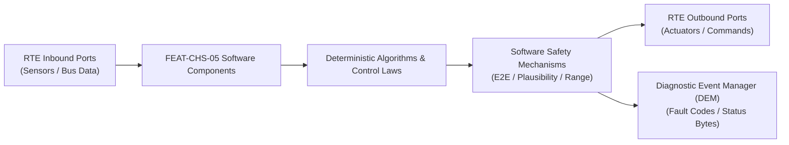

# Software Requirements Specification: Electronic Torque Vectoring & All-Wheel Drive (e-AWD)
**Feature ID:** `FEAT-CHS-05`  
**Domain:** Vehicle Motion & Chassis Control  
**Target ASIL:** ASIL D  
**Compliance Standard:** ISO 26262:2018 (Part 6 - Software Development) / ASPICE PAM v3.1 (SWE.1, SWE.2)  
**Parent System Specification:** [`FEAT-CHS-05_eAWD_SysReq.md`](file:///c:/Workset/AntiGravityProjects/TestOptimisationExperiement/system_requirements/FEAT-CHS-05_eAWD_SysReq.md)  
**Global Master Specification:** [`spec.md`](file:///c:/Workset/AntiGravityProjects/TestOptimisationExperiement/spec.md)

---

## 1. Software Architecture & Component Structure

This document specifies the AUTOSAR Software Components (SWCs), periodic runnables, algorithmic laws, safety mechanisms, and data ports implementing `FEAT-CHS-05` (Electronic Torque Vectoring & All-Wheel Drive (e-AWD)).

### AUTOSAR SWC Interaction Diagram

---

## 2. Detailed Software Requirements (SWR_REQ)
*(Multi-Software Requirement Partitioning derived from System Requirements)*

### `SWR-CHS-05-01`: Dynamic Axle Weight Transfer & Slip-Based AWD Splitter
- **Planned Release:** R100
- **ASIL Rating:** ASIL D
- **Parent System Requirement:** [`SYS-CHS-05-01`](file:///c:/Workset/AntiGravityProjects/TestOptimisationExperiement/system_requirements/FEAT-CHS-05_eAWD_SysReq.md#sys-chs-05-01)
- **Allocated AUTOSAR SWC:** `AwdAxleSplitter_SWC`
- **Execution Rate / Trigger:** 10 ms
- **Worst-Case Execution Time (WCET):** 1.2 ms
- **Software Activation Condition:** Executed cyclically every 10 ms.
- **Algorithmic Description / Logic:**
  > Calculates dynamic vertical loads: Fz_front = Fz_static_front - m*h/L * a_x; Fz_rear = Fz_static_rear + m*h/L * a_x. Distributes torque proportionally to vertical tire capacity to maximize traction without slip.
- **Software Safety Mechanism:** Torque clamp: Front and rear commands sum exactly to total driver demanded torque.
- **Failure Reaction & DEM Diagnostic Event:** Revert to fixed 50/50 split if longitudinal accelerometer fails.
- **Software Port Inputs:** `Total_Demanded_Torque_Nm, Longitudinal_Accel_Ax, Wheel_Slip_Ratios[4]`
- **Software Port Outputs:** `Raw_Front_Torque_Nm, Raw_Rear_Torque_Nm`
- **Software Verification Criteria:** SIL vehicle acceleration model test on low-mu surfaces.
- **Traceability Link:** Traces upward to [`SYS-CHS-05-01`](file:///c:/Workset/AntiGravityProjects/TestOptimisationExperiement/system_requirements/FEAT-CHS-05_eAWD_SysReq.md#sys-chs-05-01) and [`FEAT-CHS-05`](file:///c:/Workset/AntiGravityProjects/TestOptimisationExperiement/spec.md).

### `SWR-CHS-05-02`: High-Efficiency Single-Axle Decoupling & Disconnect Coordinator
- **Planned Release:** R100
- **ASIL Rating:** ASIL B
- **Parent System Requirement:** [`SYS-CHS-05-01`](file:///c:/Workset/AntiGravityProjects/TestOptimisationExperiement/system_requirements/FEAT-CHS-05_eAWD_SysReq.md#sys-chs-05-01)
- **Allocated AUTOSAR SWC:** `AwdEfficiencyDisconnect_SWC`
- **Execution Rate / Trigger:** 50 ms
- **Worst-Case Execution Time (WCET):** 0.6 ms
- **Software Activation Condition:** Executed during highway cruise in ECO mode.
- **Algorithmic Description / Logic:**
  > When cruising at constant speed on dry highway, transitions front induction motor into zero-field idle mode (or opens mechanical disconnect clutch) to eliminate drag, reducing consumption by up to 8%.
- **Software Safety Mechanism:** Rapid re-engagement: Re-energizes front motor within < 50 ms upon accelerator tip-in.
- **Failure Reaction & DEM Diagnostic Event:** Keep both axles permanently coupled if disconnect actuator status is uncertain.
- **Software Port Inputs:** `Vehicle_Speed_Kmph, Accelerator_Rate_PctS, Road_Grade_Pct, ECO_Mode_Active`
- **Software Port Outputs:** `Front_Axle_Disconnect_Cmd (boolean), Axle_Efficiency_Mode_Enum`
- **Software Verification Criteria:** WLTP cycle range test validating energy savings.
- **Traceability Link:** Traces upward to [`SYS-CHS-05-01`](file:///c:/Workset/AntiGravityProjects/TestOptimisationExperiement/system_requirements/FEAT-CHS-05_eAWD_SysReq.md#sys-chs-05-01) and [`FEAT-CHS-05`](file:///c:/Workset/AntiGravityProjects/TestOptimisationExperiement/spec.md).

### `SWR-CHS-05-03`: Active Agility Direct Yaw Moment (DYC) Controller
- **Planned Release:** R100
- **ASIL Rating:** ASIL D
- **Parent System Requirement:** [`SYS-CHS-05-02`](file:///c:/Workset/AntiGravityProjects/TestOptimisationExperiement/system_requirements/FEAT-CHS-05_eAWD_SysReq.md#sys-chs-05-02)
- **Allocated AUTOSAR SWC:** `TorqueVectoringController_SWC`
- **Execution Rate / Trigger:** 5 ms
- **Worst-Case Execution Time (WCET):** 1.4 ms
- **Software Activation Condition:** Executed every 5 ms during cornering.
- **Algorithmic Description / Logic:**
  > Computes desired agility yaw moment: M_z_des = K_tv * Steering_Angle * v_ego. Splits rear axle torque: T_RL = T_rear/2 - Delta_T; T_RR = T_rear/2 + Delta_T, where Delta_T = (M_z_des * r_wheel) / Track_width.
- **Software Safety Mechanism:** Stability envelope boundary: Suppresses Delta_T if vehicle sideslip angle exceeds 3.0 deg.
- **Failure Reaction & DEM Diagnostic Event:** Force Delta_T = 0 Nm if ESC requests active intervention.
- **Software Port Inputs:** `Steering_Angle_Deg, Vehicle_Speed_Mps, Raw_Rear_Torque_Nm, Sideslip_Beta`
- **Software Port Outputs:** `Target_Torque_RL_Nm, Target_Torque_RR_Nm`
- **Software Verification Criteria:** Slalom cone course telemetry analysis measuring yaw agility.
- **Traceability Link:** Traces upward to [`SYS-CHS-05-02`](file:///c:/Workset/AntiGravityProjects/TestOptimisationExperiement/system_requirements/FEAT-CHS-05_eAWD_SysReq.md#sys-chs-05-02) and [`FEAT-CHS-05`](file:///c:/Workset/AntiGravityProjects/TestOptimisationExperiement/spec.md).

### `SWR-CHS-05-04`: Low-Mu Traction Lock & Electronic Limited Slip Emulation
- **Planned Release:** R100
- **ASIL Rating:** ASIL D
- **Parent System Requirement:** [`SYS-CHS-05-02`](file:///c:/Workset/AntiGravityProjects/TestOptimisationExperiement/system_requirements/FEAT-CHS-05_eAWD_SysReq.md#sys-chs-05-02)
- **Allocated AUTOSAR SWC:** `AwdTractionLock_SWC`
- **Execution Rate / Trigger:** 5 ms
- **Worst-Case Execution Time (WCET):** 0.8 ms
- **Software Activation Condition:** Executed when wheel slip difference exceeds 10%.
- **Algorithmic Description / Logic:**
  > If abs(omega_RL - omega_RR) > threshold, transfers drive torque from spinning wheel to high-traction wheel. Mimics mechanical locking differential without hardware clutch pack.
- **Software Safety Mechanism:** Thermal limit protection: Prevents excessive motor heating during prolonged mud/snow recovery.
- **Failure Reaction & DEM Diagnostic Event:** If motor thermistor exceeds 140°C, ramp down torque transfer.
- **Software Port Inputs:** `Wheel_Speed_RL, Wheel_Speed_RR, Motor_Temperatures`
- **Software Port Outputs:** `Traction_Compensated_Torque_RL, Traction_Compensated_Torque_RR`
- **Software Verification Criteria:** Roller bench split-mu traction test (one wheel on rollers, one on asphalt).
- **Traceability Link:** Traces upward to [`SYS-CHS-05-02`](file:///c:/Workset/AntiGravityProjects/TestOptimisationExperiement/system_requirements/FEAT-CHS-05_eAWD_SysReq.md#sys-chs-05-02) and [`FEAT-CHS-05`](file:///c:/Workset/AntiGravityProjects/TestOptimisationExperiement/spec.md).

### `SWR-CHS-05-05`: Multi-Motor Dual-Axle Real-Time Yaw Disturbance Moment Calculator - Dynamic Observer & Signal Filter
- **Planned Release:** R100
- **ASIL Rating:** ASIL D
- **Parent System Requirement:** [`SYS-CHS-05-03`](file:///c:/Workset/AntiGravityProjects/TestOptimisationExperiement/system_requirements/FEAT-CHS-05_eAWD_SysReq.md#sys-chs-05-03)
- **Allocated AUTOSAR SWC:** `EawdYawMoment_SWC`
- **Execution Rate / Trigger:** 2 ms
- **Worst-Case Execution Time (WCET):** 0.3 ms
- **Software Activation Condition:** Executed cyclically every 2 ms.
- **Algorithmic Description / Logic:**
  > Executes signal plausibility filtering, calibration offsets, and discrete state estimation for Multi-Motor Dual-Axle Real-Time Yaw Disturbance Moment Calculator.
- **Software Safety Mechanism:** Range limit plausibility check and E2E alive sequence verification.
- **Failure Reaction & DEM Diagnostic Event:** Set default fallback output and report DEM_EVENT_FEAT_CHS_05_ERR.
- **Software Port Inputs:** `Raw sensor ADC/SENT/SPI values and RTE bus inputs.`
- **Software Port Outputs:** `Filtered physical signals and validity status bitmasks.`
- **Software Verification Criteria:** Unit test and HiL software integration test.
- **Traceability Link:** Traces upward to [`SYS-CHS-05-03`](file:///c:/Workset/AntiGravityProjects/TestOptimisationExperiement/system_requirements/FEAT-CHS-05_eAWD_SysReq.md#sys-chs-05-03) and [`FEAT-CHS-05`](file:///c:/Workset/AntiGravityProjects/TestOptimisationExperiement/spec.md).

### `SWR-CHS-05-06`: Multi-Motor Dual-Axle Real-Time Yaw Disturbance Moment Calculator - Closed-Loop Control Law & Actuator Dispatch
- **Planned Release:** R100
- **ASIL Rating:** ASIL D
- **Parent System Requirement:** [`SYS-CHS-05-03`](file:///c:/Workset/AntiGravityProjects/TestOptimisationExperiement/system_requirements/FEAT-CHS-05_eAWD_SysReq.md#sys-chs-05-03)
- **Allocated AUTOSAR SWC:** `EawdYawMoment_SWC`
- **Execution Rate / Trigger:** 2 ms
- **Worst-Case Execution Time (WCET):** 0.4 ms
- **Software Activation Condition:** Executed cyclically every 2 ms.
- **Algorithmic Description / Logic:**
  > Evaluates deterministic closed-loop control law, rate limits, and dispatches commands for Multi-Motor Dual-Axle Real-Time Yaw Disturbance Moment Calculator.
- **Software Safety Mechanism:** Command saturation clamping and watchdog program flow monitoring.
- **Failure Reaction & DEM Diagnostic Event:** De-energize actuator output, apply safe fallback clamp, and latch DTC.
- **Software Port Inputs:** `Validated physical state signals from observer SWC.`
- **Software Port Outputs:** `Actuator PWM duty cycles, torque/pressure setpoints, and diagnostic flags.`
- **Software Verification Criteria:** Hardware dynamometer and HiL closed-loop regression test suite.
- **Traceability Link:** Traces upward to [`SYS-CHS-05-03`](file:///c:/Workset/AntiGravityProjects/TestOptimisationExperiement/system_requirements/FEAT-CHS-05_eAWD_SysReq.md#sys-chs-05-03) and [`FEAT-CHS-05`](file:///c:/Workset/AntiGravityProjects/TestOptimisationExperiement/spec.md).

### `SWR-CHS-05-07`: Individual Left/Right Wheel Independent Torque Allocation Engine - Dynamic Observer & Signal Filter
- **Planned Release:** R200
- **ASIL Rating:** ASIL D
- **Parent System Requirement:** [`SYS-CHS-05-04`](file:///c:/Workset/AntiGravityProjects/TestOptimisationExperiement/system_requirements/FEAT-CHS-05_eAWD_SysReq.md#sys-chs-05-04)
- **Allocated AUTOSAR SWC:** `EawdTorqueAllocator_SWC`
- **Execution Rate / Trigger:** 2 ms
- **Worst-Case Execution Time (WCET):** 0.3 ms
- **Software Activation Condition:** Executed cyclically every 2 ms.
- **Algorithmic Description / Logic:**
  > Executes signal plausibility filtering, calibration offsets, and discrete state estimation for Individual Left/Right Wheel Independent Torque Allocation Engine.
- **Software Safety Mechanism:** Range limit plausibility check and E2E alive sequence verification.
- **Failure Reaction & DEM Diagnostic Event:** Set default fallback output and report DEM_EVENT_FEAT_CHS_05_ERR.
- **Software Port Inputs:** `Raw sensor ADC/SENT/SPI values and RTE bus inputs.`
- **Software Port Outputs:** `Filtered physical signals and validity status bitmasks.`
- **Software Verification Criteria:** Unit test and HiL software integration test.
- **Traceability Link:** Traces upward to [`SYS-CHS-05-04`](file:///c:/Workset/AntiGravityProjects/TestOptimisationExperiement/system_requirements/FEAT-CHS-05_eAWD_SysReq.md#sys-chs-05-04) and [`FEAT-CHS-05`](file:///c:/Workset/AntiGravityProjects/TestOptimisationExperiement/spec.md).

### `SWR-CHS-05-08`: Individual Left/Right Wheel Independent Torque Allocation Engine - Closed-Loop Control Law & Actuator Dispatch
- **Planned Release:** R200
- **ASIL Rating:** ASIL D
- **Parent System Requirement:** [`SYS-CHS-05-04`](file:///c:/Workset/AntiGravityProjects/TestOptimisationExperiement/system_requirements/FEAT-CHS-05_eAWD_SysReq.md#sys-chs-05-04)
- **Allocated AUTOSAR SWC:** `EawdTorqueAllocator_SWC`
- **Execution Rate / Trigger:** 2 ms
- **Worst-Case Execution Time (WCET):** 0.4 ms
- **Software Activation Condition:** Executed cyclically every 2 ms.
- **Algorithmic Description / Logic:**
  > Evaluates deterministic closed-loop control law, rate limits, and dispatches commands for Individual Left/Right Wheel Independent Torque Allocation Engine.
- **Software Safety Mechanism:** Command saturation clamping and watchdog program flow monitoring.
- **Failure Reaction & DEM Diagnostic Event:** De-energize actuator output, apply safe fallback clamp, and latch DTC.
- **Software Port Inputs:** `Validated physical state signals from observer SWC.`
- **Software Port Outputs:** `Actuator PWM duty cycles, torque/pressure setpoints, and diagnostic flags.`
- **Software Verification Criteria:** Hardware dynamometer and HiL closed-loop regression test suite.
- **Traceability Link:** Traces upward to [`SYS-CHS-05-04`](file:///c:/Workset/AntiGravityProjects/TestOptimisationExperiement/system_requirements/FEAT-CHS-05_eAWD_SysReq.md#sys-chs-05-04) and [`FEAT-CHS-05`](file:///c:/Workset/AntiGravityProjects/TestOptimisationExperiement/spec.md).

### `SWR-CHS-05-09`: Tire Longitudinal & Lateral Friction Adhesion Circle G-G Diagram Observer - Dynamic Observer & Signal Filter
- **Planned Release:** R200
- **ASIL Rating:** ASIL D
- **Parent System Requirement:** [`SYS-CHS-05-05`](file:///c:/Workset/AntiGravityProjects/TestOptimisationExperiement/system_requirements/FEAT-CHS-05_eAWD_SysReq.md#sys-chs-05-05)
- **Allocated AUTOSAR SWC:** `EawdFrictionCircle_SWC`
- **Execution Rate / Trigger:** 2 ms
- **Worst-Case Execution Time (WCET):** 0.3 ms
- **Software Activation Condition:** Executed cyclically every 2 ms.
- **Algorithmic Description / Logic:**
  > Executes signal plausibility filtering, calibration offsets, and discrete state estimation for Tire Longitudinal & Lateral Friction Adhesion Circle G-G Diagram Observer.
- **Software Safety Mechanism:** Range limit plausibility check and E2E alive sequence verification.
- **Failure Reaction & DEM Diagnostic Event:** Set default fallback output and report DEM_EVENT_FEAT_CHS_05_ERR.
- **Software Port Inputs:** `Raw sensor ADC/SENT/SPI values and RTE bus inputs.`
- **Software Port Outputs:** `Filtered physical signals and validity status bitmasks.`
- **Software Verification Criteria:** Unit test and HiL software integration test.
- **Traceability Link:** Traces upward to [`SYS-CHS-05-05`](file:///c:/Workset/AntiGravityProjects/TestOptimisationExperiement/system_requirements/FEAT-CHS-05_eAWD_SysReq.md#sys-chs-05-05) and [`FEAT-CHS-05`](file:///c:/Workset/AntiGravityProjects/TestOptimisationExperiement/spec.md).

### `SWR-CHS-05-10`: Tire Longitudinal & Lateral Friction Adhesion Circle G-G Diagram Observer - Closed-Loop Control Law & Actuator Dispatch
- **Planned Release:** R200
- **ASIL Rating:** ASIL D
- **Parent System Requirement:** [`SYS-CHS-05-05`](file:///c:/Workset/AntiGravityProjects/TestOptimisationExperiement/system_requirements/FEAT-CHS-05_eAWD_SysReq.md#sys-chs-05-05)
- **Allocated AUTOSAR SWC:** `EawdFrictionCircle_SWC`
- **Execution Rate / Trigger:** 2 ms
- **Worst-Case Execution Time (WCET):** 0.4 ms
- **Software Activation Condition:** Executed cyclically every 2 ms.
- **Algorithmic Description / Logic:**
  > Evaluates deterministic closed-loop control law, rate limits, and dispatches commands for Tire Longitudinal & Lateral Friction Adhesion Circle G-G Diagram Observer.
- **Software Safety Mechanism:** Command saturation clamping and watchdog program flow monitoring.
- **Failure Reaction & DEM Diagnostic Event:** De-energize actuator output, apply safe fallback clamp, and latch DTC.
- **Software Port Inputs:** `Validated physical state signals from observer SWC.`
- **Software Port Outputs:** `Actuator PWM duty cycles, torque/pressure setpoints, and diagnostic flags.`
- **Software Verification Criteria:** Hardware dynamometer and HiL closed-loop regression test suite.
- **Traceability Link:** Traces upward to [`SYS-CHS-05-05`](file:///c:/Workset/AntiGravityProjects/TestOptimisationExperiement/system_requirements/FEAT-CHS-05_eAWD_SysReq.md#sys-chs-05-05) and [`FEAT-CHS-05`](file:///c:/Workset/AntiGravityProjects/TestOptimisationExperiement/spec.md).

### `SWR-CHS-05-11`: Front/Rear Axle High-Speed Planetary Torque Split Dynamic Regulator - Dynamic Observer & Signal Filter
- **Planned Release:** R200
- **ASIL Rating:** ASIL D
- **Parent System Requirement:** [`SYS-CHS-05-06`](file:///c:/Workset/AntiGravityProjects/TestOptimisationExperiement/system_requirements/FEAT-CHS-05_eAWD_SysReq.md#sys-chs-05-06)
- **Allocated AUTOSAR SWC:** `EawdAxleSplitter_SWC`
- **Execution Rate / Trigger:** 5 ms
- **Worst-Case Execution Time (WCET):** 0.3 ms
- **Software Activation Condition:** Executed cyclically every 5 ms.
- **Algorithmic Description / Logic:**
  > Executes signal plausibility filtering, calibration offsets, and discrete state estimation for Front/Rear Axle High-Speed Planetary Torque Split Dynamic Regulator.
- **Software Safety Mechanism:** Range limit plausibility check and E2E alive sequence verification.
- **Failure Reaction & DEM Diagnostic Event:** Set default fallback output and report DEM_EVENT_FEAT_CHS_05_ERR.
- **Software Port Inputs:** `Raw sensor ADC/SENT/SPI values and RTE bus inputs.`
- **Software Port Outputs:** `Filtered physical signals and validity status bitmasks.`
- **Software Verification Criteria:** Unit test and HiL software integration test.
- **Traceability Link:** Traces upward to [`SYS-CHS-05-06`](file:///c:/Workset/AntiGravityProjects/TestOptimisationExperiement/system_requirements/FEAT-CHS-05_eAWD_SysReq.md#sys-chs-05-06) and [`FEAT-CHS-05`](file:///c:/Workset/AntiGravityProjects/TestOptimisationExperiement/spec.md).

### `SWR-CHS-05-12`: Front/Rear Axle High-Speed Planetary Torque Split Dynamic Regulator - Closed-Loop Control Law & Actuator Dispatch
- **Planned Release:** R200
- **ASIL Rating:** ASIL D
- **Parent System Requirement:** [`SYS-CHS-05-06`](file:///c:/Workset/AntiGravityProjects/TestOptimisationExperiement/system_requirements/FEAT-CHS-05_eAWD_SysReq.md#sys-chs-05-06)
- **Allocated AUTOSAR SWC:** `EawdAxleSplitter_SWC`
- **Execution Rate / Trigger:** 5 ms
- **Worst-Case Execution Time (WCET):** 0.4 ms
- **Software Activation Condition:** Executed cyclically every 5 ms.
- **Algorithmic Description / Logic:**
  > Evaluates deterministic closed-loop control law, rate limits, and dispatches commands for Front/Rear Axle High-Speed Planetary Torque Split Dynamic Regulator.
- **Software Safety Mechanism:** Command saturation clamping and watchdog program flow monitoring.
- **Failure Reaction & DEM Diagnostic Event:** De-energize actuator output, apply safe fallback clamp, and latch DTC.
- **Software Port Inputs:** `Validated physical state signals from observer SWC.`
- **Software Port Outputs:** `Actuator PWM duty cycles, torque/pressure setpoints, and diagnostic flags.`
- **Software Verification Criteria:** Hardware dynamometer and HiL closed-loop regression test suite.
- **Traceability Link:** Traces upward to [`SYS-CHS-05-06`](file:///c:/Workset/AntiGravityProjects/TestOptimisationExperiement/system_requirements/FEAT-CHS-05_eAWD_SysReq.md#sys-chs-05-06) and [`FEAT-CHS-05`](file:///c:/Workset/AntiGravityProjects/TestOptimisationExperiement/spec.md).

### `SWR-CHS-05-13`: Low-Friction Surface Split-Mu Cross-Axle Dynamic Slip Limiter - Dynamic Observer & Signal Filter
- **Planned Release:** R300
- **ASIL Rating:** ASIL D
- **Parent System Requirement:** [`SYS-CHS-05-07`](file:///c:/Workset/AntiGravityProjects/TestOptimisationExperiement/system_requirements/FEAT-CHS-05_eAWD_SysReq.md#sys-chs-05-07)
- **Allocated AUTOSAR SWC:** `EawdSlipLimiter_SWC`
- **Execution Rate / Trigger:** 2 ms
- **Worst-Case Execution Time (WCET):** 0.3 ms
- **Software Activation Condition:** Executed cyclically every 2 ms.
- **Algorithmic Description / Logic:**
  > Executes signal plausibility filtering, calibration offsets, and discrete state estimation for Low-Friction Surface Split-Mu Cross-Axle Dynamic Slip Limiter.
- **Software Safety Mechanism:** Range limit plausibility check and E2E alive sequence verification.
- **Failure Reaction & DEM Diagnostic Event:** Set default fallback output and report DEM_EVENT_FEAT_CHS_05_ERR.
- **Software Port Inputs:** `Raw sensor ADC/SENT/SPI values and RTE bus inputs.`
- **Software Port Outputs:** `Filtered physical signals and validity status bitmasks.`
- **Software Verification Criteria:** Unit test and HiL software integration test.
- **Traceability Link:** Traces upward to [`SYS-CHS-05-07`](file:///c:/Workset/AntiGravityProjects/TestOptimisationExperiement/system_requirements/FEAT-CHS-05_eAWD_SysReq.md#sys-chs-05-07) and [`FEAT-CHS-05`](file:///c:/Workset/AntiGravityProjects/TestOptimisationExperiement/spec.md).

### `SWR-CHS-05-14`: Low-Friction Surface Split-Mu Cross-Axle Dynamic Slip Limiter - Closed-Loop Control Law & Actuator Dispatch
- **Planned Release:** R300
- **ASIL Rating:** ASIL D
- **Parent System Requirement:** [`SYS-CHS-05-07`](file:///c:/Workset/AntiGravityProjects/TestOptimisationExperiement/system_requirements/FEAT-CHS-05_eAWD_SysReq.md#sys-chs-05-07)
- **Allocated AUTOSAR SWC:** `EawdSlipLimiter_SWC`
- **Execution Rate / Trigger:** 2 ms
- **Worst-Case Execution Time (WCET):** 0.4 ms
- **Software Activation Condition:** Executed cyclically every 2 ms.
- **Algorithmic Description / Logic:**
  > Evaluates deterministic closed-loop control law, rate limits, and dispatches commands for Low-Friction Surface Split-Mu Cross-Axle Dynamic Slip Limiter.
- **Software Safety Mechanism:** Command saturation clamping and watchdog program flow monitoring.
- **Failure Reaction & DEM Diagnostic Event:** De-energize actuator output, apply safe fallback clamp, and latch DTC.
- **Software Port Inputs:** `Validated physical state signals from observer SWC.`
- **Software Port Outputs:** `Actuator PWM duty cycles, torque/pressure setpoints, and diagnostic flags.`
- **Software Verification Criteria:** Hardware dynamometer and HiL closed-loop regression test suite.
- **Traceability Link:** Traces upward to [`SYS-CHS-05-07`](file:///c:/Workset/AntiGravityProjects/TestOptimisationExperiement/system_requirements/FEAT-CHS-05_eAWD_SysReq.md#sys-chs-05-07) and [`FEAT-CHS-05`](file:///c:/Workset/AntiGravityProjects/TestOptimisationExperiement/spec.md).

### `SWR-CHS-05-15`: High-Speed Understeer Neutralization & Corner Apex Pull-In Commander - Dynamic Observer & Signal Filter
- **Planned Release:** R300
- **ASIL Rating:** ASIL D
- **Parent System Requirement:** [`SYS-CHS-05-08`](file:///c:/Workset/AntiGravityProjects/TestOptimisationExperiement/system_requirements/FEAT-CHS-05_eAWD_SysReq.md#sys-chs-05-08)
- **Allocated AUTOSAR SWC:** `EawdUndersteerPullIn_SWC`
- **Execution Rate / Trigger:** 5 ms
- **Worst-Case Execution Time (WCET):** 0.3 ms
- **Software Activation Condition:** Executed cyclically every 5 ms.
- **Algorithmic Description / Logic:**
  > Executes signal plausibility filtering, calibration offsets, and discrete state estimation for High-Speed Understeer Neutralization & Corner Apex Pull-In Commander.
- **Software Safety Mechanism:** Range limit plausibility check and E2E alive sequence verification.
- **Failure Reaction & DEM Diagnostic Event:** Set default fallback output and report DEM_EVENT_FEAT_CHS_05_ERR.
- **Software Port Inputs:** `Raw sensor ADC/SENT/SPI values and RTE bus inputs.`
- **Software Port Outputs:** `Filtered physical signals and validity status bitmasks.`
- **Software Verification Criteria:** Unit test and HiL software integration test.
- **Traceability Link:** Traces upward to [`SYS-CHS-05-08`](file:///c:/Workset/AntiGravityProjects/TestOptimisationExperiement/system_requirements/FEAT-CHS-05_eAWD_SysReq.md#sys-chs-05-08) and [`FEAT-CHS-05`](file:///c:/Workset/AntiGravityProjects/TestOptimisationExperiement/spec.md).

### `SWR-CHS-05-16`: High-Speed Understeer Neutralization & Corner Apex Pull-In Commander - Closed-Loop Control Law & Actuator Dispatch
- **Planned Release:** R300
- **ASIL Rating:** ASIL D
- **Parent System Requirement:** [`SYS-CHS-05-08`](file:///c:/Workset/AntiGravityProjects/TestOptimisationExperiement/system_requirements/FEAT-CHS-05_eAWD_SysReq.md#sys-chs-05-08)
- **Allocated AUTOSAR SWC:** `EawdUndersteerPullIn_SWC`
- **Execution Rate / Trigger:** 5 ms
- **Worst-Case Execution Time (WCET):** 0.4 ms
- **Software Activation Condition:** Executed cyclically every 5 ms.
- **Algorithmic Description / Logic:**
  > Evaluates deterministic closed-loop control law, rate limits, and dispatches commands for High-Speed Understeer Neutralization & Corner Apex Pull-In Commander.
- **Software Safety Mechanism:** Command saturation clamping and watchdog program flow monitoring.
- **Failure Reaction & DEM Diagnostic Event:** De-energize actuator output, apply safe fallback clamp, and latch DTC.
- **Software Port Inputs:** `Validated physical state signals from observer SWC.`
- **Software Port Outputs:** `Actuator PWM duty cycles, torque/pressure setpoints, and diagnostic flags.`
- **Software Verification Criteria:** Hardware dynamometer and HiL closed-loop regression test suite.
- **Traceability Link:** Traces upward to [`SYS-CHS-05-08`](file:///c:/Workset/AntiGravityProjects/TestOptimisationExperiement/system_requirements/FEAT-CHS-05_eAWD_SysReq.md#sys-chs-05-08) and [`FEAT-CHS-05`](file:///c:/Workset/AntiGravityProjects/TestOptimisationExperiement/spec.md).

### `SWR-CHS-05-17`: Oversteer Dynamic Counter-Torque Yaw Dampening Stabilization Loop - Dynamic Observer & Signal Filter
- **Planned Release:** R300
- **ASIL Rating:** ASIL D
- **Parent System Requirement:** [`SYS-CHS-05-09`](file:///c:/Workset/AntiGravityProjects/TestOptimisationExperiement/system_requirements/FEAT-CHS-05_eAWD_SysReq.md#sys-chs-05-09)
- **Allocated AUTOSAR SWC:** `EawdOversteerDamp_SWC`
- **Execution Rate / Trigger:** 2 ms
- **Worst-Case Execution Time (WCET):** 0.3 ms
- **Software Activation Condition:** Executed cyclically every 2 ms.
- **Algorithmic Description / Logic:**
  > Executes signal plausibility filtering, calibration offsets, and discrete state estimation for Oversteer Dynamic Counter-Torque Yaw Dampening Stabilization Loop.
- **Software Safety Mechanism:** Range limit plausibility check and E2E alive sequence verification.
- **Failure Reaction & DEM Diagnostic Event:** Set default fallback output and report DEM_EVENT_FEAT_CHS_05_ERR.
- **Software Port Inputs:** `Raw sensor ADC/SENT/SPI values and RTE bus inputs.`
- **Software Port Outputs:** `Filtered physical signals and validity status bitmasks.`
- **Software Verification Criteria:** Unit test and HiL software integration test.
- **Traceability Link:** Traces upward to [`SYS-CHS-05-09`](file:///c:/Workset/AntiGravityProjects/TestOptimisationExperiement/system_requirements/FEAT-CHS-05_eAWD_SysReq.md#sys-chs-05-09) and [`FEAT-CHS-05`](file:///c:/Workset/AntiGravityProjects/TestOptimisationExperiement/spec.md).

### `SWR-CHS-05-18`: Oversteer Dynamic Counter-Torque Yaw Dampening Stabilization Loop - Closed-Loop Control Law & Actuator Dispatch
- **Planned Release:** R300
- **ASIL Rating:** ASIL D
- **Parent System Requirement:** [`SYS-CHS-05-09`](file:///c:/Workset/AntiGravityProjects/TestOptimisationExperiement/system_requirements/FEAT-CHS-05_eAWD_SysReq.md#sys-chs-05-09)
- **Allocated AUTOSAR SWC:** `EawdOversteerDamp_SWC`
- **Execution Rate / Trigger:** 2 ms
- **Worst-Case Execution Time (WCET):** 0.4 ms
- **Software Activation Condition:** Executed cyclically every 2 ms.
- **Algorithmic Description / Logic:**
  > Evaluates deterministic closed-loop control law, rate limits, and dispatches commands for Oversteer Dynamic Counter-Torque Yaw Dampening Stabilization Loop.
- **Software Safety Mechanism:** Command saturation clamping and watchdog program flow monitoring.
- **Failure Reaction & DEM Diagnostic Event:** De-energize actuator output, apply safe fallback clamp, and latch DTC.
- **Software Port Inputs:** `Validated physical state signals from observer SWC.`
- **Software Port Outputs:** `Actuator PWM duty cycles, torque/pressure setpoints, and diagnostic flags.`
- **Software Verification Criteria:** Hardware dynamometer and HiL closed-loop regression test suite.
- **Traceability Link:** Traces upward to [`SYS-CHS-05-09`](file:///c:/Workset/AntiGravityProjects/TestOptimisationExperiement/system_requirements/FEAT-CHS-05_eAWD_SysReq.md#sys-chs-05-09) and [`FEAT-CHS-05`](file:///c:/Workset/AntiGravityProjects/TestOptimisationExperiement/spec.md).

### `SWR-CHS-05-19`: Multi-Inverter Coordinated CAN-FD Fast Command Dispatcher with E2E CRC - Dynamic Observer & Signal Filter
- **Planned Release:** R400
- **ASIL Rating:** ASIL D
- **Parent System Requirement:** [`SYS-CHS-05-10`](file:///c:/Workset/AntiGravityProjects/TestOptimisationExperiement/system_requirements/FEAT-CHS-05_eAWD_SysReq.md#sys-chs-05-10)
- **Allocated AUTOSAR SWC:** `EawdE2EDispatcher_SWC`
- **Execution Rate / Trigger:** 1 ms
- **Worst-Case Execution Time (WCET):** 0.3 ms
- **Software Activation Condition:** Executed cyclically every 1 ms.
- **Algorithmic Description / Logic:**
  > Executes signal plausibility filtering, calibration offsets, and discrete state estimation for Multi-Inverter Coordinated CAN-FD Fast Command Dispatcher with E2E CRC.
- **Software Safety Mechanism:** Range limit plausibility check and E2E alive sequence verification.
- **Failure Reaction & DEM Diagnostic Event:** Set default fallback output and report DEM_EVENT_FEAT_CHS_05_ERR.
- **Software Port Inputs:** `Raw sensor ADC/SENT/SPI values and RTE bus inputs.`
- **Software Port Outputs:** `Filtered physical signals and validity status bitmasks.`
- **Software Verification Criteria:** Unit test and HiL software integration test.
- **Traceability Link:** Traces upward to [`SYS-CHS-05-10`](file:///c:/Workset/AntiGravityProjects/TestOptimisationExperiement/system_requirements/FEAT-CHS-05_eAWD_SysReq.md#sys-chs-05-10) and [`FEAT-CHS-05`](file:///c:/Workset/AntiGravityProjects/TestOptimisationExperiement/spec.md).

### `SWR-CHS-05-20`: Multi-Inverter Coordinated CAN-FD Fast Command Dispatcher with E2E CRC - Closed-Loop Control Law & Actuator Dispatch
- **Planned Release:** R400
- **ASIL Rating:** ASIL D
- **Parent System Requirement:** [`SYS-CHS-05-10`](file:///c:/Workset/AntiGravityProjects/TestOptimisationExperiement/system_requirements/FEAT-CHS-05_eAWD_SysReq.md#sys-chs-05-10)
- **Allocated AUTOSAR SWC:** `EawdE2EDispatcher_SWC`
- **Execution Rate / Trigger:** 1 ms
- **Worst-Case Execution Time (WCET):** 0.4 ms
- **Software Activation Condition:** Executed cyclically every 1 ms.
- **Algorithmic Description / Logic:**
  > Evaluates deterministic closed-loop control law, rate limits, and dispatches commands for Multi-Inverter Coordinated CAN-FD Fast Command Dispatcher with E2E CRC.
- **Software Safety Mechanism:** Command saturation clamping and watchdog program flow monitoring.
- **Failure Reaction & DEM Diagnostic Event:** De-energize actuator output, apply safe fallback clamp, and latch DTC.
- **Software Port Inputs:** `Validated physical state signals from observer SWC.`
- **Software Port Outputs:** `Actuator PWM duty cycles, torque/pressure setpoints, and diagnostic flags.`
- **Software Verification Criteria:** Hardware dynamometer and HiL closed-loop regression test suite.
- **Traceability Link:** Traces upward to [`SYS-CHS-05-10`](file:///c:/Workset/AntiGravityProjects/TestOptimisationExperiement/system_requirements/FEAT-CHS-05_eAWD_SysReq.md#sys-chs-05-10) and [`FEAT-CHS-05`](file:///c:/Workset/AntiGravityProjects/TestOptimisationExperiement/spec.md).

### `SWR-CHS-05-21`: Inverter Fast Single-Wheel Cutoff & Symmetrical Neutral Fallback Safing - Dynamic Observer & Signal Filter
- **Planned Release:** R400
- **ASIL Rating:** ASIL D
- **Parent System Requirement:** [`SYS-CHS-05-11`](file:///c:/Workset/AntiGravityProjects/TestOptimisationExperiement/system_requirements/FEAT-CHS-05_eAWD_SysReq.md#sys-chs-05-11)
- **Allocated AUTOSAR SWC:** `EawdSafingIsolation_SWC`
- **Execution Rate / Trigger:** 2 ms
- **Worst-Case Execution Time (WCET):** 0.3 ms
- **Software Activation Condition:** Executed cyclically every 2 ms.
- **Algorithmic Description / Logic:**
  > Executes signal plausibility filtering, calibration offsets, and discrete state estimation for Inverter Fast Single-Wheel Cutoff & Symmetrical Neutral Fallback Safing.
- **Software Safety Mechanism:** Range limit plausibility check and E2E alive sequence verification.
- **Failure Reaction & DEM Diagnostic Event:** Set default fallback output and report DEM_EVENT_FEAT_CHS_05_ERR.
- **Software Port Inputs:** `Raw sensor ADC/SENT/SPI values and RTE bus inputs.`
- **Software Port Outputs:** `Filtered physical signals and validity status bitmasks.`
- **Software Verification Criteria:** Unit test and HiL software integration test.
- **Traceability Link:** Traces upward to [`SYS-CHS-05-11`](file:///c:/Workset/AntiGravityProjects/TestOptimisationExperiement/system_requirements/FEAT-CHS-05_eAWD_SysReq.md#sys-chs-05-11) and [`FEAT-CHS-05`](file:///c:/Workset/AntiGravityProjects/TestOptimisationExperiement/spec.md).

### `SWR-CHS-05-22`: Inverter Fast Single-Wheel Cutoff & Symmetrical Neutral Fallback Safing - Closed-Loop Control Law & Actuator Dispatch
- **Planned Release:** R400
- **ASIL Rating:** ASIL D
- **Parent System Requirement:** [`SYS-CHS-05-11`](file:///c:/Workset/AntiGravityProjects/TestOptimisationExperiement/system_requirements/FEAT-CHS-05_eAWD_SysReq.md#sys-chs-05-11)
- **Allocated AUTOSAR SWC:** `EawdSafingIsolation_SWC`
- **Execution Rate / Trigger:** 2 ms
- **Worst-Case Execution Time (WCET):** 0.4 ms
- **Software Activation Condition:** Executed cyclically every 2 ms.
- **Algorithmic Description / Logic:**
  > Evaluates deterministic closed-loop control law, rate limits, and dispatches commands for Inverter Fast Single-Wheel Cutoff & Symmetrical Neutral Fallback Safing.
- **Software Safety Mechanism:** Command saturation clamping and watchdog program flow monitoring.
- **Failure Reaction & DEM Diagnostic Event:** De-energize actuator output, apply safe fallback clamp, and latch DTC.
- **Software Port Inputs:** `Validated physical state signals from observer SWC.`
- **Software Port Outputs:** `Actuator PWM duty cycles, torque/pressure setpoints, and diagnostic flags.`
- **Software Verification Criteria:** Hardware dynamometer and HiL closed-loop regression test suite.
- **Traceability Link:** Traces upward to [`SYS-CHS-05-11`](file:///c:/Workset/AntiGravityProjects/TestOptimisationExperiement/system_requirements/FEAT-CHS-05_eAWD_SysReq.md#sys-chs-05-11) and [`FEAT-CHS-05`](file:///c:/Workset/AntiGravityProjects/TestOptimisationExperiement/spec.md).

### `SWR-CHS-05-23`: Dual Core Lockstep Torque Comparison & Plausibility Gatekeeper - Dynamic Observer & Signal Filter
- **Planned Release:** R500
- **ASIL Rating:** ASIL D
- **Parent System Requirement:** [`SYS-CHS-05-12`](file:///c:/Workset/AntiGravityProjects/TestOptimisationExperiement/system_requirements/FEAT-CHS-05_eAWD_SysReq.md#sys-chs-05-12)
- **Allocated AUTOSAR SWC:** `EawdLockstepGatekeeper_SWC`
- **Execution Rate / Trigger:** 1 ms
- **Worst-Case Execution Time (WCET):** 0.3 ms
- **Software Activation Condition:** Executed cyclically every 1 ms.
- **Algorithmic Description / Logic:**
  > Executes signal plausibility filtering, calibration offsets, and discrete state estimation for Dual Core Lockstep Torque Comparison & Plausibility Gatekeeper.
- **Software Safety Mechanism:** Range limit plausibility check and E2E alive sequence verification.
- **Failure Reaction & DEM Diagnostic Event:** Set default fallback output and report DEM_EVENT_FEAT_CHS_05_ERR.
- **Software Port Inputs:** `Raw sensor ADC/SENT/SPI values and RTE bus inputs.`
- **Software Port Outputs:** `Filtered physical signals and validity status bitmasks.`
- **Software Verification Criteria:** Unit test and HiL software integration test.
- **Traceability Link:** Traces upward to [`SYS-CHS-05-12`](file:///c:/Workset/AntiGravityProjects/TestOptimisationExperiement/system_requirements/FEAT-CHS-05_eAWD_SysReq.md#sys-chs-05-12) and [`FEAT-CHS-05`](file:///c:/Workset/AntiGravityProjects/TestOptimisationExperiement/spec.md).

### `SWR-CHS-05-24`: Dual Core Lockstep Torque Comparison & Plausibility Gatekeeper - Closed-Loop Control Law & Actuator Dispatch
- **Planned Release:** R500
- **ASIL Rating:** ASIL D
- **Parent System Requirement:** [`SYS-CHS-05-12`](file:///c:/Workset/AntiGravityProjects/TestOptimisationExperiement/system_requirements/FEAT-CHS-05_eAWD_SysReq.md#sys-chs-05-12)
- **Allocated AUTOSAR SWC:** `EawdLockstepGatekeeper_SWC`
- **Execution Rate / Trigger:** 1 ms
- **Worst-Case Execution Time (WCET):** 0.4 ms
- **Software Activation Condition:** Executed cyclically every 1 ms.
- **Algorithmic Description / Logic:**
  > Evaluates deterministic closed-loop control law, rate limits, and dispatches commands for Dual Core Lockstep Torque Comparison & Plausibility Gatekeeper.
- **Software Safety Mechanism:** Command saturation clamping and watchdog program flow monitoring.
- **Failure Reaction & DEM Diagnostic Event:** De-energize actuator output, apply safe fallback clamp, and latch DTC.
- **Software Port Inputs:** `Validated physical state signals from observer SWC.`
- **Software Port Outputs:** `Actuator PWM duty cycles, torque/pressure setpoints, and diagnostic flags.`
- **Software Verification Criteria:** Hardware dynamometer and HiL closed-loop regression test suite.
- **Traceability Link:** Traces upward to [`SYS-CHS-05-12`](file:///c:/Workset/AntiGravityProjects/TestOptimisationExperiement/system_requirements/FEAT-CHS-05_eAWD_SysReq.md#sys-chs-05-12) and [`FEAT-CHS-05`](file:///c:/Workset/AntiGravityProjects/TestOptimisationExperiement/spec.md).

### `SWR-CHS-05-25`: DEM Torque Vectoring Diagnostics & Inverter Communication Fault Logger - Dynamic Observer & Signal Filter
- **Planned Release:** R500
- **ASIL Rating:** ASIL B
- **Parent System Requirement:** [`SYS-CHS-05-13`](file:///c:/Workset/AntiGravityProjects/TestOptimisationExperiement/system_requirements/FEAT-CHS-05_eAWD_SysReq.md#sys-chs-05-13)
- **Allocated AUTOSAR SWC:** `EawdDiagnosticManager_SWC`
- **Execution Rate / Trigger:** 20 ms
- **Worst-Case Execution Time (WCET):** 0.3 ms
- **Software Activation Condition:** Executed cyclically every 20 ms.
- **Algorithmic Description / Logic:**
  > Executes signal plausibility filtering, calibration offsets, and discrete state estimation for DEM Torque Vectoring Diagnostics & Inverter Communication Fault Logger.
- **Software Safety Mechanism:** Range limit plausibility check and E2E alive sequence verification.
- **Failure Reaction & DEM Diagnostic Event:** Set default fallback output and report DEM_EVENT_FEAT_CHS_05_ERR.
- **Software Port Inputs:** `Raw sensor ADC/SENT/SPI values and RTE bus inputs.`
- **Software Port Outputs:** `Filtered physical signals and validity status bitmasks.`
- **Software Verification Criteria:** Unit test and HiL software integration test.
- **Traceability Link:** Traces upward to [`SYS-CHS-05-13`](file:///c:/Workset/AntiGravityProjects/TestOptimisationExperiement/system_requirements/FEAT-CHS-05_eAWD_SysReq.md#sys-chs-05-13) and [`FEAT-CHS-05`](file:///c:/Workset/AntiGravityProjects/TestOptimisationExperiement/spec.md).

### `SWR-CHS-05-26`: DEM Torque Vectoring Diagnostics & Inverter Communication Fault Logger - Closed-Loop Control Law & Actuator Dispatch
- **Planned Release:** R500
- **ASIL Rating:** ASIL B
- **Parent System Requirement:** [`SYS-CHS-05-13`](file:///c:/Workset/AntiGravityProjects/TestOptimisationExperiement/system_requirements/FEAT-CHS-05_eAWD_SysReq.md#sys-chs-05-13)
- **Allocated AUTOSAR SWC:** `EawdDiagnosticManager_SWC`
- **Execution Rate / Trigger:** 20 ms
- **Worst-Case Execution Time (WCET):** 0.4 ms
- **Software Activation Condition:** Executed cyclically every 20 ms.
- **Algorithmic Description / Logic:**
  > Evaluates deterministic closed-loop control law, rate limits, and dispatches commands for DEM Torque Vectoring Diagnostics & Inverter Communication Fault Logger.
- **Software Safety Mechanism:** Command saturation clamping and watchdog program flow monitoring.
- **Failure Reaction & DEM Diagnostic Event:** De-energize actuator output, apply safe fallback clamp, and latch DTC.
- **Software Port Inputs:** `Validated physical state signals from observer SWC.`
- **Software Port Outputs:** `Actuator PWM duty cycles, torque/pressure setpoints, and diagnostic flags.`
- **Software Verification Criteria:** Hardware dynamometer and HiL closed-loop regression test suite.
- **Traceability Link:** Traces upward to [`SYS-CHS-05-13`](file:///c:/Workset/AntiGravityProjects/TestOptimisationExperiement/system_requirements/FEAT-CHS-05_eAWD_SysReq.md#sys-chs-05-13) and [`FEAT-CHS-05`](file:///c:/Workset/AntiGravityProjects/TestOptimisationExperiement/spec.md).

### `SWR-CHS-05-27`: Instrument Cluster Dynamic AWD Torque Distribution Graphic Renderer - Dynamic Observer & Signal Filter
- **Planned Release:** R500
- **ASIL Rating:** ASIL B
- **Parent System Requirement:** [`SYS-CHS-05-14`](file:///c:/Workset/AntiGravityProjects/TestOptimisationExperiement/system_requirements/FEAT-CHS-05_eAWD_SysReq.md#sys-chs-05-14)
- **Allocated AUTOSAR SWC:** `EawdHmiRenderer_SWC`
- **Execution Rate / Trigger:** 20 ms
- **Worst-Case Execution Time (WCET):** 0.3 ms
- **Software Activation Condition:** Executed cyclically every 20 ms.
- **Algorithmic Description / Logic:**
  > Executes signal plausibility filtering, calibration offsets, and discrete state estimation for Instrument Cluster Dynamic AWD Torque Distribution Graphic Renderer.
- **Software Safety Mechanism:** Range limit plausibility check and E2E alive sequence verification.
- **Failure Reaction & DEM Diagnostic Event:** Set default fallback output and report DEM_EVENT_FEAT_CHS_05_ERR.
- **Software Port Inputs:** `Raw sensor ADC/SENT/SPI values and RTE bus inputs.`
- **Software Port Outputs:** `Filtered physical signals and validity status bitmasks.`
- **Software Verification Criteria:** Unit test and HiL software integration test.
- **Traceability Link:** Traces upward to [`SYS-CHS-05-14`](file:///c:/Workset/AntiGravityProjects/TestOptimisationExperiement/system_requirements/FEAT-CHS-05_eAWD_SysReq.md#sys-chs-05-14) and [`FEAT-CHS-05`](file:///c:/Workset/AntiGravityProjects/TestOptimisationExperiement/spec.md).

### `SWR-CHS-05-28`: Instrument Cluster Dynamic AWD Torque Distribution Graphic Renderer - Closed-Loop Control Law & Actuator Dispatch
- **Planned Release:** R500
- **ASIL Rating:** ASIL B
- **Parent System Requirement:** [`SYS-CHS-05-14`](file:///c:/Workset/AntiGravityProjects/TestOptimisationExperiement/system_requirements/FEAT-CHS-05_eAWD_SysReq.md#sys-chs-05-14)
- **Allocated AUTOSAR SWC:** `EawdHmiRenderer_SWC`
- **Execution Rate / Trigger:** 20 ms
- **Worst-Case Execution Time (WCET):** 0.4 ms
- **Software Activation Condition:** Executed cyclically every 20 ms.
- **Algorithmic Description / Logic:**
  > Evaluates deterministic closed-loop control law, rate limits, and dispatches commands for Instrument Cluster Dynamic AWD Torque Distribution Graphic Renderer.
- **Software Safety Mechanism:** Command saturation clamping and watchdog program flow monitoring.
- **Failure Reaction & DEM Diagnostic Event:** De-energize actuator output, apply safe fallback clamp, and latch DTC.
- **Software Port Inputs:** `Validated physical state signals from observer SWC.`
- **Software Port Outputs:** `Actuator PWM duty cycles, torque/pressure setpoints, and diagnostic flags.`
- **Software Verification Criteria:** Hardware dynamometer and HiL closed-loop regression test suite.
- **Traceability Link:** Traces upward to [`SYS-CHS-05-14`](file:///c:/Workset/AntiGravityProjects/TestOptimisationExperiement/system_requirements/FEAT-CHS-05_eAWD_SysReq.md#sys-chs-05-14) and [`FEAT-CHS-05`](file:///c:/Workset/AntiGravityProjects/TestOptimisationExperiement/spec.md).

### `SWR-CHS-05-29`: Non-Volatile Thermal Stress & Corner Inverter Energy Throughput Tracker - Dynamic Observer & Signal Filter
- **Planned Release:** R500
- **ASIL Rating:** ASIL B
- **Parent System Requirement:** [`SYS-CHS-05-15`](file:///c:/Workset/AntiGravityProjects/TestOptimisationExperiement/system_requirements/FEAT-CHS-05_eAWD_SysReq.md#sys-chs-05-15)
- **Allocated AUTOSAR SWC:** `EawdStressTracker_SWC`
- **Execution Rate / Trigger:** 500 ms
- **Worst-Case Execution Time (WCET):** 0.3 ms
- **Software Activation Condition:** Executed cyclically every 500 ms.
- **Algorithmic Description / Logic:**
  > Executes signal plausibility filtering, calibration offsets, and discrete state estimation for Non-Volatile Thermal Stress & Corner Inverter Energy Throughput Tracker.
- **Software Safety Mechanism:** Range limit plausibility check and E2E alive sequence verification.
- **Failure Reaction & DEM Diagnostic Event:** Set default fallback output and report DEM_EVENT_FEAT_CHS_05_ERR.
- **Software Port Inputs:** `Raw sensor ADC/SENT/SPI values and RTE bus inputs.`
- **Software Port Outputs:** `Filtered physical signals and validity status bitmasks.`
- **Software Verification Criteria:** Unit test and HiL software integration test.
- **Traceability Link:** Traces upward to [`SYS-CHS-05-15`](file:///c:/Workset/AntiGravityProjects/TestOptimisationExperiement/system_requirements/FEAT-CHS-05_eAWD_SysReq.md#sys-chs-05-15) and [`FEAT-CHS-05`](file:///c:/Workset/AntiGravityProjects/TestOptimisationExperiement/spec.md).

### `SWR-CHS-05-30`: Non-Volatile Thermal Stress & Corner Inverter Energy Throughput Tracker - Closed-Loop Control Law & Actuator Dispatch
- **Planned Release:** R500
- **ASIL Rating:** ASIL B
- **Parent System Requirement:** [`SYS-CHS-05-15`](file:///c:/Workset/AntiGravityProjects/TestOptimisationExperiement/system_requirements/FEAT-CHS-05_eAWD_SysReq.md#sys-chs-05-15)
- **Allocated AUTOSAR SWC:** `EawdStressTracker_SWC`
- **Execution Rate / Trigger:** 500 ms
- **Worst-Case Execution Time (WCET):** 0.4 ms
- **Software Activation Condition:** Executed cyclically every 500 ms.
- **Algorithmic Description / Logic:**
  > Evaluates deterministic closed-loop control law, rate limits, and dispatches commands for Non-Volatile Thermal Stress & Corner Inverter Energy Throughput Tracker.
- **Software Safety Mechanism:** Command saturation clamping and watchdog program flow monitoring.
- **Failure Reaction & DEM Diagnostic Event:** De-energize actuator output, apply safe fallback clamp, and latch DTC.
- **Software Port Inputs:** `Validated physical state signals from observer SWC.`
- **Software Port Outputs:** `Actuator PWM duty cycles, torque/pressure setpoints, and diagnostic flags.`
- **Software Verification Criteria:** Hardware dynamometer and HiL closed-loop regression test suite.
- **Traceability Link:** Traces upward to [`SYS-CHS-05-15`](file:///c:/Workset/AntiGravityProjects/TestOptimisationExperiement/system_requirements/FEAT-CHS-05_eAWD_SysReq.md#sys-chs-05-15) and [`FEAT-CHS-05`](file:///c:/Workset/AntiGravityProjects/TestOptimisationExperiement/spec.md).

---

## 3. Software-to-System Backward Traceability Matrix

| Software Requirement ID | Planned Release | Allocated SWC | Execution Rate | Upstream System Req | Verification Method |
| :--- | :---: | :--- | :--- | :--- | :--- |
| `SWR-CHS-05-01` | **`R100`** | `AwdAxleSplitter_SWC` | 10 ms | [`SYS-CHS-05-01`](file:///c:/Workset/AntiGravityProjects/TestOptimisationExperiement/system_requirements/FEAT-CHS-05_eAWD_SysReq.md#sys-chs-05-01) | SIL vehicle acceleration model test on low-mu surfaces. |
| `SWR-CHS-05-02` | **`R100`** | `AwdEfficiencyDisconnect_SWC` | 50 ms | [`SYS-CHS-05-01`](file:///c:/Workset/AntiGravityProjects/TestOptimisationExperiement/system_requirements/FEAT-CHS-05_eAWD_SysReq.md#sys-chs-05-01) | WLTP cycle range test validating energy savings. |
| `SWR-CHS-05-03` | **`R100`** | `TorqueVectoringController_SWC` | 5 ms | [`SYS-CHS-05-02`](file:///c:/Workset/AntiGravityProjects/TestOptimisationExperiement/system_requirements/FEAT-CHS-05_eAWD_SysReq.md#sys-chs-05-02) | Slalom cone course telemetry analysis measuring yaw agility. |
| `SWR-CHS-05-04` | **`R100`** | `AwdTractionLock_SWC` | 5 ms | [`SYS-CHS-05-02`](file:///c:/Workset/AntiGravityProjects/TestOptimisationExperiement/system_requirements/FEAT-CHS-05_eAWD_SysReq.md#sys-chs-05-02) | Roller bench split-mu traction test (one wheel on rollers, one on asphalt). |
| `SWR-CHS-05-05` | **`R100`** | `EawdYawMoment_SWC` | 2 ms | [`SYS-CHS-05-03`](file:///c:/Workset/AntiGravityProjects/TestOptimisationExperiement/system_requirements/FEAT-CHS-05_eAWD_SysReq.md#sys-chs-05-03) | Unit test and HiL software integration test. |
| `SWR-CHS-05-06` | **`R100`** | `EawdYawMoment_SWC` | 2 ms | [`SYS-CHS-05-03`](file:///c:/Workset/AntiGravityProjects/TestOptimisationExperiement/system_requirements/FEAT-CHS-05_eAWD_SysReq.md#sys-chs-05-03) | Hardware dynamometer and HiL closed-loop regression test suite. |
| `SWR-CHS-05-07` | **`R200`** | `EawdTorqueAllocator_SWC` | 2 ms | [`SYS-CHS-05-04`](file:///c:/Workset/AntiGravityProjects/TestOptimisationExperiement/system_requirements/FEAT-CHS-05_eAWD_SysReq.md#sys-chs-05-04) | Unit test and HiL software integration test. |
| `SWR-CHS-05-08` | **`R200`** | `EawdTorqueAllocator_SWC` | 2 ms | [`SYS-CHS-05-04`](file:///c:/Workset/AntiGravityProjects/TestOptimisationExperiement/system_requirements/FEAT-CHS-05_eAWD_SysReq.md#sys-chs-05-04) | Hardware dynamometer and HiL closed-loop regression test suite. |
| `SWR-CHS-05-09` | **`R200`** | `EawdFrictionCircle_SWC` | 2 ms | [`SYS-CHS-05-05`](file:///c:/Workset/AntiGravityProjects/TestOptimisationExperiement/system_requirements/FEAT-CHS-05_eAWD_SysReq.md#sys-chs-05-05) | Unit test and HiL software integration test. |
| `SWR-CHS-05-10` | **`R200`** | `EawdFrictionCircle_SWC` | 2 ms | [`SYS-CHS-05-05`](file:///c:/Workset/AntiGravityProjects/TestOptimisationExperiement/system_requirements/FEAT-CHS-05_eAWD_SysReq.md#sys-chs-05-05) | Hardware dynamometer and HiL closed-loop regression test suite. |
| `SWR-CHS-05-11` | **`R200`** | `EawdAxleSplitter_SWC` | 5 ms | [`SYS-CHS-05-06`](file:///c:/Workset/AntiGravityProjects/TestOptimisationExperiement/system_requirements/FEAT-CHS-05_eAWD_SysReq.md#sys-chs-05-06) | Unit test and HiL software integration test. |
| `SWR-CHS-05-12` | **`R200`** | `EawdAxleSplitter_SWC` | 5 ms | [`SYS-CHS-05-06`](file:///c:/Workset/AntiGravityProjects/TestOptimisationExperiement/system_requirements/FEAT-CHS-05_eAWD_SysReq.md#sys-chs-05-06) | Hardware dynamometer and HiL closed-loop regression test suite. |
| `SWR-CHS-05-13` | **`R300`** | `EawdSlipLimiter_SWC` | 2 ms | [`SYS-CHS-05-07`](file:///c:/Workset/AntiGravityProjects/TestOptimisationExperiement/system_requirements/FEAT-CHS-05_eAWD_SysReq.md#sys-chs-05-07) | Unit test and HiL software integration test. |
| `SWR-CHS-05-14` | **`R300`** | `EawdSlipLimiter_SWC` | 2 ms | [`SYS-CHS-05-07`](file:///c:/Workset/AntiGravityProjects/TestOptimisationExperiement/system_requirements/FEAT-CHS-05_eAWD_SysReq.md#sys-chs-05-07) | Hardware dynamometer and HiL closed-loop regression test suite. |
| `SWR-CHS-05-15` | **`R300`** | `EawdUndersteerPullIn_SWC` | 5 ms | [`SYS-CHS-05-08`](file:///c:/Workset/AntiGravityProjects/TestOptimisationExperiement/system_requirements/FEAT-CHS-05_eAWD_SysReq.md#sys-chs-05-08) | Unit test and HiL software integration test. |
| `SWR-CHS-05-16` | **`R300`** | `EawdUndersteerPullIn_SWC` | 5 ms | [`SYS-CHS-05-08`](file:///c:/Workset/AntiGravityProjects/TestOptimisationExperiement/system_requirements/FEAT-CHS-05_eAWD_SysReq.md#sys-chs-05-08) | Hardware dynamometer and HiL closed-loop regression test suite. |
| `SWR-CHS-05-17` | **`R300`** | `EawdOversteerDamp_SWC` | 2 ms | [`SYS-CHS-05-09`](file:///c:/Workset/AntiGravityProjects/TestOptimisationExperiement/system_requirements/FEAT-CHS-05_eAWD_SysReq.md#sys-chs-05-09) | Unit test and HiL software integration test. |
| `SWR-CHS-05-18` | **`R300`** | `EawdOversteerDamp_SWC` | 2 ms | [`SYS-CHS-05-09`](file:///c:/Workset/AntiGravityProjects/TestOptimisationExperiement/system_requirements/FEAT-CHS-05_eAWD_SysReq.md#sys-chs-05-09) | Hardware dynamometer and HiL closed-loop regression test suite. |
| `SWR-CHS-05-19` | **`R400`** | `EawdE2EDispatcher_SWC` | 1 ms | [`SYS-CHS-05-10`](file:///c:/Workset/AntiGravityProjects/TestOptimisationExperiement/system_requirements/FEAT-CHS-05_eAWD_SysReq.md#sys-chs-05-10) | Unit test and HiL software integration test. |
| `SWR-CHS-05-20` | **`R400`** | `EawdE2EDispatcher_SWC` | 1 ms | [`SYS-CHS-05-10`](file:///c:/Workset/AntiGravityProjects/TestOptimisationExperiement/system_requirements/FEAT-CHS-05_eAWD_SysReq.md#sys-chs-05-10) | Hardware dynamometer and HiL closed-loop regression test suite. |
| `SWR-CHS-05-21` | **`R400`** | `EawdSafingIsolation_SWC` | 2 ms | [`SYS-CHS-05-11`](file:///c:/Workset/AntiGravityProjects/TestOptimisationExperiement/system_requirements/FEAT-CHS-05_eAWD_SysReq.md#sys-chs-05-11) | Unit test and HiL software integration test. |
| `SWR-CHS-05-22` | **`R400`** | `EawdSafingIsolation_SWC` | 2 ms | [`SYS-CHS-05-11`](file:///c:/Workset/AntiGravityProjects/TestOptimisationExperiement/system_requirements/FEAT-CHS-05_eAWD_SysReq.md#sys-chs-05-11) | Hardware dynamometer and HiL closed-loop regression test suite. |
| `SWR-CHS-05-23` | **`R500`** | `EawdLockstepGatekeeper_SWC` | 1 ms | [`SYS-CHS-05-12`](file:///c:/Workset/AntiGravityProjects/TestOptimisationExperiement/system_requirements/FEAT-CHS-05_eAWD_SysReq.md#sys-chs-05-12) | Unit test and HiL software integration test. |
| `SWR-CHS-05-24` | **`R500`** | `EawdLockstepGatekeeper_SWC` | 1 ms | [`SYS-CHS-05-12`](file:///c:/Workset/AntiGravityProjects/TestOptimisationExperiement/system_requirements/FEAT-CHS-05_eAWD_SysReq.md#sys-chs-05-12) | Hardware dynamometer and HiL closed-loop regression test suite. |
| `SWR-CHS-05-25` | **`R500`** | `EawdDiagnosticManager_SWC` | 20 ms | [`SYS-CHS-05-13`](file:///c:/Workset/AntiGravityProjects/TestOptimisationExperiement/system_requirements/FEAT-CHS-05_eAWD_SysReq.md#sys-chs-05-13) | Unit test and HiL software integration test. |
| `SWR-CHS-05-26` | **`R500`** | `EawdDiagnosticManager_SWC` | 20 ms | [`SYS-CHS-05-13`](file:///c:/Workset/AntiGravityProjects/TestOptimisationExperiement/system_requirements/FEAT-CHS-05_eAWD_SysReq.md#sys-chs-05-13) | Hardware dynamometer and HiL closed-loop regression test suite. |
| `SWR-CHS-05-27` | **`R500`** | `EawdHmiRenderer_SWC` | 20 ms | [`SYS-CHS-05-14`](file:///c:/Workset/AntiGravityProjects/TestOptimisationExperiement/system_requirements/FEAT-CHS-05_eAWD_SysReq.md#sys-chs-05-14) | Unit test and HiL software integration test. |
| `SWR-CHS-05-28` | **`R500`** | `EawdHmiRenderer_SWC` | 20 ms | [`SYS-CHS-05-14`](file:///c:/Workset/AntiGravityProjects/TestOptimisationExperiement/system_requirements/FEAT-CHS-05_eAWD_SysReq.md#sys-chs-05-14) | Hardware dynamometer and HiL closed-loop regression test suite. |
| `SWR-CHS-05-29` | **`R500`** | `EawdStressTracker_SWC` | 500 ms | [`SYS-CHS-05-15`](file:///c:/Workset/AntiGravityProjects/TestOptimisationExperiement/system_requirements/FEAT-CHS-05_eAWD_SysReq.md#sys-chs-05-15) | Unit test and HiL software integration test. |
| `SWR-CHS-05-30` | **`R500`** | `EawdStressTracker_SWC` | 500 ms | [`SYS-CHS-05-15`](file:///c:/Workset/AntiGravityProjects/TestOptimisationExperiement/system_requirements/FEAT-CHS-05_eAWD_SysReq.md#sys-chs-05-15) | Hardware dynamometer and HiL closed-loop regression test suite. |

- **Parent System Specification Document:** [`FEAT-CHS-05_eAWD_SysReq.md`](file:///c:/Workset/AntiGravityProjects/TestOptimisationExperiement/system_requirements/FEAT-CHS-05_eAWD_SysReq.md)
- **Master Automotive Specification:** [`spec.md`](file:///c:/Workset/AntiGravityProjects/TestOptimisationExperiement/spec.md)
