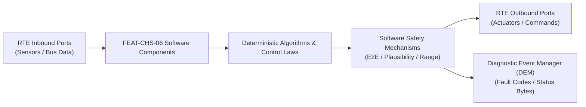

# Software Requirements Specification: Electronic Air Suspension with Road Preview (EAS)
**Feature ID:** `FEAT-CHS-06`  
**Domain:** Vehicle Motion & Chassis Control  
**Target ASIL:** ASIL C  
**Compliance Standard:** ISO 26262:2018 (Part 6 - Software Development) / ASPICE PAM v3.1 (SWE.1, SWE.2)  
**Parent System Specification:** [`FEAT-CHS-06_EAS_SysReq.md`](file:///c:/Workset/AntiGravityProjects/TestOptimisationExperiement/system_requirements/FEAT-CHS-06_EAS_SysReq.md)  
**Global Master Specification:** [`spec.md`](file:///c:/Workset/AntiGravityProjects/TestOptimisationExperiement/spec.md)

---

## 1. Software Architecture & Component Structure

This document specifies the AUTOSAR Software Components (SWCs), periodic runnables, algorithmic laws, safety mechanisms, and data ports implementing `FEAT-CHS-06` (Electronic Air Suspension with Road Preview (EAS)).

### AUTOSAR SWC Interaction Diagram

---

## 2. Detailed Software Requirements (SWR_REQ)
*(Multi-Software Requirement Partitioning derived from System Requirements)*

### `SWR-CHS-06-01`: Digital Height Sensor Butterworth Filter & Outlier Rejection
- **Planned Release:** R100
- **ASIL Rating:** ASIL C
- **Parent System Requirement:** [`SYS-CHS-06-01`](file:///c:/Workset/AntiGravityProjects/TestOptimisationExperiement/system_requirements/FEAT-CHS-06_EAS_SysReq.md#sys-chs-06-01)
- **Allocated AUTOSAR SWC:** `EasSensorProcessing_SWC`
- **Execution Rate / Trigger:** 10 ms
- **Worst-Case Execution Time (WCET):** 0.4 ms
- **Software Activation Condition:** Executed in 100 Hz cyclic task.
- **Algorithmic Description / Logic:**
  > Applies 2nd-order low-pass Butterworth filter (cutoff frequency 4.0 Hz) to eliminate wheel hop dynamics: h_filt[k] = b0*h[k] + b1*h[k-1] + b2*h[k-2] - a1*h_filt[k-1] - a2*h_filt[k-2]. Filters outlier spikes > 50 mm/10ms.
- **Software Safety Mechanism:** Redundant cross-check: Sum of diagonal heights (h_FL + h_RR) must equal (h_FR + h_RL) within 12 mm torsional warp boundary.
- **Failure Reaction & DEM Diagnostic Event:** Flag Sensor_Plausibility_Fault and freeze level calculation if warp violated for > 500 ms.
- **Software Port Inputs:** `Raw_Height_FL_FR_RL_RR_ADC, Vehicle_Speed_Kmph`
- **Software Port Outputs:** `Filtered_Height_FL_FR_RL_RR_Mm, Chassis_Torsional_Warp_Mm`
- **Software Verification Criteria:** Automated synthetic noise injection and shaker rig test validation.
- **Traceability Link:** Traces upward to [`SYS-CHS-06-01`](file:///c:/Workset/AntiGravityProjects/TestOptimisationExperiement/system_requirements/FEAT-CHS-06_EAS_SysReq.md#sys-chs-06-01) and [`FEAT-CHS-06`](file:///c:/Workset/AntiGravityProjects/TestOptimisationExperiement/spec.md).

### `SWR-CHS-06-02`: Closed-Loop Pneumatic Solenoid Valve Pulse-Width Dispatcher
- **Planned Release:** R100
- **ASIL Rating:** ASIL C
- **Parent System Requirement:** [`SYS-CHS-06-01`](file:///c:/Workset/AntiGravityProjects/TestOptimisationExperiement/system_requirements/FEAT-CHS-06_EAS_SysReq.md#sys-chs-06-01)
- **Allocated AUTOSAR SWC:** `EasLevelController_SWC`
- **Execution Rate / Trigger:** 20 ms
- **Worst-Case Execution Time (WCET):** 0.8 ms
- **Software Activation Condition:** Executed when ride height error exceeds 5 mm deadband.
- **Algorithmic Description / Logic:**
  > Computes error e = h_target - h_filt. Solenoid pulse time t_pulse = K_vol * abs(e) / sqrt(Delta_P_reservoir_bellow). Clamps minimum pulse duration to 30 ms to prevent solenoid chatter.
- **Software Safety Mechanism:** Valve stuck open protection: If corner height does not change by >= 1 mm after 500 ms of commanded inflation, shut off master supply valve.
- **Failure Reaction & DEM Diagnostic Event:** Set DEM DTC C15A2 (Solenoid Valve Circuit Open/Stuck) and inhibit valve activation.
- **Software Port Inputs:** `Filtered_Height_FL_FR_RL_RR_Mm, Target_Height_Mm, Reservoir_Pressure_Bar`
- **Software Port Outputs:** `Solenoid_PWM_Duty_Cycle[8], Compressor_Enable_Flag (boolean)`
- **Software Verification Criteria:** Pneumatic hardware test bench measuring pressure flow vs solenoid duty cycle.
- **Traceability Link:** Traces upward to [`SYS-CHS-06-01`](file:///c:/Workset/AntiGravityProjects/TestOptimisationExperiement/system_requirements/FEAT-CHS-06_EAS_SysReq.md#sys-chs-06-01) and [`FEAT-CHS-06`](file:///c:/Workset/AntiGravityProjects/TestOptimisationExperiement/spec.md).

### `SWR-CHS-06-03`: Forward Road Preview Elevation Spatial-to-Temporal Mapper
- **Planned Release:** R100
- **ASIL Rating:** ASIL B
- **Parent System Requirement:** [`SYS-CHS-06-02`](file:///c:/Workset/AntiGravityProjects/TestOptimisationExperiement/system_requirements/FEAT-CHS-06_EAS_SysReq.md#sys-chs-06-02)
- **Allocated AUTOSAR SWC:** `EasRoadPreviewMapper_SWC`
- **Execution Rate / Trigger:** 10 ms
- **Worst-Case Execution Time (WCET):** 0.9 ms
- **Software Activation Condition:** Executed when camera road profile stream is active.
- **Algorithmic Description / Logic:**
  > Transforms spatial elevation profile z(x) into wheel arrival time: t_impact = x_obstacle / v_ego. Predicts vertical obstacle height at wheel contact point with timestamp accuracy <= 5 ms.
- **Software Safety Mechanism:** Sanity bound check: Rejects camera preview spikes indicating road drop > 200 mm as false reflections.
- **Failure Reaction & DEM Diagnostic Event:** Degrade to standard passive road surface response upon camera loss.
- **Software Port Inputs:** `Road_Profile_Elevation_Vector[64], Ego_Velocity_Mps, Wheelbase_Length_M`
- **Software Port Outputs:** `Front_Axle_Impact_Time_Ms, Rear_Axle_Impact_Time_Ms, Target_Displacement_Mm`
- **Software Verification Criteria:** Hardware-in-the-loop synchronized video playback and chassis simulator.
- **Traceability Link:** Traces upward to [`SYS-CHS-06-02`](file:///c:/Workset/AntiGravityProjects/TestOptimisationExperiement/system_requirements/FEAT-CHS-06_EAS_SysReq.md#sys-chs-06-02) and [`FEAT-CHS-06`](file:///c:/Workset/AntiGravityProjects/TestOptimisationExperiement/spec.md).

### `SWR-CHS-06-04`: High-Speed Fast Exhaust Active Vent Valve Actuator
- **Planned Release:** R100
- **ASIL Rating:** ASIL B
- **Parent System Requirement:** [`SYS-CHS-06-02`](file:///c:/Workset/AntiGravityProjects/TestOptimisationExperiement/system_requirements/FEAT-CHS-06_EAS_SysReq.md#sys-chs-06-02)
- **Allocated AUTOSAR SWC:** `EasActiveVentActuator_SWC`
- **Execution Rate / Trigger:** 5 ms
- **Worst-Case Execution Time (WCET):** 0.3 ms
- **Software Activation Condition:** Triggered 50 ms before predicted speed bump impact.
- **Algorithmic Description / Logic:**
  > Opens fast-acting vent solenoid for duration Delta_t = f(Obstacle_Height) to soften air spring stiffness, then commands reservoir recharge 80 ms after impact to restore baseline height.
- **Software Safety Mechanism:** Maximum continuous vent duration clamped to 250 ms to prevent bottoming out.
- **Failure Reaction & DEM Diagnostic Event:** Inhibit vent operation if reservoir pressure < 8.0 bar.
- **Software Port Inputs:** `Front_Axle_Impact_Time_Ms, Target_Displacement_Mm, Bellow_Pressure_Bar`
- **Software Port Outputs:** `Fast_Vent_Solenoid_Fire_Command (boolean), Vent_Duration_Ms`
- **Software Verification Criteria:** Drop-tower suspension bench impact energy attenuation measurements.
- **Traceability Link:** Traces upward to [`SYS-CHS-06-02`](file:///c:/Workset/AntiGravityProjects/TestOptimisationExperiement/system_requirements/FEAT-CHS-06_EAS_SysReq.md#sys-chs-06-02) and [`FEAT-CHS-06`](file:///c:/Workset/AntiGravityProjects/TestOptimisationExperiement/spec.md).

### `SWR-CHS-06-05`: Chassis Ride Height Multi-Corner Closed-Loop Leveling Regulator - Dynamic Observer & Signal Filter
- **Planned Release:** R100
- **ASIL Rating:** ASIL C
- **Parent System Requirement:** [`SYS-CHS-06-03`](file:///c:/Workset/AntiGravityProjects/TestOptimisationExperiement/system_requirements/FEAT-CHS-06_EAS_SysReq.md#sys-chs-06-03)
- **Allocated AUTOSAR SWC:** `EasLevelingRegulator_SWC`
- **Execution Rate / Trigger:** 20 ms
- **Worst-Case Execution Time (WCET):** 0.3 ms
- **Software Activation Condition:** Executed cyclically every 20 ms.
- **Algorithmic Description / Logic:**
  > Executes signal plausibility filtering, calibration offsets, and discrete state estimation for Chassis Ride Height Multi-Corner Closed-Loop Leveling Regulator.
- **Software Safety Mechanism:** Range limit plausibility check and E2E alive sequence verification.
- **Failure Reaction & DEM Diagnostic Event:** Set default fallback output and report DEM_EVENT_FEAT_CHS_06_ERR.
- **Software Port Inputs:** `Raw sensor ADC/SENT/SPI values and RTE bus inputs.`
- **Software Port Outputs:** `Filtered physical signals and validity status bitmasks.`
- **Software Verification Criteria:** Unit test and HiL software integration test.
- **Traceability Link:** Traces upward to [`SYS-CHS-06-03`](file:///c:/Workset/AntiGravityProjects/TestOptimisationExperiement/system_requirements/FEAT-CHS-06_EAS_SysReq.md#sys-chs-06-03) and [`FEAT-CHS-06`](file:///c:/Workset/AntiGravityProjects/TestOptimisationExperiement/spec.md).

### `SWR-CHS-06-06`: Chassis Ride Height Multi-Corner Closed-Loop Leveling Regulator - Closed-Loop Control Law & Actuator Dispatch
- **Planned Release:** R100
- **ASIL Rating:** ASIL C
- **Parent System Requirement:** [`SYS-CHS-06-03`](file:///c:/Workset/AntiGravityProjects/TestOptimisationExperiement/system_requirements/FEAT-CHS-06_EAS_SysReq.md#sys-chs-06-03)
- **Allocated AUTOSAR SWC:** `EasLevelingRegulator_SWC`
- **Execution Rate / Trigger:** 20 ms
- **Worst-Case Execution Time (WCET):** 0.4 ms
- **Software Activation Condition:** Executed cyclically every 20 ms.
- **Algorithmic Description / Logic:**
  > Evaluates deterministic closed-loop control law, rate limits, and dispatches commands for Chassis Ride Height Multi-Corner Closed-Loop Leveling Regulator.
- **Software Safety Mechanism:** Command saturation clamping and watchdog program flow monitoring.
- **Failure Reaction & DEM Diagnostic Event:** De-energize actuator output, apply safe fallback clamp, and latch DTC.
- **Software Port Inputs:** `Validated physical state signals from observer SWC.`
- **Software Port Outputs:** `Actuator PWM duty cycles, torque/pressure setpoints, and diagnostic flags.`
- **Software Verification Criteria:** Hardware dynamometer and HiL closed-loop regression test suite.
- **Traceability Link:** Traces upward to [`SYS-CHS-06-03`](file:///c:/Workset/AntiGravityProjects/TestOptimisationExperiement/system_requirements/FEAT-CHS-06_EAS_SysReq.md#sys-chs-06-03) and [`FEAT-CHS-06`](file:///c:/Workset/AntiGravityProjects/TestOptimisationExperiement/spec.md).

### `SWR-CHS-06-07`: Forward Road Preview Stereo Camera Pothole & Bump Active Adjuster - Dynamic Observer & Signal Filter
- **Planned Release:** R200
- **ASIL Rating:** ASIL C
- **Parent System Requirement:** [`SYS-CHS-06-04`](file:///c:/Workset/AntiGravityProjects/TestOptimisationExperiement/system_requirements/FEAT-CHS-06_EAS_SysReq.md#sys-chs-06-04)
- **Allocated AUTOSAR SWC:** `EasRoadPreview_SWC`
- **Execution Rate / Trigger:** 15 ms
- **Worst-Case Execution Time (WCET):** 0.3 ms
- **Software Activation Condition:** Executed cyclically every 15 ms.
- **Algorithmic Description / Logic:**
  > Executes signal plausibility filtering, calibration offsets, and discrete state estimation for Forward Road Preview Stereo Camera Pothole & Bump Active Adjuster.
- **Software Safety Mechanism:** Range limit plausibility check and E2E alive sequence verification.
- **Failure Reaction & DEM Diagnostic Event:** Set default fallback output and report DEM_EVENT_FEAT_CHS_06_ERR.
- **Software Port Inputs:** `Raw sensor ADC/SENT/SPI values and RTE bus inputs.`
- **Software Port Outputs:** `Filtered physical signals and validity status bitmasks.`
- **Software Verification Criteria:** Unit test and HiL software integration test.
- **Traceability Link:** Traces upward to [`SYS-CHS-06-04`](file:///c:/Workset/AntiGravityProjects/TestOptimisationExperiement/system_requirements/FEAT-CHS-06_EAS_SysReq.md#sys-chs-06-04) and [`FEAT-CHS-06`](file:///c:/Workset/AntiGravityProjects/TestOptimisationExperiement/spec.md).

### `SWR-CHS-06-08`: Forward Road Preview Stereo Camera Pothole & Bump Active Adjuster - Closed-Loop Control Law & Actuator Dispatch
- **Planned Release:** R200
- **ASIL Rating:** ASIL C
- **Parent System Requirement:** [`SYS-CHS-06-04`](file:///c:/Workset/AntiGravityProjects/TestOptimisationExperiement/system_requirements/FEAT-CHS-06_EAS_SysReq.md#sys-chs-06-04)
- **Allocated AUTOSAR SWC:** `EasRoadPreview_SWC`
- **Execution Rate / Trigger:** 15 ms
- **Worst-Case Execution Time (WCET):** 0.4 ms
- **Software Activation Condition:** Executed cyclically every 15 ms.
- **Algorithmic Description / Logic:**
  > Evaluates deterministic closed-loop control law, rate limits, and dispatches commands for Forward Road Preview Stereo Camera Pothole & Bump Active Adjuster.
- **Software Safety Mechanism:** Command saturation clamping and watchdog program flow monitoring.
- **Failure Reaction & DEM Diagnostic Event:** De-energize actuator output, apply safe fallback clamp, and latch DTC.
- **Software Port Inputs:** `Validated physical state signals from observer SWC.`
- **Software Port Outputs:** `Actuator PWM duty cycles, torque/pressure setpoints, and diagnostic flags.`
- **Software Verification Criteria:** Hardware dynamometer and HiL closed-loop regression test suite.
- **Traceability Link:** Traces upward to [`SYS-CHS-06-04`](file:///c:/Workset/AntiGravityProjects/TestOptimisationExperiement/system_requirements/FEAT-CHS-06_EAS_SysReq.md#sys-chs-06-04) and [`FEAT-CHS-06`](file:///c:/Workset/AntiGravityProjects/TestOptimisationExperiement/spec.md).

### `SWR-CHS-06-09`: Vehicle Speed-Dependent Aerodynamic Ride Height Lowering Scheduler - Dynamic Observer & Signal Filter
- **Planned Release:** R200
- **ASIL Rating:** ASIL C
- **Parent System Requirement:** [`SYS-CHS-06-05`](file:///c:/Workset/AntiGravityProjects/TestOptimisationExperiement/system_requirements/FEAT-CHS-06_EAS_SysReq.md#sys-chs-06-05)
- **Allocated AUTOSAR SWC:** `EasAeroScheduler_SWC`
- **Execution Rate / Trigger:** 50 ms
- **Worst-Case Execution Time (WCET):** 0.3 ms
- **Software Activation Condition:** Executed cyclically every 50 ms.
- **Algorithmic Description / Logic:**
  > Executes signal plausibility filtering, calibration offsets, and discrete state estimation for Vehicle Speed-Dependent Aerodynamic Ride Height Lowering Scheduler.
- **Software Safety Mechanism:** Range limit plausibility check and E2E alive sequence verification.
- **Failure Reaction & DEM Diagnostic Event:** Set default fallback output and report DEM_EVENT_FEAT_CHS_06_ERR.
- **Software Port Inputs:** `Raw sensor ADC/SENT/SPI values and RTE bus inputs.`
- **Software Port Outputs:** `Filtered physical signals and validity status bitmasks.`
- **Software Verification Criteria:** Unit test and HiL software integration test.
- **Traceability Link:** Traces upward to [`SYS-CHS-06-05`](file:///c:/Workset/AntiGravityProjects/TestOptimisationExperiement/system_requirements/FEAT-CHS-06_EAS_SysReq.md#sys-chs-06-05) and [`FEAT-CHS-06`](file:///c:/Workset/AntiGravityProjects/TestOptimisationExperiement/spec.md).

### `SWR-CHS-06-10`: Vehicle Speed-Dependent Aerodynamic Ride Height Lowering Scheduler - Closed-Loop Control Law & Actuator Dispatch
- **Planned Release:** R200
- **ASIL Rating:** ASIL C
- **Parent System Requirement:** [`SYS-CHS-06-05`](file:///c:/Workset/AntiGravityProjects/TestOptimisationExperiement/system_requirements/FEAT-CHS-06_EAS_SysReq.md#sys-chs-06-05)
- **Allocated AUTOSAR SWC:** `EasAeroScheduler_SWC`
- **Execution Rate / Trigger:** 50 ms
- **Worst-Case Execution Time (WCET):** 0.4 ms
- **Software Activation Condition:** Executed cyclically every 50 ms.
- **Algorithmic Description / Logic:**
  > Evaluates deterministic closed-loop control law, rate limits, and dispatches commands for Vehicle Speed-Dependent Aerodynamic Ride Height Lowering Scheduler.
- **Software Safety Mechanism:** Command saturation clamping and watchdog program flow monitoring.
- **Failure Reaction & DEM Diagnostic Event:** De-energize actuator output, apply safe fallback clamp, and latch DTC.
- **Software Port Inputs:** `Validated physical state signals from observer SWC.`
- **Software Port Outputs:** `Actuator PWM duty cycles, torque/pressure setpoints, and diagnostic flags.`
- **Software Verification Criteria:** Hardware dynamometer and HiL closed-loop regression test suite.
- **Traceability Link:** Traces upward to [`SYS-CHS-06-05`](file:///c:/Workset/AntiGravityProjects/TestOptimisationExperiement/system_requirements/FEAT-CHS-06_EAS_SysReq.md#sys-chs-06-05) and [`FEAT-CHS-06`](file:///c:/Workset/AntiGravityProjects/TestOptimisationExperiement/spec.md).

### `SWR-CHS-06-11`: Pneumatic Air Compressor High-Pressure Reservoir Pressure Servoloop - Dynamic Observer & Signal Filter
- **Planned Release:** R200
- **ASIL Rating:** ASIL C
- **Parent System Requirement:** [`SYS-CHS-06-06`](file:///c:/Workset/AntiGravityProjects/TestOptimisationExperiement/system_requirements/FEAT-CHS-06_EAS_SysReq.md#sys-chs-06-06)
- **Allocated AUTOSAR SWC:** `EasCompressorServo_SWC`
- **Execution Rate / Trigger:** 50 ms
- **Worst-Case Execution Time (WCET):** 0.3 ms
- **Software Activation Condition:** Executed cyclically every 50 ms.
- **Algorithmic Description / Logic:**
  > Executes signal plausibility filtering, calibration offsets, and discrete state estimation for Pneumatic Air Compressor High-Pressure Reservoir Pressure Servoloop.
- **Software Safety Mechanism:** Range limit plausibility check and E2E alive sequence verification.
- **Failure Reaction & DEM Diagnostic Event:** Set default fallback output and report DEM_EVENT_FEAT_CHS_06_ERR.
- **Software Port Inputs:** `Raw sensor ADC/SENT/SPI values and RTE bus inputs.`
- **Software Port Outputs:** `Filtered physical signals and validity status bitmasks.`
- **Software Verification Criteria:** Unit test and HiL software integration test.
- **Traceability Link:** Traces upward to [`SYS-CHS-06-06`](file:///c:/Workset/AntiGravityProjects/TestOptimisationExperiement/system_requirements/FEAT-CHS-06_EAS_SysReq.md#sys-chs-06-06) and [`FEAT-CHS-06`](file:///c:/Workset/AntiGravityProjects/TestOptimisationExperiement/spec.md).

### `SWR-CHS-06-12`: Pneumatic Air Compressor High-Pressure Reservoir Pressure Servoloop - Closed-Loop Control Law & Actuator Dispatch
- **Planned Release:** R200
- **ASIL Rating:** ASIL C
- **Parent System Requirement:** [`SYS-CHS-06-06`](file:///c:/Workset/AntiGravityProjects/TestOptimisationExperiement/system_requirements/FEAT-CHS-06_EAS_SysReq.md#sys-chs-06-06)
- **Allocated AUTOSAR SWC:** `EasCompressorServo_SWC`
- **Execution Rate / Trigger:** 50 ms
- **Worst-Case Execution Time (WCET):** 0.4 ms
- **Software Activation Condition:** Executed cyclically every 50 ms.
- **Algorithmic Description / Logic:**
  > Evaluates deterministic closed-loop control law, rate limits, and dispatches commands for Pneumatic Air Compressor High-Pressure Reservoir Pressure Servoloop.
- **Software Safety Mechanism:** Command saturation clamping and watchdog program flow monitoring.
- **Failure Reaction & DEM Diagnostic Event:** De-energize actuator output, apply safe fallback clamp, and latch DTC.
- **Software Port Inputs:** `Validated physical state signals from observer SWC.`
- **Software Port Outputs:** `Actuator PWM duty cycles, torque/pressure setpoints, and diagnostic flags.`
- **Software Verification Criteria:** Hardware dynamometer and HiL closed-loop regression test suite.
- **Traceability Link:** Traces upward to [`SYS-CHS-06-06`](file:///c:/Workset/AntiGravityProjects/TestOptimisationExperiement/system_requirements/FEAT-CHS-06_EAS_SysReq.md#sys-chs-06-06) and [`FEAT-CHS-06`](file:///c:/Workset/AntiGravityProjects/TestOptimisationExperiement/spec.md).

### `SWR-CHS-06-13`: Multi-Channel Solenoid Valve Block Cross-Corner Inflation Governor - Dynamic Observer & Signal Filter
- **Planned Release:** R300
- **ASIL Rating:** ASIL C
- **Parent System Requirement:** [`SYS-CHS-06-07`](file:///c:/Workset/AntiGravityProjects/TestOptimisationExperiement/system_requirements/FEAT-CHS-06_EAS_SysReq.md#sys-chs-06-07)
- **Allocated AUTOSAR SWC:** `EasValveGovernor_SWC`
- **Execution Rate / Trigger:** 10 ms
- **Worst-Case Execution Time (WCET):** 0.3 ms
- **Software Activation Condition:** Executed cyclically every 10 ms.
- **Algorithmic Description / Logic:**
  > Executes signal plausibility filtering, calibration offsets, and discrete state estimation for Multi-Channel Solenoid Valve Block Cross-Corner Inflation Governor.
- **Software Safety Mechanism:** Range limit plausibility check and E2E alive sequence verification.
- **Failure Reaction & DEM Diagnostic Event:** Set default fallback output and report DEM_EVENT_FEAT_CHS_06_ERR.
- **Software Port Inputs:** `Raw sensor ADC/SENT/SPI values and RTE bus inputs.`
- **Software Port Outputs:** `Filtered physical signals and validity status bitmasks.`
- **Software Verification Criteria:** Unit test and HiL software integration test.
- **Traceability Link:** Traces upward to [`SYS-CHS-06-07`](file:///c:/Workset/AntiGravityProjects/TestOptimisationExperiement/system_requirements/FEAT-CHS-06_EAS_SysReq.md#sys-chs-06-07) and [`FEAT-CHS-06`](file:///c:/Workset/AntiGravityProjects/TestOptimisationExperiement/spec.md).

### `SWR-CHS-06-14`: Multi-Channel Solenoid Valve Block Cross-Corner Inflation Governor - Closed-Loop Control Law & Actuator Dispatch
- **Planned Release:** R300
- **ASIL Rating:** ASIL C
- **Parent System Requirement:** [`SYS-CHS-06-07`](file:///c:/Workset/AntiGravityProjects/TestOptimisationExperiement/system_requirements/FEAT-CHS-06_EAS_SysReq.md#sys-chs-06-07)
- **Allocated AUTOSAR SWC:** `EasValveGovernor_SWC`
- **Execution Rate / Trigger:** 10 ms
- **Worst-Case Execution Time (WCET):** 0.4 ms
- **Software Activation Condition:** Executed cyclically every 10 ms.
- **Algorithmic Description / Logic:**
  > Evaluates deterministic closed-loop control law, rate limits, and dispatches commands for Multi-Channel Solenoid Valve Block Cross-Corner Inflation Governor.
- **Software Safety Mechanism:** Command saturation clamping and watchdog program flow monitoring.
- **Failure Reaction & DEM Diagnostic Event:** De-energize actuator output, apply safe fallback clamp, and latch DTC.
- **Software Port Inputs:** `Validated physical state signals from observer SWC.`
- **Software Port Outputs:** `Actuator PWM duty cycles, torque/pressure setpoints, and diagnostic flags.`
- **Software Verification Criteria:** Hardware dynamometer and HiL closed-loop regression test suite.
- **Traceability Link:** Traces upward to [`SYS-CHS-06-07`](file:///c:/Workset/AntiGravityProjects/TestOptimisationExperiement/system_requirements/FEAT-CHS-06_EAS_SysReq.md#sys-chs-06-07) and [`FEAT-CHS-06`](file:///c:/Workset/AntiGravityProjects/TestOptimisationExperiement/spec.md).

### `SWR-CHS-06-15`: Passenger & Luggage Variable Payload Ingress/Egress Static Leveler - Dynamic Observer & Signal Filter
- **Planned Release:** R300
- **ASIL Rating:** ASIL B
- **Parent System Requirement:** [`SYS-CHS-06-08`](file:///c:/Workset/AntiGravityProjects/TestOptimisationExperiement/system_requirements/FEAT-CHS-06_EAS_SysReq.md#sys-chs-06-08)
- **Allocated AUTOSAR SWC:** `EasPayloadLeveler_SWC`
- **Execution Rate / Trigger:** 100 ms
- **Worst-Case Execution Time (WCET):** 0.3 ms
- **Software Activation Condition:** Executed cyclically every 100 ms.
- **Algorithmic Description / Logic:**
  > Executes signal plausibility filtering, calibration offsets, and discrete state estimation for Passenger & Luggage Variable Payload Ingress/Egress Static Leveler.
- **Software Safety Mechanism:** Range limit plausibility check and E2E alive sequence verification.
- **Failure Reaction & DEM Diagnostic Event:** Set default fallback output and report DEM_EVENT_FEAT_CHS_06_ERR.
- **Software Port Inputs:** `Raw sensor ADC/SENT/SPI values and RTE bus inputs.`
- **Software Port Outputs:** `Filtered physical signals and validity status bitmasks.`
- **Software Verification Criteria:** Unit test and HiL software integration test.
- **Traceability Link:** Traces upward to [`SYS-CHS-06-08`](file:///c:/Workset/AntiGravityProjects/TestOptimisationExperiement/system_requirements/FEAT-CHS-06_EAS_SysReq.md#sys-chs-06-08) and [`FEAT-CHS-06`](file:///c:/Workset/AntiGravityProjects/TestOptimisationExperiement/spec.md).

### `SWR-CHS-06-16`: Passenger & Luggage Variable Payload Ingress/Egress Static Leveler - Closed-Loop Control Law & Actuator Dispatch
- **Planned Release:** R300
- **ASIL Rating:** ASIL B
- **Parent System Requirement:** [`SYS-CHS-06-08`](file:///c:/Workset/AntiGravityProjects/TestOptimisationExperiement/system_requirements/FEAT-CHS-06_EAS_SysReq.md#sys-chs-06-08)
- **Allocated AUTOSAR SWC:** `EasPayloadLeveler_SWC`
- **Execution Rate / Trigger:** 100 ms
- **Worst-Case Execution Time (WCET):** 0.4 ms
- **Software Activation Condition:** Executed cyclically every 100 ms.
- **Algorithmic Description / Logic:**
  > Evaluates deterministic closed-loop control law, rate limits, and dispatches commands for Passenger & Luggage Variable Payload Ingress/Egress Static Leveler.
- **Software Safety Mechanism:** Command saturation clamping and watchdog program flow monitoring.
- **Failure Reaction & DEM Diagnostic Event:** De-energize actuator output, apply safe fallback clamp, and latch DTC.
- **Software Port Inputs:** `Validated physical state signals from observer SWC.`
- **Software Port Outputs:** `Actuator PWM duty cycles, torque/pressure setpoints, and diagnostic flags.`
- **Software Verification Criteria:** Hardware dynamometer and HiL closed-loop regression test suite.
- **Traceability Link:** Traces upward to [`SYS-CHS-06-08`](file:///c:/Workset/AntiGravityProjects/TestOptimisationExperiement/system_requirements/FEAT-CHS-06_EAS_SysReq.md#sys-chs-06-08) and [`FEAT-CHS-06`](file:///c:/Workset/AntiGravityProjects/TestOptimisationExperiement/spec.md).

### `SWR-CHS-06-17`: Terrain Drive Mode Selection (Off-Road High, Standard, Access Low) Manager - Dynamic Observer & Signal Filter
- **Planned Release:** R300
- **ASIL Rating:** ASIL B
- **Parent System Requirement:** [`SYS-CHS-06-09`](file:///c:/Workset/AntiGravityProjects/TestOptimisationExperiement/system_requirements/FEAT-CHS-06_EAS_SysReq.md#sys-chs-06-09)
- **Allocated AUTOSAR SWC:** `EasModeSelector_SWC`
- **Execution Rate / Trigger:** 50 ms
- **Worst-Case Execution Time (WCET):** 0.3 ms
- **Software Activation Condition:** Executed cyclically every 50 ms.
- **Algorithmic Description / Logic:**
  > Executes signal plausibility filtering, calibration offsets, and discrete state estimation for Terrain Drive Mode Selection (Off-Road High, Standard, Access Low) Manager.
- **Software Safety Mechanism:** Range limit plausibility check and E2E alive sequence verification.
- **Failure Reaction & DEM Diagnostic Event:** Set default fallback output and report DEM_EVENT_FEAT_CHS_06_ERR.
- **Software Port Inputs:** `Raw sensor ADC/SENT/SPI values and RTE bus inputs.`
- **Software Port Outputs:** `Filtered physical signals and validity status bitmasks.`
- **Software Verification Criteria:** Unit test and HiL software integration test.
- **Traceability Link:** Traces upward to [`SYS-CHS-06-09`](file:///c:/Workset/AntiGravityProjects/TestOptimisationExperiement/system_requirements/FEAT-CHS-06_EAS_SysReq.md#sys-chs-06-09) and [`FEAT-CHS-06`](file:///c:/Workset/AntiGravityProjects/TestOptimisationExperiement/spec.md).

### `SWR-CHS-06-18`: Terrain Drive Mode Selection (Off-Road High, Standard, Access Low) Manager - Closed-Loop Control Law & Actuator Dispatch
- **Planned Release:** R300
- **ASIL Rating:** ASIL B
- **Parent System Requirement:** [`SYS-CHS-06-09`](file:///c:/Workset/AntiGravityProjects/TestOptimisationExperiement/system_requirements/FEAT-CHS-06_EAS_SysReq.md#sys-chs-06-09)
- **Allocated AUTOSAR SWC:** `EasModeSelector_SWC`
- **Execution Rate / Trigger:** 50 ms
- **Worst-Case Execution Time (WCET):** 0.4 ms
- **Software Activation Condition:** Executed cyclically every 50 ms.
- **Algorithmic Description / Logic:**
  > Evaluates deterministic closed-loop control law, rate limits, and dispatches commands for Terrain Drive Mode Selection (Off-Road High, Standard, Access Low) Manager.
- **Software Safety Mechanism:** Command saturation clamping and watchdog program flow monitoring.
- **Failure Reaction & DEM Diagnostic Event:** De-energize actuator output, apply safe fallback clamp, and latch DTC.
- **Software Port Inputs:** `Validated physical state signals from observer SWC.`
- **Software Port Outputs:** `Actuator PWM duty cycles, torque/pressure setpoints, and diagnostic flags.`
- **Software Verification Criteria:** Hardware dynamometer and HiL closed-loop regression test suite.
- **Traceability Link:** Traces upward to [`SYS-CHS-06-09`](file:///c:/Workset/AntiGravityProjects/TestOptimisationExperiement/system_requirements/FEAT-CHS-06_EAS_SysReq.md#sys-chs-06-09) and [`FEAT-CHS-06`](file:///c:/Workset/AntiGravityProjects/TestOptimisationExperiement/spec.md).

### `SWR-CHS-06-19`: Air Compressor Thermal Protection Temperature Sensor & Duty Cycle Guard - Dynamic Observer & Signal Filter
- **Planned Release:** R400
- **ASIL Rating:** ASIL B
- **Parent System Requirement:** [`SYS-CHS-06-10`](file:///c:/Workset/AntiGravityProjects/TestOptimisationExperiement/system_requirements/FEAT-CHS-06_EAS_SysReq.md#sys-chs-06-10)
- **Allocated AUTOSAR SWC:** `EasCompressorThermal_SWC`
- **Execution Rate / Trigger:** 50 ms
- **Worst-Case Execution Time (WCET):** 0.3 ms
- **Software Activation Condition:** Executed cyclically every 50 ms.
- **Algorithmic Description / Logic:**
  > Executes signal plausibility filtering, calibration offsets, and discrete state estimation for Air Compressor Thermal Protection Temperature Sensor & Duty Cycle Guard.
- **Software Safety Mechanism:** Range limit plausibility check and E2E alive sequence verification.
- **Failure Reaction & DEM Diagnostic Event:** Set default fallback output and report DEM_EVENT_FEAT_CHS_06_ERR.
- **Software Port Inputs:** `Raw sensor ADC/SENT/SPI values and RTE bus inputs.`
- **Software Port Outputs:** `Filtered physical signals and validity status bitmasks.`
- **Software Verification Criteria:** Unit test and HiL software integration test.
- **Traceability Link:** Traces upward to [`SYS-CHS-06-10`](file:///c:/Workset/AntiGravityProjects/TestOptimisationExperiement/system_requirements/FEAT-CHS-06_EAS_SysReq.md#sys-chs-06-10) and [`FEAT-CHS-06`](file:///c:/Workset/AntiGravityProjects/TestOptimisationExperiement/spec.md).

### `SWR-CHS-06-20`: Air Compressor Thermal Protection Temperature Sensor & Duty Cycle Guard - Closed-Loop Control Law & Actuator Dispatch
- **Planned Release:** R400
- **ASIL Rating:** ASIL B
- **Parent System Requirement:** [`SYS-CHS-06-10`](file:///c:/Workset/AntiGravityProjects/TestOptimisationExperiement/system_requirements/FEAT-CHS-06_EAS_SysReq.md#sys-chs-06-10)
- **Allocated AUTOSAR SWC:** `EasCompressorThermal_SWC`
- **Execution Rate / Trigger:** 50 ms
- **Worst-Case Execution Time (WCET):** 0.4 ms
- **Software Activation Condition:** Executed cyclically every 50 ms.
- **Algorithmic Description / Logic:**
  > Evaluates deterministic closed-loop control law, rate limits, and dispatches commands for Air Compressor Thermal Protection Temperature Sensor & Duty Cycle Guard.
- **Software Safety Mechanism:** Command saturation clamping and watchdog program flow monitoring.
- **Failure Reaction & DEM Diagnostic Event:** De-energize actuator output, apply safe fallback clamp, and latch DTC.
- **Software Port Inputs:** `Validated physical state signals from observer SWC.`
- **Software Port Outputs:** `Actuator PWM duty cycles, torque/pressure setpoints, and diagnostic flags.`
- **Software Verification Criteria:** Hardware dynamometer and HiL closed-loop regression test suite.
- **Traceability Link:** Traces upward to [`SYS-CHS-06-10`](file:///c:/Workset/AntiGravityProjects/TestOptimisationExperiement/system_requirements/FEAT-CHS-06_EAS_SysReq.md#sys-chs-06-10) and [`FEAT-CHS-06`](file:///c:/Workset/AntiGravityProjects/TestOptimisationExperiement/spec.md).

### `SWR-CHS-06-21`: Pneumatic Line Slow Leak & Pressure Loss Dynamic Observer - Dynamic Observer & Signal Filter
- **Planned Release:** R400
- **ASIL Rating:** ASIL C
- **Parent System Requirement:** [`SYS-CHS-06-11`](file:///c:/Workset/AntiGravityProjects/TestOptimisationExperiement/system_requirements/FEAT-CHS-06_EAS_SysReq.md#sys-chs-06-11)
- **Allocated AUTOSAR SWC:** `EasLeakObserver_SWC`
- **Execution Rate / Trigger:** 200 ms
- **Worst-Case Execution Time (WCET):** 0.3 ms
- **Software Activation Condition:** Executed cyclically every 200 ms.
- **Algorithmic Description / Logic:**
  > Executes signal plausibility filtering, calibration offsets, and discrete state estimation for Pneumatic Line Slow Leak & Pressure Loss Dynamic Observer.
- **Software Safety Mechanism:** Range limit plausibility check and E2E alive sequence verification.
- **Failure Reaction & DEM Diagnostic Event:** Set default fallback output and report DEM_EVENT_FEAT_CHS_06_ERR.
- **Software Port Inputs:** `Raw sensor ADC/SENT/SPI values and RTE bus inputs.`
- **Software Port Outputs:** `Filtered physical signals and validity status bitmasks.`
- **Software Verification Criteria:** Unit test and HiL software integration test.
- **Traceability Link:** Traces upward to [`SYS-CHS-06-11`](file:///c:/Workset/AntiGravityProjects/TestOptimisationExperiement/system_requirements/FEAT-CHS-06_EAS_SysReq.md#sys-chs-06-11) and [`FEAT-CHS-06`](file:///c:/Workset/AntiGravityProjects/TestOptimisationExperiement/spec.md).

### `SWR-CHS-06-22`: Pneumatic Line Slow Leak & Pressure Loss Dynamic Observer - Closed-Loop Control Law & Actuator Dispatch
- **Planned Release:** R400
- **ASIL Rating:** ASIL C
- **Parent System Requirement:** [`SYS-CHS-06-11`](file:///c:/Workset/AntiGravityProjects/TestOptimisationExperiement/system_requirements/FEAT-CHS-06_EAS_SysReq.md#sys-chs-06-11)
- **Allocated AUTOSAR SWC:** `EasLeakObserver_SWC`
- **Execution Rate / Trigger:** 200 ms
- **Worst-Case Execution Time (WCET):** 0.4 ms
- **Software Activation Condition:** Executed cyclically every 200 ms.
- **Algorithmic Description / Logic:**
  > Evaluates deterministic closed-loop control law, rate limits, and dispatches commands for Pneumatic Line Slow Leak & Pressure Loss Dynamic Observer.
- **Software Safety Mechanism:** Command saturation clamping and watchdog program flow monitoring.
- **Failure Reaction & DEM Diagnostic Event:** De-energize actuator output, apply safe fallback clamp, and latch DTC.
- **Software Port Inputs:** `Validated physical state signals from observer SWC.`
- **Software Port Outputs:** `Actuator PWM duty cycles, torque/pressure setpoints, and diagnostic flags.`
- **Software Verification Criteria:** Hardware dynamometer and HiL closed-loop regression test suite.
- **Traceability Link:** Traces upward to [`SYS-CHS-06-11`](file:///c:/Workset/AntiGravityProjects/TestOptimisationExperiement/system_requirements/FEAT-CHS-06_EAS_SysReq.md#sys-chs-06-11) and [`FEAT-CHS-06`](file:///c:/Workset/AntiGravityProjects/TestOptimisationExperiement/spec.md).

### `SWR-CHS-06-23`: Pneumatic Valve Cross-Axle Pressure Balance & Anti-Roll Stabilization - Dynamic Observer & Signal Filter
- **Planned Release:** R400
- **ASIL Rating:** ASIL C
- **Parent System Requirement:** [`SYS-CHS-06-12`](file:///c:/Workset/AntiGravityProjects/TestOptimisationExperiement/system_requirements/FEAT-CHS-06_EAS_SysReq.md#sys-chs-06-12)
- **Allocated AUTOSAR SWC:** `EasRollStabilizer_SWC`
- **Execution Rate / Trigger:** 10 ms
- **Worst-Case Execution Time (WCET):** 0.3 ms
- **Software Activation Condition:** Executed cyclically every 10 ms.
- **Algorithmic Description / Logic:**
  > Executes signal plausibility filtering, calibration offsets, and discrete state estimation for Pneumatic Valve Cross-Axle Pressure Balance & Anti-Roll Stabilization.
- **Software Safety Mechanism:** Range limit plausibility check and E2E alive sequence verification.
- **Failure Reaction & DEM Diagnostic Event:** Set default fallback output and report DEM_EVENT_FEAT_CHS_06_ERR.
- **Software Port Inputs:** `Raw sensor ADC/SENT/SPI values and RTE bus inputs.`
- **Software Port Outputs:** `Filtered physical signals and validity status bitmasks.`
- **Software Verification Criteria:** Unit test and HiL software integration test.
- **Traceability Link:** Traces upward to [`SYS-CHS-06-12`](file:///c:/Workset/AntiGravityProjects/TestOptimisationExperiement/system_requirements/FEAT-CHS-06_EAS_SysReq.md#sys-chs-06-12) and [`FEAT-CHS-06`](file:///c:/Workset/AntiGravityProjects/TestOptimisationExperiement/spec.md).

### `SWR-CHS-06-24`: Pneumatic Valve Cross-Axle Pressure Balance & Anti-Roll Stabilization - Closed-Loop Control Law & Actuator Dispatch
- **Planned Release:** R400
- **ASIL Rating:** ASIL C
- **Parent System Requirement:** [`SYS-CHS-06-12`](file:///c:/Workset/AntiGravityProjects/TestOptimisationExperiement/system_requirements/FEAT-CHS-06_EAS_SysReq.md#sys-chs-06-12)
- **Allocated AUTOSAR SWC:** `EasRollStabilizer_SWC`
- **Execution Rate / Trigger:** 10 ms
- **Worst-Case Execution Time (WCET):** 0.4 ms
- **Software Activation Condition:** Executed cyclically every 10 ms.
- **Algorithmic Description / Logic:**
  > Evaluates deterministic closed-loop control law, rate limits, and dispatches commands for Pneumatic Valve Cross-Axle Pressure Balance & Anti-Roll Stabilization.
- **Software Safety Mechanism:** Command saturation clamping and watchdog program flow monitoring.
- **Failure Reaction & DEM Diagnostic Event:** De-energize actuator output, apply safe fallback clamp, and latch DTC.
- **Software Port Inputs:** `Validated physical state signals from observer SWC.`
- **Software Port Outputs:** `Actuator PWM duty cycles, torque/pressure setpoints, and diagnostic flags.`
- **Software Verification Criteria:** Hardware dynamometer and HiL closed-loop regression test suite.
- **Traceability Link:** Traces upward to [`SYS-CHS-06-12`](file:///c:/Workset/AntiGravityProjects/TestOptimisationExperiement/system_requirements/FEAT-CHS-06_EAS_SysReq.md#sys-chs-06-12) and [`FEAT-CHS-06`](file:///c:/Workset/AntiGravityProjects/TestOptimisationExperiement/spec.md).

### `SWR-CHS-06-25`: Air Suspension System Fault Fallback & Mechanical Bump-Stop Safing - Dynamic Observer & Signal Filter
- **Planned Release:** R400
- **ASIL Rating:** ASIL C
- **Parent System Requirement:** [`SYS-CHS-06-13`](file:///c:/Workset/AntiGravityProjects/TestOptimisationExperiement/system_requirements/FEAT-CHS-06_EAS_SysReq.md#sys-chs-06-13)
- **Allocated AUTOSAR SWC:** `EasFailsafeLock_SWC`
- **Execution Rate / Trigger:** 10 ms
- **Worst-Case Execution Time (WCET):** 0.3 ms
- **Software Activation Condition:** Executed cyclically every 10 ms.
- **Algorithmic Description / Logic:**
  > Executes signal plausibility filtering, calibration offsets, and discrete state estimation for Air Suspension System Fault Fallback & Mechanical Bump-Stop Safing.
- **Software Safety Mechanism:** Range limit plausibility check and E2E alive sequence verification.
- **Failure Reaction & DEM Diagnostic Event:** Set default fallback output and report DEM_EVENT_FEAT_CHS_06_ERR.
- **Software Port Inputs:** `Raw sensor ADC/SENT/SPI values and RTE bus inputs.`
- **Software Port Outputs:** `Filtered physical signals and validity status bitmasks.`
- **Software Verification Criteria:** Unit test and HiL software integration test.
- **Traceability Link:** Traces upward to [`SYS-CHS-06-13`](file:///c:/Workset/AntiGravityProjects/TestOptimisationExperiement/system_requirements/FEAT-CHS-06_EAS_SysReq.md#sys-chs-06-13) and [`FEAT-CHS-06`](file:///c:/Workset/AntiGravityProjects/TestOptimisationExperiement/spec.md).

### `SWR-CHS-06-26`: Air Suspension System Fault Fallback & Mechanical Bump-Stop Safing - Closed-Loop Control Law & Actuator Dispatch
- **Planned Release:** R400
- **ASIL Rating:** ASIL C
- **Parent System Requirement:** [`SYS-CHS-06-13`](file:///c:/Workset/AntiGravityProjects/TestOptimisationExperiement/system_requirements/FEAT-CHS-06_EAS_SysReq.md#sys-chs-06-13)
- **Allocated AUTOSAR SWC:** `EasFailsafeLock_SWC`
- **Execution Rate / Trigger:** 10 ms
- **Worst-Case Execution Time (WCET):** 0.4 ms
- **Software Activation Condition:** Executed cyclically every 10 ms.
- **Algorithmic Description / Logic:**
  > Evaluates deterministic closed-loop control law, rate limits, and dispatches commands for Air Suspension System Fault Fallback & Mechanical Bump-Stop Safing.
- **Software Safety Mechanism:** Command saturation clamping and watchdog program flow monitoring.
- **Failure Reaction & DEM Diagnostic Event:** De-energize actuator output, apply safe fallback clamp, and latch DTC.
- **Software Port Inputs:** `Validated physical state signals from observer SWC.`
- **Software Port Outputs:** `Actuator PWM duty cycles, torque/pressure setpoints, and diagnostic flags.`
- **Software Verification Criteria:** Hardware dynamometer and HiL closed-loop regression test suite.
- **Traceability Link:** Traces upward to [`SYS-CHS-06-13`](file:///c:/Workset/AntiGravityProjects/TestOptimisationExperiement/system_requirements/FEAT-CHS-06_EAS_SysReq.md#sys-chs-06-13) and [`FEAT-CHS-06`](file:///c:/Workset/AntiGravityProjects/TestOptimisationExperiement/spec.md).

### `SWR-CHS-06-27`: DEM Pneumatic Suspension DTC Qualification & Sensor Calibration Manager - Dynamic Observer & Signal Filter
- **Planned Release:** R500
- **ASIL Rating:** ASIL B
- **Parent System Requirement:** [`SYS-CHS-06-14`](file:///c:/Workset/AntiGravityProjects/TestOptimisationExperiement/system_requirements/FEAT-CHS-06_EAS_SysReq.md#sys-chs-06-14)
- **Allocated AUTOSAR SWC:** `EasDiagnosticManager_SWC`
- **Execution Rate / Trigger:** 50 ms
- **Worst-Case Execution Time (WCET):** 0.3 ms
- **Software Activation Condition:** Executed cyclically every 50 ms.
- **Algorithmic Description / Logic:**
  > Executes signal plausibility filtering, calibration offsets, and discrete state estimation for DEM Pneumatic Suspension DTC Qualification & Sensor Calibration Manager.
- **Software Safety Mechanism:** Range limit plausibility check and E2E alive sequence verification.
- **Failure Reaction & DEM Diagnostic Event:** Set default fallback output and report DEM_EVENT_FEAT_CHS_06_ERR.
- **Software Port Inputs:** `Raw sensor ADC/SENT/SPI values and RTE bus inputs.`
- **Software Port Outputs:** `Filtered physical signals and validity status bitmasks.`
- **Software Verification Criteria:** Unit test and HiL software integration test.
- **Traceability Link:** Traces upward to [`SYS-CHS-06-14`](file:///c:/Workset/AntiGravityProjects/TestOptimisationExperiement/system_requirements/FEAT-CHS-06_EAS_SysReq.md#sys-chs-06-14) and [`FEAT-CHS-06`](file:///c:/Workset/AntiGravityProjects/TestOptimisationExperiement/spec.md).

### `SWR-CHS-06-28`: DEM Pneumatic Suspension DTC Qualification & Sensor Calibration Manager - Closed-Loop Control Law & Actuator Dispatch
- **Planned Release:** R500
- **ASIL Rating:** ASIL B
- **Parent System Requirement:** [`SYS-CHS-06-14`](file:///c:/Workset/AntiGravityProjects/TestOptimisationExperiement/system_requirements/FEAT-CHS-06_EAS_SysReq.md#sys-chs-06-14)
- **Allocated AUTOSAR SWC:** `EasDiagnosticManager_SWC`
- **Execution Rate / Trigger:** 50 ms
- **Worst-Case Execution Time (WCET):** 0.4 ms
- **Software Activation Condition:** Executed cyclically every 50 ms.
- **Algorithmic Description / Logic:**
  > Evaluates deterministic closed-loop control law, rate limits, and dispatches commands for DEM Pneumatic Suspension DTC Qualification & Sensor Calibration Manager.
- **Software Safety Mechanism:** Command saturation clamping and watchdog program flow monitoring.
- **Failure Reaction & DEM Diagnostic Event:** De-energize actuator output, apply safe fallback clamp, and latch DTC.
- **Software Port Inputs:** `Validated physical state signals from observer SWC.`
- **Software Port Outputs:** `Actuator PWM duty cycles, torque/pressure setpoints, and diagnostic flags.`
- **Software Verification Criteria:** Hardware dynamometer and HiL closed-loop regression test suite.
- **Traceability Link:** Traces upward to [`SYS-CHS-06-14`](file:///c:/Workset/AntiGravityProjects/TestOptimisationExperiement/system_requirements/FEAT-CHS-06_EAS_SysReq.md#sys-chs-06-14) and [`FEAT-CHS-06`](file:///c:/Workset/AntiGravityProjects/TestOptimisationExperiement/spec.md).

### `SWR-CHS-06-29`: Non-Volatile Air Spring Cyclic Stress & Compressor Operating Hours Logger - Dynamic Observer & Signal Filter
- **Planned Release:** R500
- **ASIL Rating:** ASIL B
- **Parent System Requirement:** [`SYS-CHS-06-15`](file:///c:/Workset/AntiGravityProjects/TestOptimisationExperiement/system_requirements/FEAT-CHS-06_EAS_SysReq.md#sys-chs-06-15)
- **Allocated AUTOSAR SWC:** `EasServiceLogger_SWC`
- **Execution Rate / Trigger:** 1000 ms
- **Worst-Case Execution Time (WCET):** 0.3 ms
- **Software Activation Condition:** Executed cyclically every 1000 ms.
- **Algorithmic Description / Logic:**
  > Executes signal plausibility filtering, calibration offsets, and discrete state estimation for Non-Volatile Air Spring Cyclic Stress & Compressor Operating Hours Logger.
- **Software Safety Mechanism:** Range limit plausibility check and E2E alive sequence verification.
- **Failure Reaction & DEM Diagnostic Event:** Set default fallback output and report DEM_EVENT_FEAT_CHS_06_ERR.
- **Software Port Inputs:** `Raw sensor ADC/SENT/SPI values and RTE bus inputs.`
- **Software Port Outputs:** `Filtered physical signals and validity status bitmasks.`
- **Software Verification Criteria:** Unit test and HiL software integration test.
- **Traceability Link:** Traces upward to [`SYS-CHS-06-15`](file:///c:/Workset/AntiGravityProjects/TestOptimisationExperiement/system_requirements/FEAT-CHS-06_EAS_SysReq.md#sys-chs-06-15) and [`FEAT-CHS-06`](file:///c:/Workset/AntiGravityProjects/TestOptimisationExperiement/spec.md).

### `SWR-CHS-06-30`: Non-Volatile Air Spring Cyclic Stress & Compressor Operating Hours Logger - Closed-Loop Control Law & Actuator Dispatch
- **Planned Release:** R500
- **ASIL Rating:** ASIL B
- **Parent System Requirement:** [`SYS-CHS-06-15`](file:///c:/Workset/AntiGravityProjects/TestOptimisationExperiement/system_requirements/FEAT-CHS-06_EAS_SysReq.md#sys-chs-06-15)
- **Allocated AUTOSAR SWC:** `EasServiceLogger_SWC`
- **Execution Rate / Trigger:** 1000 ms
- **Worst-Case Execution Time (WCET):** 0.4 ms
- **Software Activation Condition:** Executed cyclically every 1000 ms.
- **Algorithmic Description / Logic:**
  > Evaluates deterministic closed-loop control law, rate limits, and dispatches commands for Non-Volatile Air Spring Cyclic Stress & Compressor Operating Hours Logger.
- **Software Safety Mechanism:** Command saturation clamping and watchdog program flow monitoring.
- **Failure Reaction & DEM Diagnostic Event:** De-energize actuator output, apply safe fallback clamp, and latch DTC.
- **Software Port Inputs:** `Validated physical state signals from observer SWC.`
- **Software Port Outputs:** `Actuator PWM duty cycles, torque/pressure setpoints, and diagnostic flags.`
- **Software Verification Criteria:** Hardware dynamometer and HiL closed-loop regression test suite.
- **Traceability Link:** Traces upward to [`SYS-CHS-06-15`](file:///c:/Workset/AntiGravityProjects/TestOptimisationExperiement/system_requirements/FEAT-CHS-06_EAS_SysReq.md#sys-chs-06-15) and [`FEAT-CHS-06`](file:///c:/Workset/AntiGravityProjects/TestOptimisationExperiement/spec.md).

---

## 3. Software-to-System Backward Traceability Matrix

| Software Requirement ID | Planned Release | Allocated SWC | Execution Rate | Upstream System Req | Verification Method |
| :--- | :---: | :--- | :--- | :--- | :--- |
| `SWR-CHS-06-01` | **`R100`** | `EasSensorProcessing_SWC` | 10 ms | [`SYS-CHS-06-01`](file:///c:/Workset/AntiGravityProjects/TestOptimisationExperiement/system_requirements/FEAT-CHS-06_EAS_SysReq.md#sys-chs-06-01) | Automated synthetic noise injection and shaker rig test validation. |
| `SWR-CHS-06-02` | **`R100`** | `EasLevelController_SWC` | 20 ms | [`SYS-CHS-06-01`](file:///c:/Workset/AntiGravityProjects/TestOptimisationExperiement/system_requirements/FEAT-CHS-06_EAS_SysReq.md#sys-chs-06-01) | Pneumatic hardware test bench measuring pressure flow vs solenoid duty cycle. |
| `SWR-CHS-06-03` | **`R100`** | `EasRoadPreviewMapper_SWC` | 10 ms | [`SYS-CHS-06-02`](file:///c:/Workset/AntiGravityProjects/TestOptimisationExperiement/system_requirements/FEAT-CHS-06_EAS_SysReq.md#sys-chs-06-02) | Hardware-in-the-loop synchronized video playback and chassis simulator. |
| `SWR-CHS-06-04` | **`R100`** | `EasActiveVentActuator_SWC` | 5 ms | [`SYS-CHS-06-02`](file:///c:/Workset/AntiGravityProjects/TestOptimisationExperiement/system_requirements/FEAT-CHS-06_EAS_SysReq.md#sys-chs-06-02) | Drop-tower suspension bench impact energy attenuation measurements. |
| `SWR-CHS-06-05` | **`R100`** | `EasLevelingRegulator_SWC` | 20 ms | [`SYS-CHS-06-03`](file:///c:/Workset/AntiGravityProjects/TestOptimisationExperiement/system_requirements/FEAT-CHS-06_EAS_SysReq.md#sys-chs-06-03) | Unit test and HiL software integration test. |
| `SWR-CHS-06-06` | **`R100`** | `EasLevelingRegulator_SWC` | 20 ms | [`SYS-CHS-06-03`](file:///c:/Workset/AntiGravityProjects/TestOptimisationExperiement/system_requirements/FEAT-CHS-06_EAS_SysReq.md#sys-chs-06-03) | Hardware dynamometer and HiL closed-loop regression test suite. |
| `SWR-CHS-06-07` | **`R200`** | `EasRoadPreview_SWC` | 15 ms | [`SYS-CHS-06-04`](file:///c:/Workset/AntiGravityProjects/TestOptimisationExperiement/system_requirements/FEAT-CHS-06_EAS_SysReq.md#sys-chs-06-04) | Unit test and HiL software integration test. |
| `SWR-CHS-06-08` | **`R200`** | `EasRoadPreview_SWC` | 15 ms | [`SYS-CHS-06-04`](file:///c:/Workset/AntiGravityProjects/TestOptimisationExperiement/system_requirements/FEAT-CHS-06_EAS_SysReq.md#sys-chs-06-04) | Hardware dynamometer and HiL closed-loop regression test suite. |
| `SWR-CHS-06-09` | **`R200`** | `EasAeroScheduler_SWC` | 50 ms | [`SYS-CHS-06-05`](file:///c:/Workset/AntiGravityProjects/TestOptimisationExperiement/system_requirements/FEAT-CHS-06_EAS_SysReq.md#sys-chs-06-05) | Unit test and HiL software integration test. |
| `SWR-CHS-06-10` | **`R200`** | `EasAeroScheduler_SWC` | 50 ms | [`SYS-CHS-06-05`](file:///c:/Workset/AntiGravityProjects/TestOptimisationExperiement/system_requirements/FEAT-CHS-06_EAS_SysReq.md#sys-chs-06-05) | Hardware dynamometer and HiL closed-loop regression test suite. |
| `SWR-CHS-06-11` | **`R200`** | `EasCompressorServo_SWC` | 50 ms | [`SYS-CHS-06-06`](file:///c:/Workset/AntiGravityProjects/TestOptimisationExperiement/system_requirements/FEAT-CHS-06_EAS_SysReq.md#sys-chs-06-06) | Unit test and HiL software integration test. |
| `SWR-CHS-06-12` | **`R200`** | `EasCompressorServo_SWC` | 50 ms | [`SYS-CHS-06-06`](file:///c:/Workset/AntiGravityProjects/TestOptimisationExperiement/system_requirements/FEAT-CHS-06_EAS_SysReq.md#sys-chs-06-06) | Hardware dynamometer and HiL closed-loop regression test suite. |
| `SWR-CHS-06-13` | **`R300`** | `EasValveGovernor_SWC` | 10 ms | [`SYS-CHS-06-07`](file:///c:/Workset/AntiGravityProjects/TestOptimisationExperiement/system_requirements/FEAT-CHS-06_EAS_SysReq.md#sys-chs-06-07) | Unit test and HiL software integration test. |
| `SWR-CHS-06-14` | **`R300`** | `EasValveGovernor_SWC` | 10 ms | [`SYS-CHS-06-07`](file:///c:/Workset/AntiGravityProjects/TestOptimisationExperiement/system_requirements/FEAT-CHS-06_EAS_SysReq.md#sys-chs-06-07) | Hardware dynamometer and HiL closed-loop regression test suite. |
| `SWR-CHS-06-15` | **`R300`** | `EasPayloadLeveler_SWC` | 100 ms | [`SYS-CHS-06-08`](file:///c:/Workset/AntiGravityProjects/TestOptimisationExperiement/system_requirements/FEAT-CHS-06_EAS_SysReq.md#sys-chs-06-08) | Unit test and HiL software integration test. |
| `SWR-CHS-06-16` | **`R300`** | `EasPayloadLeveler_SWC` | 100 ms | [`SYS-CHS-06-08`](file:///c:/Workset/AntiGravityProjects/TestOptimisationExperiement/system_requirements/FEAT-CHS-06_EAS_SysReq.md#sys-chs-06-08) | Hardware dynamometer and HiL closed-loop regression test suite. |
| `SWR-CHS-06-17` | **`R300`** | `EasModeSelector_SWC` | 50 ms | [`SYS-CHS-06-09`](file:///c:/Workset/AntiGravityProjects/TestOptimisationExperiement/system_requirements/FEAT-CHS-06_EAS_SysReq.md#sys-chs-06-09) | Unit test and HiL software integration test. |
| `SWR-CHS-06-18` | **`R300`** | `EasModeSelector_SWC` | 50 ms | [`SYS-CHS-06-09`](file:///c:/Workset/AntiGravityProjects/TestOptimisationExperiement/system_requirements/FEAT-CHS-06_EAS_SysReq.md#sys-chs-06-09) | Hardware dynamometer and HiL closed-loop regression test suite. |
| `SWR-CHS-06-19` | **`R400`** | `EasCompressorThermal_SWC` | 50 ms | [`SYS-CHS-06-10`](file:///c:/Workset/AntiGravityProjects/TestOptimisationExperiement/system_requirements/FEAT-CHS-06_EAS_SysReq.md#sys-chs-06-10) | Unit test and HiL software integration test. |
| `SWR-CHS-06-20` | **`R400`** | `EasCompressorThermal_SWC` | 50 ms | [`SYS-CHS-06-10`](file:///c:/Workset/AntiGravityProjects/TestOptimisationExperiement/system_requirements/FEAT-CHS-06_EAS_SysReq.md#sys-chs-06-10) | Hardware dynamometer and HiL closed-loop regression test suite. |
| `SWR-CHS-06-21` | **`R400`** | `EasLeakObserver_SWC` | 200 ms | [`SYS-CHS-06-11`](file:///c:/Workset/AntiGravityProjects/TestOptimisationExperiement/system_requirements/FEAT-CHS-06_EAS_SysReq.md#sys-chs-06-11) | Unit test and HiL software integration test. |
| `SWR-CHS-06-22` | **`R400`** | `EasLeakObserver_SWC` | 200 ms | [`SYS-CHS-06-11`](file:///c:/Workset/AntiGravityProjects/TestOptimisationExperiement/system_requirements/FEAT-CHS-06_EAS_SysReq.md#sys-chs-06-11) | Hardware dynamometer and HiL closed-loop regression test suite. |
| `SWR-CHS-06-23` | **`R400`** | `EasRollStabilizer_SWC` | 10 ms | [`SYS-CHS-06-12`](file:///c:/Workset/AntiGravityProjects/TestOptimisationExperiement/system_requirements/FEAT-CHS-06_EAS_SysReq.md#sys-chs-06-12) | Unit test and HiL software integration test. |
| `SWR-CHS-06-24` | **`R400`** | `EasRollStabilizer_SWC` | 10 ms | [`SYS-CHS-06-12`](file:///c:/Workset/AntiGravityProjects/TestOptimisationExperiement/system_requirements/FEAT-CHS-06_EAS_SysReq.md#sys-chs-06-12) | Hardware dynamometer and HiL closed-loop regression test suite. |
| `SWR-CHS-06-25` | **`R400`** | `EasFailsafeLock_SWC` | 10 ms | [`SYS-CHS-06-13`](file:///c:/Workset/AntiGravityProjects/TestOptimisationExperiement/system_requirements/FEAT-CHS-06_EAS_SysReq.md#sys-chs-06-13) | Unit test and HiL software integration test. |
| `SWR-CHS-06-26` | **`R400`** | `EasFailsafeLock_SWC` | 10 ms | [`SYS-CHS-06-13`](file:///c:/Workset/AntiGravityProjects/TestOptimisationExperiement/system_requirements/FEAT-CHS-06_EAS_SysReq.md#sys-chs-06-13) | Hardware dynamometer and HiL closed-loop regression test suite. |
| `SWR-CHS-06-27` | **`R500`** | `EasDiagnosticManager_SWC` | 50 ms | [`SYS-CHS-06-14`](file:///c:/Workset/AntiGravityProjects/TestOptimisationExperiement/system_requirements/FEAT-CHS-06_EAS_SysReq.md#sys-chs-06-14) | Unit test and HiL software integration test. |
| `SWR-CHS-06-28` | **`R500`** | `EasDiagnosticManager_SWC` | 50 ms | [`SYS-CHS-06-14`](file:///c:/Workset/AntiGravityProjects/TestOptimisationExperiement/system_requirements/FEAT-CHS-06_EAS_SysReq.md#sys-chs-06-14) | Hardware dynamometer and HiL closed-loop regression test suite. |
| `SWR-CHS-06-29` | **`R500`** | `EasServiceLogger_SWC` | 1000 ms | [`SYS-CHS-06-15`](file:///c:/Workset/AntiGravityProjects/TestOptimisationExperiement/system_requirements/FEAT-CHS-06_EAS_SysReq.md#sys-chs-06-15) | Unit test and HiL software integration test. |
| `SWR-CHS-06-30` | **`R500`** | `EasServiceLogger_SWC` | 1000 ms | [`SYS-CHS-06-15`](file:///c:/Workset/AntiGravityProjects/TestOptimisationExperiement/system_requirements/FEAT-CHS-06_EAS_SysReq.md#sys-chs-06-15) | Hardware dynamometer and HiL closed-loop regression test suite. |

- **Parent System Specification Document:** [`FEAT-CHS-06_EAS_SysReq.md`](file:///c:/Workset/AntiGravityProjects/TestOptimisationExperiement/system_requirements/FEAT-CHS-06_EAS_SysReq.md)
- **Master Automotive Specification:** [`spec.md`](file:///c:/Workset/AntiGravityProjects/TestOptimisationExperiement/spec.md)
