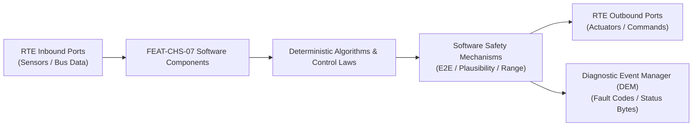

# Software Requirements Specification: Rear-Wheel Steering with Co/Counter Steer (RWS)
**Feature ID:** `FEAT-CHS-07`  
**Domain:** Vehicle Motion & Chassis Control  
**Target ASIL:** ASIL D  
**Compliance Standard:** ISO 26262:2018 (Part 6 - Software Development) / ASPICE PAM v3.1 (SWE.1, SWE.2)  
**Parent System Specification:** [`FEAT-CHS-07_RWS_SysReq.md`](file:///c:/Workset/AntiGravityProjects/TestOptimisationExperiement/system_requirements/FEAT-CHS-07_RWS_SysReq.md)  
**Global Master Specification:** [`spec.md`](file:///c:/Workset/AntiGravityProjects/TestOptimisationExperiement/spec.md)

---

## 1. Software Architecture & Component Structure

This document specifies the AUTOSAR Software Components (SWCs), periodic runnables, algorithmic laws, safety mechanisms, and data ports implementing `FEAT-CHS-07` (Rear-Wheel Steering with Co/Counter Steer (RWS)).

### AUTOSAR SWC Interaction Diagram

---

## 2. Detailed Software Requirements (SWR_REQ)
*(Multi-Software Requirement Partitioning derived from System Requirements)*

### `SWR-CHS-07-01`: Dynamic Sideslip Elimination Rear Steering Kinematic Model
- **Planned Release:** R100
- **ASIL Rating:** ASIL D
- **Parent System Requirement:** [`SYS-CHS-07-01`](file:///c:/Workset/AntiGravityProjects/TestOptimisationExperiement/system_requirements/FEAT-CHS-07_RWS_SysReq.md#sys-chs-07-01)
- **Allocated AUTOSAR SWC:** `RwsKinematicCoordinator_SWC`
- **Execution Rate / Trigger:** 10 ms
- **Worst-Case Execution Time (WCET):** 0.7 ms
- **Software Activation Condition:** Executed cyclically every 10 ms.
- **Algorithmic Description / Logic:**
  > Computes target rear steer: delta_r = K_rws(v) * delta_f + K_yaw * (Omega_yaw_meas - Omega_yaw_target). Gain K_rws transitions from -0.32 at 0 km/h to 0.0 at 60 km/h and +0.12 at 120 km/h.
- **Software Safety Mechanism:** Dynamic angle authority limiter: Maximum allowable |delta_r| is capped by speed envelope: max_angle = min(10.0, 350.0 / (v_ego + 10.0)).
- **Failure Reaction & DEM Diagnostic Event:** Clamp output to 0.0 deg if front steering angle sensor status is degraded.
- **Software Port Inputs:** `Front_Wheel_Angle_Deg, Vehicle_Speed_Mps, Measured_Yaw_Rate_RadS`
- **Software Port Outputs:** `Target_Rear_Angle_Deg, Kinematic_Sideslip_Beta_Rad`
- **Software Verification Criteria:** Simulation matrix covering 10,000 cornering scenarios on CarSim.
- **Traceability Link:** Traces upward to [`SYS-CHS-07-01`](file:///c:/Workset/AntiGravityProjects/TestOptimisationExperiement/system_requirements/FEAT-CHS-07_RWS_SysReq.md#sys-chs-07-01) and [`FEAT-CHS-07`](file:///c:/Workset/AntiGravityProjects/TestOptimisationExperiement/spec.md).

### `SWR-CHS-07-02`: Rear-Axle Crab-Walk & Low-Speed Diagonal Park Trajectory Planner
- **Planned Release:** R100
- **ASIL Rating:** ASIL B
- **Parent System Requirement:** [`SYS-CHS-07-01`](file:///c:/Workset/AntiGravityProjects/TestOptimisationExperiement/system_requirements/FEAT-CHS-07_RWS_SysReq.md#sys-chs-07-01)
- **Allocated AUTOSAR SWC:** `RwsCrabWalkPlanner_SWC`
- **Execution Rate / Trigger:** 20 ms
- **Worst-Case Execution Time (WCET):** 0.5 ms
- **Software Activation Condition:** Active when user selects Crab-Walk or Diagonal Park mode at speed < 15 km/h.
- **Algorithmic Description / Logic:**
  > Sets delta_r = delta_f (equal phase steering) up to +-8.0 degrees, allowing vehicle to translate diagonally without altering vehicle yaw heading.
- **Software Safety Mechanism:** Speed lockout: Unconditionally aborts crab-walk mode and transitions to standard Ackermann if vehicle speed > 20 km/h.
- **Failure Reaction & DEM Diagnostic Event:** Immediately revert to 0.0 degrees if any obstacle is detected within 0.5 m of vehicle flanks.
- **Software Port Inputs:** `Driver_CrabWalk_Switch, Front_Steer_Angle_Deg, Vehicle_Speed_Mps, Flank_Ultrasonic_Dist`
- **Software Port Outputs:** `Crab_Angle_Request_Deg, Crab_Mode_Active_Flag (boolean)`
- **Software Verification Criteria:** Parking maneuver validation on low-speed proving ground track.
- **Traceability Link:** Traces upward to [`SYS-CHS-07-01`](file:///c:/Workset/AntiGravityProjects/TestOptimisationExperiement/system_requirements/FEAT-CHS-07_RWS_SysReq.md#sys-chs-07-01) and [`FEAT-CHS-07`](file:///c:/Workset/AntiGravityProjects/TestOptimisationExperiement/spec.md).

### `SWR-CHS-07-03`: Dual-Channel Rear BLDC Field Oriented Control (FOC) Loop
- **Planned Release:** R100
- **ASIL Rating:** ASIL D
- **Parent System Requirement:** [`SYS-CHS-07-02`](file:///c:/Workset/AntiGravityProjects/TestOptimisationExperiement/system_requirements/FEAT-CHS-07_RWS_SysReq.md#sys-chs-07-02)
- **Allocated AUTOSAR SWC:** `RwsFocActuator_SWC`
- **Execution Rate / Trigger:** 1 ms
- **Worst-Case Execution Time (WCET):** 0.15 ms
- **Software Activation Condition:** Executed in 1 kHz high-speed motor control ISR.
- **Algorithmic Description / Logic:**
  > Executes Clarke/Park transformation: Samples three-phase currents I_a, I_b, I_c and dual resolvers. Runs cascaded PID: Position loop (100 Hz) -> Velocity loop (500 Hz) -> Current Id/Iq loop (10 kHz PWM).
- **Software Safety Mechanism:** Dual-inverter cross-monitoring: Compares Id/Iq demands between Channel A and Channel B microcontrollers over dedicated SPI link.
- **Failure Reaction & DEM Diagnostic Event:** If torque divergence > 1.5 Nm for > 6 ms, trip hardware relay to safe centering state.
- **Software Port Inputs:** `Dual_Resolver_Angle_Rad, Motor_Phase_Currents_ABC[3], Target_Rear_Angle_Deg`
- **Software Port Outputs:** `SVPWM_Duty_Cycles_ABC[3], Actuator_Delivered_Torque_Nm`
- **Software Verification Criteria:** Inverter dynamometer step response from -10 deg to +10 deg in < 200 ms.
- **Traceability Link:** Traces upward to [`SYS-CHS-07-02`](file:///c:/Workset/AntiGravityProjects/TestOptimisationExperiement/system_requirements/FEAT-CHS-07_RWS_SysReq.md#sys-chs-07-02) and [`FEAT-CHS-07`](file:///c:/Workset/AntiGravityProjects/TestOptimisationExperiement/spec.md).

### `SWR-CHS-07-04`: Spring-Loaded Mechanical Rack Centering Solenoid Supervisor
- **Planned Release:** R100
- **ASIL Rating:** ASIL D
- **Parent System Requirement:** [`SYS-CHS-07-02`](file:///c:/Workset/AntiGravityProjects/TestOptimisationExperiement/system_requirements/FEAT-CHS-07_RWS_SysReq.md#sys-chs-07-02)
- **Allocated AUTOSAR SWC:** `RwsCenterLockSupervisor_SWC`
- **Execution Rate / Trigger:** 5 ms
- **Worst-Case Execution Time (WCET):** 0.25 ms
- **Software Activation Condition:** Monitors actuator health continuously.
- **Algorithmic Description / Logic:**
  > Maintains solenoid energized to keep mechanical lock wedge disengaged. Upon fault trip signal (E2E timeout, overcurrent, or resolver loss), de-energizes solenoid in <= 5 ms, allowing spring to drive wedge into center notch.
- **Software Safety Mechanism:** Mechanical lock confirmation: Monitors inductive proximity switch to verify wedge is fully seated in center notch.
- **Failure Reaction & DEM Diagnostic Event:** If lock wedge fails to seat within 100 ms, apply dynamic motor braking to clamp rack position.
- **Software Port Inputs:** `Safety_Trip_Trigger_Bits, Lock_Pin_Proximity_Sensor_State, Rear_Rack_Velocity`
- **Software Port Outputs:** `Solenoid_Power_Relay_Cmd (boolean), Mechanical_Lock_Engaged_Flag`
- **Software Verification Criteria:** Physical bench fault-injection testing cutting 12V power at 100 km/h simulated speed.
- **Traceability Link:** Traces upward to [`SYS-CHS-07-02`](file:///c:/Workset/AntiGravityProjects/TestOptimisationExperiement/system_requirements/FEAT-CHS-07_RWS_SysReq.md#sys-chs-07-02) and [`FEAT-CHS-07`](file:///c:/Workset/AntiGravityProjects/TestOptimisationExperiement/spec.md).

### `SWR-CHS-07-05`: Rear-Wheel Steering Low-Speed Counter-Phase Agility Angle Calculator - Dynamic Observer & Signal Filter
- **Planned Release:** R100
- **ASIL Rating:** ASIL D
- **Parent System Requirement:** [`SYS-CHS-07-03`](file:///c:/Workset/AntiGravityProjects/TestOptimisationExperiement/system_requirements/FEAT-CHS-07_RWS_SysReq.md#sys-chs-07-03)
- **Allocated AUTOSAR SWC:** `RwsCounterPhase_SWC`
- **Execution Rate / Trigger:** 2 ms
- **Worst-Case Execution Time (WCET):** 0.3 ms
- **Software Activation Condition:** Executed cyclically every 2 ms.
- **Algorithmic Description / Logic:**
  > Executes signal plausibility filtering, calibration offsets, and discrete state estimation for Rear-Wheel Steering Low-Speed Counter-Phase Agility Angle Calculator.
- **Software Safety Mechanism:** Range limit plausibility check and E2E alive sequence verification.
- **Failure Reaction & DEM Diagnostic Event:** Set default fallback output and report DEM_EVENT_FEAT_CHS_07_ERR.
- **Software Port Inputs:** `Raw sensor ADC/SENT/SPI values and RTE bus inputs.`
- **Software Port Outputs:** `Filtered physical signals and validity status bitmasks.`
- **Software Verification Criteria:** Unit test and HiL software integration test.
- **Traceability Link:** Traces upward to [`SYS-CHS-07-03`](file:///c:/Workset/AntiGravityProjects/TestOptimisationExperiement/system_requirements/FEAT-CHS-07_RWS_SysReq.md#sys-chs-07-03) and [`FEAT-CHS-07`](file:///c:/Workset/AntiGravityProjects/TestOptimisationExperiement/spec.md).

### `SWR-CHS-07-06`: Rear-Wheel Steering Low-Speed Counter-Phase Agility Angle Calculator - Closed-Loop Control Law & Actuator Dispatch
- **Planned Release:** R100
- **ASIL Rating:** ASIL D
- **Parent System Requirement:** [`SYS-CHS-07-03`](file:///c:/Workset/AntiGravityProjects/TestOptimisationExperiement/system_requirements/FEAT-CHS-07_RWS_SysReq.md#sys-chs-07-03)
- **Allocated AUTOSAR SWC:** `RwsCounterPhase_SWC`
- **Execution Rate / Trigger:** 2 ms
- **Worst-Case Execution Time (WCET):** 0.4 ms
- **Software Activation Condition:** Executed cyclically every 2 ms.
- **Algorithmic Description / Logic:**
  > Evaluates deterministic closed-loop control law, rate limits, and dispatches commands for Rear-Wheel Steering Low-Speed Counter-Phase Agility Angle Calculator.
- **Software Safety Mechanism:** Command saturation clamping and watchdog program flow monitoring.
- **Failure Reaction & DEM Diagnostic Event:** De-energize actuator output, apply safe fallback clamp, and latch DTC.
- **Software Port Inputs:** `Validated physical state signals from observer SWC.`
- **Software Port Outputs:** `Actuator PWM duty cycles, torque/pressure setpoints, and diagnostic flags.`
- **Software Verification Criteria:** Hardware dynamometer and HiL closed-loop regression test suite.
- **Traceability Link:** Traces upward to [`SYS-CHS-07-03`](file:///c:/Workset/AntiGravityProjects/TestOptimisationExperiement/system_requirements/FEAT-CHS-07_RWS_SysReq.md#sys-chs-07-03) and [`FEAT-CHS-07`](file:///c:/Workset/AntiGravityProjects/TestOptimisationExperiement/spec.md).

### `SWR-CHS-07-07`: High-Speed Co-Phase Directional Stability Rear Steering Angle Calculator - Dynamic Observer & Signal Filter
- **Planned Release:** R100
- **ASIL Rating:** ASIL D
- **Parent System Requirement:** [`SYS-CHS-07-04`](file:///c:/Workset/AntiGravityProjects/TestOptimisationExperiement/system_requirements/FEAT-CHS-07_RWS_SysReq.md#sys-chs-07-04)
- **Allocated AUTOSAR SWC:** `RwsCoPhase_SWC`
- **Execution Rate / Trigger:** 2 ms
- **Worst-Case Execution Time (WCET):** 0.3 ms
- **Software Activation Condition:** Executed cyclically every 2 ms.
- **Algorithmic Description / Logic:**
  > Executes signal plausibility filtering, calibration offsets, and discrete state estimation for High-Speed Co-Phase Directional Stability Rear Steering Angle Calculator.
- **Software Safety Mechanism:** Range limit plausibility check and E2E alive sequence verification.
- **Failure Reaction & DEM Diagnostic Event:** Set default fallback output and report DEM_EVENT_FEAT_CHS_07_ERR.
- **Software Port Inputs:** `Raw sensor ADC/SENT/SPI values and RTE bus inputs.`
- **Software Port Outputs:** `Filtered physical signals and validity status bitmasks.`
- **Software Verification Criteria:** Unit test and HiL software integration test.
- **Traceability Link:** Traces upward to [`SYS-CHS-07-04`](file:///c:/Workset/AntiGravityProjects/TestOptimisationExperiement/system_requirements/FEAT-CHS-07_RWS_SysReq.md#sys-chs-07-04) and [`FEAT-CHS-07`](file:///c:/Workset/AntiGravityProjects/TestOptimisationExperiement/spec.md).

### `SWR-CHS-07-08`: High-Speed Co-Phase Directional Stability Rear Steering Angle Calculator - Closed-Loop Control Law & Actuator Dispatch
- **Planned Release:** R100
- **ASIL Rating:** ASIL D
- **Parent System Requirement:** [`SYS-CHS-07-04`](file:///c:/Workset/AntiGravityProjects/TestOptimisationExperiement/system_requirements/FEAT-CHS-07_RWS_SysReq.md#sys-chs-07-04)
- **Allocated AUTOSAR SWC:** `RwsCoPhase_SWC`
- **Execution Rate / Trigger:** 2 ms
- **Worst-Case Execution Time (WCET):** 0.4 ms
- **Software Activation Condition:** Executed cyclically every 2 ms.
- **Algorithmic Description / Logic:**
  > Evaluates deterministic closed-loop control law, rate limits, and dispatches commands for High-Speed Co-Phase Directional Stability Rear Steering Angle Calculator.
- **Software Safety Mechanism:** Command saturation clamping and watchdog program flow monitoring.
- **Failure Reaction & DEM Diagnostic Event:** De-energize actuator output, apply safe fallback clamp, and latch DTC.
- **Software Port Inputs:** `Validated physical state signals from observer SWC.`
- **Software Port Outputs:** `Actuator PWM duty cycles, torque/pressure setpoints, and diagnostic flags.`
- **Software Verification Criteria:** Hardware dynamometer and HiL closed-loop regression test suite.
- **Traceability Link:** Traces upward to [`SYS-CHS-07-04`](file:///c:/Workset/AntiGravityProjects/TestOptimisationExperiement/system_requirements/FEAT-CHS-07_RWS_SysReq.md#sys-chs-07-04) and [`FEAT-CHS-07`](file:///c:/Workset/AntiGravityProjects/TestOptimisationExperiement/spec.md).

### `SWR-CHS-07-09`: Zero-Yaw Dynamic Crab Angle & Lateral Lane Change Transition Law - Dynamic Observer & Signal Filter
- **Planned Release:** R200
- **ASIL Rating:** ASIL D
- **Parent System Requirement:** [`SYS-CHS-07-05`](file:///c:/Workset/AntiGravityProjects/TestOptimisationExperiement/system_requirements/FEAT-CHS-07_RWS_SysReq.md#sys-chs-07-05)
- **Allocated AUTOSAR SWC:** `RwsCrabAngle_SWC`
- **Execution Rate / Trigger:** 2 ms
- **Worst-Case Execution Time (WCET):** 0.3 ms
- **Software Activation Condition:** Executed cyclically every 2 ms.
- **Algorithmic Description / Logic:**
  > Executes signal plausibility filtering, calibration offsets, and discrete state estimation for Zero-Yaw Dynamic Crab Angle & Lateral Lane Change Transition Law.
- **Software Safety Mechanism:** Range limit plausibility check and E2E alive sequence verification.
- **Failure Reaction & DEM Diagnostic Event:** Set default fallback output and report DEM_EVENT_FEAT_CHS_07_ERR.
- **Software Port Inputs:** `Raw sensor ADC/SENT/SPI values and RTE bus inputs.`
- **Software Port Outputs:** `Filtered physical signals and validity status bitmasks.`
- **Software Verification Criteria:** Unit test and HiL software integration test.
- **Traceability Link:** Traces upward to [`SYS-CHS-07-05`](file:///c:/Workset/AntiGravityProjects/TestOptimisationExperiement/system_requirements/FEAT-CHS-07_RWS_SysReq.md#sys-chs-07-05) and [`FEAT-CHS-07`](file:///c:/Workset/AntiGravityProjects/TestOptimisationExperiement/spec.md).

### `SWR-CHS-07-10`: Zero-Yaw Dynamic Crab Angle & Lateral Lane Change Transition Law - Closed-Loop Control Law & Actuator Dispatch
- **Planned Release:** R200
- **ASIL Rating:** ASIL D
- **Parent System Requirement:** [`SYS-CHS-07-05`](file:///c:/Workset/AntiGravityProjects/TestOptimisationExperiement/system_requirements/FEAT-CHS-07_RWS_SysReq.md#sys-chs-07-05)
- **Allocated AUTOSAR SWC:** `RwsCrabAngle_SWC`
- **Execution Rate / Trigger:** 2 ms
- **Worst-Case Execution Time (WCET):** 0.4 ms
- **Software Activation Condition:** Executed cyclically every 2 ms.
- **Algorithmic Description / Logic:**
  > Evaluates deterministic closed-loop control law, rate limits, and dispatches commands for Zero-Yaw Dynamic Crab Angle & Lateral Lane Change Transition Law.
- **Software Safety Mechanism:** Command saturation clamping and watchdog program flow monitoring.
- **Failure Reaction & DEM Diagnostic Event:** De-energize actuator output, apply safe fallback clamp, and latch DTC.
- **Software Port Inputs:** `Validated physical state signals from observer SWC.`
- **Software Port Outputs:** `Actuator PWM duty cycles, torque/pressure setpoints, and diagnostic flags.`
- **Software Verification Criteria:** Hardware dynamometer and HiL closed-loop regression test suite.
- **Traceability Link:** Traces upward to [`SYS-CHS-07-05`](file:///c:/Workset/AntiGravityProjects/TestOptimisationExperiement/system_requirements/FEAT-CHS-07_RWS_SysReq.md#sys-chs-07-05) and [`FEAT-CHS-07`](file:///c:/Workset/AntiGravityProjects/TestOptimisationExperiement/spec.md).

### `SWR-CHS-07-11`: Rear Steering Electromechanical Linear Actuator Closed-Loop Position Servo - Dynamic Observer & Signal Filter
- **Planned Release:** R200
- **ASIL Rating:** ASIL D
- **Parent System Requirement:** [`SYS-CHS-07-06`](file:///c:/Workset/AntiGravityProjects/TestOptimisationExperiement/system_requirements/FEAT-CHS-07_RWS_SysReq.md#sys-chs-07-06)
- **Allocated AUTOSAR SWC:** `RwsActuatorServo_SWC`
- **Execution Rate / Trigger:** 0.5 ms
- **Worst-Case Execution Time (WCET):** 0.3 ms
- **Software Activation Condition:** Executed cyclically every 0.5 ms.
- **Algorithmic Description / Logic:**
  > Executes signal plausibility filtering, calibration offsets, and discrete state estimation for Rear Steering Electromechanical Linear Actuator Closed-Loop Position Servo.
- **Software Safety Mechanism:** Range limit plausibility check and E2E alive sequence verification.
- **Failure Reaction & DEM Diagnostic Event:** Set default fallback output and report DEM_EVENT_FEAT_CHS_07_ERR.
- **Software Port Inputs:** `Raw sensor ADC/SENT/SPI values and RTE bus inputs.`
- **Software Port Outputs:** `Filtered physical signals and validity status bitmasks.`
- **Software Verification Criteria:** Unit test and HiL software integration test.
- **Traceability Link:** Traces upward to [`SYS-CHS-07-06`](file:///c:/Workset/AntiGravityProjects/TestOptimisationExperiement/system_requirements/FEAT-CHS-07_RWS_SysReq.md#sys-chs-07-06) and [`FEAT-CHS-07`](file:///c:/Workset/AntiGravityProjects/TestOptimisationExperiement/spec.md).

### `SWR-CHS-07-12`: Rear Steering Electromechanical Linear Actuator Closed-Loop Position Servo - Closed-Loop Control Law & Actuator Dispatch
- **Planned Release:** R200
- **ASIL Rating:** ASIL D
- **Parent System Requirement:** [`SYS-CHS-07-06`](file:///c:/Workset/AntiGravityProjects/TestOptimisationExperiement/system_requirements/FEAT-CHS-07_RWS_SysReq.md#sys-chs-07-06)
- **Allocated AUTOSAR SWC:** `RwsActuatorServo_SWC`
- **Execution Rate / Trigger:** 0.5 ms
- **Worst-Case Execution Time (WCET):** 0.4 ms
- **Software Activation Condition:** Executed cyclically every 0.5 ms.
- **Algorithmic Description / Logic:**
  > Evaluates deterministic closed-loop control law, rate limits, and dispatches commands for Rear Steering Electromechanical Linear Actuator Closed-Loop Position Servo.
- **Software Safety Mechanism:** Command saturation clamping and watchdog program flow monitoring.
- **Failure Reaction & DEM Diagnostic Event:** De-energize actuator output, apply safe fallback clamp, and latch DTC.
- **Software Port Inputs:** `Validated physical state signals from observer SWC.`
- **Software Port Outputs:** `Actuator PWM duty cycles, torque/pressure setpoints, and diagnostic flags.`
- **Software Verification Criteria:** Hardware dynamometer and HiL closed-loop regression test suite.
- **Traceability Link:** Traces upward to [`SYS-CHS-07-06`](file:///c:/Workset/AntiGravityProjects/TestOptimisationExperiement/system_requirements/FEAT-CHS-07_RWS_SysReq.md#sys-chs-07-06) and [`FEAT-CHS-07`](file:///c:/Workset/AntiGravityProjects/TestOptimisationExperiement/spec.md).

### `SWR-CHS-07-13`: Dual Redundant Hall/Resolver Rear Toe-Angle Sensor Cross-Monitor - Dynamic Observer & Signal Filter
- **Planned Release:** R200
- **ASIL Rating:** ASIL D
- **Parent System Requirement:** [`SYS-CHS-07-07`](file:///c:/Workset/AntiGravityProjects/TestOptimisationExperiement/system_requirements/FEAT-CHS-07_RWS_SysReq.md#sys-chs-07-07)
- **Allocated AUTOSAR SWC:** `RwsSensorCrossCheck_SWC`
- **Execution Rate / Trigger:** 0.5 ms
- **Worst-Case Execution Time (WCET):** 0.3 ms
- **Software Activation Condition:** Executed cyclically every 0.5 ms.
- **Algorithmic Description / Logic:**
  > Executes signal plausibility filtering, calibration offsets, and discrete state estimation for Dual Redundant Hall/Resolver Rear Toe-Angle Sensor Cross-Monitor.
- **Software Safety Mechanism:** Range limit plausibility check and E2E alive sequence verification.
- **Failure Reaction & DEM Diagnostic Event:** Set default fallback output and report DEM_EVENT_FEAT_CHS_07_ERR.
- **Software Port Inputs:** `Raw sensor ADC/SENT/SPI values and RTE bus inputs.`
- **Software Port Outputs:** `Filtered physical signals and validity status bitmasks.`
- **Software Verification Criteria:** Unit test and HiL software integration test.
- **Traceability Link:** Traces upward to [`SYS-CHS-07-07`](file:///c:/Workset/AntiGravityProjects/TestOptimisationExperiement/system_requirements/FEAT-CHS-07_RWS_SysReq.md#sys-chs-07-07) and [`FEAT-CHS-07`](file:///c:/Workset/AntiGravityProjects/TestOptimisationExperiement/spec.md).

### `SWR-CHS-07-14`: Dual Redundant Hall/Resolver Rear Toe-Angle Sensor Cross-Monitor - Closed-Loop Control Law & Actuator Dispatch
- **Planned Release:** R200
- **ASIL Rating:** ASIL D
- **Parent System Requirement:** [`SYS-CHS-07-07`](file:///c:/Workset/AntiGravityProjects/TestOptimisationExperiement/system_requirements/FEAT-CHS-07_RWS_SysReq.md#sys-chs-07-07)
- **Allocated AUTOSAR SWC:** `RwsSensorCrossCheck_SWC`
- **Execution Rate / Trigger:** 0.5 ms
- **Worst-Case Execution Time (WCET):** 0.4 ms
- **Software Activation Condition:** Executed cyclically every 0.5 ms.
- **Algorithmic Description / Logic:**
  > Evaluates deterministic closed-loop control law, rate limits, and dispatches commands for Dual Redundant Hall/Resolver Rear Toe-Angle Sensor Cross-Monitor.
- **Software Safety Mechanism:** Command saturation clamping and watchdog program flow monitoring.
- **Failure Reaction & DEM Diagnostic Event:** De-energize actuator output, apply safe fallback clamp, and latch DTC.
- **Software Port Inputs:** `Validated physical state signals from observer SWC.`
- **Software Port Outputs:** `Actuator PWM duty cycles, torque/pressure setpoints, and diagnostic flags.`
- **Software Verification Criteria:** Hardware dynamometer and HiL closed-loop regression test suite.
- **Traceability Link:** Traces upward to [`SYS-CHS-07-07`](file:///c:/Workset/AntiGravityProjects/TestOptimisationExperiement/system_requirements/FEAT-CHS-07_RWS_SysReq.md#sys-chs-07-07) and [`FEAT-CHS-07`](file:///c:/Workset/AntiGravityProjects/TestOptimisationExperiement/spec.md).

### `SWR-CHS-07-15`: Dual-Inverter Symmetrical Motor Winding Load Sharing Controller - Dynamic Observer & Signal Filter
- **Planned Release:** R500
- **ASIL Rating:** ASIL D
- **Parent System Requirement:** [`SYS-CHS-07-08`](file:///c:/Workset/AntiGravityProjects/TestOptimisationExperiement/system_requirements/FEAT-CHS-07_RWS_SysReq.md#sys-chs-07-08)
- **Allocated AUTOSAR SWC:** `RwsInverterLoadShare_SWC`
- **Execution Rate / Trigger:** 0.5 ms
- **Worst-Case Execution Time (WCET):** 0.3 ms
- **Software Activation Condition:** Executed cyclically every 0.5 ms.
- **Algorithmic Description / Logic:**
  > Executes signal plausibility filtering, calibration offsets, and discrete state estimation for Dual-Inverter Symmetrical Motor Winding Load Sharing Controller.
- **Software Safety Mechanism:** Range limit plausibility check and E2E alive sequence verification.
- **Failure Reaction & DEM Diagnostic Event:** Set default fallback output and report DEM_EVENT_FEAT_CHS_07_ERR.
- **Software Port Inputs:** `Raw sensor ADC/SENT/SPI values and RTE bus inputs.`
- **Software Port Outputs:** `Filtered physical signals and validity status bitmasks.`
- **Software Verification Criteria:** Unit test and HiL software integration test.
- **Traceability Link:** Traces upward to [`SYS-CHS-07-08`](file:///c:/Workset/AntiGravityProjects/TestOptimisationExperiement/system_requirements/FEAT-CHS-07_RWS_SysReq.md#sys-chs-07-08) and [`FEAT-CHS-07`](file:///c:/Workset/AntiGravityProjects/TestOptimisationExperiement/spec.md).

### `SWR-CHS-07-16`: Dual-Inverter Symmetrical Motor Winding Load Sharing Controller - Closed-Loop Control Law & Actuator Dispatch
- **Planned Release:** R500
- **ASIL Rating:** ASIL D
- **Parent System Requirement:** [`SYS-CHS-07-08`](file:///c:/Workset/AntiGravityProjects/TestOptimisationExperiement/system_requirements/FEAT-CHS-07_RWS_SysReq.md#sys-chs-07-08)
- **Allocated AUTOSAR SWC:** `RwsInverterLoadShare_SWC`
- **Execution Rate / Trigger:** 0.5 ms
- **Worst-Case Execution Time (WCET):** 0.4 ms
- **Software Activation Condition:** Executed cyclically every 0.5 ms.
- **Algorithmic Description / Logic:**
  > Evaluates deterministic closed-loop control law, rate limits, and dispatches commands for Dual-Inverter Symmetrical Motor Winding Load Sharing Controller.
- **Software Safety Mechanism:** Command saturation clamping and watchdog program flow monitoring.
- **Failure Reaction & DEM Diagnostic Event:** De-energize actuator output, apply safe fallback clamp, and latch DTC.
- **Software Port Inputs:** `Validated physical state signals from observer SWC.`
- **Software Port Outputs:** `Actuator PWM duty cycles, torque/pressure setpoints, and diagnostic flags.`
- **Software Verification Criteria:** Hardware dynamometer and HiL closed-loop regression test suite.
- **Traceability Link:** Traces upward to [`SYS-CHS-07-08`](file:///c:/Workset/AntiGravityProjects/TestOptimisationExperiement/system_requirements/FEAT-CHS-07_RWS_SysReq.md#sys-chs-07-08) and [`FEAT-CHS-07`](file:///c:/Workset/AntiGravityProjects/TestOptimisationExperiement/spec.md).

### `SWR-CHS-07-17`: Single-Channel Fault Autonomous 100% Load Takeover in <= 5 ms - Dynamic Observer & Signal Filter
- **Planned Release:** R300
- **ASIL Rating:** ASIL D
- **Parent System Requirement:** [`SYS-CHS-07-09`](file:///c:/Workset/AntiGravityProjects/TestOptimisationExperiement/system_requirements/FEAT-CHS-07_RWS_SysReq.md#sys-chs-07-09)
- **Allocated AUTOSAR SWC:** `RwsSingleChannelTakeover_SWC`
- **Execution Rate / Trigger:** 1 ms
- **Worst-Case Execution Time (WCET):** 0.3 ms
- **Software Activation Condition:** Executed cyclically every 1 ms.
- **Algorithmic Description / Logic:**
  > Executes signal plausibility filtering, calibration offsets, and discrete state estimation for Single-Channel Fault Autonomous 100% Load Takeover in <= 5 ms.
- **Software Safety Mechanism:** Range limit plausibility check and E2E alive sequence verification.
- **Failure Reaction & DEM Diagnostic Event:** Set default fallback output and report DEM_EVENT_FEAT_CHS_07_ERR.
- **Software Port Inputs:** `Raw sensor ADC/SENT/SPI values and RTE bus inputs.`
- **Software Port Outputs:** `Filtered physical signals and validity status bitmasks.`
- **Software Verification Criteria:** Unit test and HiL software integration test.
- **Traceability Link:** Traces upward to [`SYS-CHS-07-09`](file:///c:/Workset/AntiGravityProjects/TestOptimisationExperiement/system_requirements/FEAT-CHS-07_RWS_SysReq.md#sys-chs-07-09) and [`FEAT-CHS-07`](file:///c:/Workset/AntiGravityProjects/TestOptimisationExperiement/spec.md).

### `SWR-CHS-07-18`: Single-Channel Fault Autonomous 100% Load Takeover in <= 5 ms - Closed-Loop Control Law & Actuator Dispatch
- **Planned Release:** R300
- **ASIL Rating:** ASIL D
- **Parent System Requirement:** [`SYS-CHS-07-09`](file:///c:/Workset/AntiGravityProjects/TestOptimisationExperiement/system_requirements/FEAT-CHS-07_RWS_SysReq.md#sys-chs-07-09)
- **Allocated AUTOSAR SWC:** `RwsSingleChannelTakeover_SWC`
- **Execution Rate / Trigger:** 1 ms
- **Worst-Case Execution Time (WCET):** 0.4 ms
- **Software Activation Condition:** Executed cyclically every 1 ms.
- **Algorithmic Description / Logic:**
  > Evaluates deterministic closed-loop control law, rate limits, and dispatches commands for Single-Channel Fault Autonomous 100% Load Takeover in <= 5 ms.
- **Software Safety Mechanism:** Command saturation clamping and watchdog program flow monitoring.
- **Failure Reaction & DEM Diagnostic Event:** De-energize actuator output, apply safe fallback clamp, and latch DTC.
- **Software Port Inputs:** `Validated physical state signals from observer SWC.`
- **Software Port Outputs:** `Actuator PWM duty cycles, torque/pressure setpoints, and diagnostic flags.`
- **Software Verification Criteria:** Hardware dynamometer and HiL closed-loop regression test suite.
- **Traceability Link:** Traces upward to [`SYS-CHS-07-09`](file:///c:/Workset/AntiGravityProjects/TestOptimisationExperiement/system_requirements/FEAT-CHS-07_RWS_SysReq.md#sys-chs-07-09) and [`FEAT-CHS-07`](file:///c:/Workset/AntiGravityProjects/TestOptimisationExperiement/spec.md).

### `SWR-CHS-07-19`: Rear Mechanical Spring-Loaded Center-Lock Fallback Mechanism - Dynamic Observer & Signal Filter
- **Planned Release:** R300
- **ASIL Rating:** ASIL D
- **Parent System Requirement:** [`SYS-CHS-07-10`](file:///c:/Workset/AntiGravityProjects/TestOptimisationExperiement/system_requirements/FEAT-CHS-07_RWS_SysReq.md#sys-chs-07-10)
- **Allocated AUTOSAR SWC:** `RwsCenterLockSafing_SWC`
- **Execution Rate / Trigger:** 2 ms
- **Worst-Case Execution Time (WCET):** 0.3 ms
- **Software Activation Condition:** Executed cyclically every 2 ms.
- **Algorithmic Description / Logic:**
  > Executes signal plausibility filtering, calibration offsets, and discrete state estimation for Rear Mechanical Spring-Loaded Center-Lock Fallback Mechanism.
- **Software Safety Mechanism:** Range limit plausibility check and E2E alive sequence verification.
- **Failure Reaction & DEM Diagnostic Event:** Set default fallback output and report DEM_EVENT_FEAT_CHS_07_ERR.
- **Software Port Inputs:** `Raw sensor ADC/SENT/SPI values and RTE bus inputs.`
- **Software Port Outputs:** `Filtered physical signals and validity status bitmasks.`
- **Software Verification Criteria:** Unit test and HiL software integration test.
- **Traceability Link:** Traces upward to [`SYS-CHS-07-10`](file:///c:/Workset/AntiGravityProjects/TestOptimisationExperiement/system_requirements/FEAT-CHS-07_RWS_SysReq.md#sys-chs-07-10) and [`FEAT-CHS-07`](file:///c:/Workset/AntiGravityProjects/TestOptimisationExperiement/spec.md).

### `SWR-CHS-07-20`: Rear Mechanical Spring-Loaded Center-Lock Fallback Mechanism - Closed-Loop Control Law & Actuator Dispatch
- **Planned Release:** R300
- **ASIL Rating:** ASIL D
- **Parent System Requirement:** [`SYS-CHS-07-10`](file:///c:/Workset/AntiGravityProjects/TestOptimisationExperiement/system_requirements/FEAT-CHS-07_RWS_SysReq.md#sys-chs-07-10)
- **Allocated AUTOSAR SWC:** `RwsCenterLockSafing_SWC`
- **Execution Rate / Trigger:** 2 ms
- **Worst-Case Execution Time (WCET):** 0.4 ms
- **Software Activation Condition:** Executed cyclically every 2 ms.
- **Algorithmic Description / Logic:**
  > Evaluates deterministic closed-loop control law, rate limits, and dispatches commands for Rear Mechanical Spring-Loaded Center-Lock Fallback Mechanism.
- **Software Safety Mechanism:** Command saturation clamping and watchdog program flow monitoring.
- **Failure Reaction & DEM Diagnostic Event:** De-energize actuator output, apply safe fallback clamp, and latch DTC.
- **Software Port Inputs:** `Validated physical state signals from observer SWC.`
- **Software Port Outputs:** `Actuator PWM duty cycles, torque/pressure setpoints, and diagnostic flags.`
- **Software Verification Criteria:** Hardware dynamometer and HiL closed-loop regression test suite.
- **Traceability Link:** Traces upward to [`SYS-CHS-07-10`](file:///c:/Workset/AntiGravityProjects/TestOptimisationExperiement/system_requirements/FEAT-CHS-07_RWS_SysReq.md#sys-chs-07-10) and [`FEAT-CHS-07`](file:///c:/Workset/AntiGravityProjects/TestOptimisationExperiement/spec.md).

### `SWR-CHS-07-21`: ESC Stability Override & Rear-Axle Active Counter-Steer Yaw Damper - Dynamic Observer & Signal Filter
- **Planned Release:** R400
- **ASIL Rating:** ASIL D
- **Parent System Requirement:** [`SYS-CHS-07-11`](file:///c:/Workset/AntiGravityProjects/TestOptimisationExperiement/system_requirements/FEAT-CHS-07_RWS_SysReq.md#sys-chs-07-11)
- **Allocated AUTOSAR SWC:** `RwsEscCounterSteer_SWC`
- **Execution Rate / Trigger:** 2 ms
- **Worst-Case Execution Time (WCET):** 0.3 ms
- **Software Activation Condition:** Executed cyclically every 2 ms.
- **Algorithmic Description / Logic:**
  > Executes signal plausibility filtering, calibration offsets, and discrete state estimation for ESC Stability Override & Rear-Axle Active Counter-Steer Yaw Damper.
- **Software Safety Mechanism:** Range limit plausibility check and E2E alive sequence verification.
- **Failure Reaction & DEM Diagnostic Event:** Set default fallback output and report DEM_EVENT_FEAT_CHS_07_ERR.
- **Software Port Inputs:** `Raw sensor ADC/SENT/SPI values and RTE bus inputs.`
- **Software Port Outputs:** `Filtered physical signals and validity status bitmasks.`
- **Software Verification Criteria:** Unit test and HiL software integration test.
- **Traceability Link:** Traces upward to [`SYS-CHS-07-11`](file:///c:/Workset/AntiGravityProjects/TestOptimisationExperiement/system_requirements/FEAT-CHS-07_RWS_SysReq.md#sys-chs-07-11) and [`FEAT-CHS-07`](file:///c:/Workset/AntiGravityProjects/TestOptimisationExperiement/spec.md).

### `SWR-CHS-07-22`: ESC Stability Override & Rear-Axle Active Counter-Steer Yaw Damper - Closed-Loop Control Law & Actuator Dispatch
- **Planned Release:** R400
- **ASIL Rating:** ASIL D
- **Parent System Requirement:** [`SYS-CHS-07-11`](file:///c:/Workset/AntiGravityProjects/TestOptimisationExperiement/system_requirements/FEAT-CHS-07_RWS_SysReq.md#sys-chs-07-11)
- **Allocated AUTOSAR SWC:** `RwsEscCounterSteer_SWC`
- **Execution Rate / Trigger:** 2 ms
- **Worst-Case Execution Time (WCET):** 0.4 ms
- **Software Activation Condition:** Executed cyclically every 2 ms.
- **Algorithmic Description / Logic:**
  > Evaluates deterministic closed-loop control law, rate limits, and dispatches commands for ESC Stability Override & Rear-Axle Active Counter-Steer Yaw Damper.
- **Software Safety Mechanism:** Command saturation clamping and watchdog program flow monitoring.
- **Failure Reaction & DEM Diagnostic Event:** De-energize actuator output, apply safe fallback clamp, and latch DTC.
- **Software Port Inputs:** `Validated physical state signals from observer SWC.`
- **Software Port Outputs:** `Actuator PWM duty cycles, torque/pressure setpoints, and diagnostic flags.`
- **Software Verification Criteria:** Hardware dynamometer and HiL closed-loop regression test suite.
- **Traceability Link:** Traces upward to [`SYS-CHS-07-11`](file:///c:/Workset/AntiGravityProjects/TestOptimisationExperiement/system_requirements/FEAT-CHS-07_RWS_SysReq.md#sys-chs-07-11) and [`FEAT-CHS-07`](file:///c:/Workset/AntiGravityProjects/TestOptimisationExperiement/spec.md).

### `SWR-CHS-07-23`: Rear Wheel Tire Kinematic Clearance & Suspension Bump Envelope Guard - Dynamic Observer & Signal Filter
- **Planned Release:** R400
- **ASIL Rating:** ASIL D
- **Parent System Requirement:** [`SYS-CHS-07-12`](file:///c:/Workset/AntiGravityProjects/TestOptimisationExperiement/system_requirements/FEAT-CHS-07_RWS_SysReq.md#sys-chs-07-12)
- **Allocated AUTOSAR SWC:** `RwsClearanceGuard_SWC`
- **Execution Rate / Trigger:** 5 ms
- **Worst-Case Execution Time (WCET):** 0.3 ms
- **Software Activation Condition:** Executed cyclically every 5 ms.
- **Algorithmic Description / Logic:**
  > Executes signal plausibility filtering, calibration offsets, and discrete state estimation for Rear Wheel Tire Kinematic Clearance & Suspension Bump Envelope Guard.
- **Software Safety Mechanism:** Range limit plausibility check and E2E alive sequence verification.
- **Failure Reaction & DEM Diagnostic Event:** Set default fallback output and report DEM_EVENT_FEAT_CHS_07_ERR.
- **Software Port Inputs:** `Raw sensor ADC/SENT/SPI values and RTE bus inputs.`
- **Software Port Outputs:** `Filtered physical signals and validity status bitmasks.`
- **Software Verification Criteria:** Unit test and HiL software integration test.
- **Traceability Link:** Traces upward to [`SYS-CHS-07-12`](file:///c:/Workset/AntiGravityProjects/TestOptimisationExperiement/system_requirements/FEAT-CHS-07_RWS_SysReq.md#sys-chs-07-12) and [`FEAT-CHS-07`](file:///c:/Workset/AntiGravityProjects/TestOptimisationExperiement/spec.md).

### `SWR-CHS-07-24`: Rear Wheel Tire Kinematic Clearance & Suspension Bump Envelope Guard - Closed-Loop Control Law & Actuator Dispatch
- **Planned Release:** R400
- **ASIL Rating:** ASIL D
- **Parent System Requirement:** [`SYS-CHS-07-12`](file:///c:/Workset/AntiGravityProjects/TestOptimisationExperiement/system_requirements/FEAT-CHS-07_RWS_SysReq.md#sys-chs-07-12)
- **Allocated AUTOSAR SWC:** `RwsClearanceGuard_SWC`
- **Execution Rate / Trigger:** 5 ms
- **Worst-Case Execution Time (WCET):** 0.4 ms
- **Software Activation Condition:** Executed cyclically every 5 ms.
- **Algorithmic Description / Logic:**
  > Evaluates deterministic closed-loop control law, rate limits, and dispatches commands for Rear Wheel Tire Kinematic Clearance & Suspension Bump Envelope Guard.
- **Software Safety Mechanism:** Command saturation clamping and watchdog program flow monitoring.
- **Failure Reaction & DEM Diagnostic Event:** De-energize actuator output, apply safe fallback clamp, and latch DTC.
- **Software Port Inputs:** `Validated physical state signals from observer SWC.`
- **Software Port Outputs:** `Actuator PWM duty cycles, torque/pressure setpoints, and diagnostic flags.`
- **Software Verification Criteria:** Hardware dynamometer and HiL closed-loop regression test suite.
- **Traceability Link:** Traces upward to [`SYS-CHS-07-12`](file:///c:/Workset/AntiGravityProjects/TestOptimisationExperiement/system_requirements/FEAT-CHS-07_RWS_SysReq.md#sys-chs-07-12) and [`FEAT-CHS-07`](file:///c:/Workset/AntiGravityProjects/TestOptimisationExperiement/spec.md).

### `SWR-CHS-07-25`: Actuator Thermal Overload & Continuous High-Load Torque Derater - Dynamic Observer & Signal Filter
- **Planned Release:** R400
- **ASIL Rating:** ASIL B
- **Parent System Requirement:** [`SYS-CHS-07-13`](file:///c:/Workset/AntiGravityProjects/TestOptimisationExperiement/system_requirements/FEAT-CHS-07_RWS_SysReq.md#sys-chs-07-13)
- **Allocated AUTOSAR SWC:** `RwsThermalDerater_SWC`
- **Execution Rate / Trigger:** 50 ms
- **Worst-Case Execution Time (WCET):** 0.3 ms
- **Software Activation Condition:** Executed cyclically every 50 ms.
- **Algorithmic Description / Logic:**
  > Executes signal plausibility filtering, calibration offsets, and discrete state estimation for Actuator Thermal Overload & Continuous High-Load Torque Derater.
- **Software Safety Mechanism:** Range limit plausibility check and E2E alive sequence verification.
- **Failure Reaction & DEM Diagnostic Event:** Set default fallback output and report DEM_EVENT_FEAT_CHS_07_ERR.
- **Software Port Inputs:** `Raw sensor ADC/SENT/SPI values and RTE bus inputs.`
- **Software Port Outputs:** `Filtered physical signals and validity status bitmasks.`
- **Software Verification Criteria:** Unit test and HiL software integration test.
- **Traceability Link:** Traces upward to [`SYS-CHS-07-13`](file:///c:/Workset/AntiGravityProjects/TestOptimisationExperiement/system_requirements/FEAT-CHS-07_RWS_SysReq.md#sys-chs-07-13) and [`FEAT-CHS-07`](file:///c:/Workset/AntiGravityProjects/TestOptimisationExperiement/spec.md).

### `SWR-CHS-07-26`: Actuator Thermal Overload & Continuous High-Load Torque Derater - Closed-Loop Control Law & Actuator Dispatch
- **Planned Release:** R400
- **ASIL Rating:** ASIL B
- **Parent System Requirement:** [`SYS-CHS-07-13`](file:///c:/Workset/AntiGravityProjects/TestOptimisationExperiement/system_requirements/FEAT-CHS-07_RWS_SysReq.md#sys-chs-07-13)
- **Allocated AUTOSAR SWC:** `RwsThermalDerater_SWC`
- **Execution Rate / Trigger:** 50 ms
- **Worst-Case Execution Time (WCET):** 0.4 ms
- **Software Activation Condition:** Executed cyclically every 50 ms.
- **Algorithmic Description / Logic:**
  > Evaluates deterministic closed-loop control law, rate limits, and dispatches commands for Actuator Thermal Overload & Continuous High-Load Torque Derater.
- **Software Safety Mechanism:** Command saturation clamping and watchdog program flow monitoring.
- **Failure Reaction & DEM Diagnostic Event:** De-energize actuator output, apply safe fallback clamp, and latch DTC.
- **Software Port Inputs:** `Validated physical state signals from observer SWC.`
- **Software Port Outputs:** `Actuator PWM duty cycles, torque/pressure setpoints, and diagnostic flags.`
- **Software Verification Criteria:** Hardware dynamometer and HiL closed-loop regression test suite.
- **Traceability Link:** Traces upward to [`SYS-CHS-07-13`](file:///c:/Workset/AntiGravityProjects/TestOptimisationExperiement/system_requirements/FEAT-CHS-07_RWS_SysReq.md#sys-chs-07-13) and [`FEAT-CHS-07`](file:///c:/Workset/AntiGravityProjects/TestOptimisationExperiement/spec.md).

### `SWR-CHS-07-27`: Dual Core Lockstep Microcontroller Safety Gatekeeper & Token Validator - Dynamic Observer & Signal Filter
- **Planned Release:** R400
- **ASIL Rating:** ASIL D
- **Parent System Requirement:** [`SYS-CHS-07-14`](file:///c:/Workset/AntiGravityProjects/TestOptimisationExperiement/system_requirements/FEAT-CHS-07_RWS_SysReq.md#sys-chs-07-14)
- **Allocated AUTOSAR SWC:** `RwsLockstepGatekeeper_SWC`
- **Execution Rate / Trigger:** 1 ms
- **Worst-Case Execution Time (WCET):** 0.3 ms
- **Software Activation Condition:** Executed cyclically every 1 ms.
- **Algorithmic Description / Logic:**
  > Executes signal plausibility filtering, calibration offsets, and discrete state estimation for Dual Core Lockstep Microcontroller Safety Gatekeeper & Token Validator.
- **Software Safety Mechanism:** Range limit plausibility check and E2E alive sequence verification.
- **Failure Reaction & DEM Diagnostic Event:** Set default fallback output and report DEM_EVENT_FEAT_CHS_07_ERR.
- **Software Port Inputs:** `Raw sensor ADC/SENT/SPI values and RTE bus inputs.`
- **Software Port Outputs:** `Filtered physical signals and validity status bitmasks.`
- **Software Verification Criteria:** Unit test and HiL software integration test.
- **Traceability Link:** Traces upward to [`SYS-CHS-07-14`](file:///c:/Workset/AntiGravityProjects/TestOptimisationExperiement/system_requirements/FEAT-CHS-07_RWS_SysReq.md#sys-chs-07-14) and [`FEAT-CHS-07`](file:///c:/Workset/AntiGravityProjects/TestOptimisationExperiement/spec.md).

### `SWR-CHS-07-28`: Dual Core Lockstep Microcontroller Safety Gatekeeper & Token Validator - Closed-Loop Control Law & Actuator Dispatch
- **Planned Release:** R400
- **ASIL Rating:** ASIL D
- **Parent System Requirement:** [`SYS-CHS-07-14`](file:///c:/Workset/AntiGravityProjects/TestOptimisationExperiement/system_requirements/FEAT-CHS-07_RWS_SysReq.md#sys-chs-07-14)
- **Allocated AUTOSAR SWC:** `RwsLockstepGatekeeper_SWC`
- **Execution Rate / Trigger:** 1 ms
- **Worst-Case Execution Time (WCET):** 0.4 ms
- **Software Activation Condition:** Executed cyclically every 1 ms.
- **Algorithmic Description / Logic:**
  > Evaluates deterministic closed-loop control law, rate limits, and dispatches commands for Dual Core Lockstep Microcontroller Safety Gatekeeper & Token Validator.
- **Software Safety Mechanism:** Command saturation clamping and watchdog program flow monitoring.
- **Failure Reaction & DEM Diagnostic Event:** De-energize actuator output, apply safe fallback clamp, and latch DTC.
- **Software Port Inputs:** `Validated physical state signals from observer SWC.`
- **Software Port Outputs:** `Actuator PWM duty cycles, torque/pressure setpoints, and diagnostic flags.`
- **Software Verification Criteria:** Hardware dynamometer and HiL closed-loop regression test suite.
- **Traceability Link:** Traces upward to [`SYS-CHS-07-14`](file:///c:/Workset/AntiGravityProjects/TestOptimisationExperiement/system_requirements/FEAT-CHS-07_RWS_SysReq.md#sys-chs-07-14) and [`FEAT-CHS-07`](file:///c:/Workset/AntiGravityProjects/TestOptimisationExperiement/spec.md).

### `SWR-CHS-07-29`: DEM Rear-Wheel Steering Diagnostic Event Manager & DTC Logger - Dynamic Observer & Signal Filter
- **Planned Release:** R500
- **ASIL Rating:** ASIL D
- **Parent System Requirement:** [`SYS-CHS-07-15`](file:///c:/Workset/AntiGravityProjects/TestOptimisationExperiement/system_requirements/FEAT-CHS-07_RWS_SysReq.md#sys-chs-07-15)
- **Allocated AUTOSAR SWC:** `RwsDiagnosticManager_SWC`
- **Execution Rate / Trigger:** 10 ms
- **Worst-Case Execution Time (WCET):** 0.3 ms
- **Software Activation Condition:** Executed cyclically every 10 ms.
- **Algorithmic Description / Logic:**
  > Executes signal plausibility filtering, calibration offsets, and discrete state estimation for DEM Rear-Wheel Steering Diagnostic Event Manager & DTC Logger.
- **Software Safety Mechanism:** Range limit plausibility check and E2E alive sequence verification.
- **Failure Reaction & DEM Diagnostic Event:** Set default fallback output and report DEM_EVENT_FEAT_CHS_07_ERR.
- **Software Port Inputs:** `Raw sensor ADC/SENT/SPI values and RTE bus inputs.`
- **Software Port Outputs:** `Filtered physical signals and validity status bitmasks.`
- **Software Verification Criteria:** Unit test and HiL software integration test.
- **Traceability Link:** Traces upward to [`SYS-CHS-07-15`](file:///c:/Workset/AntiGravityProjects/TestOptimisationExperiement/system_requirements/FEAT-CHS-07_RWS_SysReq.md#sys-chs-07-15) and [`FEAT-CHS-07`](file:///c:/Workset/AntiGravityProjects/TestOptimisationExperiement/spec.md).

### `SWR-CHS-07-30`: DEM Rear-Wheel Steering Diagnostic Event Manager & DTC Logger - Closed-Loop Control Law & Actuator Dispatch
- **Planned Release:** R500
- **ASIL Rating:** ASIL D
- **Parent System Requirement:** [`SYS-CHS-07-15`](file:///c:/Workset/AntiGravityProjects/TestOptimisationExperiement/system_requirements/FEAT-CHS-07_RWS_SysReq.md#sys-chs-07-15)
- **Allocated AUTOSAR SWC:** `RwsDiagnosticManager_SWC`
- **Execution Rate / Trigger:** 10 ms
- **Worst-Case Execution Time (WCET):** 0.4 ms
- **Software Activation Condition:** Executed cyclically every 10 ms.
- **Algorithmic Description / Logic:**
  > Evaluates deterministic closed-loop control law, rate limits, and dispatches commands for DEM Rear-Wheel Steering Diagnostic Event Manager & DTC Logger.
- **Software Safety Mechanism:** Command saturation clamping and watchdog program flow monitoring.
- **Failure Reaction & DEM Diagnostic Event:** De-energize actuator output, apply safe fallback clamp, and latch DTC.
- **Software Port Inputs:** `Validated physical state signals from observer SWC.`
- **Software Port Outputs:** `Actuator PWM duty cycles, torque/pressure setpoints, and diagnostic flags.`
- **Software Verification Criteria:** Hardware dynamometer and HiL closed-loop regression test suite.
- **Traceability Link:** Traces upward to [`SYS-CHS-07-15`](file:///c:/Workset/AntiGravityProjects/TestOptimisationExperiement/system_requirements/FEAT-CHS-07_RWS_SysReq.md#sys-chs-07-15) and [`FEAT-CHS-07`](file:///c:/Workset/AntiGravityProjects/TestOptimisationExperiement/spec.md).

### `SWR-CHS-07-31`: Instrument Cluster Rear-Wheel Steering Health Status & Turning Radius HMI - Dynamic Observer & Signal Filter
- **Planned Release:** R500
- **ASIL Rating:** ASIL B
- **Parent System Requirement:** [`SYS-CHS-07-16`](file:///c:/Workset/AntiGravityProjects/TestOptimisationExperiement/system_requirements/FEAT-CHS-07_RWS_SysReq.md#sys-chs-07-16)
- **Allocated AUTOSAR SWC:** `RwsHmiDispatcher_SWC`
- **Execution Rate / Trigger:** 20 ms
- **Worst-Case Execution Time (WCET):** 0.3 ms
- **Software Activation Condition:** Executed cyclically every 20 ms.
- **Algorithmic Description / Logic:**
  > Executes signal plausibility filtering, calibration offsets, and discrete state estimation for Instrument Cluster Rear-Wheel Steering Health Status & Turning Radius HMI.
- **Software Safety Mechanism:** Range limit plausibility check and E2E alive sequence verification.
- **Failure Reaction & DEM Diagnostic Event:** Set default fallback output and report DEM_EVENT_FEAT_CHS_07_ERR.
- **Software Port Inputs:** `Raw sensor ADC/SENT/SPI values and RTE bus inputs.`
- **Software Port Outputs:** `Filtered physical signals and validity status bitmasks.`
- **Software Verification Criteria:** Unit test and HiL software integration test.
- **Traceability Link:** Traces upward to [`SYS-CHS-07-16`](file:///c:/Workset/AntiGravityProjects/TestOptimisationExperiement/system_requirements/FEAT-CHS-07_RWS_SysReq.md#sys-chs-07-16) and [`FEAT-CHS-07`](file:///c:/Workset/AntiGravityProjects/TestOptimisationExperiement/spec.md).

### `SWR-CHS-07-32`: Instrument Cluster Rear-Wheel Steering Health Status & Turning Radius HMI - Closed-Loop Control Law & Actuator Dispatch
- **Planned Release:** R500
- **ASIL Rating:** ASIL B
- **Parent System Requirement:** [`SYS-CHS-07-16`](file:///c:/Workset/AntiGravityProjects/TestOptimisationExperiement/system_requirements/FEAT-CHS-07_RWS_SysReq.md#sys-chs-07-16)
- **Allocated AUTOSAR SWC:** `RwsHmiDispatcher_SWC`
- **Execution Rate / Trigger:** 20 ms
- **Worst-Case Execution Time (WCET):** 0.4 ms
- **Software Activation Condition:** Executed cyclically every 20 ms.
- **Algorithmic Description / Logic:**
  > Evaluates deterministic closed-loop control law, rate limits, and dispatches commands for Instrument Cluster Rear-Wheel Steering Health Status & Turning Radius HMI.
- **Software Safety Mechanism:** Command saturation clamping and watchdog program flow monitoring.
- **Failure Reaction & DEM Diagnostic Event:** De-energize actuator output, apply safe fallback clamp, and latch DTC.
- **Software Port Inputs:** `Validated physical state signals from observer SWC.`
- **Software Port Outputs:** `Actuator PWM duty cycles, torque/pressure setpoints, and diagnostic flags.`
- **Software Verification Criteria:** Hardware dynamometer and HiL closed-loop regression test suite.
- **Traceability Link:** Traces upward to [`SYS-CHS-07-16`](file:///c:/Workset/AntiGravityProjects/TestOptimisationExperiement/system_requirements/FEAT-CHS-07_RWS_SysReq.md#sys-chs-07-16) and [`FEAT-CHS-07`](file:///c:/Workset/AntiGravityProjects/TestOptimisationExperiement/spec.md).

---

## 3. Software-to-System Backward Traceability Matrix

| Software Requirement ID | Planned Release | Allocated SWC | Execution Rate | Upstream System Req | Verification Method |
| :--- | :---: | :--- | :--- | :--- | :--- |
| `SWR-CHS-07-01` | **`R100`** | `RwsKinematicCoordinator_SWC` | 10 ms | [`SYS-CHS-07-01`](file:///c:/Workset/AntiGravityProjects/TestOptimisationExperiement/system_requirements/FEAT-CHS-07_RWS_SysReq.md#sys-chs-07-01) | Simulation matrix covering 10,000 cornering scenarios on CarSim. |
| `SWR-CHS-07-02` | **`R100`** | `RwsCrabWalkPlanner_SWC` | 20 ms | [`SYS-CHS-07-01`](file:///c:/Workset/AntiGravityProjects/TestOptimisationExperiement/system_requirements/FEAT-CHS-07_RWS_SysReq.md#sys-chs-07-01) | Parking maneuver validation on low-speed proving ground track. |
| `SWR-CHS-07-03` | **`R100`** | `RwsFocActuator_SWC` | 1 ms | [`SYS-CHS-07-02`](file:///c:/Workset/AntiGravityProjects/TestOptimisationExperiement/system_requirements/FEAT-CHS-07_RWS_SysReq.md#sys-chs-07-02) | Inverter dynamometer step response from -10 deg to +10 deg in < 200 ms. |
| `SWR-CHS-07-04` | **`R100`** | `RwsCenterLockSupervisor_SWC` | 5 ms | [`SYS-CHS-07-02`](file:///c:/Workset/AntiGravityProjects/TestOptimisationExperiement/system_requirements/FEAT-CHS-07_RWS_SysReq.md#sys-chs-07-02) | Physical bench fault-injection testing cutting 12V power at 100 km/h simulated speed. |
| `SWR-CHS-07-05` | **`R100`** | `RwsCounterPhase_SWC` | 2 ms | [`SYS-CHS-07-03`](file:///c:/Workset/AntiGravityProjects/TestOptimisationExperiement/system_requirements/FEAT-CHS-07_RWS_SysReq.md#sys-chs-07-03) | Unit test and HiL software integration test. |
| `SWR-CHS-07-06` | **`R100`** | `RwsCounterPhase_SWC` | 2 ms | [`SYS-CHS-07-03`](file:///c:/Workset/AntiGravityProjects/TestOptimisationExperiement/system_requirements/FEAT-CHS-07_RWS_SysReq.md#sys-chs-07-03) | Hardware dynamometer and HiL closed-loop regression test suite. |
| `SWR-CHS-07-07` | **`R100`** | `RwsCoPhase_SWC` | 2 ms | [`SYS-CHS-07-04`](file:///c:/Workset/AntiGravityProjects/TestOptimisationExperiement/system_requirements/FEAT-CHS-07_RWS_SysReq.md#sys-chs-07-04) | Unit test and HiL software integration test. |
| `SWR-CHS-07-08` | **`R100`** | `RwsCoPhase_SWC` | 2 ms | [`SYS-CHS-07-04`](file:///c:/Workset/AntiGravityProjects/TestOptimisationExperiement/system_requirements/FEAT-CHS-07_RWS_SysReq.md#sys-chs-07-04) | Hardware dynamometer and HiL closed-loop regression test suite. |
| `SWR-CHS-07-09` | **`R200`** | `RwsCrabAngle_SWC` | 2 ms | [`SYS-CHS-07-05`](file:///c:/Workset/AntiGravityProjects/TestOptimisationExperiement/system_requirements/FEAT-CHS-07_RWS_SysReq.md#sys-chs-07-05) | Unit test and HiL software integration test. |
| `SWR-CHS-07-10` | **`R200`** | `RwsCrabAngle_SWC` | 2 ms | [`SYS-CHS-07-05`](file:///c:/Workset/AntiGravityProjects/TestOptimisationExperiement/system_requirements/FEAT-CHS-07_RWS_SysReq.md#sys-chs-07-05) | Hardware dynamometer and HiL closed-loop regression test suite. |
| `SWR-CHS-07-11` | **`R200`** | `RwsActuatorServo_SWC` | 0.5 ms | [`SYS-CHS-07-06`](file:///c:/Workset/AntiGravityProjects/TestOptimisationExperiement/system_requirements/FEAT-CHS-07_RWS_SysReq.md#sys-chs-07-06) | Unit test and HiL software integration test. |
| `SWR-CHS-07-12` | **`R200`** | `RwsActuatorServo_SWC` | 0.5 ms | [`SYS-CHS-07-06`](file:///c:/Workset/AntiGravityProjects/TestOptimisationExperiement/system_requirements/FEAT-CHS-07_RWS_SysReq.md#sys-chs-07-06) | Hardware dynamometer and HiL closed-loop regression test suite. |
| `SWR-CHS-07-13` | **`R200`** | `RwsSensorCrossCheck_SWC` | 0.5 ms | [`SYS-CHS-07-07`](file:///c:/Workset/AntiGravityProjects/TestOptimisationExperiement/system_requirements/FEAT-CHS-07_RWS_SysReq.md#sys-chs-07-07) | Unit test and HiL software integration test. |
| `SWR-CHS-07-14` | **`R200`** | `RwsSensorCrossCheck_SWC` | 0.5 ms | [`SYS-CHS-07-07`](file:///c:/Workset/AntiGravityProjects/TestOptimisationExperiement/system_requirements/FEAT-CHS-07_RWS_SysReq.md#sys-chs-07-07) | Hardware dynamometer and HiL closed-loop regression test suite. |
| `SWR-CHS-07-15` | **`R500`** | `RwsInverterLoadShare_SWC` | 0.5 ms | [`SYS-CHS-07-08`](file:///c:/Workset/AntiGravityProjects/TestOptimisationExperiement/system_requirements/FEAT-CHS-07_RWS_SysReq.md#sys-chs-07-08) | Unit test and HiL software integration test. |
| `SWR-CHS-07-16` | **`R500`** | `RwsInverterLoadShare_SWC` | 0.5 ms | [`SYS-CHS-07-08`](file:///c:/Workset/AntiGravityProjects/TestOptimisationExperiement/system_requirements/FEAT-CHS-07_RWS_SysReq.md#sys-chs-07-08) | Hardware dynamometer and HiL closed-loop regression test suite. |
| `SWR-CHS-07-17` | **`R300`** | `RwsSingleChannelTakeover_SWC` | 1 ms | [`SYS-CHS-07-09`](file:///c:/Workset/AntiGravityProjects/TestOptimisationExperiement/system_requirements/FEAT-CHS-07_RWS_SysReq.md#sys-chs-07-09) | Unit test and HiL software integration test. |
| `SWR-CHS-07-18` | **`R300`** | `RwsSingleChannelTakeover_SWC` | 1 ms | [`SYS-CHS-07-09`](file:///c:/Workset/AntiGravityProjects/TestOptimisationExperiement/system_requirements/FEAT-CHS-07_RWS_SysReq.md#sys-chs-07-09) | Hardware dynamometer and HiL closed-loop regression test suite. |
| `SWR-CHS-07-19` | **`R300`** | `RwsCenterLockSafing_SWC` | 2 ms | [`SYS-CHS-07-10`](file:///c:/Workset/AntiGravityProjects/TestOptimisationExperiement/system_requirements/FEAT-CHS-07_RWS_SysReq.md#sys-chs-07-10) | Unit test and HiL software integration test. |
| `SWR-CHS-07-20` | **`R300`** | `RwsCenterLockSafing_SWC` | 2 ms | [`SYS-CHS-07-10`](file:///c:/Workset/AntiGravityProjects/TestOptimisationExperiement/system_requirements/FEAT-CHS-07_RWS_SysReq.md#sys-chs-07-10) | Hardware dynamometer and HiL closed-loop regression test suite. |
| `SWR-CHS-07-21` | **`R400`** | `RwsEscCounterSteer_SWC` | 2 ms | [`SYS-CHS-07-11`](file:///c:/Workset/AntiGravityProjects/TestOptimisationExperiement/system_requirements/FEAT-CHS-07_RWS_SysReq.md#sys-chs-07-11) | Unit test and HiL software integration test. |
| `SWR-CHS-07-22` | **`R400`** | `RwsEscCounterSteer_SWC` | 2 ms | [`SYS-CHS-07-11`](file:///c:/Workset/AntiGravityProjects/TestOptimisationExperiement/system_requirements/FEAT-CHS-07_RWS_SysReq.md#sys-chs-07-11) | Hardware dynamometer and HiL closed-loop regression test suite. |
| `SWR-CHS-07-23` | **`R400`** | `RwsClearanceGuard_SWC` | 5 ms | [`SYS-CHS-07-12`](file:///c:/Workset/AntiGravityProjects/TestOptimisationExperiement/system_requirements/FEAT-CHS-07_RWS_SysReq.md#sys-chs-07-12) | Unit test and HiL software integration test. |
| `SWR-CHS-07-24` | **`R400`** | `RwsClearanceGuard_SWC` | 5 ms | [`SYS-CHS-07-12`](file:///c:/Workset/AntiGravityProjects/TestOptimisationExperiement/system_requirements/FEAT-CHS-07_RWS_SysReq.md#sys-chs-07-12) | Hardware dynamometer and HiL closed-loop regression test suite. |
| `SWR-CHS-07-25` | **`R400`** | `RwsThermalDerater_SWC` | 50 ms | [`SYS-CHS-07-13`](file:///c:/Workset/AntiGravityProjects/TestOptimisationExperiement/system_requirements/FEAT-CHS-07_RWS_SysReq.md#sys-chs-07-13) | Unit test and HiL software integration test. |
| `SWR-CHS-07-26` | **`R400`** | `RwsThermalDerater_SWC` | 50 ms | [`SYS-CHS-07-13`](file:///c:/Workset/AntiGravityProjects/TestOptimisationExperiement/system_requirements/FEAT-CHS-07_RWS_SysReq.md#sys-chs-07-13) | Hardware dynamometer and HiL closed-loop regression test suite. |
| `SWR-CHS-07-27` | **`R400`** | `RwsLockstepGatekeeper_SWC` | 1 ms | [`SYS-CHS-07-14`](file:///c:/Workset/AntiGravityProjects/TestOptimisationExperiement/system_requirements/FEAT-CHS-07_RWS_SysReq.md#sys-chs-07-14) | Unit test and HiL software integration test. |
| `SWR-CHS-07-28` | **`R400`** | `RwsLockstepGatekeeper_SWC` | 1 ms | [`SYS-CHS-07-14`](file:///c:/Workset/AntiGravityProjects/TestOptimisationExperiement/system_requirements/FEAT-CHS-07_RWS_SysReq.md#sys-chs-07-14) | Hardware dynamometer and HiL closed-loop regression test suite. |
| `SWR-CHS-07-29` | **`R500`** | `RwsDiagnosticManager_SWC` | 10 ms | [`SYS-CHS-07-15`](file:///c:/Workset/AntiGravityProjects/TestOptimisationExperiement/system_requirements/FEAT-CHS-07_RWS_SysReq.md#sys-chs-07-15) | Unit test and HiL software integration test. |
| `SWR-CHS-07-30` | **`R500`** | `RwsDiagnosticManager_SWC` | 10 ms | [`SYS-CHS-07-15`](file:///c:/Workset/AntiGravityProjects/TestOptimisationExperiement/system_requirements/FEAT-CHS-07_RWS_SysReq.md#sys-chs-07-15) | Hardware dynamometer and HiL closed-loop regression test suite. |
| `SWR-CHS-07-31` | **`R500`** | `RwsHmiDispatcher_SWC` | 20 ms | [`SYS-CHS-07-16`](file:///c:/Workset/AntiGravityProjects/TestOptimisationExperiement/system_requirements/FEAT-CHS-07_RWS_SysReq.md#sys-chs-07-16) | Unit test and HiL software integration test. |
| `SWR-CHS-07-32` | **`R500`** | `RwsHmiDispatcher_SWC` | 20 ms | [`SYS-CHS-07-16`](file:///c:/Workset/AntiGravityProjects/TestOptimisationExperiement/system_requirements/FEAT-CHS-07_RWS_SysReq.md#sys-chs-07-16) | Hardware dynamometer and HiL closed-loop regression test suite. |

- **Parent System Specification Document:** [`FEAT-CHS-07_RWS_SysReq.md`](file:///c:/Workset/AntiGravityProjects/TestOptimisationExperiement/system_requirements/FEAT-CHS-07_RWS_SysReq.md)
- **Master Automotive Specification:** [`spec.md`](file:///c:/Workset/AntiGravityProjects/TestOptimisationExperiement/spec.md)
