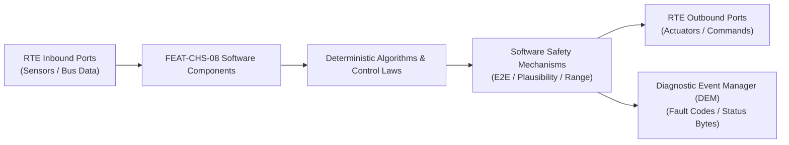

# Software Requirements Specification: Electronic Active Roll Stabilization (e-ARS)
**Feature ID:** `FEAT-CHS-08`  
**Domain:** Vehicle Motion & Chassis Control  
**Target ASIL:** ASIL C  
**Compliance Standard:** ISO 26262:2018 (Part 6 - Software Development) / ASPICE PAM v3.1 (SWE.1, SWE.2)  
**Parent System Specification:** [`FEAT-CHS-08_e-ARS_SysReq.md`](file:///c:/Workset/AntiGravityProjects/TestOptimisationExperiement/system_requirements/FEAT-CHS-08_e-ARS_SysReq.md)  
**Global Master Specification:** [`spec.md`](file:///c:/Workset/AntiGravityProjects/TestOptimisationExperiement/spec.md)

---

## 1. Software Architecture & Component Structure

This document specifies the AUTOSAR Software Components (SWCs), periodic runnables, algorithmic laws, safety mechanisms, and data ports implementing `FEAT-CHS-08` (Electronic Active Roll Stabilization (e-ARS)).

### AUTOSAR SWC Interaction Diagram

---

## 2. Detailed Software Requirements (SWR_REQ)
*(Multi-Software Requirement Partitioning derived from System Requirements)*

### `SWR-CHS-08-01`: Dynamic Feedforward & Feedback Roll Moment Observer
- **Planned Release:** R500
- **ASIL Rating:** ASIL C
- **Parent System Requirement:** [`SYS-CHS-08-01`](file:///c:/Workset/AntiGravityProjects/TestOptimisationExperiement/system_requirements/FEAT-CHS-08_e-ARS_SysReq.md#sys-chs-08-01)
- **Allocated AUTOSAR SWC:** `EarsRollObserver_SWC`
- **Execution Rate / Trigger:** 10 ms
- **Worst-Case Execution Time (WCET):** 0.6 ms
- **Software Activation Condition:** Cyclic 10 ms task.
- **Algorithmic Description / Logic:**
  > Calculates feedforward roll torque: T_ff = m_vehicle * h_cg * a_y_target. Calculates feedback roll damping: T_fb = K_p * (Phi_meas - Phi_target) + K_d * Roll_Rate_meas. Total torque T_total = T_ff + T_fb.
- **Software Safety Mechanism:** Roll rate acceleration limiter: Clamps d(T_total)/dt to <= 12,000 Nm/s to prevent abrupt chassis jerks.
- **Failure Reaction & DEM Diagnostic Event:** Zero feedback gains if roll rate gyro noise exceeds 0.05 rad/s RMS.
- **Software Port Inputs:** `Lateral_Accel_Mps2, Roll_Rate_RadS, Steering_Angle_Rad, Vehicle_Speed_Mps`
- **Software Port Outputs:** `Total_Roll_Moment_Demand_Nm, Estimated_Roll_Angle_Rad`
- **Software Verification Criteria:** CarSim multi-body vehicle dynamics co-simulation.
- **Traceability Link:** Traces upward to [`SYS-CHS-08-01`](file:///c:/Workset/AntiGravityProjects/TestOptimisationExperiement/system_requirements/FEAT-CHS-08_e-ARS_SysReq.md#sys-chs-08-01) and [`FEAT-CHS-08`](file:///c:/Workset/AntiGravityProjects/TestOptimisationExperiement/spec.md).

### `SWR-CHS-08-02`: Single-Wheel Bump Decoupling & Straight-Line Ride Suppressor
- **Planned Release:** R500
- **ASIL Rating:** ASIL B
- **Parent System Requirement:** [`SYS-CHS-08-01`](file:///c:/Workset/AntiGravityProjects/TestOptimisationExperiement/system_requirements/FEAT-CHS-08_e-ARS_SysReq.md#sys-chs-08-01)
- **Allocated AUTOSAR SWC:** `EarsComfortDecoupler_SWC`
- **Execution Rate / Trigger:** 10 ms
- **Worst-Case Execution Time (WCET):** 0.4 ms
- **Software Activation Condition:** Active when lateral acceleration |a_y| < 0.5 m/s².
- **Algorithmic Description / Logic:**
  > Detects single-wheel vertical road disturbance via corner acceleration sensors: If asymmetric wheel vertical velocity dz_L/dt != dz_R/dt while a_y ~= 0, commands active stabilizer motor to apply opposing torque, neutralizing anti-roll bar stiffness to zero for maximum plush ride.
- **Software Safety Mechanism:** Instant roll restore: Re-engages full roll stiffness in <= 30 ms if driver rapidly inputs steering wheel angle (> 150 deg/s).
- **Failure Reaction & DEM Diagnostic Event:** Lock decoupling if corner accelerometer signal is intermittent.
- **Software Port Inputs:** `Wheel_Vertical_Accel_FL_FR_RL_RR, Steering_Wheel_Speed_DegS, Lateral_Accel_Mps2`
- **Software Port Outputs:** `Decouple_Compliance_Factor, Active_Stiffness_Correction_Nm`
- **Software Verification Criteria:** Single-wheel obstacle ride comfort test on rough asphalt track.
- **Traceability Link:** Traces upward to [`SYS-CHS-08-01`](file:///c:/Workset/AntiGravityProjects/TestOptimisationExperiement/system_requirements/FEAT-CHS-08_e-ARS_SysReq.md#sys-chs-08-01) and [`FEAT-CHS-08`](file:///c:/Workset/AntiGravityProjects/TestOptimisationExperiement/spec.md).

### `SWR-CHS-08-03`: 48V Inverter Field Oriented Motor Torque Controller
- **Planned Release:** R100
- **ASIL Rating:** ASIL C
- **Parent System Requirement:** [`SYS-CHS-08-02`](file:///c:/Workset/AntiGravityProjects/TestOptimisationExperiement/system_requirements/FEAT-CHS-08_e-ARS_SysReq.md#sys-chs-08-02)
- **Allocated AUTOSAR SWC:** `EarsFocTorqueController_SWC`
- **Execution Rate / Trigger:** 1 ms
- **Worst-Case Execution Time (WCET):** 0.18 ms
- **Software Activation Condition:** Executed in 1 kHz motor control task.
- **Algorithmic Description / Logic:**
  > Converts roll torque demand to motor quadrature current demand: I_q_target = T_demand / (K_t * N_gear). Executes PI current loop: V_q = K_p_iq * e_iq + K_i_iq * int(e_iq) + Back_EMF_compensation.
- **Software Safety Mechanism:** Continuous I²t thermal integrator: Monitors motor and inverter temperature, derating torque smoothly if thermal threshold exceeded.
- **Failure Reaction & DEM Diagnostic Event:** Shutdown inverter bridge upon detection of motor overcurrent (> 95A).
- **Software Port Inputs:** `Target_Motor_Torque_Nm, Phase_Current_A_B_C, Rotor_Position_Rad`
- **Software Port Outputs:** `Inverter_SVPWM_Duties[3], Actual_Motor_Torque_Nm`
- **Software Verification Criteria:** HIL motor test bench running dyno torque step profile.
- **Traceability Link:** Traces upward to [`SYS-CHS-08-02`](file:///c:/Workset/AntiGravityProjects/TestOptimisationExperiement/system_requirements/FEAT-CHS-08_e-ARS_SysReq.md#sys-chs-08-02) and [`FEAT-CHS-08`](file:///c:/Workset/AntiGravityProjects/TestOptimisationExperiement/spec.md).

### `SWR-CHS-08-04`: Planetary Gearbox Backlash & Elastic Deflection Compensator
- **Planned Release:** R100
- **ASIL Rating:** ASIL B
- **Parent System Requirement:** [`SYS-CHS-08-02`](file:///c:/Workset/AntiGravityProjects/TestOptimisationExperiement/system_requirements/FEAT-CHS-08_e-ARS_SysReq.md#sys-chs-08-02)
- **Allocated AUTOSAR SWC:** `EarsBacklashCompensator_SWC`
- **Execution Rate / Trigger:** 2 ms
- **Worst-Case Execution Time (WCET):** 0.25 ms
- **Software Activation Condition:** Active during direction reversal of roll moment.
- **Algorithmic Description / Logic:**
  > Estimates gear tooth backlash angle (0.15 deg) and stabilizer bar torsional twist: Theta_motor = N_gear * (Theta_bar + T_demand / K_bar_stiffness). Applies fast torque feedforward pulse across backlash deadzone to eliminate mechanical clunk.
- **Software Safety Mechanism:** Backlash pulse magnitude limited to 2.5 Nm to prevent mechanical impact stress.
- **Failure Reaction & DEM Diagnostic Event:** Disable backlash compensation if gearbox position sensor confidence degrades.
- **Software Port Inputs:** `Motor_Rotor_Angle_Rad, Bar_Torsion_Angle_Rad, Target_Motor_Torque_Nm`
- **Software Port Outputs:** `Compensated_Rotor_Position_Target, Gearbox_Backlash_State_Enum`
- **Software Verification Criteria:** Acoustic and vibration NVH testing on 4-post road simulator.
- **Traceability Link:** Traces upward to [`SYS-CHS-08-02`](file:///c:/Workset/AntiGravityProjects/TestOptimisationExperiement/system_requirements/FEAT-CHS-08_e-ARS_SysReq.md#sys-chs-08-02) and [`FEAT-CHS-08`](file:///c:/Workset/AntiGravityProjects/TestOptimisationExperiement/spec.md).

### `SWR-CHS-08-05`: Chassis Dynamic Body Roll Moment Lateral Acceleration Observer - Dynamic Observer & Signal Filter
- **Planned Release:** R100
- **ASIL Rating:** ASIL C
- **Parent System Requirement:** [`SYS-CHS-08-03`](file:///c:/Workset/AntiGravityProjects/TestOptimisationExperiement/system_requirements/FEAT-CHS-08_e-ARS_SysReq.md#sys-chs-08-03)
- **Allocated AUTOSAR SWC:** `EarsRollMomentObserver_SWC`
- **Execution Rate / Trigger:** 2 ms
- **Worst-Case Execution Time (WCET):** 0.3 ms
- **Software Activation Condition:** Executed cyclically every 2 ms.
- **Algorithmic Description / Logic:**
  > Executes signal plausibility filtering, calibration offsets, and discrete state estimation for Chassis Dynamic Body Roll Moment Lateral Acceleration Observer.
- **Software Safety Mechanism:** Range limit plausibility check and E2E alive sequence verification.
- **Failure Reaction & DEM Diagnostic Event:** Set default fallback output and report DEM_EVENT_FEAT_CHS_08_ERR.
- **Software Port Inputs:** `Raw sensor ADC/SENT/SPI values and RTE bus inputs.`
- **Software Port Outputs:** `Filtered physical signals and validity status bitmasks.`
- **Software Verification Criteria:** Unit test and HiL software integration test.
- **Traceability Link:** Traces upward to [`SYS-CHS-08-03`](file:///c:/Workset/AntiGravityProjects/TestOptimisationExperiement/system_requirements/FEAT-CHS-08_e-ARS_SysReq.md#sys-chs-08-03) and [`FEAT-CHS-08`](file:///c:/Workset/AntiGravityProjects/TestOptimisationExperiement/spec.md).

### `SWR-CHS-08-06`: Chassis Dynamic Body Roll Moment Lateral Acceleration Observer - Closed-Loop Control Law & Actuator Dispatch
- **Planned Release:** R100
- **ASIL Rating:** ASIL C
- **Parent System Requirement:** [`SYS-CHS-08-03`](file:///c:/Workset/AntiGravityProjects/TestOptimisationExperiement/system_requirements/FEAT-CHS-08_e-ARS_SysReq.md#sys-chs-08-03)
- **Allocated AUTOSAR SWC:** `EarsRollMomentObserver_SWC`
- **Execution Rate / Trigger:** 2 ms
- **Worst-Case Execution Time (WCET):** 0.4 ms
- **Software Activation Condition:** Executed cyclically every 2 ms.
- **Algorithmic Description / Logic:**
  > Evaluates deterministic closed-loop control law, rate limits, and dispatches commands for Chassis Dynamic Body Roll Moment Lateral Acceleration Observer.
- **Software Safety Mechanism:** Command saturation clamping and watchdog program flow monitoring.
- **Failure Reaction & DEM Diagnostic Event:** De-energize actuator output, apply safe fallback clamp, and latch DTC.
- **Software Port Inputs:** `Validated physical state signals from observer SWC.`
- **Software Port Outputs:** `Actuator PWM duty cycles, torque/pressure setpoints, and diagnostic flags.`
- **Software Verification Criteria:** Hardware dynamometer and HiL closed-loop regression test suite.
- **Traceability Link:** Traces upward to [`SYS-CHS-08-03`](file:///c:/Workset/AntiGravityProjects/TestOptimisationExperiement/system_requirements/FEAT-CHS-08_e-ARS_SysReq.md#sys-chs-08-03) and [`FEAT-CHS-08`](file:///c:/Workset/AntiGravityProjects/TestOptimisationExperiement/spec.md).

### `SWR-CHS-08-07`: Active Anti-Roll Bar Front/Rear Dynamic Roll Stiffness Proportioner - Dynamic Observer & Signal Filter
- **Planned Release:** R200
- **ASIL Rating:** ASIL C
- **Parent System Requirement:** [`SYS-CHS-08-04`](file:///c:/Workset/AntiGravityProjects/TestOptimisationExperiement/system_requirements/FEAT-CHS-08_e-ARS_SysReq.md#sys-chs-08-04)
- **Allocated AUTOSAR SWC:** `EarsStiffnessProportioner_SWC`
- **Execution Rate / Trigger:** 2 ms
- **Worst-Case Execution Time (WCET):** 0.3 ms
- **Software Activation Condition:** Executed cyclically every 2 ms.
- **Algorithmic Description / Logic:**
  > Executes signal plausibility filtering, calibration offsets, and discrete state estimation for Active Anti-Roll Bar Front/Rear Dynamic Roll Stiffness Proportioner.
- **Software Safety Mechanism:** Range limit plausibility check and E2E alive sequence verification.
- **Failure Reaction & DEM Diagnostic Event:** Set default fallback output and report DEM_EVENT_FEAT_CHS_08_ERR.
- **Software Port Inputs:** `Raw sensor ADC/SENT/SPI values and RTE bus inputs.`
- **Software Port Outputs:** `Filtered physical signals and validity status bitmasks.`
- **Software Verification Criteria:** Unit test and HiL software integration test.
- **Traceability Link:** Traces upward to [`SYS-CHS-08-04`](file:///c:/Workset/AntiGravityProjects/TestOptimisationExperiement/system_requirements/FEAT-CHS-08_e-ARS_SysReq.md#sys-chs-08-04) and [`FEAT-CHS-08`](file:///c:/Workset/AntiGravityProjects/TestOptimisationExperiement/spec.md).

### `SWR-CHS-08-08`: Active Anti-Roll Bar Front/Rear Dynamic Roll Stiffness Proportioner - Closed-Loop Control Law & Actuator Dispatch
- **Planned Release:** R200
- **ASIL Rating:** ASIL C
- **Parent System Requirement:** [`SYS-CHS-08-04`](file:///c:/Workset/AntiGravityProjects/TestOptimisationExperiement/system_requirements/FEAT-CHS-08_e-ARS_SysReq.md#sys-chs-08-04)
- **Allocated AUTOSAR SWC:** `EarsStiffnessProportioner_SWC`
- **Execution Rate / Trigger:** 2 ms
- **Worst-Case Execution Time (WCET):** 0.4 ms
- **Software Activation Condition:** Executed cyclically every 2 ms.
- **Algorithmic Description / Logic:**
  > Evaluates deterministic closed-loop control law, rate limits, and dispatches commands for Active Anti-Roll Bar Front/Rear Dynamic Roll Stiffness Proportioner.
- **Software Safety Mechanism:** Command saturation clamping and watchdog program flow monitoring.
- **Failure Reaction & DEM Diagnostic Event:** De-energize actuator output, apply safe fallback clamp, and latch DTC.
- **Software Port Inputs:** `Validated physical state signals from observer SWC.`
- **Software Port Outputs:** `Actuator PWM duty cycles, torque/pressure setpoints, and diagnostic flags.`
- **Software Verification Criteria:** Hardware dynamometer and HiL closed-loop regression test suite.
- **Traceability Link:** Traces upward to [`SYS-CHS-08-04`](file:///c:/Workset/AntiGravityProjects/TestOptimisationExperiement/system_requirements/FEAT-CHS-08_e-ARS_SysReq.md#sys-chs-08-04) and [`FEAT-CHS-08`](file:///c:/Workset/AntiGravityProjects/TestOptimisationExperiement/spec.md).

### `SWR-CHS-08-09`: High-Torque 48V Electromechanical Roll Actuator Closed-Loop Servo - Dynamic Observer & Signal Filter
- **Planned Release:** R200
- **ASIL Rating:** ASIL C
- **Parent System Requirement:** [`SYS-CHS-08-05`](file:///c:/Workset/AntiGravityProjects/TestOptimisationExperiement/system_requirements/FEAT-CHS-08_e-ARS_SysReq.md#sys-chs-08-05)
- **Allocated AUTOSAR SWC:** `EarsActuatorServo_SWC`
- **Execution Rate / Trigger:** 0.5 ms
- **Worst-Case Execution Time (WCET):** 0.3 ms
- **Software Activation Condition:** Executed cyclically every 0.5 ms.
- **Algorithmic Description / Logic:**
  > Executes signal plausibility filtering, calibration offsets, and discrete state estimation for High-Torque 48V Electromechanical Roll Actuator Closed-Loop Servo.
- **Software Safety Mechanism:** Range limit plausibility check and E2E alive sequence verification.
- **Failure Reaction & DEM Diagnostic Event:** Set default fallback output and report DEM_EVENT_FEAT_CHS_08_ERR.
- **Software Port Inputs:** `Raw sensor ADC/SENT/SPI values and RTE bus inputs.`
- **Software Port Outputs:** `Filtered physical signals and validity status bitmasks.`
- **Software Verification Criteria:** Unit test and HiL software integration test.
- **Traceability Link:** Traces upward to [`SYS-CHS-08-05`](file:///c:/Workset/AntiGravityProjects/TestOptimisationExperiement/system_requirements/FEAT-CHS-08_e-ARS_SysReq.md#sys-chs-08-05) and [`FEAT-CHS-08`](file:///c:/Workset/AntiGravityProjects/TestOptimisationExperiement/spec.md).

### `SWR-CHS-08-10`: High-Torque 48V Electromechanical Roll Actuator Closed-Loop Servo - Closed-Loop Control Law & Actuator Dispatch
- **Planned Release:** R200
- **ASIL Rating:** ASIL C
- **Parent System Requirement:** [`SYS-CHS-08-05`](file:///c:/Workset/AntiGravityProjects/TestOptimisationExperiement/system_requirements/FEAT-CHS-08_e-ARS_SysReq.md#sys-chs-08-05)
- **Allocated AUTOSAR SWC:** `EarsActuatorServo_SWC`
- **Execution Rate / Trigger:** 0.5 ms
- **Worst-Case Execution Time (WCET):** 0.4 ms
- **Software Activation Condition:** Executed cyclically every 0.5 ms.
- **Algorithmic Description / Logic:**
  > Evaluates deterministic closed-loop control law, rate limits, and dispatches commands for High-Torque 48V Electromechanical Roll Actuator Closed-Loop Servo.
- **Software Safety Mechanism:** Command saturation clamping and watchdog program flow monitoring.
- **Failure Reaction & DEM Diagnostic Event:** De-energize actuator output, apply safe fallback clamp, and latch DTC.
- **Software Port Inputs:** `Validated physical state signals from observer SWC.`
- **Software Port Outputs:** `Actuator PWM duty cycles, torque/pressure setpoints, and diagnostic flags.`
- **Software Verification Criteria:** Hardware dynamometer and HiL closed-loop regression test suite.
- **Traceability Link:** Traces upward to [`SYS-CHS-08-05`](file:///c:/Workset/AntiGravityProjects/TestOptimisationExperiement/system_requirements/FEAT-CHS-08_e-ARS_SysReq.md#sys-chs-08-05) and [`FEAT-CHS-08`](file:///c:/Workset/AntiGravityProjects/TestOptimisationExperiement/spec.md).

### `SWR-CHS-08-11`: Straight-Line Single-Wheel Roughness Decoupling & Ride Comfort Optimizer - Dynamic Observer & Signal Filter
- **Planned Release:** R200
- **ASIL Rating:** ASIL C
- **Parent System Requirement:** [`SYS-CHS-08-06`](file:///c:/Workset/AntiGravityProjects/TestOptimisationExperiement/system_requirements/FEAT-CHS-08_e-ARS_SysReq.md#sys-chs-08-06)
- **Allocated AUTOSAR SWC:** `EarsDecouplingManager_SWC`
- **Execution Rate / Trigger:** 5 ms
- **Worst-Case Execution Time (WCET):** 0.3 ms
- **Software Activation Condition:** Executed cyclically every 5 ms.
- **Algorithmic Description / Logic:**
  > Executes signal plausibility filtering, calibration offsets, and discrete state estimation for Straight-Line Single-Wheel Roughness Decoupling & Ride Comfort Optimizer.
- **Software Safety Mechanism:** Range limit plausibility check and E2E alive sequence verification.
- **Failure Reaction & DEM Diagnostic Event:** Set default fallback output and report DEM_EVENT_FEAT_CHS_08_ERR.
- **Software Port Inputs:** `Raw sensor ADC/SENT/SPI values and RTE bus inputs.`
- **Software Port Outputs:** `Filtered physical signals and validity status bitmasks.`
- **Software Verification Criteria:** Unit test and HiL software integration test.
- **Traceability Link:** Traces upward to [`SYS-CHS-08-06`](file:///c:/Workset/AntiGravityProjects/TestOptimisationExperiement/system_requirements/FEAT-CHS-08_e-ARS_SysReq.md#sys-chs-08-06) and [`FEAT-CHS-08`](file:///c:/Workset/AntiGravityProjects/TestOptimisationExperiement/spec.md).

### `SWR-CHS-08-12`: Straight-Line Single-Wheel Roughness Decoupling & Ride Comfort Optimizer - Closed-Loop Control Law & Actuator Dispatch
- **Planned Release:** R200
- **ASIL Rating:** ASIL C
- **Parent System Requirement:** [`SYS-CHS-08-06`](file:///c:/Workset/AntiGravityProjects/TestOptimisationExperiement/system_requirements/FEAT-CHS-08_e-ARS_SysReq.md#sys-chs-08-06)
- **Allocated AUTOSAR SWC:** `EarsDecouplingManager_SWC`
- **Execution Rate / Trigger:** 5 ms
- **Worst-Case Execution Time (WCET):** 0.4 ms
- **Software Activation Condition:** Executed cyclically every 5 ms.
- **Algorithmic Description / Logic:**
  > Evaluates deterministic closed-loop control law, rate limits, and dispatches commands for Straight-Line Single-Wheel Roughness Decoupling & Ride Comfort Optimizer.
- **Software Safety Mechanism:** Command saturation clamping and watchdog program flow monitoring.
- **Failure Reaction & DEM Diagnostic Event:** De-energize actuator output, apply safe fallback clamp, and latch DTC.
- **Software Port Inputs:** `Validated physical state signals from observer SWC.`
- **Software Port Outputs:** `Actuator PWM duty cycles, torque/pressure setpoints, and diagnostic flags.`
- **Software Verification Criteria:** Hardware dynamometer and HiL closed-loop regression test suite.
- **Traceability Link:** Traces upward to [`SYS-CHS-08-06`](file:///c:/Workset/AntiGravityProjects/TestOptimisationExperiement/system_requirements/FEAT-CHS-08_e-ARS_SysReq.md#sys-chs-08-06) and [`FEAT-CHS-08`](file:///c:/Workset/AntiGravityProjects/TestOptimisationExperiement/spec.md).

### `SWR-CHS-08-13`: High-G Emergency Evasive Swerve Dynamic Roll Suppression Commander - Dynamic Observer & Signal Filter
- **Planned Release:** R300
- **ASIL Rating:** ASIL C
- **Parent System Requirement:** [`SYS-CHS-08-07`](file:///c:/Workset/AntiGravityProjects/TestOptimisationExperiement/system_requirements/FEAT-CHS-08_e-ARS_SysReq.md#sys-chs-08-07)
- **Allocated AUTOSAR SWC:** `EarsRollSuppression_SWC`
- **Execution Rate / Trigger:** 2 ms
- **Worst-Case Execution Time (WCET):** 0.3 ms
- **Software Activation Condition:** Executed cyclically every 2 ms.
- **Algorithmic Description / Logic:**
  > Executes signal plausibility filtering, calibration offsets, and discrete state estimation for High-G Emergency Evasive Swerve Dynamic Roll Suppression Commander.
- **Software Safety Mechanism:** Range limit plausibility check and E2E alive sequence verification.
- **Failure Reaction & DEM Diagnostic Event:** Set default fallback output and report DEM_EVENT_FEAT_CHS_08_ERR.
- **Software Port Inputs:** `Raw sensor ADC/SENT/SPI values and RTE bus inputs.`
- **Software Port Outputs:** `Filtered physical signals and validity status bitmasks.`
- **Software Verification Criteria:** Unit test and HiL software integration test.
- **Traceability Link:** Traces upward to [`SYS-CHS-08-07`](file:///c:/Workset/AntiGravityProjects/TestOptimisationExperiement/system_requirements/FEAT-CHS-08_e-ARS_SysReq.md#sys-chs-08-07) and [`FEAT-CHS-08`](file:///c:/Workset/AntiGravityProjects/TestOptimisationExperiement/spec.md).

### `SWR-CHS-08-14`: High-G Emergency Evasive Swerve Dynamic Roll Suppression Commander - Closed-Loop Control Law & Actuator Dispatch
- **Planned Release:** R300
- **ASIL Rating:** ASIL C
- **Parent System Requirement:** [`SYS-CHS-08-07`](file:///c:/Workset/AntiGravityProjects/TestOptimisationExperiement/system_requirements/FEAT-CHS-08_e-ARS_SysReq.md#sys-chs-08-07)
- **Allocated AUTOSAR SWC:** `EarsRollSuppression_SWC`
- **Execution Rate / Trigger:** 2 ms
- **Worst-Case Execution Time (WCET):** 0.4 ms
- **Software Activation Condition:** Executed cyclically every 2 ms.
- **Algorithmic Description / Logic:**
  > Evaluates deterministic closed-loop control law, rate limits, and dispatches commands for High-G Emergency Evasive Swerve Dynamic Roll Suppression Commander.
- **Software Safety Mechanism:** Command saturation clamping and watchdog program flow monitoring.
- **Failure Reaction & DEM Diagnostic Event:** De-energize actuator output, apply safe fallback clamp, and latch DTC.
- **Software Port Inputs:** `Validated physical state signals from observer SWC.`
- **Software Port Outputs:** `Actuator PWM duty cycles, torque/pressure setpoints, and diagnostic flags.`
- **Software Verification Criteria:** Hardware dynamometer and HiL closed-loop regression test suite.
- **Traceability Link:** Traces upward to [`SYS-CHS-08-07`](file:///c:/Workset/AntiGravityProjects/TestOptimisationExperiement/system_requirements/FEAT-CHS-08_e-ARS_SysReq.md#sys-chs-08-07) and [`FEAT-CHS-08`](file:///c:/Workset/AntiGravityProjects/TestOptimisationExperiement/spec.md).

### `SWR-CHS-08-15`: Actuator Planetary Gearbox Torque Sensor Cross-Plausibility Monitor - Dynamic Observer & Signal Filter
- **Planned Release:** R300
- **ASIL Rating:** ASIL C
- **Parent System Requirement:** [`SYS-CHS-08-08`](file:///c:/Workset/AntiGravityProjects/TestOptimisationExperiement/system_requirements/FEAT-CHS-08_e-ARS_SysReq.md#sys-chs-08-08)
- **Allocated AUTOSAR SWC:** `EarsTorqueCrossCheck_SWC`
- **Execution Rate / Trigger:** 2 ms
- **Worst-Case Execution Time (WCET):** 0.3 ms
- **Software Activation Condition:** Executed cyclically every 2 ms.
- **Algorithmic Description / Logic:**
  > Executes signal plausibility filtering, calibration offsets, and discrete state estimation for Actuator Planetary Gearbox Torque Sensor Cross-Plausibility Monitor.
- **Software Safety Mechanism:** Range limit plausibility check and E2E alive sequence verification.
- **Failure Reaction & DEM Diagnostic Event:** Set default fallback output and report DEM_EVENT_FEAT_CHS_08_ERR.
- **Software Port Inputs:** `Raw sensor ADC/SENT/SPI values and RTE bus inputs.`
- **Software Port Outputs:** `Filtered physical signals and validity status bitmasks.`
- **Software Verification Criteria:** Unit test and HiL software integration test.
- **Traceability Link:** Traces upward to [`SYS-CHS-08-08`](file:///c:/Workset/AntiGravityProjects/TestOptimisationExperiement/system_requirements/FEAT-CHS-08_e-ARS_SysReq.md#sys-chs-08-08) and [`FEAT-CHS-08`](file:///c:/Workset/AntiGravityProjects/TestOptimisationExperiement/spec.md).

### `SWR-CHS-08-16`: Actuator Planetary Gearbox Torque Sensor Cross-Plausibility Monitor - Closed-Loop Control Law & Actuator Dispatch
- **Planned Release:** R300
- **ASIL Rating:** ASIL C
- **Parent System Requirement:** [`SYS-CHS-08-08`](file:///c:/Workset/AntiGravityProjects/TestOptimisationExperiement/system_requirements/FEAT-CHS-08_e-ARS_SysReq.md#sys-chs-08-08)
- **Allocated AUTOSAR SWC:** `EarsTorqueCrossCheck_SWC`
- **Execution Rate / Trigger:** 2 ms
- **Worst-Case Execution Time (WCET):** 0.4 ms
- **Software Activation Condition:** Executed cyclically every 2 ms.
- **Algorithmic Description / Logic:**
  > Evaluates deterministic closed-loop control law, rate limits, and dispatches commands for Actuator Planetary Gearbox Torque Sensor Cross-Plausibility Monitor.
- **Software Safety Mechanism:** Command saturation clamping and watchdog program flow monitoring.
- **Failure Reaction & DEM Diagnostic Event:** De-energize actuator output, apply safe fallback clamp, and latch DTC.
- **Software Port Inputs:** `Validated physical state signals from observer SWC.`
- **Software Port Outputs:** `Actuator PWM duty cycles, torque/pressure setpoints, and diagnostic flags.`
- **Software Verification Criteria:** Hardware dynamometer and HiL closed-loop regression test suite.
- **Traceability Link:** Traces upward to [`SYS-CHS-08-08`](file:///c:/Workset/AntiGravityProjects/TestOptimisationExperiement/system_requirements/FEAT-CHS-08_e-ARS_SysReq.md#sys-chs-08-08) and [`FEAT-CHS-08`](file:///c:/Workset/AntiGravityProjects/TestOptimisationExperiement/spec.md).

### `SWR-CHS-08-17`: 48V Power Supply Brownout Current Clamping & Torque Derater - Dynamic Observer & Signal Filter
- **Planned Release:** R500
- **ASIL Rating:** ASIL C
- **Parent System Requirement:** [`SYS-CHS-08-09`](file:///c:/Workset/AntiGravityProjects/TestOptimisationExperiement/system_requirements/FEAT-CHS-08_e-ARS_SysReq.md#sys-chs-08-09)
- **Allocated AUTOSAR SWC:** `EarsVoltageDerater_SWC`
- **Execution Rate / Trigger:** 5 ms
- **Worst-Case Execution Time (WCET):** 0.3 ms
- **Software Activation Condition:** Executed cyclically every 5 ms.
- **Algorithmic Description / Logic:**
  > Executes signal plausibility filtering, calibration offsets, and discrete state estimation for 48V Power Supply Brownout Current Clamping & Torque Derater.
- **Software Safety Mechanism:** Range limit plausibility check and E2E alive sequence verification.
- **Failure Reaction & DEM Diagnostic Event:** Set default fallback output and report DEM_EVENT_FEAT_CHS_08_ERR.
- **Software Port Inputs:** `Raw sensor ADC/SENT/SPI values and RTE bus inputs.`
- **Software Port Outputs:** `Filtered physical signals and validity status bitmasks.`
- **Software Verification Criteria:** Unit test and HiL software integration test.
- **Traceability Link:** Traces upward to [`SYS-CHS-08-09`](file:///c:/Workset/AntiGravityProjects/TestOptimisationExperiement/system_requirements/FEAT-CHS-08_e-ARS_SysReq.md#sys-chs-08-09) and [`FEAT-CHS-08`](file:///c:/Workset/AntiGravityProjects/TestOptimisationExperiement/spec.md).

### `SWR-CHS-08-18`: 48V Power Supply Brownout Current Clamping & Torque Derater - Closed-Loop Control Law & Actuator Dispatch
- **Planned Release:** R500
- **ASIL Rating:** ASIL C
- **Parent System Requirement:** [`SYS-CHS-08-09`](file:///c:/Workset/AntiGravityProjects/TestOptimisationExperiement/system_requirements/FEAT-CHS-08_e-ARS_SysReq.md#sys-chs-08-09)
- **Allocated AUTOSAR SWC:** `EarsVoltageDerater_SWC`
- **Execution Rate / Trigger:** 5 ms
- **Worst-Case Execution Time (WCET):** 0.4 ms
- **Software Activation Condition:** Executed cyclically every 5 ms.
- **Algorithmic Description / Logic:**
  > Evaluates deterministic closed-loop control law, rate limits, and dispatches commands for 48V Power Supply Brownout Current Clamping & Torque Derater.
- **Software Safety Mechanism:** Command saturation clamping and watchdog program flow monitoring.
- **Failure Reaction & DEM Diagnostic Event:** De-energize actuator output, apply safe fallback clamp, and latch DTC.
- **Software Port Inputs:** `Validated physical state signals from observer SWC.`
- **Software Port Outputs:** `Actuator PWM duty cycles, torque/pressure setpoints, and diagnostic flags.`
- **Software Verification Criteria:** Hardware dynamometer and HiL closed-loop regression test suite.
- **Traceability Link:** Traces upward to [`SYS-CHS-08-09`](file:///c:/Workset/AntiGravityProjects/TestOptimisationExperiement/system_requirements/FEAT-CHS-08_e-ARS_SysReq.md#sys-chs-08-09) and [`FEAT-CHS-08`](file:///c:/Workset/AntiGravityProjects/TestOptimisationExperiement/spec.md).

### `SWR-CHS-08-19`: Multi-Node Stabilizer Motor Stator Thermal Protection Derating Law - Dynamic Observer & Signal Filter
- **Planned Release:** R400
- **ASIL Rating:** ASIL B
- **Parent System Requirement:** [`SYS-CHS-08-10`](file:///c:/Workset/AntiGravityProjects/TestOptimisationExperiement/system_requirements/FEAT-CHS-08_e-ARS_SysReq.md#sys-chs-08-10)
- **Allocated AUTOSAR SWC:** `EarsThermalDerater_SWC`
- **Execution Rate / Trigger:** 50 ms
- **Worst-Case Execution Time (WCET):** 0.3 ms
- **Software Activation Condition:** Executed cyclically every 50 ms.
- **Algorithmic Description / Logic:**
  > Executes signal plausibility filtering, calibration offsets, and discrete state estimation for Multi-Node Stabilizer Motor Stator Thermal Protection Derating Law.
- **Software Safety Mechanism:** Range limit plausibility check and E2E alive sequence verification.
- **Failure Reaction & DEM Diagnostic Event:** Set default fallback output and report DEM_EVENT_FEAT_CHS_08_ERR.
- **Software Port Inputs:** `Raw sensor ADC/SENT/SPI values and RTE bus inputs.`
- **Software Port Outputs:** `Filtered physical signals and validity status bitmasks.`
- **Software Verification Criteria:** Unit test and HiL software integration test.
- **Traceability Link:** Traces upward to [`SYS-CHS-08-10`](file:///c:/Workset/AntiGravityProjects/TestOptimisationExperiement/system_requirements/FEAT-CHS-08_e-ARS_SysReq.md#sys-chs-08-10) and [`FEAT-CHS-08`](file:///c:/Workset/AntiGravityProjects/TestOptimisationExperiement/spec.md).

### `SWR-CHS-08-20`: Multi-Node Stabilizer Motor Stator Thermal Protection Derating Law - Closed-Loop Control Law & Actuator Dispatch
- **Planned Release:** R400
- **ASIL Rating:** ASIL B
- **Parent System Requirement:** [`SYS-CHS-08-10`](file:///c:/Workset/AntiGravityProjects/TestOptimisationExperiement/system_requirements/FEAT-CHS-08_e-ARS_SysReq.md#sys-chs-08-10)
- **Allocated AUTOSAR SWC:** `EarsThermalDerater_SWC`
- **Execution Rate / Trigger:** 50 ms
- **Worst-Case Execution Time (WCET):** 0.4 ms
- **Software Activation Condition:** Executed cyclically every 50 ms.
- **Algorithmic Description / Logic:**
  > Evaluates deterministic closed-loop control law, rate limits, and dispatches commands for Multi-Node Stabilizer Motor Stator Thermal Protection Derating Law.
- **Software Safety Mechanism:** Command saturation clamping and watchdog program flow monitoring.
- **Failure Reaction & DEM Diagnostic Event:** De-energize actuator output, apply safe fallback clamp, and latch DTC.
- **Software Port Inputs:** `Validated physical state signals from observer SWC.`
- **Software Port Outputs:** `Actuator PWM duty cycles, torque/pressure setpoints, and diagnostic flags.`
- **Software Verification Criteria:** Hardware dynamometer and HiL closed-loop regression test suite.
- **Traceability Link:** Traces upward to [`SYS-CHS-08-10`](file:///c:/Workset/AntiGravityProjects/TestOptimisationExperiement/system_requirements/FEAT-CHS-08_e-ARS_SysReq.md#sys-chs-08-10) and [`FEAT-CHS-08`](file:///c:/Workset/AntiGravityProjects/TestOptimisationExperiement/spec.md).

### `SWR-CHS-08-21`: Actuator Mechanical Clutch Fail-Passive Decoupling Safing Engine - Dynamic Observer & Signal Filter
- **Planned Release:** R400
- **ASIL Rating:** ASIL C
- **Parent System Requirement:** [`SYS-CHS-08-11`](file:///c:/Workset/AntiGravityProjects/TestOptimisationExperiement/system_requirements/FEAT-CHS-08_e-ARS_SysReq.md#sys-chs-08-11)
- **Allocated AUTOSAR SWC:** `EarsFailPassiveSafing_SWC`
- **Execution Rate / Trigger:** 2 ms
- **Worst-Case Execution Time (WCET):** 0.3 ms
- **Software Activation Condition:** Executed cyclically every 2 ms.
- **Algorithmic Description / Logic:**
  > Executes signal plausibility filtering, calibration offsets, and discrete state estimation for Actuator Mechanical Clutch Fail-Passive Decoupling Safing Engine.
- **Software Safety Mechanism:** Range limit plausibility check and E2E alive sequence verification.
- **Failure Reaction & DEM Diagnostic Event:** Set default fallback output and report DEM_EVENT_FEAT_CHS_08_ERR.
- **Software Port Inputs:** `Raw sensor ADC/SENT/SPI values and RTE bus inputs.`
- **Software Port Outputs:** `Filtered physical signals and validity status bitmasks.`
- **Software Verification Criteria:** Unit test and HiL software integration test.
- **Traceability Link:** Traces upward to [`SYS-CHS-08-11`](file:///c:/Workset/AntiGravityProjects/TestOptimisationExperiement/system_requirements/FEAT-CHS-08_e-ARS_SysReq.md#sys-chs-08-11) and [`FEAT-CHS-08`](file:///c:/Workset/AntiGravityProjects/TestOptimisationExperiement/spec.md).

### `SWR-CHS-08-22`: Actuator Mechanical Clutch Fail-Passive Decoupling Safing Engine - Closed-Loop Control Law & Actuator Dispatch
- **Planned Release:** R400
- **ASIL Rating:** ASIL C
- **Parent System Requirement:** [`SYS-CHS-08-11`](file:///c:/Workset/AntiGravityProjects/TestOptimisationExperiement/system_requirements/FEAT-CHS-08_e-ARS_SysReq.md#sys-chs-08-11)
- **Allocated AUTOSAR SWC:** `EarsFailPassiveSafing_SWC`
- **Execution Rate / Trigger:** 2 ms
- **Worst-Case Execution Time (WCET):** 0.4 ms
- **Software Activation Condition:** Executed cyclically every 2 ms.
- **Algorithmic Description / Logic:**
  > Evaluates deterministic closed-loop control law, rate limits, and dispatches commands for Actuator Mechanical Clutch Fail-Passive Decoupling Safing Engine.
- **Software Safety Mechanism:** Command saturation clamping and watchdog program flow monitoring.
- **Failure Reaction & DEM Diagnostic Event:** De-energize actuator output, apply safe fallback clamp, and latch DTC.
- **Software Port Inputs:** `Validated physical state signals from observer SWC.`
- **Software Port Outputs:** `Actuator PWM duty cycles, torque/pressure setpoints, and diagnostic flags.`
- **Software Verification Criteria:** Hardware dynamometer and HiL closed-loop regression test suite.
- **Traceability Link:** Traces upward to [`SYS-CHS-08-11`](file:///c:/Workset/AntiGravityProjects/TestOptimisationExperiement/system_requirements/FEAT-CHS-08_e-ARS_SysReq.md#sys-chs-08-11) and [`FEAT-CHS-08`](file:///c:/Workset/AntiGravityProjects/TestOptimisationExperiement/spec.md).

### `SWR-CHS-08-23`: Dual Core Lockstep Execution Supervisor & Safing Relay Trigger - Dynamic Observer & Signal Filter
- **Planned Release:** R500
- **ASIL Rating:** ASIL C
- **Parent System Requirement:** [`SYS-CHS-08-12`](file:///c:/Workset/AntiGravityProjects/TestOptimisationExperiement/system_requirements/FEAT-CHS-08_e-ARS_SysReq.md#sys-chs-08-12)
- **Allocated AUTOSAR SWC:** `EarsLockstepSupervisor_SWC`
- **Execution Rate / Trigger:** 1 ms
- **Worst-Case Execution Time (WCET):** 0.3 ms
- **Software Activation Condition:** Executed cyclically every 1 ms.
- **Algorithmic Description / Logic:**
  > Executes signal plausibility filtering, calibration offsets, and discrete state estimation for Dual Core Lockstep Execution Supervisor & Safing Relay Trigger.
- **Software Safety Mechanism:** Range limit plausibility check and E2E alive sequence verification.
- **Failure Reaction & DEM Diagnostic Event:** Set default fallback output and report DEM_EVENT_FEAT_CHS_08_ERR.
- **Software Port Inputs:** `Raw sensor ADC/SENT/SPI values and RTE bus inputs.`
- **Software Port Outputs:** `Filtered physical signals and validity status bitmasks.`
- **Software Verification Criteria:** Unit test and HiL software integration test.
- **Traceability Link:** Traces upward to [`SYS-CHS-08-12`](file:///c:/Workset/AntiGravityProjects/TestOptimisationExperiement/system_requirements/FEAT-CHS-08_e-ARS_SysReq.md#sys-chs-08-12) and [`FEAT-CHS-08`](file:///c:/Workset/AntiGravityProjects/TestOptimisationExperiement/spec.md).

### `SWR-CHS-08-24`: Dual Core Lockstep Execution Supervisor & Safing Relay Trigger - Closed-Loop Control Law & Actuator Dispatch
- **Planned Release:** R500
- **ASIL Rating:** ASIL C
- **Parent System Requirement:** [`SYS-CHS-08-12`](file:///c:/Workset/AntiGravityProjects/TestOptimisationExperiement/system_requirements/FEAT-CHS-08_e-ARS_SysReq.md#sys-chs-08-12)
- **Allocated AUTOSAR SWC:** `EarsLockstepSupervisor_SWC`
- **Execution Rate / Trigger:** 1 ms
- **Worst-Case Execution Time (WCET):** 0.4 ms
- **Software Activation Condition:** Executed cyclically every 1 ms.
- **Algorithmic Description / Logic:**
  > Evaluates deterministic closed-loop control law, rate limits, and dispatches commands for Dual Core Lockstep Execution Supervisor & Safing Relay Trigger.
- **Software Safety Mechanism:** Command saturation clamping and watchdog program flow monitoring.
- **Failure Reaction & DEM Diagnostic Event:** De-energize actuator output, apply safe fallback clamp, and latch DTC.
- **Software Port Inputs:** `Validated physical state signals from observer SWC.`
- **Software Port Outputs:** `Actuator PWM duty cycles, torque/pressure setpoints, and diagnostic flags.`
- **Software Verification Criteria:** Hardware dynamometer and HiL closed-loop regression test suite.
- **Traceability Link:** Traces upward to [`SYS-CHS-08-12`](file:///c:/Workset/AntiGravityProjects/TestOptimisationExperiement/system_requirements/FEAT-CHS-08_e-ARS_SysReq.md#sys-chs-08-12) and [`FEAT-CHS-08`](file:///c:/Workset/AntiGravityProjects/TestOptimisationExperiement/spec.md).

### `SWR-CHS-08-25`: DEM Active Roll Stabilization Diagnostic Event Manager & DTC Latcher - Dynamic Observer & Signal Filter
- **Planned Release:** R500
- **ASIL Rating:** ASIL B
- **Parent System Requirement:** [`SYS-CHS-08-13`](file:///c:/Workset/AntiGravityProjects/TestOptimisationExperiement/system_requirements/FEAT-CHS-08_e-ARS_SysReq.md#sys-chs-08-13)
- **Allocated AUTOSAR SWC:** `EarsDiagnosticManager_SWC`
- **Execution Rate / Trigger:** 20 ms
- **Worst-Case Execution Time (WCET):** 0.3 ms
- **Software Activation Condition:** Executed cyclically every 20 ms.
- **Algorithmic Description / Logic:**
  > Executes signal plausibility filtering, calibration offsets, and discrete state estimation for DEM Active Roll Stabilization Diagnostic Event Manager & DTC Latcher.
- **Software Safety Mechanism:** Range limit plausibility check and E2E alive sequence verification.
- **Failure Reaction & DEM Diagnostic Event:** Set default fallback output and report DEM_EVENT_FEAT_CHS_08_ERR.
- **Software Port Inputs:** `Raw sensor ADC/SENT/SPI values and RTE bus inputs.`
- **Software Port Outputs:** `Filtered physical signals and validity status bitmasks.`
- **Software Verification Criteria:** Unit test and HiL software integration test.
- **Traceability Link:** Traces upward to [`SYS-CHS-08-13`](file:///c:/Workset/AntiGravityProjects/TestOptimisationExperiement/system_requirements/FEAT-CHS-08_e-ARS_SysReq.md#sys-chs-08-13) and [`FEAT-CHS-08`](file:///c:/Workset/AntiGravityProjects/TestOptimisationExperiement/spec.md).

### `SWR-CHS-08-26`: DEM Active Roll Stabilization Diagnostic Event Manager & DTC Latcher - Closed-Loop Control Law & Actuator Dispatch
- **Planned Release:** R500
- **ASIL Rating:** ASIL B
- **Parent System Requirement:** [`SYS-CHS-08-13`](file:///c:/Workset/AntiGravityProjects/TestOptimisationExperiement/system_requirements/FEAT-CHS-08_e-ARS_SysReq.md#sys-chs-08-13)
- **Allocated AUTOSAR SWC:** `EarsDiagnosticManager_SWC`
- **Execution Rate / Trigger:** 20 ms
- **Worst-Case Execution Time (WCET):** 0.4 ms
- **Software Activation Condition:** Executed cyclically every 20 ms.
- **Algorithmic Description / Logic:**
  > Evaluates deterministic closed-loop control law, rate limits, and dispatches commands for DEM Active Roll Stabilization Diagnostic Event Manager & DTC Latcher.
- **Software Safety Mechanism:** Command saturation clamping and watchdog program flow monitoring.
- **Failure Reaction & DEM Diagnostic Event:** De-energize actuator output, apply safe fallback clamp, and latch DTC.
- **Software Port Inputs:** `Validated physical state signals from observer SWC.`
- **Software Port Outputs:** `Actuator PWM duty cycles, torque/pressure setpoints, and diagnostic flags.`
- **Software Verification Criteria:** Hardware dynamometer and HiL closed-loop regression test suite.
- **Traceability Link:** Traces upward to [`SYS-CHS-08-13`](file:///c:/Workset/AntiGravityProjects/TestOptimisationExperiement/system_requirements/FEAT-CHS-08_e-ARS_SysReq.md#sys-chs-08-13) and [`FEAT-CHS-08`](file:///c:/Workset/AntiGravityProjects/TestOptimisationExperiement/spec.md).

### `SWR-CHS-08-27`: Instrument Cluster Dynamic Cornering G & Active Roll Bar Display HMI - Dynamic Observer & Signal Filter
- **Planned Release:** R500
- **ASIL Rating:** ASIL B
- **Parent System Requirement:** [`SYS-CHS-08-14`](file:///c:/Workset/AntiGravityProjects/TestOptimisationExperiement/system_requirements/FEAT-CHS-08_e-ARS_SysReq.md#sys-chs-08-14)
- **Allocated AUTOSAR SWC:** `EarsHmiDispatcher_SWC`
- **Execution Rate / Trigger:** 20 ms
- **Worst-Case Execution Time (WCET):** 0.3 ms
- **Software Activation Condition:** Executed cyclically every 20 ms.
- **Algorithmic Description / Logic:**
  > Executes signal plausibility filtering, calibration offsets, and discrete state estimation for Instrument Cluster Dynamic Cornering G & Active Roll Bar Display HMI.
- **Software Safety Mechanism:** Range limit plausibility check and E2E alive sequence verification.
- **Failure Reaction & DEM Diagnostic Event:** Set default fallback output and report DEM_EVENT_FEAT_CHS_08_ERR.
- **Software Port Inputs:** `Raw sensor ADC/SENT/SPI values and RTE bus inputs.`
- **Software Port Outputs:** `Filtered physical signals and validity status bitmasks.`
- **Software Verification Criteria:** Unit test and HiL software integration test.
- **Traceability Link:** Traces upward to [`SYS-CHS-08-14`](file:///c:/Workset/AntiGravityProjects/TestOptimisationExperiement/system_requirements/FEAT-CHS-08_e-ARS_SysReq.md#sys-chs-08-14) and [`FEAT-CHS-08`](file:///c:/Workset/AntiGravityProjects/TestOptimisationExperiement/spec.md).

### `SWR-CHS-08-28`: Instrument Cluster Dynamic Cornering G & Active Roll Bar Display HMI - Closed-Loop Control Law & Actuator Dispatch
- **Planned Release:** R500
- **ASIL Rating:** ASIL B
- **Parent System Requirement:** [`SYS-CHS-08-14`](file:///c:/Workset/AntiGravityProjects/TestOptimisationExperiement/system_requirements/FEAT-CHS-08_e-ARS_SysReq.md#sys-chs-08-14)
- **Allocated AUTOSAR SWC:** `EarsHmiDispatcher_SWC`
- **Execution Rate / Trigger:** 20 ms
- **Worst-Case Execution Time (WCET):** 0.4 ms
- **Software Activation Condition:** Executed cyclically every 20 ms.
- **Algorithmic Description / Logic:**
  > Evaluates deterministic closed-loop control law, rate limits, and dispatches commands for Instrument Cluster Dynamic Cornering G & Active Roll Bar Display HMI.
- **Software Safety Mechanism:** Command saturation clamping and watchdog program flow monitoring.
- **Failure Reaction & DEM Diagnostic Event:** De-energize actuator output, apply safe fallback clamp, and latch DTC.
- **Software Port Inputs:** `Validated physical state signals from observer SWC.`
- **Software Port Outputs:** `Actuator PWM duty cycles, torque/pressure setpoints, and diagnostic flags.`
- **Software Verification Criteria:** Hardware dynamometer and HiL closed-loop regression test suite.
- **Traceability Link:** Traces upward to [`SYS-CHS-08-14`](file:///c:/Workset/AntiGravityProjects/TestOptimisationExperiement/system_requirements/FEAT-CHS-08_e-ARS_SysReq.md#sys-chs-08-14) and [`FEAT-CHS-08`](file:///c:/Workset/AntiGravityProjects/TestOptimisationExperiement/spec.md).

### `SWR-CHS-08-29`: Non-Volatile Severe Dynamic Lateral Maneuvers & Roll Stress Logger - Dynamic Observer & Signal Filter
- **Planned Release:** R500
- **ASIL Rating:** ASIL B
- **Parent System Requirement:** [`SYS-CHS-08-15`](file:///c:/Workset/AntiGravityProjects/TestOptimisationExperiement/system_requirements/FEAT-CHS-08_e-ARS_SysReq.md#sys-chs-08-15)
- **Allocated AUTOSAR SWC:** `EarsStressLogger_SWC`
- **Execution Rate / Trigger:** 500 ms
- **Worst-Case Execution Time (WCET):** 0.3 ms
- **Software Activation Condition:** Executed cyclically every 500 ms.
- **Algorithmic Description / Logic:**
  > Executes signal plausibility filtering, calibration offsets, and discrete state estimation for Non-Volatile Severe Dynamic Lateral Maneuvers & Roll Stress Logger.
- **Software Safety Mechanism:** Range limit plausibility check and E2E alive sequence verification.
- **Failure Reaction & DEM Diagnostic Event:** Set default fallback output and report DEM_EVENT_FEAT_CHS_08_ERR.
- **Software Port Inputs:** `Raw sensor ADC/SENT/SPI values and RTE bus inputs.`
- **Software Port Outputs:** `Filtered physical signals and validity status bitmasks.`
- **Software Verification Criteria:** Unit test and HiL software integration test.
- **Traceability Link:** Traces upward to [`SYS-CHS-08-15`](file:///c:/Workset/AntiGravityProjects/TestOptimisationExperiement/system_requirements/FEAT-CHS-08_e-ARS_SysReq.md#sys-chs-08-15) and [`FEAT-CHS-08`](file:///c:/Workset/AntiGravityProjects/TestOptimisationExperiement/spec.md).

### `SWR-CHS-08-30`: Non-Volatile Severe Dynamic Lateral Maneuvers & Roll Stress Logger - Closed-Loop Control Law & Actuator Dispatch
- **Planned Release:** R500
- **ASIL Rating:** ASIL B
- **Parent System Requirement:** [`SYS-CHS-08-15`](file:///c:/Workset/AntiGravityProjects/TestOptimisationExperiement/system_requirements/FEAT-CHS-08_e-ARS_SysReq.md#sys-chs-08-15)
- **Allocated AUTOSAR SWC:** `EarsStressLogger_SWC`
- **Execution Rate / Trigger:** 500 ms
- **Worst-Case Execution Time (WCET):** 0.4 ms
- **Software Activation Condition:** Executed cyclically every 500 ms.
- **Algorithmic Description / Logic:**
  > Evaluates deterministic closed-loop control law, rate limits, and dispatches commands for Non-Volatile Severe Dynamic Lateral Maneuvers & Roll Stress Logger.
- **Software Safety Mechanism:** Command saturation clamping and watchdog program flow monitoring.
- **Failure Reaction & DEM Diagnostic Event:** De-energize actuator output, apply safe fallback clamp, and latch DTC.
- **Software Port Inputs:** `Validated physical state signals from observer SWC.`
- **Software Port Outputs:** `Actuator PWM duty cycles, torque/pressure setpoints, and diagnostic flags.`
- **Software Verification Criteria:** Hardware dynamometer and HiL closed-loop regression test suite.
- **Traceability Link:** Traces upward to [`SYS-CHS-08-15`](file:///c:/Workset/AntiGravityProjects/TestOptimisationExperiement/system_requirements/FEAT-CHS-08_e-ARS_SysReq.md#sys-chs-08-15) and [`FEAT-CHS-08`](file:///c:/Workset/AntiGravityProjects/TestOptimisationExperiement/spec.md).

---

## 3. Software-to-System Backward Traceability Matrix

| Software Requirement ID | Planned Release | Allocated SWC | Execution Rate | Upstream System Req | Verification Method |
| :--- | :---: | :--- | :--- | :--- | :--- |
| `SWR-CHS-08-01` | **`R500`** | `EarsRollObserver_SWC` | 10 ms | [`SYS-CHS-08-01`](file:///c:/Workset/AntiGravityProjects/TestOptimisationExperiement/system_requirements/FEAT-CHS-08_e-ARS_SysReq.md#sys-chs-08-01) | CarSim multi-body vehicle dynamics co-simulation. |
| `SWR-CHS-08-02` | **`R500`** | `EarsComfortDecoupler_SWC` | 10 ms | [`SYS-CHS-08-01`](file:///c:/Workset/AntiGravityProjects/TestOptimisationExperiement/system_requirements/FEAT-CHS-08_e-ARS_SysReq.md#sys-chs-08-01) | Single-wheel obstacle ride comfort test on rough asphalt track. |
| `SWR-CHS-08-03` | **`R100`** | `EarsFocTorqueController_SWC` | 1 ms | [`SYS-CHS-08-02`](file:///c:/Workset/AntiGravityProjects/TestOptimisationExperiement/system_requirements/FEAT-CHS-08_e-ARS_SysReq.md#sys-chs-08-02) | HIL motor test bench running dyno torque step profile. |
| `SWR-CHS-08-04` | **`R100`** | `EarsBacklashCompensator_SWC` | 2 ms | [`SYS-CHS-08-02`](file:///c:/Workset/AntiGravityProjects/TestOptimisationExperiement/system_requirements/FEAT-CHS-08_e-ARS_SysReq.md#sys-chs-08-02) | Acoustic and vibration NVH testing on 4-post road simulator. |
| `SWR-CHS-08-05` | **`R100`** | `EarsRollMomentObserver_SWC` | 2 ms | [`SYS-CHS-08-03`](file:///c:/Workset/AntiGravityProjects/TestOptimisationExperiement/system_requirements/FEAT-CHS-08_e-ARS_SysReq.md#sys-chs-08-03) | Unit test and HiL software integration test. |
| `SWR-CHS-08-06` | **`R100`** | `EarsRollMomentObserver_SWC` | 2 ms | [`SYS-CHS-08-03`](file:///c:/Workset/AntiGravityProjects/TestOptimisationExperiement/system_requirements/FEAT-CHS-08_e-ARS_SysReq.md#sys-chs-08-03) | Hardware dynamometer and HiL closed-loop regression test suite. |
| `SWR-CHS-08-07` | **`R200`** | `EarsStiffnessProportioner_SWC` | 2 ms | [`SYS-CHS-08-04`](file:///c:/Workset/AntiGravityProjects/TestOptimisationExperiement/system_requirements/FEAT-CHS-08_e-ARS_SysReq.md#sys-chs-08-04) | Unit test and HiL software integration test. |
| `SWR-CHS-08-08` | **`R200`** | `EarsStiffnessProportioner_SWC` | 2 ms | [`SYS-CHS-08-04`](file:///c:/Workset/AntiGravityProjects/TestOptimisationExperiement/system_requirements/FEAT-CHS-08_e-ARS_SysReq.md#sys-chs-08-04) | Hardware dynamometer and HiL closed-loop regression test suite. |
| `SWR-CHS-08-09` | **`R200`** | `EarsActuatorServo_SWC` | 0.5 ms | [`SYS-CHS-08-05`](file:///c:/Workset/AntiGravityProjects/TestOptimisationExperiement/system_requirements/FEAT-CHS-08_e-ARS_SysReq.md#sys-chs-08-05) | Unit test and HiL software integration test. |
| `SWR-CHS-08-10` | **`R200`** | `EarsActuatorServo_SWC` | 0.5 ms | [`SYS-CHS-08-05`](file:///c:/Workset/AntiGravityProjects/TestOptimisationExperiement/system_requirements/FEAT-CHS-08_e-ARS_SysReq.md#sys-chs-08-05) | Hardware dynamometer and HiL closed-loop regression test suite. |
| `SWR-CHS-08-11` | **`R200`** | `EarsDecouplingManager_SWC` | 5 ms | [`SYS-CHS-08-06`](file:///c:/Workset/AntiGravityProjects/TestOptimisationExperiement/system_requirements/FEAT-CHS-08_e-ARS_SysReq.md#sys-chs-08-06) | Unit test and HiL software integration test. |
| `SWR-CHS-08-12` | **`R200`** | `EarsDecouplingManager_SWC` | 5 ms | [`SYS-CHS-08-06`](file:///c:/Workset/AntiGravityProjects/TestOptimisationExperiement/system_requirements/FEAT-CHS-08_e-ARS_SysReq.md#sys-chs-08-06) | Hardware dynamometer and HiL closed-loop regression test suite. |
| `SWR-CHS-08-13` | **`R300`** | `EarsRollSuppression_SWC` | 2 ms | [`SYS-CHS-08-07`](file:///c:/Workset/AntiGravityProjects/TestOptimisationExperiement/system_requirements/FEAT-CHS-08_e-ARS_SysReq.md#sys-chs-08-07) | Unit test and HiL software integration test. |
| `SWR-CHS-08-14` | **`R300`** | `EarsRollSuppression_SWC` | 2 ms | [`SYS-CHS-08-07`](file:///c:/Workset/AntiGravityProjects/TestOptimisationExperiement/system_requirements/FEAT-CHS-08_e-ARS_SysReq.md#sys-chs-08-07) | Hardware dynamometer and HiL closed-loop regression test suite. |
| `SWR-CHS-08-15` | **`R300`** | `EarsTorqueCrossCheck_SWC` | 2 ms | [`SYS-CHS-08-08`](file:///c:/Workset/AntiGravityProjects/TestOptimisationExperiement/system_requirements/FEAT-CHS-08_e-ARS_SysReq.md#sys-chs-08-08) | Unit test and HiL software integration test. |
| `SWR-CHS-08-16` | **`R300`** | `EarsTorqueCrossCheck_SWC` | 2 ms | [`SYS-CHS-08-08`](file:///c:/Workset/AntiGravityProjects/TestOptimisationExperiement/system_requirements/FEAT-CHS-08_e-ARS_SysReq.md#sys-chs-08-08) | Hardware dynamometer and HiL closed-loop regression test suite. |
| `SWR-CHS-08-17` | **`R500`** | `EarsVoltageDerater_SWC` | 5 ms | [`SYS-CHS-08-09`](file:///c:/Workset/AntiGravityProjects/TestOptimisationExperiement/system_requirements/FEAT-CHS-08_e-ARS_SysReq.md#sys-chs-08-09) | Unit test and HiL software integration test. |
| `SWR-CHS-08-18` | **`R500`** | `EarsVoltageDerater_SWC` | 5 ms | [`SYS-CHS-08-09`](file:///c:/Workset/AntiGravityProjects/TestOptimisationExperiement/system_requirements/FEAT-CHS-08_e-ARS_SysReq.md#sys-chs-08-09) | Hardware dynamometer and HiL closed-loop regression test suite. |
| `SWR-CHS-08-19` | **`R400`** | `EarsThermalDerater_SWC` | 50 ms | [`SYS-CHS-08-10`](file:///c:/Workset/AntiGravityProjects/TestOptimisationExperiement/system_requirements/FEAT-CHS-08_e-ARS_SysReq.md#sys-chs-08-10) | Unit test and HiL software integration test. |
| `SWR-CHS-08-20` | **`R400`** | `EarsThermalDerater_SWC` | 50 ms | [`SYS-CHS-08-10`](file:///c:/Workset/AntiGravityProjects/TestOptimisationExperiement/system_requirements/FEAT-CHS-08_e-ARS_SysReq.md#sys-chs-08-10) | Hardware dynamometer and HiL closed-loop regression test suite. |
| `SWR-CHS-08-21` | **`R400`** | `EarsFailPassiveSafing_SWC` | 2 ms | [`SYS-CHS-08-11`](file:///c:/Workset/AntiGravityProjects/TestOptimisationExperiement/system_requirements/FEAT-CHS-08_e-ARS_SysReq.md#sys-chs-08-11) | Unit test and HiL software integration test. |
| `SWR-CHS-08-22` | **`R400`** | `EarsFailPassiveSafing_SWC` | 2 ms | [`SYS-CHS-08-11`](file:///c:/Workset/AntiGravityProjects/TestOptimisationExperiement/system_requirements/FEAT-CHS-08_e-ARS_SysReq.md#sys-chs-08-11) | Hardware dynamometer and HiL closed-loop regression test suite. |
| `SWR-CHS-08-23` | **`R500`** | `EarsLockstepSupervisor_SWC` | 1 ms | [`SYS-CHS-08-12`](file:///c:/Workset/AntiGravityProjects/TestOptimisationExperiement/system_requirements/FEAT-CHS-08_e-ARS_SysReq.md#sys-chs-08-12) | Unit test and HiL software integration test. |
| `SWR-CHS-08-24` | **`R500`** | `EarsLockstepSupervisor_SWC` | 1 ms | [`SYS-CHS-08-12`](file:///c:/Workset/AntiGravityProjects/TestOptimisationExperiement/system_requirements/FEAT-CHS-08_e-ARS_SysReq.md#sys-chs-08-12) | Hardware dynamometer and HiL closed-loop regression test suite. |
| `SWR-CHS-08-25` | **`R500`** | `EarsDiagnosticManager_SWC` | 20 ms | [`SYS-CHS-08-13`](file:///c:/Workset/AntiGravityProjects/TestOptimisationExperiement/system_requirements/FEAT-CHS-08_e-ARS_SysReq.md#sys-chs-08-13) | Unit test and HiL software integration test. |
| `SWR-CHS-08-26` | **`R500`** | `EarsDiagnosticManager_SWC` | 20 ms | [`SYS-CHS-08-13`](file:///c:/Workset/AntiGravityProjects/TestOptimisationExperiement/system_requirements/FEAT-CHS-08_e-ARS_SysReq.md#sys-chs-08-13) | Hardware dynamometer and HiL closed-loop regression test suite. |
| `SWR-CHS-08-27` | **`R500`** | `EarsHmiDispatcher_SWC` | 20 ms | [`SYS-CHS-08-14`](file:///c:/Workset/AntiGravityProjects/TestOptimisationExperiement/system_requirements/FEAT-CHS-08_e-ARS_SysReq.md#sys-chs-08-14) | Unit test and HiL software integration test. |
| `SWR-CHS-08-28` | **`R500`** | `EarsHmiDispatcher_SWC` | 20 ms | [`SYS-CHS-08-14`](file:///c:/Workset/AntiGravityProjects/TestOptimisationExperiement/system_requirements/FEAT-CHS-08_e-ARS_SysReq.md#sys-chs-08-14) | Hardware dynamometer and HiL closed-loop regression test suite. |
| `SWR-CHS-08-29` | **`R500`** | `EarsStressLogger_SWC` | 500 ms | [`SYS-CHS-08-15`](file:///c:/Workset/AntiGravityProjects/TestOptimisationExperiement/system_requirements/FEAT-CHS-08_e-ARS_SysReq.md#sys-chs-08-15) | Unit test and HiL software integration test. |
| `SWR-CHS-08-30` | **`R500`** | `EarsStressLogger_SWC` | 500 ms | [`SYS-CHS-08-15`](file:///c:/Workset/AntiGravityProjects/TestOptimisationExperiement/system_requirements/FEAT-CHS-08_e-ARS_SysReq.md#sys-chs-08-15) | Hardware dynamometer and HiL closed-loop regression test suite. |

- **Parent System Specification Document:** [`FEAT-CHS-08_e-ARS_SysReq.md`](file:///c:/Workset/AntiGravityProjects/TestOptimisationExperiement/system_requirements/FEAT-CHS-08_e-ARS_SysReq.md)
- **Master Automotive Specification:** [`spec.md`](file:///c:/Workset/AntiGravityProjects/TestOptimisationExperiement/spec.md)
