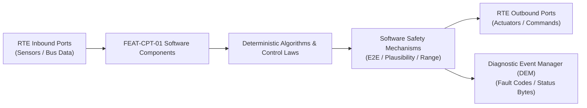

# Software Requirements Specification: Driver Monitoring & Cabin Sensing (DMS/OMS)
**Feature ID:** `FEAT-CPT-01`  
**Domain:** Digital Cockpit, HMI & Cabin Sensing  
**Target ASIL:** ASIL B  
**Compliance Standard:** ISO 26262:2018 (Part 6 - Software Development) / ASPICE PAM v3.1 (SWE.1, SWE.2)  
**Parent System Specification:** [`FEAT-CPT-01_DMS_SysReq.md`](file:///c:/Workset/AntiGravityProjects/TestOptimisationExperiement/system_requirements/FEAT-CPT-01_DMS_SysReq.md)  
**Global Master Specification:** [`spec.md`](file:///c:/Workset/AntiGravityProjects/TestOptimisationExperiement/spec.md)

---

## 1. Software Architecture & Component Structure

This document specifies the AUTOSAR Software Components (SWCs), periodic runnables, algorithmic laws, safety mechanisms, and data ports implementing `FEAT-CPT-01` (Driver Monitoring & Cabin Sensing (DMS/OMS)).

### AUTOSAR SWC Interaction Diagram

---

## 2. Detailed Software Requirements (SWR_REQ)
*(Multi-Software Requirement Partitioning derived from System Requirements)*

### `SWR-CPT-01-01`: Facial Landmark & Eye Aspect Ratio (EAR) Neural Network Pipeline
- **Planned Release:** R100
- **ASIL Rating:** ASIL B
- **Parent System Requirement:** [`SYS-CPT-01-01`](file:///c:/Workset/AntiGravityProjects/TestOptimisationExperiement/system_requirements/FEAT-CPT-01_DMS_SysReq.md#sys-cpt-01-01)
- **Allocated AUTOSAR SWC:** `DmsFaceTracker_SWC`
- **Execution Rate / Trigger:** 33 ms
- **Worst-Case Execution Time (WCET):** 16.5 ms (NPU)
- **Software Activation Condition:** Executed on every incoming NIR frame.
- **Algorithmic Description / Logic:**
  > Detects 68 3D facial landmarks using MobileNet-backbone CNN. Computes Eye Aspect Ratio: EAR = (||p2 - p6|| + ||p3 - p5||)/(2 * ||p1 - p4||). EAR < 0.21 indicates closed eyelid. Integrates eye closure over 60s window for PERCLOS.
- **Software Safety Mechanism:** Confidence score filtering: Landmark updates rejected if bounding box score < 0.70.
- **Failure Reaction & DEM Diagnostic Event:** Fallback to head pose orientation if eyes obscured by dark lenses.
- **Software Port Inputs:** `NIR_Video_Frame_Buffer`
- **Software Port Outputs:** `Driver_EAR_Score, Driver_PERCLOS_Score, Facial_Tracking_Confidence`
- **Software Verification Criteria:** Benchmark testing against 100,000 annotated driver facial video sequences.
- **Traceability Link:** Traces upward to [`SYS-CPT-01-01`](file:///c:/Workset/AntiGravityProjects/TestOptimisationExperiement/system_requirements/FEAT-CPT-01_DMS_SysReq.md#sys-cpt-01-01) and [`FEAT-CPT-01`](file:///c:/Workset/AntiGravityProjects/TestOptimisationExperiement/spec.md).

### `SWR-CPT-01-02`: Attention Cone & Drowsiness Multi-Stage Escalation Supervisor
- **Planned Release:** R100
- **ASIL Rating:** ASIL B
- **Parent System Requirement:** [`SYS-CPT-01-01`](file:///c:/Workset/AntiGravityProjects/TestOptimisationExperiement/system_requirements/FEAT-CPT-01_DMS_SysReq.md#sys-cpt-01-01)
- **Allocated AUTOSAR SWC:** `DmsDistractionSupervisor_SWC`
- **Execution Rate / Trigger:** 50 ms
- **Worst-Case Execution Time (WCET):** 0.9 ms
- **Software Activation Condition:** Executed every 50 ms.
- **Algorithmic Description / Logic:**
  > Maps gaze vector to forward road cone (yaw in [-15, +15] deg, pitch in [-10, +10] deg). Distraction Timer increments when gaze outside cone. At 2.5s: Trigger Level 1 chime. At 4.0s: Trigger Level 2 haptic alert and ADAS warning.
- **Software Safety Mechanism:** Speed dependency: Escalation thresholds tightened by 30% if vehicle speed > 100 km/h.
- **Failure Reaction & DEM Diagnostic Event:** If camera blinded, prompt driver to wipe interior camera lens.
- **Software Port Inputs:** `Driver_Gaze_Vector_XYZ, Driver_PERCLOS_Score, Vehicle_Speed_Kmph`
- **Software Port Outputs:** `DMS_Distraction_Alert_Level (uint8), DMS_Drowsiness_Alert_Level (uint8)`
- **Software Verification Criteria:** Driver simulator subjective distraction test suite.
- **Traceability Link:** Traces upward to [`SYS-CPT-01-01`](file:///c:/Workset/AntiGravityProjects/TestOptimisationExperiement/system_requirements/FEAT-CPT-01_DMS_SysReq.md#sys-cpt-01-01) and [`FEAT-CPT-01`](file:///c:/Workset/AntiGravityProjects/TestOptimisationExperiement/spec.md).

### `SWR-CPT-01-03`: 60 GHz FMCW In-Cabin Micro-Doppler Respiration Detector
- **Planned Release:** R100
- **ASIL Rating:** ASIL B
- **Parent System Requirement:** [`SYS-CPT-01-02`](file:///c:/Workset/AntiGravityProjects/TestOptimisationExperiement/system_requirements/FEAT-CPT-01_DMS_SysReq.md#sys-cpt-01-02)
- **Allocated AUTOSAR SWC:** `OmsRadarBreathing_SWC`
- **Execution Rate / Trigger:** 100 ms
- **Worst-Case Execution Time (WCET):** 4.2 ms
- **Software Activation Condition:** Executed when vehicle is locked and parked.
- **Algorithmic Description / Logic:**
  > Processes 60 GHz radar Range-Doppler matrices. Extracts phase variation corresponding to sub-millimeter chest wall movements in 0.2 to 0.7 Hz range (12 to 42 breaths per minute).
- **Software Safety Mechanism:** Motion discrimination: Distinguishes living breathing infant from inanimate swaying object.
- **Failure Reaction & DEM Diagnostic Event:** If radar signal noisy, cross-reference cabin PIR motion sensor.
- **Software Port Inputs:** `Radar_Range_Doppler_FFT_Buffer`
- **Software Port Outputs:** `Respiration_Rate_Bpm (float32), Living_Subject_Detected (boolean)`
- **Software Verification Criteria:** Medical test bench with calibrated mechanical infant lung simulator.
- **Traceability Link:** Traces upward to [`SYS-CPT-01-02`](file:///c:/Workset/AntiGravityProjects/TestOptimisationExperiement/system_requirements/FEAT-CPT-01_DMS_SysReq.md#sys-cpt-01-02) and [`FEAT-CPT-01`](file:///c:/Workset/AntiGravityProjects/TestOptimisationExperiement/spec.md).

### `SWR-CPT-01-04`: Child Left Behind Hot-Cabin Alarm & Window Vent Dispatcher
- **Planned Release:** R100
- **ASIL Rating:** ASIL B
- **Parent System Requirement:** [`SYS-CPT-01-02`](file:///c:/Workset/AntiGravityProjects/TestOptimisationExperiement/system_requirements/FEAT-CPT-01_DMS_SysReq.md#sys-cpt-01-02)
- **Allocated AUTOSAR SWC:** `OmsChildAlertManager_SWC`
- **Execution Rate / Trigger:** 500 ms
- **Worst-Case Execution Time (WCET):** 0.8 ms
- **Software Activation Condition:** Executed when Living_Subject_Detected == TRUE in parked vehicle.
- **Algorithmic Description / Logic:**
  > If child detected for > 60s: Dispatches push notification to owner phone. If cabin temperature > 32°C: Commands power windows open by 3 cm, sounds vehicle horn alarm, and dials emergency telematics.
- **Software Safety Mechanism:** Window vent height restricted to 3 cm to prevent unauthorized exterior reach-in.
- **Failure Reaction & DEM Diagnostic Event:** Escalate to continuous alarm if temperature exceeds 38°C.
- **Software Port Inputs:** `Living_Subject_Detected, Cabin_Temperature_C, Vehicle_Lock_State`
- **Software Port Outputs:** `Telematics_Child_Alarm_Req, BCM_Window_Vent_Cmd, Horn_Alarm_Cmd`
- **Software Verification Criteria:** Test chamber heat-up scenario evaluating emergency alert latency.
- **Traceability Link:** Traces upward to [`SYS-CPT-01-02`](file:///c:/Workset/AntiGravityProjects/TestOptimisationExperiement/system_requirements/FEAT-CPT-01_DMS_SysReq.md#sys-cpt-01-02) and [`FEAT-CPT-01`](file:///c:/Workset/AntiGravityProjects/TestOptimisationExperiement/spec.md).

### `SWR-CPT-01-05`: 60 GHz FMCW Radar Micro-Doppler Vital Signs Extractor
- **Planned Release:** R100
- **ASIL Rating:** ASIL B
- **Parent System Requirement:** [`SYS-CPT-01-03`](file:///c:/Workset/AntiGravityProjects/TestOptimisationExperiement/system_requirements/FEAT-CPT-01_DMS_SysReq.md#sys-cpt-01-03)
- **Allocated AUTOSAR SWC:** `CpdRadarVitalSigns_SWC`
- **Execution Rate / Trigger:** 50 ms
- **Worst-Case Execution Time (WCET):** 2.2 ms
- **Software Activation Condition:** Executed when vehicle is locked.
- **Algorithmic Description / Logic:**
  > Applies 2D-FFT on raw FMCW beat signal: Extracts range-Doppler map. Performs Phase Unwrap on target range bins: Detects micro-motion phase shift Delta_phi = 4*pi*Delta_r / lambda. Bandpass filters between 0.15 Hz and 0.8 Hz to isolate pediatric respiration.
- **Software Safety Mechanism:** Rejects false motion (swaying air fresheners or wind drafts) via Doppler energy dispersion.
- **Failure Reaction & DEM Diagnostic Event:** Retry scan across all rear seating zones if initial sweep is inconclusive.
- **Software Port Inputs:** `Raw_FMCW_Chirp_IQ_Samples[1024], Cabin_Temperature_DegC`
- **Software Port Outputs:** `Respiratory_Rate_BPM, Target_Chest_Displacement_Mm, Infant_Detected_Probability`
- **Software Verification Criteria:** Pediatric medical mannequin breathing simulation tests under heavy blankets.
- **Traceability Link:** Traces upward to [`SYS-CPT-01-03`](file:///c:/Workset/AntiGravityProjects/TestOptimisationExperiement/system_requirements/FEAT-CPT-01_DMS_SysReq.md#sys-cpt-01-03) and [`FEAT-CPT-01`](file:///c:/Workset/AntiGravityProjects/TestOptimisationExperiement/spec.md).

### `SWR-CPT-01-06`: Child Presence Detection Multi-Tier Escalation Coordinator
- **Planned Release:** R100
- **ASIL Rating:** ASIL B
- **Parent System Requirement:** [`SYS-CPT-01-03`](file:///c:/Workset/AntiGravityProjects/TestOptimisationExperiement/system_requirements/FEAT-CPT-01_DMS_SysReq.md#sys-cpt-01-03)
- **Allocated AUTOSAR SWC:** `CpdAlarmCoordinator_SWC`
- **Execution Rate / Trigger:** 100 ms
- **Worst-Case Execution Time (WCET):** 0.4 ms
- **Software Activation Condition:** Active on Infant_Detected_Probability > 85%.
- **Algorithmic Description / Logic:**
  > Executes staged emergency response: Stage 1 (0-15s): Sends urgent push notification and SMS to user smartphone; Stage 2 (15-45s): Flashes vehicle hazard lamps and chirps exterior horn; Stage 3 (> 45s or cabin temp > 35°C): Cracks open all windows by 25 mm, turns on HVAC blower fan, and dispatches telematics emergency alert.
- **Software Safety Mechanism:** Cabin heatstroke prevention: Accelerates escalation directly to Stage 3 if interior temperature exceeds 35°C.
- **Failure Reaction & DEM Diagnostic Event:** Engage maximum alarm horn if cellular network is unavailable.
- **Software Port Inputs:** `Infant_Detected_Probability, Cabin_Temperature_DegC, Alarm_Timer_Sec`
- **Software Port Outputs:** `BCM_Window_Vent_Cmd, BCM_Horn_Alarm_Pattern, Telematics_CPD_Emergency_Call`
- **Software Verification Criteria:** Hot car thermal chamber deployment test validating window venting and alarm trigger.
- **Traceability Link:** Traces upward to [`SYS-CPT-01-03`](file:///c:/Workset/AntiGravityProjects/TestOptimisationExperiement/system_requirements/FEAT-CPT-01_DMS_SysReq.md#sys-cpt-01-03) and [`FEAT-CPT-01`](file:///c:/Workset/AntiGravityProjects/TestOptimisationExperiement/spec.md).

### `SWR-CPT-01-07`: Handheld Mobile Phone Object Detection & Keypoint Saliency Net
- **Planned Release:** R200
- **ASIL Rating:** ASIL A
- **Parent System Requirement:** [`SYS-CPT-01-04`](file:///c:/Workset/AntiGravityProjects/TestOptimisationExperiement/system_requirements/FEAT-CPT-01_DMS_SysReq.md#sys-cpt-01-04)
- **Allocated AUTOSAR SWC:** `DmsPhoneDetector_SWC`
- **Execution Rate / Trigger:** 50 ms
- **Worst-Case Execution Time (WCET):** 3.5 ms
- **Software Activation Condition:** Cyclic 50 ms vision task.
- **Algorithmic Description / Logic:**
  > Runs lightweight convolutional neural network detecting rectangular mobile devices in cabin. Computes spatial Euclidean distance between detected phone bounding box and driver head/ear keypoints. If distance < 12 cm for > 2.0s, flags Handheld_Call_Detected.
- **Software Safety Mechanism:** Confidence threshold check: Requires detector confidence > 80% to avoid nuisance warnings.
- **Failure Reaction & DEM Diagnostic Event:** Suppress alert if handsfree Bluetooth call is currently active.
- **Software Port Inputs:** `IR_Cabin_Camera_Greyscale_Image, Driver_Head_Keypoints[5], Bluetooth_Call_Active_Flag`
- **Software Port Outputs:** `Handheld_Call_Detected_Flag, Texting_At_Wheel_Detected_Flag`
- **Software Verification Criteria:** Detection benchmark across 50 mobile phone models and hand grip variations.
- **Traceability Link:** Traces upward to [`SYS-CPT-01-04`](file:///c:/Workset/AntiGravityProjects/TestOptimisationExperiement/system_requirements/FEAT-CPT-01_DMS_SysReq.md#sys-cpt-01-04) and [`FEAT-CPT-01`](file:///c:/Workset/AntiGravityProjects/TestOptimisationExperiement/spec.md).

### `SWR-CPT-01-08`: Driver Distraction Visual Prompt & Audio Chime Suppressor
- **Planned Release:** R200
- **ASIL Rating:** ASIL A
- **Parent System Requirement:** [`SYS-CPT-01-04`](file:///c:/Workset/AntiGravityProjects/TestOptimisationExperiement/system_requirements/FEAT-CPT-01_DMS_SysReq.md#sys-cpt-01-04)
- **Allocated AUTOSAR SWC:** `DmsDistractionHmi_SWC`
- **Execution Rate / Trigger:** 50 ms
- **Worst-Case Execution Time (WCET):** 0.3 ms
- **Software Activation Condition:** Active upon distraction detection.
- **Algorithmic Description / Logic:**
  > Displays amber 'Pay Attention to Road' icon on Instrument Cluster and Head-Up Display. Sounds gentle 600 Hz reminder chime if distraction persists > 3.5 seconds. Automatically extinguishes warning within 500 ms when driver returns gaze to forward road.
- **Software Safety Mechanism:** Nuisance prevention filter: Distraction warnings muted below 10 km/h (traffic light stop).
- **Failure Reaction & DEM Diagnostic Event:** Display static warning icon if chime amplifier is muted.
- **Software Port Inputs:** `Handheld_Call_Detected_Flag, Gaze_On_Road_Confirmed_Flag, Vehicle_Speed_Kmph`
- **Software Port Outputs:** `Cluster_Distraction_Icon_Cmd, HUD_Distraction_Prompt_Cmd, Chime_Request_Code`
- **Software Verification Criteria:** HMI user study evaluating distraction alert efficacy and annoyance rating.
- **Traceability Link:** Traces upward to [`SYS-CPT-01-04`](file:///c:/Workset/AntiGravityProjects/TestOptimisationExperiement/system_requirements/FEAT-CPT-01_DMS_SysReq.md#sys-cpt-01-04) and [`FEAT-CPT-01`](file:///c:/Workset/AntiGravityProjects/TestOptimisationExperiement/spec.md).

### `SWR-CPT-01-09`: Head Slump & Cardiac Incapacitation Multi-Sensor Classifier
- **Planned Release:** R200
- **ASIL Rating:** ASIL D
- **Parent System Requirement:** [`SYS-CPT-01-05`](file:///c:/Workset/AntiGravityProjects/TestOptimisationExperiement/system_requirements/FEAT-CPT-01_DMS_SysReq.md#sys-cpt-01-05)
- **Allocated AUTOSAR SWC:** `DmsIncapacitationDetector_SWC`
- **Execution Rate / Trigger:** 20 ms
- **Worst-Case Execution Time (WCET):** 0.8 ms
- **Software Activation Condition:** Continuous safety task.
- **Algorithmic Description / Logic:**
  > Detects acute medical incapacitation: 1) Head pitch angle < -40 deg (chin on chest) for > 3.0s; 2) Eyelid PERCLOS == 100% (eyes closed); 3) Hands-Off steering wheel == TRUE. Fuses with driver seat ECG/ballistocardiogram heart rate sensor: Flags Acute_Incapacitation if heart rate drops to zero or ventricular fibrillation detected.
- **Software Safety Mechanism:** Triple-sensor quorum check to avoid false tripping during driver head stretch.
- **Failure Reaction & DEM Diagnostic Event:** Initiate emergency stop sequence immediately upon positive quorum confirmation.
- **Software Port Inputs:** `Head_Pose_Euler_Angles[3], PERCLOS_Score_Pct, Hands_On_Steering_Flag, Seat_Heart_Rate_BPM`
- **Software Port Outputs:** `Driver_Incapacitation_Confirmed_Flag (boolean), Incapacitation_Severity_Enum`
- **Software Verification Criteria:** Medical simulator testing of driver cardiac arrest and stroke scenarios.
- **Traceability Link:** Traces upward to [`SYS-CPT-01-05`](file:///c:/Workset/AntiGravityProjects/TestOptimisationExperiement/system_requirements/FEAT-CPT-01_DMS_SysReq.md#sys-cpt-01-05) and [`FEAT-CPT-01`](file:///c:/Workset/AntiGravityProjects/TestOptimisationExperiement/spec.md).

### `SWR-CPT-01-10`: Autonomous Safe Pull-Over & Emergency Medical Dispatcher
- **Planned Release:** R200
- **ASIL Rating:** ASIL D
- **Parent System Requirement:** [`SYS-CPT-01-05`](file:///c:/Workset/AntiGravityProjects/TestOptimisationExperiement/system_requirements/FEAT-CPT-01_DMS_SysReq.md#sys-cpt-01-05)
- **Allocated AUTOSAR SWC:** `DmsEmergencyPullOver_SWC`
- **Execution Rate / Trigger:** 20 ms
- **Worst-Case Execution Time (WCET):** 0.6 ms
- **Software Activation Condition:** Triggered on Driver_Incapacitation_Confirmed_Flag.
- **Algorithmic Description / Logic:**
  > Coordinates emergency stop: Decelerates vehicle at -2.0 m/s², steers to maintain center of lane (or pulls over to road shoulder if safe), flashes exterior hazard lamps, brings vehicle to complete stop, applies EPB, unlocks doors, and transmits automatic eCall with 'Driver Medical Emergency' priority code.
- **Software Safety Mechanism:** Driver manual abort: Driver grasping steering wheel with > 3 Nm torque cancels maneuver instantly.
- **Failure Reaction & DEM Diagnostic Event:** Continue automated stop in lane if road shoulder is blocked.
- **Software Port Inputs:** `Driver_Incapacitation_Confirmed_Flag, Driver_Handwheel_Torque_Nm, Current_Speed_Mps`
- **Software Port Outputs:** `Emergency_Decel_Cmd_Mps2, Lane_Centering_Assist_Force_Active, Emergency_Medical_eCall_Req`
- **Software Verification Criteria:** Closed proving ground track validation of autonomous medical emergency stop.
- **Traceability Link:** Traces upward to [`SYS-CPT-01-05`](file:///c:/Workset/AntiGravityProjects/TestOptimisationExperiement/system_requirements/FEAT-CPT-01_DMS_SysReq.md#sys-cpt-01-05) and [`FEAT-CPT-01`](file:///c:/Workset/AntiGravityProjects/TestOptimisationExperiement/spec.md).

### `SWR-CPT-01-11`: Near-Infrared (NIR) 940nm LED Illumination Driver & Eye Exposure Safety - Dynamic Observer & Signal Filter
- **Planned Release:** R200
- **ASIL Rating:** ASIL B
- **Parent System Requirement:** [`SYS-CPT-01-06`](file:///c:/Workset/AntiGravityProjects/TestOptimisationExperiement/system_requirements/FEAT-CPT-01_DMS_SysReq.md#sys-cpt-01-06)
- **Allocated AUTOSAR SWC:** `DmsIlluminationDriver_SWC`
- **Execution Rate / Trigger:** 10 ms
- **Worst-Case Execution Time (WCET):** 0.3 ms
- **Software Activation Condition:** Executed cyclically every 10 ms.
- **Algorithmic Description / Logic:**
  > Executes signal plausibility filtering, calibration offsets, and discrete state estimation for Near-Infrared (NIR) 940nm LED Illumination Driver & Eye Exposure Safety.
- **Software Safety Mechanism:** Range limit plausibility check and E2E alive sequence verification.
- **Failure Reaction & DEM Diagnostic Event:** Set default fallback output and report DEM_EVENT_FEAT_CPT_01_ERR.
- **Software Port Inputs:** `Raw sensor ADC/SENT/SPI values and RTE bus inputs.`
- **Software Port Outputs:** `Filtered physical signals and validity status bitmasks.`
- **Software Verification Criteria:** Unit test and HiL software integration test.
- **Traceability Link:** Traces upward to [`SYS-CPT-01-06`](file:///c:/Workset/AntiGravityProjects/TestOptimisationExperiement/system_requirements/FEAT-CPT-01_DMS_SysReq.md#sys-cpt-01-06) and [`FEAT-CPT-01`](file:///c:/Workset/AntiGravityProjects/TestOptimisationExperiement/spec.md).

### `SWR-CPT-01-12`: Near-Infrared (NIR) 940nm LED Illumination Driver & Eye Exposure Safety - Closed-Loop Control Law & Actuator Dispatch
- **Planned Release:** R200
- **ASIL Rating:** ASIL B
- **Parent System Requirement:** [`SYS-CPT-01-06`](file:///c:/Workset/AntiGravityProjects/TestOptimisationExperiement/system_requirements/FEAT-CPT-01_DMS_SysReq.md#sys-cpt-01-06)
- **Allocated AUTOSAR SWC:** `DmsIlluminationDriver_SWC`
- **Execution Rate / Trigger:** 10 ms
- **Worst-Case Execution Time (WCET):** 0.4 ms
- **Software Activation Condition:** Executed cyclically every 10 ms.
- **Algorithmic Description / Logic:**
  > Evaluates deterministic closed-loop control law, rate limits, and dispatches commands for Near-Infrared (NIR) 940nm LED Illumination Driver & Eye Exposure Safety.
- **Software Safety Mechanism:** Command saturation clamping and watchdog program flow monitoring.
- **Failure Reaction & DEM Diagnostic Event:** De-energize actuator output, apply safe fallback clamp, and latch DTC.
- **Software Port Inputs:** `Validated physical state signals from observer SWC.`
- **Software Port Outputs:** `Actuator PWM duty cycles, torque/pressure setpoints, and diagnostic flags.`
- **Software Verification Criteria:** Hardware dynamometer and HiL closed-loop regression test suite.
- **Traceability Link:** Traces upward to [`SYS-CPT-01-06`](file:///c:/Workset/AntiGravityProjects/TestOptimisationExperiement/system_requirements/FEAT-CPT-01_DMS_SysReq.md#sys-cpt-01-06) and [`FEAT-CPT-01`](file:///c:/Workset/AntiGravityProjects/TestOptimisationExperiement/spec.md).

### `SWR-CPT-01-13`: Driver Facial Landmark 68-Point Mesh Real-Time 3D Geometric Tracker - Dynamic Observer & Signal Filter
- **Planned Release:** R300
- **ASIL Rating:** ASIL B
- **Parent System Requirement:** [`SYS-CPT-01-07`](file:///c:/Workset/AntiGravityProjects/TestOptimisationExperiement/system_requirements/FEAT-CPT-01_DMS_SysReq.md#sys-cpt-01-07)
- **Allocated AUTOSAR SWC:** `DmsFaceMeshTracker_SWC`
- **Execution Rate / Trigger:** 20 ms
- **Worst-Case Execution Time (WCET):** 0.3 ms
- **Software Activation Condition:** Executed cyclically every 20 ms.
- **Algorithmic Description / Logic:**
  > Executes signal plausibility filtering, calibration offsets, and discrete state estimation for Driver Facial Landmark 68-Point Mesh Real-Time 3D Geometric Tracker.
- **Software Safety Mechanism:** Range limit plausibility check and E2E alive sequence verification.
- **Failure Reaction & DEM Diagnostic Event:** Set default fallback output and report DEM_EVENT_FEAT_CPT_01_ERR.
- **Software Port Inputs:** `Raw sensor ADC/SENT/SPI values and RTE bus inputs.`
- **Software Port Outputs:** `Filtered physical signals and validity status bitmasks.`
- **Software Verification Criteria:** Unit test and HiL software integration test.
- **Traceability Link:** Traces upward to [`SYS-CPT-01-07`](file:///c:/Workset/AntiGravityProjects/TestOptimisationExperiement/system_requirements/FEAT-CPT-01_DMS_SysReq.md#sys-cpt-01-07) and [`FEAT-CPT-01`](file:///c:/Workset/AntiGravityProjects/TestOptimisationExperiement/spec.md).

### `SWR-CPT-01-14`: Driver Facial Landmark 68-Point Mesh Real-Time 3D Geometric Tracker - Closed-Loop Control Law & Actuator Dispatch
- **Planned Release:** R300
- **ASIL Rating:** ASIL B
- **Parent System Requirement:** [`SYS-CPT-01-07`](file:///c:/Workset/AntiGravityProjects/TestOptimisationExperiement/system_requirements/FEAT-CPT-01_DMS_SysReq.md#sys-cpt-01-07)
- **Allocated AUTOSAR SWC:** `DmsFaceMeshTracker_SWC`
- **Execution Rate / Trigger:** 20 ms
- **Worst-Case Execution Time (WCET):** 0.4 ms
- **Software Activation Condition:** Executed cyclically every 20 ms.
- **Algorithmic Description / Logic:**
  > Evaluates deterministic closed-loop control law, rate limits, and dispatches commands for Driver Facial Landmark 68-Point Mesh Real-Time 3D Geometric Tracker.
- **Software Safety Mechanism:** Command saturation clamping and watchdog program flow monitoring.
- **Failure Reaction & DEM Diagnostic Event:** De-energize actuator output, apply safe fallback clamp, and latch DTC.
- **Software Port Inputs:** `Validated physical state signals from observer SWC.`
- **Software Port Outputs:** `Actuator PWM duty cycles, torque/pressure setpoints, and diagnostic flags.`
- **Software Verification Criteria:** Hardware dynamometer and HiL closed-loop regression test suite.
- **Traceability Link:** Traces upward to [`SYS-CPT-01-07`](file:///c:/Workset/AntiGravityProjects/TestOptimisationExperiement/system_requirements/FEAT-CPT-01_DMS_SysReq.md#sys-cpt-01-07) and [`FEAT-CPT-01`](file:///c:/Workset/AntiGravityProjects/TestOptimisationExperiement/spec.md).

### `SWR-CPT-01-15`: Eye Gaze Vector Estimation & Instrument Cluster / Windshield Zone Classifier - Dynamic Observer & Signal Filter
- **Planned Release:** R300
- **ASIL Rating:** ASIL B
- **Parent System Requirement:** [`SYS-CPT-01-08`](file:///c:/Workset/AntiGravityProjects/TestOptimisationExperiement/system_requirements/FEAT-CPT-01_DMS_SysReq.md#sys-cpt-01-08)
- **Allocated AUTOSAR SWC:** `DmsGazeZoneClassifier_SWC`
- **Execution Rate / Trigger:** 20 ms
- **Worst-Case Execution Time (WCET):** 0.3 ms
- **Software Activation Condition:** Executed cyclically every 20 ms.
- **Algorithmic Description / Logic:**
  > Executes signal plausibility filtering, calibration offsets, and discrete state estimation for Eye Gaze Vector Estimation & Instrument Cluster / Windshield Zone Classifier.
- **Software Safety Mechanism:** Range limit plausibility check and E2E alive sequence verification.
- **Failure Reaction & DEM Diagnostic Event:** Set default fallback output and report DEM_EVENT_FEAT_CPT_01_ERR.
- **Software Port Inputs:** `Raw sensor ADC/SENT/SPI values and RTE bus inputs.`
- **Software Port Outputs:** `Filtered physical signals and validity status bitmasks.`
- **Software Verification Criteria:** Unit test and HiL software integration test.
- **Traceability Link:** Traces upward to [`SYS-CPT-01-08`](file:///c:/Workset/AntiGravityProjects/TestOptimisationExperiement/system_requirements/FEAT-CPT-01_DMS_SysReq.md#sys-cpt-01-08) and [`FEAT-CPT-01`](file:///c:/Workset/AntiGravityProjects/TestOptimisationExperiement/spec.md).

### `SWR-CPT-01-16`: Eye Gaze Vector Estimation & Instrument Cluster / Windshield Zone Classifier - Closed-Loop Control Law & Actuator Dispatch
- **Planned Release:** R300
- **ASIL Rating:** ASIL B
- **Parent System Requirement:** [`SYS-CPT-01-08`](file:///c:/Workset/AntiGravityProjects/TestOptimisationExperiement/system_requirements/FEAT-CPT-01_DMS_SysReq.md#sys-cpt-01-08)
- **Allocated AUTOSAR SWC:** `DmsGazeZoneClassifier_SWC`
- **Execution Rate / Trigger:** 20 ms
- **Worst-Case Execution Time (WCET):** 0.4 ms
- **Software Activation Condition:** Executed cyclically every 20 ms.
- **Algorithmic Description / Logic:**
  > Evaluates deterministic closed-loop control law, rate limits, and dispatches commands for Eye Gaze Vector Estimation & Instrument Cluster / Windshield Zone Classifier.
- **Software Safety Mechanism:** Command saturation clamping and watchdog program flow monitoring.
- **Failure Reaction & DEM Diagnostic Event:** De-energize actuator output, apply safe fallback clamp, and latch DTC.
- **Software Port Inputs:** `Validated physical state signals from observer SWC.`
- **Software Port Outputs:** `Actuator PWM duty cycles, torque/pressure setpoints, and diagnostic flags.`
- **Software Verification Criteria:** Hardware dynamometer and HiL closed-loop regression test suite.
- **Traceability Link:** Traces upward to [`SYS-CPT-01-08`](file:///c:/Workset/AntiGravityProjects/TestOptimisationExperiement/system_requirements/FEAT-CPT-01_DMS_SysReq.md#sys-cpt-01-08) and [`FEAT-CPT-01`](file:///c:/Workset/AntiGravityProjects/TestOptimisationExperiement/spec.md).

### `SWR-CPT-01-17`: PERCLOS Percentage Eye Closure Drowsiness Index Evaluator - Dynamic Observer & Signal Filter
- **Planned Release:** R300
- **ASIL Rating:** ASIL B
- **Parent System Requirement:** [`SYS-CPT-01-09`](file:///c:/Workset/AntiGravityProjects/TestOptimisationExperiement/system_requirements/FEAT-CPT-01_DMS_SysReq.md#sys-cpt-01-09)
- **Allocated AUTOSAR SWC:** `DmsPerclosEvaluator_SWC`
- **Execution Rate / Trigger:** 50 ms
- **Worst-Case Execution Time (WCET):** 0.3 ms
- **Software Activation Condition:** Executed cyclically every 50 ms.
- **Algorithmic Description / Logic:**
  > Executes signal plausibility filtering, calibration offsets, and discrete state estimation for PERCLOS Percentage Eye Closure Drowsiness Index Evaluator.
- **Software Safety Mechanism:** Range limit plausibility check and E2E alive sequence verification.
- **Failure Reaction & DEM Diagnostic Event:** Set default fallback output and report DEM_EVENT_FEAT_CPT_01_ERR.
- **Software Port Inputs:** `Raw sensor ADC/SENT/SPI values and RTE bus inputs.`
- **Software Port Outputs:** `Filtered physical signals and validity status bitmasks.`
- **Software Verification Criteria:** Unit test and HiL software integration test.
- **Traceability Link:** Traces upward to [`SYS-CPT-01-09`](file:///c:/Workset/AntiGravityProjects/TestOptimisationExperiement/system_requirements/FEAT-CPT-01_DMS_SysReq.md#sys-cpt-01-09) and [`FEAT-CPT-01`](file:///c:/Workset/AntiGravityProjects/TestOptimisationExperiement/spec.md).

### `SWR-CPT-01-18`: PERCLOS Percentage Eye Closure Drowsiness Index Evaluator - Closed-Loop Control Law & Actuator Dispatch
- **Planned Release:** R300
- **ASIL Rating:** ASIL B
- **Parent System Requirement:** [`SYS-CPT-01-09`](file:///c:/Workset/AntiGravityProjects/TestOptimisationExperiement/system_requirements/FEAT-CPT-01_DMS_SysReq.md#sys-cpt-01-09)
- **Allocated AUTOSAR SWC:** `DmsPerclosEvaluator_SWC`
- **Execution Rate / Trigger:** 50 ms
- **Worst-Case Execution Time (WCET):** 0.4 ms
- **Software Activation Condition:** Executed cyclically every 50 ms.
- **Algorithmic Description / Logic:**
  > Evaluates deterministic closed-loop control law, rate limits, and dispatches commands for PERCLOS Percentage Eye Closure Drowsiness Index Evaluator.
- **Software Safety Mechanism:** Command saturation clamping and watchdog program flow monitoring.
- **Failure Reaction & DEM Diagnostic Event:** De-energize actuator output, apply safe fallback clamp, and latch DTC.
- **Software Port Inputs:** `Validated physical state signals from observer SWC.`
- **Software Port Outputs:** `Actuator PWM duty cycles, torque/pressure setpoints, and diagnostic flags.`
- **Software Verification Criteria:** Hardware dynamometer and HiL closed-loop regression test suite.
- **Traceability Link:** Traces upward to [`SYS-CPT-01-09`](file:///c:/Workset/AntiGravityProjects/TestOptimisationExperiement/system_requirements/FEAT-CPT-01_DMS_SysReq.md#sys-cpt-01-09) and [`FEAT-CPT-01`](file:///c:/Workset/AntiGravityProjects/TestOptimisationExperiement/spec.md).

### `SWR-CPT-01-19`: Visual Inattention & Extended Eye-Off-Road Distraction Time Tracker - Dynamic Observer & Signal Filter
- **Planned Release:** R400
- **ASIL Rating:** ASIL B
- **Parent System Requirement:** [`SYS-CPT-01-10`](file:///c:/Workset/AntiGravityProjects/TestOptimisationExperiement/system_requirements/FEAT-CPT-01_DMS_SysReq.md#sys-cpt-01-10)
- **Allocated AUTOSAR SWC:** `DmsDistractionTracker_SWC`
- **Execution Rate / Trigger:** 20 ms
- **Worst-Case Execution Time (WCET):** 0.3 ms
- **Software Activation Condition:** Executed cyclically every 20 ms.
- **Algorithmic Description / Logic:**
  > Executes signal plausibility filtering, calibration offsets, and discrete state estimation for Visual Inattention & Extended Eye-Off-Road Distraction Time Tracker.
- **Software Safety Mechanism:** Range limit plausibility check and E2E alive sequence verification.
- **Failure Reaction & DEM Diagnostic Event:** Set default fallback output and report DEM_EVENT_FEAT_CPT_01_ERR.
- **Software Port Inputs:** `Raw sensor ADC/SENT/SPI values and RTE bus inputs.`
- **Software Port Outputs:** `Filtered physical signals and validity status bitmasks.`
- **Software Verification Criteria:** Unit test and HiL software integration test.
- **Traceability Link:** Traces upward to [`SYS-CPT-01-10`](file:///c:/Workset/AntiGravityProjects/TestOptimisationExperiement/system_requirements/FEAT-CPT-01_DMS_SysReq.md#sys-cpt-01-10) and [`FEAT-CPT-01`](file:///c:/Workset/AntiGravityProjects/TestOptimisationExperiement/spec.md).

### `SWR-CPT-01-20`: Visual Inattention & Extended Eye-Off-Road Distraction Time Tracker - Closed-Loop Control Law & Actuator Dispatch
- **Planned Release:** R400
- **ASIL Rating:** ASIL B
- **Parent System Requirement:** [`SYS-CPT-01-10`](file:///c:/Workset/AntiGravityProjects/TestOptimisationExperiement/system_requirements/FEAT-CPT-01_DMS_SysReq.md#sys-cpt-01-10)
- **Allocated AUTOSAR SWC:** `DmsDistractionTracker_SWC`
- **Execution Rate / Trigger:** 20 ms
- **Worst-Case Execution Time (WCET):** 0.4 ms
- **Software Activation Condition:** Executed cyclically every 20 ms.
- **Algorithmic Description / Logic:**
  > Evaluates deterministic closed-loop control law, rate limits, and dispatches commands for Visual Inattention & Extended Eye-Off-Road Distraction Time Tracker.
- **Software Safety Mechanism:** Command saturation clamping and watchdog program flow monitoring.
- **Failure Reaction & DEM Diagnostic Event:** De-energize actuator output, apply safe fallback clamp, and latch DTC.
- **Software Port Inputs:** `Validated physical state signals from observer SWC.`
- **Software Port Outputs:** `Actuator PWM duty cycles, torque/pressure setpoints, and diagnostic flags.`
- **Software Verification Criteria:** Hardware dynamometer and HiL closed-loop regression test suite.
- **Traceability Link:** Traces upward to [`SYS-CPT-01-10`](file:///c:/Workset/AntiGravityProjects/TestOptimisationExperiement/system_requirements/FEAT-CPT-01_DMS_SysReq.md#sys-cpt-01-10) and [`FEAT-CPT-01`](file:///c:/Workset/AntiGravityProjects/TestOptimisationExperiement/spec.md).

### `SWR-CPT-01-21`: Micro-Sleep & Closed Eyelid Acute Incapacitation Emergency Escalation - Dynamic Observer & Signal Filter
- **Planned Release:** R400
- **ASIL Rating:** ASIL B
- **Parent System Requirement:** [`SYS-CPT-01-11`](file:///c:/Workset/AntiGravityProjects/TestOptimisationExperiement/system_requirements/FEAT-CPT-01_DMS_SysReq.md#sys-cpt-01-11)
- **Allocated AUTOSAR SWC:** `DmsMicroSleepDetector_SWC`
- **Execution Rate / Trigger:** 10 ms
- **Worst-Case Execution Time (WCET):** 0.3 ms
- **Software Activation Condition:** Executed cyclically every 10 ms.
- **Algorithmic Description / Logic:**
  > Executes signal plausibility filtering, calibration offsets, and discrete state estimation for Micro-Sleep & Closed Eyelid Acute Incapacitation Emergency Escalation.
- **Software Safety Mechanism:** Range limit plausibility check and E2E alive sequence verification.
- **Failure Reaction & DEM Diagnostic Event:** Set default fallback output and report DEM_EVENT_FEAT_CPT_01_ERR.
- **Software Port Inputs:** `Raw sensor ADC/SENT/SPI values and RTE bus inputs.`
- **Software Port Outputs:** `Filtered physical signals and validity status bitmasks.`
- **Software Verification Criteria:** Unit test and HiL software integration test.
- **Traceability Link:** Traces upward to [`SYS-CPT-01-11`](file:///c:/Workset/AntiGravityProjects/TestOptimisationExperiement/system_requirements/FEAT-CPT-01_DMS_SysReq.md#sys-cpt-01-11) and [`FEAT-CPT-01`](file:///c:/Workset/AntiGravityProjects/TestOptimisationExperiement/spec.md).

### `SWR-CPT-01-22`: Micro-Sleep & Closed Eyelid Acute Incapacitation Emergency Escalation - Closed-Loop Control Law & Actuator Dispatch
- **Planned Release:** R400
- **ASIL Rating:** ASIL B
- **Parent System Requirement:** [`SYS-CPT-01-11`](file:///c:/Workset/AntiGravityProjects/TestOptimisationExperiement/system_requirements/FEAT-CPT-01_DMS_SysReq.md#sys-cpt-01-11)
- **Allocated AUTOSAR SWC:** `DmsMicroSleepDetector_SWC`
- **Execution Rate / Trigger:** 10 ms
- **Worst-Case Execution Time (WCET):** 0.4 ms
- **Software Activation Condition:** Executed cyclically every 10 ms.
- **Algorithmic Description / Logic:**
  > Evaluates deterministic closed-loop control law, rate limits, and dispatches commands for Micro-Sleep & Closed Eyelid Acute Incapacitation Emergency Escalation.
- **Software Safety Mechanism:** Command saturation clamping and watchdog program flow monitoring.
- **Failure Reaction & DEM Diagnostic Event:** De-energize actuator output, apply safe fallback clamp, and latch DTC.
- **Software Port Inputs:** `Validated physical state signals from observer SWC.`
- **Software Port Outputs:** `Actuator PWM duty cycles, torque/pressure setpoints, and diagnostic flags.`
- **Software Verification Criteria:** Hardware dynamometer and HiL closed-loop regression test suite.
- **Traceability Link:** Traces upward to [`SYS-CPT-01-11`](file:///c:/Workset/AntiGravityProjects/TestOptimisationExperiement/system_requirements/FEAT-CPT-01_DMS_SysReq.md#sys-cpt-01-11) and [`FEAT-CPT-01`](file:///c:/Workset/AntiGravityProjects/TestOptimisationExperiement/spec.md).

### `SWR-CPT-01-23`: Cabin Occupant Monitoring System (OMS) Rear Seat Passenger Presence Detector - Dynamic Observer & Signal Filter
- **Planned Release:** R400
- **ASIL Rating:** ASIL B
- **Parent System Requirement:** [`SYS-CPT-01-12`](file:///c:/Workset/AntiGravityProjects/TestOptimisationExperiement/system_requirements/FEAT-CPT-01_DMS_SysReq.md#sys-cpt-01-12)
- **Allocated AUTOSAR SWC:** `OmsOccupantDetector_SWC`
- **Execution Rate / Trigger:** 100 ms
- **Worst-Case Execution Time (WCET):** 0.3 ms
- **Software Activation Condition:** Executed cyclically every 100 ms.
- **Algorithmic Description / Logic:**
  > Executes signal plausibility filtering, calibration offsets, and discrete state estimation for Cabin Occupant Monitoring System (OMS) Rear Seat Passenger Presence Detector.
- **Software Safety Mechanism:** Range limit plausibility check and E2E alive sequence verification.
- **Failure Reaction & DEM Diagnostic Event:** Set default fallback output and report DEM_EVENT_FEAT_CPT_01_ERR.
- **Software Port Inputs:** `Raw sensor ADC/SENT/SPI values and RTE bus inputs.`
- **Software Port Outputs:** `Filtered physical signals and validity status bitmasks.`
- **Software Verification Criteria:** Unit test and HiL software integration test.
- **Traceability Link:** Traces upward to [`SYS-CPT-01-12`](file:///c:/Workset/AntiGravityProjects/TestOptimisationExperiement/system_requirements/FEAT-CPT-01_DMS_SysReq.md#sys-cpt-01-12) and [`FEAT-CPT-01`](file:///c:/Workset/AntiGravityProjects/TestOptimisationExperiement/spec.md).

### `SWR-CPT-01-24`: Cabin Occupant Monitoring System (OMS) Rear Seat Passenger Presence Detector - Closed-Loop Control Law & Actuator Dispatch
- **Planned Release:** R400
- **ASIL Rating:** ASIL B
- **Parent System Requirement:** [`SYS-CPT-01-12`](file:///c:/Workset/AntiGravityProjects/TestOptimisationExperiement/system_requirements/FEAT-CPT-01_DMS_SysReq.md#sys-cpt-01-12)
- **Allocated AUTOSAR SWC:** `OmsOccupantDetector_SWC`
- **Execution Rate / Trigger:** 100 ms
- **Worst-Case Execution Time (WCET):** 0.4 ms
- **Software Activation Condition:** Executed cyclically every 100 ms.
- **Algorithmic Description / Logic:**
  > Evaluates deterministic closed-loop control law, rate limits, and dispatches commands for Cabin Occupant Monitoring System (OMS) Rear Seat Passenger Presence Detector.
- **Software Safety Mechanism:** Command saturation clamping and watchdog program flow monitoring.
- **Failure Reaction & DEM Diagnostic Event:** De-energize actuator output, apply safe fallback clamp, and latch DTC.
- **Software Port Inputs:** `Validated physical state signals from observer SWC.`
- **Software Port Outputs:** `Actuator PWM duty cycles, torque/pressure setpoints, and diagnostic flags.`
- **Software Verification Criteria:** Hardware dynamometer and HiL closed-loop regression test suite.
- **Traceability Link:** Traces upward to [`SYS-CPT-01-12`](file:///c:/Workset/AntiGravityProjects/TestOptimisationExperiement/system_requirements/FEAT-CPT-01_DMS_SysReq.md#sys-cpt-01-12) and [`FEAT-CPT-01`](file:///c:/Workset/AntiGravityProjects/TestOptimisationExperiement/spec.md).

### `SWR-CPT-01-25`: Child Left Behind In-Cabin Heatstroke Prevention Emergency Warning - Dynamic Observer & Signal Filter
- **Planned Release:** R500
- **ASIL Rating:** ASIL B
- **Parent System Requirement:** [`SYS-CPT-01-13`](file:///c:/Workset/AntiGravityProjects/TestOptimisationExperiement/system_requirements/FEAT-CPT-01_DMS_SysReq.md#sys-cpt-01-13)
- **Allocated AUTOSAR SWC:** `OmsChildLeftBehind_SWC`
- **Execution Rate / Trigger:** 500 ms
- **Worst-Case Execution Time (WCET):** 0.3 ms
- **Software Activation Condition:** Executed cyclically every 500 ms.
- **Algorithmic Description / Logic:**
  > Executes signal plausibility filtering, calibration offsets, and discrete state estimation for Child Left Behind In-Cabin Heatstroke Prevention Emergency Warning.
- **Software Safety Mechanism:** Range limit plausibility check and E2E alive sequence verification.
- **Failure Reaction & DEM Diagnostic Event:** Set default fallback output and report DEM_EVENT_FEAT_CPT_01_ERR.
- **Software Port Inputs:** `Raw sensor ADC/SENT/SPI values and RTE bus inputs.`
- **Software Port Outputs:** `Filtered physical signals and validity status bitmasks.`
- **Software Verification Criteria:** Unit test and HiL software integration test.
- **Traceability Link:** Traces upward to [`SYS-CPT-01-13`](file:///c:/Workset/AntiGravityProjects/TestOptimisationExperiement/system_requirements/FEAT-CPT-01_DMS_SysReq.md#sys-cpt-01-13) and [`FEAT-CPT-01`](file:///c:/Workset/AntiGravityProjects/TestOptimisationExperiement/spec.md).

### `SWR-CPT-01-26`: Child Left Behind In-Cabin Heatstroke Prevention Emergency Warning - Closed-Loop Control Law & Actuator Dispatch
- **Planned Release:** R500
- **ASIL Rating:** ASIL B
- **Parent System Requirement:** [`SYS-CPT-01-13`](file:///c:/Workset/AntiGravityProjects/TestOptimisationExperiement/system_requirements/FEAT-CPT-01_DMS_SysReq.md#sys-cpt-01-13)
- **Allocated AUTOSAR SWC:** `OmsChildLeftBehind_SWC`
- **Execution Rate / Trigger:** 500 ms
- **Worst-Case Execution Time (WCET):** 0.4 ms
- **Software Activation Condition:** Executed cyclically every 500 ms.
- **Algorithmic Description / Logic:**
  > Evaluates deterministic closed-loop control law, rate limits, and dispatches commands for Child Left Behind In-Cabin Heatstroke Prevention Emergency Warning.
- **Software Safety Mechanism:** Command saturation clamping and watchdog program flow monitoring.
- **Failure Reaction & DEM Diagnostic Event:** De-energize actuator output, apply safe fallback clamp, and latch DTC.
- **Software Port Inputs:** `Validated physical state signals from observer SWC.`
- **Software Port Outputs:** `Actuator PWM duty cycles, torque/pressure setpoints, and diagnostic flags.`
- **Software Verification Criteria:** Hardware dynamometer and HiL closed-loop regression test suite.
- **Traceability Link:** Traces upward to [`SYS-CPT-01-13`](file:///c:/Workset/AntiGravityProjects/TestOptimisationExperiement/system_requirements/FEAT-CPT-01_DMS_SysReq.md#sys-cpt-01-13) and [`FEAT-CPT-01`](file:///c:/Workset/AntiGravityProjects/TestOptimisationExperiement/spec.md).

### `SWR-CPT-01-27`: Driver Face Identity Biometric Authentication & User Profile Switcher - Dynamic Observer & Signal Filter
- **Planned Release:** R500
- **ASIL Rating:** ASIL A
- **Parent System Requirement:** [`SYS-CPT-01-14`](file:///c:/Workset/AntiGravityProjects/TestOptimisationExperiement/system_requirements/FEAT-CPT-01_DMS_SysReq.md#sys-cpt-01-14)
- **Allocated AUTOSAR SWC:** `DmsBiometricAuth_SWC`
- **Execution Rate / Trigger:** 200 ms
- **Worst-Case Execution Time (WCET):** 0.3 ms
- **Software Activation Condition:** Executed cyclically every 200 ms.
- **Algorithmic Description / Logic:**
  > Executes signal plausibility filtering, calibration offsets, and discrete state estimation for Driver Face Identity Biometric Authentication & User Profile Switcher.
- **Software Safety Mechanism:** Range limit plausibility check and E2E alive sequence verification.
- **Failure Reaction & DEM Diagnostic Event:** Set default fallback output and report DEM_EVENT_FEAT_CPT_01_ERR.
- **Software Port Inputs:** `Raw sensor ADC/SENT/SPI values and RTE bus inputs.`
- **Software Port Outputs:** `Filtered physical signals and validity status bitmasks.`
- **Software Verification Criteria:** Unit test and HiL software integration test.
- **Traceability Link:** Traces upward to [`SYS-CPT-01-14`](file:///c:/Workset/AntiGravityProjects/TestOptimisationExperiement/system_requirements/FEAT-CPT-01_DMS_SysReq.md#sys-cpt-01-14) and [`FEAT-CPT-01`](file:///c:/Workset/AntiGravityProjects/TestOptimisationExperiement/spec.md).

### `SWR-CPT-01-28`: Driver Face Identity Biometric Authentication & User Profile Switcher - Closed-Loop Control Law & Actuator Dispatch
- **Planned Release:** R500
- **ASIL Rating:** ASIL A
- **Parent System Requirement:** [`SYS-CPT-01-14`](file:///c:/Workset/AntiGravityProjects/TestOptimisationExperiement/system_requirements/FEAT-CPT-01_DMS_SysReq.md#sys-cpt-01-14)
- **Allocated AUTOSAR SWC:** `DmsBiometricAuth_SWC`
- **Execution Rate / Trigger:** 200 ms
- **Worst-Case Execution Time (WCET):** 0.4 ms
- **Software Activation Condition:** Executed cyclically every 200 ms.
- **Algorithmic Description / Logic:**
  > Evaluates deterministic closed-loop control law, rate limits, and dispatches commands for Driver Face Identity Biometric Authentication & User Profile Switcher.
- **Software Safety Mechanism:** Command saturation clamping and watchdog program flow monitoring.
- **Failure Reaction & DEM Diagnostic Event:** De-energize actuator output, apply safe fallback clamp, and latch DTC.
- **Software Port Inputs:** `Validated physical state signals from observer SWC.`
- **Software Port Outputs:** `Actuator PWM duty cycles, torque/pressure setpoints, and diagnostic flags.`
- **Software Verification Criteria:** Hardware dynamometer and HiL closed-loop regression test suite.
- **Traceability Link:** Traces upward to [`SYS-CPT-01-14`](file:///c:/Workset/AntiGravityProjects/TestOptimisationExperiement/system_requirements/FEAT-CPT-01_DMS_SysReq.md#sys-cpt-01-14) and [`FEAT-CPT-01`](file:///c:/Workset/AntiGravityProjects/TestOptimisationExperiement/spec.md).

### `SWR-CPT-01-29`: Camera Lens Blockage, Sunglass Occlusion & Low Contrast Health Monitor - Dynamic Observer & Signal Filter
- **Planned Release:** R500
- **ASIL Rating:** ASIL B
- **Parent System Requirement:** [`SYS-CPT-01-15`](file:///c:/Workset/AntiGravityProjects/TestOptimisationExperiement/system_requirements/FEAT-CPT-01_DMS_SysReq.md#sys-cpt-01-15)
- **Allocated AUTOSAR SWC:** `DmsOcclusionMonitor_SWC`
- **Execution Rate / Trigger:** 100 ms
- **Worst-Case Execution Time (WCET):** 0.3 ms
- **Software Activation Condition:** Executed cyclically every 100 ms.
- **Algorithmic Description / Logic:**
  > Executes signal plausibility filtering, calibration offsets, and discrete state estimation for Camera Lens Blockage, Sunglass Occlusion & Low Contrast Health Monitor.
- **Software Safety Mechanism:** Range limit plausibility check and E2E alive sequence verification.
- **Failure Reaction & DEM Diagnostic Event:** Set default fallback output and report DEM_EVENT_FEAT_CPT_01_ERR.
- **Software Port Inputs:** `Raw sensor ADC/SENT/SPI values and RTE bus inputs.`
- **Software Port Outputs:** `Filtered physical signals and validity status bitmasks.`
- **Software Verification Criteria:** Unit test and HiL software integration test.
- **Traceability Link:** Traces upward to [`SYS-CPT-01-15`](file:///c:/Workset/AntiGravityProjects/TestOptimisationExperiement/system_requirements/FEAT-CPT-01_DMS_SysReq.md#sys-cpt-01-15) and [`FEAT-CPT-01`](file:///c:/Workset/AntiGravityProjects/TestOptimisationExperiement/spec.md).

### `SWR-CPT-01-30`: Camera Lens Blockage, Sunglass Occlusion & Low Contrast Health Monitor - Closed-Loop Control Law & Actuator Dispatch
- **Planned Release:** R500
- **ASIL Rating:** ASIL B
- **Parent System Requirement:** [`SYS-CPT-01-15`](file:///c:/Workset/AntiGravityProjects/TestOptimisationExperiement/system_requirements/FEAT-CPT-01_DMS_SysReq.md#sys-cpt-01-15)
- **Allocated AUTOSAR SWC:** `DmsOcclusionMonitor_SWC`
- **Execution Rate / Trigger:** 100 ms
- **Worst-Case Execution Time (WCET):** 0.4 ms
- **Software Activation Condition:** Executed cyclically every 100 ms.
- **Algorithmic Description / Logic:**
  > Evaluates deterministic closed-loop control law, rate limits, and dispatches commands for Camera Lens Blockage, Sunglass Occlusion & Low Contrast Health Monitor.
- **Software Safety Mechanism:** Command saturation clamping and watchdog program flow monitoring.
- **Failure Reaction & DEM Diagnostic Event:** De-energize actuator output, apply safe fallback clamp, and latch DTC.
- **Software Port Inputs:** `Validated physical state signals from observer SWC.`
- **Software Port Outputs:** `Actuator PWM duty cycles, torque/pressure setpoints, and diagnostic flags.`
- **Software Verification Criteria:** Hardware dynamometer and HiL closed-loop regression test suite.
- **Traceability Link:** Traces upward to [`SYS-CPT-01-15`](file:///c:/Workset/AntiGravityProjects/TestOptimisationExperiement/system_requirements/FEAT-CPT-01_DMS_SysReq.md#sys-cpt-01-15) and [`FEAT-CPT-01`](file:///c:/Workset/AntiGravityProjects/TestOptimisationExperiement/spec.md).

---

## 3. Software-to-System Backward Traceability Matrix

| Software Requirement ID | Planned Release | Allocated SWC | Execution Rate | Upstream System Req | Verification Method |
| :--- | :---: | :--- | :--- | :--- | :--- |
| `SWR-CPT-01-01` | **`R100`** | `DmsFaceTracker_SWC` | 33 ms | [`SYS-CPT-01-01`](file:///c:/Workset/AntiGravityProjects/TestOptimisationExperiement/system_requirements/FEAT-CPT-01_DMS_SysReq.md#sys-cpt-01-01) | Benchmark testing against 100,000 annotated driver facial video sequences. |
| `SWR-CPT-01-02` | **`R100`** | `DmsDistractionSupervisor_SWC` | 50 ms | [`SYS-CPT-01-01`](file:///c:/Workset/AntiGravityProjects/TestOptimisationExperiement/system_requirements/FEAT-CPT-01_DMS_SysReq.md#sys-cpt-01-01) | Driver simulator subjective distraction test suite. |
| `SWR-CPT-01-03` | **`R100`** | `OmsRadarBreathing_SWC` | 100 ms | [`SYS-CPT-01-02`](file:///c:/Workset/AntiGravityProjects/TestOptimisationExperiement/system_requirements/FEAT-CPT-01_DMS_SysReq.md#sys-cpt-01-02) | Medical test bench with calibrated mechanical infant lung simulator. |
| `SWR-CPT-01-04` | **`R100`** | `OmsChildAlertManager_SWC` | 500 ms | [`SYS-CPT-01-02`](file:///c:/Workset/AntiGravityProjects/TestOptimisationExperiement/system_requirements/FEAT-CPT-01_DMS_SysReq.md#sys-cpt-01-02) | Test chamber heat-up scenario evaluating emergency alert latency. |
| `SWR-CPT-01-05` | **`R100`** | `CpdRadarVitalSigns_SWC` | 50 ms | [`SYS-CPT-01-03`](file:///c:/Workset/AntiGravityProjects/TestOptimisationExperiement/system_requirements/FEAT-CPT-01_DMS_SysReq.md#sys-cpt-01-03) | Pediatric medical mannequin breathing simulation tests under heavy blankets. |
| `SWR-CPT-01-06` | **`R100`** | `CpdAlarmCoordinator_SWC` | 100 ms | [`SYS-CPT-01-03`](file:///c:/Workset/AntiGravityProjects/TestOptimisationExperiement/system_requirements/FEAT-CPT-01_DMS_SysReq.md#sys-cpt-01-03) | Hot car thermal chamber deployment test validating window venting and alarm trigger. |
| `SWR-CPT-01-07` | **`R200`** | `DmsPhoneDetector_SWC` | 50 ms | [`SYS-CPT-01-04`](file:///c:/Workset/AntiGravityProjects/TestOptimisationExperiement/system_requirements/FEAT-CPT-01_DMS_SysReq.md#sys-cpt-01-04) | Detection benchmark across 50 mobile phone models and hand grip variations. |
| `SWR-CPT-01-08` | **`R200`** | `DmsDistractionHmi_SWC` | 50 ms | [`SYS-CPT-01-04`](file:///c:/Workset/AntiGravityProjects/TestOptimisationExperiement/system_requirements/FEAT-CPT-01_DMS_SysReq.md#sys-cpt-01-04) | HMI user study evaluating distraction alert efficacy and annoyance rating. |
| `SWR-CPT-01-09` | **`R200`** | `DmsIncapacitationDetector_SWC` | 20 ms | [`SYS-CPT-01-05`](file:///c:/Workset/AntiGravityProjects/TestOptimisationExperiement/system_requirements/FEAT-CPT-01_DMS_SysReq.md#sys-cpt-01-05) | Medical simulator testing of driver cardiac arrest and stroke scenarios. |
| `SWR-CPT-01-10` | **`R200`** | `DmsEmergencyPullOver_SWC` | 20 ms | [`SYS-CPT-01-05`](file:///c:/Workset/AntiGravityProjects/TestOptimisationExperiement/system_requirements/FEAT-CPT-01_DMS_SysReq.md#sys-cpt-01-05) | Closed proving ground track validation of autonomous medical emergency stop. |
| `SWR-CPT-01-11` | **`R200`** | `DmsIlluminationDriver_SWC` | 10 ms | [`SYS-CPT-01-06`](file:///c:/Workset/AntiGravityProjects/TestOptimisationExperiement/system_requirements/FEAT-CPT-01_DMS_SysReq.md#sys-cpt-01-06) | Unit test and HiL software integration test. |
| `SWR-CPT-01-12` | **`R200`** | `DmsIlluminationDriver_SWC` | 10 ms | [`SYS-CPT-01-06`](file:///c:/Workset/AntiGravityProjects/TestOptimisationExperiement/system_requirements/FEAT-CPT-01_DMS_SysReq.md#sys-cpt-01-06) | Hardware dynamometer and HiL closed-loop regression test suite. |
| `SWR-CPT-01-13` | **`R300`** | `DmsFaceMeshTracker_SWC` | 20 ms | [`SYS-CPT-01-07`](file:///c:/Workset/AntiGravityProjects/TestOptimisationExperiement/system_requirements/FEAT-CPT-01_DMS_SysReq.md#sys-cpt-01-07) | Unit test and HiL software integration test. |
| `SWR-CPT-01-14` | **`R300`** | `DmsFaceMeshTracker_SWC` | 20 ms | [`SYS-CPT-01-07`](file:///c:/Workset/AntiGravityProjects/TestOptimisationExperiement/system_requirements/FEAT-CPT-01_DMS_SysReq.md#sys-cpt-01-07) | Hardware dynamometer and HiL closed-loop regression test suite. |
| `SWR-CPT-01-15` | **`R300`** | `DmsGazeZoneClassifier_SWC` | 20 ms | [`SYS-CPT-01-08`](file:///c:/Workset/AntiGravityProjects/TestOptimisationExperiement/system_requirements/FEAT-CPT-01_DMS_SysReq.md#sys-cpt-01-08) | Unit test and HiL software integration test. |
| `SWR-CPT-01-16` | **`R300`** | `DmsGazeZoneClassifier_SWC` | 20 ms | [`SYS-CPT-01-08`](file:///c:/Workset/AntiGravityProjects/TestOptimisationExperiement/system_requirements/FEAT-CPT-01_DMS_SysReq.md#sys-cpt-01-08) | Hardware dynamometer and HiL closed-loop regression test suite. |
| `SWR-CPT-01-17` | **`R300`** | `DmsPerclosEvaluator_SWC` | 50 ms | [`SYS-CPT-01-09`](file:///c:/Workset/AntiGravityProjects/TestOptimisationExperiement/system_requirements/FEAT-CPT-01_DMS_SysReq.md#sys-cpt-01-09) | Unit test and HiL software integration test. |
| `SWR-CPT-01-18` | **`R300`** | `DmsPerclosEvaluator_SWC` | 50 ms | [`SYS-CPT-01-09`](file:///c:/Workset/AntiGravityProjects/TestOptimisationExperiement/system_requirements/FEAT-CPT-01_DMS_SysReq.md#sys-cpt-01-09) | Hardware dynamometer and HiL closed-loop regression test suite. |
| `SWR-CPT-01-19` | **`R400`** | `DmsDistractionTracker_SWC` | 20 ms | [`SYS-CPT-01-10`](file:///c:/Workset/AntiGravityProjects/TestOptimisationExperiement/system_requirements/FEAT-CPT-01_DMS_SysReq.md#sys-cpt-01-10) | Unit test and HiL software integration test. |
| `SWR-CPT-01-20` | **`R400`** | `DmsDistractionTracker_SWC` | 20 ms | [`SYS-CPT-01-10`](file:///c:/Workset/AntiGravityProjects/TestOptimisationExperiement/system_requirements/FEAT-CPT-01_DMS_SysReq.md#sys-cpt-01-10) | Hardware dynamometer and HiL closed-loop regression test suite. |
| `SWR-CPT-01-21` | **`R400`** | `DmsMicroSleepDetector_SWC` | 10 ms | [`SYS-CPT-01-11`](file:///c:/Workset/AntiGravityProjects/TestOptimisationExperiement/system_requirements/FEAT-CPT-01_DMS_SysReq.md#sys-cpt-01-11) | Unit test and HiL software integration test. |
| `SWR-CPT-01-22` | **`R400`** | `DmsMicroSleepDetector_SWC` | 10 ms | [`SYS-CPT-01-11`](file:///c:/Workset/AntiGravityProjects/TestOptimisationExperiement/system_requirements/FEAT-CPT-01_DMS_SysReq.md#sys-cpt-01-11) | Hardware dynamometer and HiL closed-loop regression test suite. |
| `SWR-CPT-01-23` | **`R400`** | `OmsOccupantDetector_SWC` | 100 ms | [`SYS-CPT-01-12`](file:///c:/Workset/AntiGravityProjects/TestOptimisationExperiement/system_requirements/FEAT-CPT-01_DMS_SysReq.md#sys-cpt-01-12) | Unit test and HiL software integration test. |
| `SWR-CPT-01-24` | **`R400`** | `OmsOccupantDetector_SWC` | 100 ms | [`SYS-CPT-01-12`](file:///c:/Workset/AntiGravityProjects/TestOptimisationExperiement/system_requirements/FEAT-CPT-01_DMS_SysReq.md#sys-cpt-01-12) | Hardware dynamometer and HiL closed-loop regression test suite. |
| `SWR-CPT-01-25` | **`R500`** | `OmsChildLeftBehind_SWC` | 500 ms | [`SYS-CPT-01-13`](file:///c:/Workset/AntiGravityProjects/TestOptimisationExperiement/system_requirements/FEAT-CPT-01_DMS_SysReq.md#sys-cpt-01-13) | Unit test and HiL software integration test. |
| `SWR-CPT-01-26` | **`R500`** | `OmsChildLeftBehind_SWC` | 500 ms | [`SYS-CPT-01-13`](file:///c:/Workset/AntiGravityProjects/TestOptimisationExperiement/system_requirements/FEAT-CPT-01_DMS_SysReq.md#sys-cpt-01-13) | Hardware dynamometer and HiL closed-loop regression test suite. |
| `SWR-CPT-01-27` | **`R500`** | `DmsBiometricAuth_SWC` | 200 ms | [`SYS-CPT-01-14`](file:///c:/Workset/AntiGravityProjects/TestOptimisationExperiement/system_requirements/FEAT-CPT-01_DMS_SysReq.md#sys-cpt-01-14) | Unit test and HiL software integration test. |
| `SWR-CPT-01-28` | **`R500`** | `DmsBiometricAuth_SWC` | 200 ms | [`SYS-CPT-01-14`](file:///c:/Workset/AntiGravityProjects/TestOptimisationExperiement/system_requirements/FEAT-CPT-01_DMS_SysReq.md#sys-cpt-01-14) | Hardware dynamometer and HiL closed-loop regression test suite. |
| `SWR-CPT-01-29` | **`R500`** | `DmsOcclusionMonitor_SWC` | 100 ms | [`SYS-CPT-01-15`](file:///c:/Workset/AntiGravityProjects/TestOptimisationExperiement/system_requirements/FEAT-CPT-01_DMS_SysReq.md#sys-cpt-01-15) | Unit test and HiL software integration test. |
| `SWR-CPT-01-30` | **`R500`** | `DmsOcclusionMonitor_SWC` | 100 ms | [`SYS-CPT-01-15`](file:///c:/Workset/AntiGravityProjects/TestOptimisationExperiement/system_requirements/FEAT-CPT-01_DMS_SysReq.md#sys-cpt-01-15) | Hardware dynamometer and HiL closed-loop regression test suite. |

- **Parent System Specification Document:** [`FEAT-CPT-01_DMS_SysReq.md`](file:///c:/Workset/AntiGravityProjects/TestOptimisationExperiement/system_requirements/FEAT-CPT-01_DMS_SysReq.md)
- **Master Automotive Specification:** [`spec.md`](file:///c:/Workset/AntiGravityProjects/TestOptimisationExperiement/spec.md)
