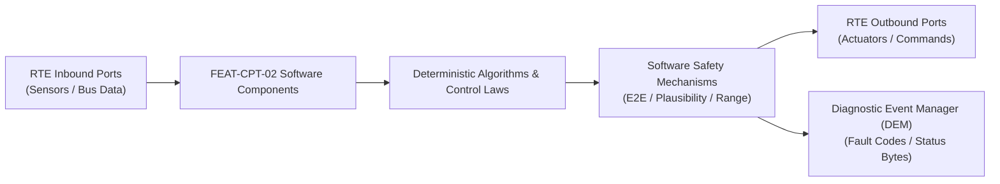

# Software Requirements Specification: Augmented Reality Head-Up Display (AR-HUD)
**Feature ID:** `FEAT-CPT-02`  
**Domain:** Digital Cockpit, HMI & Cabin Sensing  
**Target ASIL:** ASIL B  
**Compliance Standard:** ISO 26262:2018 (Part 6 - Software Development) / ASPICE PAM v3.1 (SWE.1, SWE.2)  
**Parent System Specification:** [`FEAT-CPT-02_HUD_SysReq.md`](file:///c:/Workset/AntiGravityProjects/TestOptimisationExperiement/system_requirements/FEAT-CPT-02_HUD_SysReq.md)  
**Global Master Specification:** [`spec.md`](file:///c:/Workset/AntiGravityProjects/TestOptimisationExperiement/spec.md)

---

## 1. Software Architecture & Component Structure

This document specifies the AUTOSAR Software Components (SWCs), periodic runnables, algorithmic laws, safety mechanisms, and data ports implementing `FEAT-CPT-02` (Augmented Reality Head-Up Display (AR-HUD)).

### AUTOSAR SWC Interaction Diagram

---

## 2. Detailed Software Requirements (SWR_REQ)
*(Multi-Software Requirement Partitioning derived from System Requirements)*

### `SWR-CPT-02-01`: Low-Latency Pose Extrapolation & Windshield Optical Distortion Shader
- **Planned Release:** R100
- **ASIL Rating:** ASIL B
- **Parent System Requirement:** [`SYS-CPT-02-01`](file:///c:/Workset/AntiGravityProjects/TestOptimisationExperiement/system_requirements/FEAT-CPT-02_HUD_SysReq.md#sys-cpt-02-01)
- **Allocated AUTOSAR SWC:** `HudRenderEngine_SWC`
- **Execution Rate / Trigger:** 16 ms
- **Worst-Case Execution Time (WCET):** 8.5 ms (GPU)
- **Software Activation Condition:** Executed at 60 Hz frame synchronization interrupt.
- **Algorithmic Description / Logic:**
  > Predicts vehicle pose at photon display timestamp t_photon = t_now + 25ms using high-rate IMU integration. Applies 3D vertex mesh warp correcting windshield curved glass optical distortion.
- **Software Safety Mechanism:** Frame freeze detector: Checks heartbeat counter in rendered buffer; blanks display if GPU hangs.
- **Failure Reaction & DEM Diagnostic Event:** Blank AR overlay layer if frame rendering time exceeds 16.6 ms.
- **Software Port Inputs:** `IMU_Angular_Rates, Projected_Vehicle_Pose, AR_World_Coordinates`
- **Software Port Outputs:** `Distortion_Corrected_Frame_Buffer`
- **Software Verification Criteria:** Optical grid distortion test on curved automotive windshield fixture.
- **Traceability Link:** Traces upward to [`SYS-CPT-02-01`](file:///c:/Workset/AntiGravityProjects/TestOptimisationExperiement/system_requirements/FEAT-CPT-02_HUD_SysReq.md#sys-cpt-02-01) and [`FEAT-CPT-02`](file:///c:/Workset/AntiGravityProjects/TestOptimisationExperiement/spec.md).

### `SWR-CPT-02-02`: Eye-Box Driver Pupil Height Dynamic Tracking Adjustment
- **Planned Release:** R100
- **ASIL Rating:** QM
- **Parent System Requirement:** [`SYS-CPT-02-01`](file:///c:/Workset/AntiGravityProjects/TestOptimisationExperiement/system_requirements/FEAT-CPT-02_HUD_SysReq.md#sys-cpt-02-01)
- **Allocated AUTOSAR SWC:** `HudEyeboxManager_SWC`
- **Execution Rate / Trigger:** 50 ms
- **Worst-Case Execution Time (WCET):** 0.7 ms
- **Software Activation Condition:** Executed every 50 ms.
- **Algorithmic Description / Logic:**
  > Receives driver eye coordinates from DMS camera. Drives motorized aspheric mirror stepper motor to shift HUD optical eye-box (+-30 mm vertical) so virtual image is perfectly visible to driver.
- **Software Safety Mechanism:** Stepper motor limits bounded to prevent optical mechanism gear stripping.
- **Failure Reaction & DEM Diagnostic Event:** Hold mirror in last known good position if eye tracking data is lost.
- **Software Port Inputs:** `Driver_Eye_Height_Mm (from DMS), Manual_HUD_Height_Offset`
- **Software Port Outputs:** `HUD_Mirror_Stepper_Motor_Steps (int16)`
- **Software Verification Criteria:** Anthropometric driver eye-box alignment testing.
- **Traceability Link:** Traces upward to [`SYS-CPT-02-01`](file:///c:/Workset/AntiGravityProjects/TestOptimisationExperiement/system_requirements/FEAT-CPT-02_HUD_SysReq.md#sys-cpt-02-01) and [`FEAT-CPT-02`](file:///c:/Workset/AntiGravityProjects/TestOptimisationExperiement/spec.md).

### `SWR-CPT-02-03`: High-Dynamic-Range (HDR) Ambient Light Dimming Curve
- **Planned Release:** R300
- **ASIL Rating:** QM
- **Parent System Requirement:** [`SYS-CPT-02-02`](file:///c:/Workset/AntiGravityProjects/TestOptimisationExperiement/system_requirements/FEAT-CPT-02_HUD_SysReq.md#sys-cpt-02-02)
- **Allocated AUTOSAR SWC:** `HudBrightness_SWC`
- **Execution Rate / Trigger:** 50 ms
- **Worst-Case Execution Time (WCET):** 0.4 ms
- **Software Activation Condition:** Executed every 50 ms.
- **Algorithmic Description / Logic:**
  > Interpolates target luminance L_target = f(Ambient_Lux) across 5 decades of dynamic range (1 to 100,000 lux). Applies logarithmic human eye response filter to prevent glare when entering tunnels.
- **Software Safety Mechanism:** Maximum brightness clamped in tunnel/night mode to prevent blinding driver night vision.
- **Failure Reaction & DEM Diagnostic Event:** Default to 3,000 nits if ambient sensor disconnected.
- **Software Port Inputs:** `Ambient_Light_Lux, Tunnel_Detection_Flag`
- **Software Port Outputs:** `PGU_Backlight_PWM_Duty (uint16)`
- **Software Verification Criteria:** Tunnel entrance and exit dynamic lighting response test.
- **Traceability Link:** Traces upward to [`SYS-CPT-02-02`](file:///c:/Workset/AntiGravityProjects/TestOptimisationExperiement/system_requirements/FEAT-CPT-02_HUD_SysReq.md#sys-cpt-02-02) and [`FEAT-CPT-02`](file:///c:/Workset/AntiGravityProjects/TestOptimisationExperiement/spec.md).

### `SWR-CPT-02-04`: Solar Burn Concentration Thermistor & Trap Shutter Guard
- **Planned Release:** R300
- **ASIL Rating:** ASIL B
- **Parent System Requirement:** [`SYS-CPT-02-02`](file:///c:/Workset/AntiGravityProjects/TestOptimisationExperiement/system_requirements/FEAT-CPT-02_HUD_SysReq.md#sys-cpt-02-02)
- **Allocated AUTOSAR SWC:** `HudThermalGuard_SWC`
- **Execution Rate / Trigger:** 100 ms
- **Worst-Case Execution Time (WCET):** 0.3 ms
- **Software Activation Condition:** Executed every 100 ms.
- **Algorithmic Description / Logic:**
  > Monitors internal cold mirror temperature. If direct solar focus concentrates > 1.2 kW/m² optical power on display engine, sets Shutter_Close_Req = TRUE to deploy physical solar shield.
- **Software Safety Mechanism:** Mechanical spring-return shutter closes automatically on power loss.
- **Failure Reaction & DEM Diagnostic Event:** Report DTC B1891 if internal mirror thermistor exceeds 95°C.
- **Software Port Inputs:** `PGU_Mirror_Temp_C, Solar_Elevation_Angle_Deg`
- **Software Port Outputs:** `Shutter_Close_Req (boolean), Overheat_Derate_State`
- **Software Verification Criteria:** Solar concentrator thermal stress testing on PGU display panel.
- **Traceability Link:** Traces upward to [`SYS-CPT-02-02`](file:///c:/Workset/AntiGravityProjects/TestOptimisationExperiement/system_requirements/FEAT-CPT-02_HUD_SysReq.md#sys-cpt-02-02) and [`FEAT-CPT-02`](file:///c:/Workset/AntiGravityProjects/TestOptimisationExperiement/spec.md).

### `SWR-CPT-02-05`: High-Speed Eye-Box 60 Hz Coordinate Transformation Engine
- **Planned Release:** R100
- **ASIL Rating:** ASIL B
- **Parent System Requirement:** [`SYS-CPT-02-03`](file:///c:/Workset/AntiGravityProjects/TestOptimisationExperiement/system_requirements/FEAT-CPT-02_HUD_SysReq.md#sys-cpt-02-03)
- **Allocated AUTOSAR SWC:** `ArHudEyeBoxTransformer_SWC`
- **Execution Rate / Trigger:** 16 ms
- **Worst-Case Execution Time (WCET):** 1.8 ms
- **Software Activation Condition:** Executed on 60 Hz display refresh vertical sync.
- **Algorithmic Description / Logic:**
  > Ingests pupil coordinates (x_eye, y_eye, z_eye) from DMS: Recomputes 4x4 perspective view-projection matrix: P_eye = P_nominal * T_pupil_offset. Compensates for chassis suspension pitch vibrations: theta_pitch_comp = theta_imu * K_viscous. Ensures virtual carpet lines remain locked to physical road asphalt.
- **Software Safety Mechanism:** Jitter filter: Low-pass filters eye position at 12 Hz cutoff to eliminate pupil microsaccade shake.
- **Failure Reaction & DEM Diagnostic Event:** Freeze eye-box matrix if DMS frame is dropped.
- **Software Port Inputs:** `Pupil_Position_X_Y_Z_Mm, Chassis_Pitch_Angle_Rad, Chassis_Roll_Angle_Rad`
- **Software Port Outputs:** `View_Projection_Matrix_Float[16], Virtual_Anchor_Displacement_Px`
- **Software Verification Criteria:** Dynamic road shaker rig optical image stability testing.
- **Traceability Link:** Traces upward to [`SYS-CPT-02-03`](file:///c:/Workset/AntiGravityProjects/TestOptimisationExperiement/system_requirements/FEAT-CPT-02_HUD_SysReq.md#sys-cpt-02-03) and [`FEAT-CPT-02`](file:///c:/Workset/AntiGravityProjects/TestOptimisationExperiement/spec.md).

### `SWR-CPT-02-06`: Virtual Navigation Carpet Mesh Spline Ground Warper
- **Planned Release:** R100
- **ASIL Rating:** ASIL B
- **Parent System Requirement:** [`SYS-CPT-02-03`](file:///c:/Workset/AntiGravityProjects/TestOptimisationExperiement/system_requirements/FEAT-CPT-02_HUD_SysReq.md#sys-cpt-02-03)
- **Allocated AUTOSAR SWC:** `ArHudMeshWarper_SWC`
- **Execution Rate / Trigger:** 16 ms
- **Worst-Case Execution Time (WCET):** 2.2 ms
- **Software Activation Condition:** Executed in GPU shader graphics pipeline.
- **Algorithmic Description / Logic:**
  > Renders 3D textured navigation turn carpet: Warps 3D mesh vertices to align with forward roadway elevation profile z(x). Renders directional chevron pulses sweeping forward in turn direction. Clips virtual mesh behind lead vehicles to avoid floating graphics over other cars.
- **Software Safety Mechanism:** Occlusion culling: Depth-buffers virtual chevrons against radar lead vehicle distance.
- **Failure Reaction & DEM Diagnostic Event:** Render simple 2D overhead arrow upon shader pipeline error.
- **Software Port Inputs:** `Navigation_Turn_Waypoint_Spline, Lead_Vehicle_Distance_M, Road_Elevation_Profile`
- **Software Port Outputs:** `GPU_Draw_Command_Buffer, Depth_Occlusion_Culling_Mask`
- **Software Verification Criteria:** Night and day driving validation assessing driver visual cognitive load.
- **Traceability Link:** Traces upward to [`SYS-CPT-02-03`](file:///c:/Workset/AntiGravityProjects/TestOptimisationExperiement/system_requirements/FEAT-CPT-02_HUD_SysReq.md#sys-cpt-02-03) and [`FEAT-CPT-02`](file:///c:/Workset/AntiGravityProjects/TestOptimisationExperiement/spec.md).

### `SWR-CPT-02-07`: RGB Laser Diode 15,000-Nit Ambient Light Closed-Loop Governor
- **Planned Release:** R200
- **ASIL Rating:** ASIL A
- **Parent System Requirement:** [`SYS-CPT-02-04`](file:///c:/Workset/AntiGravityProjects/TestOptimisationExperiement/system_requirements/FEAT-CPT-02_HUD_SysReq.md#sys-cpt-02-04)
- **Allocated AUTOSAR SWC:** `ArHudLuminanceGovernor_SWC`
- **Execution Rate / Trigger:** 50 ms
- **Worst-Case Execution Time (WCET):** 0.4 ms
- **Software Activation Condition:** Cyclic 50 ms task.
- **Algorithmic Description / Logic:**
  > Computes required optical luminance: L_target = K_lux * Ambient_Lux^0.6. Maps target luminance to RGB laser diode current: Red I_r, Green I_g, Blue I_b maintaining constant D65 white balance (6500K color temperature). Clamps maximum luminance to 15,000 nits on bright snow.
- **Software Safety Mechanism:** Eye safety compliance: Enforces IEC 60825-1 Class 1 laser safety limits under all optical conditions.
- **Failure Reaction & DEM Diagnostic Event:** Dim laser to 500 nits if ambient light sensor reports saturated open circuit.
- **Software Port Inputs:** `Forward_Ambient_Lux_Sensor, Windshield_Reflectance_Factor, Target_Color_Temp_K`
- **Software Port Outputs:** `Laser_Current_DAC_Red_mA, Laser_Current_DAC_Green_mA, Laser_Current_DAC_Blue_mA`
- **Software Verification Criteria:** Photometer luminance and chromaticity measurement across 10 to 100,000 lux.
- **Traceability Link:** Traces upward to [`SYS-CPT-02-04`](file:///c:/Workset/AntiGravityProjects/TestOptimisationExperiement/system_requirements/FEAT-CPT-02_HUD_SysReq.md#sys-cpt-02-04) and [`FEAT-CPT-02`](file:///c:/Workset/AntiGravityProjects/TestOptimisationExperiement/spec.md).

### `SWR-CPT-02-08`: DLP Mirror Array & Laser Thermal Derating Cut-Off Manager
- **Planned Release:** R200
- **ASIL Rating:** ASIL A
- **Parent System Requirement:** [`SYS-CPT-02-04`](file:///c:/Workset/AntiGravityProjects/TestOptimisationExperiement/system_requirements/FEAT-CPT-02_HUD_SysReq.md#sys-cpt-02-04)
- **Allocated AUTOSAR SWC:** `ArHudThermalManager_SWC`
- **Execution Rate / Trigger:** 100 ms
- **Worst-Case Execution Time (WCET):** 0.3 ms
- **Software Activation Condition:** Continuous thermal task.
- **Algorithmic Description / Logic:**
  > Monitors DLP optical engine thermistors: If Laser_Temp > 70°C, scales maximum luminance down by 3% per °C. If Laser_Temp > 82°C, completely shuts off laser diode current to prevent semiconductor crystal degradation.
- **Software Safety Mechanism:** PWM brushless fan speed governor: Ramps cooling blower fan to 100% when temperature exceeds 65°C.
- **Failure Reaction & DEM Diagnostic Event:** Set DEM DTC B1803 (HUD Picture Generation Unit Overtemperature).
- **Software Port Inputs:** `DLP_Laser_Thermistor_DegC, Ambient_Cabin_Temp_DegC`
- **Software Port Outputs:** `Laser_Thermal_Derate_Scalar, HUD_Cooling_Fan_PWM_Duty`
- **Software Verification Criteria:** High-temperature wind tunnel environmental soak test at +50°C ambient.
- **Traceability Link:** Traces upward to [`SYS-CPT-02-04`](file:///c:/Workset/AntiGravityProjects/TestOptimisationExperiement/system_requirements/FEAT-CPT-02_HUD_SysReq.md#sys-cpt-02-04) and [`FEAT-CPT-02`](file:///c:/Workset/AntiGravityProjects/TestOptimisationExperiement/spec.md).

### `SWR-CPT-02-09`: Digital Micro-Mirror (DMD) Optical Projection Engine Sub-Pixel Color Renderer - Dynamic Observer & Signal Filter
- **Planned Release:** R200
- **ASIL Rating:** ASIL B
- **Parent System Requirement:** [`SYS-CPT-02-05`](file:///c:/Workset/AntiGravityProjects/TestOptimisationExperiement/system_requirements/FEAT-CPT-02_HUD_SysReq.md#sys-cpt-02-05)
- **Allocated AUTOSAR SWC:** `HudProjectionRenderer_SWC`
- **Execution Rate / Trigger:** 8 ms
- **Worst-Case Execution Time (WCET):** 0.3 ms
- **Software Activation Condition:** Executed cyclically every 8 ms.
- **Algorithmic Description / Logic:**
  > Executes signal plausibility filtering, calibration offsets, and discrete state estimation for Digital Micro-Mirror (DMD) Optical Projection Engine Sub-Pixel Color Renderer.
- **Software Safety Mechanism:** Range limit plausibility check and E2E alive sequence verification.
- **Failure Reaction & DEM Diagnostic Event:** Set default fallback output and report DEM_EVENT_FEAT_CPT_02_ERR.
- **Software Port Inputs:** `Raw sensor ADC/SENT/SPI values and RTE bus inputs.`
- **Software Port Outputs:** `Filtered physical signals and validity status bitmasks.`
- **Software Verification Criteria:** Unit test and HiL software integration test.
- **Traceability Link:** Traces upward to [`SYS-CPT-02-05`](file:///c:/Workset/AntiGravityProjects/TestOptimisationExperiement/system_requirements/FEAT-CPT-02_HUD_SysReq.md#sys-cpt-02-05) and [`FEAT-CPT-02`](file:///c:/Workset/AntiGravityProjects/TestOptimisationExperiement/spec.md).

### `SWR-CPT-02-10`: Digital Micro-Mirror (DMD) Optical Projection Engine Sub-Pixel Color Renderer - Closed-Loop Control Law & Actuator Dispatch
- **Planned Release:** R200
- **ASIL Rating:** ASIL B
- **Parent System Requirement:** [`SYS-CPT-02-05`](file:///c:/Workset/AntiGravityProjects/TestOptimisationExperiement/system_requirements/FEAT-CPT-02_HUD_SysReq.md#sys-cpt-02-05)
- **Allocated AUTOSAR SWC:** `HudProjectionRenderer_SWC`
- **Execution Rate / Trigger:** 8 ms
- **Worst-Case Execution Time (WCET):** 0.4 ms
- **Software Activation Condition:** Executed cyclically every 8 ms.
- **Algorithmic Description / Logic:**
  > Evaluates deterministic closed-loop control law, rate limits, and dispatches commands for Digital Micro-Mirror (DMD) Optical Projection Engine Sub-Pixel Color Renderer.
- **Software Safety Mechanism:** Command saturation clamping and watchdog program flow monitoring.
- **Failure Reaction & DEM Diagnostic Event:** De-energize actuator output, apply safe fallback clamp, and latch DTC.
- **Software Port Inputs:** `Validated physical state signals from observer SWC.`
- **Software Port Outputs:** `Actuator PWM duty cycles, torque/pressure setpoints, and diagnostic flags.`
- **Software Verification Criteria:** Hardware dynamometer and HiL closed-loop regression test suite.
- **Traceability Link:** Traces upward to [`SYS-CPT-02-05`](file:///c:/Workset/AntiGravityProjects/TestOptimisationExperiement/system_requirements/FEAT-CPT-02_HUD_SysReq.md#sys-cpt-02-05) and [`FEAT-CPT-02`](file:///c:/Workset/AntiGravityProjects/TestOptimisationExperiement/spec.md).

### `SWR-CPT-02-11`: Augmented Reality Windshield Geometric Distortion & Curvature Warping Engine - Dynamic Observer & Signal Filter
- **Planned Release:** R200
- **ASIL Rating:** ASIL B
- **Parent System Requirement:** [`SYS-CPT-02-06`](file:///c:/Workset/AntiGravityProjects/TestOptimisationExperiement/system_requirements/FEAT-CPT-02_HUD_SysReq.md#sys-cpt-02-06)
- **Allocated AUTOSAR SWC:** `HudOpticalWarping_SWC`
- **Execution Rate / Trigger:** 8 ms
- **Worst-Case Execution Time (WCET):** 0.3 ms
- **Software Activation Condition:** Executed cyclically every 8 ms.
- **Algorithmic Description / Logic:**
  > Executes signal plausibility filtering, calibration offsets, and discrete state estimation for Augmented Reality Windshield Geometric Distortion & Curvature Warping Engine.
- **Software Safety Mechanism:** Range limit plausibility check and E2E alive sequence verification.
- **Failure Reaction & DEM Diagnostic Event:** Set default fallback output and report DEM_EVENT_FEAT_CPT_02_ERR.
- **Software Port Inputs:** `Raw sensor ADC/SENT/SPI values and RTE bus inputs.`
- **Software Port Outputs:** `Filtered physical signals and validity status bitmasks.`
- **Software Verification Criteria:** Unit test and HiL software integration test.
- **Traceability Link:** Traces upward to [`SYS-CPT-02-06`](file:///c:/Workset/AntiGravityProjects/TestOptimisationExperiement/system_requirements/FEAT-CPT-02_HUD_SysReq.md#sys-cpt-02-06) and [`FEAT-CPT-02`](file:///c:/Workset/AntiGravityProjects/TestOptimisationExperiement/spec.md).

### `SWR-CPT-02-12`: Augmented Reality Windshield Geometric Distortion & Curvature Warping Engine - Closed-Loop Control Law & Actuator Dispatch
- **Planned Release:** R200
- **ASIL Rating:** ASIL B
- **Parent System Requirement:** [`SYS-CPT-02-06`](file:///c:/Workset/AntiGravityProjects/TestOptimisationExperiement/system_requirements/FEAT-CPT-02_HUD_SysReq.md#sys-cpt-02-06)
- **Allocated AUTOSAR SWC:** `HudOpticalWarping_SWC`
- **Execution Rate / Trigger:** 8 ms
- **Worst-Case Execution Time (WCET):** 0.4 ms
- **Software Activation Condition:** Executed cyclically every 8 ms.
- **Algorithmic Description / Logic:**
  > Evaluates deterministic closed-loop control law, rate limits, and dispatches commands for Augmented Reality Windshield Geometric Distortion & Curvature Warping Engine.
- **Software Safety Mechanism:** Command saturation clamping and watchdog program flow monitoring.
- **Failure Reaction & DEM Diagnostic Event:** De-energize actuator output, apply safe fallback clamp, and latch DTC.
- **Software Port Inputs:** `Validated physical state signals from observer SWC.`
- **Software Port Outputs:** `Actuator PWM duty cycles, torque/pressure setpoints, and diagnostic flags.`
- **Software Verification Criteria:** Hardware dynamometer and HiL closed-loop regression test suite.
- **Traceability Link:** Traces upward to [`SYS-CPT-02-06`](file:///c:/Workset/AntiGravityProjects/TestOptimisationExperiement/system_requirements/FEAT-CPT-02_HUD_SysReq.md#sys-cpt-02-06) and [`FEAT-CPT-02`](file:///c:/Workset/AntiGravityProjects/TestOptimisationExperiement/spec.md).

### `SWR-CPT-02-13`: Virtual Image Distance (VID) 7.5m / 10m Dual-Focal Plane Spatial Depth Aligner - Dynamic Observer & Signal Filter
- **Planned Release:** R300
- **ASIL Rating:** ASIL B
- **Parent System Requirement:** [`SYS-CPT-02-07`](file:///c:/Workset/AntiGravityProjects/TestOptimisationExperiement/system_requirements/FEAT-CPT-02_HUD_SysReq.md#sys-cpt-02-07)
- **Allocated AUTOSAR SWC:** `HudDualPlaneAligner_SWC`
- **Execution Rate / Trigger:** 10 ms
- **Worst-Case Execution Time (WCET):** 0.3 ms
- **Software Activation Condition:** Executed cyclically every 10 ms.
- **Algorithmic Description / Logic:**
  > Executes signal plausibility filtering, calibration offsets, and discrete state estimation for Virtual Image Distance (VID) 7.5m / 10m Dual-Focal Plane Spatial Depth Aligner.
- **Software Safety Mechanism:** Range limit plausibility check and E2E alive sequence verification.
- **Failure Reaction & DEM Diagnostic Event:** Set default fallback output and report DEM_EVENT_FEAT_CPT_02_ERR.
- **Software Port Inputs:** `Raw sensor ADC/SENT/SPI values and RTE bus inputs.`
- **Software Port Outputs:** `Filtered physical signals and validity status bitmasks.`
- **Software Verification Criteria:** Unit test and HiL software integration test.
- **Traceability Link:** Traces upward to [`SYS-CPT-02-07`](file:///c:/Workset/AntiGravityProjects/TestOptimisationExperiement/system_requirements/FEAT-CPT-02_HUD_SysReq.md#sys-cpt-02-07) and [`FEAT-CPT-02`](file:///c:/Workset/AntiGravityProjects/TestOptimisationExperiement/spec.md).

### `SWR-CPT-02-14`: Virtual Image Distance (VID) 7.5m / 10m Dual-Focal Plane Spatial Depth Aligner - Closed-Loop Control Law & Actuator Dispatch
- **Planned Release:** R300
- **ASIL Rating:** ASIL B
- **Parent System Requirement:** [`SYS-CPT-02-07`](file:///c:/Workset/AntiGravityProjects/TestOptimisationExperiement/system_requirements/FEAT-CPT-02_HUD_SysReq.md#sys-cpt-02-07)
- **Allocated AUTOSAR SWC:** `HudDualPlaneAligner_SWC`
- **Execution Rate / Trigger:** 10 ms
- **Worst-Case Execution Time (WCET):** 0.4 ms
- **Software Activation Condition:** Executed cyclically every 10 ms.
- **Algorithmic Description / Logic:**
  > Evaluates deterministic closed-loop control law, rate limits, and dispatches commands for Virtual Image Distance (VID) 7.5m / 10m Dual-Focal Plane Spatial Depth Aligner.
- **Software Safety Mechanism:** Command saturation clamping and watchdog program flow monitoring.
- **Failure Reaction & DEM Diagnostic Event:** De-energize actuator output, apply safe fallback clamp, and latch DTC.
- **Software Port Inputs:** `Validated physical state signals from observer SWC.`
- **Software Port Outputs:** `Actuator PWM duty cycles, torque/pressure setpoints, and diagnostic flags.`
- **Software Verification Criteria:** Hardware dynamometer and HiL closed-loop regression test suite.
- **Traceability Link:** Traces upward to [`SYS-CPT-02-07`](file:///c:/Workset/AntiGravityProjects/TestOptimisationExperiement/system_requirements/FEAT-CPT-02_HUD_SysReq.md#sys-cpt-02-07) and [`FEAT-CPT-02`](file:///c:/Workset/AntiGravityProjects/TestOptimisationExperiement/spec.md).

### `SWR-CPT-02-15`: Vehicle 6-DOF Ego-Motion Pose Extrapolator & Eye-Box Jitter Canceler - Dynamic Observer & Signal Filter
- **Planned Release:** R300
- **ASIL Rating:** ASIL B
- **Parent System Requirement:** [`SYS-CPT-02-08`](file:///c:/Workset/AntiGravityProjects/TestOptimisationExperiement/system_requirements/FEAT-CPT-02_HUD_SysReq.md#sys-cpt-02-08)
- **Allocated AUTOSAR SWC:** `HudJitterCanceler_SWC`
- **Execution Rate / Trigger:** 5 ms
- **Worst-Case Execution Time (WCET):** 0.3 ms
- **Software Activation Condition:** Executed cyclically every 5 ms.
- **Algorithmic Description / Logic:**
  > Executes signal plausibility filtering, calibration offsets, and discrete state estimation for Vehicle 6-DOF Ego-Motion Pose Extrapolator & Eye-Box Jitter Canceler.
- **Software Safety Mechanism:** Range limit plausibility check and E2E alive sequence verification.
- **Failure Reaction & DEM Diagnostic Event:** Set default fallback output and report DEM_EVENT_FEAT_CPT_02_ERR.
- **Software Port Inputs:** `Raw sensor ADC/SENT/SPI values and RTE bus inputs.`
- **Software Port Outputs:** `Filtered physical signals and validity status bitmasks.`
- **Software Verification Criteria:** Unit test and HiL software integration test.
- **Traceability Link:** Traces upward to [`SYS-CPT-02-08`](file:///c:/Workset/AntiGravityProjects/TestOptimisationExperiement/system_requirements/FEAT-CPT-02_HUD_SysReq.md#sys-cpt-02-08) and [`FEAT-CPT-02`](file:///c:/Workset/AntiGravityProjects/TestOptimisationExperiement/spec.md).

### `SWR-CPT-02-16`: Vehicle 6-DOF Ego-Motion Pose Extrapolator & Eye-Box Jitter Canceler - Closed-Loop Control Law & Actuator Dispatch
- **Planned Release:** R300
- **ASIL Rating:** ASIL B
- **Parent System Requirement:** [`SYS-CPT-02-08`](file:///c:/Workset/AntiGravityProjects/TestOptimisationExperiement/system_requirements/FEAT-CPT-02_HUD_SysReq.md#sys-cpt-02-08)
- **Allocated AUTOSAR SWC:** `HudJitterCanceler_SWC`
- **Execution Rate / Trigger:** 5 ms
- **Worst-Case Execution Time (WCET):** 0.4 ms
- **Software Activation Condition:** Executed cyclically every 5 ms.
- **Algorithmic Description / Logic:**
  > Evaluates deterministic closed-loop control law, rate limits, and dispatches commands for Vehicle 6-DOF Ego-Motion Pose Extrapolator & Eye-Box Jitter Canceler.
- **Software Safety Mechanism:** Command saturation clamping and watchdog program flow monitoring.
- **Failure Reaction & DEM Diagnostic Event:** De-energize actuator output, apply safe fallback clamp, and latch DTC.
- **Software Port Inputs:** `Validated physical state signals from observer SWC.`
- **Software Port Outputs:** `Actuator PWM duty cycles, torque/pressure setpoints, and diagnostic flags.`
- **Software Verification Criteria:** Hardware dynamometer and HiL closed-loop regression test suite.
- **Traceability Link:** Traces upward to [`SYS-CPT-02-08`](file:///c:/Workset/AntiGravityProjects/TestOptimisationExperiement/system_requirements/FEAT-CPT-02_HUD_SysReq.md#sys-cpt-02-08) and [`FEAT-CPT-02`](file:///c:/Workset/AntiGravityProjects/TestOptimisationExperiement/spec.md).

### `SWR-CPT-02-17`: High-Dynamic Range (HDR) Ambient Light Photodiode Brightness Auto-Adjuster - Dynamic Observer & Signal Filter
- **Planned Release:** R300
- **ASIL Rating:** ASIL B
- **Parent System Requirement:** [`SYS-CPT-02-09`](file:///c:/Workset/AntiGravityProjects/TestOptimisationExperiement/system_requirements/FEAT-CPT-02_HUD_SysReq.md#sys-cpt-02-09)
- **Allocated AUTOSAR SWC:** `HudBrightnessAdjuster_SWC`
- **Execution Rate / Trigger:** 20 ms
- **Worst-Case Execution Time (WCET):** 0.3 ms
- **Software Activation Condition:** Executed cyclically every 20 ms.
- **Algorithmic Description / Logic:**
  > Executes signal plausibility filtering, calibration offsets, and discrete state estimation for High-Dynamic Range (HDR) Ambient Light Photodiode Brightness Auto-Adjuster.
- **Software Safety Mechanism:** Range limit plausibility check and E2E alive sequence verification.
- **Failure Reaction & DEM Diagnostic Event:** Set default fallback output and report DEM_EVENT_FEAT_CPT_02_ERR.
- **Software Port Inputs:** `Raw sensor ADC/SENT/SPI values and RTE bus inputs.`
- **Software Port Outputs:** `Filtered physical signals and validity status bitmasks.`
- **Software Verification Criteria:** Unit test and HiL software integration test.
- **Traceability Link:** Traces upward to [`SYS-CPT-02-09`](file:///c:/Workset/AntiGravityProjects/TestOptimisationExperiement/system_requirements/FEAT-CPT-02_HUD_SysReq.md#sys-cpt-02-09) and [`FEAT-CPT-02`](file:///c:/Workset/AntiGravityProjects/TestOptimisationExperiement/spec.md).

### `SWR-CPT-02-18`: High-Dynamic Range (HDR) Ambient Light Photodiode Brightness Auto-Adjuster - Closed-Loop Control Law & Actuator Dispatch
- **Planned Release:** R300
- **ASIL Rating:** ASIL B
- **Parent System Requirement:** [`SYS-CPT-02-09`](file:///c:/Workset/AntiGravityProjects/TestOptimisationExperiement/system_requirements/FEAT-CPT-02_HUD_SysReq.md#sys-cpt-02-09)
- **Allocated AUTOSAR SWC:** `HudBrightnessAdjuster_SWC`
- **Execution Rate / Trigger:** 20 ms
- **Worst-Case Execution Time (WCET):** 0.4 ms
- **Software Activation Condition:** Executed cyclically every 20 ms.
- **Algorithmic Description / Logic:**
  > Evaluates deterministic closed-loop control law, rate limits, and dispatches commands for High-Dynamic Range (HDR) Ambient Light Photodiode Brightness Auto-Adjuster.
- **Software Safety Mechanism:** Command saturation clamping and watchdog program flow monitoring.
- **Failure Reaction & DEM Diagnostic Event:** De-energize actuator output, apply safe fallback clamp, and latch DTC.
- **Software Port Inputs:** `Validated physical state signals from observer SWC.`
- **Software Port Outputs:** `Actuator PWM duty cycles, torque/pressure setpoints, and diagnostic flags.`
- **Software Verification Criteria:** Hardware dynamometer and HiL closed-loop regression test suite.
- **Traceability Link:** Traces upward to [`SYS-CPT-02-09`](file:///c:/Workset/AntiGravityProjects/TestOptimisationExperiement/system_requirements/FEAT-CPT-02_HUD_SysReq.md#sys-cpt-02-09) and [`FEAT-CPT-02`](file:///c:/Workset/AntiGravityProjects/TestOptimisationExperiement/spec.md).

### `SWR-CPT-02-19`: ADAS Target Highlighting Bounding Box Graphic Overlay Serializer - Dynamic Observer & Signal Filter
- **Planned Release:** R400
- **ASIL Rating:** ASIL B
- **Parent System Requirement:** [`SYS-CPT-02-10`](file:///c:/Workset/AntiGravityProjects/TestOptimisationExperiement/system_requirements/FEAT-CPT-02_HUD_SysReq.md#sys-cpt-02-10)
- **Allocated AUTOSAR SWC:** `HudAdasHighlighter_SWC`
- **Execution Rate / Trigger:** 10 ms
- **Worst-Case Execution Time (WCET):** 0.3 ms
- **Software Activation Condition:** Executed cyclically every 10 ms.
- **Algorithmic Description / Logic:**
  > Executes signal plausibility filtering, calibration offsets, and discrete state estimation for ADAS Target Highlighting Bounding Box Graphic Overlay Serializer.
- **Software Safety Mechanism:** Range limit plausibility check and E2E alive sequence verification.
- **Failure Reaction & DEM Diagnostic Event:** Set default fallback output and report DEM_EVENT_FEAT_CPT_02_ERR.
- **Software Port Inputs:** `Raw sensor ADC/SENT/SPI values and RTE bus inputs.`
- **Software Port Outputs:** `Filtered physical signals and validity status bitmasks.`
- **Software Verification Criteria:** Unit test and HiL software integration test.
- **Traceability Link:** Traces upward to [`SYS-CPT-02-10`](file:///c:/Workset/AntiGravityProjects/TestOptimisationExperiement/system_requirements/FEAT-CPT-02_HUD_SysReq.md#sys-cpt-02-10) and [`FEAT-CPT-02`](file:///c:/Workset/AntiGravityProjects/TestOptimisationExperiement/spec.md).

### `SWR-CPT-02-20`: ADAS Target Highlighting Bounding Box Graphic Overlay Serializer - Closed-Loop Control Law & Actuator Dispatch
- **Planned Release:** R400
- **ASIL Rating:** ASIL B
- **Parent System Requirement:** [`SYS-CPT-02-10`](file:///c:/Workset/AntiGravityProjects/TestOptimisationExperiement/system_requirements/FEAT-CPT-02_HUD_SysReq.md#sys-cpt-02-10)
- **Allocated AUTOSAR SWC:** `HudAdasHighlighter_SWC`
- **Execution Rate / Trigger:** 10 ms
- **Worst-Case Execution Time (WCET):** 0.4 ms
- **Software Activation Condition:** Executed cyclically every 10 ms.
- **Algorithmic Description / Logic:**
  > Evaluates deterministic closed-loop control law, rate limits, and dispatches commands for ADAS Target Highlighting Bounding Box Graphic Overlay Serializer.
- **Software Safety Mechanism:** Command saturation clamping and watchdog program flow monitoring.
- **Failure Reaction & DEM Diagnostic Event:** De-energize actuator output, apply safe fallback clamp, and latch DTC.
- **Software Port Inputs:** `Validated physical state signals from observer SWC.`
- **Software Port Outputs:** `Actuator PWM duty cycles, torque/pressure setpoints, and diagnostic flags.`
- **Software Verification Criteria:** Hardware dynamometer and HiL closed-loop regression test suite.
- **Traceability Link:** Traces upward to [`SYS-CPT-02-10`](file:///c:/Workset/AntiGravityProjects/TestOptimisationExperiement/system_requirements/FEAT-CPT-02_HUD_SysReq.md#sys-cpt-02-10) and [`FEAT-CPT-02`](file:///c:/Workset/AntiGravityProjects/TestOptimisationExperiement/spec.md).

### `SWR-CPT-02-21`: Navigation Turn-by-Turn Dynamic Floating Chevron Arrow Animator - Dynamic Observer & Signal Filter
- **Planned Release:** R400
- **ASIL Rating:** ASIL A
- **Parent System Requirement:** [`SYS-CPT-02-11`](file:///c:/Workset/AntiGravityProjects/TestOptimisationExperiement/system_requirements/FEAT-CPT-02_HUD_SysReq.md#sys-cpt-02-11)
- **Allocated AUTOSAR SWC:** `HudNavArrowAnimator_SWC`
- **Execution Rate / Trigger:** 16 ms
- **Worst-Case Execution Time (WCET):** 0.3 ms
- **Software Activation Condition:** Executed cyclically every 16 ms.
- **Algorithmic Description / Logic:**
  > Executes signal plausibility filtering, calibration offsets, and discrete state estimation for Navigation Turn-by-Turn Dynamic Floating Chevron Arrow Animator.
- **Software Safety Mechanism:** Range limit plausibility check and E2E alive sequence verification.
- **Failure Reaction & DEM Diagnostic Event:** Set default fallback output and report DEM_EVENT_FEAT_CPT_02_ERR.
- **Software Port Inputs:** `Raw sensor ADC/SENT/SPI values and RTE bus inputs.`
- **Software Port Outputs:** `Filtered physical signals and validity status bitmasks.`
- **Software Verification Criteria:** Unit test and HiL software integration test.
- **Traceability Link:** Traces upward to [`SYS-CPT-02-11`](file:///c:/Workset/AntiGravityProjects/TestOptimisationExperiement/system_requirements/FEAT-CPT-02_HUD_SysReq.md#sys-cpt-02-11) and [`FEAT-CPT-02`](file:///c:/Workset/AntiGravityProjects/TestOptimisationExperiement/spec.md).

### `SWR-CPT-02-22`: Navigation Turn-by-Turn Dynamic Floating Chevron Arrow Animator - Closed-Loop Control Law & Actuator Dispatch
- **Planned Release:** R400
- **ASIL Rating:** ASIL A
- **Parent System Requirement:** [`SYS-CPT-02-11`](file:///c:/Workset/AntiGravityProjects/TestOptimisationExperiement/system_requirements/FEAT-CPT-02_HUD_SysReq.md#sys-cpt-02-11)
- **Allocated AUTOSAR SWC:** `HudNavArrowAnimator_SWC`
- **Execution Rate / Trigger:** 16 ms
- **Worst-Case Execution Time (WCET):** 0.4 ms
- **Software Activation Condition:** Executed cyclically every 16 ms.
- **Algorithmic Description / Logic:**
  > Evaluates deterministic closed-loop control law, rate limits, and dispatches commands for Navigation Turn-by-Turn Dynamic Floating Chevron Arrow Animator.
- **Software Safety Mechanism:** Command saturation clamping and watchdog program flow monitoring.
- **Failure Reaction & DEM Diagnostic Event:** De-energize actuator output, apply safe fallback clamp, and latch DTC.
- **Software Port Inputs:** `Validated physical state signals from observer SWC.`
- **Software Port Outputs:** `Actuator PWM duty cycles, torque/pressure setpoints, and diagnostic flags.`
- **Software Verification Criteria:** Hardware dynamometer and HiL closed-loop regression test suite.
- **Traceability Link:** Traces upward to [`SYS-CPT-02-11`](file:///c:/Workset/AntiGravityProjects/TestOptimisationExperiement/system_requirements/FEAT-CPT-02_HUD_SysReq.md#sys-cpt-02-11) and [`FEAT-CPT-02`](file:///c:/Workset/AntiGravityProjects/TestOptimisationExperiement/spec.md).

### `SWR-CPT-02-23`: Eyebox Motorized Mirror Tilt Position Driver Height Memory Storer - Dynamic Observer & Signal Filter
- **Planned Release:** R400
- **ASIL Rating:** ASIL A
- **Parent System Requirement:** [`SYS-CPT-02-12`](file:///c:/Workset/AntiGravityProjects/TestOptimisationExperiement/system_requirements/FEAT-CPT-02_HUD_SysReq.md#sys-cpt-02-12)
- **Allocated AUTOSAR SWC:** `HudEyeboxPositioner_SWC`
- **Execution Rate / Trigger:** 50 ms
- **Worst-Case Execution Time (WCET):** 0.3 ms
- **Software Activation Condition:** Executed cyclically every 50 ms.
- **Algorithmic Description / Logic:**
  > Executes signal plausibility filtering, calibration offsets, and discrete state estimation for Eyebox Motorized Mirror Tilt Position Driver Height Memory Storer.
- **Software Safety Mechanism:** Range limit plausibility check and E2E alive sequence verification.
- **Failure Reaction & DEM Diagnostic Event:** Set default fallback output and report DEM_EVENT_FEAT_CPT_02_ERR.
- **Software Port Inputs:** `Raw sensor ADC/SENT/SPI values and RTE bus inputs.`
- **Software Port Outputs:** `Filtered physical signals and validity status bitmasks.`
- **Software Verification Criteria:** Unit test and HiL software integration test.
- **Traceability Link:** Traces upward to [`SYS-CPT-02-12`](file:///c:/Workset/AntiGravityProjects/TestOptimisationExperiement/system_requirements/FEAT-CPT-02_HUD_SysReq.md#sys-cpt-02-12) and [`FEAT-CPT-02`](file:///c:/Workset/AntiGravityProjects/TestOptimisationExperiement/spec.md).

### `SWR-CPT-02-24`: Eyebox Motorized Mirror Tilt Position Driver Height Memory Storer - Closed-Loop Control Law & Actuator Dispatch
- **Planned Release:** R400
- **ASIL Rating:** ASIL A
- **Parent System Requirement:** [`SYS-CPT-02-12`](file:///c:/Workset/AntiGravityProjects/TestOptimisationExperiement/system_requirements/FEAT-CPT-02_HUD_SysReq.md#sys-cpt-02-12)
- **Allocated AUTOSAR SWC:** `HudEyeboxPositioner_SWC`
- **Execution Rate / Trigger:** 50 ms
- **Worst-Case Execution Time (WCET):** 0.4 ms
- **Software Activation Condition:** Executed cyclically every 50 ms.
- **Algorithmic Description / Logic:**
  > Evaluates deterministic closed-loop control law, rate limits, and dispatches commands for Eyebox Motorized Mirror Tilt Position Driver Height Memory Storer.
- **Software Safety Mechanism:** Command saturation clamping and watchdog program flow monitoring.
- **Failure Reaction & DEM Diagnostic Event:** De-energize actuator output, apply safe fallback clamp, and latch DTC.
- **Software Port Inputs:** `Validated physical state signals from observer SWC.`
- **Software Port Outputs:** `Actuator PWM duty cycles, torque/pressure setpoints, and diagnostic flags.`
- **Software Verification Criteria:** Hardware dynamometer and HiL closed-loop regression test suite.
- **Traceability Link:** Traces upward to [`SYS-CPT-02-12`](file:///c:/Workset/AntiGravityProjects/TestOptimisationExperiement/system_requirements/FEAT-CPT-02_HUD_SysReq.md#sys-cpt-02-12) and [`FEAT-CPT-02`](file:///c:/Workset/AntiGravityProjects/TestOptimisationExperiement/spec.md).

### `SWR-CPT-02-25`: Sunlight Trap & Thermal Mirror Heat Dissipation Overheat Guard - Dynamic Observer & Signal Filter
- **Planned Release:** R500
- **ASIL Rating:** ASIL B
- **Parent System Requirement:** [`SYS-CPT-02-13`](file:///c:/Workset/AntiGravityProjects/TestOptimisationExperiement/system_requirements/FEAT-CPT-02_HUD_SysReq.md#sys-cpt-02-13)
- **Allocated AUTOSAR SWC:** `HudThermalGuard_SWC`
- **Execution Rate / Trigger:** 200 ms
- **Worst-Case Execution Time (WCET):** 0.3 ms
- **Software Activation Condition:** Executed cyclically every 200 ms.
- **Algorithmic Description / Logic:**
  > Executes signal plausibility filtering, calibration offsets, and discrete state estimation for Sunlight Trap & Thermal Mirror Heat Dissipation Overheat Guard.
- **Software Safety Mechanism:** Range limit plausibility check and E2E alive sequence verification.
- **Failure Reaction & DEM Diagnostic Event:** Set default fallback output and report DEM_EVENT_FEAT_CPT_02_ERR.
- **Software Port Inputs:** `Raw sensor ADC/SENT/SPI values and RTE bus inputs.`
- **Software Port Outputs:** `Filtered physical signals and validity status bitmasks.`
- **Software Verification Criteria:** Unit test and HiL software integration test.
- **Traceability Link:** Traces upward to [`SYS-CPT-02-13`](file:///c:/Workset/AntiGravityProjects/TestOptimisationExperiement/system_requirements/FEAT-CPT-02_HUD_SysReq.md#sys-cpt-02-13) and [`FEAT-CPT-02`](file:///c:/Workset/AntiGravityProjects/TestOptimisationExperiement/spec.md).

### `SWR-CPT-02-26`: Sunlight Trap & Thermal Mirror Heat Dissipation Overheat Guard - Closed-Loop Control Law & Actuator Dispatch
- **Planned Release:** R500
- **ASIL Rating:** ASIL B
- **Parent System Requirement:** [`SYS-CPT-02-13`](file:///c:/Workset/AntiGravityProjects/TestOptimisationExperiement/system_requirements/FEAT-CPT-02_HUD_SysReq.md#sys-cpt-02-13)
- **Allocated AUTOSAR SWC:** `HudThermalGuard_SWC`
- **Execution Rate / Trigger:** 200 ms
- **Worst-Case Execution Time (WCET):** 0.4 ms
- **Software Activation Condition:** Executed cyclically every 200 ms.
- **Algorithmic Description / Logic:**
  > Evaluates deterministic closed-loop control law, rate limits, and dispatches commands for Sunlight Trap & Thermal Mirror Heat Dissipation Overheat Guard.
- **Software Safety Mechanism:** Command saturation clamping and watchdog program flow monitoring.
- **Failure Reaction & DEM Diagnostic Event:** De-energize actuator output, apply safe fallback clamp, and latch DTC.
- **Software Port Inputs:** `Validated physical state signals from observer SWC.`
- **Software Port Outputs:** `Actuator PWM duty cycles, torque/pressure setpoints, and diagnostic flags.`
- **Software Verification Criteria:** Hardware dynamometer and HiL closed-loop regression test suite.
- **Traceability Link:** Traces upward to [`SYS-CPT-02-13`](file:///c:/Workset/AntiGravityProjects/TestOptimisationExperiement/system_requirements/FEAT-CPT-02_HUD_SysReq.md#sys-cpt-02-13) and [`FEAT-CPT-02`](file:///c:/Workset/AntiGravityProjects/TestOptimisationExperiement/spec.md).

### `SWR-CPT-02-27`: Optical Engine Pixel Burnout & Frame Freeze Hardware Watchdog Safing - Dynamic Observer & Signal Filter
- **Planned Release:** R400
- **ASIL Rating:** ASIL B
- **Parent System Requirement:** [`SYS-CPT-02-14`](file:///c:/Workset/AntiGravityProjects/TestOptimisationExperiement/system_requirements/FEAT-CPT-02_HUD_SysReq.md#sys-cpt-02-14)
- **Allocated AUTOSAR SWC:** `HudWatchdogSafing_SWC`
- **Execution Rate / Trigger:** 10 ms
- **Worst-Case Execution Time (WCET):** 0.3 ms
- **Software Activation Condition:** Executed cyclically every 10 ms.
- **Algorithmic Description / Logic:**
  > Executes signal plausibility filtering, calibration offsets, and discrete state estimation for Optical Engine Pixel Burnout & Frame Freeze Hardware Watchdog Safing.
- **Software Safety Mechanism:** Range limit plausibility check and E2E alive sequence verification.
- **Failure Reaction & DEM Diagnostic Event:** Set default fallback output and report DEM_EVENT_FEAT_CPT_02_ERR.
- **Software Port Inputs:** `Raw sensor ADC/SENT/SPI values and RTE bus inputs.`
- **Software Port Outputs:** `Filtered physical signals and validity status bitmasks.`
- **Software Verification Criteria:** Unit test and HiL software integration test.
- **Traceability Link:** Traces upward to [`SYS-CPT-02-14`](file:///c:/Workset/AntiGravityProjects/TestOptimisationExperiement/system_requirements/FEAT-CPT-02_HUD_SysReq.md#sys-cpt-02-14) and [`FEAT-CPT-02`](file:///c:/Workset/AntiGravityProjects/TestOptimisationExperiement/spec.md).

### `SWR-CPT-02-28`: Optical Engine Pixel Burnout & Frame Freeze Hardware Watchdog Safing - Closed-Loop Control Law & Actuator Dispatch
- **Planned Release:** R400
- **ASIL Rating:** ASIL B
- **Parent System Requirement:** [`SYS-CPT-02-14`](file:///c:/Workset/AntiGravityProjects/TestOptimisationExperiement/system_requirements/FEAT-CPT-02_HUD_SysReq.md#sys-cpt-02-14)
- **Allocated AUTOSAR SWC:** `HudWatchdogSafing_SWC`
- **Execution Rate / Trigger:** 10 ms
- **Worst-Case Execution Time (WCET):** 0.4 ms
- **Software Activation Condition:** Executed cyclically every 10 ms.
- **Algorithmic Description / Logic:**
  > Evaluates deterministic closed-loop control law, rate limits, and dispatches commands for Optical Engine Pixel Burnout & Frame Freeze Hardware Watchdog Safing.
- **Software Safety Mechanism:** Command saturation clamping and watchdog program flow monitoring.
- **Failure Reaction & DEM Diagnostic Event:** De-energize actuator output, apply safe fallback clamp, and latch DTC.
- **Software Port Inputs:** `Validated physical state signals from observer SWC.`
- **Software Port Outputs:** `Actuator PWM duty cycles, torque/pressure setpoints, and diagnostic flags.`
- **Software Verification Criteria:** Hardware dynamometer and HiL closed-loop regression test suite.
- **Traceability Link:** Traces upward to [`SYS-CPT-02-14`](file:///c:/Workset/AntiGravityProjects/TestOptimisationExperiement/system_requirements/FEAT-CPT-02_HUD_SysReq.md#sys-cpt-02-14) and [`FEAT-CPT-02`](file:///c:/Workset/AntiGravityProjects/TestOptimisationExperiement/spec.md).

### `SWR-CPT-02-29`: DEM Head-Up Display Component Health Diagnostics & DTC Logger - Dynamic Observer & Signal Filter
- **Planned Release:** R500
- **ASIL Rating:** ASIL B
- **Parent System Requirement:** [`SYS-CPT-02-15`](file:///c:/Workset/AntiGravityProjects/TestOptimisationExperiement/system_requirements/FEAT-CPT-02_HUD_SysReq.md#sys-cpt-02-15)
- **Allocated AUTOSAR SWC:** `HudDiagnosticManager_SWC`
- **Execution Rate / Trigger:** 50 ms
- **Worst-Case Execution Time (WCET):** 0.3 ms
- **Software Activation Condition:** Executed cyclically every 50 ms.
- **Algorithmic Description / Logic:**
  > Executes signal plausibility filtering, calibration offsets, and discrete state estimation for DEM Head-Up Display Component Health Diagnostics & DTC Logger.
- **Software Safety Mechanism:** Range limit plausibility check and E2E alive sequence verification.
- **Failure Reaction & DEM Diagnostic Event:** Set default fallback output and report DEM_EVENT_FEAT_CPT_02_ERR.
- **Software Port Inputs:** `Raw sensor ADC/SENT/SPI values and RTE bus inputs.`
- **Software Port Outputs:** `Filtered physical signals and validity status bitmasks.`
- **Software Verification Criteria:** Unit test and HiL software integration test.
- **Traceability Link:** Traces upward to [`SYS-CPT-02-15`](file:///c:/Workset/AntiGravityProjects/TestOptimisationExperiement/system_requirements/FEAT-CPT-02_HUD_SysReq.md#sys-cpt-02-15) and [`FEAT-CPT-02`](file:///c:/Workset/AntiGravityProjects/TestOptimisationExperiement/spec.md).

### `SWR-CPT-02-30`: DEM Head-Up Display Component Health Diagnostics & DTC Logger - Closed-Loop Control Law & Actuator Dispatch
- **Planned Release:** R500
- **ASIL Rating:** ASIL B
- **Parent System Requirement:** [`SYS-CPT-02-15`](file:///c:/Workset/AntiGravityProjects/TestOptimisationExperiement/system_requirements/FEAT-CPT-02_HUD_SysReq.md#sys-cpt-02-15)
- **Allocated AUTOSAR SWC:** `HudDiagnosticManager_SWC`
- **Execution Rate / Trigger:** 50 ms
- **Worst-Case Execution Time (WCET):** 0.4 ms
- **Software Activation Condition:** Executed cyclically every 50 ms.
- **Algorithmic Description / Logic:**
  > Evaluates deterministic closed-loop control law, rate limits, and dispatches commands for DEM Head-Up Display Component Health Diagnostics & DTC Logger.
- **Software Safety Mechanism:** Command saturation clamping and watchdog program flow monitoring.
- **Failure Reaction & DEM Diagnostic Event:** De-energize actuator output, apply safe fallback clamp, and latch DTC.
- **Software Port Inputs:** `Validated physical state signals from observer SWC.`
- **Software Port Outputs:** `Actuator PWM duty cycles, torque/pressure setpoints, and diagnostic flags.`
- **Software Verification Criteria:** Hardware dynamometer and HiL closed-loop regression test suite.
- **Traceability Link:** Traces upward to [`SYS-CPT-02-15`](file:///c:/Workset/AntiGravityProjects/TestOptimisationExperiement/system_requirements/FEAT-CPT-02_HUD_SysReq.md#sys-cpt-02-15) and [`FEAT-CPT-02`](file:///c:/Workset/AntiGravityProjects/TestOptimisationExperiement/spec.md).

---

## 3. Software-to-System Backward Traceability Matrix

| Software Requirement ID | Planned Release | Allocated SWC | Execution Rate | Upstream System Req | Verification Method |
| :--- | :---: | :--- | :--- | :--- | :--- |
| `SWR-CPT-02-01` | **`R100`** | `HudRenderEngine_SWC` | 16 ms | [`SYS-CPT-02-01`](file:///c:/Workset/AntiGravityProjects/TestOptimisationExperiement/system_requirements/FEAT-CPT-02_HUD_SysReq.md#sys-cpt-02-01) | Optical grid distortion test on curved automotive windshield fixture. |
| `SWR-CPT-02-02` | **`R100`** | `HudEyeboxManager_SWC` | 50 ms | [`SYS-CPT-02-01`](file:///c:/Workset/AntiGravityProjects/TestOptimisationExperiement/system_requirements/FEAT-CPT-02_HUD_SysReq.md#sys-cpt-02-01) | Anthropometric driver eye-box alignment testing. |
| `SWR-CPT-02-03` | **`R300`** | `HudBrightness_SWC` | 50 ms | [`SYS-CPT-02-02`](file:///c:/Workset/AntiGravityProjects/TestOptimisationExperiement/system_requirements/FEAT-CPT-02_HUD_SysReq.md#sys-cpt-02-02) | Tunnel entrance and exit dynamic lighting response test. |
| `SWR-CPT-02-04` | **`R300`** | `HudThermalGuard_SWC` | 100 ms | [`SYS-CPT-02-02`](file:///c:/Workset/AntiGravityProjects/TestOptimisationExperiement/system_requirements/FEAT-CPT-02_HUD_SysReq.md#sys-cpt-02-02) | Solar concentrator thermal stress testing on PGU display panel. |
| `SWR-CPT-02-05` | **`R100`** | `ArHudEyeBoxTransformer_SWC` | 16 ms | [`SYS-CPT-02-03`](file:///c:/Workset/AntiGravityProjects/TestOptimisationExperiement/system_requirements/FEAT-CPT-02_HUD_SysReq.md#sys-cpt-02-03) | Dynamic road shaker rig optical image stability testing. |
| `SWR-CPT-02-06` | **`R100`** | `ArHudMeshWarper_SWC` | 16 ms | [`SYS-CPT-02-03`](file:///c:/Workset/AntiGravityProjects/TestOptimisationExperiement/system_requirements/FEAT-CPT-02_HUD_SysReq.md#sys-cpt-02-03) | Night and day driving validation assessing driver visual cognitive load. |
| `SWR-CPT-02-07` | **`R200`** | `ArHudLuminanceGovernor_SWC` | 50 ms | [`SYS-CPT-02-04`](file:///c:/Workset/AntiGravityProjects/TestOptimisationExperiement/system_requirements/FEAT-CPT-02_HUD_SysReq.md#sys-cpt-02-04) | Photometer luminance and chromaticity measurement across 10 to 100,000 lux. |
| `SWR-CPT-02-08` | **`R200`** | `ArHudThermalManager_SWC` | 100 ms | [`SYS-CPT-02-04`](file:///c:/Workset/AntiGravityProjects/TestOptimisationExperiement/system_requirements/FEAT-CPT-02_HUD_SysReq.md#sys-cpt-02-04) | High-temperature wind tunnel environmental soak test at +50°C ambient. |
| `SWR-CPT-02-09` | **`R200`** | `HudProjectionRenderer_SWC` | 8 ms | [`SYS-CPT-02-05`](file:///c:/Workset/AntiGravityProjects/TestOptimisationExperiement/system_requirements/FEAT-CPT-02_HUD_SysReq.md#sys-cpt-02-05) | Unit test and HiL software integration test. |
| `SWR-CPT-02-10` | **`R200`** | `HudProjectionRenderer_SWC` | 8 ms | [`SYS-CPT-02-05`](file:///c:/Workset/AntiGravityProjects/TestOptimisationExperiement/system_requirements/FEAT-CPT-02_HUD_SysReq.md#sys-cpt-02-05) | Hardware dynamometer and HiL closed-loop regression test suite. |
| `SWR-CPT-02-11` | **`R200`** | `HudOpticalWarping_SWC` | 8 ms | [`SYS-CPT-02-06`](file:///c:/Workset/AntiGravityProjects/TestOptimisationExperiement/system_requirements/FEAT-CPT-02_HUD_SysReq.md#sys-cpt-02-06) | Unit test and HiL software integration test. |
| `SWR-CPT-02-12` | **`R200`** | `HudOpticalWarping_SWC` | 8 ms | [`SYS-CPT-02-06`](file:///c:/Workset/AntiGravityProjects/TestOptimisationExperiement/system_requirements/FEAT-CPT-02_HUD_SysReq.md#sys-cpt-02-06) | Hardware dynamometer and HiL closed-loop regression test suite. |
| `SWR-CPT-02-13` | **`R300`** | `HudDualPlaneAligner_SWC` | 10 ms | [`SYS-CPT-02-07`](file:///c:/Workset/AntiGravityProjects/TestOptimisationExperiement/system_requirements/FEAT-CPT-02_HUD_SysReq.md#sys-cpt-02-07) | Unit test and HiL software integration test. |
| `SWR-CPT-02-14` | **`R300`** | `HudDualPlaneAligner_SWC` | 10 ms | [`SYS-CPT-02-07`](file:///c:/Workset/AntiGravityProjects/TestOptimisationExperiement/system_requirements/FEAT-CPT-02_HUD_SysReq.md#sys-cpt-02-07) | Hardware dynamometer and HiL closed-loop regression test suite. |
| `SWR-CPT-02-15` | **`R300`** | `HudJitterCanceler_SWC` | 5 ms | [`SYS-CPT-02-08`](file:///c:/Workset/AntiGravityProjects/TestOptimisationExperiement/system_requirements/FEAT-CPT-02_HUD_SysReq.md#sys-cpt-02-08) | Unit test and HiL software integration test. |
| `SWR-CPT-02-16` | **`R300`** | `HudJitterCanceler_SWC` | 5 ms | [`SYS-CPT-02-08`](file:///c:/Workset/AntiGravityProjects/TestOptimisationExperiement/system_requirements/FEAT-CPT-02_HUD_SysReq.md#sys-cpt-02-08) | Hardware dynamometer and HiL closed-loop regression test suite. |
| `SWR-CPT-02-17` | **`R300`** | `HudBrightnessAdjuster_SWC` | 20 ms | [`SYS-CPT-02-09`](file:///c:/Workset/AntiGravityProjects/TestOptimisationExperiement/system_requirements/FEAT-CPT-02_HUD_SysReq.md#sys-cpt-02-09) | Unit test and HiL software integration test. |
| `SWR-CPT-02-18` | **`R300`** | `HudBrightnessAdjuster_SWC` | 20 ms | [`SYS-CPT-02-09`](file:///c:/Workset/AntiGravityProjects/TestOptimisationExperiement/system_requirements/FEAT-CPT-02_HUD_SysReq.md#sys-cpt-02-09) | Hardware dynamometer and HiL closed-loop regression test suite. |
| `SWR-CPT-02-19` | **`R400`** | `HudAdasHighlighter_SWC` | 10 ms | [`SYS-CPT-02-10`](file:///c:/Workset/AntiGravityProjects/TestOptimisationExperiement/system_requirements/FEAT-CPT-02_HUD_SysReq.md#sys-cpt-02-10) | Unit test and HiL software integration test. |
| `SWR-CPT-02-20` | **`R400`** | `HudAdasHighlighter_SWC` | 10 ms | [`SYS-CPT-02-10`](file:///c:/Workset/AntiGravityProjects/TestOptimisationExperiement/system_requirements/FEAT-CPT-02_HUD_SysReq.md#sys-cpt-02-10) | Hardware dynamometer and HiL closed-loop regression test suite. |
| `SWR-CPT-02-21` | **`R400`** | `HudNavArrowAnimator_SWC` | 16 ms | [`SYS-CPT-02-11`](file:///c:/Workset/AntiGravityProjects/TestOptimisationExperiement/system_requirements/FEAT-CPT-02_HUD_SysReq.md#sys-cpt-02-11) | Unit test and HiL software integration test. |
| `SWR-CPT-02-22` | **`R400`** | `HudNavArrowAnimator_SWC` | 16 ms | [`SYS-CPT-02-11`](file:///c:/Workset/AntiGravityProjects/TestOptimisationExperiement/system_requirements/FEAT-CPT-02_HUD_SysReq.md#sys-cpt-02-11) | Hardware dynamometer and HiL closed-loop regression test suite. |
| `SWR-CPT-02-23` | **`R400`** | `HudEyeboxPositioner_SWC` | 50 ms | [`SYS-CPT-02-12`](file:///c:/Workset/AntiGravityProjects/TestOptimisationExperiement/system_requirements/FEAT-CPT-02_HUD_SysReq.md#sys-cpt-02-12) | Unit test and HiL software integration test. |
| `SWR-CPT-02-24` | **`R400`** | `HudEyeboxPositioner_SWC` | 50 ms | [`SYS-CPT-02-12`](file:///c:/Workset/AntiGravityProjects/TestOptimisationExperiement/system_requirements/FEAT-CPT-02_HUD_SysReq.md#sys-cpt-02-12) | Hardware dynamometer and HiL closed-loop regression test suite. |
| `SWR-CPT-02-25` | **`R500`** | `HudThermalGuard_SWC` | 200 ms | [`SYS-CPT-02-13`](file:///c:/Workset/AntiGravityProjects/TestOptimisationExperiement/system_requirements/FEAT-CPT-02_HUD_SysReq.md#sys-cpt-02-13) | Unit test and HiL software integration test. |
| `SWR-CPT-02-26` | **`R500`** | `HudThermalGuard_SWC` | 200 ms | [`SYS-CPT-02-13`](file:///c:/Workset/AntiGravityProjects/TestOptimisationExperiement/system_requirements/FEAT-CPT-02_HUD_SysReq.md#sys-cpt-02-13) | Hardware dynamometer and HiL closed-loop regression test suite. |
| `SWR-CPT-02-27` | **`R400`** | `HudWatchdogSafing_SWC` | 10 ms | [`SYS-CPT-02-14`](file:///c:/Workset/AntiGravityProjects/TestOptimisationExperiement/system_requirements/FEAT-CPT-02_HUD_SysReq.md#sys-cpt-02-14) | Unit test and HiL software integration test. |
| `SWR-CPT-02-28` | **`R400`** | `HudWatchdogSafing_SWC` | 10 ms | [`SYS-CPT-02-14`](file:///c:/Workset/AntiGravityProjects/TestOptimisationExperiement/system_requirements/FEAT-CPT-02_HUD_SysReq.md#sys-cpt-02-14) | Hardware dynamometer and HiL closed-loop regression test suite. |
| `SWR-CPT-02-29` | **`R500`** | `HudDiagnosticManager_SWC` | 50 ms | [`SYS-CPT-02-15`](file:///c:/Workset/AntiGravityProjects/TestOptimisationExperiement/system_requirements/FEAT-CPT-02_HUD_SysReq.md#sys-cpt-02-15) | Unit test and HiL software integration test. |
| `SWR-CPT-02-30` | **`R500`** | `HudDiagnosticManager_SWC` | 50 ms | [`SYS-CPT-02-15`](file:///c:/Workset/AntiGravityProjects/TestOptimisationExperiement/system_requirements/FEAT-CPT-02_HUD_SysReq.md#sys-cpt-02-15) | Hardware dynamometer and HiL closed-loop regression test suite. |

- **Parent System Specification Document:** [`FEAT-CPT-02_HUD_SysReq.md`](file:///c:/Workset/AntiGravityProjects/TestOptimisationExperiement/system_requirements/FEAT-CPT-02_HUD_SysReq.md)
- **Master Automotive Specification:** [`spec.md`](file:///c:/Workset/AntiGravityProjects/TestOptimisationExperiement/spec.md)
