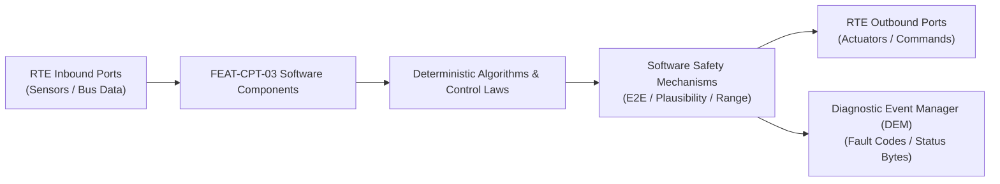

# Software Requirements Specification: Digital Instrument Cluster with ASIL B Safety Island (DIC-SI)
**Feature ID:** `FEAT-CPT-03`  
**Domain:** Cockpit Electronics & Acoustic Safety  
**Target ASIL:** ASIL B / ISO 26262  
**Compliance Standard:** ISO 26262:2018 (Part 6 - Software Development) / ASPICE PAM v3.1 (SWE.1, SWE.2)  
**Parent System Specification:** [`FEAT-CPT-03_CLUSTER_SysReq.md`](file:///c:/Workset/AntiGravityProjects/TestOptimisationExperiement/system_requirements/FEAT-CPT-03_CLUSTER_SysReq.md)  
**Global Master Specification:** [`spec.md`](file:///c:/Workset/AntiGravityProjects/TestOptimisationExperiement/spec.md)

---

## 1. Software Architecture & Component Structure

This document specifies the AUTOSAR Software Components (SWCs), periodic runnables, algorithmic laws, safety mechanisms, and data ports implementing `FEAT-CPT-03` (Digital Instrument Cluster with ASIL B Safety Island (DIC-SI)).

### AUTOSAR SWC Interaction Diagram

---

## 2. Detailed Software Requirements (SWR_REQ)
*(Multi-Software Requirement Partitioning derived from System Requirements)*

### `SWR-CPT-03-01`: Display Framebuffer Hardware CRC-32 Signature Checker
- **Planned Release:** R400
- **ASIL Rating:** ASIL B
- **Parent System Requirement:** [`SYS-CPT-03-01`](file:///c:/Workset/AntiGravityProjects/TestOptimisationExperiement/system_requirements/FEAT-CPT-03_CLUSTER_SysReq.md#sys-cpt-03-01)
- **Allocated AUTOSAR SWC:** `ClusterSafetyIsland_SWC`
- **Execution Rate / Trigger:** 16 ms
- **Worst-Case Execution Time (WCET):** 0.4 ms
- **Software Activation Condition:** Triggered on vertical blanking interval (V-SYNC) of display at 60 Hz.
- **Algorithmic Description / Logic:**
  > Samples hardware CRC signature computed across critical display region (speedometer dial + tell-tale bounding box). Verifies CRC changes dynamically when speed changes. If speed > 0 km/h and identical CRC is detected for >= 6 consecutive frames (100 ms), flags SoC_Display_Frozen.
- **Software Safety Mechanism:** Autonomous hardware comparator inside Safety Island microcontroller bypassing main OS.
- **Failure Reaction & DEM Diagnostic Event:** Toggle Display_Mux_Select line from SoC input to Safety Island 2D graphics engine.
- **Software Port Inputs:** `Hardware_CRC32_Register, VSync_Interrupt_Flag, Filtered_Vehicle_Speed_Kmph`
- **Software Port Outputs:** `Frame_Valid_Flag (boolean), Display_Mux_Control (boolean)`
- **Software Verification Criteria:** Direct frame injection testing freezing GPU display buffer on bench setup.
- **Traceability Link:** Traces upward to [`SYS-CPT-03-01`](file:///c:/Workset/AntiGravityProjects/TestOptimisationExperiement/system_requirements/FEAT-CPT-03_CLUSTER_SysReq.md#sys-cpt-03-01) and [`FEAT-CPT-03`](file:///c:/Workset/AntiGravityProjects/TestOptimisationExperiement/spec.md).

### `SWR-CPT-03-02`: Safety Island 2D Fallback Speedometer Vector Renderer
- **Planned Release:** R400
- **ASIL Rating:** ASIL B
- **Parent System Requirement:** [`SYS-CPT-03-01`](file:///c:/Workset/AntiGravityProjects/TestOptimisationExperiement/system_requirements/FEAT-CPT-03_CLUSTER_SysReq.md#sys-cpt-03-01)
- **Allocated AUTOSAR SWC:** `ClusterFallbackRenderer_SWC`
- **Execution Rate / Trigger:** 20 ms
- **Worst-Case Execution Time (WCET):** 1.8 ms
- **Software Activation Condition:** Active when Display_Mux_Select is switched to Safety Island.
- **Algorithmic Description / Logic:**
  > Renders high-contrast numerical vehicle speed and basic warning icons using internal SRAM 2D graphics accelerator. Ensures minimum 50 fps rendering to prevent perceptible flicker.
- **Software Safety Mechanism:** Direct frame buffer driving with dedicated dual-port video RAM.
- **Failure Reaction & DEM Diagnostic Event:** If Safety Island internal renderer errors, illuminate dedicated physical red LED tell-tales.
- **Software Port Inputs:** `Filtered_Vehicle_Speed_Kmph, Master_Warning_Bits, Gear_Position_PRND`
- **Software Port Outputs:** `Fallback_Display_RGB_Stream, Rendering_Active_Status (boolean)`
- **Software Verification Criteria:** Automated pixel-level optical camera inspection on HIL test station.
- **Traceability Link:** Traces upward to [`SYS-CPT-03-01`](file:///c:/Workset/AntiGravityProjects/TestOptimisationExperiement/system_requirements/FEAT-CPT-03_CLUSTER_SysReq.md#sys-cpt-03-01) and [`FEAT-CPT-03`](file:///c:/Workset/AntiGravityProjects/TestOptimisationExperiement/spec.md).

### `SWR-CPT-03-03`: E2E Profile 4 CAN-FD Tell-Tale Message Validator
- **Planned Release:** R100
- **ASIL Rating:** ASIL B
- **Parent System Requirement:** [`SYS-CPT-03-02`](file:///c:/Workset/AntiGravityProjects/TestOptimisationExperiement/system_requirements/FEAT-CPT-03_CLUSTER_SysReq.md#sys-cpt-03-02)
- **Allocated AUTOSAR SWC:** `ClusterTellTaleReceiver_SWC`
- **Execution Rate / Trigger:** 10 ms
- **Worst-Case Execution Time (WCET):** 0.3 ms
- **Software Activation Condition:** Executed upon arrival of safety CAN-FD PDUs.
- **Algorithmic Description / Logic:**
  > Validates AUTOSAR E2E Profile 4: Checks 16-bit alive counter and 32-bit CRC against Data ID. Rejects out-of-order, stale, or corrupted messages. Updates internal tell-tale state machine.
- **Software Safety Mechanism:** Timeout monitor: If no valid message received within 100 ms, transitions tell-tale to FAILSAFE_ILLUMINATED state.
- **Failure Reaction & DEM Diagnostic Event:** Latch corresponding tell-tale ON and log DTC U0129.
- **Software Port Inputs:** `Raw_CANFD_Safety_PDU_Payload[64], E2E_Expected_Counter`
- **Software Port Outputs:** `Validated_TellTale_Bitmask[32], E2E_Error_Status_Enum`
- **Software Verification Criteria:** Vector CANoe automated fault injection with bit flips, message drops, and counter skips.
- **Traceability Link:** Traces upward to [`SYS-CPT-03-02`](file:///c:/Workset/AntiGravityProjects/TestOptimisationExperiement/system_requirements/FEAT-CPT-03_CLUSTER_SysReq.md#sys-cpt-03-02) and [`FEAT-CPT-03`](file:///c:/Workset/AntiGravityProjects/TestOptimisationExperiement/spec.md).

### `SWR-CPT-03-04`: Dual-Tone Acoustic Hardware Piezo Chime Generator
- **Planned Release:** R100
- **ASIL Rating:** ASIL B
- **Parent System Requirement:** [`SYS-CPT-03-02`](file:///c:/Workset/AntiGravityProjects/TestOptimisationExperiement/system_requirements/FEAT-CPT-03_CLUSTER_SysReq.md#sys-cpt-03-02)
- **Allocated AUTOSAR SWC:** `ClusterChimeManager_SWC`
- **Execution Rate / Trigger:** 10 ms
- **Worst-Case Execution Time (WCET):** 0.2 ms
- **Software Activation Condition:** Triggered upon warning escalation.
- **Algorithmic Description / Logic:**
  > Prioritizes warning chimes based on safety hierarchy: 1) Crash/Airbag (continuous 1200 Hz tone @ 85 dB); 2) Red Brake/ABS (repeating 800 Hz double-chirp); 3) Turn signal click (subtle 400 Hz toggle). Drives hardware PWM timer.
- **Software Safety Mechanism:** Hardware buzzer current feedback: Verifies piezo transducer impedance to confirm chime was physically sounded.
- **Failure Reaction & DEM Diagnostic Event:** Redirect chime demand to cabin audio DSP amplifier via Ethernet AVB if piezo fails.
- **Software Port Inputs:** `Validated_TellTale_Bitmask, Driver_Door_State, Seatbelt_Buckle_State`
- **Software Port Outputs:** `Piezo_PWM_Frequency_Hz, Piezo_PWM_Duty_Cycle, Piezo_Diagnostic_Status`
- **Software Verification Criteria:** Anechoic acoustic chamber sound pressure level (SPL) and frequency spectrum analysis.
- **Traceability Link:** Traces upward to [`SYS-CPT-03-02`](file:///c:/Workset/AntiGravityProjects/TestOptimisationExperiement/system_requirements/FEAT-CPT-03_CLUSTER_SysReq.md#sys-cpt-03-02) and [`FEAT-CPT-03`](file:///c:/Workset/AntiGravityProjects/TestOptimisationExperiement/spec.md).

### `SWR-CPT-03-05`: Dual Microcontroller Core Architecture ASIL B Safety Island Hardware Core - Dynamic Observer & Signal Filter
- **Planned Release:** R100
- **ASIL Rating:** ASIL B
- **Parent System Requirement:** [`SYS-CPT-03-03`](file:///c:/Workset/AntiGravityProjects/TestOptimisationExperiement/system_requirements/FEAT-CPT-03_CLUSTER_SysReq.md#sys-cpt-03-03)
- **Allocated AUTOSAR SWC:** `ClusterSafetyIsland_SWC`
- **Execution Rate / Trigger:** 2 ms
- **Worst-Case Execution Time (WCET):** 0.3 ms
- **Software Activation Condition:** Executed cyclically every 2 ms.
- **Algorithmic Description / Logic:**
  > Executes signal plausibility filtering, calibration offsets, and discrete state estimation for Dual Microcontroller Core Architecture ASIL B Safety Island Hardware Core.
- **Software Safety Mechanism:** Range limit plausibility check and E2E alive sequence verification.
- **Failure Reaction & DEM Diagnostic Event:** Set default fallback output and report DEM_EVENT_FEAT_CPT_03_ERR.
- **Software Port Inputs:** `Raw sensor ADC/SENT/SPI values and RTE bus inputs.`
- **Software Port Outputs:** `Filtered physical signals and validity status bitmasks.`
- **Software Verification Criteria:** Unit test and HiL software integration test.
- **Traceability Link:** Traces upward to [`SYS-CPT-03-03`](file:///c:/Workset/AntiGravityProjects/TestOptimisationExperiement/system_requirements/FEAT-CPT-03_CLUSTER_SysReq.md#sys-cpt-03-03) and [`FEAT-CPT-03`](file:///c:/Workset/AntiGravityProjects/TestOptimisationExperiement/spec.md).

### `SWR-CPT-03-06`: Dual Microcontroller Core Architecture ASIL B Safety Island Hardware Core - Closed-Loop Control Law & Actuator Dispatch
- **Planned Release:** R100
- **ASIL Rating:** ASIL B
- **Parent System Requirement:** [`SYS-CPT-03-03`](file:///c:/Workset/AntiGravityProjects/TestOptimisationExperiement/system_requirements/FEAT-CPT-03_CLUSTER_SysReq.md#sys-cpt-03-03)
- **Allocated AUTOSAR SWC:** `ClusterSafetyIsland_SWC`
- **Execution Rate / Trigger:** 2 ms
- **Worst-Case Execution Time (WCET):** 0.4 ms
- **Software Activation Condition:** Executed cyclically every 2 ms.
- **Algorithmic Description / Logic:**
  > Evaluates deterministic closed-loop control law, rate limits, and dispatches commands for Dual Microcontroller Core Architecture ASIL B Safety Island Hardware Core.
- **Software Safety Mechanism:** Command saturation clamping and watchdog program flow monitoring.
- **Failure Reaction & DEM Diagnostic Event:** De-energize actuator output, apply safe fallback clamp, and latch DTC.
- **Software Port Inputs:** `Validated physical state signals from observer SWC.`
- **Software Port Outputs:** `Actuator PWM duty cycles, torque/pressure setpoints, and diagnostic flags.`
- **Software Verification Criteria:** Hardware dynamometer and HiL closed-loop regression test suite.
- **Traceability Link:** Traces upward to [`SYS-CPT-03-03`](file:///c:/Workset/AntiGravityProjects/TestOptimisationExperiement/system_requirements/FEAT-CPT-03_CLUSTER_SysReq.md#sys-cpt-03-03) and [`FEAT-CPT-03`](file:///c:/Workset/AntiGravityProjects/TestOptimisationExperiement/spec.md).

### `SWR-CPT-03-07`: Safety-Critical Optical Tell-Tale Lamp Display Controller & Pixel Echo Checker - Dynamic Observer & Signal Filter
- **Planned Release:** R200
- **ASIL Rating:** ASIL B
- **Parent System Requirement:** [`SYS-CPT-03-04`](file:///c:/Workset/AntiGravityProjects/TestOptimisationExperiement/system_requirements/FEAT-CPT-03_CLUSTER_SysReq.md#sys-cpt-03-04)
- **Allocated AUTOSAR SWC:** `ClusterPixelEcho_SWC`
- **Execution Rate / Trigger:** 2 ms
- **Worst-Case Execution Time (WCET):** 0.3 ms
- **Software Activation Condition:** Executed cyclically every 2 ms.
- **Algorithmic Description / Logic:**
  > Executes signal plausibility filtering, calibration offsets, and discrete state estimation for Safety-Critical Optical Tell-Tale Lamp Display Controller & Pixel Echo Checker.
- **Software Safety Mechanism:** Range limit plausibility check and E2E alive sequence verification.
- **Failure Reaction & DEM Diagnostic Event:** Set default fallback output and report DEM_EVENT_FEAT_CPT_03_ERR.
- **Software Port Inputs:** `Raw sensor ADC/SENT/SPI values and RTE bus inputs.`
- **Software Port Outputs:** `Filtered physical signals and validity status bitmasks.`
- **Software Verification Criteria:** Unit test and HiL software integration test.
- **Traceability Link:** Traces upward to [`SYS-CPT-03-04`](file:///c:/Workset/AntiGravityProjects/TestOptimisationExperiement/system_requirements/FEAT-CPT-03_CLUSTER_SysReq.md#sys-cpt-03-04) and [`FEAT-CPT-03`](file:///c:/Workset/AntiGravityProjects/TestOptimisationExperiement/spec.md).

### `SWR-CPT-03-08`: Safety-Critical Optical Tell-Tale Lamp Display Controller & Pixel Echo Checker - Closed-Loop Control Law & Actuator Dispatch
- **Planned Release:** R200
- **ASIL Rating:** ASIL B
- **Parent System Requirement:** [`SYS-CPT-03-04`](file:///c:/Workset/AntiGravityProjects/TestOptimisationExperiement/system_requirements/FEAT-CPT-03_CLUSTER_SysReq.md#sys-cpt-03-04)
- **Allocated AUTOSAR SWC:** `ClusterPixelEcho_SWC`
- **Execution Rate / Trigger:** 2 ms
- **Worst-Case Execution Time (WCET):** 0.4 ms
- **Software Activation Condition:** Executed cyclically every 2 ms.
- **Algorithmic Description / Logic:**
  > Evaluates deterministic closed-loop control law, rate limits, and dispatches commands for Safety-Critical Optical Tell-Tale Lamp Display Controller & Pixel Echo Checker.
- **Software Safety Mechanism:** Command saturation clamping and watchdog program flow monitoring.
- **Failure Reaction & DEM Diagnostic Event:** De-energize actuator output, apply safe fallback clamp, and latch DTC.
- **Software Port Inputs:** `Validated physical state signals from observer SWC.`
- **Software Port Outputs:** `Actuator PWM duty cycles, torque/pressure setpoints, and diagnostic flags.`
- **Software Verification Criteria:** Hardware dynamometer and HiL closed-loop regression test suite.
- **Traceability Link:** Traces upward to [`SYS-CPT-03-04`](file:///c:/Workset/AntiGravityProjects/TestOptimisationExperiement/system_requirements/FEAT-CPT-03_CLUSTER_SysReq.md#sys-cpt-03-04) and [`FEAT-CPT-03`](file:///c:/Workset/AntiGravityProjects/TestOptimisationExperiement/spec.md).

### `SWR-CPT-03-09`: Vehicle Speedometer Digital Needle Value Verification & Plausibility Monitor - Dynamic Observer & Signal Filter
- **Planned Release:** R200
- **ASIL Rating:** ASIL B
- **Parent System Requirement:** [`SYS-CPT-03-05`](file:///c:/Workset/AntiGravityProjects/TestOptimisationExperiement/system_requirements/FEAT-CPT-03_CLUSTER_SysReq.md#sys-cpt-03-05)
- **Allocated AUTOSAR SWC:** `ClusterSpeedPlausibility_SWC`
- **Execution Rate / Trigger:** 5 ms
- **Worst-Case Execution Time (WCET):** 0.3 ms
- **Software Activation Condition:** Executed cyclically every 5 ms.
- **Algorithmic Description / Logic:**
  > Executes signal plausibility filtering, calibration offsets, and discrete state estimation for Vehicle Speedometer Digital Needle Value Verification & Plausibility Monitor.
- **Software Safety Mechanism:** Range limit plausibility check and E2E alive sequence verification.
- **Failure Reaction & DEM Diagnostic Event:** Set default fallback output and report DEM_EVENT_FEAT_CPT_03_ERR.
- **Software Port Inputs:** `Raw sensor ADC/SENT/SPI values and RTE bus inputs.`
- **Software Port Outputs:** `Filtered physical signals and validity status bitmasks.`
- **Software Verification Criteria:** Unit test and HiL software integration test.
- **Traceability Link:** Traces upward to [`SYS-CPT-03-05`](file:///c:/Workset/AntiGravityProjects/TestOptimisationExperiement/system_requirements/FEAT-CPT-03_CLUSTER_SysReq.md#sys-cpt-03-05) and [`FEAT-CPT-03`](file:///c:/Workset/AntiGravityProjects/TestOptimisationExperiement/spec.md).

### `SWR-CPT-03-10`: Vehicle Speedometer Digital Needle Value Verification & Plausibility Monitor - Closed-Loop Control Law & Actuator Dispatch
- **Planned Release:** R200
- **ASIL Rating:** ASIL B
- **Parent System Requirement:** [`SYS-CPT-03-05`](file:///c:/Workset/AntiGravityProjects/TestOptimisationExperiement/system_requirements/FEAT-CPT-03_CLUSTER_SysReq.md#sys-cpt-03-05)
- **Allocated AUTOSAR SWC:** `ClusterSpeedPlausibility_SWC`
- **Execution Rate / Trigger:** 5 ms
- **Worst-Case Execution Time (WCET):** 0.4 ms
- **Software Activation Condition:** Executed cyclically every 5 ms.
- **Algorithmic Description / Logic:**
  > Evaluates deterministic closed-loop control law, rate limits, and dispatches commands for Vehicle Speedometer Digital Needle Value Verification & Plausibility Monitor.
- **Software Safety Mechanism:** Command saturation clamping and watchdog program flow monitoring.
- **Failure Reaction & DEM Diagnostic Event:** De-energize actuator output, apply safe fallback clamp, and latch DTC.
- **Software Port Inputs:** `Validated physical state signals from observer SWC.`
- **Software Port Outputs:** `Actuator PWM duty cycles, torque/pressure setpoints, and diagnostic flags.`
- **Software Verification Criteria:** Hardware dynamometer and HiL closed-loop regression test suite.
- **Traceability Link:** Traces upward to [`SYS-CPT-03-05`](file:///c:/Workset/AntiGravityProjects/TestOptimisationExperiement/system_requirements/FEAT-CPT-03_CLUSTER_SysReq.md#sys-cpt-03-05) and [`FEAT-CPT-03`](file:///c:/Workset/AntiGravityProjects/TestOptimisationExperiement/spec.md).

### `SWR-CPT-03-11`: Gear Selector State (P-R-N-D) Redundant Display Transmission Governor - Dynamic Observer & Signal Filter
- **Planned Release:** R200
- **ASIL Rating:** ASIL B
- **Parent System Requirement:** [`SYS-CPT-03-06`](file:///c:/Workset/AntiGravityProjects/TestOptimisationExperiement/system_requirements/FEAT-CPT-03_CLUSTER_SysReq.md#sys-cpt-03-06)
- **Allocated AUTOSAR SWC:** `ClusterGearDisplay_SWC`
- **Execution Rate / Trigger:** 5 ms
- **Worst-Case Execution Time (WCET):** 0.3 ms
- **Software Activation Condition:** Executed cyclically every 5 ms.
- **Algorithmic Description / Logic:**
  > Executes signal plausibility filtering, calibration offsets, and discrete state estimation for Gear Selector State (P-R-N-D) Redundant Display Transmission Governor.
- **Software Safety Mechanism:** Range limit plausibility check and E2E alive sequence verification.
- **Failure Reaction & DEM Diagnostic Event:** Set default fallback output and report DEM_EVENT_FEAT_CPT_03_ERR.
- **Software Port Inputs:** `Raw sensor ADC/SENT/SPI values and RTE bus inputs.`
- **Software Port Outputs:** `Filtered physical signals and validity status bitmasks.`
- **Software Verification Criteria:** Unit test and HiL software integration test.
- **Traceability Link:** Traces upward to [`SYS-CPT-03-06`](file:///c:/Workset/AntiGravityProjects/TestOptimisationExperiement/system_requirements/FEAT-CPT-03_CLUSTER_SysReq.md#sys-cpt-03-06) and [`FEAT-CPT-03`](file:///c:/Workset/AntiGravityProjects/TestOptimisationExperiement/spec.md).

### `SWR-CPT-03-12`: Gear Selector State (P-R-N-D) Redundant Display Transmission Governor - Closed-Loop Control Law & Actuator Dispatch
- **Planned Release:** R200
- **ASIL Rating:** ASIL B
- **Parent System Requirement:** [`SYS-CPT-03-06`](file:///c:/Workset/AntiGravityProjects/TestOptimisationExperiement/system_requirements/FEAT-CPT-03_CLUSTER_SysReq.md#sys-cpt-03-06)
- **Allocated AUTOSAR SWC:** `ClusterGearDisplay_SWC`
- **Execution Rate / Trigger:** 5 ms
- **Worst-Case Execution Time (WCET):** 0.4 ms
- **Software Activation Condition:** Executed cyclically every 5 ms.
- **Algorithmic Description / Logic:**
  > Evaluates deterministic closed-loop control law, rate limits, and dispatches commands for Gear Selector State (P-R-N-D) Redundant Display Transmission Governor.
- **Software Safety Mechanism:** Command saturation clamping and watchdog program flow monitoring.
- **Failure Reaction & DEM Diagnostic Event:** De-energize actuator output, apply safe fallback clamp, and latch DTC.
- **Software Port Inputs:** `Validated physical state signals from observer SWC.`
- **Software Port Outputs:** `Actuator PWM duty cycles, torque/pressure setpoints, and diagnostic flags.`
- **Software Verification Criteria:** Hardware dynamometer and HiL closed-loop regression test suite.
- **Traceability Link:** Traces upward to [`SYS-CPT-03-06`](file:///c:/Workset/AntiGravityProjects/TestOptimisationExperiement/system_requirements/FEAT-CPT-03_CLUSTER_SysReq.md#sys-cpt-03-06) and [`FEAT-CPT-03`](file:///c:/Workset/AntiGravityProjects/TestOptimisationExperiement/spec.md).

### `SWR-CPT-03-13`: High-Speed CAN-FD / Automotive Ethernet Instrument Cluster Gateway Interface - Dynamic Observer & Signal Filter
- **Planned Release:** R300
- **ASIL Rating:** ASIL B
- **Parent System Requirement:** [`SYS-CPT-03-07`](file:///c:/Workset/AntiGravityProjects/TestOptimisationExperiement/system_requirements/FEAT-CPT-03_CLUSTER_SysReq.md#sys-cpt-03-07)
- **Allocated AUTOSAR SWC:** `ClusterGatewayInterface_SWC`
- **Execution Rate / Trigger:** 2 ms
- **Worst-Case Execution Time (WCET):** 0.3 ms
- **Software Activation Condition:** Executed cyclically every 2 ms.
- **Algorithmic Description / Logic:**
  > Executes signal plausibility filtering, calibration offsets, and discrete state estimation for High-Speed CAN-FD / Automotive Ethernet Instrument Cluster Gateway Interface.
- **Software Safety Mechanism:** Range limit plausibility check and E2E alive sequence verification.
- **Failure Reaction & DEM Diagnostic Event:** Set default fallback output and report DEM_EVENT_FEAT_CPT_03_ERR.
- **Software Port Inputs:** `Raw sensor ADC/SENT/SPI values and RTE bus inputs.`
- **Software Port Outputs:** `Filtered physical signals and validity status bitmasks.`
- **Software Verification Criteria:** Unit test and HiL software integration test.
- **Traceability Link:** Traces upward to [`SYS-CPT-03-07`](file:///c:/Workset/AntiGravityProjects/TestOptimisationExperiement/system_requirements/FEAT-CPT-03_CLUSTER_SysReq.md#sys-cpt-03-07) and [`FEAT-CPT-03`](file:///c:/Workset/AntiGravityProjects/TestOptimisationExperiement/spec.md).

### `SWR-CPT-03-14`: High-Speed CAN-FD / Automotive Ethernet Instrument Cluster Gateway Interface - Closed-Loop Control Law & Actuator Dispatch
- **Planned Release:** R300
- **ASIL Rating:** ASIL B
- **Parent System Requirement:** [`SYS-CPT-03-07`](file:///c:/Workset/AntiGravityProjects/TestOptimisationExperiement/system_requirements/FEAT-CPT-03_CLUSTER_SysReq.md#sys-cpt-03-07)
- **Allocated AUTOSAR SWC:** `ClusterGatewayInterface_SWC`
- **Execution Rate / Trigger:** 2 ms
- **Worst-Case Execution Time (WCET):** 0.4 ms
- **Software Activation Condition:** Executed cyclically every 2 ms.
- **Algorithmic Description / Logic:**
  > Evaluates deterministic closed-loop control law, rate limits, and dispatches commands for High-Speed CAN-FD / Automotive Ethernet Instrument Cluster Gateway Interface.
- **Software Safety Mechanism:** Command saturation clamping and watchdog program flow monitoring.
- **Failure Reaction & DEM Diagnostic Event:** De-energize actuator output, apply safe fallback clamp, and latch DTC.
- **Software Port Inputs:** `Validated physical state signals from observer SWC.`
- **Software Port Outputs:** `Actuator PWM duty cycles, torque/pressure setpoints, and diagnostic flags.`
- **Software Verification Criteria:** Hardware dynamometer and HiL closed-loop regression test suite.
- **Traceability Link:** Traces upward to [`SYS-CPT-03-07`](file:///c:/Workset/AntiGravityProjects/TestOptimisationExperiement/system_requirements/FEAT-CPT-03_CLUSTER_SysReq.md#sys-cpt-03-07) and [`FEAT-CPT-03`](file:///c:/Workset/AntiGravityProjects/TestOptimisationExperiement/spec.md).

### `SWR-CPT-03-15`: Cluster LCD Backlight Dual-String LED Open/Short Hardware Supervisor - Dynamic Observer & Signal Filter
- **Planned Release:** R300
- **ASIL Rating:** ASIL B
- **Parent System Requirement:** [`SYS-CPT-03-08`](file:///c:/Workset/AntiGravityProjects/TestOptimisationExperiement/system_requirements/FEAT-CPT-03_CLUSTER_SysReq.md#sys-cpt-03-08)
- **Allocated AUTOSAR SWC:** `ClusterBacklightSupervisor_SWC`
- **Execution Rate / Trigger:** 20 ms
- **Worst-Case Execution Time (WCET):** 0.3 ms
- **Software Activation Condition:** Executed cyclically every 20 ms.
- **Algorithmic Description / Logic:**
  > Executes signal plausibility filtering, calibration offsets, and discrete state estimation for Cluster LCD Backlight Dual-String LED Open/Short Hardware Supervisor.
- **Software Safety Mechanism:** Range limit plausibility check and E2E alive sequence verification.
- **Failure Reaction & DEM Diagnostic Event:** Set default fallback output and report DEM_EVENT_FEAT_CPT_03_ERR.
- **Software Port Inputs:** `Raw sensor ADC/SENT/SPI values and RTE bus inputs.`
- **Software Port Outputs:** `Filtered physical signals and validity status bitmasks.`
- **Software Verification Criteria:** Unit test and HiL software integration test.
- **Traceability Link:** Traces upward to [`SYS-CPT-03-08`](file:///c:/Workset/AntiGravityProjects/TestOptimisationExperiement/system_requirements/FEAT-CPT-03_CLUSTER_SysReq.md#sys-cpt-03-08) and [`FEAT-CPT-03`](file:///c:/Workset/AntiGravityProjects/TestOptimisationExperiement/spec.md).

### `SWR-CPT-03-16`: Cluster LCD Backlight Dual-String LED Open/Short Hardware Supervisor - Closed-Loop Control Law & Actuator Dispatch
- **Planned Release:** R300
- **ASIL Rating:** ASIL B
- **Parent System Requirement:** [`SYS-CPT-03-08`](file:///c:/Workset/AntiGravityProjects/TestOptimisationExperiement/system_requirements/FEAT-CPT-03_CLUSTER_SysReq.md#sys-cpt-03-08)
- **Allocated AUTOSAR SWC:** `ClusterBacklightSupervisor_SWC`
- **Execution Rate / Trigger:** 20 ms
- **Worst-Case Execution Time (WCET):** 0.4 ms
- **Software Activation Condition:** Executed cyclically every 20 ms.
- **Algorithmic Description / Logic:**
  > Evaluates deterministic closed-loop control law, rate limits, and dispatches commands for Cluster LCD Backlight Dual-String LED Open/Short Hardware Supervisor.
- **Software Safety Mechanism:** Command saturation clamping and watchdog program flow monitoring.
- **Failure Reaction & DEM Diagnostic Event:** De-energize actuator output, apply safe fallback clamp, and latch DTC.
- **Software Port Inputs:** `Validated physical state signals from observer SWC.`
- **Software Port Outputs:** `Actuator PWM duty cycles, torque/pressure setpoints, and diagnostic flags.`
- **Software Verification Criteria:** Hardware dynamometer and HiL closed-loop regression test suite.
- **Traceability Link:** Traces upward to [`SYS-CPT-03-08`](file:///c:/Workset/AntiGravityProjects/TestOptimisationExperiement/system_requirements/FEAT-CPT-03_CLUSTER_SysReq.md#sys-cpt-03-08) and [`FEAT-CPT-03`](file:///c:/Workset/AntiGravityProjects/TestOptimisationExperiement/spec.md).

### `SWR-CPT-03-17`: Graphic Processing Unit (GPU) Frame Rendering Freeze & Lockup Hardware Watchdog - Dynamic Observer & Signal Filter
- **Planned Release:** R400
- **ASIL Rating:** ASIL B
- **Parent System Requirement:** [`SYS-CPT-03-09`](file:///c:/Workset/AntiGravityProjects/TestOptimisationExperiement/system_requirements/FEAT-CPT-03_CLUSTER_SysReq.md#sys-cpt-03-09)
- **Allocated AUTOSAR SWC:** `ClusterGpuWatchdog_SWC`
- **Execution Rate / Trigger:** 5 ms
- **Worst-Case Execution Time (WCET):** 0.3 ms
- **Software Activation Condition:** Executed cyclically every 5 ms.
- **Algorithmic Description / Logic:**
  > Executes signal plausibility filtering, calibration offsets, and discrete state estimation for Graphic Processing Unit (GPU) Frame Rendering Freeze & Lockup Hardware Watchdog.
- **Software Safety Mechanism:** Range limit plausibility check and E2E alive sequence verification.
- **Failure Reaction & DEM Diagnostic Event:** Set default fallback output and report DEM_EVENT_FEAT_CPT_03_ERR.
- **Software Port Inputs:** `Raw sensor ADC/SENT/SPI values and RTE bus inputs.`
- **Software Port Outputs:** `Filtered physical signals and validity status bitmasks.`
- **Software Verification Criteria:** Unit test and HiL software integration test.
- **Traceability Link:** Traces upward to [`SYS-CPT-03-09`](file:///c:/Workset/AntiGravityProjects/TestOptimisationExperiement/system_requirements/FEAT-CPT-03_CLUSTER_SysReq.md#sys-cpt-03-09) and [`FEAT-CPT-03`](file:///c:/Workset/AntiGravityProjects/TestOptimisationExperiement/spec.md).

### `SWR-CPT-03-18`: Graphic Processing Unit (GPU) Frame Rendering Freeze & Lockup Hardware Watchdog - Closed-Loop Control Law & Actuator Dispatch
- **Planned Release:** R400
- **ASIL Rating:** ASIL B
- **Parent System Requirement:** [`SYS-CPT-03-09`](file:///c:/Workset/AntiGravityProjects/TestOptimisationExperiement/system_requirements/FEAT-CPT-03_CLUSTER_SysReq.md#sys-cpt-03-09)
- **Allocated AUTOSAR SWC:** `ClusterGpuWatchdog_SWC`
- **Execution Rate / Trigger:** 5 ms
- **Worst-Case Execution Time (WCET):** 0.4 ms
- **Software Activation Condition:** Executed cyclically every 5 ms.
- **Algorithmic Description / Logic:**
  > Evaluates deterministic closed-loop control law, rate limits, and dispatches commands for Graphic Processing Unit (GPU) Frame Rendering Freeze & Lockup Hardware Watchdog.
- **Software Safety Mechanism:** Command saturation clamping and watchdog program flow monitoring.
- **Failure Reaction & DEM Diagnostic Event:** De-energize actuator output, apply safe fallback clamp, and latch DTC.
- **Software Port Inputs:** `Validated physical state signals from observer SWC.`
- **Software Port Outputs:** `Actuator PWM duty cycles, torque/pressure setpoints, and diagnostic flags.`
- **Software Verification Criteria:** Hardware dynamometer and HiL closed-loop regression test suite.
- **Traceability Link:** Traces upward to [`SYS-CPT-03-09`](file:///c:/Workset/AntiGravityProjects/TestOptimisationExperiement/system_requirements/FEAT-CPT-03_CLUSTER_SysReq.md#sys-cpt-03-09) and [`FEAT-CPT-03`](file:///c:/Workset/AntiGravityProjects/TestOptimisationExperiement/spec.md).

### `SWR-CPT-03-19`: Acoustic Master Chime Loudspeaker Continuity & Amplifier Impedance Tester - Dynamic Observer & Signal Filter
- **Planned Release:** R500
- **ASIL Rating:** ASIL B
- **Parent System Requirement:** [`SYS-CPT-03-10`](file:///c:/Workset/AntiGravityProjects/TestOptimisationExperiement/system_requirements/FEAT-CPT-03_CLUSTER_SysReq.md#sys-cpt-03-10)
- **Allocated AUTOSAR SWC:** `ClusterChimeImpedance_SWC`
- **Execution Rate / Trigger:** 50 ms
- **Worst-Case Execution Time (WCET):** 0.3 ms
- **Software Activation Condition:** Executed cyclically every 50 ms.
- **Algorithmic Description / Logic:**
  > Executes signal plausibility filtering, calibration offsets, and discrete state estimation for Acoustic Master Chime Loudspeaker Continuity & Amplifier Impedance Tester.
- **Software Safety Mechanism:** Range limit plausibility check and E2E alive sequence verification.
- **Failure Reaction & DEM Diagnostic Event:** Set default fallback output and report DEM_EVENT_FEAT_CPT_03_ERR.
- **Software Port Inputs:** `Raw sensor ADC/SENT/SPI values and RTE bus inputs.`
- **Software Port Outputs:** `Filtered physical signals and validity status bitmasks.`
- **Software Verification Criteria:** Unit test and HiL software integration test.
- **Traceability Link:** Traces upward to [`SYS-CPT-03-10`](file:///c:/Workset/AntiGravityProjects/TestOptimisationExperiement/system_requirements/FEAT-CPT-03_CLUSTER_SysReq.md#sys-cpt-03-10) and [`FEAT-CPT-03`](file:///c:/Workset/AntiGravityProjects/TestOptimisationExperiement/spec.md).

### `SWR-CPT-03-20`: Acoustic Master Chime Loudspeaker Continuity & Amplifier Impedance Tester - Closed-Loop Control Law & Actuator Dispatch
- **Planned Release:** R500
- **ASIL Rating:** ASIL B
- **Parent System Requirement:** [`SYS-CPT-03-10`](file:///c:/Workset/AntiGravityProjects/TestOptimisationExperiement/system_requirements/FEAT-CPT-03_CLUSTER_SysReq.md#sys-cpt-03-10)
- **Allocated AUTOSAR SWC:** `ClusterChimeImpedance_SWC`
- **Execution Rate / Trigger:** 50 ms
- **Worst-Case Execution Time (WCET):** 0.4 ms
- **Software Activation Condition:** Executed cyclically every 50 ms.
- **Algorithmic Description / Logic:**
  > Evaluates deterministic closed-loop control law, rate limits, and dispatches commands for Acoustic Master Chime Loudspeaker Continuity & Amplifier Impedance Tester.
- **Software Safety Mechanism:** Command saturation clamping and watchdog program flow monitoring.
- **Failure Reaction & DEM Diagnostic Event:** De-energize actuator output, apply safe fallback clamp, and latch DTC.
- **Software Port Inputs:** `Validated physical state signals from observer SWC.`
- **Software Port Outputs:** `Actuator PWM duty cycles, torque/pressure setpoints, and diagnostic flags.`
- **Software Verification Criteria:** Hardware dynamometer and HiL closed-loop regression test suite.
- **Traceability Link:** Traces upward to [`SYS-CPT-03-10`](file:///c:/Workset/AntiGravityProjects/TestOptimisationExperiement/system_requirements/FEAT-CPT-03_CLUSTER_SysReq.md#sys-cpt-03-10) and [`FEAT-CPT-03`](file:///c:/Workset/AntiGravityProjects/TestOptimisationExperiement/spec.md).

### `SWR-CPT-03-21`: Ambient Cabin Illuminance Display Dimming Curve Generator - Dynamic Observer & Signal Filter
- **Planned Release:** R400
- **ASIL Rating:** ASIL A
- **Parent System Requirement:** [`SYS-CPT-03-11`](file:///c:/Workset/AntiGravityProjects/TestOptimisationExperiement/system_requirements/FEAT-CPT-03_CLUSTER_SysReq.md#sys-cpt-03-11)
- **Allocated AUTOSAR SWC:** `ClusterDimmingCurve_SWC`
- **Execution Rate / Trigger:** 100 ms
- **Worst-Case Execution Time (WCET):** 0.3 ms
- **Software Activation Condition:** Executed cyclically every 100 ms.
- **Algorithmic Description / Logic:**
  > Executes signal plausibility filtering, calibration offsets, and discrete state estimation for Ambient Cabin Illuminance Display Dimming Curve Generator.
- **Software Safety Mechanism:** Range limit plausibility check and E2E alive sequence verification.
- **Failure Reaction & DEM Diagnostic Event:** Set default fallback output and report DEM_EVENT_FEAT_CPT_03_ERR.
- **Software Port Inputs:** `Raw sensor ADC/SENT/SPI values and RTE bus inputs.`
- **Software Port Outputs:** `Filtered physical signals and validity status bitmasks.`
- **Software Verification Criteria:** Unit test and HiL software integration test.
- **Traceability Link:** Traces upward to [`SYS-CPT-03-11`](file:///c:/Workset/AntiGravityProjects/TestOptimisationExperiement/system_requirements/FEAT-CPT-03_CLUSTER_SysReq.md#sys-cpt-03-11) and [`FEAT-CPT-03`](file:///c:/Workset/AntiGravityProjects/TestOptimisationExperiement/spec.md).

### `SWR-CPT-03-22`: Ambient Cabin Illuminance Display Dimming Curve Generator - Closed-Loop Control Law & Actuator Dispatch
- **Planned Release:** R400
- **ASIL Rating:** ASIL A
- **Parent System Requirement:** [`SYS-CPT-03-11`](file:///c:/Workset/AntiGravityProjects/TestOptimisationExperiement/system_requirements/FEAT-CPT-03_CLUSTER_SysReq.md#sys-cpt-03-11)
- **Allocated AUTOSAR SWC:** `ClusterDimmingCurve_SWC`
- **Execution Rate / Trigger:** 100 ms
- **Worst-Case Execution Time (WCET):** 0.4 ms
- **Software Activation Condition:** Executed cyclically every 100 ms.
- **Algorithmic Description / Logic:**
  > Evaluates deterministic closed-loop control law, rate limits, and dispatches commands for Ambient Cabin Illuminance Display Dimming Curve Generator.
- **Software Safety Mechanism:** Command saturation clamping and watchdog program flow monitoring.
- **Failure Reaction & DEM Diagnostic Event:** De-energize actuator output, apply safe fallback clamp, and latch DTC.
- **Software Port Inputs:** `Validated physical state signals from observer SWC.`
- **Software Port Outputs:** `Actuator PWM duty cycles, torque/pressure setpoints, and diagnostic flags.`
- **Software Verification Criteria:** Hardware dynamometer and HiL closed-loop regression test suite.
- **Traceability Link:** Traces upward to [`SYS-CPT-03-11`](file:///c:/Workset/AntiGravityProjects/TestOptimisationExperiement/system_requirements/FEAT-CPT-03_CLUSTER_SysReq.md#sys-cpt-03-11) and [`FEAT-CPT-03`](file:///c:/Workset/AntiGravityProjects/TestOptimisationExperiement/spec.md).

### `SWR-CPT-03-23`: Trip Computer Energy Consumption & Estimated Range Calculation Law - Dynamic Observer & Signal Filter
- **Planned Release:** R400
- **ASIL Rating:** ASIL A
- **Parent System Requirement:** [`SYS-CPT-03-12`](file:///c:/Workset/AntiGravityProjects/TestOptimisationExperiement/system_requirements/FEAT-CPT-03_CLUSTER_SysReq.md#sys-cpt-03-12)
- **Allocated AUTOSAR SWC:** `ClusterTripComputer_SWC`
- **Execution Rate / Trigger:** 200 ms
- **Worst-Case Execution Time (WCET):** 0.3 ms
- **Software Activation Condition:** Executed cyclically every 200 ms.
- **Algorithmic Description / Logic:**
  > Executes signal plausibility filtering, calibration offsets, and discrete state estimation for Trip Computer Energy Consumption & Estimated Range Calculation Law.
- **Software Safety Mechanism:** Range limit plausibility check and E2E alive sequence verification.
- **Failure Reaction & DEM Diagnostic Event:** Set default fallback output and report DEM_EVENT_FEAT_CPT_03_ERR.
- **Software Port Inputs:** `Raw sensor ADC/SENT/SPI values and RTE bus inputs.`
- **Software Port Outputs:** `Filtered physical signals and validity status bitmasks.`
- **Software Verification Criteria:** Unit test and HiL software integration test.
- **Traceability Link:** Traces upward to [`SYS-CPT-03-12`](file:///c:/Workset/AntiGravityProjects/TestOptimisationExperiement/system_requirements/FEAT-CPT-03_CLUSTER_SysReq.md#sys-cpt-03-12) and [`FEAT-CPT-03`](file:///c:/Workset/AntiGravityProjects/TestOptimisationExperiement/spec.md).

### `SWR-CPT-03-24`: Trip Computer Energy Consumption & Estimated Range Calculation Law - Closed-Loop Control Law & Actuator Dispatch
- **Planned Release:** R400
- **ASIL Rating:** ASIL A
- **Parent System Requirement:** [`SYS-CPT-03-12`](file:///c:/Workset/AntiGravityProjects/TestOptimisationExperiement/system_requirements/FEAT-CPT-03_CLUSTER_SysReq.md#sys-cpt-03-12)
- **Allocated AUTOSAR SWC:** `ClusterTripComputer_SWC`
- **Execution Rate / Trigger:** 200 ms
- **Worst-Case Execution Time (WCET):** 0.4 ms
- **Software Activation Condition:** Executed cyclically every 200 ms.
- **Algorithmic Description / Logic:**
  > Evaluates deterministic closed-loop control law, rate limits, and dispatches commands for Trip Computer Energy Consumption & Estimated Range Calculation Law.
- **Software Safety Mechanism:** Command saturation clamping and watchdog program flow monitoring.
- **Failure Reaction & DEM Diagnostic Event:** De-energize actuator output, apply safe fallback clamp, and latch DTC.
- **Software Port Inputs:** `Validated physical state signals from observer SWC.`
- **Software Port Outputs:** `Actuator PWM duty cycles, torque/pressure setpoints, and diagnostic flags.`
- **Software Verification Criteria:** Hardware dynamometer and HiL closed-loop regression test suite.
- **Traceability Link:** Traces upward to [`SYS-CPT-03-12`](file:///c:/Workset/AntiGravityProjects/TestOptimisationExperiement/system_requirements/FEAT-CPT-03_CLUSTER_SysReq.md#sys-cpt-03-12) and [`FEAT-CPT-03`](file:///c:/Workset/AntiGravityProjects/TestOptimisationExperiement/spec.md).

### `SWR-CPT-03-25`: High-Priority Master Warning Message Text Overlay Pop-Up Manager - Dynamic Observer & Signal Filter
- **Planned Release:** R500
- **ASIL Rating:** ASIL B
- **Parent System Requirement:** [`SYS-CPT-03-13`](file:///c:/Workset/AntiGravityProjects/TestOptimisationExperiement/system_requirements/FEAT-CPT-03_CLUSTER_SysReq.md#sys-cpt-03-13)
- **Allocated AUTOSAR SWC:** `ClusterPopUpManager_SWC`
- **Execution Rate / Trigger:** 20 ms
- **Worst-Case Execution Time (WCET):** 0.3 ms
- **Software Activation Condition:** Executed cyclically every 20 ms.
- **Algorithmic Description / Logic:**
  > Executes signal plausibility filtering, calibration offsets, and discrete state estimation for High-Priority Master Warning Message Text Overlay Pop-Up Manager.
- **Software Safety Mechanism:** Range limit plausibility check and E2E alive sequence verification.
- **Failure Reaction & DEM Diagnostic Event:** Set default fallback output and report DEM_EVENT_FEAT_CPT_03_ERR.
- **Software Port Inputs:** `Raw sensor ADC/SENT/SPI values and RTE bus inputs.`
- **Software Port Outputs:** `Filtered physical signals and validity status bitmasks.`
- **Software Verification Criteria:** Unit test and HiL software integration test.
- **Traceability Link:** Traces upward to [`SYS-CPT-03-13`](file:///c:/Workset/AntiGravityProjects/TestOptimisationExperiement/system_requirements/FEAT-CPT-03_CLUSTER_SysReq.md#sys-cpt-03-13) and [`FEAT-CPT-03`](file:///c:/Workset/AntiGravityProjects/TestOptimisationExperiement/spec.md).

### `SWR-CPT-03-26`: High-Priority Master Warning Message Text Overlay Pop-Up Manager - Closed-Loop Control Law & Actuator Dispatch
- **Planned Release:** R500
- **ASIL Rating:** ASIL B
- **Parent System Requirement:** [`SYS-CPT-03-13`](file:///c:/Workset/AntiGravityProjects/TestOptimisationExperiement/system_requirements/FEAT-CPT-03_CLUSTER_SysReq.md#sys-cpt-03-13)
- **Allocated AUTOSAR SWC:** `ClusterPopUpManager_SWC`
- **Execution Rate / Trigger:** 20 ms
- **Worst-Case Execution Time (WCET):** 0.4 ms
- **Software Activation Condition:** Executed cyclically every 20 ms.
- **Algorithmic Description / Logic:**
  > Evaluates deterministic closed-loop control law, rate limits, and dispatches commands for High-Priority Master Warning Message Text Overlay Pop-Up Manager.
- **Software Safety Mechanism:** Command saturation clamping and watchdog program flow monitoring.
- **Failure Reaction & DEM Diagnostic Event:** De-energize actuator output, apply safe fallback clamp, and latch DTC.
- **Software Port Inputs:** `Validated physical state signals from observer SWC.`
- **Software Port Outputs:** `Actuator PWM duty cycles, torque/pressure setpoints, and diagnostic flags.`
- **Software Verification Criteria:** Hardware dynamometer and HiL closed-loop regression test suite.
- **Traceability Link:** Traces upward to [`SYS-CPT-03-13`](file:///c:/Workset/AntiGravityProjects/TestOptimisationExperiement/system_requirements/FEAT-CPT-03_CLUSTER_SysReq.md#sys-cpt-03-13) and [`FEAT-CPT-03`](file:///c:/Workset/AntiGravityProjects/TestOptimisationExperiement/spec.md).

### `SWR-CPT-03-27`: DEM Instrument Cluster Diagnostic Trouble Code Qualification & Error Logger - Dynamic Observer & Signal Filter
- **Planned Release:** R500
- **ASIL Rating:** ASIL B
- **Parent System Requirement:** [`SYS-CPT-03-14`](file:///c:/Workset/AntiGravityProjects/TestOptimisationExperiement/system_requirements/FEAT-CPT-03_CLUSTER_SysReq.md#sys-cpt-03-14)
- **Allocated AUTOSAR SWC:** `ClusterDiagnosticManager_SWC`
- **Execution Rate / Trigger:** 50 ms
- **Worst-Case Execution Time (WCET):** 0.3 ms
- **Software Activation Condition:** Executed cyclically every 50 ms.
- **Algorithmic Description / Logic:**
  > Executes signal plausibility filtering, calibration offsets, and discrete state estimation for DEM Instrument Cluster Diagnostic Trouble Code Qualification & Error Logger.
- **Software Safety Mechanism:** Range limit plausibility check and E2E alive sequence verification.
- **Failure Reaction & DEM Diagnostic Event:** Set default fallback output and report DEM_EVENT_FEAT_CPT_03_ERR.
- **Software Port Inputs:** `Raw sensor ADC/SENT/SPI values and RTE bus inputs.`
- **Software Port Outputs:** `Filtered physical signals and validity status bitmasks.`
- **Software Verification Criteria:** Unit test and HiL software integration test.
- **Traceability Link:** Traces upward to [`SYS-CPT-03-14`](file:///c:/Workset/AntiGravityProjects/TestOptimisationExperiement/system_requirements/FEAT-CPT-03_CLUSTER_SysReq.md#sys-cpt-03-14) and [`FEAT-CPT-03`](file:///c:/Workset/AntiGravityProjects/TestOptimisationExperiement/spec.md).

### `SWR-CPT-03-28`: DEM Instrument Cluster Diagnostic Trouble Code Qualification & Error Logger - Closed-Loop Control Law & Actuator Dispatch
- **Planned Release:** R500
- **ASIL Rating:** ASIL B
- **Parent System Requirement:** [`SYS-CPT-03-14`](file:///c:/Workset/AntiGravityProjects/TestOptimisationExperiement/system_requirements/FEAT-CPT-03_CLUSTER_SysReq.md#sys-cpt-03-14)
- **Allocated AUTOSAR SWC:** `ClusterDiagnosticManager_SWC`
- **Execution Rate / Trigger:** 50 ms
- **Worst-Case Execution Time (WCET):** 0.4 ms
- **Software Activation Condition:** Executed cyclically every 50 ms.
- **Algorithmic Description / Logic:**
  > Evaluates deterministic closed-loop control law, rate limits, and dispatches commands for DEM Instrument Cluster Diagnostic Trouble Code Qualification & Error Logger.
- **Software Safety Mechanism:** Command saturation clamping and watchdog program flow monitoring.
- **Failure Reaction & DEM Diagnostic Event:** De-energize actuator output, apply safe fallback clamp, and latch DTC.
- **Software Port Inputs:** `Validated physical state signals from observer SWC.`
- **Software Port Outputs:** `Actuator PWM duty cycles, torque/pressure setpoints, and diagnostic flags.`
- **Software Verification Criteria:** Hardware dynamometer and HiL closed-loop regression test suite.
- **Traceability Link:** Traces upward to [`SYS-CPT-03-14`](file:///c:/Workset/AntiGravityProjects/TestOptimisationExperiement/system_requirements/FEAT-CPT-03_CLUSTER_SysReq.md#sys-cpt-03-14) and [`FEAT-CPT-03`](file:///c:/Workset/AntiGravityProjects/TestOptimisationExperiement/spec.md).

### `SWR-CPT-03-29`: Non-Volatile Cluster Odometer Cumulative Mileage Anti-Tamper Counter - Dynamic Observer & Signal Filter
- **Planned Release:** R500
- **ASIL Rating:** ASIL B
- **Parent System Requirement:** [`SYS-CPT-03-15`](file:///c:/Workset/AntiGravityProjects/TestOptimisationExperiement/system_requirements/FEAT-CPT-03_CLUSTER_SysReq.md#sys-cpt-03-15)
- **Allocated AUTOSAR SWC:** `ClusterOdometerSecurity_SWC`
- **Execution Rate / Trigger:** 500 ms
- **Worst-Case Execution Time (WCET):** 0.3 ms
- **Software Activation Condition:** Executed cyclically every 500 ms.
- **Algorithmic Description / Logic:**
  > Executes signal plausibility filtering, calibration offsets, and discrete state estimation for Non-Volatile Cluster Odometer Cumulative Mileage Anti-Tamper Counter.
- **Software Safety Mechanism:** Range limit plausibility check and E2E alive sequence verification.
- **Failure Reaction & DEM Diagnostic Event:** Set default fallback output and report DEM_EVENT_FEAT_CPT_03_ERR.
- **Software Port Inputs:** `Raw sensor ADC/SENT/SPI values and RTE bus inputs.`
- **Software Port Outputs:** `Filtered physical signals and validity status bitmasks.`
- **Software Verification Criteria:** Unit test and HiL software integration test.
- **Traceability Link:** Traces upward to [`SYS-CPT-03-15`](file:///c:/Workset/AntiGravityProjects/TestOptimisationExperiement/system_requirements/FEAT-CPT-03_CLUSTER_SysReq.md#sys-cpt-03-15) and [`FEAT-CPT-03`](file:///c:/Workset/AntiGravityProjects/TestOptimisationExperiement/spec.md).

### `SWR-CPT-03-30`: Non-Volatile Cluster Odometer Cumulative Mileage Anti-Tamper Counter - Closed-Loop Control Law & Actuator Dispatch
- **Planned Release:** R500
- **ASIL Rating:** ASIL B
- **Parent System Requirement:** [`SYS-CPT-03-15`](file:///c:/Workset/AntiGravityProjects/TestOptimisationExperiement/system_requirements/FEAT-CPT-03_CLUSTER_SysReq.md#sys-cpt-03-15)
- **Allocated AUTOSAR SWC:** `ClusterOdometerSecurity_SWC`
- **Execution Rate / Trigger:** 500 ms
- **Worst-Case Execution Time (WCET):** 0.4 ms
- **Software Activation Condition:** Executed cyclically every 500 ms.
- **Algorithmic Description / Logic:**
  > Evaluates deterministic closed-loop control law, rate limits, and dispatches commands for Non-Volatile Cluster Odometer Cumulative Mileage Anti-Tamper Counter.
- **Software Safety Mechanism:** Command saturation clamping and watchdog program flow monitoring.
- **Failure Reaction & DEM Diagnostic Event:** De-energize actuator output, apply safe fallback clamp, and latch DTC.
- **Software Port Inputs:** `Validated physical state signals from observer SWC.`
- **Software Port Outputs:** `Actuator PWM duty cycles, torque/pressure setpoints, and diagnostic flags.`
- **Software Verification Criteria:** Hardware dynamometer and HiL closed-loop regression test suite.
- **Traceability Link:** Traces upward to [`SYS-CPT-03-15`](file:///c:/Workset/AntiGravityProjects/TestOptimisationExperiement/system_requirements/FEAT-CPT-03_CLUSTER_SysReq.md#sys-cpt-03-15) and [`FEAT-CPT-03`](file:///c:/Workset/AntiGravityProjects/TestOptimisationExperiement/spec.md).

---

## 3. Software-to-System Backward Traceability Matrix

| Software Requirement ID | Planned Release | Allocated SWC | Execution Rate | Upstream System Req | Verification Method |
| :--- | :---: | :--- | :--- | :--- | :--- |
| `SWR-CPT-03-01` | **`R400`** | `ClusterSafetyIsland_SWC` | 16 ms | [`SYS-CPT-03-01`](file:///c:/Workset/AntiGravityProjects/TestOptimisationExperiement/system_requirements/FEAT-CPT-03_CLUSTER_SysReq.md#sys-cpt-03-01) | Direct frame injection testing freezing GPU display buffer on bench setup. |
| `SWR-CPT-03-02` | **`R400`** | `ClusterFallbackRenderer_SWC` | 20 ms | [`SYS-CPT-03-01`](file:///c:/Workset/AntiGravityProjects/TestOptimisationExperiement/system_requirements/FEAT-CPT-03_CLUSTER_SysReq.md#sys-cpt-03-01) | Automated pixel-level optical camera inspection on HIL test station. |
| `SWR-CPT-03-03` | **`R100`** | `ClusterTellTaleReceiver_SWC` | 10 ms | [`SYS-CPT-03-02`](file:///c:/Workset/AntiGravityProjects/TestOptimisationExperiement/system_requirements/FEAT-CPT-03_CLUSTER_SysReq.md#sys-cpt-03-02) | Vector CANoe automated fault injection with bit flips, message drops, and counter skips. |
| `SWR-CPT-03-04` | **`R100`** | `ClusterChimeManager_SWC` | 10 ms | [`SYS-CPT-03-02`](file:///c:/Workset/AntiGravityProjects/TestOptimisationExperiement/system_requirements/FEAT-CPT-03_CLUSTER_SysReq.md#sys-cpt-03-02) | Anechoic acoustic chamber sound pressure level (SPL) and frequency spectrum analysis. |
| `SWR-CPT-03-05` | **`R100`** | `ClusterSafetyIsland_SWC` | 2 ms | [`SYS-CPT-03-03`](file:///c:/Workset/AntiGravityProjects/TestOptimisationExperiement/system_requirements/FEAT-CPT-03_CLUSTER_SysReq.md#sys-cpt-03-03) | Unit test and HiL software integration test. |
| `SWR-CPT-03-06` | **`R100`** | `ClusterSafetyIsland_SWC` | 2 ms | [`SYS-CPT-03-03`](file:///c:/Workset/AntiGravityProjects/TestOptimisationExperiement/system_requirements/FEAT-CPT-03_CLUSTER_SysReq.md#sys-cpt-03-03) | Hardware dynamometer and HiL closed-loop regression test suite. |
| `SWR-CPT-03-07` | **`R200`** | `ClusterPixelEcho_SWC` | 2 ms | [`SYS-CPT-03-04`](file:///c:/Workset/AntiGravityProjects/TestOptimisationExperiement/system_requirements/FEAT-CPT-03_CLUSTER_SysReq.md#sys-cpt-03-04) | Unit test and HiL software integration test. |
| `SWR-CPT-03-08` | **`R200`** | `ClusterPixelEcho_SWC` | 2 ms | [`SYS-CPT-03-04`](file:///c:/Workset/AntiGravityProjects/TestOptimisationExperiement/system_requirements/FEAT-CPT-03_CLUSTER_SysReq.md#sys-cpt-03-04) | Hardware dynamometer and HiL closed-loop regression test suite. |
| `SWR-CPT-03-09` | **`R200`** | `ClusterSpeedPlausibility_SWC` | 5 ms | [`SYS-CPT-03-05`](file:///c:/Workset/AntiGravityProjects/TestOptimisationExperiement/system_requirements/FEAT-CPT-03_CLUSTER_SysReq.md#sys-cpt-03-05) | Unit test and HiL software integration test. |
| `SWR-CPT-03-10` | **`R200`** | `ClusterSpeedPlausibility_SWC` | 5 ms | [`SYS-CPT-03-05`](file:///c:/Workset/AntiGravityProjects/TestOptimisationExperiement/system_requirements/FEAT-CPT-03_CLUSTER_SysReq.md#sys-cpt-03-05) | Hardware dynamometer and HiL closed-loop regression test suite. |
| `SWR-CPT-03-11` | **`R200`** | `ClusterGearDisplay_SWC` | 5 ms | [`SYS-CPT-03-06`](file:///c:/Workset/AntiGravityProjects/TestOptimisationExperiement/system_requirements/FEAT-CPT-03_CLUSTER_SysReq.md#sys-cpt-03-06) | Unit test and HiL software integration test. |
| `SWR-CPT-03-12` | **`R200`** | `ClusterGearDisplay_SWC` | 5 ms | [`SYS-CPT-03-06`](file:///c:/Workset/AntiGravityProjects/TestOptimisationExperiement/system_requirements/FEAT-CPT-03_CLUSTER_SysReq.md#sys-cpt-03-06) | Hardware dynamometer and HiL closed-loop regression test suite. |
| `SWR-CPT-03-13` | **`R300`** | `ClusterGatewayInterface_SWC` | 2 ms | [`SYS-CPT-03-07`](file:///c:/Workset/AntiGravityProjects/TestOptimisationExperiement/system_requirements/FEAT-CPT-03_CLUSTER_SysReq.md#sys-cpt-03-07) | Unit test and HiL software integration test. |
| `SWR-CPT-03-14` | **`R300`** | `ClusterGatewayInterface_SWC` | 2 ms | [`SYS-CPT-03-07`](file:///c:/Workset/AntiGravityProjects/TestOptimisationExperiement/system_requirements/FEAT-CPT-03_CLUSTER_SysReq.md#sys-cpt-03-07) | Hardware dynamometer and HiL closed-loop regression test suite. |
| `SWR-CPT-03-15` | **`R300`** | `ClusterBacklightSupervisor_SWC` | 20 ms | [`SYS-CPT-03-08`](file:///c:/Workset/AntiGravityProjects/TestOptimisationExperiement/system_requirements/FEAT-CPT-03_CLUSTER_SysReq.md#sys-cpt-03-08) | Unit test and HiL software integration test. |
| `SWR-CPT-03-16` | **`R300`** | `ClusterBacklightSupervisor_SWC` | 20 ms | [`SYS-CPT-03-08`](file:///c:/Workset/AntiGravityProjects/TestOptimisationExperiement/system_requirements/FEAT-CPT-03_CLUSTER_SysReq.md#sys-cpt-03-08) | Hardware dynamometer and HiL closed-loop regression test suite. |
| `SWR-CPT-03-17` | **`R400`** | `ClusterGpuWatchdog_SWC` | 5 ms | [`SYS-CPT-03-09`](file:///c:/Workset/AntiGravityProjects/TestOptimisationExperiement/system_requirements/FEAT-CPT-03_CLUSTER_SysReq.md#sys-cpt-03-09) | Unit test and HiL software integration test. |
| `SWR-CPT-03-18` | **`R400`** | `ClusterGpuWatchdog_SWC` | 5 ms | [`SYS-CPT-03-09`](file:///c:/Workset/AntiGravityProjects/TestOptimisationExperiement/system_requirements/FEAT-CPT-03_CLUSTER_SysReq.md#sys-cpt-03-09) | Hardware dynamometer and HiL closed-loop regression test suite. |
| `SWR-CPT-03-19` | **`R500`** | `ClusterChimeImpedance_SWC` | 50 ms | [`SYS-CPT-03-10`](file:///c:/Workset/AntiGravityProjects/TestOptimisationExperiement/system_requirements/FEAT-CPT-03_CLUSTER_SysReq.md#sys-cpt-03-10) | Unit test and HiL software integration test. |
| `SWR-CPT-03-20` | **`R500`** | `ClusterChimeImpedance_SWC` | 50 ms | [`SYS-CPT-03-10`](file:///c:/Workset/AntiGravityProjects/TestOptimisationExperiement/system_requirements/FEAT-CPT-03_CLUSTER_SysReq.md#sys-cpt-03-10) | Hardware dynamometer and HiL closed-loop regression test suite. |
| `SWR-CPT-03-21` | **`R400`** | `ClusterDimmingCurve_SWC` | 100 ms | [`SYS-CPT-03-11`](file:///c:/Workset/AntiGravityProjects/TestOptimisationExperiement/system_requirements/FEAT-CPT-03_CLUSTER_SysReq.md#sys-cpt-03-11) | Unit test and HiL software integration test. |
| `SWR-CPT-03-22` | **`R400`** | `ClusterDimmingCurve_SWC` | 100 ms | [`SYS-CPT-03-11`](file:///c:/Workset/AntiGravityProjects/TestOptimisationExperiement/system_requirements/FEAT-CPT-03_CLUSTER_SysReq.md#sys-cpt-03-11) | Hardware dynamometer and HiL closed-loop regression test suite. |
| `SWR-CPT-03-23` | **`R400`** | `ClusterTripComputer_SWC` | 200 ms | [`SYS-CPT-03-12`](file:///c:/Workset/AntiGravityProjects/TestOptimisationExperiement/system_requirements/FEAT-CPT-03_CLUSTER_SysReq.md#sys-cpt-03-12) | Unit test and HiL software integration test. |
| `SWR-CPT-03-24` | **`R400`** | `ClusterTripComputer_SWC` | 200 ms | [`SYS-CPT-03-12`](file:///c:/Workset/AntiGravityProjects/TestOptimisationExperiement/system_requirements/FEAT-CPT-03_CLUSTER_SysReq.md#sys-cpt-03-12) | Hardware dynamometer and HiL closed-loop regression test suite. |
| `SWR-CPT-03-25` | **`R500`** | `ClusterPopUpManager_SWC` | 20 ms | [`SYS-CPT-03-13`](file:///c:/Workset/AntiGravityProjects/TestOptimisationExperiement/system_requirements/FEAT-CPT-03_CLUSTER_SysReq.md#sys-cpt-03-13) | Unit test and HiL software integration test. |
| `SWR-CPT-03-26` | **`R500`** | `ClusterPopUpManager_SWC` | 20 ms | [`SYS-CPT-03-13`](file:///c:/Workset/AntiGravityProjects/TestOptimisationExperiement/system_requirements/FEAT-CPT-03_CLUSTER_SysReq.md#sys-cpt-03-13) | Hardware dynamometer and HiL closed-loop regression test suite. |
| `SWR-CPT-03-27` | **`R500`** | `ClusterDiagnosticManager_SWC` | 50 ms | [`SYS-CPT-03-14`](file:///c:/Workset/AntiGravityProjects/TestOptimisationExperiement/system_requirements/FEAT-CPT-03_CLUSTER_SysReq.md#sys-cpt-03-14) | Unit test and HiL software integration test. |
| `SWR-CPT-03-28` | **`R500`** | `ClusterDiagnosticManager_SWC` | 50 ms | [`SYS-CPT-03-14`](file:///c:/Workset/AntiGravityProjects/TestOptimisationExperiement/system_requirements/FEAT-CPT-03_CLUSTER_SysReq.md#sys-cpt-03-14) | Hardware dynamometer and HiL closed-loop regression test suite. |
| `SWR-CPT-03-29` | **`R500`** | `ClusterOdometerSecurity_SWC` | 500 ms | [`SYS-CPT-03-15`](file:///c:/Workset/AntiGravityProjects/TestOptimisationExperiement/system_requirements/FEAT-CPT-03_CLUSTER_SysReq.md#sys-cpt-03-15) | Unit test and HiL software integration test. |
| `SWR-CPT-03-30` | **`R500`** | `ClusterOdometerSecurity_SWC` | 500 ms | [`SYS-CPT-03-15`](file:///c:/Workset/AntiGravityProjects/TestOptimisationExperiement/system_requirements/FEAT-CPT-03_CLUSTER_SysReq.md#sys-cpt-03-15) | Hardware dynamometer and HiL closed-loop regression test suite. |

- **Parent System Specification Document:** [`FEAT-CPT-03_CLUSTER_SysReq.md`](file:///c:/Workset/AntiGravityProjects/TestOptimisationExperiement/system_requirements/FEAT-CPT-03_CLUSTER_SysReq.md)
- **Master Automotive Specification:** [`spec.md`](file:///c:/Workset/AntiGravityProjects/TestOptimisationExperiement/spec.md)
