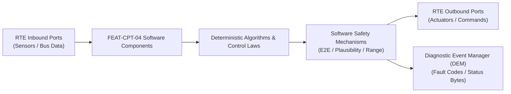

# Software Requirements Specification: Acoustic Vehicle Alerting & Active Road Noise Cancellation (AVAS-RNC)
**Feature ID:** `FEAT-CPT-04`  
**Domain:** Cockpit Electronics & Acoustic Safety  
**Target ASIL:** ASIL B / UNECE R138  
**Compliance Standard:** ISO 26262:2018 (Part 6 - Software Development) / ASPICE PAM v3.1 (SWE.1, SWE.2)  
**Parent System Specification:** [`FEAT-CPT-04_AVAS-RNC_SysReq.md`](file:///c:/Workset/AntiGravityProjects/TestOptimisationExperiement/system_requirements/FEAT-CPT-04_AVAS-RNC_SysReq.md)  
**Global Master Specification:** [`spec.md`](file:///c:/Workset/AntiGravityProjects/TestOptimisationExperiement/spec.md)

---

## 1. Software Architecture & Component Structure

This document specifies the AUTOSAR Software Components (SWCs), periodic runnables, algorithmic laws, safety mechanisms, and data ports implementing `FEAT-CPT-04` (Acoustic Vehicle Alerting & Active Road Noise Cancellation (AVAS-RNC)).

### AUTOSAR SWC Interaction Diagram

---

## 2. Detailed Software Requirements (SWR_REQ)
*(Multi-Software Requirement Partitioning derived from System Requirements)*

### `SWR-CPT-04-01`: Harmonic Pitch-Shifting Multi-Band AVAS Audio Synthesizer
- **Planned Release:** R100
- **ASIL Rating:** ASIL B
- **Parent System Requirement:** [`SYS-CPT-04-01`](file:///c:/Workset/AntiGravityProjects/TestOptimisationExperiement/system_requirements/FEAT-CPT-04_AVAS-RNC_SysReq.md#sys-cpt-04-01)
- **Allocated AUTOSAR SWC:** `AvasSynthesizer_SWC`
- **Execution Rate / Trigger:** 10 ms
- **Worst-Case Execution Time (WCET):** 0.6 ms
- **Software Activation Condition:** Active when vehicle speed <= 30 km/h.
- **Algorithmic Description / Logic:**
  > Generates 4 harmonic base tones f1=250Hz, f2=400Hz, f3=800Hz, f4=1600Hz. Applies speed-proportional frequency shift: f_out(v) = f_base * (1.0 + 0.008 * v_ego). Modulates amplitude between 56 dB(A) at 10 km/h and 66 dB(A) at 20 km/h according to UNECE R138 curves.
- **Software Safety Mechanism:** Continuous 1/3-octave band energy verification inside audio DSP.
- **Failure Reaction & DEM Diagnostic Event:** Latch default tone if frequency calculation overflows.
- **Software Port Inputs:** `Vehicle_Speed_Mps, Target_Sound_Profile_Index`
- **Software Port Outputs:** `AVAS_PCM_Audio_Buffer[128], Pitch_Shift_Factor`
- **Software Verification Criteria:** FFT spectrum analyzer verification against UNECE R138 minimum 1/3-octave sound level limits.
- **Traceability Link:** Traces upward to [`SYS-CPT-04-01`](file:///c:/Workset/AntiGravityProjects/TestOptimisationExperiement/system_requirements/FEAT-CPT-04_AVAS-RNC_SysReq.md#sys-cpt-04-01) and [`FEAT-CPT-04`](file:///c:/Workset/AntiGravityProjects/TestOptimisationExperiement/spec.md).

### `SWR-CPT-04-02`: AVAS Class-D Audio Amplifier Voice Coil Diagnostic Supervisor
- **Planned Release:** R100
- **ASIL Rating:** ASIL B
- **Parent System Requirement:** [`SYS-CPT-04-01`](file:///c:/Workset/AntiGravityProjects/TestOptimisationExperiement/system_requirements/FEAT-CPT-04_AVAS-RNC_SysReq.md#sys-cpt-04-01)
- **Allocated AUTOSAR SWC:** `AvasSpeakerDiagnostics_SWC`
- **Execution Rate / Trigger:** 100 ms
- **Worst-Case Execution Time (WCET):** 0.25 ms
- **Software Activation Condition:** Cyclic 100 ms task.
- **Algorithmic Description / Logic:**
  > Injects inaudible 25 kHz pilot tone into speaker amplifier output. Samples pilot current response to compute voice coil impedance: Z_spk = V_pilot / I_pilot. Flags fault if Z_spk < 2.0 ohms (short) or Z_spk > 40.0 ohms (open/disconnected).
- **Software Safety Mechanism:** Independent hardware load diagnostic register read from smart Class-D amplifier IC.
- **Failure Reaction & DEM Diagnostic Event:** Set DTC B13C8 and transmit AVAS_Fault_Broadcast over CAN-FD.
- **Software Port Inputs:** `Amp_Load_Sense_ADC, Amp_Thermal_Flag`
- **Software Port Outputs:** `Speaker_Healthy_Flag (boolean), Measured_Impedance_Ohms`
- **Software Verification Criteria:** Physical test disconnecting speaker harness and verifying cluster tell-tale activation within 200 ms.
- **Traceability Link:** Traces upward to [`SYS-CPT-04-01`](file:///c:/Workset/AntiGravityProjects/TestOptimisationExperiement/system_requirements/FEAT-CPT-04_AVAS-RNC_SysReq.md#sys-cpt-04-01) and [`FEAT-CPT-04`](file:///c:/Workset/AntiGravityProjects/TestOptimisationExperiement/spec.md).

### `SWR-CPT-04-03`: Filtered-X Least Mean Squares (FxLMS) Multi-Channel RNC Engine
- **Planned Release:** R100
- **ASIL Rating:** QM
- **Parent System Requirement:** [`SYS-CPT-04-02`](file:///c:/Workset/AntiGravityProjects/TestOptimisationExperiement/system_requirements/FEAT-CPT-04_AVAS-RNC_SysReq.md#sys-cpt-04-02)
- **Allocated AUTOSAR SWC:** `RncAdaptiveFilter_SWC`
- **Execution Rate / Trigger:** 1 ms
- **Worst-Case Execution Time (WCET):** 0.45 ms
- **Software Activation Condition:** Executed in 1 kHz high-speed audio DSP task.
- **Algorithmic Description / Logic:**
  > Implements multi-channel Filtered-X Least Mean Squares (FxLMS) adaptive filter: Updates FIR filter weight vector w[k+1] = w[k] - mu * e[k] * x_filt[k], where x is chassis vibration reference, e is error microphone signal, and x_filt is filtered through secondary acoustic transfer path model S(z).
- **Software Safety Mechanism:** Weight divergence detector: If sum(w^2) exceeds stable energy threshold, reset filter weights to zero in 1 ms.
- **Failure Reaction & DEM Diagnostic Event:** Mute RNC anti-noise output if divergence detected.
- **Software Port Inputs:** `Suspension_Vibration_X[4], Error_Microphone_E[4], Secondary_Path_Model_Coeffs`
- **Software Port Outputs:** `AntiNoise_Audio_Stream[4], Adaptation_Error_Norm`
- **Software Verification Criteria:** Hardware audio DSP bench simulation with recorded road noise impulses.
- **Traceability Link:** Traces upward to [`SYS-CPT-04-02`](file:///c:/Workset/AntiGravityProjects/TestOptimisationExperiement/system_requirements/FEAT-CPT-04_AVAS-RNC_SysReq.md#sys-cpt-04-02) and [`FEAT-CPT-04`](file:///c:/Workset/AntiGravityProjects/TestOptimisationExperiement/spec.md).

### `SWR-CPT-04-04`: Acoustic Anti-Feedback Howling Suppression & Window Rollout Detector
- **Planned Release:** R100
- **ASIL Rating:** QM
- **Parent System Requirement:** [`SYS-CPT-04-02`](file:///c:/Workset/AntiGravityProjects/TestOptimisationExperiement/system_requirements/FEAT-CPT-04_AVAS-RNC_SysReq.md#sys-cpt-04-02)
- **Allocated AUTOSAR SWC:** `RncFeedbackSupervisor_SWC`
- **Execution Rate / Trigger:** 10 ms
- **Worst-Case Execution Time (WCET):** 0.2 ms
- **Software Activation Condition:** Supervises RNC operation.
- **Algorithmic Description / Logic:**
  > Monitors error microphone spectral power: If narrowband spectral peak exceeds wideband average by > 18 dB (positive feedback howling precursor), or if any window drops > 20 mm, immediately fades out RNC volume to 0.0 with 50 ms exponential decay.
- **Software Safety Mechanism:** Hard audio limiter clamps anti-noise speaker output to <= 3.0V RMS (prevent passenger ear discomfort).
- **Failure Reaction & DEM Diagnostic Event:** Disable RNC until windows are rolled up and acoustic stability verified.
- **Software Port Inputs:** `Error_Mic_Spectrum_Array[64], Window_Open_Position_Mm_Array[4]`
- **Software Port Outputs:** `RNC_Master_Gain_Linear (float32), Howling_Intervention_Flag (boolean)`
- **Software Verification Criteria:** In-vehicle road testing opening windows at 100 km/h with rapid acoustic fade-out verification.
- **Traceability Link:** Traces upward to [`SYS-CPT-04-02`](file:///c:/Workset/AntiGravityProjects/TestOptimisationExperiement/system_requirements/FEAT-CPT-04_AVAS-RNC_SysReq.md#sys-cpt-04-02) and [`FEAT-CPT-04`](file:///c:/Workset/AntiGravityProjects/TestOptimisationExperiement/spec.md).

### `SWR-CPT-04-05`: Acoustic Vehicle Alerting System (AVAS) UNECE R138 Minimum Sound Pressure Level Synthesizer - Dynamic Observer & Signal Filter
- **Planned Release:** R100
- **ASIL Rating:** ASIL B
- **Parent System Requirement:** [`SYS-CPT-04-03`](file:///c:/Workset/AntiGravityProjects/TestOptimisationExperiement/system_requirements/FEAT-CPT-04_AVAS-RNC_SysReq.md#sys-cpt-04-03)
- **Allocated AUTOSAR SWC:** `AvasR138Synthesizer_SWC`
- **Execution Rate / Trigger:** 10 ms
- **Worst-Case Execution Time (WCET):** 0.3 ms
- **Software Activation Condition:** Executed cyclically every 10 ms.
- **Algorithmic Description / Logic:**
  > Executes signal plausibility filtering, calibration offsets, and discrete state estimation for Acoustic Vehicle Alerting System (AVAS) UNECE R138 Minimum Sound Pressure Level Synthesizer.
- **Software Safety Mechanism:** Range limit plausibility check and E2E alive sequence verification.
- **Failure Reaction & DEM Diagnostic Event:** Set default fallback output and report DEM_EVENT_FEAT_CPT_04_ERR.
- **Software Port Inputs:** `Raw sensor ADC/SENT/SPI values and RTE bus inputs.`
- **Software Port Outputs:** `Filtered physical signals and validity status bitmasks.`
- **Software Verification Criteria:** Unit test and HiL software integration test.
- **Traceability Link:** Traces upward to [`SYS-CPT-04-03`](file:///c:/Workset/AntiGravityProjects/TestOptimisationExperiement/system_requirements/FEAT-CPT-04_AVAS-RNC_SysReq.md#sys-cpt-04-03) and [`FEAT-CPT-04`](file:///c:/Workset/AntiGravityProjects/TestOptimisationExperiement/spec.md).

### `SWR-CPT-04-06`: Acoustic Vehicle Alerting System (AVAS) UNECE R138 Minimum Sound Pressure Level Synthesizer - Closed-Loop Control Law & Actuator Dispatch
- **Planned Release:** R100
- **ASIL Rating:** ASIL B
- **Parent System Requirement:** [`SYS-CPT-04-03`](file:///c:/Workset/AntiGravityProjects/TestOptimisationExperiement/system_requirements/FEAT-CPT-04_AVAS-RNC_SysReq.md#sys-cpt-04-03)
- **Allocated AUTOSAR SWC:** `AvasR138Synthesizer_SWC`
- **Execution Rate / Trigger:** 10 ms
- **Worst-Case Execution Time (WCET):** 0.4 ms
- **Software Activation Condition:** Executed cyclically every 10 ms.
- **Algorithmic Description / Logic:**
  > Evaluates deterministic closed-loop control law, rate limits, and dispatches commands for Acoustic Vehicle Alerting System (AVAS) UNECE R138 Minimum Sound Pressure Level Synthesizer.
- **Software Safety Mechanism:** Command saturation clamping and watchdog program flow monitoring.
- **Failure Reaction & DEM Diagnostic Event:** De-energize actuator output, apply safe fallback clamp, and latch DTC.
- **Software Port Inputs:** `Validated physical state signals from observer SWC.`
- **Software Port Outputs:** `Actuator PWM duty cycles, torque/pressure setpoints, and diagnostic flags.`
- **Software Verification Criteria:** Hardware dynamometer and HiL closed-loop regression test suite.
- **Traceability Link:** Traces upward to [`SYS-CPT-04-03`](file:///c:/Workset/AntiGravityProjects/TestOptimisationExperiement/system_requirements/FEAT-CPT-04_AVAS-RNC_SysReq.md#sys-cpt-04-03) and [`FEAT-CPT-04`](file:///c:/Workset/AntiGravityProjects/TestOptimisationExperiement/spec.md).

### `SWR-CPT-04-07`: Forward / Reverse Directional Sound Pitch Shift Frequency Modulator - Dynamic Observer & Signal Filter
- **Planned Release:** R200
- **ASIL Rating:** ASIL B
- **Parent System Requirement:** [`SYS-CPT-04-04`](file:///c:/Workset/AntiGravityProjects/TestOptimisationExperiement/system_requirements/FEAT-CPT-04_AVAS-RNC_SysReq.md#sys-cpt-04-04)
- **Allocated AUTOSAR SWC:** `AvasPitchModulator_SWC`
- **Execution Rate / Trigger:** 10 ms
- **Worst-Case Execution Time (WCET):** 0.3 ms
- **Software Activation Condition:** Executed cyclically every 10 ms.
- **Algorithmic Description / Logic:**
  > Executes signal plausibility filtering, calibration offsets, and discrete state estimation for Forward / Reverse Directional Sound Pitch Shift Frequency Modulator.
- **Software Safety Mechanism:** Range limit plausibility check and E2E alive sequence verification.
- **Failure Reaction & DEM Diagnostic Event:** Set default fallback output and report DEM_EVENT_FEAT_CPT_04_ERR.
- **Software Port Inputs:** `Raw sensor ADC/SENT/SPI values and RTE bus inputs.`
- **Software Port Outputs:** `Filtered physical signals and validity status bitmasks.`
- **Software Verification Criteria:** Unit test and HiL software integration test.
- **Traceability Link:** Traces upward to [`SYS-CPT-04-04`](file:///c:/Workset/AntiGravityProjects/TestOptimisationExperiement/system_requirements/FEAT-CPT-04_AVAS-RNC_SysReq.md#sys-cpt-04-04) and [`FEAT-CPT-04`](file:///c:/Workset/AntiGravityProjects/TestOptimisationExperiement/spec.md).

### `SWR-CPT-04-08`: Forward / Reverse Directional Sound Pitch Shift Frequency Modulator - Closed-Loop Control Law & Actuator Dispatch
- **Planned Release:** R200
- **ASIL Rating:** ASIL B
- **Parent System Requirement:** [`SYS-CPT-04-04`](file:///c:/Workset/AntiGravityProjects/TestOptimisationExperiement/system_requirements/FEAT-CPT-04_AVAS-RNC_SysReq.md#sys-cpt-04-04)
- **Allocated AUTOSAR SWC:** `AvasPitchModulator_SWC`
- **Execution Rate / Trigger:** 10 ms
- **Worst-Case Execution Time (WCET):** 0.4 ms
- **Software Activation Condition:** Executed cyclically every 10 ms.
- **Algorithmic Description / Logic:**
  > Evaluates deterministic closed-loop control law, rate limits, and dispatches commands for Forward / Reverse Directional Sound Pitch Shift Frequency Modulator.
- **Software Safety Mechanism:** Command saturation clamping and watchdog program flow monitoring.
- **Failure Reaction & DEM Diagnostic Event:** De-energize actuator output, apply safe fallback clamp, and latch DTC.
- **Software Port Inputs:** `Validated physical state signals from observer SWC.`
- **Software Port Outputs:** `Actuator PWM duty cycles, torque/pressure setpoints, and diagnostic flags.`
- **Software Verification Criteria:** Hardware dynamometer and HiL closed-loop regression test suite.
- **Traceability Link:** Traces upward to [`SYS-CPT-04-04`](file:///c:/Workset/AntiGravityProjects/TestOptimisationExperiement/system_requirements/FEAT-CPT-04_AVAS-RNC_SysReq.md#sys-cpt-04-04) and [`FEAT-CPT-04`](file:///c:/Workset/AntiGravityProjects/TestOptimisationExperiement/spec.md).

### `SWR-CPT-04-09`: Dual Exterior Weather-Sealed Loudspeaker Impedance & Continuity Diagnostics - Dynamic Observer & Signal Filter
- **Planned Release:** R500
- **ASIL Rating:** ASIL B
- **Parent System Requirement:** [`SYS-CPT-04-05`](file:///c:/Workset/AntiGravityProjects/TestOptimisationExperiement/system_requirements/FEAT-CPT-04_AVAS-RNC_SysReq.md#sys-cpt-04-05)
- **Allocated AUTOSAR SWC:** `AvasSpeakerDiagnostics_SWC`
- **Execution Rate / Trigger:** 20 ms
- **Worst-Case Execution Time (WCET):** 0.3 ms
- **Software Activation Condition:** Executed cyclically every 20 ms.
- **Algorithmic Description / Logic:**
  > Executes signal plausibility filtering, calibration offsets, and discrete state estimation for Dual Exterior Weather-Sealed Loudspeaker Impedance & Continuity Diagnostics.
- **Software Safety Mechanism:** Range limit plausibility check and E2E alive sequence verification.
- **Failure Reaction & DEM Diagnostic Event:** Set default fallback output and report DEM_EVENT_FEAT_CPT_04_ERR.
- **Software Port Inputs:** `Raw sensor ADC/SENT/SPI values and RTE bus inputs.`
- **Software Port Outputs:** `Filtered physical signals and validity status bitmasks.`
- **Software Verification Criteria:** Unit test and HiL software integration test.
- **Traceability Link:** Traces upward to [`SYS-CPT-04-05`](file:///c:/Workset/AntiGravityProjects/TestOptimisationExperiement/system_requirements/FEAT-CPT-04_AVAS-RNC_SysReq.md#sys-cpt-04-05) and [`FEAT-CPT-04`](file:///c:/Workset/AntiGravityProjects/TestOptimisationExperiement/spec.md).

### `SWR-CPT-04-10`: Dual Exterior Weather-Sealed Loudspeaker Impedance & Continuity Diagnostics - Closed-Loop Control Law & Actuator Dispatch
- **Planned Release:** R500
- **ASIL Rating:** ASIL B
- **Parent System Requirement:** [`SYS-CPT-04-05`](file:///c:/Workset/AntiGravityProjects/TestOptimisationExperiement/system_requirements/FEAT-CPT-04_AVAS-RNC_SysReq.md#sys-cpt-04-05)
- **Allocated AUTOSAR SWC:** `AvasSpeakerDiagnostics_SWC`
- **Execution Rate / Trigger:** 20 ms
- **Worst-Case Execution Time (WCET):** 0.4 ms
- **Software Activation Condition:** Executed cyclically every 20 ms.
- **Algorithmic Description / Logic:**
  > Evaluates deterministic closed-loop control law, rate limits, and dispatches commands for Dual Exterior Weather-Sealed Loudspeaker Impedance & Continuity Diagnostics.
- **Software Safety Mechanism:** Command saturation clamping and watchdog program flow monitoring.
- **Failure Reaction & DEM Diagnostic Event:** De-energize actuator output, apply safe fallback clamp, and latch DTC.
- **Software Port Inputs:** `Validated physical state signals from observer SWC.`
- **Software Port Outputs:** `Actuator PWM duty cycles, torque/pressure setpoints, and diagnostic flags.`
- **Software Verification Criteria:** Hardware dynamometer and HiL closed-loop regression test suite.
- **Traceability Link:** Traces upward to [`SYS-CPT-04-05`](file:///c:/Workset/AntiGravityProjects/TestOptimisationExperiement/system_requirements/FEAT-CPT-04_AVAS-RNC_SysReq.md#sys-cpt-04-05) and [`FEAT-CPT-04`](file:///c:/Workset/AntiGravityProjects/TestOptimisationExperiement/spec.md).

### `SWR-CPT-04-11`: AVAS Sound Synthesis Temporary Driver Pause Switch Regulation (Restricted) - Dynamic Observer & Signal Filter
- **Planned Release:** R200
- **ASIL Rating:** ASIL B
- **Parent System Requirement:** [`SYS-CPT-04-06`](file:///c:/Workset/AntiGravityProjects/TestOptimisationExperiement/system_requirements/FEAT-CPT-04_AVAS-RNC_SysReq.md#sys-cpt-04-06)
- **Allocated AUTOSAR SWC:** `AvasPauseGovernor_SWC`
- **Execution Rate / Trigger:** 50 ms
- **Worst-Case Execution Time (WCET):** 0.3 ms
- **Software Activation Condition:** Executed cyclically every 50 ms.
- **Algorithmic Description / Logic:**
  > Executes signal plausibility filtering, calibration offsets, and discrete state estimation for AVAS Sound Synthesis Temporary Driver Pause Switch Regulation (Restricted).
- **Software Safety Mechanism:** Range limit plausibility check and E2E alive sequence verification.
- **Failure Reaction & DEM Diagnostic Event:** Set default fallback output and report DEM_EVENT_FEAT_CPT_04_ERR.
- **Software Port Inputs:** `Raw sensor ADC/SENT/SPI values and RTE bus inputs.`
- **Software Port Outputs:** `Filtered physical signals and validity status bitmasks.`
- **Software Verification Criteria:** Unit test and HiL software integration test.
- **Traceability Link:** Traces upward to [`SYS-CPT-04-06`](file:///c:/Workset/AntiGravityProjects/TestOptimisationExperiement/system_requirements/FEAT-CPT-04_AVAS-RNC_SysReq.md#sys-cpt-04-06) and [`FEAT-CPT-04`](file:///c:/Workset/AntiGravityProjects/TestOptimisationExperiement/spec.md).

### `SWR-CPT-04-12`: AVAS Sound Synthesis Temporary Driver Pause Switch Regulation (Restricted) - Closed-Loop Control Law & Actuator Dispatch
- **Planned Release:** R200
- **ASIL Rating:** ASIL B
- **Parent System Requirement:** [`SYS-CPT-04-06`](file:///c:/Workset/AntiGravityProjects/TestOptimisationExperiement/system_requirements/FEAT-CPT-04_AVAS-RNC_SysReq.md#sys-cpt-04-06)
- **Allocated AUTOSAR SWC:** `AvasPauseGovernor_SWC`
- **Execution Rate / Trigger:** 50 ms
- **Worst-Case Execution Time (WCET):** 0.4 ms
- **Software Activation Condition:** Executed cyclically every 50 ms.
- **Algorithmic Description / Logic:**
  > Evaluates deterministic closed-loop control law, rate limits, and dispatches commands for AVAS Sound Synthesis Temporary Driver Pause Switch Regulation (Restricted).
- **Software Safety Mechanism:** Command saturation clamping and watchdog program flow monitoring.
- **Failure Reaction & DEM Diagnostic Event:** De-energize actuator output, apply safe fallback clamp, and latch DTC.
- **Software Port Inputs:** `Validated physical state signals from observer SWC.`
- **Software Port Outputs:** `Actuator PWM duty cycles, torque/pressure setpoints, and diagnostic flags.`
- **Software Verification Criteria:** Hardware dynamometer and HiL closed-loop regression test suite.
- **Traceability Link:** Traces upward to [`SYS-CPT-04-06`](file:///c:/Workset/AntiGravityProjects/TestOptimisationExperiement/system_requirements/FEAT-CPT-04_AVAS-RNC_SysReq.md#sys-cpt-04-06) and [`FEAT-CPT-04`](file:///c:/Workset/AntiGravityProjects/TestOptimisationExperiement/spec.md).

### `SWR-CPT-04-13`: Active Road Noise Cancellation (RNC) 4-Corner Accelerometer Vibration Acquisition - Dynamic Observer & Signal Filter
- **Planned Release:** R300
- **ASIL Rating:** ASIL B
- **Parent System Requirement:** [`SYS-CPT-04-07`](file:///c:/Workset/AntiGravityProjects/TestOptimisationExperiement/system_requirements/FEAT-CPT-04_AVAS-RNC_SysReq.md#sys-cpt-04-07)
- **Allocated AUTOSAR SWC:** `RncAccelAcquisition_SWC`
- **Execution Rate / Trigger:** 0.2 ms
- **Worst-Case Execution Time (WCET):** 0.3 ms
- **Software Activation Condition:** Executed cyclically every 0.2 ms.
- **Algorithmic Description / Logic:**
  > Executes signal plausibility filtering, calibration offsets, and discrete state estimation for Active Road Noise Cancellation (RNC) 4-Corner Accelerometer Vibration Acquisition.
- **Software Safety Mechanism:** Range limit plausibility check and E2E alive sequence verification.
- **Failure Reaction & DEM Diagnostic Event:** Set default fallback output and report DEM_EVENT_FEAT_CPT_04_ERR.
- **Software Port Inputs:** `Raw sensor ADC/SENT/SPI values and RTE bus inputs.`
- **Software Port Outputs:** `Filtered physical signals and validity status bitmasks.`
- **Software Verification Criteria:** Unit test and HiL software integration test.
- **Traceability Link:** Traces upward to [`SYS-CPT-04-07`](file:///c:/Workset/AntiGravityProjects/TestOptimisationExperiement/system_requirements/FEAT-CPT-04_AVAS-RNC_SysReq.md#sys-cpt-04-07) and [`FEAT-CPT-04`](file:///c:/Workset/AntiGravityProjects/TestOptimisationExperiement/spec.md).

### `SWR-CPT-04-14`: Active Road Noise Cancellation (RNC) 4-Corner Accelerometer Vibration Acquisition - Closed-Loop Control Law & Actuator Dispatch
- **Planned Release:** R300
- **ASIL Rating:** ASIL B
- **Parent System Requirement:** [`SYS-CPT-04-07`](file:///c:/Workset/AntiGravityProjects/TestOptimisationExperiement/system_requirements/FEAT-CPT-04_AVAS-RNC_SysReq.md#sys-cpt-04-07)
- **Allocated AUTOSAR SWC:** `RncAccelAcquisition_SWC`
- **Execution Rate / Trigger:** 0.2 ms
- **Worst-Case Execution Time (WCET):** 0.4 ms
- **Software Activation Condition:** Executed cyclically every 0.2 ms.
- **Algorithmic Description / Logic:**
  > Evaluates deterministic closed-loop control law, rate limits, and dispatches commands for Active Road Noise Cancellation (RNC) 4-Corner Accelerometer Vibration Acquisition.
- **Software Safety Mechanism:** Command saturation clamping and watchdog program flow monitoring.
- **Failure Reaction & DEM Diagnostic Event:** De-energize actuator output, apply safe fallback clamp, and latch DTC.
- **Software Port Inputs:** `Validated physical state signals from observer SWC.`
- **Software Port Outputs:** `Actuator PWM duty cycles, torque/pressure setpoints, and diagnostic flags.`
- **Software Verification Criteria:** Hardware dynamometer and HiL closed-loop regression test suite.
- **Traceability Link:** Traces upward to [`SYS-CPT-04-07`](file:///c:/Workset/AntiGravityProjects/TestOptimisationExperiement/system_requirements/FEAT-CPT-04_AVAS-RNC_SysReq.md#sys-cpt-04-07) and [`FEAT-CPT-04`](file:///c:/Workset/AntiGravityProjects/TestOptimisationExperiement/spec.md).

### `SWR-CPT-04-15`: Cabin Interior Microphone Acoustic Noise Error Sensor Array Sampler - Dynamic Observer & Signal Filter
- **Planned Release:** R300
- **ASIL Rating:** ASIL B
- **Parent System Requirement:** [`SYS-CPT-04-08`](file:///c:/Workset/AntiGravityProjects/TestOptimisationExperiement/system_requirements/FEAT-CPT-04_AVAS-RNC_SysReq.md#sys-cpt-04-08)
- **Allocated AUTOSAR SWC:** `RncMicArraySampler_SWC`
- **Execution Rate / Trigger:** 0.2 ms
- **Worst-Case Execution Time (WCET):** 0.3 ms
- **Software Activation Condition:** Executed cyclically every 0.2 ms.
- **Algorithmic Description / Logic:**
  > Executes signal plausibility filtering, calibration offsets, and discrete state estimation for Cabin Interior Microphone Acoustic Noise Error Sensor Array Sampler.
- **Software Safety Mechanism:** Range limit plausibility check and E2E alive sequence verification.
- **Failure Reaction & DEM Diagnostic Event:** Set default fallback output and report DEM_EVENT_FEAT_CPT_04_ERR.
- **Software Port Inputs:** `Raw sensor ADC/SENT/SPI values and RTE bus inputs.`
- **Software Port Outputs:** `Filtered physical signals and validity status bitmasks.`
- **Software Verification Criteria:** Unit test and HiL software integration test.
- **Traceability Link:** Traces upward to [`SYS-CPT-04-08`](file:///c:/Workset/AntiGravityProjects/TestOptimisationExperiement/system_requirements/FEAT-CPT-04_AVAS-RNC_SysReq.md#sys-cpt-04-08) and [`FEAT-CPT-04`](file:///c:/Workset/AntiGravityProjects/TestOptimisationExperiement/spec.md).

### `SWR-CPT-04-16`: Cabin Interior Microphone Acoustic Noise Error Sensor Array Sampler - Closed-Loop Control Law & Actuator Dispatch
- **Planned Release:** R300
- **ASIL Rating:** ASIL B
- **Parent System Requirement:** [`SYS-CPT-04-08`](file:///c:/Workset/AntiGravityProjects/TestOptimisationExperiement/system_requirements/FEAT-CPT-04_AVAS-RNC_SysReq.md#sys-cpt-04-08)
- **Allocated AUTOSAR SWC:** `RncMicArraySampler_SWC`
- **Execution Rate / Trigger:** 0.2 ms
- **Worst-Case Execution Time (WCET):** 0.4 ms
- **Software Activation Condition:** Executed cyclically every 0.2 ms.
- **Algorithmic Description / Logic:**
  > Evaluates deterministic closed-loop control law, rate limits, and dispatches commands for Cabin Interior Microphone Acoustic Noise Error Sensor Array Sampler.
- **Software Safety Mechanism:** Command saturation clamping and watchdog program flow monitoring.
- **Failure Reaction & DEM Diagnostic Event:** De-energize actuator output, apply safe fallback clamp, and latch DTC.
- **Software Port Inputs:** `Validated physical state signals from observer SWC.`
- **Software Port Outputs:** `Actuator PWM duty cycles, torque/pressure setpoints, and diagnostic flags.`
- **Software Verification Criteria:** Hardware dynamometer and HiL closed-loop regression test suite.
- **Traceability Link:** Traces upward to [`SYS-CPT-04-08`](file:///c:/Workset/AntiGravityProjects/TestOptimisationExperiement/system_requirements/FEAT-CPT-04_AVAS-RNC_SysReq.md#sys-cpt-04-08) and [`FEAT-CPT-04`](file:///c:/Workset/AntiGravityProjects/TestOptimisationExperiement/spec.md).

### `SWR-CPT-04-17`: Filtered-X Least Mean Squares (FxLMS) Real-Time Adaptive Phase-Inversion DSP Engine - Dynamic Observer & Signal Filter
- **Planned Release:** R300
- **ASIL Rating:** ASIL B
- **Parent System Requirement:** [`SYS-CPT-04-09`](file:///c:/Workset/AntiGravityProjects/TestOptimisationExperiement/system_requirements/FEAT-CPT-04_AVAS-RNC_SysReq.md#sys-cpt-04-09)
- **Allocated AUTOSAR SWC:** `RncFxlmsEngine_SWC`
- **Execution Rate / Trigger:** 0.4 ms
- **Worst-Case Execution Time (WCET):** 0.3 ms
- **Software Activation Condition:** Executed cyclically every 0.4 ms.
- **Algorithmic Description / Logic:**
  > Executes signal plausibility filtering, calibration offsets, and discrete state estimation for Filtered-X Least Mean Squares (FxLMS) Real-Time Adaptive Phase-Inversion DSP Engine.
- **Software Safety Mechanism:** Range limit plausibility check and E2E alive sequence verification.
- **Failure Reaction & DEM Diagnostic Event:** Set default fallback output and report DEM_EVENT_FEAT_CPT_04_ERR.
- **Software Port Inputs:** `Raw sensor ADC/SENT/SPI values and RTE bus inputs.`
- **Software Port Outputs:** `Filtered physical signals and validity status bitmasks.`
- **Software Verification Criteria:** Unit test and HiL software integration test.
- **Traceability Link:** Traces upward to [`SYS-CPT-04-09`](file:///c:/Workset/AntiGravityProjects/TestOptimisationExperiement/system_requirements/FEAT-CPT-04_AVAS-RNC_SysReq.md#sys-cpt-04-09) and [`FEAT-CPT-04`](file:///c:/Workset/AntiGravityProjects/TestOptimisationExperiement/spec.md).

### `SWR-CPT-04-18`: Filtered-X Least Mean Squares (FxLMS) Real-Time Adaptive Phase-Inversion DSP Engine - Closed-Loop Control Law & Actuator Dispatch
- **Planned Release:** R300
- **ASIL Rating:** ASIL B
- **Parent System Requirement:** [`SYS-CPT-04-09`](file:///c:/Workset/AntiGravityProjects/TestOptimisationExperiement/system_requirements/FEAT-CPT-04_AVAS-RNC_SysReq.md#sys-cpt-04-09)
- **Allocated AUTOSAR SWC:** `RncFxlmsEngine_SWC`
- **Execution Rate / Trigger:** 0.4 ms
- **Worst-Case Execution Time (WCET):** 0.4 ms
- **Software Activation Condition:** Executed cyclically every 0.4 ms.
- **Algorithmic Description / Logic:**
  > Evaluates deterministic closed-loop control law, rate limits, and dispatches commands for Filtered-X Least Mean Squares (FxLMS) Real-Time Adaptive Phase-Inversion DSP Engine.
- **Software Safety Mechanism:** Command saturation clamping and watchdog program flow monitoring.
- **Failure Reaction & DEM Diagnostic Event:** De-energize actuator output, apply safe fallback clamp, and latch DTC.
- **Software Port Inputs:** `Validated physical state signals from observer SWC.`
- **Software Port Outputs:** `Actuator PWM duty cycles, torque/pressure setpoints, and diagnostic flags.`
- **Software Verification Criteria:** Hardware dynamometer and HiL closed-loop regression test suite.
- **Traceability Link:** Traces upward to [`SYS-CPT-04-09`](file:///c:/Workset/AntiGravityProjects/TestOptimisationExperiement/system_requirements/FEAT-CPT-04_AVAS-RNC_SysReq.md#sys-cpt-04-09) and [`FEAT-CPT-04`](file:///c:/Workset/AntiGravityProjects/TestOptimisationExperiement/spec.md).

### `SWR-CPT-04-19`: Premium Audio System Multi-Channel Subwoofer Anti-Noise Superposition Driver - Dynamic Observer & Signal Filter
- **Planned Release:** R400
- **ASIL Rating:** ASIL B
- **Parent System Requirement:** [`SYS-CPT-04-10`](file:///c:/Workset/AntiGravityProjects/TestOptimisationExperiement/system_requirements/FEAT-CPT-04_AVAS-RNC_SysReq.md#sys-cpt-04-10)
- **Allocated AUTOSAR SWC:** `RncAudioSuperposition_SWC`
- **Execution Rate / Trigger:** 0.5 ms
- **Worst-Case Execution Time (WCET):** 0.3 ms
- **Software Activation Condition:** Executed cyclically every 0.5 ms.
- **Algorithmic Description / Logic:**
  > Executes signal plausibility filtering, calibration offsets, and discrete state estimation for Premium Audio System Multi-Channel Subwoofer Anti-Noise Superposition Driver.
- **Software Safety Mechanism:** Range limit plausibility check and E2E alive sequence verification.
- **Failure Reaction & DEM Diagnostic Event:** Set default fallback output and report DEM_EVENT_FEAT_CPT_04_ERR.
- **Software Port Inputs:** `Raw sensor ADC/SENT/SPI values and RTE bus inputs.`
- **Software Port Outputs:** `Filtered physical signals and validity status bitmasks.`
- **Software Verification Criteria:** Unit test and HiL software integration test.
- **Traceability Link:** Traces upward to [`SYS-CPT-04-10`](file:///c:/Workset/AntiGravityProjects/TestOptimisationExperiement/system_requirements/FEAT-CPT-04_AVAS-RNC_SysReq.md#sys-cpt-04-10) and [`FEAT-CPT-04`](file:///c:/Workset/AntiGravityProjects/TestOptimisationExperiement/spec.md).

### `SWR-CPT-04-20`: Premium Audio System Multi-Channel Subwoofer Anti-Noise Superposition Driver - Closed-Loop Control Law & Actuator Dispatch
- **Planned Release:** R400
- **ASIL Rating:** ASIL B
- **Parent System Requirement:** [`SYS-CPT-04-10`](file:///c:/Workset/AntiGravityProjects/TestOptimisationExperiement/system_requirements/FEAT-CPT-04_AVAS-RNC_SysReq.md#sys-cpt-04-10)
- **Allocated AUTOSAR SWC:** `RncAudioSuperposition_SWC`
- **Execution Rate / Trigger:** 0.5 ms
- **Worst-Case Execution Time (WCET):** 0.4 ms
- **Software Activation Condition:** Executed cyclically every 0.5 ms.
- **Algorithmic Description / Logic:**
  > Evaluates deterministic closed-loop control law, rate limits, and dispatches commands for Premium Audio System Multi-Channel Subwoofer Anti-Noise Superposition Driver.
- **Software Safety Mechanism:** Command saturation clamping and watchdog program flow monitoring.
- **Failure Reaction & DEM Diagnostic Event:** De-energize actuator output, apply safe fallback clamp, and latch DTC.
- **Software Port Inputs:** `Validated physical state signals from observer SWC.`
- **Software Port Outputs:** `Actuator PWM duty cycles, torque/pressure setpoints, and diagnostic flags.`
- **Software Verification Criteria:** Hardware dynamometer and HiL closed-loop regression test suite.
- **Traceability Link:** Traces upward to [`SYS-CPT-04-10`](file:///c:/Workset/AntiGravityProjects/TestOptimisationExperiement/system_requirements/FEAT-CPT-04_AVAS-RNC_SysReq.md#sys-cpt-04-10) and [`FEAT-CPT-04`](file:///c:/Workset/AntiGravityProjects/TestOptimisationExperiement/spec.md).

### `SWR-CPT-04-21`: Vehicle Speed & Rough Road Surface RNC Control Gain Dynamic Scaler - Dynamic Observer & Signal Filter
- **Planned Release:** R400
- **ASIL Rating:** ASIL B
- **Parent System Requirement:** [`SYS-CPT-04-11`](file:///c:/Workset/AntiGravityProjects/TestOptimisationExperiement/system_requirements/FEAT-CPT-04_AVAS-RNC_SysReq.md#sys-cpt-04-11)
- **Allocated AUTOSAR SWC:** `RncGainScaler_SWC`
- **Execution Rate / Trigger:** 50 ms
- **Worst-Case Execution Time (WCET):** 0.3 ms
- **Software Activation Condition:** Executed cyclically every 50 ms.
- **Algorithmic Description / Logic:**
  > Executes signal plausibility filtering, calibration offsets, and discrete state estimation for Vehicle Speed & Rough Road Surface RNC Control Gain Dynamic Scaler.
- **Software Safety Mechanism:** Range limit plausibility check and E2E alive sequence verification.
- **Failure Reaction & DEM Diagnostic Event:** Set default fallback output and report DEM_EVENT_FEAT_CPT_04_ERR.
- **Software Port Inputs:** `Raw sensor ADC/SENT/SPI values and RTE bus inputs.`
- **Software Port Outputs:** `Filtered physical signals and validity status bitmasks.`
- **Software Verification Criteria:** Unit test and HiL software integration test.
- **Traceability Link:** Traces upward to [`SYS-CPT-04-11`](file:///c:/Workset/AntiGravityProjects/TestOptimisationExperiement/system_requirements/FEAT-CPT-04_AVAS-RNC_SysReq.md#sys-cpt-04-11) and [`FEAT-CPT-04`](file:///c:/Workset/AntiGravityProjects/TestOptimisationExperiement/spec.md).

### `SWR-CPT-04-22`: Vehicle Speed & Rough Road Surface RNC Control Gain Dynamic Scaler - Closed-Loop Control Law & Actuator Dispatch
- **Planned Release:** R400
- **ASIL Rating:** ASIL B
- **Parent System Requirement:** [`SYS-CPT-04-11`](file:///c:/Workset/AntiGravityProjects/TestOptimisationExperiement/system_requirements/FEAT-CPT-04_AVAS-RNC_SysReq.md#sys-cpt-04-11)
- **Allocated AUTOSAR SWC:** `RncGainScaler_SWC`
- **Execution Rate / Trigger:** 50 ms
- **Worst-Case Execution Time (WCET):** 0.4 ms
- **Software Activation Condition:** Executed cyclically every 50 ms.
- **Algorithmic Description / Logic:**
  > Evaluates deterministic closed-loop control law, rate limits, and dispatches commands for Vehicle Speed & Rough Road Surface RNC Control Gain Dynamic Scaler.
- **Software Safety Mechanism:** Command saturation clamping and watchdog program flow monitoring.
- **Failure Reaction & DEM Diagnostic Event:** De-energize actuator output, apply safe fallback clamp, and latch DTC.
- **Software Port Inputs:** `Validated physical state signals from observer SWC.`
- **Software Port Outputs:** `Actuator PWM duty cycles, torque/pressure setpoints, and diagnostic flags.`
- **Software Verification Criteria:** Hardware dynamometer and HiL closed-loop regression test suite.
- **Traceability Link:** Traces upward to [`SYS-CPT-04-11`](file:///c:/Workset/AntiGravityProjects/TestOptimisationExperiement/system_requirements/FEAT-CPT-04_AVAS-RNC_SysReq.md#sys-cpt-04-11) and [`FEAT-CPT-04`](file:///c:/Workset/AntiGravityProjects/TestOptimisationExperiement/spec.md).

### `SWR-CPT-04-23`: Audio Amplifier Thermal & High-Current Voltage Protection Supervisor - Dynamic Observer & Signal Filter
- **Planned Release:** R400
- **ASIL Rating:** ASIL B
- **Parent System Requirement:** [`SYS-CPT-04-12`](file:///c:/Workset/AntiGravityProjects/TestOptimisationExperiement/system_requirements/FEAT-CPT-04_AVAS-RNC_SysReq.md#sys-cpt-04-12)
- **Allocated AUTOSAR SWC:** `RncAmplifierThermal_SWC`
- **Execution Rate / Trigger:** 20 ms
- **Worst-Case Execution Time (WCET):** 0.3 ms
- **Software Activation Condition:** Executed cyclically every 20 ms.
- **Algorithmic Description / Logic:**
  > Executes signal plausibility filtering, calibration offsets, and discrete state estimation for Audio Amplifier Thermal & High-Current Voltage Protection Supervisor.
- **Software Safety Mechanism:** Range limit plausibility check and E2E alive sequence verification.
- **Failure Reaction & DEM Diagnostic Event:** Set default fallback output and report DEM_EVENT_FEAT_CPT_04_ERR.
- **Software Port Inputs:** `Raw sensor ADC/SENT/SPI values and RTE bus inputs.`
- **Software Port Outputs:** `Filtered physical signals and validity status bitmasks.`
- **Software Verification Criteria:** Unit test and HiL software integration test.
- **Traceability Link:** Traces upward to [`SYS-CPT-04-12`](file:///c:/Workset/AntiGravityProjects/TestOptimisationExperiement/system_requirements/FEAT-CPT-04_AVAS-RNC_SysReq.md#sys-cpt-04-12) and [`FEAT-CPT-04`](file:///c:/Workset/AntiGravityProjects/TestOptimisationExperiement/spec.md).

### `SWR-CPT-04-24`: Audio Amplifier Thermal & High-Current Voltage Protection Supervisor - Closed-Loop Control Law & Actuator Dispatch
- **Planned Release:** R400
- **ASIL Rating:** ASIL B
- **Parent System Requirement:** [`SYS-CPT-04-12`](file:///c:/Workset/AntiGravityProjects/TestOptimisationExperiement/system_requirements/FEAT-CPT-04_AVAS-RNC_SysReq.md#sys-cpt-04-12)
- **Allocated AUTOSAR SWC:** `RncAmplifierThermal_SWC`
- **Execution Rate / Trigger:** 20 ms
- **Worst-Case Execution Time (WCET):** 0.4 ms
- **Software Activation Condition:** Executed cyclically every 20 ms.
- **Algorithmic Description / Logic:**
  > Evaluates deterministic closed-loop control law, rate limits, and dispatches commands for Audio Amplifier Thermal & High-Current Voltage Protection Supervisor.
- **Software Safety Mechanism:** Command saturation clamping and watchdog program flow monitoring.
- **Failure Reaction & DEM Diagnostic Event:** De-energize actuator output, apply safe fallback clamp, and latch DTC.
- **Software Port Inputs:** `Validated physical state signals from observer SWC.`
- **Software Port Outputs:** `Actuator PWM duty cycles, torque/pressure setpoints, and diagnostic flags.`
- **Software Verification Criteria:** Hardware dynamometer and HiL closed-loop regression test suite.
- **Traceability Link:** Traces upward to [`SYS-CPT-04-12`](file:///c:/Workset/AntiGravityProjects/TestOptimisationExperiement/system_requirements/FEAT-CPT-04_AVAS-RNC_SysReq.md#sys-cpt-04-12) and [`FEAT-CPT-04`](file:///c:/Workset/AntiGravityProjects/TestOptimisationExperiement/spec.md).

### `SWR-CPT-04-25`: DEM Acoustic System Diagnostic Event Manager & Speaker Fault Latcher - Dynamic Observer & Signal Filter
- **Planned Release:** R500
- **ASIL Rating:** ASIL B
- **Parent System Requirement:** [`SYS-CPT-04-13`](file:///c:/Workset/AntiGravityProjects/TestOptimisationExperiement/system_requirements/FEAT-CPT-04_AVAS-RNC_SysReq.md#sys-cpt-04-13)
- **Allocated AUTOSAR SWC:** `AvasDiagnosticManager_SWC`
- **Execution Rate / Trigger:** 50 ms
- **Worst-Case Execution Time (WCET):** 0.3 ms
- **Software Activation Condition:** Executed cyclically every 50 ms.
- **Algorithmic Description / Logic:**
  > Executes signal plausibility filtering, calibration offsets, and discrete state estimation for DEM Acoustic System Diagnostic Event Manager & Speaker Fault Latcher.
- **Software Safety Mechanism:** Range limit plausibility check and E2E alive sequence verification.
- **Failure Reaction & DEM Diagnostic Event:** Set default fallback output and report DEM_EVENT_FEAT_CPT_04_ERR.
- **Software Port Inputs:** `Raw sensor ADC/SENT/SPI values and RTE bus inputs.`
- **Software Port Outputs:** `Filtered physical signals and validity status bitmasks.`
- **Software Verification Criteria:** Unit test and HiL software integration test.
- **Traceability Link:** Traces upward to [`SYS-CPT-04-13`](file:///c:/Workset/AntiGravityProjects/TestOptimisationExperiement/system_requirements/FEAT-CPT-04_AVAS-RNC_SysReq.md#sys-cpt-04-13) and [`FEAT-CPT-04`](file:///c:/Workset/AntiGravityProjects/TestOptimisationExperiement/spec.md).

### `SWR-CPT-04-26`: DEM Acoustic System Diagnostic Event Manager & Speaker Fault Latcher - Closed-Loop Control Law & Actuator Dispatch
- **Planned Release:** R500
- **ASIL Rating:** ASIL B
- **Parent System Requirement:** [`SYS-CPT-04-13`](file:///c:/Workset/AntiGravityProjects/TestOptimisationExperiement/system_requirements/FEAT-CPT-04_AVAS-RNC_SysReq.md#sys-cpt-04-13)
- **Allocated AUTOSAR SWC:** `AvasDiagnosticManager_SWC`
- **Execution Rate / Trigger:** 50 ms
- **Worst-Case Execution Time (WCET):** 0.4 ms
- **Software Activation Condition:** Executed cyclically every 50 ms.
- **Algorithmic Description / Logic:**
  > Evaluates deterministic closed-loop control law, rate limits, and dispatches commands for DEM Acoustic System Diagnostic Event Manager & Speaker Fault Latcher.
- **Software Safety Mechanism:** Command saturation clamping and watchdog program flow monitoring.
- **Failure Reaction & DEM Diagnostic Event:** De-energize actuator output, apply safe fallback clamp, and latch DTC.
- **Software Port Inputs:** `Validated physical state signals from observer SWC.`
- **Software Port Outputs:** `Actuator PWM duty cycles, torque/pressure setpoints, and diagnostic flags.`
- **Software Verification Criteria:** Hardware dynamometer and HiL closed-loop regression test suite.
- **Traceability Link:** Traces upward to [`SYS-CPT-04-13`](file:///c:/Workset/AntiGravityProjects/TestOptimisationExperiement/system_requirements/FEAT-CPT-04_AVAS-RNC_SysReq.md#sys-cpt-04-13) and [`FEAT-CPT-04`](file:///c:/Workset/AntiGravityProjects/TestOptimisationExperiement/spec.md).

### `SWR-CPT-04-27`: Cockpit Sound Signature Customization & Pedestrian Welcome Sound Selector - Dynamic Observer & Signal Filter
- **Planned Release:** R500
- **ASIL Rating:** ASIL A
- **Parent System Requirement:** [`SYS-CPT-04-14`](file:///c:/Workset/AntiGravityProjects/TestOptimisationExperiement/system_requirements/FEAT-CPT-04_AVAS-RNC_SysReq.md#sys-cpt-04-14)
- **Allocated AUTOSAR SWC:** `AvasSoundSignature_SWC`
- **Execution Rate / Trigger:** 100 ms
- **Worst-Case Execution Time (WCET):** 0.3 ms
- **Software Activation Condition:** Executed cyclically every 100 ms.
- **Algorithmic Description / Logic:**
  > Executes signal plausibility filtering, calibration offsets, and discrete state estimation for Cockpit Sound Signature Customization & Pedestrian Welcome Sound Selector.
- **Software Safety Mechanism:** Range limit plausibility check and E2E alive sequence verification.
- **Failure Reaction & DEM Diagnostic Event:** Set default fallback output and report DEM_EVENT_FEAT_CPT_04_ERR.
- **Software Port Inputs:** `Raw sensor ADC/SENT/SPI values and RTE bus inputs.`
- **Software Port Outputs:** `Filtered physical signals and validity status bitmasks.`
- **Software Verification Criteria:** Unit test and HiL software integration test.
- **Traceability Link:** Traces upward to [`SYS-CPT-04-14`](file:///c:/Workset/AntiGravityProjects/TestOptimisationExperiement/system_requirements/FEAT-CPT-04_AVAS-RNC_SysReq.md#sys-cpt-04-14) and [`FEAT-CPT-04`](file:///c:/Workset/AntiGravityProjects/TestOptimisationExperiement/spec.md).

### `SWR-CPT-04-28`: Cockpit Sound Signature Customization & Pedestrian Welcome Sound Selector - Closed-Loop Control Law & Actuator Dispatch
- **Planned Release:** R500
- **ASIL Rating:** ASIL A
- **Parent System Requirement:** [`SYS-CPT-04-14`](file:///c:/Workset/AntiGravityProjects/TestOptimisationExperiement/system_requirements/FEAT-CPT-04_AVAS-RNC_SysReq.md#sys-cpt-04-14)
- **Allocated AUTOSAR SWC:** `AvasSoundSignature_SWC`
- **Execution Rate / Trigger:** 100 ms
- **Worst-Case Execution Time (WCET):** 0.4 ms
- **Software Activation Condition:** Executed cyclically every 100 ms.
- **Algorithmic Description / Logic:**
  > Evaluates deterministic closed-loop control law, rate limits, and dispatches commands for Cockpit Sound Signature Customization & Pedestrian Welcome Sound Selector.
- **Software Safety Mechanism:** Command saturation clamping and watchdog program flow monitoring.
- **Failure Reaction & DEM Diagnostic Event:** De-energize actuator output, apply safe fallback clamp, and latch DTC.
- **Software Port Inputs:** `Validated physical state signals from observer SWC.`
- **Software Port Outputs:** `Actuator PWM duty cycles, torque/pressure setpoints, and diagnostic flags.`
- **Software Verification Criteria:** Hardware dynamometer and HiL closed-loop regression test suite.
- **Traceability Link:** Traces upward to [`SYS-CPT-04-14`](file:///c:/Workset/AntiGravityProjects/TestOptimisationExperiement/system_requirements/FEAT-CPT-04_AVAS-RNC_SysReq.md#sys-cpt-04-14) and [`FEAT-CPT-04`](file:///c:/Workset/AntiGravityProjects/TestOptimisationExperiement/spec.md).

### `SWR-CPT-04-29`: Non-Volatile AVAS Active Operating Hours & Safety Sound Output Audit Logger - Dynamic Observer & Signal Filter
- **Planned Release:** R500
- **ASIL Rating:** ASIL B
- **Parent System Requirement:** [`SYS-CPT-04-15`](file:///c:/Workset/AntiGravityProjects/TestOptimisationExperiement/system_requirements/FEAT-CPT-04_AVAS-RNC_SysReq.md#sys-cpt-04-15)
- **Allocated AUTOSAR SWC:** `AvasAuditLogger_SWC`
- **Execution Rate / Trigger:** 1000 ms
- **Worst-Case Execution Time (WCET):** 0.3 ms
- **Software Activation Condition:** Executed cyclically every 1000 ms.
- **Algorithmic Description / Logic:**
  > Executes signal plausibility filtering, calibration offsets, and discrete state estimation for Non-Volatile AVAS Active Operating Hours & Safety Sound Output Audit Logger.
- **Software Safety Mechanism:** Range limit plausibility check and E2E alive sequence verification.
- **Failure Reaction & DEM Diagnostic Event:** Set default fallback output and report DEM_EVENT_FEAT_CPT_04_ERR.
- **Software Port Inputs:** `Raw sensor ADC/SENT/SPI values and RTE bus inputs.`
- **Software Port Outputs:** `Filtered physical signals and validity status bitmasks.`
- **Software Verification Criteria:** Unit test and HiL software integration test.
- **Traceability Link:** Traces upward to [`SYS-CPT-04-15`](file:///c:/Workset/AntiGravityProjects/TestOptimisationExperiement/system_requirements/FEAT-CPT-04_AVAS-RNC_SysReq.md#sys-cpt-04-15) and [`FEAT-CPT-04`](file:///c:/Workset/AntiGravityProjects/TestOptimisationExperiement/spec.md).

### `SWR-CPT-04-30`: Non-Volatile AVAS Active Operating Hours & Safety Sound Output Audit Logger - Closed-Loop Control Law & Actuator Dispatch
- **Planned Release:** R500
- **ASIL Rating:** ASIL B
- **Parent System Requirement:** [`SYS-CPT-04-15`](file:///c:/Workset/AntiGravityProjects/TestOptimisationExperiement/system_requirements/FEAT-CPT-04_AVAS-RNC_SysReq.md#sys-cpt-04-15)
- **Allocated AUTOSAR SWC:** `AvasAuditLogger_SWC`
- **Execution Rate / Trigger:** 1000 ms
- **Worst-Case Execution Time (WCET):** 0.4 ms
- **Software Activation Condition:** Executed cyclically every 1000 ms.
- **Algorithmic Description / Logic:**
  > Evaluates deterministic closed-loop control law, rate limits, and dispatches commands for Non-Volatile AVAS Active Operating Hours & Safety Sound Output Audit Logger.
- **Software Safety Mechanism:** Command saturation clamping and watchdog program flow monitoring.
- **Failure Reaction & DEM Diagnostic Event:** De-energize actuator output, apply safe fallback clamp, and latch DTC.
- **Software Port Inputs:** `Validated physical state signals from observer SWC.`
- **Software Port Outputs:** `Actuator PWM duty cycles, torque/pressure setpoints, and diagnostic flags.`
- **Software Verification Criteria:** Hardware dynamometer and HiL closed-loop regression test suite.
- **Traceability Link:** Traces upward to [`SYS-CPT-04-15`](file:///c:/Workset/AntiGravityProjects/TestOptimisationExperiement/system_requirements/FEAT-CPT-04_AVAS-RNC_SysReq.md#sys-cpt-04-15) and [`FEAT-CPT-04`](file:///c:/Workset/AntiGravityProjects/TestOptimisationExperiement/spec.md).

---

## 3. Software-to-System Backward Traceability Matrix

| Software Requirement ID | Planned Release | Allocated SWC | Execution Rate | Upstream System Req | Verification Method |
| :--- | :---: | :--- | :--- | :--- | :--- |
| `SWR-CPT-04-01` | **`R100`** | `AvasSynthesizer_SWC` | 10 ms | [`SYS-CPT-04-01`](file:///c:/Workset/AntiGravityProjects/TestOptimisationExperiement/system_requirements/FEAT-CPT-04_AVAS-RNC_SysReq.md#sys-cpt-04-01) | FFT spectrum analyzer verification against UNECE R138 minimum 1/3-octave sound level limits. |
| `SWR-CPT-04-02` | **`R100`** | `AvasSpeakerDiagnostics_SWC` | 100 ms | [`SYS-CPT-04-01`](file:///c:/Workset/AntiGravityProjects/TestOptimisationExperiement/system_requirements/FEAT-CPT-04_AVAS-RNC_SysReq.md#sys-cpt-04-01) | Physical test disconnecting speaker harness and verifying cluster tell-tale activation within 200 ms. |
| `SWR-CPT-04-03` | **`R100`** | `RncAdaptiveFilter_SWC` | 1 ms | [`SYS-CPT-04-02`](file:///c:/Workset/AntiGravityProjects/TestOptimisationExperiement/system_requirements/FEAT-CPT-04_AVAS-RNC_SysReq.md#sys-cpt-04-02) | Hardware audio DSP bench simulation with recorded road noise impulses. |
| `SWR-CPT-04-04` | **`R100`** | `RncFeedbackSupervisor_SWC` | 10 ms | [`SYS-CPT-04-02`](file:///c:/Workset/AntiGravityProjects/TestOptimisationExperiement/system_requirements/FEAT-CPT-04_AVAS-RNC_SysReq.md#sys-cpt-04-02) | In-vehicle road testing opening windows at 100 km/h with rapid acoustic fade-out verification. |
| `SWR-CPT-04-05` | **`R100`** | `AvasR138Synthesizer_SWC` | 10 ms | [`SYS-CPT-04-03`](file:///c:/Workset/AntiGravityProjects/TestOptimisationExperiement/system_requirements/FEAT-CPT-04_AVAS-RNC_SysReq.md#sys-cpt-04-03) | Unit test and HiL software integration test. |
| `SWR-CPT-04-06` | **`R100`** | `AvasR138Synthesizer_SWC` | 10 ms | [`SYS-CPT-04-03`](file:///c:/Workset/AntiGravityProjects/TestOptimisationExperiement/system_requirements/FEAT-CPT-04_AVAS-RNC_SysReq.md#sys-cpt-04-03) | Hardware dynamometer and HiL closed-loop regression test suite. |
| `SWR-CPT-04-07` | **`R200`** | `AvasPitchModulator_SWC` | 10 ms | [`SYS-CPT-04-04`](file:///c:/Workset/AntiGravityProjects/TestOptimisationExperiement/system_requirements/FEAT-CPT-04_AVAS-RNC_SysReq.md#sys-cpt-04-04) | Unit test and HiL software integration test. |
| `SWR-CPT-04-08` | **`R200`** | `AvasPitchModulator_SWC` | 10 ms | [`SYS-CPT-04-04`](file:///c:/Workset/AntiGravityProjects/TestOptimisationExperiement/system_requirements/FEAT-CPT-04_AVAS-RNC_SysReq.md#sys-cpt-04-04) | Hardware dynamometer and HiL closed-loop regression test suite. |
| `SWR-CPT-04-09` | **`R500`** | `AvasSpeakerDiagnostics_SWC` | 20 ms | [`SYS-CPT-04-05`](file:///c:/Workset/AntiGravityProjects/TestOptimisationExperiement/system_requirements/FEAT-CPT-04_AVAS-RNC_SysReq.md#sys-cpt-04-05) | Unit test and HiL software integration test. |
| `SWR-CPT-04-10` | **`R500`** | `AvasSpeakerDiagnostics_SWC` | 20 ms | [`SYS-CPT-04-05`](file:///c:/Workset/AntiGravityProjects/TestOptimisationExperiement/system_requirements/FEAT-CPT-04_AVAS-RNC_SysReq.md#sys-cpt-04-05) | Hardware dynamometer and HiL closed-loop regression test suite. |
| `SWR-CPT-04-11` | **`R200`** | `AvasPauseGovernor_SWC` | 50 ms | [`SYS-CPT-04-06`](file:///c:/Workset/AntiGravityProjects/TestOptimisationExperiement/system_requirements/FEAT-CPT-04_AVAS-RNC_SysReq.md#sys-cpt-04-06) | Unit test and HiL software integration test. |
| `SWR-CPT-04-12` | **`R200`** | `AvasPauseGovernor_SWC` | 50 ms | [`SYS-CPT-04-06`](file:///c:/Workset/AntiGravityProjects/TestOptimisationExperiement/system_requirements/FEAT-CPT-04_AVAS-RNC_SysReq.md#sys-cpt-04-06) | Hardware dynamometer and HiL closed-loop regression test suite. |
| `SWR-CPT-04-13` | **`R300`** | `RncAccelAcquisition_SWC` | 0.2 ms | [`SYS-CPT-04-07`](file:///c:/Workset/AntiGravityProjects/TestOptimisationExperiement/system_requirements/FEAT-CPT-04_AVAS-RNC_SysReq.md#sys-cpt-04-07) | Unit test and HiL software integration test. |
| `SWR-CPT-04-14` | **`R300`** | `RncAccelAcquisition_SWC` | 0.2 ms | [`SYS-CPT-04-07`](file:///c:/Workset/AntiGravityProjects/TestOptimisationExperiement/system_requirements/FEAT-CPT-04_AVAS-RNC_SysReq.md#sys-cpt-04-07) | Hardware dynamometer and HiL closed-loop regression test suite. |
| `SWR-CPT-04-15` | **`R300`** | `RncMicArraySampler_SWC` | 0.2 ms | [`SYS-CPT-04-08`](file:///c:/Workset/AntiGravityProjects/TestOptimisationExperiement/system_requirements/FEAT-CPT-04_AVAS-RNC_SysReq.md#sys-cpt-04-08) | Unit test and HiL software integration test. |
| `SWR-CPT-04-16` | **`R300`** | `RncMicArraySampler_SWC` | 0.2 ms | [`SYS-CPT-04-08`](file:///c:/Workset/AntiGravityProjects/TestOptimisationExperiement/system_requirements/FEAT-CPT-04_AVAS-RNC_SysReq.md#sys-cpt-04-08) | Hardware dynamometer and HiL closed-loop regression test suite. |
| `SWR-CPT-04-17` | **`R300`** | `RncFxlmsEngine_SWC` | 0.4 ms | [`SYS-CPT-04-09`](file:///c:/Workset/AntiGravityProjects/TestOptimisationExperiement/system_requirements/FEAT-CPT-04_AVAS-RNC_SysReq.md#sys-cpt-04-09) | Unit test and HiL software integration test. |
| `SWR-CPT-04-18` | **`R300`** | `RncFxlmsEngine_SWC` | 0.4 ms | [`SYS-CPT-04-09`](file:///c:/Workset/AntiGravityProjects/TestOptimisationExperiement/system_requirements/FEAT-CPT-04_AVAS-RNC_SysReq.md#sys-cpt-04-09) | Hardware dynamometer and HiL closed-loop regression test suite. |
| `SWR-CPT-04-19` | **`R400`** | `RncAudioSuperposition_SWC` | 0.5 ms | [`SYS-CPT-04-10`](file:///c:/Workset/AntiGravityProjects/TestOptimisationExperiement/system_requirements/FEAT-CPT-04_AVAS-RNC_SysReq.md#sys-cpt-04-10) | Unit test and HiL software integration test. |
| `SWR-CPT-04-20` | **`R400`** | `RncAudioSuperposition_SWC` | 0.5 ms | [`SYS-CPT-04-10`](file:///c:/Workset/AntiGravityProjects/TestOptimisationExperiement/system_requirements/FEAT-CPT-04_AVAS-RNC_SysReq.md#sys-cpt-04-10) | Hardware dynamometer and HiL closed-loop regression test suite. |
| `SWR-CPT-04-21` | **`R400`** | `RncGainScaler_SWC` | 50 ms | [`SYS-CPT-04-11`](file:///c:/Workset/AntiGravityProjects/TestOptimisationExperiement/system_requirements/FEAT-CPT-04_AVAS-RNC_SysReq.md#sys-cpt-04-11) | Unit test and HiL software integration test. |
| `SWR-CPT-04-22` | **`R400`** | `RncGainScaler_SWC` | 50 ms | [`SYS-CPT-04-11`](file:///c:/Workset/AntiGravityProjects/TestOptimisationExperiement/system_requirements/FEAT-CPT-04_AVAS-RNC_SysReq.md#sys-cpt-04-11) | Hardware dynamometer and HiL closed-loop regression test suite. |
| `SWR-CPT-04-23` | **`R400`** | `RncAmplifierThermal_SWC` | 20 ms | [`SYS-CPT-04-12`](file:///c:/Workset/AntiGravityProjects/TestOptimisationExperiement/system_requirements/FEAT-CPT-04_AVAS-RNC_SysReq.md#sys-cpt-04-12) | Unit test and HiL software integration test. |
| `SWR-CPT-04-24` | **`R400`** | `RncAmplifierThermal_SWC` | 20 ms | [`SYS-CPT-04-12`](file:///c:/Workset/AntiGravityProjects/TestOptimisationExperiement/system_requirements/FEAT-CPT-04_AVAS-RNC_SysReq.md#sys-cpt-04-12) | Hardware dynamometer and HiL closed-loop regression test suite. |
| `SWR-CPT-04-25` | **`R500`** | `AvasDiagnosticManager_SWC` | 50 ms | [`SYS-CPT-04-13`](file:///c:/Workset/AntiGravityProjects/TestOptimisationExperiement/system_requirements/FEAT-CPT-04_AVAS-RNC_SysReq.md#sys-cpt-04-13) | Unit test and HiL software integration test. |
| `SWR-CPT-04-26` | **`R500`** | `AvasDiagnosticManager_SWC` | 50 ms | [`SYS-CPT-04-13`](file:///c:/Workset/AntiGravityProjects/TestOptimisationExperiement/system_requirements/FEAT-CPT-04_AVAS-RNC_SysReq.md#sys-cpt-04-13) | Hardware dynamometer and HiL closed-loop regression test suite. |
| `SWR-CPT-04-27` | **`R500`** | `AvasSoundSignature_SWC` | 100 ms | [`SYS-CPT-04-14`](file:///c:/Workset/AntiGravityProjects/TestOptimisationExperiement/system_requirements/FEAT-CPT-04_AVAS-RNC_SysReq.md#sys-cpt-04-14) | Unit test and HiL software integration test. |
| `SWR-CPT-04-28` | **`R500`** | `AvasSoundSignature_SWC` | 100 ms | [`SYS-CPT-04-14`](file:///c:/Workset/AntiGravityProjects/TestOptimisationExperiement/system_requirements/FEAT-CPT-04_AVAS-RNC_SysReq.md#sys-cpt-04-14) | Hardware dynamometer and HiL closed-loop regression test suite. |
| `SWR-CPT-04-29` | **`R500`** | `AvasAuditLogger_SWC` | 1000 ms | [`SYS-CPT-04-15`](file:///c:/Workset/AntiGravityProjects/TestOptimisationExperiement/system_requirements/FEAT-CPT-04_AVAS-RNC_SysReq.md#sys-cpt-04-15) | Unit test and HiL software integration test. |
| `SWR-CPT-04-30` | **`R500`** | `AvasAuditLogger_SWC` | 1000 ms | [`SYS-CPT-04-15`](file:///c:/Workset/AntiGravityProjects/TestOptimisationExperiement/system_requirements/FEAT-CPT-04_AVAS-RNC_SysReq.md#sys-cpt-04-15) | Hardware dynamometer and HiL closed-loop regression test suite. |

- **Parent System Specification Document:** [`FEAT-CPT-04_AVAS-RNC_SysReq.md`](file:///c:/Workset/AntiGravityProjects/TestOptimisationExperiement/system_requirements/FEAT-CPT-04_AVAS-RNC_SysReq.md)
- **Master Automotive Specification:** [`spec.md`](file:///c:/Workset/AntiGravityProjects/TestOptimisationExperiement/spec.md)
