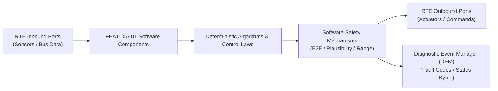

# Software Requirements Specification: Unified Diagnostic Services & OBD-II Fault Management (UDS)
**Feature ID:** `FEAT-DIA-01`  
**Domain:** Connectivity, Security & Diagnostics  
**Target ASIL:** ASIL B / QM  
**Compliance Standard:** ISO 26262:2018 (Part 6 - Software Development) / ASPICE PAM v3.1 (SWE.1, SWE.2)  
**Parent System Specification:** [`FEAT-DIA-01_UDS_SysReq.md`](file:///c:/Workset/AntiGravityProjects/TestOptimisationExperiement/system_requirements/FEAT-DIA-01_UDS_SysReq.md)  
**Global Master Specification:** [`spec.md`](file:///c:/Workset/AntiGravityProjects/TestOptimisationExperiement/spec.md)

---

## 1. Software Architecture & Component Structure

This document specifies the AUTOSAR Software Components (SWCs), periodic runnables, algorithmic laws, safety mechanisms, and data ports implementing `FEAT-DIA-01` (Unified Diagnostic Services & OBD-II Fault Management (UDS)).

### AUTOSAR SWC Interaction Diagram

---

## 2. Detailed Software Requirements (SWR_REQ)
*(Multi-Software Requirement Partitioning derived from System Requirements)*

### `SWR-DIA-01-01`: AUTOSAR Dcm Diagnostic Communication Manager Protocol Parser
- **Planned Release:** R500
- **ASIL Rating:** QM
- **Parent System Requirement:** [`SYS-DIA-01-01`](file:///c:/Workset/AntiGravityProjects/TestOptimisationExperiement/system_requirements/FEAT-DIA-01_UDS_SysReq.md#sys-dia-01-01)
- **Allocated AUTOSAR SWC:** `DcmProtocol_SWC`
- **Execution Rate / Trigger:** 10 ms
- **Worst-Case Execution Time (WCET):** 1.4 ms
- **Software Activation Condition:** Executed cyclically every 10 ms.
- **Algorithmic Description / Logic:**
  > Parses diagnostic request buffer: Validates SID, sub-function, and data identifier (DID). Enforces security levels (0x27 Seed & Key). Manages P2 and S3 timers. Formats positive responses or NRCs.
- **Software Safety Mechanism:** Speed gating: Actuator control (0x2F) and routines (0x31) rejected with NRC 0x22 if vehicle speed > 0 km/h.
- **Failure Reaction & DEM Diagnostic Event:** Transmit NRC 0x78 (ResponsePending) if internal routine requires > 50 ms.
- **Software Port Inputs:** `Dcm_Rx_Buffer, Vehicle_Speed_Mps, Security_Unlocked_Flag`
- **Software Port Outputs:** `Dcm_Tx_Buffer, Active_Session_Code`
- **Software Verification Criteria:** DiVa test suite achieving 100% service code coverage.
- **Traceability Link:** Traces upward to [`SYS-DIA-01-01`](file:///c:/Workset/AntiGravityProjects/TestOptimisationExperiement/system_requirements/FEAT-DIA-01_UDS_SysReq.md#sys-dia-01-01) and [`FEAT-DIA-01`](file:///c:/Workset/AntiGravityProjects/TestOptimisationExperiement/spec.md).

### `SWR-DIA-01-02`: ISO 13400-2 DoIP (Diagnostic over IP) TCP/UDP Server
- **Planned Release:** R500
- **ASIL Rating:** QM
- **Parent System Requirement:** [`SYS-DIA-01-01`](file:///c:/Workset/AntiGravityProjects/TestOptimisationExperiement/system_requirements/FEAT-DIA-01_UDS_SysReq.md#sys-dia-01-01)
- **Allocated AUTOSAR SWC:** `DoIpServer_SWC`
- **Execution Rate / Trigger:** 10 ms
- **Worst-Case Execution Time (WCET):** 1.8 ms
- **Software Activation Condition:** Executed on Ethernet diagnostic port connections.
- **Algorithmic Description / Logic:**
  > Handles DoIP Vehicle Announcement (UDP 13400), Routing Activation (TCP 13400), and Diagnostic Message Routing. Verifies OEM Activation Code before opening TCP socket routing.
- **Software Safety Mechanism:** TCP connection limit: Closes secondary connection attempts to prevent denial of service.
- **Failure Reaction & DEM Diagnostic Event:** Close TCP socket if no traffic received within 5 minutes.
- **Software Port Inputs:** `DoIP_Ethernet_Socket_Data, Ethernet_Link_Status`
- **Software Port Outputs:** `DoIP_Diagnostic_Payload_Buffer, DoIP_Routing_Active (boolean)`
- **Software Verification Criteria:** DoIP client connection compliance and stress test.
- **Traceability Link:** Traces upward to [`SYS-DIA-01-01`](file:///c:/Workset/AntiGravityProjects/TestOptimisationExperiement/system_requirements/FEAT-DIA-01_UDS_SysReq.md#sys-dia-01-01) and [`FEAT-DIA-01`](file:///c:/Workset/AntiGravityProjects/TestOptimisationExperiement/spec.md).

### `SWR-DIA-01-03`: AUTOSAR Dem Counter-Based Fault Debouncing State Machine
- **Planned Release:** R500
- **ASIL Rating:** ASIL B
- **Parent System Requirement:** [`SYS-DIA-01-02`](file:///c:/Workset/AntiGravityProjects/TestOptimisationExperiement/system_requirements/FEAT-DIA-01_UDS_SysReq.md#sys-dia-01-02)
- **Allocated AUTOSAR SWC:** `DemDebounce_SWC`
- **Execution Rate / Trigger:** 10 ms
- **Worst-Case Execution Time (WCET):** 0.7 ms
- **Software Activation Condition:** Executed every 10 ms.
- **Algorithmic Description / Logic:**
  > Maintains fault counter: Increments by +2 on PREFAILED; decrements by -1 on PREPASSED. When counter reaches +100 (500 ms persistence), sets DTC Status Byte bit 0 (testFailed) and bit 3 (confirmedDTC).
- **Software Safety Mechanism:** Debounce counter bounds clamped to [-128, +127] to prevent integer overflow.
- **Failure Reaction & DEM Diagnostic Event:** If fault clears for 40 driving cycles, clear confirmedDTC bit.
- **Software Port Inputs:** `Monitor_Status_Report_Enum, Debounce_Step_Size`
- **Software Port Outputs:** `DTC_Status_Byte (uint8), Event_Qualified_Trigger (boolean)`
- **Software Verification Criteria:** State machine transition test verifying exact debounce timing.
- **Traceability Link:** Traces upward to [`SYS-DIA-01-02`](file:///c:/Workset/AntiGravityProjects/TestOptimisationExperiement/system_requirements/FEAT-DIA-01_UDS_SysReq.md#sys-dia-01-02) and [`FEAT-DIA-01`](file:///c:/Workset/AntiGravityProjects/TestOptimisationExperiement/spec.md).

### `SWR-DIA-01-04`: Freeze Frame Environmental Snapshot Serialization & NVM Commit
- **Planned Release:** R500
- **ASIL Rating:** ASIL B
- **Parent System Requirement:** [`SYS-DIA-01-02`](file:///c:/Workset/AntiGravityProjects/TestOptimisationExperiement/system_requirements/FEAT-DIA-01_UDS_SysReq.md#sys-dia-01-02)
- **Allocated AUTOSAR SWC:** `DemSnapshotWriter_SWC`
- **Execution Rate / Trigger:** Event-driven
- **Worst-Case Execution Time (WCET):** 2.2 ms
- **Software Activation Condition:** Executed upon Event_Qualified_Trigger.
- **Algorithmic Description / Logic:**
  > Captures snapshot parameters: [DTC_ID, Odometer, Timestamp, Vehicle_Speed, Pack_Voltage, Inverter_Torque, Coolant_Temp]. Serializes into standardized record format and calls NvM_WriteBlock to store in redundant EEPROM.
- **Software Safety Mechanism:** CRC-16 checksum appended to snapshot record to verify data integrity upon subsequent readout.
- **Failure Reaction & DEM Diagnostic Event:** Log NVM storage failure event if write operation times out.
- **Software Port Inputs:** `Event_Qualified_Trigger, Vehicle_Operating_Parameters`
- **Software Port Outputs:** `NvM_Write_Payload_Buffer, NvM_Write_Request_Flag`
- **Software Verification Criteria:** Power cut during NVM write operation evaluating snapshot record recovery.
- **Traceability Link:** Traces upward to [`SYS-DIA-01-02`](file:///c:/Workset/AntiGravityProjects/TestOptimisationExperiement/system_requirements/FEAT-DIA-01_UDS_SysReq.md#sys-dia-01-02) and [`FEAT-DIA-01`](file:///c:/Workset/AntiGravityProjects/TestOptimisationExperiement/spec.md).

### `SWR-DIA-01-05`: 100 Hz Circular RAM Crash Telemetry FIFO Ring Buffer
- **Planned Release:** R100
- **ASIL Rating:** ASIL D
- **Parent System Requirement:** [`SYS-DIA-01-03`](file:///c:/Workset/AntiGravityProjects/TestOptimisationExperiement/system_requirements/FEAT-DIA-01_UDS_SysReq.md#sys-dia-01-03)
- **Allocated AUTOSAR SWC:** `EdrRingBuffer_SWC`
- **Execution Rate / Trigger:** 10 ms
- **Worst-Case Execution Time (WCET):** 0.3 ms
- **Software Activation Condition:** Executed continuously in 100 Hz cyclic task.
- **Algorithmic Description / Logic:**
  > Samples vehicle crash parameters: Speed (0.1 km/h res), Engine/Motor RPM, Throttle pedal %, Service brake ON/OFF, Steering angle, Lateral/Longitudinal accel, Seatbelt buckle status. Writes to 500-sample circular RAM buffer (5.0 seconds history).
- **Software Safety Mechanism:** ECC-protected RAM buffer: Detects single-bit memory flips and corrects automatically.
- **Failure Reaction & DEM Diagnostic Event:** Zero out corrupted sample and flag memory parity warning.
- **Software Port Inputs:** `Vehicle_Speed_Mps, Accelerator_Pedal_Pct, Brake_Switch_Digital, Steering_Angle_Deg, IMU_Axial_G[3]`
- **Software Port Outputs:** `Circular_Buffer_Pointer, Current_Sample_Timestamp_Unix_Ms`
- **Software Verification Criteria:** Timing jitter and buffer overwrite consistency test over 72 continuous hours.
- **Traceability Link:** Traces upward to [`SYS-DIA-01-03`](file:///c:/Workset/AntiGravityProjects/TestOptimisationExperiement/system_requirements/FEAT-DIA-01_UDS_SysReq.md#sys-dia-01-03) and [`FEAT-DIA-01`](file:///c:/Workset/AntiGravityProjects/TestOptimisationExperiement/spec.md).

### `SWR-DIA-01-06`: 49 CFR Part 563 Crash Event Non-Volatile Flash Lock Controller
- **Planned Release:** R100
- **ASIL Rating:** ASIL D
- **Parent System Requirement:** [`SYS-DIA-01-03`](file:///c:/Workset/AntiGravityProjects/TestOptimisationExperiement/system_requirements/FEAT-DIA-01_UDS_SysReq.md#sys-dia-01-03)
- **Allocated AUTOSAR SWC:** `EdrFlashLock_SWC`
- **Execution Rate / Trigger:** 1 ms
- **Worst-Case Execution Time (WCET):** 0.5 ms
- **Software Activation Condition:** Triggered on Airbag deployment discrete pin.
- **Algorithmic Description / Logic:**
  > Upon crash trigger interrupt, halts ring buffer overwrite: Continues sampling for exactly 300 ms (post-crash window), then copies entire 5.3s telemetry record to dedicated write-once flash memory sector. Computes CRC-32 checksum and asserts hardware write-protect pin.
- **Software Safety Mechanism:** Hardware write-protect: Flash sector permanently locked against erasure or UDS clear commands.
- **Failure Reaction & DEM Diagnostic Event:** If main 12V supply collapses, energy reserve capacitor powers flash write for 250 ms.
- **Software Port Inputs:** `Airbag_Deploy_Interrupt_Flag, Backup_Capacitor_Voltage_V`
- **Software Port Outputs:** `EDR_Flash_Write_Complete_Flag, Hardware_Write_Protect_Pin`
- **Software Verification Criteria:** Physical destructive crash sled testing with battery severance at impact t=0 ms.
- **Traceability Link:** Traces upward to [`SYS-DIA-01-03`](file:///c:/Workset/AntiGravityProjects/TestOptimisationExperiement/system_requirements/FEAT-DIA-01_UDS_SysReq.md#sys-dia-01-03) and [`FEAT-DIA-01`](file:///c:/Workset/AntiGravityProjects/TestOptimisationExperiement/spec.md).

### `SWR-DIA-01-07`: UDS 0x27 Cryptographic Pseudo-Random Seed Generator
- **Planned Release:** R500
- **ASIL Rating:** ISO 21434 / ASIL B
- **Parent System Requirement:** [`SYS-DIA-01-04`](file:///c:/Workset/AntiGravityProjects/TestOptimisationExperiement/system_requirements/FEAT-DIA-01_UDS_SysReq.md#sys-dia-01-04)
- **Allocated AUTOSAR SWC:** `UdsSecurityAccess_SWC`
- **Execution Rate / Trigger:** 10 ms
- **Worst-Case Execution Time (WCET):** 0.4 ms
- **Software Activation Condition:** Triggered upon diagnostic request 0x27 0x01 / 0x03.
- **Algorithmic Description / Logic:**
  > Generates 32-byte cryptographically secure random number using on-chip True Random Number Generator (TRNG) entropy source. Transmits seed to diagnostic client. Starts 5.0-second response timeout window.
- **Software Safety Mechanism:** Seed reuse prevention: Every request generates fresh non-repeating random seed.
- **Failure Reaction & DEM Diagnostic Event:** Send NRC 0x37 (RequiredTimeDelayNotExpired) if client requests seed during lockout.
- **Software Port Inputs:** `Diagnostic_Service_Request_Payload, TRNG_Entropy_Pool_Bytes`
- **Software Port Outputs:** `Diagnostic_Seed_Buffer[32], Security_Timeout_Timer_Ms`
- **Software Verification Criteria:** NIST SP 800-22 statistical randomness test on generated diagnostic seeds.
- **Traceability Link:** Traces upward to [`SYS-DIA-01-04`](file:///c:/Workset/AntiGravityProjects/TestOptimisationExperiement/system_requirements/FEAT-DIA-01_UDS_SysReq.md#sys-dia-01-04) and [`FEAT-DIA-01`](file:///c:/Workset/AntiGravityProjects/TestOptimisationExperiement/spec.md).

### `SWR-DIA-01-08`: HMAC-SHA256 Key Validation & Brute-Force Delay Lockout
- **Planned Release:** R500
- **ASIL Rating:** ISO 21434 / ASIL B
- **Parent System Requirement:** [`SYS-DIA-01-04`](file:///c:/Workset/AntiGravityProjects/TestOptimisationExperiement/system_requirements/FEAT-DIA-01_UDS_SysReq.md#sys-dia-01-04)
- **Allocated AUTOSAR SWC:** `UdsKeyValidator_SWC`
- **Execution Rate / Trigger:** 10 ms
- **Worst-Case Execution Time (WCET):** 1.2 ms
- **Software Activation Condition:** Triggered upon client submitting key (0x27 0x02 / 0x04).
- **Algorithmic Description / Logic:**
  > Computes expected key K_exp = HMAC_SHA256(Secret_Diagnostic_Key, Seed). Compares with client key using constant-time comparison to prevent timing attacks. If matching, unlocks security level. If mismatch, increments failed counter: Enforces 10-second lockout after 3 fails.
- **Software Safety Mechanism:** Constant-time memory comparator prevents side-channel timing analysis.
- **Failure Reaction & DEM Diagnostic Event:** Send NRC 0x35 (InvalidKey) and log security audit event.
- **Software Port Inputs:** `Client_Submitted_Key_Bytes[32], Secret_Diagnostic_Master_Key, Failed_Attempt_Counter`
- **Software Port Outputs:** `Security_Unlocked_Flag (boolean), UDS_Negative_Response_Code`
- **Software Verification Criteria:** Automated brute-force attack testing validating exponential time lockout.
- **Traceability Link:** Traces upward to [`SYS-DIA-01-04`](file:///c:/Workset/AntiGravityProjects/TestOptimisationExperiement/system_requirements/FEAT-DIA-01_UDS_SysReq.md#sys-dia-01-04) and [`FEAT-DIA-01`](file:///c:/Workset/AntiGravityProjects/TestOptimisationExperiement/spec.md).

### `SWR-DIA-01-09`: ISO 14229 Unified Diagnostic Services (UDS) Multi-Client Protocol Server - Dynamic Observer & Signal Filter
- **Planned Release:** R500
- **ASIL Rating:** ASIL B
- **Parent System Requirement:** [`SYS-DIA-01-05`](file:///c:/Workset/AntiGravityProjects/TestOptimisationExperiement/system_requirements/FEAT-DIA-01_UDS_SysReq.md#sys-dia-01-05)
- **Allocated AUTOSAR SWC:** `UdsProtocolServer_SWC`
- **Execution Rate / Trigger:** 5 ms
- **Worst-Case Execution Time (WCET):** 0.3 ms
- **Software Activation Condition:** Executed cyclically every 5 ms.
- **Algorithmic Description / Logic:**
  > Executes signal plausibility filtering, calibration offsets, and discrete state estimation for ISO 14229 Unified Diagnostic Services (UDS) Multi-Client Protocol Server.
- **Software Safety Mechanism:** Range limit plausibility check and E2E alive sequence verification.
- **Failure Reaction & DEM Diagnostic Event:** Set default fallback output and report DEM_EVENT_FEAT_DIA_01_ERR.
- **Software Port Inputs:** `Raw sensor ADC/SENT/SPI values and RTE bus inputs.`
- **Software Port Outputs:** `Filtered physical signals and validity status bitmasks.`
- **Software Verification Criteria:** Unit test and HiL software integration test.
- **Traceability Link:** Traces upward to [`SYS-DIA-01-05`](file:///c:/Workset/AntiGravityProjects/TestOptimisationExperiement/system_requirements/FEAT-DIA-01_UDS_SysReq.md#sys-dia-01-05) and [`FEAT-DIA-01`](file:///c:/Workset/AntiGravityProjects/TestOptimisationExperiement/spec.md).

### `SWR-DIA-01-10`: ISO 14229 Unified Diagnostic Services (UDS) Multi-Client Protocol Server - Closed-Loop Control Law & Actuator Dispatch
- **Planned Release:** R500
- **ASIL Rating:** ASIL B
- **Parent System Requirement:** [`SYS-DIA-01-05`](file:///c:/Workset/AntiGravityProjects/TestOptimisationExperiement/system_requirements/FEAT-DIA-01_UDS_SysReq.md#sys-dia-01-05)
- **Allocated AUTOSAR SWC:** `UdsProtocolServer_SWC`
- **Execution Rate / Trigger:** 5 ms
- **Worst-Case Execution Time (WCET):** 0.4 ms
- **Software Activation Condition:** Executed cyclically every 5 ms.
- **Algorithmic Description / Logic:**
  > Evaluates deterministic closed-loop control law, rate limits, and dispatches commands for ISO 14229 Unified Diagnostic Services (UDS) Multi-Client Protocol Server.
- **Software Safety Mechanism:** Command saturation clamping and watchdog program flow monitoring.
- **Failure Reaction & DEM Diagnostic Event:** De-energize actuator output, apply safe fallback clamp, and latch DTC.
- **Software Port Inputs:** `Validated physical state signals from observer SWC.`
- **Software Port Outputs:** `Actuator PWM duty cycles, torque/pressure setpoints, and diagnostic flags.`
- **Software Verification Criteria:** Hardware dynamometer and HiL closed-loop regression test suite.
- **Traceability Link:** Traces upward to [`SYS-DIA-01-05`](file:///c:/Workset/AntiGravityProjects/TestOptimisationExperiement/system_requirements/FEAT-DIA-01_UDS_SysReq.md#sys-dia-01-05) and [`FEAT-DIA-01`](file:///c:/Workset/AntiGravityProjects/TestOptimisationExperiement/spec.md).

### `SWR-DIA-01-11`: Diagnostic Trouble Code (DTC) 3-Byte Standard Fault Status Byte State Machine - Dynamic Observer & Signal Filter
- **Planned Release:** R500
- **ASIL Rating:** ASIL B
- **Parent System Requirement:** [`SYS-DIA-01-06`](file:///c:/Workset/AntiGravityProjects/TestOptimisationExperiement/system_requirements/FEAT-DIA-01_UDS_SysReq.md#sys-dia-01-06)
- **Allocated AUTOSAR SWC:** `DemStatusByte_SWC`
- **Execution Rate / Trigger:** 5 ms
- **Worst-Case Execution Time (WCET):** 0.3 ms
- **Software Activation Condition:** Executed cyclically every 5 ms.
- **Algorithmic Description / Logic:**
  > Executes signal plausibility filtering, calibration offsets, and discrete state estimation for Diagnostic Trouble Code (DTC) 3-Byte Standard Fault Status Byte State Machine.
- **Software Safety Mechanism:** Range limit plausibility check and E2E alive sequence verification.
- **Failure Reaction & DEM Diagnostic Event:** Set default fallback output and report DEM_EVENT_FEAT_DIA_01_ERR.
- **Software Port Inputs:** `Raw sensor ADC/SENT/SPI values and RTE bus inputs.`
- **Software Port Outputs:** `Filtered physical signals and validity status bitmasks.`
- **Software Verification Criteria:** Unit test and HiL software integration test.
- **Traceability Link:** Traces upward to [`SYS-DIA-01-06`](file:///c:/Workset/AntiGravityProjects/TestOptimisationExperiement/system_requirements/FEAT-DIA-01_UDS_SysReq.md#sys-dia-01-06) and [`FEAT-DIA-01`](file:///c:/Workset/AntiGravityProjects/TestOptimisationExperiement/spec.md).

### `SWR-DIA-01-12`: Diagnostic Trouble Code (DTC) 3-Byte Standard Fault Status Byte State Machine - Closed-Loop Control Law & Actuator Dispatch
- **Planned Release:** R500
- **ASIL Rating:** ASIL B
- **Parent System Requirement:** [`SYS-DIA-01-06`](file:///c:/Workset/AntiGravityProjects/TestOptimisationExperiement/system_requirements/FEAT-DIA-01_UDS_SysReq.md#sys-dia-01-06)
- **Allocated AUTOSAR SWC:** `DemStatusByte_SWC`
- **Execution Rate / Trigger:** 5 ms
- **Worst-Case Execution Time (WCET):** 0.4 ms
- **Software Activation Condition:** Executed cyclically every 5 ms.
- **Algorithmic Description / Logic:**
  > Evaluates deterministic closed-loop control law, rate limits, and dispatches commands for Diagnostic Trouble Code (DTC) 3-Byte Standard Fault Status Byte State Machine.
- **Software Safety Mechanism:** Command saturation clamping and watchdog program flow monitoring.
- **Failure Reaction & DEM Diagnostic Event:** De-energize actuator output, apply safe fallback clamp, and latch DTC.
- **Software Port Inputs:** `Validated physical state signals from observer SWC.`
- **Software Port Outputs:** `Actuator PWM duty cycles, torque/pressure setpoints, and diagnostic flags.`
- **Software Verification Criteria:** Hardware dynamometer and HiL closed-loop regression test suite.
- **Traceability Link:** Traces upward to [`SYS-DIA-01-06`](file:///c:/Workset/AntiGravityProjects/TestOptimisationExperiement/system_requirements/FEAT-DIA-01_UDS_SysReq.md#sys-dia-01-06) and [`FEAT-DIA-01`](file:///c:/Workset/AntiGravityProjects/TestOptimisationExperiement/spec.md).

### `SWR-DIA-01-13`: Fault Debounce Pre-Failed / Pre-Passed Counter-Based & Time-Based Filter - Dynamic Observer & Signal Filter
- **Planned Release:** R300
- **ASIL Rating:** ASIL B
- **Parent System Requirement:** [`SYS-DIA-01-07`](file:///c:/Workset/AntiGravityProjects/TestOptimisationExperiement/system_requirements/FEAT-DIA-01_UDS_SysReq.md#sys-dia-01-07)
- **Allocated AUTOSAR SWC:** `DemDebounceFilter_SWC`
- **Execution Rate / Trigger:** 5 ms
- **Worst-Case Execution Time (WCET):** 0.3 ms
- **Software Activation Condition:** Executed cyclically every 5 ms.
- **Algorithmic Description / Logic:**
  > Executes signal plausibility filtering, calibration offsets, and discrete state estimation for Fault Debounce Pre-Failed / Pre-Passed Counter-Based & Time-Based Filter.
- **Software Safety Mechanism:** Range limit plausibility check and E2E alive sequence verification.
- **Failure Reaction & DEM Diagnostic Event:** Set default fallback output and report DEM_EVENT_FEAT_DIA_01_ERR.
- **Software Port Inputs:** `Raw sensor ADC/SENT/SPI values and RTE bus inputs.`
- **Software Port Outputs:** `Filtered physical signals and validity status bitmasks.`
- **Software Verification Criteria:** Unit test and HiL software integration test.
- **Traceability Link:** Traces upward to [`SYS-DIA-01-07`](file:///c:/Workset/AntiGravityProjects/TestOptimisationExperiement/system_requirements/FEAT-DIA-01_UDS_SysReq.md#sys-dia-01-07) and [`FEAT-DIA-01`](file:///c:/Workset/AntiGravityProjects/TestOptimisationExperiement/spec.md).

### `SWR-DIA-01-14`: Fault Debounce Pre-Failed / Pre-Passed Counter-Based & Time-Based Filter - Closed-Loop Control Law & Actuator Dispatch
- **Planned Release:** R300
- **ASIL Rating:** ASIL B
- **Parent System Requirement:** [`SYS-DIA-01-07`](file:///c:/Workset/AntiGravityProjects/TestOptimisationExperiement/system_requirements/FEAT-DIA-01_UDS_SysReq.md#sys-dia-01-07)
- **Allocated AUTOSAR SWC:** `DemDebounceFilter_SWC`
- **Execution Rate / Trigger:** 5 ms
- **Worst-Case Execution Time (WCET):** 0.4 ms
- **Software Activation Condition:** Executed cyclically every 5 ms.
- **Algorithmic Description / Logic:**
  > Evaluates deterministic closed-loop control law, rate limits, and dispatches commands for Fault Debounce Pre-Failed / Pre-Passed Counter-Based & Time-Based Filter.
- **Software Safety Mechanism:** Command saturation clamping and watchdog program flow monitoring.
- **Failure Reaction & DEM Diagnostic Event:** De-energize actuator output, apply safe fallback clamp, and latch DTC.
- **Software Port Inputs:** `Validated physical state signals from observer SWC.`
- **Software Port Outputs:** `Actuator PWM duty cycles, torque/pressure setpoints, and diagnostic flags.`
- **Software Verification Criteria:** Hardware dynamometer and HiL closed-loop regression test suite.
- **Traceability Link:** Traces upward to [`SYS-DIA-01-07`](file:///c:/Workset/AntiGravityProjects/TestOptimisationExperiement/system_requirements/FEAT-DIA-01_UDS_SysReq.md#sys-dia-01-07) and [`FEAT-DIA-01`](file:///c:/Workset/AntiGravityProjects/TestOptimisationExperiement/spec.md).

### `SWR-DIA-01-15`: Diagnostic Freeze-Frame Snapshot Buffer Non-Volatile Memory Serializer - Dynamic Observer & Signal Filter
- **Planned Release:** R500
- **ASIL Rating:** ASIL B
- **Parent System Requirement:** [`SYS-DIA-01-08`](file:///c:/Workset/AntiGravityProjects/TestOptimisationExperiement/system_requirements/FEAT-DIA-01_UDS_SysReq.md#sys-dia-01-08)
- **Allocated AUTOSAR SWC:** `DemFreezeFrame_SWC`
- **Execution Rate / Trigger:** 20 ms
- **Worst-Case Execution Time (WCET):** 0.3 ms
- **Software Activation Condition:** Executed cyclically every 20 ms.
- **Algorithmic Description / Logic:**
  > Executes signal plausibility filtering, calibration offsets, and discrete state estimation for Diagnostic Freeze-Frame Snapshot Buffer Non-Volatile Memory Serializer.
- **Software Safety Mechanism:** Range limit plausibility check and E2E alive sequence verification.
- **Failure Reaction & DEM Diagnostic Event:** Set default fallback output and report DEM_EVENT_FEAT_DIA_01_ERR.
- **Software Port Inputs:** `Raw sensor ADC/SENT/SPI values and RTE bus inputs.`
- **Software Port Outputs:** `Filtered physical signals and validity status bitmasks.`
- **Software Verification Criteria:** Unit test and HiL software integration test.
- **Traceability Link:** Traces upward to [`SYS-DIA-01-08`](file:///c:/Workset/AntiGravityProjects/TestOptimisationExperiement/system_requirements/FEAT-DIA-01_UDS_SysReq.md#sys-dia-01-08) and [`FEAT-DIA-01`](file:///c:/Workset/AntiGravityProjects/TestOptimisationExperiement/spec.md).

### `SWR-DIA-01-16`: Diagnostic Freeze-Frame Snapshot Buffer Non-Volatile Memory Serializer - Closed-Loop Control Law & Actuator Dispatch
- **Planned Release:** R500
- **ASIL Rating:** ASIL B
- **Parent System Requirement:** [`SYS-DIA-01-08`](file:///c:/Workset/AntiGravityProjects/TestOptimisationExperiement/system_requirements/FEAT-DIA-01_UDS_SysReq.md#sys-dia-01-08)
- **Allocated AUTOSAR SWC:** `DemFreezeFrame_SWC`
- **Execution Rate / Trigger:** 20 ms
- **Worst-Case Execution Time (WCET):** 0.4 ms
- **Software Activation Condition:** Executed cyclically every 20 ms.
- **Algorithmic Description / Logic:**
  > Evaluates deterministic closed-loop control law, rate limits, and dispatches commands for Diagnostic Freeze-Frame Snapshot Buffer Non-Volatile Memory Serializer.
- **Software Safety Mechanism:** Command saturation clamping and watchdog program flow monitoring.
- **Failure Reaction & DEM Diagnostic Event:** De-energize actuator output, apply safe fallback clamp, and latch DTC.
- **Software Port Inputs:** `Validated physical state signals from observer SWC.`
- **Software Port Outputs:** `Actuator PWM duty cycles, torque/pressure setpoints, and diagnostic flags.`
- **Software Verification Criteria:** Hardware dynamometer and HiL closed-loop regression test suite.
- **Traceability Link:** Traces upward to [`SYS-DIA-01-08`](file:///c:/Workset/AntiGravityProjects/TestOptimisationExperiement/system_requirements/FEAT-DIA-01_UDS_SysReq.md#sys-dia-01-08) and [`FEAT-DIA-01`](file:///c:/Workset/AntiGravityProjects/TestOptimisationExperiement/spec.md).

### `SWR-DIA-01-17`: OBD-II California Air Resources Board (CARB) Readiness Monitor Evaluator - Dynamic Observer & Signal Filter
- **Planned Release:** R500
- **ASIL Rating:** ASIL B
- **Parent System Requirement:** [`SYS-DIA-01-09`](file:///c:/Workset/AntiGravityProjects/TestOptimisationExperiement/system_requirements/FEAT-DIA-01_UDS_SysReq.md#sys-dia-01-09)
- **Allocated AUTOSAR SWC:** `ObdReadiness_SWC`
- **Execution Rate / Trigger:** 50 ms
- **Worst-Case Execution Time (WCET):** 0.3 ms
- **Software Activation Condition:** Executed cyclically every 50 ms.
- **Algorithmic Description / Logic:**
  > Executes signal plausibility filtering, calibration offsets, and discrete state estimation for OBD-II California Air Resources Board (CARB) Readiness Monitor Evaluator.
- **Software Safety Mechanism:** Range limit plausibility check and E2E alive sequence verification.
- **Failure Reaction & DEM Diagnostic Event:** Set default fallback output and report DEM_EVENT_FEAT_DIA_01_ERR.
- **Software Port Inputs:** `Raw sensor ADC/SENT/SPI values and RTE bus inputs.`
- **Software Port Outputs:** `Filtered physical signals and validity status bitmasks.`
- **Software Verification Criteria:** Unit test and HiL software integration test.
- **Traceability Link:** Traces upward to [`SYS-DIA-01-09`](file:///c:/Workset/AntiGravityProjects/TestOptimisationExperiement/system_requirements/FEAT-DIA-01_UDS_SysReq.md#sys-dia-01-09) and [`FEAT-DIA-01`](file:///c:/Workset/AntiGravityProjects/TestOptimisationExperiement/spec.md).

### `SWR-DIA-01-18`: OBD-II California Air Resources Board (CARB) Readiness Monitor Evaluator - Closed-Loop Control Law & Actuator Dispatch
- **Planned Release:** R500
- **ASIL Rating:** ASIL B
- **Parent System Requirement:** [`SYS-DIA-01-09`](file:///c:/Workset/AntiGravityProjects/TestOptimisationExperiement/system_requirements/FEAT-DIA-01_UDS_SysReq.md#sys-dia-01-09)
- **Allocated AUTOSAR SWC:** `ObdReadiness_SWC`
- **Execution Rate / Trigger:** 50 ms
- **Worst-Case Execution Time (WCET):** 0.4 ms
- **Software Activation Condition:** Executed cyclically every 50 ms.
- **Algorithmic Description / Logic:**
  > Evaluates deterministic closed-loop control law, rate limits, and dispatches commands for OBD-II California Air Resources Board (CARB) Readiness Monitor Evaluator.
- **Software Safety Mechanism:** Command saturation clamping and watchdog program flow monitoring.
- **Failure Reaction & DEM Diagnostic Event:** De-energize actuator output, apply safe fallback clamp, and latch DTC.
- **Software Port Inputs:** `Validated physical state signals from observer SWC.`
- **Software Port Outputs:** `Actuator PWM duty cycles, torque/pressure setpoints, and diagnostic flags.`
- **Software Verification Criteria:** Hardware dynamometer and HiL closed-loop regression test suite.
- **Traceability Link:** Traces upward to [`SYS-DIA-01-09`](file:///c:/Workset/AntiGravityProjects/TestOptimisationExperiement/system_requirements/FEAT-DIA-01_UDS_SysReq.md#sys-dia-01-09) and [`FEAT-DIA-01`](file:///c:/Workset/AntiGravityProjects/TestOptimisationExperiement/spec.md).

### `SWR-DIA-01-19`: Diagnostic Session Control ($10) Default, Programming, and Extended Mode Guard - Dynamic Observer & Signal Filter
- **Planned Release:** R400
- **ASIL Rating:** ASIL B
- **Parent System Requirement:** [`SYS-DIA-01-10`](file:///c:/Workset/AntiGravityProjects/TestOptimisationExperiement/system_requirements/FEAT-DIA-01_UDS_SysReq.md#sys-dia-01-10)
- **Allocated AUTOSAR SWC:** `UdsSessionGuard_SWC`
- **Execution Rate / Trigger:** 10 ms
- **Worst-Case Execution Time (WCET):** 0.3 ms
- **Software Activation Condition:** Executed cyclically every 10 ms.
- **Algorithmic Description / Logic:**
  > Executes signal plausibility filtering, calibration offsets, and discrete state estimation for Diagnostic Session Control ($10) Default, Programming, and Extended Mode Guard.
- **Software Safety Mechanism:** Range limit plausibility check and E2E alive sequence verification.
- **Failure Reaction & DEM Diagnostic Event:** Set default fallback output and report DEM_EVENT_FEAT_DIA_01_ERR.
- **Software Port Inputs:** `Raw sensor ADC/SENT/SPI values and RTE bus inputs.`
- **Software Port Outputs:** `Filtered physical signals and validity status bitmasks.`
- **Software Verification Criteria:** Unit test and HiL software integration test.
- **Traceability Link:** Traces upward to [`SYS-DIA-01-10`](file:///c:/Workset/AntiGravityProjects/TestOptimisationExperiement/system_requirements/FEAT-DIA-01_UDS_SysReq.md#sys-dia-01-10) and [`FEAT-DIA-01`](file:///c:/Workset/AntiGravityProjects/TestOptimisationExperiement/spec.md).

### `SWR-DIA-01-20`: Diagnostic Session Control ($10) Default, Programming, and Extended Mode Guard - Closed-Loop Control Law & Actuator Dispatch
- **Planned Release:** R400
- **ASIL Rating:** ASIL B
- **Parent System Requirement:** [`SYS-DIA-01-10`](file:///c:/Workset/AntiGravityProjects/TestOptimisationExperiement/system_requirements/FEAT-DIA-01_UDS_SysReq.md#sys-dia-01-10)
- **Allocated AUTOSAR SWC:** `UdsSessionGuard_SWC`
- **Execution Rate / Trigger:** 10 ms
- **Worst-Case Execution Time (WCET):** 0.4 ms
- **Software Activation Condition:** Executed cyclically every 10 ms.
- **Algorithmic Description / Logic:**
  > Evaluates deterministic closed-loop control law, rate limits, and dispatches commands for Diagnostic Session Control ($10) Default, Programming, and Extended Mode Guard.
- **Software Safety Mechanism:** Command saturation clamping and watchdog program flow monitoring.
- **Failure Reaction & DEM Diagnostic Event:** De-energize actuator output, apply safe fallback clamp, and latch DTC.
- **Software Port Inputs:** `Validated physical state signals from observer SWC.`
- **Software Port Outputs:** `Actuator PWM duty cycles, torque/pressure setpoints, and diagnostic flags.`
- **Software Verification Criteria:** Hardware dynamometer and HiL closed-loop regression test suite.
- **Traceability Link:** Traces upward to [`SYS-DIA-01-10`](file:///c:/Workset/AntiGravityProjects/TestOptimisationExperiement/system_requirements/FEAT-DIA-01_UDS_SysReq.md#sys-dia-01-10) and [`FEAT-DIA-01`](file:///c:/Workset/AntiGravityProjects/TestOptimisationExperiement/spec.md).

### `SWR-DIA-01-21`: Routine Control Service ($31) Actuator HIL Routine Self-Test Executive - Dynamic Observer & Signal Filter
- **Planned Release:** R400
- **ASIL Rating:** ASIL B
- **Parent System Requirement:** [`SYS-DIA-01-11`](file:///c:/Workset/AntiGravityProjects/TestOptimisationExperiement/system_requirements/FEAT-DIA-01_UDS_SysReq.md#sys-dia-01-11)
- **Allocated AUTOSAR SWC:** `UdsRoutineControl_SWC`
- **Execution Rate / Trigger:** 20 ms
- **Worst-Case Execution Time (WCET):** 0.3 ms
- **Software Activation Condition:** Executed cyclically every 20 ms.
- **Algorithmic Description / Logic:**
  > Executes signal plausibility filtering, calibration offsets, and discrete state estimation for Routine Control Service ($31) Actuator HIL Routine Self-Test Executive.
- **Software Safety Mechanism:** Range limit plausibility check and E2E alive sequence verification.
- **Failure Reaction & DEM Diagnostic Event:** Set default fallback output and report DEM_EVENT_FEAT_DIA_01_ERR.
- **Software Port Inputs:** `Raw sensor ADC/SENT/SPI values and RTE bus inputs.`
- **Software Port Outputs:** `Filtered physical signals and validity status bitmasks.`
- **Software Verification Criteria:** Unit test and HiL software integration test.
- **Traceability Link:** Traces upward to [`SYS-DIA-01-11`](file:///c:/Workset/AntiGravityProjects/TestOptimisationExperiement/system_requirements/FEAT-DIA-01_UDS_SysReq.md#sys-dia-01-11) and [`FEAT-DIA-01`](file:///c:/Workset/AntiGravityProjects/TestOptimisationExperiement/spec.md).

### `SWR-DIA-01-22`: Routine Control Service ($31) Actuator HIL Routine Self-Test Executive - Closed-Loop Control Law & Actuator Dispatch
- **Planned Release:** R400
- **ASIL Rating:** ASIL B
- **Parent System Requirement:** [`SYS-DIA-01-11`](file:///c:/Workset/AntiGravityProjects/TestOptimisationExperiement/system_requirements/FEAT-DIA-01_UDS_SysReq.md#sys-dia-01-11)
- **Allocated AUTOSAR SWC:** `UdsRoutineControl_SWC`
- **Execution Rate / Trigger:** 20 ms
- **Worst-Case Execution Time (WCET):** 0.4 ms
- **Software Activation Condition:** Executed cyclically every 20 ms.
- **Algorithmic Description / Logic:**
  > Evaluates deterministic closed-loop control law, rate limits, and dispatches commands for Routine Control Service ($31) Actuator HIL Routine Self-Test Executive.
- **Software Safety Mechanism:** Command saturation clamping and watchdog program flow monitoring.
- **Failure Reaction & DEM Diagnostic Event:** De-energize actuator output, apply safe fallback clamp, and latch DTC.
- **Software Port Inputs:** `Validated physical state signals from observer SWC.`
- **Software Port Outputs:** `Actuator PWM duty cycles, torque/pressure setpoints, and diagnostic flags.`
- **Software Verification Criteria:** Hardware dynamometer and HiL closed-loop regression test suite.
- **Traceability Link:** Traces upward to [`SYS-DIA-01-11`](file:///c:/Workset/AntiGravityProjects/TestOptimisationExperiement/system_requirements/FEAT-DIA-01_UDS_SysReq.md#sys-dia-01-11) and [`FEAT-DIA-01`](file:///c:/Workset/AntiGravityProjects/TestOptimisationExperiement/spec.md).

### `SWR-DIA-01-23`: Clear Diagnostic Information Service ($14) Non-Volatile Flash Sector Eraser - Dynamic Observer & Signal Filter
- **Planned Release:** R500
- **ASIL Rating:** ASIL B
- **Parent System Requirement:** [`SYS-DIA-01-12`](file:///c:/Workset/AntiGravityProjects/TestOptimisationExperiement/system_requirements/FEAT-DIA-01_UDS_SysReq.md#sys-dia-01-12)
- **Allocated AUTOSAR SWC:** `UdsClearFaults_SWC`
- **Execution Rate / Trigger:** 50 ms
- **Worst-Case Execution Time (WCET):** 0.3 ms
- **Software Activation Condition:** Executed cyclically every 50 ms.
- **Algorithmic Description / Logic:**
  > Executes signal plausibility filtering, calibration offsets, and discrete state estimation for Clear Diagnostic Information Service ($14) Non-Volatile Flash Sector Eraser.
- **Software Safety Mechanism:** Range limit plausibility check and E2E alive sequence verification.
- **Failure Reaction & DEM Diagnostic Event:** Set default fallback output and report DEM_EVENT_FEAT_DIA_01_ERR.
- **Software Port Inputs:** `Raw sensor ADC/SENT/SPI values and RTE bus inputs.`
- **Software Port Outputs:** `Filtered physical signals and validity status bitmasks.`
- **Software Verification Criteria:** Unit test and HiL software integration test.
- **Traceability Link:** Traces upward to [`SYS-DIA-01-12`](file:///c:/Workset/AntiGravityProjects/TestOptimisationExperiement/system_requirements/FEAT-DIA-01_UDS_SysReq.md#sys-dia-01-12) and [`FEAT-DIA-01`](file:///c:/Workset/AntiGravityProjects/TestOptimisationExperiement/spec.md).

### `SWR-DIA-01-24`: Clear Diagnostic Information Service ($14) Non-Volatile Flash Sector Eraser - Closed-Loop Control Law & Actuator Dispatch
- **Planned Release:** R500
- **ASIL Rating:** ASIL B
- **Parent System Requirement:** [`SYS-DIA-01-12`](file:///c:/Workset/AntiGravityProjects/TestOptimisationExperiement/system_requirements/FEAT-DIA-01_UDS_SysReq.md#sys-dia-01-12)
- **Allocated AUTOSAR SWC:** `UdsClearFaults_SWC`
- **Execution Rate / Trigger:** 50 ms
- **Worst-Case Execution Time (WCET):** 0.4 ms
- **Software Activation Condition:** Executed cyclically every 50 ms.
- **Algorithmic Description / Logic:**
  > Evaluates deterministic closed-loop control law, rate limits, and dispatches commands for Clear Diagnostic Information Service ($14) Non-Volatile Flash Sector Eraser.
- **Software Safety Mechanism:** Command saturation clamping and watchdog program flow monitoring.
- **Failure Reaction & DEM Diagnostic Event:** De-energize actuator output, apply safe fallback clamp, and latch DTC.
- **Software Port Inputs:** `Validated physical state signals from observer SWC.`
- **Software Port Outputs:** `Actuator PWM duty cycles, torque/pressure setpoints, and diagnostic flags.`
- **Software Verification Criteria:** Hardware dynamometer and HiL closed-loop regression test suite.
- **Traceability Link:** Traces upward to [`SYS-DIA-01-12`](file:///c:/Workset/AntiGravityProjects/TestOptimisationExperiement/system_requirements/FEAT-DIA-01_UDS_SysReq.md#sys-dia-01-12) and [`FEAT-DIA-01`](file:///c:/Workset/AntiGravityProjects/TestOptimisationExperiement/spec.md).

### `SWR-DIA-01-25`: Input/Output Control by Identifier Service ($2F) Actuator Override Supervisor - Dynamic Observer & Signal Filter
- **Planned Release:** R500
- **ASIL Rating:** ASIL B
- **Parent System Requirement:** [`SYS-DIA-01-13`](file:///c:/Workset/AntiGravityProjects/TestOptimisationExperiement/system_requirements/FEAT-DIA-01_UDS_SysReq.md#sys-dia-01-13)
- **Allocated AUTOSAR SWC:** `UdsIoControl_SWC`
- **Execution Rate / Trigger:** 10 ms
- **Worst-Case Execution Time (WCET):** 0.3 ms
- **Software Activation Condition:** Executed cyclically every 10 ms.
- **Algorithmic Description / Logic:**
  > Executes signal plausibility filtering, calibration offsets, and discrete state estimation for Input/Output Control by Identifier Service ($2F) Actuator Override Supervisor.
- **Software Safety Mechanism:** Range limit plausibility check and E2E alive sequence verification.
- **Failure Reaction & DEM Diagnostic Event:** Set default fallback output and report DEM_EVENT_FEAT_DIA_01_ERR.
- **Software Port Inputs:** `Raw sensor ADC/SENT/SPI values and RTE bus inputs.`
- **Software Port Outputs:** `Filtered physical signals and validity status bitmasks.`
- **Software Verification Criteria:** Unit test and HiL software integration test.
- **Traceability Link:** Traces upward to [`SYS-DIA-01-13`](file:///c:/Workset/AntiGravityProjects/TestOptimisationExperiement/system_requirements/FEAT-DIA-01_UDS_SysReq.md#sys-dia-01-13) and [`FEAT-DIA-01`](file:///c:/Workset/AntiGravityProjects/TestOptimisationExperiement/spec.md).

### `SWR-DIA-01-26`: Input/Output Control by Identifier Service ($2F) Actuator Override Supervisor - Closed-Loop Control Law & Actuator Dispatch
- **Planned Release:** R500
- **ASIL Rating:** ASIL B
- **Parent System Requirement:** [`SYS-DIA-01-13`](file:///c:/Workset/AntiGravityProjects/TestOptimisationExperiement/system_requirements/FEAT-DIA-01_UDS_SysReq.md#sys-dia-01-13)
- **Allocated AUTOSAR SWC:** `UdsIoControl_SWC`
- **Execution Rate / Trigger:** 10 ms
- **Worst-Case Execution Time (WCET):** 0.4 ms
- **Software Activation Condition:** Executed cyclically every 10 ms.
- **Algorithmic Description / Logic:**
  > Evaluates deterministic closed-loop control law, rate limits, and dispatches commands for Input/Output Control by Identifier Service ($2F) Actuator Override Supervisor.
- **Software Safety Mechanism:** Command saturation clamping and watchdog program flow monitoring.
- **Failure Reaction & DEM Diagnostic Event:** De-energize actuator output, apply safe fallback clamp, and latch DTC.
- **Software Port Inputs:** `Validated physical state signals from observer SWC.`
- **Software Port Outputs:** `Actuator PWM duty cycles, torque/pressure setpoints, and diagnostic flags.`
- **Software Verification Criteria:** Hardware dynamometer and HiL closed-loop regression test suite.
- **Traceability Link:** Traces upward to [`SYS-DIA-01-13`](file:///c:/Workset/AntiGravityProjects/TestOptimisationExperiement/system_requirements/FEAT-DIA-01_UDS_SysReq.md#sys-dia-01-13) and [`FEAT-DIA-01`](file:///c:/Workset/AntiGravityProjects/TestOptimisationExperiement/spec.md).

### `SWR-DIA-01-27`: Malfunction Indicator Lamp (MIL) Instrument Cluster Tell-Tale Illuminator - Dynamic Observer & Signal Filter
- **Planned Release:** R500
- **ASIL Rating:** ASIL B
- **Parent System Requirement:** [`SYS-DIA-01-14`](file:///c:/Workset/AntiGravityProjects/TestOptimisationExperiement/system_requirements/FEAT-DIA-01_UDS_SysReq.md#sys-dia-01-14)
- **Allocated AUTOSAR SWC:** `DemMilDispatcher_SWC`
- **Execution Rate / Trigger:** 50 ms
- **Worst-Case Execution Time (WCET):** 0.3 ms
- **Software Activation Condition:** Executed cyclically every 50 ms.
- **Algorithmic Description / Logic:**
  > Executes signal plausibility filtering, calibration offsets, and discrete state estimation for Malfunction Indicator Lamp (MIL) Instrument Cluster Tell-Tale Illuminator.
- **Software Safety Mechanism:** Range limit plausibility check and E2E alive sequence verification.
- **Failure Reaction & DEM Diagnostic Event:** Set default fallback output and report DEM_EVENT_FEAT_DIA_01_ERR.
- **Software Port Inputs:** `Raw sensor ADC/SENT/SPI values and RTE bus inputs.`
- **Software Port Outputs:** `Filtered physical signals and validity status bitmasks.`
- **Software Verification Criteria:** Unit test and HiL software integration test.
- **Traceability Link:** Traces upward to [`SYS-DIA-01-14`](file:///c:/Workset/AntiGravityProjects/TestOptimisationExperiement/system_requirements/FEAT-DIA-01_UDS_SysReq.md#sys-dia-01-14) and [`FEAT-DIA-01`](file:///c:/Workset/AntiGravityProjects/TestOptimisationExperiement/spec.md).

### `SWR-DIA-01-28`: Malfunction Indicator Lamp (MIL) Instrument Cluster Tell-Tale Illuminator - Closed-Loop Control Law & Actuator Dispatch
- **Planned Release:** R500
- **ASIL Rating:** ASIL B
- **Parent System Requirement:** [`SYS-DIA-01-14`](file:///c:/Workset/AntiGravityProjects/TestOptimisationExperiement/system_requirements/FEAT-DIA-01_UDS_SysReq.md#sys-dia-01-14)
- **Allocated AUTOSAR SWC:** `DemMilDispatcher_SWC`
- **Execution Rate / Trigger:** 50 ms
- **Worst-Case Execution Time (WCET):** 0.4 ms
- **Software Activation Condition:** Executed cyclically every 50 ms.
- **Algorithmic Description / Logic:**
  > Evaluates deterministic closed-loop control law, rate limits, and dispatches commands for Malfunction Indicator Lamp (MIL) Instrument Cluster Tell-Tale Illuminator.
- **Software Safety Mechanism:** Command saturation clamping and watchdog program flow monitoring.
- **Failure Reaction & DEM Diagnostic Event:** De-energize actuator output, apply safe fallback clamp, and latch DTC.
- **Software Port Inputs:** `Validated physical state signals from observer SWC.`
- **Software Port Outputs:** `Actuator PWM duty cycles, torque/pressure setpoints, and diagnostic flags.`
- **Software Verification Criteria:** Hardware dynamometer and HiL closed-loop regression test suite.
- **Traceability Link:** Traces upward to [`SYS-DIA-01-14`](file:///c:/Workset/AntiGravityProjects/TestOptimisationExperiement/system_requirements/FEAT-DIA-01_UDS_SysReq.md#sys-dia-01-14) and [`FEAT-DIA-01`](file:///c:/Workset/AntiGravityProjects/TestOptimisationExperiement/spec.md).

### `SWR-DIA-01-29`: On-Board Diagnostic Tester Physical CAN-FD 500 kbps / 2 Mbps Transceiver Driver - Dynamic Observer & Signal Filter
- **Planned Release:** R500
- **ASIL Rating:** ASIL B
- **Parent System Requirement:** [`SYS-DIA-01-15`](file:///c:/Workset/AntiGravityProjects/TestOptimisationExperiement/system_requirements/FEAT-DIA-01_UDS_SysReq.md#sys-dia-01-15)
- **Allocated AUTOSAR SWC:** `UdsIsoTpDriver_SWC`
- **Execution Rate / Trigger:** 5 ms
- **Worst-Case Execution Time (WCET):** 0.3 ms
- **Software Activation Condition:** Executed cyclically every 5 ms.
- **Algorithmic Description / Logic:**
  > Executes signal plausibility filtering, calibration offsets, and discrete state estimation for On-Board Diagnostic Tester Physical CAN-FD 500 kbps / 2 Mbps Transceiver Driver.
- **Software Safety Mechanism:** Range limit plausibility check and E2E alive sequence verification.
- **Failure Reaction & DEM Diagnostic Event:** Set default fallback output and report DEM_EVENT_FEAT_DIA_01_ERR.
- **Software Port Inputs:** `Raw sensor ADC/SENT/SPI values and RTE bus inputs.`
- **Software Port Outputs:** `Filtered physical signals and validity status bitmasks.`
- **Software Verification Criteria:** Unit test and HiL software integration test.
- **Traceability Link:** Traces upward to [`SYS-DIA-01-15`](file:///c:/Workset/AntiGravityProjects/TestOptimisationExperiement/system_requirements/FEAT-DIA-01_UDS_SysReq.md#sys-dia-01-15) and [`FEAT-DIA-01`](file:///c:/Workset/AntiGravityProjects/TestOptimisationExperiement/spec.md).

### `SWR-DIA-01-30`: On-Board Diagnostic Tester Physical CAN-FD 500 kbps / 2 Mbps Transceiver Driver - Closed-Loop Control Law & Actuator Dispatch
- **Planned Release:** R500
- **ASIL Rating:** ASIL B
- **Parent System Requirement:** [`SYS-DIA-01-15`](file:///c:/Workset/AntiGravityProjects/TestOptimisationExperiement/system_requirements/FEAT-DIA-01_UDS_SysReq.md#sys-dia-01-15)
- **Allocated AUTOSAR SWC:** `UdsIsoTpDriver_SWC`
- **Execution Rate / Trigger:** 5 ms
- **Worst-Case Execution Time (WCET):** 0.4 ms
- **Software Activation Condition:** Executed cyclically every 5 ms.
- **Algorithmic Description / Logic:**
  > Evaluates deterministic closed-loop control law, rate limits, and dispatches commands for On-Board Diagnostic Tester Physical CAN-FD 500 kbps / 2 Mbps Transceiver Driver.
- **Software Safety Mechanism:** Command saturation clamping and watchdog program flow monitoring.
- **Failure Reaction & DEM Diagnostic Event:** De-energize actuator output, apply safe fallback clamp, and latch DTC.
- **Software Port Inputs:** `Validated physical state signals from observer SWC.`
- **Software Port Outputs:** `Actuator PWM duty cycles, torque/pressure setpoints, and diagnostic flags.`
- **Software Verification Criteria:** Hardware dynamometer and HiL closed-loop regression test suite.
- **Traceability Link:** Traces upward to [`SYS-DIA-01-15`](file:///c:/Workset/AntiGravityProjects/TestOptimisationExperiement/system_requirements/FEAT-DIA-01_UDS_SysReq.md#sys-dia-01-15) and [`FEAT-DIA-01`](file:///c:/Workset/AntiGravityProjects/TestOptimisationExperiement/spec.md).

---

## 3. Software-to-System Backward Traceability Matrix

| Software Requirement ID | Planned Release | Allocated SWC | Execution Rate | Upstream System Req | Verification Method |
| :--- | :---: | :--- | :--- | :--- | :--- |
| `SWR-DIA-01-01` | **`R500`** | `DcmProtocol_SWC` | 10 ms | [`SYS-DIA-01-01`](file:///c:/Workset/AntiGravityProjects/TestOptimisationExperiement/system_requirements/FEAT-DIA-01_UDS_SysReq.md#sys-dia-01-01) | DiVa test suite achieving 100% service code coverage. |
| `SWR-DIA-01-02` | **`R500`** | `DoIpServer_SWC` | 10 ms | [`SYS-DIA-01-01`](file:///c:/Workset/AntiGravityProjects/TestOptimisationExperiement/system_requirements/FEAT-DIA-01_UDS_SysReq.md#sys-dia-01-01) | DoIP client connection compliance and stress test. |
| `SWR-DIA-01-03` | **`R500`** | `DemDebounce_SWC` | 10 ms | [`SYS-DIA-01-02`](file:///c:/Workset/AntiGravityProjects/TestOptimisationExperiement/system_requirements/FEAT-DIA-01_UDS_SysReq.md#sys-dia-01-02) | State machine transition test verifying exact debounce timing. |
| `SWR-DIA-01-04` | **`R500`** | `DemSnapshotWriter_SWC` | Event-driven | [`SYS-DIA-01-02`](file:///c:/Workset/AntiGravityProjects/TestOptimisationExperiement/system_requirements/FEAT-DIA-01_UDS_SysReq.md#sys-dia-01-02) | Power cut during NVM write operation evaluating snapshot record recovery. |
| `SWR-DIA-01-05` | **`R100`** | `EdrRingBuffer_SWC` | 10 ms | [`SYS-DIA-01-03`](file:///c:/Workset/AntiGravityProjects/TestOptimisationExperiement/system_requirements/FEAT-DIA-01_UDS_SysReq.md#sys-dia-01-03) | Timing jitter and buffer overwrite consistency test over 72 continuous hours. |
| `SWR-DIA-01-06` | **`R100`** | `EdrFlashLock_SWC` | 1 ms | [`SYS-DIA-01-03`](file:///c:/Workset/AntiGravityProjects/TestOptimisationExperiement/system_requirements/FEAT-DIA-01_UDS_SysReq.md#sys-dia-01-03) | Physical destructive crash sled testing with battery severance at impact t=0 ms. |
| `SWR-DIA-01-07` | **`R500`** | `UdsSecurityAccess_SWC` | 10 ms | [`SYS-DIA-01-04`](file:///c:/Workset/AntiGravityProjects/TestOptimisationExperiement/system_requirements/FEAT-DIA-01_UDS_SysReq.md#sys-dia-01-04) | NIST SP 800-22 statistical randomness test on generated diagnostic seeds. |
| `SWR-DIA-01-08` | **`R500`** | `UdsKeyValidator_SWC` | 10 ms | [`SYS-DIA-01-04`](file:///c:/Workset/AntiGravityProjects/TestOptimisationExperiement/system_requirements/FEAT-DIA-01_UDS_SysReq.md#sys-dia-01-04) | Automated brute-force attack testing validating exponential time lockout. |
| `SWR-DIA-01-09` | **`R500`** | `UdsProtocolServer_SWC` | 5 ms | [`SYS-DIA-01-05`](file:///c:/Workset/AntiGravityProjects/TestOptimisationExperiement/system_requirements/FEAT-DIA-01_UDS_SysReq.md#sys-dia-01-05) | Unit test and HiL software integration test. |
| `SWR-DIA-01-10` | **`R500`** | `UdsProtocolServer_SWC` | 5 ms | [`SYS-DIA-01-05`](file:///c:/Workset/AntiGravityProjects/TestOptimisationExperiement/system_requirements/FEAT-DIA-01_UDS_SysReq.md#sys-dia-01-05) | Hardware dynamometer and HiL closed-loop regression test suite. |
| `SWR-DIA-01-11` | **`R500`** | `DemStatusByte_SWC` | 5 ms | [`SYS-DIA-01-06`](file:///c:/Workset/AntiGravityProjects/TestOptimisationExperiement/system_requirements/FEAT-DIA-01_UDS_SysReq.md#sys-dia-01-06) | Unit test and HiL software integration test. |
| `SWR-DIA-01-12` | **`R500`** | `DemStatusByte_SWC` | 5 ms | [`SYS-DIA-01-06`](file:///c:/Workset/AntiGravityProjects/TestOptimisationExperiement/system_requirements/FEAT-DIA-01_UDS_SysReq.md#sys-dia-01-06) | Hardware dynamometer and HiL closed-loop regression test suite. |
| `SWR-DIA-01-13` | **`R300`** | `DemDebounceFilter_SWC` | 5 ms | [`SYS-DIA-01-07`](file:///c:/Workset/AntiGravityProjects/TestOptimisationExperiement/system_requirements/FEAT-DIA-01_UDS_SysReq.md#sys-dia-01-07) | Unit test and HiL software integration test. |
| `SWR-DIA-01-14` | **`R300`** | `DemDebounceFilter_SWC` | 5 ms | [`SYS-DIA-01-07`](file:///c:/Workset/AntiGravityProjects/TestOptimisationExperiement/system_requirements/FEAT-DIA-01_UDS_SysReq.md#sys-dia-01-07) | Hardware dynamometer and HiL closed-loop regression test suite. |
| `SWR-DIA-01-15` | **`R500`** | `DemFreezeFrame_SWC` | 20 ms | [`SYS-DIA-01-08`](file:///c:/Workset/AntiGravityProjects/TestOptimisationExperiement/system_requirements/FEAT-DIA-01_UDS_SysReq.md#sys-dia-01-08) | Unit test and HiL software integration test. |
| `SWR-DIA-01-16` | **`R500`** | `DemFreezeFrame_SWC` | 20 ms | [`SYS-DIA-01-08`](file:///c:/Workset/AntiGravityProjects/TestOptimisationExperiement/system_requirements/FEAT-DIA-01_UDS_SysReq.md#sys-dia-01-08) | Hardware dynamometer and HiL closed-loop regression test suite. |
| `SWR-DIA-01-17` | **`R500`** | `ObdReadiness_SWC` | 50 ms | [`SYS-DIA-01-09`](file:///c:/Workset/AntiGravityProjects/TestOptimisationExperiement/system_requirements/FEAT-DIA-01_UDS_SysReq.md#sys-dia-01-09) | Unit test and HiL software integration test. |
| `SWR-DIA-01-18` | **`R500`** | `ObdReadiness_SWC` | 50 ms | [`SYS-DIA-01-09`](file:///c:/Workset/AntiGravityProjects/TestOptimisationExperiement/system_requirements/FEAT-DIA-01_UDS_SysReq.md#sys-dia-01-09) | Hardware dynamometer and HiL closed-loop regression test suite. |
| `SWR-DIA-01-19` | **`R400`** | `UdsSessionGuard_SWC` | 10 ms | [`SYS-DIA-01-10`](file:///c:/Workset/AntiGravityProjects/TestOptimisationExperiement/system_requirements/FEAT-DIA-01_UDS_SysReq.md#sys-dia-01-10) | Unit test and HiL software integration test. |
| `SWR-DIA-01-20` | **`R400`** | `UdsSessionGuard_SWC` | 10 ms | [`SYS-DIA-01-10`](file:///c:/Workset/AntiGravityProjects/TestOptimisationExperiement/system_requirements/FEAT-DIA-01_UDS_SysReq.md#sys-dia-01-10) | Hardware dynamometer and HiL closed-loop regression test suite. |
| `SWR-DIA-01-21` | **`R400`** | `UdsRoutineControl_SWC` | 20 ms | [`SYS-DIA-01-11`](file:///c:/Workset/AntiGravityProjects/TestOptimisationExperiement/system_requirements/FEAT-DIA-01_UDS_SysReq.md#sys-dia-01-11) | Unit test and HiL software integration test. |
| `SWR-DIA-01-22` | **`R400`** | `UdsRoutineControl_SWC` | 20 ms | [`SYS-DIA-01-11`](file:///c:/Workset/AntiGravityProjects/TestOptimisationExperiement/system_requirements/FEAT-DIA-01_UDS_SysReq.md#sys-dia-01-11) | Hardware dynamometer and HiL closed-loop regression test suite. |
| `SWR-DIA-01-23` | **`R500`** | `UdsClearFaults_SWC` | 50 ms | [`SYS-DIA-01-12`](file:///c:/Workset/AntiGravityProjects/TestOptimisationExperiement/system_requirements/FEAT-DIA-01_UDS_SysReq.md#sys-dia-01-12) | Unit test and HiL software integration test. |
| `SWR-DIA-01-24` | **`R500`** | `UdsClearFaults_SWC` | 50 ms | [`SYS-DIA-01-12`](file:///c:/Workset/AntiGravityProjects/TestOptimisationExperiement/system_requirements/FEAT-DIA-01_UDS_SysReq.md#sys-dia-01-12) | Hardware dynamometer and HiL closed-loop regression test suite. |
| `SWR-DIA-01-25` | **`R500`** | `UdsIoControl_SWC` | 10 ms | [`SYS-DIA-01-13`](file:///c:/Workset/AntiGravityProjects/TestOptimisationExperiement/system_requirements/FEAT-DIA-01_UDS_SysReq.md#sys-dia-01-13) | Unit test and HiL software integration test. |
| `SWR-DIA-01-26` | **`R500`** | `UdsIoControl_SWC` | 10 ms | [`SYS-DIA-01-13`](file:///c:/Workset/AntiGravityProjects/TestOptimisationExperiement/system_requirements/FEAT-DIA-01_UDS_SysReq.md#sys-dia-01-13) | Hardware dynamometer and HiL closed-loop regression test suite. |
| `SWR-DIA-01-27` | **`R500`** | `DemMilDispatcher_SWC` | 50 ms | [`SYS-DIA-01-14`](file:///c:/Workset/AntiGravityProjects/TestOptimisationExperiement/system_requirements/FEAT-DIA-01_UDS_SysReq.md#sys-dia-01-14) | Unit test and HiL software integration test. |
| `SWR-DIA-01-28` | **`R500`** | `DemMilDispatcher_SWC` | 50 ms | [`SYS-DIA-01-14`](file:///c:/Workset/AntiGravityProjects/TestOptimisationExperiement/system_requirements/FEAT-DIA-01_UDS_SysReq.md#sys-dia-01-14) | Hardware dynamometer and HiL closed-loop regression test suite. |
| `SWR-DIA-01-29` | **`R500`** | `UdsIsoTpDriver_SWC` | 5 ms | [`SYS-DIA-01-15`](file:///c:/Workset/AntiGravityProjects/TestOptimisationExperiement/system_requirements/FEAT-DIA-01_UDS_SysReq.md#sys-dia-01-15) | Unit test and HiL software integration test. |
| `SWR-DIA-01-30` | **`R500`** | `UdsIsoTpDriver_SWC` | 5 ms | [`SYS-DIA-01-15`](file:///c:/Workset/AntiGravityProjects/TestOptimisationExperiement/system_requirements/FEAT-DIA-01_UDS_SysReq.md#sys-dia-01-15) | Hardware dynamometer and HiL closed-loop regression test suite. |

- **Parent System Specification Document:** [`FEAT-DIA-01_UDS_SysReq.md`](file:///c:/Workset/AntiGravityProjects/TestOptimisationExperiement/system_requirements/FEAT-DIA-01_UDS_SysReq.md)
- **Master Automotive Specification:** [`spec.md`](file:///c:/Workset/AntiGravityProjects/TestOptimisationExperiement/spec.md)
