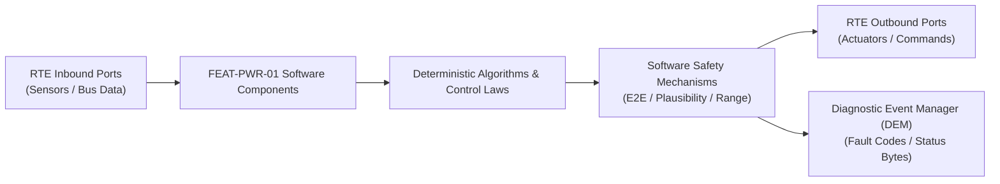

# Software Requirements Specification: High-Voltage Battery Management System (BMS)
**Feature ID:** `FEAT-PWR-01`  
**Domain:** Electric Powertrain & Energy Management  
**Target ASIL:** ASIL D  
**Compliance Standard:** ISO 26262:2018 (Part 6 - Software Development) / ASPICE PAM v3.1 (SWE.1, SWE.2)  
**Parent System Specification:** [`FEAT-PWR-01_BMS_SysReq.md`](file:///c:/Workset/AntiGravityProjects/TestOptimisationExperiement/system_requirements/FEAT-PWR-01_BMS_SysReq.md)  
**Global Master Specification:** [`spec.md`](file:///c:/Workset/AntiGravityProjects/TestOptimisationExperiement/spec.md)

---

## 1. Software Architecture & Component Structure

This document specifies the AUTOSAR Software Components (SWCs), periodic runnables, algorithmic laws, safety mechanisms, and data ports implementing `FEAT-PWR-01` (High-Voltage Battery Management System (BMS)).

### AUTOSAR SWC Interaction Diagram

---

## 2. Detailed Software Requirements (SWR_REQ)
*(Multi-Software Requirement Partitioning derived from System Requirements)*

### `SWR-PWR-01-01`: Daisy-Chain Analog Front-End (AFE) SPI Polling & CRC-15 Filter
- **Planned Release:** R100
- **ASIL Rating:** ASIL D
- **Parent System Requirement:** [`SYS-PWR-01-01`](file:///c:/Workset/AntiGravityProjects/TestOptimisationExperiement/system_requirements/FEAT-PWR-01_BMS_SysReq.md#sys-pwr-01-01)
- **Allocated AUTOSAR SWC:** `BmsCellSampler_SWC`
- **Execution Rate / Trigger:** 10 ms
- **Worst-Case Execution Time (WCET):** 1.8 ms
- **Software Activation Condition:** Executed cyclically every 10 ms.
- **Algorithmic Description / Logic:**
  > Sends broadcast command to 16 AFE chips on daisy chain. Reads back 192 voltage words. Calculates CRC-15 polynomial x^15 + x^14 + x^10 + x^8 + x^7 + x^4 + x^3 + 1. Rejects corrupted packets.
- **Software Safety Mechanism:** Frame counter and inverted command echo validation.
- **Failure Reaction & DEM Diagnostic Event:** If 3 consecutive CRC failures occur, trigger redundant reverse daisy-chain loop.
- **Software Port Inputs:** `SPI_Raw_Rx_Buffer`
- **Software Port Outputs:** `Filtered_Cell_Voltages[192] (uint16 in mV)`
- **Software Verification Criteria:** Bit-flip fault injection unit testing achieving 100% MC/DC.
- **Traceability Link:** Traces upward to [`SYS-PWR-01-01`](file:///c:/Workset/AntiGravityProjects/TestOptimisationExperiement/system_requirements/FEAT-PWR-01_BMS_SysReq.md#sys-pwr-01-01) and [`FEAT-PWR-01`](file:///c:/Workset/AntiGravityProjects/TestOptimisationExperiement/spec.md).

### `SWR-PWR-01-02`: Synchronous 1 kHz Shunt Overcurrent Fast Comparator ISR
- **Planned Release:** R100
- **ASIL Rating:** ASIL D
- **Parent System Requirement:** [`SYS-PWR-01-01`](file:///c:/Workset/AntiGravityProjects/TestOptimisationExperiement/system_requirements/FEAT-PWR-01_BMS_SysReq.md#sys-pwr-01-01)
- **Allocated AUTOSAR SWC:** `BmsCurrentMonitor_SWC`
- **Execution Rate / Trigger:** 1 ms
- **Worst-Case Execution Time (WCET):** 0.15 ms
- **Software Activation Condition:** Executed in high-priority timer ISR at 1000 Hz.
- **Algorithmic Description / Logic:**
  > Samples dual delta-sigma ADC current channels. Computes pack current: I_pack = V_shunt / R_shunt. If abs(I_pack) > 1500.0 A for >= 2 consecutive samples, directly asserts hardware trip line.
- **Software Safety Mechanism:** Dual-core lockstep hardware comparator cross-check.
- **Failure Reaction & DEM Diagnostic Event:** Trip hardware high-speed pyrofuse output in <= 2 ms.
- **Software Port Inputs:** `ADC_Shunt_Voltage_Ch1, ADC_Shunt_Voltage_Ch2`
- **Software Port Outputs:** `Overcurrent_Trip_Active (boolean), Fast_Current_Sample_A`
- **Software Verification Criteria:** Hardware injection unit test of current step responses.
- **Traceability Link:** Traces upward to [`SYS-PWR-01-01`](file:///c:/Workset/AntiGravityProjects/TestOptimisationExperiement/system_requirements/FEAT-PWR-01_BMS_SysReq.md#sys-pwr-01-01) and [`FEAT-PWR-01`](file:///c:/Workset/AntiGravityProjects/TestOptimisationExperiement/spec.md).

### `SWR-PWR-01-03`: Dual-Ring Redundant Daisy-Chain Communication Failover
- **Planned Release:** R100
- **ASIL Rating:** ASIL D
- **Parent System Requirement:** [`SYS-PWR-01-01`](file:///c:/Workset/AntiGravityProjects/TestOptimisationExperiement/system_requirements/FEAT-PWR-01_BMS_SysReq.md#sys-pwr-01-01)
- **Allocated AUTOSAR SWC:** `BmsCommSupervisor_SWC`
- **Execution Rate / Trigger:** 10 ms
- **Worst-Case Execution Time (WCET):** 0.6 ms
- **Software Activation Condition:** Executed on communication timeout.
- **Algorithmic Description / Logic:**
  > If Forward_Loop_Timeout == TRUE, enables Reverse_Loop_Transceiver within 2 ms, reading the daisy-chain from the opposite terminal to maintain 100% cell visibility.
- **Software Safety Mechanism:** Bidirectional ring isolation switches preventing single-point cable cut failure.
- **Failure Reaction & DEM Diagnostic Event:** Set AFE_Ring_Degraded_Flag if operating on single ring path.
- **Software Port Inputs:** `Forward_Loop_Status, Reverse_Loop_Status`
- **Software Port Outputs:** `Active_Ring_Port_Enum, Comm_Error_Counter`
- **Software Verification Criteria:** Physical harness cut fault injection test.
- **Traceability Link:** Traces upward to [`SYS-PWR-01-01`](file:///c:/Workset/AntiGravityProjects/TestOptimisationExperiement/system_requirements/FEAT-PWR-01_BMS_SysReq.md#sys-pwr-01-01) and [`FEAT-PWR-01`](file:///c:/Workset/AntiGravityProjects/TestOptimisationExperiement/spec.md).

### `SWR-PWR-01-04`: Dual Extended Kalman Filter (DEKF) SOC Estimator
- **Planned Release:** R100
- **ASIL Rating:** ASIL C
- **Parent System Requirement:** [`SYS-PWR-01-02`](file:///c:/Workset/AntiGravityProjects/TestOptimisationExperiement/system_requirements/FEAT-PWR-01_BMS_SysReq.md#sys-pwr-01-02)
- **Allocated AUTOSAR SWC:** `BmsSocEstimator_SWC`
- **Execution Rate / Trigger:** 50 ms
- **Worst-Case Execution Time (WCET):** 4.2 ms
- **Software Activation Condition:** Executed every 50 ms.
- **Algorithmic Description / Logic:**
  > Implements 2-RC Thevenin equivalent circuit model. State vector [SOC, V_RC1, V_RC2]^T. Blends Coulomb counting integral with open-circuit voltage OCV(SOC, T) measurement update.
- **Software Safety Mechanism:** Covariance trace monitoring; reset to OCV lookup when vehicle rests > 2 hours.
- **Failure Reaction & DEM Diagnostic Event:** Fall back to pure Coulomb counting if voltage sensor error is flagged.
- **Software Port Inputs:** `Filtered_Cell_Voltages, Fast_Current_Sample_A, Module_Temperatures`
- **Software Port Outputs:** `Battery_SOC_Pct (float32), SOC_Uncertainty_Band`
- **Software Verification Criteria:** Simulation against dynamic WLTP and US06 drive cycles.
- **Traceability Link:** Traces upward to [`SYS-PWR-01-02`](file:///c:/Workset/AntiGravityProjects/TestOptimisationExperiement/system_requirements/FEAT-PWR-01_BMS_SysReq.md#sys-pwr-01-02) and [`FEAT-PWR-01`](file:///c:/Workset/AntiGravityProjects/TestOptimisationExperiement/spec.md).

### `SWR-PWR-01-05`: Electro-Thermal State of Power (SOP) Envelope Calculator
- **Planned Release:** R100
- **ASIL Rating:** ASIL C
- **Parent System Requirement:** [`SYS-PWR-01-02`](file:///c:/Workset/AntiGravityProjects/TestOptimisationExperiement/system_requirements/FEAT-PWR-01_BMS_SysReq.md#sys-pwr-01-02)
- **Allocated AUTOSAR SWC:** `BmsSopCalculator_SWC`
- **Execution Rate / Trigger:** 20 ms
- **Worst-Case Execution Time (WCET):** 1.4 ms
- **Software Activation Condition:** Executed every 20 ms.
- **Algorithmic Description / Logic:**
  > Calculates maximum allowable continuous and 10s pulse power limits: P_dis_max = V_pack * min(I_max_cell, (V_min_cell - OCV)/R_int). Prevents cell voltage dropping below 2.50V or rising above 4.25V.
- **Software Safety Mechanism:** Temperature derating LUTs enforce sharp power cutoff below -20°C and above 55°C.
- **Failure Reaction & DEM Diagnostic Event:** Clamp P_dis_max to 10 kW if cell temperature exceeds 62°C.
- **Software Port Inputs:** `Battery_SOC_Pct, Min_Cell_Voltage, Max_Cell_Voltage, Max_Module_Temp`
- **Software Port Outputs:** `P_Charge_Limit_kW (float32), P_Discharge_Limit_kW (float32)`
- **Software Verification Criteria:** Unit test of power limit boundaries under extreme temperatures.
- **Traceability Link:** Traces upward to [`SYS-PWR-01-02`](file:///c:/Workset/AntiGravityProjects/TestOptimisationExperiement/system_requirements/FEAT-PWR-01_BMS_SysReq.md#sys-pwr-01-02) and [`FEAT-PWR-01`](file:///c:/Workset/AntiGravityProjects/TestOptimisationExperiement/spec.md).

### `SWR-PWR-01-06`: Automated Precharge Voltage Ramp & Timeout Supervisor
- **Planned Release:** R100
- **ASIL Rating:** ASIL D
- **Parent System Requirement:** [`SYS-PWR-01-03`](file:///c:/Workset/AntiGravityProjects/TestOptimisationExperiement/system_requirements/FEAT-PWR-01_BMS_SysReq.md#sys-pwr-01-03)
- **Allocated AUTOSAR SWC:** `BmsPrechargeManager_SWC`
- **Execution Rate / Trigger:** 5 ms
- **Worst-Case Execution Time (WCET):** 0.7 ms
- **Software Activation Condition:** Executed during contactor closing sequence.
- **Algorithmic Description / Logic:**
  > Closes Negative Contactor and Precharge Relay. Monitors Inverter DC-link capacitor voltage V_link. When V_link >= 0.95 * V_pack, closes Main Positive Contactor and opens Precharge Relay within 20 ms.
- **Software Safety Mechanism:** Precharge timeout: If V_link does not reach 95% in 300 ms, abort, open all contactors, and flag precharge resistor overload.
- **Failure Reaction & DEM Diagnostic Event:** Latch Precharge_Fault_Locked state and log DTC P0A0F.
- **Software Port Inputs:** `V_link_Voltage, V_pack_Voltage, Precharge_Timer_Ms`
- **Software Port Outputs:** `Precharge_Relay_Cmd (boolean), Main_Pos_Contactor_Cmd (boolean)`
- **Software Verification Criteria:** HIL bench test with shorted DC-link capacitor.
- **Traceability Link:** Traces upward to [`SYS-PWR-01-03`](file:///c:/Workset/AntiGravityProjects/TestOptimisationExperiement/system_requirements/FEAT-PWR-01_BMS_SysReq.md#sys-pwr-01-03) and [`FEAT-PWR-01`](file:///c:/Workset/AntiGravityProjects/TestOptimisationExperiement/spec.md).

### `SWR-PWR-01-07`: Contactor Weld Detection & Open-Circuit Health Diagnostics
- **Planned Release:** R100
- **ASIL Rating:** ASIL D
- **Parent System Requirement:** [`SYS-PWR-01-03`](file:///c:/Workset/AntiGravityProjects/TestOptimisationExperiement/system_requirements/FEAT-PWR-01_BMS_SysReq.md#sys-pwr-01-03)
- **Allocated AUTOSAR SWC:** `BmsContactorDiagnostic_SWC`
- **Execution Rate / Trigger:** 20 ms
- **Worst-Case Execution Time (WCET):** 0.9 ms
- **Software Activation Condition:** Executed at ignition shutdown sequence.
- **Algorithmic Description / Logic:**
  > Commands contactors OPEN. Checks voltage across contactor terminals: If V_link remains equal to V_pack after discharge resistor activation, positive or negative contactor is welded.
- **Software Safety Mechanism:** Independent auxiliary feedback switches cross-checked against electrical voltmeter.
- **Failure Reaction & DEM Diagnostic Event:** Inhibit future contactor closure and latch permanent service warning.
- **Software Port Inputs:** `V_link_Voltage, V_pack_Voltage, Contactor_Aux_Feedback_Pos, Contactor_Aux_Feedback_Neg`
- **Software Port Outputs:** `Contactor_Weld_Detected (boolean), Lockout_Active (boolean)`
- **Software Verification Criteria:** Automated contactor weld fault injection simulation.
- **Traceability Link:** Traces upward to [`SYS-PWR-01-03`](file:///c:/Workset/AntiGravityProjects/TestOptimisationExperiement/system_requirements/FEAT-PWR-01_BMS_SysReq.md#sys-pwr-01-03) and [`FEAT-PWR-01`](file:///c:/Workset/AntiGravityProjects/TestOptimisationExperiement/spec.md).

### `SWR-PWR-01-08`: Pyrofuse High-Speed Firing Pulse Generator
- **Planned Release:** R100
- **ASIL Rating:** ASIL D
- **Parent System Requirement:** [`SYS-PWR-01-03`](file:///c:/Workset/AntiGravityProjects/TestOptimisationExperiement/system_requirements/FEAT-PWR-01_BMS_SysReq.md#sys-pwr-01-03)
- **Allocated AUTOSAR SWC:** `BmsPyroTrigger_SWC`
- **Execution Rate / Trigger:** 1 ms
- **Worst-Case Execution Time (WCET):** 0.2 ms
- **Software Activation Condition:** Executed upon Overcurrent_Trip or Crash_Signal.
- **Algorithmic Description / Logic:**
  > Asserts Pyro_Fire_High_Side = TRUE and Pyro_Fire_Low_Side = TRUE for 10 ms pulse. Verifies pyrofuse continuity drops to OPEN circuit.
- **Software Safety Mechanism:** Dual-switch output driver (high-side and low-side switches required simultaneously).
- **Failure Reaction & DEM Diagnostic Event:** If pyrofuse fails to clear current, backup electronic contactor trip command executed in parallel.
- **Software Port Inputs:** `Overcurrent_Trip_Active, Crash_Detected_Digital, Pyro_Continuity_Pin`
- **Software Port Outputs:** `Pyro_Fire_Pulse_Active (boolean)`
- **Software Verification Criteria:** Pyrofuse test firings on high-power test stand.
- **Traceability Link:** Traces upward to [`SYS-PWR-01-03`](file:///c:/Workset/AntiGravityProjects/TestOptimisationExperiement/system_requirements/FEAT-PWR-01_BMS_SysReq.md#sys-pwr-01-03) and [`FEAT-PWR-01`](file:///c:/Workset/AntiGravityProjects/TestOptimisationExperiement/spec.md).

### `SWR-PWR-01-09`: Cell Voltage Sorting & Passive Bleed Duration Scheduler
- **Planned Release:** R100
- **ASIL Rating:** ASIL C
- **Parent System Requirement:** [`SYS-PWR-01-04`](file:///c:/Workset/AntiGravityProjects/TestOptimisationExperiement/system_requirements/FEAT-PWR-01_BMS_SysReq.md#sys-pwr-01-04)
- **Allocated AUTOSAR SWC:** `BmsBalancingScheduler_SWC`
- **Execution Rate / Trigger:** 100 ms
- **Worst-Case Execution Time (WCET):** 1.2 ms
- **Software Activation Condition:** Executed during battery charging.
- **Algorithmic Description / Logic:**
  > Computes lowest cell voltage V_min = min(V_cell[1..192]). For each cell i: If V_cell[i] - V_min > 15 mV and V_cell[i] > 3.90V, commands bleed switch ON for duration t_bleed = K_bal * (V_cell[i] - V_min). Interleaves balancing to distribute module thermal heat.
- **Software Safety Mechanism:** Thermal duty limiter: Clamps maximum concurrent balancing channels to <= 25% of cells.
- **Failure Reaction & DEM Diagnostic Event:** Disable balancing if any balance zone thermistor exceeds 80°C.
- **Software Port Inputs:** `Cell_Voltages_Array[192], Module_Temperatures_Array[32]`
- **Software Port Outputs:** `Balance_Channel_Commands[192], Balancing_Current_Estimate_mA`
- **Software Verification Criteria:** Cell equalization bench test across 100 unbalanced synthetic cells.
- **Traceability Link:** Traces upward to [`SYS-PWR-01-04`](file:///c:/Workset/AntiGravityProjects/TestOptimisationExperiement/system_requirements/FEAT-PWR-01_BMS_SysReq.md#sys-pwr-01-04) and [`FEAT-PWR-01`](file:///c:/Workset/AntiGravityProjects/TestOptimisationExperiement/spec.md).

### `SWR-PWR-01-10`: Balancing Switch Stuck-Closed Hardware Diagnostic Monitor
- **Planned Release:** R100
- **ASIL Rating:** ASIL C
- **Parent System Requirement:** [`SYS-PWR-01-04`](file:///c:/Workset/AntiGravityProjects/TestOptimisationExperiement/system_requirements/FEAT-PWR-01_BMS_SysReq.md#sys-pwr-01-04)
- **Allocated AUTOSAR SWC:** `BmsBalancingDiag_SWC`
- **Execution Rate / Trigger:** 1000 ms
- **Worst-Case Execution Time (WCET):** 0.5 ms
- **Software Activation Condition:** Executed periodically when balancing is idle.
- **Algorithmic Description / Logic:**
  > Commands all balancing switches OFF. Measures voltage drop across bleed resistors. If voltage drop indicates continuous current draw (> 5 mA) when commanded OFF, identifies stuck-closed balancing MOSFET.
- **Software Safety Mechanism:** Protects cell from permanent over-discharge self-drain.
- **Failure Reaction & DEM Diagnostic Event:** Set DEM DTC P0B24 (Battery Cell Balancing Circuit Stuck On) and notify service.
- **Software Port Inputs:** `Bleed_Resistor_Current_Sensors, Balancing_Command_State`
- **Software Port Outputs:** `Balancing_Circuit_Fault_Mask[192], Stuck_Switch_Detected_Flag`
- **Software Verification Criteria:** Hardware fault injection shorting balance MOSFET gate.
- **Traceability Link:** Traces upward to [`SYS-PWR-01-04`](file:///c:/Workset/AntiGravityProjects/TestOptimisationExperiement/system_requirements/FEAT-PWR-01_BMS_SysReq.md#sys-pwr-01-04) and [`FEAT-PWR-01`](file:///c:/Workset/AntiGravityProjects/TestOptimisationExperiement/spec.md).

### `SWR-PWR-01-11`: High-Voltage Interlock Loop (HVIL) Fast Edge-Detector
- **Planned Release:** R200
- **ASIL Rating:** ASIL D
- **Parent System Requirement:** [`SYS-PWR-01-05`](file:///c:/Workset/AntiGravityProjects/TestOptimisationExperiement/system_requirements/FEAT-PWR-01_BMS_SysReq.md#sys-pwr-01-05)
- **Allocated AUTOSAR SWC:** `BmsHvilSupervisor_SWC`
- **Execution Rate / Trigger:** 1 ms
- **Worst-Case Execution Time (WCET):** 0.15 ms
- **Software Activation Condition:** Executed in 1 kHz hardware timer ISR.
- **Algorithmic Description / Logic:**
  > Samples high-speed comparator monitoring 10 mA pilot current loop routed through all HV connectors, inverter covers, and service plugs. If pilot line opens for >= 2 consecutive samples (2 ms), asserts HVIL_Trip_Asserted.
- **Software Safety Mechanism:** Direct hardware trip pin to contactor economizer driver circuit.
- **Failure Reaction & DEM Diagnostic Event:** Command VCU inverter zero torque in 50 ms then open contactors.
- **Software Port Inputs:** `HVIL_Current_ADC, HVIL_Comparator_Interrupt_Flag`
- **Software Port Outputs:** `HVIL_Trip_Asserted (boolean), HVIL_Break_Timestamp_Unix_Ms`
- **Software Verification Criteria:** Mechanical connector unplugging under live high-voltage load test bench.
- **Traceability Link:** Traces upward to [`SYS-PWR-01-05`](file:///c:/Workset/AntiGravityProjects/TestOptimisationExperiement/system_requirements/FEAT-PWR-01_BMS_SysReq.md#sys-pwr-01-05) and [`FEAT-PWR-01`](file:///c:/Workset/AntiGravityProjects/TestOptimisationExperiement/spec.md).

### `SWR-PWR-01-12`: Low-Frequency AC Injected Chassis Insulation Impedance Observer
- **Planned Release:** R200
- **ASIL Rating:** ASIL D
- **Parent System Requirement:** [`SYS-PWR-01-05`](file:///c:/Workset/AntiGravityProjects/TestOptimisationExperiement/system_requirements/FEAT-PWR-01_BMS_SysReq.md#sys-pwr-01-05)
- **Allocated AUTOSAR SWC:** `BmsInsulationObserver_SWC`
- **Execution Rate / Trigger:** 100 ms
- **Worst-Case Execution Time (WCET):** 0.8 ms
- **Software Activation Condition:** Continuous cyclic task.
- **Algorithmic Description / Logic:**
  > Injects balanced 10 Hz AC sinusoidal pilot voltage (+-20V) between HV DC bus and vehicle chassis. Measures leakage return current and phase angle. Extracts real isolation resistance R_iso = V_inject / I_real. Flags warning if R_iso < 500 kOhm; trips critical if R_iso < 100 kOhm.
- **Software Safety Mechanism:** Galvanic isolation guard: Injected pilot signal energy limited to < 2.0 mJ (harmless to touch).
- **Failure Reaction & DEM Diagnostic Event:** Latch DTC P0AA6 (Hybrid/EV Battery Voltage System Isolation Fault).
- **Software Port Inputs:** `Injected_Pilot_Voltage_ADC, Injected_Leakage_Current_ADC, DC_Bus_Voltage_V`
- **Software Port Outputs:** `Measured_Isolation_Resistance_kOhm, Isolation_Fault_Level_Enum`
- **Software Verification Criteria:** Calibrated decade resistance box leakage test to chassis ground.
- **Traceability Link:** Traces upward to [`SYS-PWR-01-05`](file:///c:/Workset/AntiGravityProjects/TestOptimisationExperiement/system_requirements/FEAT-PWR-01_BMS_SysReq.md#sys-pwr-01-05) and [`FEAT-PWR-01`](file:///c:/Workset/AntiGravityProjects/TestOptimisationExperiement/spec.md).

### `SWR-PWR-01-13`: Pack Cavity Pressure Wave dP/dt Transient Analyzer
- **Planned Release:** R200
- **ASIL Rating:** ASIL D
- **Parent System Requirement:** [`SYS-PWR-01-06`](file:///c:/Workset/AntiGravityProjects/TestOptimisationExperiement/system_requirements/FEAT-PWR-01_BMS_SysReq.md#sys-pwr-01-06)
- **Allocated AUTOSAR SWC:** `BmsPressureWave_SWC`
- **Execution Rate / Trigger:** 10 ms
- **Worst-Case Execution Time (WCET):** 0.4 ms
- **Software Activation Condition:** Continuous safety task.
- **Algorithmic Description / Logic:**
  > Samples sealed battery pack enclosure barometric pressure: Computes pressure rate of rise dP/dt = (P[k] - P[k-1]) / dT. If dP/dt > 50.0 mbar/s (indicative of cell safety vent rupture), flags Thermal_Runaway_Onset.
- **Software Safety Mechanism:** Barometric pressure compensation: Adjusts baseline for atmospheric pressure changes when driving uphill.
- **Failure Reaction & DEM Diagnostic Event:** Trigger emergency pyrofuse disconnect within 2 ms.
- **Software Port Inputs:** `Pack_Internal_Pressure_Mbar, Ambient_Barometric_Pressure_Mbar`
- **Software Port Outputs:** `Pressure_Rate_Of_Rise_Mbar_S, Pressure_Wave_Detected_Flag (boolean)`
- **Software Verification Criteria:** Gas cannister controlled pulse venting inside sealed battery mock enclosure.
- **Traceability Link:** Traces upward to [`SYS-PWR-01-06`](file:///c:/Workset/AntiGravityProjects/TestOptimisationExperiement/system_requirements/FEAT-PWR-01_BMS_SysReq.md#sys-pwr-01-06) and [`FEAT-PWR-01`](file:///c:/Workset/AntiGravityProjects/TestOptimisationExperiement/spec.md).

### `SWR-PWR-01-14`: Hydrogen Electrochemical Precursor Gas Cross-Correlator
- **Planned Release:** R200
- **ASIL Rating:** ASIL D
- **Parent System Requirement:** [`SYS-PWR-01-06`](file:///c:/Workset/AntiGravityProjects/TestOptimisationExperiement/system_requirements/FEAT-PWR-01_BMS_SysReq.md#sys-pwr-01-06)
- **Allocated AUTOSAR SWC:** `BmsGasCorrelator_SWC`
- **Execution Rate / Trigger:** 50 ms
- **Worst-Case Execution Time (WCET):** 0.6 ms
- **Software Activation Condition:** Continuous gas monitoring.
- **Algorithmic Description / Logic:**
  > Samples solid-state hydrogen (H2) and carbon monoxide (CO) electrochemical sensors inside pack venting plenum. If H2 concentration exceeds 500 ppm AND any cell temperature rate dT/dt > 1.0 °C/s, asserts Thermal_Runaway_Confirmed.
- **Software Safety Mechanism:** Sensor baseline autozero calibration to prevent false alarms over 10-year vehicle lifetime.
- **Failure Reaction & DEM Diagnostic Event:** Command vehicle horn alarm and broadcast cloud telematics fire alert.
- **Software Port Inputs:** `H2_Sensor_Concentration_PPM, CO_Sensor_Concentration_PPM, Max_Cell_Temp_Rate_DegC_S`
- **Software Port Outputs:** `Thermal_Runaway_Confirmed_Flag (boolean), Off_Gas_Severity_Index`
- **Software Verification Criteria:** Electrochemical laboratory off-gassing test during lithium-ion overcharge.
- **Traceability Link:** Traces upward to [`SYS-PWR-01-06`](file:///c:/Workset/AntiGravityProjects/TestOptimisationExperiement/system_requirements/FEAT-PWR-01_BMS_SysReq.md#sys-pwr-01-06) and [`FEAT-PWR-01`](file:///c:/Workset/AntiGravityProjects/TestOptimisationExperiement/spec.md).

### `SWR-PWR-01-15`: Cell Over-Voltage Hardware Safing & Fast Contactor Trip - Dynamic Observer & Signal Filter
- **Planned Release:** R400
- **ASIL Rating:** ASIL D
- **Parent System Requirement:** [`SYS-PWR-01-07`](file:///c:/Workset/AntiGravityProjects/TestOptimisationExperiement/system_requirements/FEAT-PWR-01_BMS_SysReq.md#sys-pwr-01-07)
- **Allocated AUTOSAR SWC:** `BmsOvervoltage_SWC`
- **Execution Rate / Trigger:** 1 ms
- **Worst-Case Execution Time (WCET):** 0.3 ms
- **Software Activation Condition:** Executed cyclically every 1 ms.
- **Algorithmic Description / Logic:**
  > Executes signal plausibility filtering, calibration offsets, and discrete state estimation for Cell Over-Voltage Hardware Safing & Fast Contactor Trip.
- **Software Safety Mechanism:** Range limit plausibility check and E2E alive sequence verification.
- **Failure Reaction & DEM Diagnostic Event:** Set default fallback output and report DEM_EVENT_FEAT_PWR_01_ERR.
- **Software Port Inputs:** `Raw sensor ADC/SENT/SPI values and RTE bus inputs.`
- **Software Port Outputs:** `Filtered physical signals and validity status bitmasks.`
- **Software Verification Criteria:** Unit test and HiL software integration test.
- **Traceability Link:** Traces upward to [`SYS-PWR-01-07`](file:///c:/Workset/AntiGravityProjects/TestOptimisationExperiement/system_requirements/FEAT-PWR-01_BMS_SysReq.md#sys-pwr-01-07) and [`FEAT-PWR-01`](file:///c:/Workset/AntiGravityProjects/TestOptimisationExperiement/spec.md).

### `SWR-PWR-01-16`: Cell Over-Voltage Hardware Safing & Fast Contactor Trip - Closed-Loop Control Law & Actuator Dispatch
- **Planned Release:** R400
- **ASIL Rating:** ASIL D
- **Parent System Requirement:** [`SYS-PWR-01-07`](file:///c:/Workset/AntiGravityProjects/TestOptimisationExperiement/system_requirements/FEAT-PWR-01_BMS_SysReq.md#sys-pwr-01-07)
- **Allocated AUTOSAR SWC:** `BmsOvervoltage_SWC`
- **Execution Rate / Trigger:** 1 ms
- **Worst-Case Execution Time (WCET):** 0.4 ms
- **Software Activation Condition:** Executed cyclically every 1 ms.
- **Algorithmic Description / Logic:**
  > Evaluates deterministic closed-loop control law, rate limits, and dispatches commands for Cell Over-Voltage Hardware Safing & Fast Contactor Trip.
- **Software Safety Mechanism:** Command saturation clamping and watchdog program flow monitoring.
- **Failure Reaction & DEM Diagnostic Event:** De-energize actuator output, apply safe fallback clamp, and latch DTC.
- **Software Port Inputs:** `Validated physical state signals from observer SWC.`
- **Software Port Outputs:** `Actuator PWM duty cycles, torque/pressure setpoints, and diagnostic flags.`
- **Software Verification Criteria:** Hardware dynamometer and HiL closed-loop regression test suite.
- **Traceability Link:** Traces upward to [`SYS-PWR-01-07`](file:///c:/Workset/AntiGravityProjects/TestOptimisationExperiement/system_requirements/FEAT-PWR-01_BMS_SysReq.md#sys-pwr-01-07) and [`FEAT-PWR-01`](file:///c:/Workset/AntiGravityProjects/TestOptimisationExperiement/spec.md).

### `SWR-PWR-01-17`: Cell Under-Voltage Protection & Discharge Power Limiter - Dynamic Observer & Signal Filter
- **Planned Release:** R300
- **ASIL Rating:** ASIL D
- **Parent System Requirement:** [`SYS-PWR-01-08`](file:///c:/Workset/AntiGravityProjects/TestOptimisationExperiement/system_requirements/FEAT-PWR-01_BMS_SysReq.md#sys-pwr-01-08)
- **Allocated AUTOSAR SWC:** `BmsUndervoltage_SWC`
- **Execution Rate / Trigger:** 5 ms
- **Worst-Case Execution Time (WCET):** 0.3 ms
- **Software Activation Condition:** Executed cyclically every 5 ms.
- **Algorithmic Description / Logic:**
  > Executes signal plausibility filtering, calibration offsets, and discrete state estimation for Cell Under-Voltage Protection & Discharge Power Limiter.
- **Software Safety Mechanism:** Range limit plausibility check and E2E alive sequence verification.
- **Failure Reaction & DEM Diagnostic Event:** Set default fallback output and report DEM_EVENT_FEAT_PWR_01_ERR.
- **Software Port Inputs:** `Raw sensor ADC/SENT/SPI values and RTE bus inputs.`
- **Software Port Outputs:** `Filtered physical signals and validity status bitmasks.`
- **Software Verification Criteria:** Unit test and HiL software integration test.
- **Traceability Link:** Traces upward to [`SYS-PWR-01-08`](file:///c:/Workset/AntiGravityProjects/TestOptimisationExperiement/system_requirements/FEAT-PWR-01_BMS_SysReq.md#sys-pwr-01-08) and [`FEAT-PWR-01`](file:///c:/Workset/AntiGravityProjects/TestOptimisationExperiement/spec.md).

### `SWR-PWR-01-18`: Cell Under-Voltage Protection & Discharge Power Limiter - Closed-Loop Control Law & Actuator Dispatch
- **Planned Release:** R300
- **ASIL Rating:** ASIL D
- **Parent System Requirement:** [`SYS-PWR-01-08`](file:///c:/Workset/AntiGravityProjects/TestOptimisationExperiement/system_requirements/FEAT-PWR-01_BMS_SysReq.md#sys-pwr-01-08)
- **Allocated AUTOSAR SWC:** `BmsUndervoltage_SWC`
- **Execution Rate / Trigger:** 5 ms
- **Worst-Case Execution Time (WCET):** 0.4 ms
- **Software Activation Condition:** Executed cyclically every 5 ms.
- **Algorithmic Description / Logic:**
  > Evaluates deterministic closed-loop control law, rate limits, and dispatches commands for Cell Under-Voltage Protection & Discharge Power Limiter.
- **Software Safety Mechanism:** Command saturation clamping and watchdog program flow monitoring.
- **Failure Reaction & DEM Diagnostic Event:** De-energize actuator output, apply safe fallback clamp, and latch DTC.
- **Software Port Inputs:** `Validated physical state signals from observer SWC.`
- **Software Port Outputs:** `Actuator PWM duty cycles, torque/pressure setpoints, and diagnostic flags.`
- **Software Verification Criteria:** Hardware dynamometer and HiL closed-loop regression test suite.
- **Traceability Link:** Traces upward to [`SYS-PWR-01-08`](file:///c:/Workset/AntiGravityProjects/TestOptimisationExperiement/system_requirements/FEAT-PWR-01_BMS_SysReq.md#sys-pwr-01-08) and [`FEAT-PWR-01`](file:///c:/Workset/AntiGravityProjects/TestOptimisationExperiement/spec.md).

### `SWR-PWR-01-19`: High-Voltage Isolation Resistance Continuous Earth Monitor - Dynamic Observer & Signal Filter
- **Planned Release:** R300
- **ASIL Rating:** ASIL D
- **Parent System Requirement:** [`SYS-PWR-01-09`](file:///c:/Workset/AntiGravityProjects/TestOptimisationExperiement/system_requirements/FEAT-PWR-01_BMS_SysReq.md#sys-pwr-01-09)
- **Allocated AUTOSAR SWC:** `BmsIsolationMonitor_SWC`
- **Execution Rate / Trigger:** 50 ms
- **Worst-Case Execution Time (WCET):** 0.3 ms
- **Software Activation Condition:** Executed cyclically every 50 ms.
- **Algorithmic Description / Logic:**
  > Executes signal plausibility filtering, calibration offsets, and discrete state estimation for High-Voltage Isolation Resistance Continuous Earth Monitor.
- **Software Safety Mechanism:** Range limit plausibility check and E2E alive sequence verification.
- **Failure Reaction & DEM Diagnostic Event:** Set default fallback output and report DEM_EVENT_FEAT_PWR_01_ERR.
- **Software Port Inputs:** `Raw sensor ADC/SENT/SPI values and RTE bus inputs.`
- **Software Port Outputs:** `Filtered physical signals and validity status bitmasks.`
- **Software Verification Criteria:** Unit test and HiL software integration test.
- **Traceability Link:** Traces upward to [`SYS-PWR-01-09`](file:///c:/Workset/AntiGravityProjects/TestOptimisationExperiement/system_requirements/FEAT-PWR-01_BMS_SysReq.md#sys-pwr-01-09) and [`FEAT-PWR-01`](file:///c:/Workset/AntiGravityProjects/TestOptimisationExperiement/spec.md).

### `SWR-PWR-01-20`: High-Voltage Isolation Resistance Continuous Earth Monitor - Closed-Loop Control Law & Actuator Dispatch
- **Planned Release:** R300
- **ASIL Rating:** ASIL D
- **Parent System Requirement:** [`SYS-PWR-01-09`](file:///c:/Workset/AntiGravityProjects/TestOptimisationExperiement/system_requirements/FEAT-PWR-01_BMS_SysReq.md#sys-pwr-01-09)
- **Allocated AUTOSAR SWC:** `BmsIsolationMonitor_SWC`
- **Execution Rate / Trigger:** 50 ms
- **Worst-Case Execution Time (WCET):** 0.4 ms
- **Software Activation Condition:** Executed cyclically every 50 ms.
- **Algorithmic Description / Logic:**
  > Evaluates deterministic closed-loop control law, rate limits, and dispatches commands for High-Voltage Isolation Resistance Continuous Earth Monitor.
- **Software Safety Mechanism:** Command saturation clamping and watchdog program flow monitoring.
- **Failure Reaction & DEM Diagnostic Event:** De-energize actuator output, apply safe fallback clamp, and latch DTC.
- **Software Port Inputs:** `Validated physical state signals from observer SWC.`
- **Software Port Outputs:** `Actuator PWM duty cycles, torque/pressure setpoints, and diagnostic flags.`
- **Software Verification Criteria:** Hardware dynamometer and HiL closed-loop regression test suite.
- **Traceability Link:** Traces upward to [`SYS-PWR-01-09`](file:///c:/Workset/AntiGravityProjects/TestOptimisationExperiement/system_requirements/FEAT-PWR-01_BMS_SysReq.md#sys-pwr-01-09) and [`FEAT-PWR-01`](file:///c:/Workset/AntiGravityProjects/TestOptimisationExperiement/spec.md).

### `SWR-PWR-01-21`: High-Voltage Interlock Loop (HVIL) Wire-Break Detector - Dynamic Observer & Signal Filter
- **Planned Release:** R300
- **ASIL Rating:** ASIL D
- **Parent System Requirement:** [`SYS-PWR-01-10`](file:///c:/Workset/AntiGravityProjects/TestOptimisationExperiement/system_requirements/FEAT-PWR-01_BMS_SysReq.md#sys-pwr-01-10)
- **Allocated AUTOSAR SWC:** `BmsHvilSupervisor_SWC`
- **Execution Rate / Trigger:** 2 ms
- **Worst-Case Execution Time (WCET):** 0.3 ms
- **Software Activation Condition:** Executed cyclically every 2 ms.
- **Algorithmic Description / Logic:**
  > Executes signal plausibility filtering, calibration offsets, and discrete state estimation for High-Voltage Interlock Loop (HVIL) Wire-Break Detector.
- **Software Safety Mechanism:** Range limit plausibility check and E2E alive sequence verification.
- **Failure Reaction & DEM Diagnostic Event:** Set default fallback output and report DEM_EVENT_FEAT_PWR_01_ERR.
- **Software Port Inputs:** `Raw sensor ADC/SENT/SPI values and RTE bus inputs.`
- **Software Port Outputs:** `Filtered physical signals and validity status bitmasks.`
- **Software Verification Criteria:** Unit test and HiL software integration test.
- **Traceability Link:** Traces upward to [`SYS-PWR-01-10`](file:///c:/Workset/AntiGravityProjects/TestOptimisationExperiement/system_requirements/FEAT-PWR-01_BMS_SysReq.md#sys-pwr-01-10) and [`FEAT-PWR-01`](file:///c:/Workset/AntiGravityProjects/TestOptimisationExperiement/spec.md).

### `SWR-PWR-01-22`: High-Voltage Interlock Loop (HVIL) Wire-Break Detector - Closed-Loop Control Law & Actuator Dispatch
- **Planned Release:** R300
- **ASIL Rating:** ASIL D
- **Parent System Requirement:** [`SYS-PWR-01-10`](file:///c:/Workset/AntiGravityProjects/TestOptimisationExperiement/system_requirements/FEAT-PWR-01_BMS_SysReq.md#sys-pwr-01-10)
- **Allocated AUTOSAR SWC:** `BmsHvilSupervisor_SWC`
- **Execution Rate / Trigger:** 2 ms
- **Worst-Case Execution Time (WCET):** 0.4 ms
- **Software Activation Condition:** Executed cyclically every 2 ms.
- **Algorithmic Description / Logic:**
  > Evaluates deterministic closed-loop control law, rate limits, and dispatches commands for High-Voltage Interlock Loop (HVIL) Wire-Break Detector.
- **Software Safety Mechanism:** Command saturation clamping and watchdog program flow monitoring.
- **Failure Reaction & DEM Diagnostic Event:** De-energize actuator output, apply safe fallback clamp, and latch DTC.
- **Software Port Inputs:** `Validated physical state signals from observer SWC.`
- **Software Port Outputs:** `Actuator PWM duty cycles, torque/pressure setpoints, and diagnostic flags.`
- **Software Verification Criteria:** Hardware dynamometer and HiL closed-loop regression test suite.
- **Traceability Link:** Traces upward to [`SYS-PWR-01-10`](file:///c:/Workset/AntiGravityProjects/TestOptimisationExperiement/system_requirements/FEAT-PWR-01_BMS_SysReq.md#sys-pwr-01-10) and [`FEAT-PWR-01`](file:///c:/Workset/AntiGravityProjects/TestOptimisationExperiement/spec.md).

### `SWR-PWR-01-23`: Battery Pack Multi-Point Thermal Runaway Early Warning - Dynamic Observer & Signal Filter
- **Planned Release:** R400
- **ASIL Rating:** ASIL D
- **Parent System Requirement:** [`SYS-PWR-01-11`](file:///c:/Workset/AntiGravityProjects/TestOptimisationExperiement/system_requirements/FEAT-PWR-01_BMS_SysReq.md#sys-pwr-01-11)
- **Allocated AUTOSAR SWC:** `BmsThermalRunaway_SWC`
- **Execution Rate / Trigger:** 10 ms
- **Worst-Case Execution Time (WCET):** 0.3 ms
- **Software Activation Condition:** Executed cyclically every 10 ms.
- **Algorithmic Description / Logic:**
  > Executes signal plausibility filtering, calibration offsets, and discrete state estimation for Battery Pack Multi-Point Thermal Runaway Early Warning.
- **Software Safety Mechanism:** Range limit plausibility check and E2E alive sequence verification.
- **Failure Reaction & DEM Diagnostic Event:** Set default fallback output and report DEM_EVENT_FEAT_PWR_01_ERR.
- **Software Port Inputs:** `Raw sensor ADC/SENT/SPI values and RTE bus inputs.`
- **Software Port Outputs:** `Filtered physical signals and validity status bitmasks.`
- **Software Verification Criteria:** Unit test and HiL software integration test.
- **Traceability Link:** Traces upward to [`SYS-PWR-01-11`](file:///c:/Workset/AntiGravityProjects/TestOptimisationExperiement/system_requirements/FEAT-PWR-01_BMS_SysReq.md#sys-pwr-01-11) and [`FEAT-PWR-01`](file:///c:/Workset/AntiGravityProjects/TestOptimisationExperiement/spec.md).

### `SWR-PWR-01-24`: Battery Pack Multi-Point Thermal Runaway Early Warning - Closed-Loop Control Law & Actuator Dispatch
- **Planned Release:** R400
- **ASIL Rating:** ASIL D
- **Parent System Requirement:** [`SYS-PWR-01-11`](file:///c:/Workset/AntiGravityProjects/TestOptimisationExperiement/system_requirements/FEAT-PWR-01_BMS_SysReq.md#sys-pwr-01-11)
- **Allocated AUTOSAR SWC:** `BmsThermalRunaway_SWC`
- **Execution Rate / Trigger:** 10 ms
- **Worst-Case Execution Time (WCET):** 0.4 ms
- **Software Activation Condition:** Executed cyclically every 10 ms.
- **Algorithmic Description / Logic:**
  > Evaluates deterministic closed-loop control law, rate limits, and dispatches commands for Battery Pack Multi-Point Thermal Runaway Early Warning.
- **Software Safety Mechanism:** Command saturation clamping and watchdog program flow monitoring.
- **Failure Reaction & DEM Diagnostic Event:** De-energize actuator output, apply safe fallback clamp, and latch DTC.
- **Software Port Inputs:** `Validated physical state signals from observer SWC.`
- **Software Port Outputs:** `Actuator PWM duty cycles, torque/pressure setpoints, and diagnostic flags.`
- **Software Verification Criteria:** Hardware dynamometer and HiL closed-loop regression test suite.
- **Traceability Link:** Traces upward to [`SYS-PWR-01-11`](file:///c:/Workset/AntiGravityProjects/TestOptimisationExperiement/system_requirements/FEAT-PWR-01_BMS_SysReq.md#sys-pwr-01-11) and [`FEAT-PWR-01`](file:///c:/Workset/AntiGravityProjects/TestOptimisationExperiement/spec.md).

### `SWR-PWR-01-25`: High-Current Pyro-Fuse Actuation & Short-Circuit Safing - Dynamic Observer & Signal Filter
- **Planned Release:** R400
- **ASIL Rating:** ASIL D
- **Parent System Requirement:** [`SYS-PWR-01-12`](file:///c:/Workset/AntiGravityProjects/TestOptimisationExperiement/system_requirements/FEAT-PWR-01_BMS_SysReq.md#sys-pwr-01-12)
- **Allocated AUTOSAR SWC:** `BmsPyrofuseDriver_SWC`
- **Execution Rate / Trigger:** 1 ms
- **Worst-Case Execution Time (WCET):** 0.3 ms
- **Software Activation Condition:** Executed cyclically every 1 ms.
- **Algorithmic Description / Logic:**
  > Executes signal plausibility filtering, calibration offsets, and discrete state estimation for High-Current Pyro-Fuse Actuation & Short-Circuit Safing.
- **Software Safety Mechanism:** Range limit plausibility check and E2E alive sequence verification.
- **Failure Reaction & DEM Diagnostic Event:** Set default fallback output and report DEM_EVENT_FEAT_PWR_01_ERR.
- **Software Port Inputs:** `Raw sensor ADC/SENT/SPI values and RTE bus inputs.`
- **Software Port Outputs:** `Filtered physical signals and validity status bitmasks.`
- **Software Verification Criteria:** Unit test and HiL software integration test.
- **Traceability Link:** Traces upward to [`SYS-PWR-01-12`](file:///c:/Workset/AntiGravityProjects/TestOptimisationExperiement/system_requirements/FEAT-PWR-01_BMS_SysReq.md#sys-pwr-01-12) and [`FEAT-PWR-01`](file:///c:/Workset/AntiGravityProjects/TestOptimisationExperiement/spec.md).

### `SWR-PWR-01-26`: High-Current Pyro-Fuse Actuation & Short-Circuit Safing - Closed-Loop Control Law & Actuator Dispatch
- **Planned Release:** R400
- **ASIL Rating:** ASIL D
- **Parent System Requirement:** [`SYS-PWR-01-12`](file:///c:/Workset/AntiGravityProjects/TestOptimisationExperiement/system_requirements/FEAT-PWR-01_BMS_SysReq.md#sys-pwr-01-12)
- **Allocated AUTOSAR SWC:** `BmsPyrofuseDriver_SWC`
- **Execution Rate / Trigger:** 1 ms
- **Worst-Case Execution Time (WCET):** 0.4 ms
- **Software Activation Condition:** Executed cyclically every 1 ms.
- **Algorithmic Description / Logic:**
  > Evaluates deterministic closed-loop control law, rate limits, and dispatches commands for High-Current Pyro-Fuse Actuation & Short-Circuit Safing.
- **Software Safety Mechanism:** Command saturation clamping and watchdog program flow monitoring.
- **Failure Reaction & DEM Diagnostic Event:** De-energize actuator output, apply safe fallback clamp, and latch DTC.
- **Software Port Inputs:** `Validated physical state signals from observer SWC.`
- **Software Port Outputs:** `Actuator PWM duty cycles, torque/pressure setpoints, and diagnostic flags.`
- **Software Verification Criteria:** Hardware dynamometer and HiL closed-loop regression test suite.
- **Traceability Link:** Traces upward to [`SYS-PWR-01-12`](file:///c:/Workset/AntiGravityProjects/TestOptimisationExperiement/system_requirements/FEAT-PWR-01_BMS_SysReq.md#sys-pwr-01-12) and [`FEAT-PWR-01`](file:///c:/Workset/AntiGravityProjects/TestOptimisationExperiement/spec.md).

### `SWR-PWR-01-27`: State of Charge (SOC) Extended Kalman Filter Observer - Dynamic Observer & Signal Filter
- **Planned Release:** R400
- **ASIL Rating:** ASIL C
- **Parent System Requirement:** [`SYS-PWR-01-13`](file:///c:/Workset/AntiGravityProjects/TestOptimisationExperiement/system_requirements/FEAT-PWR-01_BMS_SysReq.md#sys-pwr-01-13)
- **Allocated AUTOSAR SWC:** `BmsSocObserver_SWC`
- **Execution Rate / Trigger:** 50 ms
- **Worst-Case Execution Time (WCET):** 0.3 ms
- **Software Activation Condition:** Executed cyclically every 50 ms.
- **Algorithmic Description / Logic:**
  > Executes signal plausibility filtering, calibration offsets, and discrete state estimation for State of Charge (SOC) Extended Kalman Filter Observer.
- **Software Safety Mechanism:** Range limit plausibility check and E2E alive sequence verification.
- **Failure Reaction & DEM Diagnostic Event:** Set default fallback output and report DEM_EVENT_FEAT_PWR_01_ERR.
- **Software Port Inputs:** `Raw sensor ADC/SENT/SPI values and RTE bus inputs.`
- **Software Port Outputs:** `Filtered physical signals and validity status bitmasks.`
- **Software Verification Criteria:** Unit test and HiL software integration test.
- **Traceability Link:** Traces upward to [`SYS-PWR-01-13`](file:///c:/Workset/AntiGravityProjects/TestOptimisationExperiement/system_requirements/FEAT-PWR-01_BMS_SysReq.md#sys-pwr-01-13) and [`FEAT-PWR-01`](file:///c:/Workset/AntiGravityProjects/TestOptimisationExperiement/spec.md).

### `SWR-PWR-01-28`: State of Charge (SOC) Extended Kalman Filter Observer - Closed-Loop Control Law & Actuator Dispatch
- **Planned Release:** R400
- **ASIL Rating:** ASIL C
- **Parent System Requirement:** [`SYS-PWR-01-13`](file:///c:/Workset/AntiGravityProjects/TestOptimisationExperiement/system_requirements/FEAT-PWR-01_BMS_SysReq.md#sys-pwr-01-13)
- **Allocated AUTOSAR SWC:** `BmsSocObserver_SWC`
- **Execution Rate / Trigger:** 50 ms
- **Worst-Case Execution Time (WCET):** 0.4 ms
- **Software Activation Condition:** Executed cyclically every 50 ms.
- **Algorithmic Description / Logic:**
  > Evaluates deterministic closed-loop control law, rate limits, and dispatches commands for State of Charge (SOC) Extended Kalman Filter Observer.
- **Software Safety Mechanism:** Command saturation clamping and watchdog program flow monitoring.
- **Failure Reaction & DEM Diagnostic Event:** De-energize actuator output, apply safe fallback clamp, and latch DTC.
- **Software Port Inputs:** `Validated physical state signals from observer SWC.`
- **Software Port Outputs:** `Actuator PWM duty cycles, torque/pressure setpoints, and diagnostic flags.`
- **Software Verification Criteria:** Hardware dynamometer and HiL closed-loop regression test suite.
- **Traceability Link:** Traces upward to [`SYS-PWR-01-13`](file:///c:/Workset/AntiGravityProjects/TestOptimisationExperiement/system_requirements/FEAT-PWR-01_BMS_SysReq.md#sys-pwr-01-13) and [`FEAT-PWR-01`](file:///c:/Workset/AntiGravityProjects/TestOptimisationExperiement/spec.md).

### `SWR-PWR-01-29`: State of Health (SOH) Capacity & Internal Resistance Estimator - Dynamic Observer & Signal Filter
- **Planned Release:** R500
- **ASIL Rating:** ASIL B
- **Parent System Requirement:** [`SYS-PWR-01-14`](file:///c:/Workset/AntiGravityProjects/TestOptimisationExperiement/system_requirements/FEAT-PWR-01_BMS_SysReq.md#sys-pwr-01-14)
- **Allocated AUTOSAR SWC:** `BmsSohEstimator_SWC`
- **Execution Rate / Trigger:** 100 ms
- **Worst-Case Execution Time (WCET):** 0.3 ms
- **Software Activation Condition:** Executed cyclically every 100 ms.
- **Algorithmic Description / Logic:**
  > Executes signal plausibility filtering, calibration offsets, and discrete state estimation for State of Health (SOH) Capacity & Internal Resistance Estimator.
- **Software Safety Mechanism:** Range limit plausibility check and E2E alive sequence verification.
- **Failure Reaction & DEM Diagnostic Event:** Set default fallback output and report DEM_EVENT_FEAT_PWR_01_ERR.
- **Software Port Inputs:** `Raw sensor ADC/SENT/SPI values and RTE bus inputs.`
- **Software Port Outputs:** `Filtered physical signals and validity status bitmasks.`
- **Software Verification Criteria:** Unit test and HiL software integration test.
- **Traceability Link:** Traces upward to [`SYS-PWR-01-14`](file:///c:/Workset/AntiGravityProjects/TestOptimisationExperiement/system_requirements/FEAT-PWR-01_BMS_SysReq.md#sys-pwr-01-14) and [`FEAT-PWR-01`](file:///c:/Workset/AntiGravityProjects/TestOptimisationExperiement/spec.md).

### `SWR-PWR-01-30`: State of Health (SOH) Capacity & Internal Resistance Estimator - Closed-Loop Control Law & Actuator Dispatch
- **Planned Release:** R500
- **ASIL Rating:** ASIL B
- **Parent System Requirement:** [`SYS-PWR-01-14`](file:///c:/Workset/AntiGravityProjects/TestOptimisationExperiement/system_requirements/FEAT-PWR-01_BMS_SysReq.md#sys-pwr-01-14)
- **Allocated AUTOSAR SWC:** `BmsSohEstimator_SWC`
- **Execution Rate / Trigger:** 100 ms
- **Worst-Case Execution Time (WCET):** 0.4 ms
- **Software Activation Condition:** Executed cyclically every 100 ms.
- **Algorithmic Description / Logic:**
  > Evaluates deterministic closed-loop control law, rate limits, and dispatches commands for State of Health (SOH) Capacity & Internal Resistance Estimator.
- **Software Safety Mechanism:** Command saturation clamping and watchdog program flow monitoring.
- **Failure Reaction & DEM Diagnostic Event:** De-energize actuator output, apply safe fallback clamp, and latch DTC.
- **Software Port Inputs:** `Validated physical state signals from observer SWC.`
- **Software Port Outputs:** `Actuator PWM duty cycles, torque/pressure setpoints, and diagnostic flags.`
- **Software Verification Criteria:** Hardware dynamometer and HiL closed-loop regression test suite.
- **Traceability Link:** Traces upward to [`SYS-PWR-01-14`](file:///c:/Workset/AntiGravityProjects/TestOptimisationExperiement/system_requirements/FEAT-PWR-01_BMS_SysReq.md#sys-pwr-01-14) and [`FEAT-PWR-01`](file:///c:/Workset/AntiGravityProjects/TestOptimisationExperiement/spec.md).

### `SWR-PWR-01-31`: Active & Passive Cell Balancing Symmetrical Switched Resistor Matrix - Dynamic Observer & Signal Filter
- **Planned Release:** R500
- **ASIL Rating:** ASIL B
- **Parent System Requirement:** [`SYS-PWR-01-15`](file:///c:/Workset/AntiGravityProjects/TestOptimisationExperiement/system_requirements/FEAT-PWR-01_BMS_SysReq.md#sys-pwr-01-15)
- **Allocated AUTOSAR SWC:** `BmsCellBalancer_SWC`
- **Execution Rate / Trigger:** 200 ms
- **Worst-Case Execution Time (WCET):** 0.3 ms
- **Software Activation Condition:** Executed cyclically every 200 ms.
- **Algorithmic Description / Logic:**
  > Executes signal plausibility filtering, calibration offsets, and discrete state estimation for Active & Passive Cell Balancing Symmetrical Switched Resistor Matrix.
- **Software Safety Mechanism:** Range limit plausibility check and E2E alive sequence verification.
- **Failure Reaction & DEM Diagnostic Event:** Set default fallback output and report DEM_EVENT_FEAT_PWR_01_ERR.
- **Software Port Inputs:** `Raw sensor ADC/SENT/SPI values and RTE bus inputs.`
- **Software Port Outputs:** `Filtered physical signals and validity status bitmasks.`
- **Software Verification Criteria:** Unit test and HiL software integration test.
- **Traceability Link:** Traces upward to [`SYS-PWR-01-15`](file:///c:/Workset/AntiGravityProjects/TestOptimisationExperiement/system_requirements/FEAT-PWR-01_BMS_SysReq.md#sys-pwr-01-15) and [`FEAT-PWR-01`](file:///c:/Workset/AntiGravityProjects/TestOptimisationExperiement/spec.md).

### `SWR-PWR-01-32`: Active & Passive Cell Balancing Symmetrical Switched Resistor Matrix - Closed-Loop Control Law & Actuator Dispatch
- **Planned Release:** R500
- **ASIL Rating:** ASIL B
- **Parent System Requirement:** [`SYS-PWR-01-15`](file:///c:/Workset/AntiGravityProjects/TestOptimisationExperiement/system_requirements/FEAT-PWR-01_BMS_SysReq.md#sys-pwr-01-15)
- **Allocated AUTOSAR SWC:** `BmsCellBalancer_SWC`
- **Execution Rate / Trigger:** 200 ms
- **Worst-Case Execution Time (WCET):** 0.4 ms
- **Software Activation Condition:** Executed cyclically every 200 ms.
- **Algorithmic Description / Logic:**
  > Evaluates deterministic closed-loop control law, rate limits, and dispatches commands for Active & Passive Cell Balancing Symmetrical Switched Resistor Matrix.
- **Software Safety Mechanism:** Command saturation clamping and watchdog program flow monitoring.
- **Failure Reaction & DEM Diagnostic Event:** De-energize actuator output, apply safe fallback clamp, and latch DTC.
- **Software Port Inputs:** `Validated physical state signals from observer SWC.`
- **Software Port Outputs:** `Actuator PWM duty cycles, torque/pressure setpoints, and diagnostic flags.`
- **Software Verification Criteria:** Hardware dynamometer and HiL closed-loop regression test suite.
- **Traceability Link:** Traces upward to [`SYS-PWR-01-15`](file:///c:/Workset/AntiGravityProjects/TestOptimisationExperiement/system_requirements/FEAT-PWR-01_BMS_SysReq.md#sys-pwr-01-15) and [`FEAT-PWR-01`](file:///c:/Workset/AntiGravityProjects/TestOptimisationExperiement/spec.md).

### `SWR-PWR-01-33`: DEM Non-Volatile Battery Cycle Life & Stress Buffer - Dynamic Observer & Signal Filter
- **Planned Release:** R500
- **ASIL Rating:** ASIL B
- **Parent System Requirement:** [`SYS-PWR-01-16`](file:///c:/Workset/AntiGravityProjects/TestOptimisationExperiement/system_requirements/FEAT-PWR-01_BMS_SysReq.md#sys-pwr-01-16)
- **Allocated AUTOSAR SWC:** `BmsDiagnosticManager_SWC`
- **Execution Rate / Trigger:** 50 ms
- **Worst-Case Execution Time (WCET):** 0.3 ms
- **Software Activation Condition:** Executed cyclically every 50 ms.
- **Algorithmic Description / Logic:**
  > Executes signal plausibility filtering, calibration offsets, and discrete state estimation for DEM Non-Volatile Battery Cycle Life & Stress Buffer.
- **Software Safety Mechanism:** Range limit plausibility check and E2E alive sequence verification.
- **Failure Reaction & DEM Diagnostic Event:** Set default fallback output and report DEM_EVENT_FEAT_PWR_01_ERR.
- **Software Port Inputs:** `Raw sensor ADC/SENT/SPI values and RTE bus inputs.`
- **Software Port Outputs:** `Filtered physical signals and validity status bitmasks.`
- **Software Verification Criteria:** Unit test and HiL software integration test.
- **Traceability Link:** Traces upward to [`SYS-PWR-01-16`](file:///c:/Workset/AntiGravityProjects/TestOptimisationExperiement/system_requirements/FEAT-PWR-01_BMS_SysReq.md#sys-pwr-01-16) and [`FEAT-PWR-01`](file:///c:/Workset/AntiGravityProjects/TestOptimisationExperiement/spec.md).

### `SWR-PWR-01-34`: DEM Non-Volatile Battery Cycle Life & Stress Buffer - Closed-Loop Control Law & Actuator Dispatch
- **Planned Release:** R500
- **ASIL Rating:** ASIL B
- **Parent System Requirement:** [`SYS-PWR-01-16`](file:///c:/Workset/AntiGravityProjects/TestOptimisationExperiement/system_requirements/FEAT-PWR-01_BMS_SysReq.md#sys-pwr-01-16)
- **Allocated AUTOSAR SWC:** `BmsDiagnosticManager_SWC`
- **Execution Rate / Trigger:** 50 ms
- **Worst-Case Execution Time (WCET):** 0.4 ms
- **Software Activation Condition:** Executed cyclically every 50 ms.
- **Algorithmic Description / Logic:**
  > Evaluates deterministic closed-loop control law, rate limits, and dispatches commands for DEM Non-Volatile Battery Cycle Life & Stress Buffer.
- **Software Safety Mechanism:** Command saturation clamping and watchdog program flow monitoring.
- **Failure Reaction & DEM Diagnostic Event:** De-energize actuator output, apply safe fallback clamp, and latch DTC.
- **Software Port Inputs:** `Validated physical state signals from observer SWC.`
- **Software Port Outputs:** `Actuator PWM duty cycles, torque/pressure setpoints, and diagnostic flags.`
- **Software Verification Criteria:** Hardware dynamometer and HiL closed-loop regression test suite.
- **Traceability Link:** Traces upward to [`SYS-PWR-01-16`](file:///c:/Workset/AntiGravityProjects/TestOptimisationExperiement/system_requirements/FEAT-PWR-01_BMS_SysReq.md#sys-pwr-01-16) and [`FEAT-PWR-01`](file:///c:/Workset/AntiGravityProjects/TestOptimisationExperiement/spec.md).

---

## 3. Software-to-System Backward Traceability Matrix

| Software Requirement ID | Planned Release | Allocated SWC | Execution Rate | Upstream System Req | Verification Method |
| :--- | :---: | :--- | :--- | :--- | :--- |
| `SWR-PWR-01-01` | **`R100`** | `BmsCellSampler_SWC` | 10 ms | [`SYS-PWR-01-01`](file:///c:/Workset/AntiGravityProjects/TestOptimisationExperiement/system_requirements/FEAT-PWR-01_BMS_SysReq.md#sys-pwr-01-01) | Bit-flip fault injection unit testing achieving 100% MC/DC. |
| `SWR-PWR-01-02` | **`R100`** | `BmsCurrentMonitor_SWC` | 1 ms | [`SYS-PWR-01-01`](file:///c:/Workset/AntiGravityProjects/TestOptimisationExperiement/system_requirements/FEAT-PWR-01_BMS_SysReq.md#sys-pwr-01-01) | Hardware injection unit test of current step responses. |
| `SWR-PWR-01-03` | **`R100`** | `BmsCommSupervisor_SWC` | 10 ms | [`SYS-PWR-01-01`](file:///c:/Workset/AntiGravityProjects/TestOptimisationExperiement/system_requirements/FEAT-PWR-01_BMS_SysReq.md#sys-pwr-01-01) | Physical harness cut fault injection test. |
| `SWR-PWR-01-04` | **`R100`** | `BmsSocEstimator_SWC` | 50 ms | [`SYS-PWR-01-02`](file:///c:/Workset/AntiGravityProjects/TestOptimisationExperiement/system_requirements/FEAT-PWR-01_BMS_SysReq.md#sys-pwr-01-02) | Simulation against dynamic WLTP and US06 drive cycles. |
| `SWR-PWR-01-05` | **`R100`** | `BmsSopCalculator_SWC` | 20 ms | [`SYS-PWR-01-02`](file:///c:/Workset/AntiGravityProjects/TestOptimisationExperiement/system_requirements/FEAT-PWR-01_BMS_SysReq.md#sys-pwr-01-02) | Unit test of power limit boundaries under extreme temperatures. |
| `SWR-PWR-01-06` | **`R100`** | `BmsPrechargeManager_SWC` | 5 ms | [`SYS-PWR-01-03`](file:///c:/Workset/AntiGravityProjects/TestOptimisationExperiement/system_requirements/FEAT-PWR-01_BMS_SysReq.md#sys-pwr-01-03) | HIL bench test with shorted DC-link capacitor. |
| `SWR-PWR-01-07` | **`R100`** | `BmsContactorDiagnostic_SWC` | 20 ms | [`SYS-PWR-01-03`](file:///c:/Workset/AntiGravityProjects/TestOptimisationExperiement/system_requirements/FEAT-PWR-01_BMS_SysReq.md#sys-pwr-01-03) | Automated contactor weld fault injection simulation. |
| `SWR-PWR-01-08` | **`R100`** | `BmsPyroTrigger_SWC` | 1 ms | [`SYS-PWR-01-03`](file:///c:/Workset/AntiGravityProjects/TestOptimisationExperiement/system_requirements/FEAT-PWR-01_BMS_SysReq.md#sys-pwr-01-03) | Pyrofuse test firings on high-power test stand. |
| `SWR-PWR-01-09` | **`R100`** | `BmsBalancingScheduler_SWC` | 100 ms | [`SYS-PWR-01-04`](file:///c:/Workset/AntiGravityProjects/TestOptimisationExperiement/system_requirements/FEAT-PWR-01_BMS_SysReq.md#sys-pwr-01-04) | Cell equalization bench test across 100 unbalanced synthetic cells. |
| `SWR-PWR-01-10` | **`R100`** | `BmsBalancingDiag_SWC` | 1000 ms | [`SYS-PWR-01-04`](file:///c:/Workset/AntiGravityProjects/TestOptimisationExperiement/system_requirements/FEAT-PWR-01_BMS_SysReq.md#sys-pwr-01-04) | Hardware fault injection shorting balance MOSFET gate. |
| `SWR-PWR-01-11` | **`R200`** | `BmsHvilSupervisor_SWC` | 1 ms | [`SYS-PWR-01-05`](file:///c:/Workset/AntiGravityProjects/TestOptimisationExperiement/system_requirements/FEAT-PWR-01_BMS_SysReq.md#sys-pwr-01-05) | Mechanical connector unplugging under live high-voltage load test bench. |
| `SWR-PWR-01-12` | **`R200`** | `BmsInsulationObserver_SWC` | 100 ms | [`SYS-PWR-01-05`](file:///c:/Workset/AntiGravityProjects/TestOptimisationExperiement/system_requirements/FEAT-PWR-01_BMS_SysReq.md#sys-pwr-01-05) | Calibrated decade resistance box leakage test to chassis ground. |
| `SWR-PWR-01-13` | **`R200`** | `BmsPressureWave_SWC` | 10 ms | [`SYS-PWR-01-06`](file:///c:/Workset/AntiGravityProjects/TestOptimisationExperiement/system_requirements/FEAT-PWR-01_BMS_SysReq.md#sys-pwr-01-06) | Gas cannister controlled pulse venting inside sealed battery mock enclosure. |
| `SWR-PWR-01-14` | **`R200`** | `BmsGasCorrelator_SWC` | 50 ms | [`SYS-PWR-01-06`](file:///c:/Workset/AntiGravityProjects/TestOptimisationExperiement/system_requirements/FEAT-PWR-01_BMS_SysReq.md#sys-pwr-01-06) | Electrochemical laboratory off-gassing test during lithium-ion overcharge. |
| `SWR-PWR-01-15` | **`R400`** | `BmsOvervoltage_SWC` | 1 ms | [`SYS-PWR-01-07`](file:///c:/Workset/AntiGravityProjects/TestOptimisationExperiement/system_requirements/FEAT-PWR-01_BMS_SysReq.md#sys-pwr-01-07) | Unit test and HiL software integration test. |
| `SWR-PWR-01-16` | **`R400`** | `BmsOvervoltage_SWC` | 1 ms | [`SYS-PWR-01-07`](file:///c:/Workset/AntiGravityProjects/TestOptimisationExperiement/system_requirements/FEAT-PWR-01_BMS_SysReq.md#sys-pwr-01-07) | Hardware dynamometer and HiL closed-loop regression test suite. |
| `SWR-PWR-01-17` | **`R300`** | `BmsUndervoltage_SWC` | 5 ms | [`SYS-PWR-01-08`](file:///c:/Workset/AntiGravityProjects/TestOptimisationExperiement/system_requirements/FEAT-PWR-01_BMS_SysReq.md#sys-pwr-01-08) | Unit test and HiL software integration test. |
| `SWR-PWR-01-18` | **`R300`** | `BmsUndervoltage_SWC` | 5 ms | [`SYS-PWR-01-08`](file:///c:/Workset/AntiGravityProjects/TestOptimisationExperiement/system_requirements/FEAT-PWR-01_BMS_SysReq.md#sys-pwr-01-08) | Hardware dynamometer and HiL closed-loop regression test suite. |
| `SWR-PWR-01-19` | **`R300`** | `BmsIsolationMonitor_SWC` | 50 ms | [`SYS-PWR-01-09`](file:///c:/Workset/AntiGravityProjects/TestOptimisationExperiement/system_requirements/FEAT-PWR-01_BMS_SysReq.md#sys-pwr-01-09) | Unit test and HiL software integration test. |
| `SWR-PWR-01-20` | **`R300`** | `BmsIsolationMonitor_SWC` | 50 ms | [`SYS-PWR-01-09`](file:///c:/Workset/AntiGravityProjects/TestOptimisationExperiement/system_requirements/FEAT-PWR-01_BMS_SysReq.md#sys-pwr-01-09) | Hardware dynamometer and HiL closed-loop regression test suite. |
| `SWR-PWR-01-21` | **`R300`** | `BmsHvilSupervisor_SWC` | 2 ms | [`SYS-PWR-01-10`](file:///c:/Workset/AntiGravityProjects/TestOptimisationExperiement/system_requirements/FEAT-PWR-01_BMS_SysReq.md#sys-pwr-01-10) | Unit test and HiL software integration test. |
| `SWR-PWR-01-22` | **`R300`** | `BmsHvilSupervisor_SWC` | 2 ms | [`SYS-PWR-01-10`](file:///c:/Workset/AntiGravityProjects/TestOptimisationExperiement/system_requirements/FEAT-PWR-01_BMS_SysReq.md#sys-pwr-01-10) | Hardware dynamometer and HiL closed-loop regression test suite. |
| `SWR-PWR-01-23` | **`R400`** | `BmsThermalRunaway_SWC` | 10 ms | [`SYS-PWR-01-11`](file:///c:/Workset/AntiGravityProjects/TestOptimisationExperiement/system_requirements/FEAT-PWR-01_BMS_SysReq.md#sys-pwr-01-11) | Unit test and HiL software integration test. |
| `SWR-PWR-01-24` | **`R400`** | `BmsThermalRunaway_SWC` | 10 ms | [`SYS-PWR-01-11`](file:///c:/Workset/AntiGravityProjects/TestOptimisationExperiement/system_requirements/FEAT-PWR-01_BMS_SysReq.md#sys-pwr-01-11) | Hardware dynamometer and HiL closed-loop regression test suite. |
| `SWR-PWR-01-25` | **`R400`** | `BmsPyrofuseDriver_SWC` | 1 ms | [`SYS-PWR-01-12`](file:///c:/Workset/AntiGravityProjects/TestOptimisationExperiement/system_requirements/FEAT-PWR-01_BMS_SysReq.md#sys-pwr-01-12) | Unit test and HiL software integration test. |
| `SWR-PWR-01-26` | **`R400`** | `BmsPyrofuseDriver_SWC` | 1 ms | [`SYS-PWR-01-12`](file:///c:/Workset/AntiGravityProjects/TestOptimisationExperiement/system_requirements/FEAT-PWR-01_BMS_SysReq.md#sys-pwr-01-12) | Hardware dynamometer and HiL closed-loop regression test suite. |
| `SWR-PWR-01-27` | **`R400`** | `BmsSocObserver_SWC` | 50 ms | [`SYS-PWR-01-13`](file:///c:/Workset/AntiGravityProjects/TestOptimisationExperiement/system_requirements/FEAT-PWR-01_BMS_SysReq.md#sys-pwr-01-13) | Unit test and HiL software integration test. |
| `SWR-PWR-01-28` | **`R400`** | `BmsSocObserver_SWC` | 50 ms | [`SYS-PWR-01-13`](file:///c:/Workset/AntiGravityProjects/TestOptimisationExperiement/system_requirements/FEAT-PWR-01_BMS_SysReq.md#sys-pwr-01-13) | Hardware dynamometer and HiL closed-loop regression test suite. |
| `SWR-PWR-01-29` | **`R500`** | `BmsSohEstimator_SWC` | 100 ms | [`SYS-PWR-01-14`](file:///c:/Workset/AntiGravityProjects/TestOptimisationExperiement/system_requirements/FEAT-PWR-01_BMS_SysReq.md#sys-pwr-01-14) | Unit test and HiL software integration test. |
| `SWR-PWR-01-30` | **`R500`** | `BmsSohEstimator_SWC` | 100 ms | [`SYS-PWR-01-14`](file:///c:/Workset/AntiGravityProjects/TestOptimisationExperiement/system_requirements/FEAT-PWR-01_BMS_SysReq.md#sys-pwr-01-14) | Hardware dynamometer and HiL closed-loop regression test suite. |
| `SWR-PWR-01-31` | **`R500`** | `BmsCellBalancer_SWC` | 200 ms | [`SYS-PWR-01-15`](file:///c:/Workset/AntiGravityProjects/TestOptimisationExperiement/system_requirements/FEAT-PWR-01_BMS_SysReq.md#sys-pwr-01-15) | Unit test and HiL software integration test. |
| `SWR-PWR-01-32` | **`R500`** | `BmsCellBalancer_SWC` | 200 ms | [`SYS-PWR-01-15`](file:///c:/Workset/AntiGravityProjects/TestOptimisationExperiement/system_requirements/FEAT-PWR-01_BMS_SysReq.md#sys-pwr-01-15) | Hardware dynamometer and HiL closed-loop regression test suite. |
| `SWR-PWR-01-33` | **`R500`** | `BmsDiagnosticManager_SWC` | 50 ms | [`SYS-PWR-01-16`](file:///c:/Workset/AntiGravityProjects/TestOptimisationExperiement/system_requirements/FEAT-PWR-01_BMS_SysReq.md#sys-pwr-01-16) | Unit test and HiL software integration test. |
| `SWR-PWR-01-34` | **`R500`** | `BmsDiagnosticManager_SWC` | 50 ms | [`SYS-PWR-01-16`](file:///c:/Workset/AntiGravityProjects/TestOptimisationExperiement/system_requirements/FEAT-PWR-01_BMS_SysReq.md#sys-pwr-01-16) | Hardware dynamometer and HiL closed-loop regression test suite. |

- **Parent System Specification Document:** [`FEAT-PWR-01_BMS_SysReq.md`](file:///c:/Workset/AntiGravityProjects/TestOptimisationExperiement/system_requirements/FEAT-PWR-01_BMS_SysReq.md)
- **Master Automotive Specification:** [`spec.md`](file:///c:/Workset/AntiGravityProjects/TestOptimisationExperiement/spec.md)
