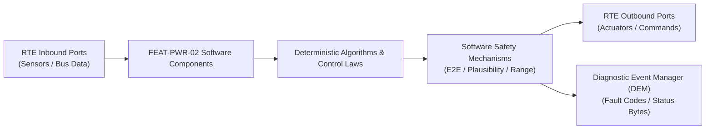

# Software Requirements Specification: Traction Motor Torque Delivery & Arbitration (VCU)
**Feature ID:** `FEAT-PWR-02`  
**Domain:** Electric Powertrain & Energy Management  
**Target ASIL:** ASIL D  
**Compliance Standard:** ISO 26262:2018 (Part 6 - Software Development) / ASPICE PAM v3.1 (SWE.1, SWE.2)  
**Parent System Specification:** [`FEAT-PWR-02_Torque_SysReq.md`](file:///c:/Workset/AntiGravityProjects/TestOptimisationExperiement/system_requirements/FEAT-PWR-02_Torque_SysReq.md)  
**Global Master Specification:** [`spec.md`](file:///c:/Workset/AntiGravityProjects/TestOptimisationExperiement/spec.md)

---

## 1. Software Architecture & Component Structure

This document specifies the AUTOSAR Software Components (SWCs), periodic runnables, algorithmic laws, safety mechanisms, and data ports implementing `FEAT-PWR-02` (Traction Motor Torque Delivery & Arbitration (VCU)).

### AUTOSAR SWC Interaction Diagram

---

## 2. Detailed Software Requirements (SWR_REQ)
*(Multi-Software Requirement Partitioning derived from System Requirements)*

### `SWR-PWR-02-01`: Opposite-Slope Accelerator Pedal Voltage Normalization
- **Planned Release:** R100
- **ASIL Rating:** ASIL D
- **Parent System Requirement:** [`SYS-PWR-02-01`](file:///c:/Workset/AntiGravityProjects/TestOptimisationExperiement/system_requirements/FEAT-PWR-02_Torque_SysReq.md#sys-pwr-02-01)
- **Allocated AUTOSAR SWC:** `VcuPedalSensor_SWC`
- **Execution Rate / Trigger:** 5 ms
- **Worst-Case Execution Time (WCET):** 0.5 ms
- **Software Activation Condition:** Executed cyclically every 5 ms.
- **Algorithmic Description / Logic:**
  > Normalizes APP1: P1 = (V1 - V1_min)/(V1_max - V1_min) * 100%. Normalizes APP2: P2 = (V2_max - V2)/(V2_max - V2_min) * 100%. Clamps P1 and P2 to [0.0, 100.0]%.
- **Software Safety Mechanism:** Voltage out-of-range detection: V1 < 0.2V or V1 > 4.8V triggers hardware sensor fault.
- **Failure Reaction & DEM Diagnostic Event:** Force Normalized_Pedal = 0.0% if voltage exceeds physical calibration bounds.
- **Software Port Inputs:** `ADC_Raw_APP1_Voltage, ADC_Raw_APP2_Voltage`
- **Software Port Outputs:** `Pedal_P1_Pct, Pedal_P2_Pct`
- **Software Verification Criteria:** Unit test sweeping ADC voltages across full 0-5V range.
- **Traceability Link:** Traces upward to [`SYS-PWR-02-01`](file:///c:/Workset/AntiGravityProjects/TestOptimisationExperiement/system_requirements/FEAT-PWR-02_Torque_SysReq.md#sys-pwr-02-01) and [`FEAT-PWR-02`](file:///c:/Workset/AntiGravityProjects/TestOptimisationExperiement/spec.md).

### `SWR-PWR-02-02`: Pedal Rationality Cross-Check & Brake Override Supervisor
- **Planned Release:** R100
- **ASIL Rating:** ASIL D
- **Parent System Requirement:** [`SYS-PWR-02-01`](file:///c:/Workset/AntiGravityProjects/TestOptimisationExperiement/system_requirements/FEAT-PWR-02_Torque_SysReq.md#sys-pwr-02-01)
- **Allocated AUTOSAR SWC:** `VcuPedalSafety_SWC`
- **Execution Rate / Trigger:** 5 ms
- **Worst-Case Execution Time (WCET):** 0.4 ms
- **Software Activation Condition:** Executed every 5 ms on normalized pedal percentages.
- **Algorithmic Description / Logic:**
  > Computes error delta = abs(P1 - P2). If delta > 5.0% for >= 20 cycles (100 ms), latch APP_Plausibility_Fault. If Brake_Pedal_Active == TRUE and P1 > 10.0%, enforce Brake Override: Output_Pedal = 0.0%.
- **Software Safety Mechanism:** Smart Brake Override logic guarantees mechanical stopping under stuck accelerator.
- **Failure Reaction & DEM Diagnostic Event:** Latch APP_Plausibility_Fault and log DTC P2138.
- **Software Port Inputs:** `Pedal_P1_Pct, Pedal_P2_Pct, Brake_Pedal_Active`
- **Software Port Outputs:** `Validated_Pedal_Pct (float32), Brake_Override_Active (boolean)`
- **Software Verification Criteria:** SIL MC/DC unit test covering stuck-throttle and brake-tap scenarios.
- **Traceability Link:** Traces upward to [`SYS-PWR-02-01`](file:///c:/Workset/AntiGravityProjects/TestOptimisationExperiement/system_requirements/FEAT-PWR-02_Torque_SysReq.md#sys-pwr-02-01) and [`FEAT-PWR-02`](file:///c:/Workset/AntiGravityProjects/TestOptimisationExperiement/spec.md).

### `SWR-PWR-02-03`: Drive Torque Map Interpolation & Creep Speed Governor
- **Planned Release:** R500
- **ASIL Rating:** ASIL D
- **Parent System Requirement:** [`SYS-PWR-02-02`](file:///c:/Workset/AntiGravityProjects/TestOptimisationExperiement/system_requirements/FEAT-PWR-02_Torque_SysReq.md#sys-pwr-02-02)
- **Allocated AUTOSAR SWC:** `VcuDriverDemand_SWC`
- **Execution Rate / Trigger:** 5 ms
- **Worst-Case Execution Time (WCET):** 0.8 ms
- **Software Activation Condition:** Executed every 5 ms in DRIVE mode.
- **Algorithmic Description / Logic:**
  > Interpolates 2D Driver Demand LUT: T_driver = f(Validated_Pedal_Pct, Motor_RPM, Drive_Mode). If Validated_Pedal == 0% and Speed < 8 km/h, applies PI creep governor maintaining 5 km/h creep.
- **Software Safety Mechanism:** Drive mode switching debounced; torque steps rate-limited during mode changes.
- **Failure Reaction & DEM Diagnostic Event:** Clamp driver demand to 0 Nm if target gear signal is corrupted.
- **Software Port Inputs:** `Validated_Pedal_Pct, Motor_RPM, Drive_Mode_Enum, Target_Gear_Enum`
- **Software Port Outputs:** `Driver_Demanded_Torque_Nm (float32)`
- **Software Verification Criteria:** Drive-cycle simulation checking pedal feel and creep response.
- **Traceability Link:** Traces upward to [`SYS-PWR-02-02`](file:///c:/Workset/AntiGravityProjects/TestOptimisationExperiement/system_requirements/FEAT-PWR-02_Torque_SysReq.md#sys-pwr-02-02) and [`FEAT-PWR-02`](file:///c:/Workset/AntiGravityProjects/TestOptimisationExperiement/spec.md).

### `SWR-PWR-02-04`: Multi-Master Torque Arbitration Matrix & Safety Clamping
- **Planned Release:** R500
- **ASIL Rating:** ASIL D
- **Parent System Requirement:** [`SYS-PWR-02-02`](file:///c:/Workset/AntiGravityProjects/TestOptimisationExperiement/system_requirements/FEAT-PWR-02_Torque_SysReq.md#sys-pwr-02-02)
- **Allocated AUTOSAR SWC:** `VcuTorqueArbitrator_SWC`
- **Execution Rate / Trigger:** 5 ms
- **Worst-Case Execution Time (WCET):** 0.7 ms
- **Software Activation Condition:** Executed every 5 ms on all torque requests.
- **Algorithmic Description / Logic:**
  > Arbitrates: T_prop = (ACC_Active == TRUE) ? T_acc : Driver_Demanded_Torque_Nm. Final allowable torque: T_arb = min(T_prop, T_tcs_max, T_esc_clamp, T_bms_discharge_limit).
- **Software Safety Mechanism:** Safety reduction requests (TCS, ESC, BMS) unconditionally take mathematical minimum.
- **Failure Reaction & DEM Diagnostic Event:** If any input signal is invalid, assume worst-case clamp of 0.0 Nm.
- **Software Port Inputs:** `Driver_Demanded_Torque_Nm, ACC_Torque_Req, TCS_Max_Torque_Limit, BMS_Limit_Nm`
- **Software Port Outputs:** `Arbitrated_Motor_Torque_Nm (float32)`
- **Software Verification Criteria:** Truth table unit test verifying all arbitration combinations.
- **Traceability Link:** Traces upward to [`SYS-PWR-02-02`](file:///c:/Workset/AntiGravityProjects/TestOptimisationExperiement/system_requirements/FEAT-PWR-02_Torque_SysReq.md#sys-pwr-02-02) and [`FEAT-PWR-02`](file:///c:/Workset/AntiGravityProjects/TestOptimisationExperiement/spec.md).

### `SWR-PWR-02-05`: MTPA (Maximum Torque Per Ampere) 2D Look-Up Table Interpolator
- **Planned Release:** R100
- **ASIL Rating:** ASIL D
- **Parent System Requirement:** [`SYS-PWR-02-03`](file:///c:/Workset/AntiGravityProjects/TestOptimisationExperiement/system_requirements/FEAT-PWR-02_Torque_SysReq.md#sys-pwr-02-03)
- **Allocated AUTOSAR SWC:** `InverterMtpa_SWC`
- **Execution Rate / Trigger:** 1 ms
- **Worst-Case Execution Time (WCET):** 0.25 ms
- **Software Activation Condition:** Executed every 1 ms.
- **Algorithmic Description / Logic:**
  > Interpolates bilinearly from pre-calibrated motor characterization maps: (Id_base, Iq_base) = f(Arbitrated_Motor_Torque_Nm, Motor_RPM). Maximizes torque per ampere to minimize stator copper loss.
- **Software Safety Mechanism:** Current magnitude constraint check: sqrt(Id^2 + Iq^2) <= I_max_inverter (600 A).
- **Failure Reaction & DEM Diagnostic Event:** Clamp current references if DC bus voltage drops below minimum operating limit.
- **Software Port Inputs:** `Arbitrated_Motor_Torque_Nm, Motor_RPM, DC_Bus_Voltage`
- **Software Port Outputs:** `Id_Base_A (float32), Iq_Base_A (float32)`
- **Software Verification Criteria:** Mathematical unit test verifying MTPA optimal trajectory curve.
- **Traceability Link:** Traces upward to [`SYS-PWR-02-03`](file:///c:/Workset/AntiGravityProjects/TestOptimisationExperiement/system_requirements/FEAT-PWR-02_Torque_SysReq.md#sys-pwr-02-03) and [`FEAT-PWR-02`](file:///c:/Workset/AntiGravityProjects/TestOptimisationExperiement/spec.md).

### `SWR-PWR-02-06`: Field Weakening Controller & Safe Torque Off (STO) Dispatcher
- **Planned Release:** R100
- **ASIL Rating:** ASIL D
- **Parent System Requirement:** [`SYS-PWR-02-03`](file:///c:/Workset/AntiGravityProjects/TestOptimisationExperiement/system_requirements/FEAT-PWR-02_Torque_SysReq.md#sys-pwr-02-03)
- **Allocated AUTOSAR SWC:** `InverterFieldWeakening_SWC`
- **Execution Rate / Trigger:** 1 ms
- **Worst-Case Execution Time (WCET):** 0.3 ms
- **Software Activation Condition:** Executed every 1 ms when back-EMF approaches DC bus limit.
- **Algorithmic Description / Logic:**
  > When voltage modulation index m = sqrt(Vd^2 + Vq^2) / V_dc exceeds 0.95, injects negative d-axis demagnetizing current delta_Id = -K_fw * (m - 0.95) to suppress back-EMF at high RPM.
- **Software Safety Mechanism:** Demagnetization limit: Ensure Id never exceeds irreversible rotor magnet demagnetization threshold.
- **Failure Reaction & DEM Diagnostic Event:** If inverter reports overtemperature or desaturation fault, trigger STO in < 500 us.
- **Software Port Inputs:** `Id_Base_A, Iq_Base_A, Modulation_Index, STO_Request_Flag`
- **Software Port Outputs:** `Final_Id_Reference_A, Final_Iq_Reference_A, STO_Hardware_Pin`
- **Software Verification Criteria:** High-speed dyno testing reaching maximum motor speed (18,000 RPM).
- **Traceability Link:** Traces upward to [`SYS-PWR-02-03`](file:///c:/Workset/AntiGravityProjects/TestOptimisationExperiement/system_requirements/FEAT-PWR-02_Torque_SysReq.md#sys-pwr-02-03) and [`FEAT-PWR-02`](file:///c:/Workset/AntiGravityProjects/TestOptimisationExperiement/spec.md).

### `SWR-PWR-02-08`: Zero-Speed Motor Rotor Electrical Hill-Hold Servo
- **Planned Release:** R200
- **ASIL Rating:** ASIL C
- **Parent System Requirement:** [`SYS-PWR-02-04`](file:///c:/Workset/AntiGravityProjects/TestOptimisationExperiement/system_requirements/FEAT-PWR-02_Torque_SysReq.md#sys-pwr-02-04)
- **Allocated AUTOSAR SWC:** `VcuHillHold_SWC`
- **Execution Rate / Trigger:** 5 ms
- **Worst-Case Execution Time (WCET):** 0.4 ms
- **Software Activation Condition:** Active when vehicle stopped on grade.
- **Algorithmic Description / Logic:**
  > Samples high-resolution motor resolver: If vehicle velocity < 0.1 km/h and brake pedal is released, executes position-locking PID servo on motor rotor angle: T_hold = K_p_pos * (Theta_target - Theta_meas) + K_d_pos * Omega_meas + m_veh * g * sin(Grade) * r_wheel.
- **Software Safety Mechanism:** Rotor movement guard: If rotor slips backward > 15 degrees, pulses hydraulic brake pressure.
- **Failure Reaction & DEM Diagnostic Event:** Handover to ESP hydraulic hill hold if motor current draws > 150A for > 8.0s.
- **Software Port Inputs:** `Motor_Resolver_Angle_Rad, Incline_Grade_Rad, Brake_Pedal_Pressure_Bar`
- **Software Port Outputs:** `Active_Rotor_Hold_Torque_Nm, ESP_Handover_Request_Flag`
- **Software Verification Criteria:** Chassis dynamometer slope simulation with zero rollback verification.
- **Traceability Link:** Traces upward to [`SYS-PWR-02-04`](file:///c:/Workset/AntiGravityProjects/TestOptimisationExperiement/system_requirements/FEAT-PWR-02_Torque_SysReq.md#sys-pwr-02-04) and [`FEAT-PWR-02`](file:///c:/Workset/AntiGravityProjects/TestOptimisationExperiement/spec.md).

### `SWR-PWR-02-09`: Configurable Low-Speed Vehicle Creep Velocity Profiler
- **Planned Release:** R200
- **ASIL Rating:** ASIL B
- **Parent System Requirement:** [`SYS-PWR-02-04`](file:///c:/Workset/AntiGravityProjects/TestOptimisationExperiement/system_requirements/FEAT-PWR-02_Torque_SysReq.md#sys-pwr-02-04)
- **Allocated AUTOSAR SWC:** `VcuCreepProfiler_SWC`
- **Execution Rate / Trigger:** 10 ms
- **Worst-Case Execution Time (WCET):** 0.3 ms
- **Software Activation Condition:** Active when creep mode enabled by driver.
- **Algorithmic Description / Logic:**
  > Generates simulated torque converter creep feel: T_creep = T_creep_max * max(0.0, 1.0 - v_ego / V_creep_limit) with V_creep_limit = 6.0 km/h and T_creep_max = 50 Nm. Smoothly decays torque to zero when driver touches brake pedal.
- **Software Safety Mechanism:** Door ajar interlock: Creep torque is forced to 0 Nm if any passenger door or trunk opens.
- **Failure Reaction & DEM Diagnostic Event:** Zero creep torque if accelerator pedal sensor status is questionable.
- **Software Port Inputs:** `Vehicle_Speed_Mps, Driver_Creep_Enable_Setting, Door_Status_Bits`
- **Software Port Outputs:** `Regulated_Creep_Torque_Demand_Nm, Creep_Active_Status (boolean)`
- **Software Verification Criteria:** Subjective low-speed parking lot driveability evaluation.
- **Traceability Link:** Traces upward to [`SYS-PWR-02-04`](file:///c:/Workset/AntiGravityProjects/TestOptimisationExperiement/system_requirements/FEAT-PWR-02_Torque_SysReq.md#sys-pwr-02-04) and [`FEAT-PWR-02`](file:///c:/Workset/AntiGravityProjects/TestOptimisationExperiement/spec.md).

### `SWR-PWR-02-10`: Stator Winding & SiC Inverter Thermal Resistance Model
- **Planned Release:** R500
- **ASIL Rating:** ASIL B
- **Parent System Requirement:** [`SYS-PWR-02-05`](file:///c:/Workset/AntiGravityProjects/TestOptimisationExperiement/system_requirements/FEAT-PWR-02_Torque_SysReq.md#sys-pwr-02-05)
- **Allocated AUTOSAR SWC:** `VcuThermalModel_SWC`
- **Execution Rate / Trigger:** 100 ms
- **Worst-Case Execution Time (WCET):** 0.8 ms
- **Software Activation Condition:** Cyclic 100 ms task.
- **Algorithmic Description / Logic:**
  > Implements 4-node lumped thermal capacitance model: Computes internal motor magnet temperature T_rotor_est and power module junction temperature T_j: T_j = T_case + P_loss * R_th_jc. Detects hotspot divergence from single point sensor.
- **Software Safety Mechanism:** Conservative bound: If coolant temperature sensor fails, assumes worst-case 85°C coolant.
- **Failure Reaction & DEM Diagnostic Event:** Report DEM DTC P0A2F (Drive Motor Temperature Sensor Circuit Range/Performance).
- **Software Port Inputs:** `Motor_Stator_Thermistor_DegC, Coolant_Inlet_Temp_DegC, Inverter_Phase_Current_RMS`
- **Software Port Outputs:** `Estimated_Rotor_Magnet_Temp_DegC, Junction_Temp_Max_DegC`
- **Software Verification Criteria:** Infrared thermal camera dynamometer validation on electric motor test cell.
- **Traceability Link:** Traces upward to [`SYS-PWR-02-05`](file:///c:/Workset/AntiGravityProjects/TestOptimisationExperiement/system_requirements/FEAT-PWR-02_Torque_SysReq.md#sys-pwr-02-05) and [`FEAT-PWR-02`](file:///c:/Workset/AntiGravityProjects/TestOptimisationExperiement/spec.md).

### `SWR-PWR-02-11`: Continuous Thermal Torque Derating Look-Up Interpolator
- **Planned Release:** R500
- **ASIL Rating:** ASIL B
- **Parent System Requirement:** [`SYS-PWR-02-05`](file:///c:/Workset/AntiGravityProjects/TestOptimisationExperiement/system_requirements/FEAT-PWR-02_Torque_SysReq.md#sys-pwr-02-05)
- **Allocated AUTOSAR SWC:** `VcuThermalDerater_SWC`
- **Execution Rate / Trigger:** 20 ms
- **Worst-Case Execution Time (WCET):** 0.4 ms
- **Software Activation Condition:** Active during propulsion.
- **Algorithmic Description / Logic:**
  > Computes scaling factor K_thermal in [0.0, 1.0]: K_thermal = 1.0 if T_max < 140°C; linearly scales to 0.1 at 175°C; reaches 0.0 at 185°C. Applies rate limiter (max -50 Nm/s) to ensure smooth torque fade without abrupt deceleration jerk.
- **Software Safety Mechanism:** Cluster notification trigger: Displays 'Power Reduced Due to Temperature' icon when K_thermal < 0.7.
- **Failure Reaction & DEM Diagnostic Event:** Clamp torque to 30% if temperature sensors short or open.
- **Software Port Inputs:** `Junction_Temp_Max_DegC, Estimated_Rotor_Magnet_Temp_DegC`
- **Software Port Outputs:** `Thermal_Torque_Derate_Factor, Cluster_Thermal_Derate_Alert`
- **Software Verification Criteria:** Climatic chamber hot desert hill-climb full throttle simulation.
- **Traceability Link:** Traces upward to [`SYS-PWR-02-05`](file:///c:/Workset/AntiGravityProjects/TestOptimisationExperiement/system_requirements/FEAT-PWR-02_Torque_SysReq.md#sys-pwr-02-05) and [`FEAT-PWR-02`](file:///c:/Workset/AntiGravityProjects/TestOptimisationExperiement/spec.md).

### `SWR-PWR-02-11`: Traction Motor Multi-Channel Accelerator Pedal Cross-Check - Dynamic Observer & Signal Filter
- **Planned Release:** R200
- **ASIL Rating:** ASIL D
- **Parent System Requirement:** [`SYS-PWR-02-06`](file:///c:/Workset/AntiGravityProjects/TestOptimisationExperiement/system_requirements/FEAT-PWR-02_Torque_SysReq.md#sys-pwr-02-06)
- **Allocated AUTOSAR SWC:** `VcuPedalCrossCheck_SWC`
- **Execution Rate / Trigger:** 2 ms
- **Worst-Case Execution Time (WCET):** 0.3 ms
- **Software Activation Condition:** Executed cyclically every 2 ms.
- **Algorithmic Description / Logic:**
  > Executes signal plausibility filtering, calibration offsets, and discrete state estimation for Traction Motor Multi-Channel Accelerator Pedal Cross-Check.
- **Software Safety Mechanism:** Range limit plausibility check and E2E alive sequence verification.
- **Failure Reaction & DEM Diagnostic Event:** Set default fallback output and report DEM_EVENT_FEAT_PWR_02_ERR.
- **Software Port Inputs:** `Raw sensor ADC/SENT/SPI values and RTE bus inputs.`
- **Software Port Outputs:** `Filtered physical signals and validity status bitmasks.`
- **Software Verification Criteria:** Unit test and HiL software integration test.
- **Traceability Link:** Traces upward to [`SYS-PWR-02-06`](file:///c:/Workset/AntiGravityProjects/TestOptimisationExperiement/system_requirements/FEAT-PWR-02_Torque_SysReq.md#sys-pwr-02-06) and [`FEAT-PWR-02`](file:///c:/Workset/AntiGravityProjects/TestOptimisationExperiement/spec.md).

### `SWR-PWR-02-12`: Traction Motor Multi-Channel Accelerator Pedal Cross-Check - Closed-Loop Control Law & Actuator Dispatch
- **Planned Release:** R200
- **ASIL Rating:** ASIL D
- **Parent System Requirement:** [`SYS-PWR-02-06`](file:///c:/Workset/AntiGravityProjects/TestOptimisationExperiement/system_requirements/FEAT-PWR-02_Torque_SysReq.md#sys-pwr-02-06)
- **Allocated AUTOSAR SWC:** `VcuPedalCrossCheck_SWC`
- **Execution Rate / Trigger:** 2 ms
- **Worst-Case Execution Time (WCET):** 0.4 ms
- **Software Activation Condition:** Executed cyclically every 2 ms.
- **Algorithmic Description / Logic:**
  > Evaluates deterministic closed-loop control law, rate limits, and dispatches commands for Traction Motor Multi-Channel Accelerator Pedal Cross-Check.
- **Software Safety Mechanism:** Command saturation clamping and watchdog program flow monitoring.
- **Failure Reaction & DEM Diagnostic Event:** De-energize actuator output, apply safe fallback clamp, and latch DTC.
- **Software Port Inputs:** `Validated physical state signals from observer SWC.`
- **Software Port Outputs:** `Actuator PWM duty cycles, torque/pressure setpoints, and diagnostic flags.`
- **Software Verification Criteria:** Hardware dynamometer and HiL closed-loop regression test suite.
- **Traceability Link:** Traces upward to [`SYS-PWR-02-06`](file:///c:/Workset/AntiGravityProjects/TestOptimisationExperiement/system_requirements/FEAT-PWR-02_Torque_SysReq.md#sys-pwr-02-06) and [`FEAT-PWR-02`](file:///c:/Workset/AntiGravityProjects/TestOptimisationExperiement/spec.md).

### `SWR-PWR-02-13`: Inverter Space Vector Modulation (SVM) Stator Flux Controller - Dynamic Observer & Signal Filter
- **Planned Release:** R300
- **ASIL Rating:** ASIL D
- **Parent System Requirement:** [`SYS-PWR-02-07`](file:///c:/Workset/AntiGravityProjects/TestOptimisationExperiement/system_requirements/FEAT-PWR-02_Torque_SysReq.md#sys-pwr-02-07)
- **Allocated AUTOSAR SWC:** `VcuFocController_SWC`
- **Execution Rate / Trigger:** 0.5 ms
- **Worst-Case Execution Time (WCET):** 0.3 ms
- **Software Activation Condition:** Executed cyclically every 0.5 ms.
- **Algorithmic Description / Logic:**
  > Executes signal plausibility filtering, calibration offsets, and discrete state estimation for Inverter Space Vector Modulation (SVM) Stator Flux Controller.
- **Software Safety Mechanism:** Range limit plausibility check and E2E alive sequence verification.
- **Failure Reaction & DEM Diagnostic Event:** Set default fallback output and report DEM_EVENT_FEAT_PWR_02_ERR.
- **Software Port Inputs:** `Raw sensor ADC/SENT/SPI values and RTE bus inputs.`
- **Software Port Outputs:** `Filtered physical signals and validity status bitmasks.`
- **Software Verification Criteria:** Unit test and HiL software integration test.
- **Traceability Link:** Traces upward to [`SYS-PWR-02-07`](file:///c:/Workset/AntiGravityProjects/TestOptimisationExperiement/system_requirements/FEAT-PWR-02_Torque_SysReq.md#sys-pwr-02-07) and [`FEAT-PWR-02`](file:///c:/Workset/AntiGravityProjects/TestOptimisationExperiement/spec.md).

### `SWR-PWR-02-14`: Inverter Space Vector Modulation (SVM) Stator Flux Controller - Closed-Loop Control Law & Actuator Dispatch
- **Planned Release:** R300
- **ASIL Rating:** ASIL D
- **Parent System Requirement:** [`SYS-PWR-02-07`](file:///c:/Workset/AntiGravityProjects/TestOptimisationExperiement/system_requirements/FEAT-PWR-02_Torque_SysReq.md#sys-pwr-02-07)
- **Allocated AUTOSAR SWC:** `VcuFocController_SWC`
- **Execution Rate / Trigger:** 0.5 ms
- **Worst-Case Execution Time (WCET):** 0.4 ms
- **Software Activation Condition:** Executed cyclically every 0.5 ms.
- **Algorithmic Description / Logic:**
  > Evaluates deterministic closed-loop control law, rate limits, and dispatches commands for Inverter Space Vector Modulation (SVM) Stator Flux Controller.
- **Software Safety Mechanism:** Command saturation clamping and watchdog program flow monitoring.
- **Failure Reaction & DEM Diagnostic Event:** De-energize actuator output, apply safe fallback clamp, and latch DTC.
- **Software Port Inputs:** `Validated physical state signals from observer SWC.`
- **Software Port Outputs:** `Actuator PWM duty cycles, torque/pressure setpoints, and diagnostic flags.`
- **Software Verification Criteria:** Hardware dynamometer and HiL closed-loop regression test suite.
- **Traceability Link:** Traces upward to [`SYS-PWR-02-07`](file:///c:/Workset/AntiGravityProjects/TestOptimisationExperiement/system_requirements/FEAT-PWR-02_Torque_SysReq.md#sys-pwr-02-07) and [`FEAT-PWR-02`](file:///c:/Workset/AntiGravityProjects/TestOptimisationExperiement/spec.md).

### `SWR-PWR-02-15`: Powertrain Dynamic Torque Arbitration (Driver vs ACC vs ESC) - Dynamic Observer & Signal Filter
- **Planned Release:** R500
- **ASIL Rating:** ASIL D
- **Parent System Requirement:** [`SYS-PWR-02-08`](file:///c:/Workset/AntiGravityProjects/TestOptimisationExperiement/system_requirements/FEAT-PWR-02_Torque_SysReq.md#sys-pwr-02-08)
- **Allocated AUTOSAR SWC:** `VcuTorqueArbitrator_SWC`
- **Execution Rate / Trigger:** 2 ms
- **Worst-Case Execution Time (WCET):** 0.3 ms
- **Software Activation Condition:** Executed cyclically every 2 ms.
- **Algorithmic Description / Logic:**
  > Executes signal plausibility filtering, calibration offsets, and discrete state estimation for Powertrain Dynamic Torque Arbitration (Driver vs ACC vs ESC).
- **Software Safety Mechanism:** Range limit plausibility check and E2E alive sequence verification.
- **Failure Reaction & DEM Diagnostic Event:** Set default fallback output and report DEM_EVENT_FEAT_PWR_02_ERR.
- **Software Port Inputs:** `Raw sensor ADC/SENT/SPI values and RTE bus inputs.`
- **Software Port Outputs:** `Filtered physical signals and validity status bitmasks.`
- **Software Verification Criteria:** Unit test and HiL software integration test.
- **Traceability Link:** Traces upward to [`SYS-PWR-02-08`](file:///c:/Workset/AntiGravityProjects/TestOptimisationExperiement/system_requirements/FEAT-PWR-02_Torque_SysReq.md#sys-pwr-02-08) and [`FEAT-PWR-02`](file:///c:/Workset/AntiGravityProjects/TestOptimisationExperiement/spec.md).

### `SWR-PWR-02-16`: Powertrain Dynamic Torque Arbitration (Driver vs ACC vs ESC) - Closed-Loop Control Law & Actuator Dispatch
- **Planned Release:** R500
- **ASIL Rating:** ASIL D
- **Parent System Requirement:** [`SYS-PWR-02-08`](file:///c:/Workset/AntiGravityProjects/TestOptimisationExperiement/system_requirements/FEAT-PWR-02_Torque_SysReq.md#sys-pwr-02-08)
- **Allocated AUTOSAR SWC:** `VcuTorqueArbitrator_SWC`
- **Execution Rate / Trigger:** 2 ms
- **Worst-Case Execution Time (WCET):** 0.4 ms
- **Software Activation Condition:** Executed cyclically every 2 ms.
- **Algorithmic Description / Logic:**
  > Evaluates deterministic closed-loop control law, rate limits, and dispatches commands for Powertrain Dynamic Torque Arbitration (Driver vs ACC vs ESC).
- **Software Safety Mechanism:** Command saturation clamping and watchdog program flow monitoring.
- **Failure Reaction & DEM Diagnostic Event:** De-energize actuator output, apply safe fallback clamp, and latch DTC.
- **Software Port Inputs:** `Validated physical state signals from observer SWC.`
- **Software Port Outputs:** `Actuator PWM duty cycles, torque/pressure setpoints, and diagnostic flags.`
- **Software Verification Criteria:** Hardware dynamometer and HiL closed-loop regression test suite.
- **Traceability Link:** Traces upward to [`SYS-PWR-02-08`](file:///c:/Workset/AntiGravityProjects/TestOptimisationExperiement/system_requirements/FEAT-PWR-02_Torque_SysReq.md#sys-pwr-02-08) and [`FEAT-PWR-02`](file:///c:/Workset/AntiGravityProjects/TestOptimisationExperiement/spec.md).

### `SWR-PWR-02-17`: Motor Rotor Resolver-to-Digital Angle Decoding & Position Observer - Dynamic Observer & Signal Filter
- **Planned Release:** R300
- **ASIL Rating:** ASIL D
- **Parent System Requirement:** [`SYS-PWR-02-09`](file:///c:/Workset/AntiGravityProjects/TestOptimisationExperiement/system_requirements/FEAT-PWR-02_Torque_SysReq.md#sys-pwr-02-09)
- **Allocated AUTOSAR SWC:** `VcuResolverDecoder_SWC`
- **Execution Rate / Trigger:** 0.5 ms
- **Worst-Case Execution Time (WCET):** 0.3 ms
- **Software Activation Condition:** Executed cyclically every 0.5 ms.
- **Algorithmic Description / Logic:**
  > Executes signal plausibility filtering, calibration offsets, and discrete state estimation for Motor Rotor Resolver-to-Digital Angle Decoding & Position Observer.
- **Software Safety Mechanism:** Range limit plausibility check and E2E alive sequence verification.
- **Failure Reaction & DEM Diagnostic Event:** Set default fallback output and report DEM_EVENT_FEAT_PWR_02_ERR.
- **Software Port Inputs:** `Raw sensor ADC/SENT/SPI values and RTE bus inputs.`
- **Software Port Outputs:** `Filtered physical signals and validity status bitmasks.`
- **Software Verification Criteria:** Unit test and HiL software integration test.
- **Traceability Link:** Traces upward to [`SYS-PWR-02-09`](file:///c:/Workset/AntiGravityProjects/TestOptimisationExperiement/system_requirements/FEAT-PWR-02_Torque_SysReq.md#sys-pwr-02-09) and [`FEAT-PWR-02`](file:///c:/Workset/AntiGravityProjects/TestOptimisationExperiement/spec.md).

### `SWR-PWR-02-18`: Motor Rotor Resolver-to-Digital Angle Decoding & Position Observer - Closed-Loop Control Law & Actuator Dispatch
- **Planned Release:** R300
- **ASIL Rating:** ASIL D
- **Parent System Requirement:** [`SYS-PWR-02-09`](file:///c:/Workset/AntiGravityProjects/TestOptimisationExperiement/system_requirements/FEAT-PWR-02_Torque_SysReq.md#sys-pwr-02-09)
- **Allocated AUTOSAR SWC:** `VcuResolverDecoder_SWC`
- **Execution Rate / Trigger:** 0.5 ms
- **Worst-Case Execution Time (WCET):** 0.4 ms
- **Software Activation Condition:** Executed cyclically every 0.5 ms.
- **Algorithmic Description / Logic:**
  > Evaluates deterministic closed-loop control law, rate limits, and dispatches commands for Motor Rotor Resolver-to-Digital Angle Decoding & Position Observer.
- **Software Safety Mechanism:** Command saturation clamping and watchdog program flow monitoring.
- **Failure Reaction & DEM Diagnostic Event:** De-energize actuator output, apply safe fallback clamp, and latch DTC.
- **Software Port Inputs:** `Validated physical state signals from observer SWC.`
- **Software Port Outputs:** `Actuator PWM duty cycles, torque/pressure setpoints, and diagnostic flags.`
- **Software Verification Criteria:** Hardware dynamometer and HiL closed-loop regression test suite.
- **Traceability Link:** Traces upward to [`SYS-PWR-02-09`](file:///c:/Workset/AntiGravityProjects/TestOptimisationExperiement/system_requirements/FEAT-PWR-02_Torque_SysReq.md#sys-pwr-02-09) and [`FEAT-PWR-02`](file:///c:/Workset/AntiGravityProjects/TestOptimisationExperiement/spec.md).

### `SWR-PWR-02-19`: Active Inverter Discharge & DC Link Capacitor Bleed Resistor Manager - Dynamic Observer & Signal Filter
- **Planned Release:** R400
- **ASIL Rating:** ASIL D
- **Parent System Requirement:** [`SYS-PWR-02-10`](file:///c:/Workset/AntiGravityProjects/TestOptimisationExperiement/system_requirements/FEAT-PWR-02_Torque_SysReq.md#sys-pwr-02-10)
- **Allocated AUTOSAR SWC:** `VcuActiveDischarge_SWC`
- **Execution Rate / Trigger:** 5 ms
- **Worst-Case Execution Time (WCET):** 0.3 ms
- **Software Activation Condition:** Executed cyclically every 5 ms.
- **Algorithmic Description / Logic:**
  > Executes signal plausibility filtering, calibration offsets, and discrete state estimation for Active Inverter Discharge & DC Link Capacitor Bleed Resistor Manager.
- **Software Safety Mechanism:** Range limit plausibility check and E2E alive sequence verification.
- **Failure Reaction & DEM Diagnostic Event:** Set default fallback output and report DEM_EVENT_FEAT_PWR_02_ERR.
- **Software Port Inputs:** `Raw sensor ADC/SENT/SPI values and RTE bus inputs.`
- **Software Port Outputs:** `Filtered physical signals and validity status bitmasks.`
- **Software Verification Criteria:** Unit test and HiL software integration test.
- **Traceability Link:** Traces upward to [`SYS-PWR-02-10`](file:///c:/Workset/AntiGravityProjects/TestOptimisationExperiement/system_requirements/FEAT-PWR-02_Torque_SysReq.md#sys-pwr-02-10) and [`FEAT-PWR-02`](file:///c:/Workset/AntiGravityProjects/TestOptimisationExperiement/spec.md).

### `SWR-PWR-02-20`: Active Inverter Discharge & DC Link Capacitor Bleed Resistor Manager - Closed-Loop Control Law & Actuator Dispatch
- **Planned Release:** R400
- **ASIL Rating:** ASIL D
- **Parent System Requirement:** [`SYS-PWR-02-10`](file:///c:/Workset/AntiGravityProjects/TestOptimisationExperiement/system_requirements/FEAT-PWR-02_Torque_SysReq.md#sys-pwr-02-10)
- **Allocated AUTOSAR SWC:** `VcuActiveDischarge_SWC`
- **Execution Rate / Trigger:** 5 ms
- **Worst-Case Execution Time (WCET):** 0.4 ms
- **Software Activation Condition:** Executed cyclically every 5 ms.
- **Algorithmic Description / Logic:**
  > Evaluates deterministic closed-loop control law, rate limits, and dispatches commands for Active Inverter Discharge & DC Link Capacitor Bleed Resistor Manager.
- **Software Safety Mechanism:** Command saturation clamping and watchdog program flow monitoring.
- **Failure Reaction & DEM Diagnostic Event:** De-energize actuator output, apply safe fallback clamp, and latch DTC.
- **Software Port Inputs:** `Validated physical state signals from observer SWC.`
- **Software Port Outputs:** `Actuator PWM duty cycles, torque/pressure setpoints, and diagnostic flags.`
- **Software Verification Criteria:** Hardware dynamometer and HiL closed-loop regression test suite.
- **Traceability Link:** Traces upward to [`SYS-PWR-02-10`](file:///c:/Workset/AntiGravityProjects/TestOptimisationExperiement/system_requirements/FEAT-PWR-02_Torque_SysReq.md#sys-pwr-02-10) and [`FEAT-PWR-02`](file:///c:/Workset/AntiGravityProjects/TestOptimisationExperiement/spec.md).

### `SWR-PWR-02-21`: Traction Inverter Phase Over-Current Hardware Trip Monitor - Dynamic Observer & Signal Filter
- **Planned Release:** R400
- **ASIL Rating:** ASIL D
- **Parent System Requirement:** [`SYS-PWR-02-11`](file:///c:/Workset/AntiGravityProjects/TestOptimisationExperiement/system_requirements/FEAT-PWR-02_Torque_SysReq.md#sys-pwr-02-11)
- **Allocated AUTOSAR SWC:** `VcuOvercurrentTrip_SWC`
- **Execution Rate / Trigger:** 0.2 ms
- **Worst-Case Execution Time (WCET):** 0.3 ms
- **Software Activation Condition:** Executed cyclically every 0.2 ms.
- **Algorithmic Description / Logic:**
  > Executes signal plausibility filtering, calibration offsets, and discrete state estimation for Traction Inverter Phase Over-Current Hardware Trip Monitor.
- **Software Safety Mechanism:** Range limit plausibility check and E2E alive sequence verification.
- **Failure Reaction & DEM Diagnostic Event:** Set default fallback output and report DEM_EVENT_FEAT_PWR_02_ERR.
- **Software Port Inputs:** `Raw sensor ADC/SENT/SPI values and RTE bus inputs.`
- **Software Port Outputs:** `Filtered physical signals and validity status bitmasks.`
- **Software Verification Criteria:** Unit test and HiL software integration test.
- **Traceability Link:** Traces upward to [`SYS-PWR-02-11`](file:///c:/Workset/AntiGravityProjects/TestOptimisationExperiement/system_requirements/FEAT-PWR-02_Torque_SysReq.md#sys-pwr-02-11) and [`FEAT-PWR-02`](file:///c:/Workset/AntiGravityProjects/TestOptimisationExperiement/spec.md).

### `SWR-PWR-02-22`: Traction Inverter Phase Over-Current Hardware Trip Monitor - Closed-Loop Control Law & Actuator Dispatch
- **Planned Release:** R400
- **ASIL Rating:** ASIL D
- **Parent System Requirement:** [`SYS-PWR-02-11`](file:///c:/Workset/AntiGravityProjects/TestOptimisationExperiement/system_requirements/FEAT-PWR-02_Torque_SysReq.md#sys-pwr-02-11)
- **Allocated AUTOSAR SWC:** `VcuOvercurrentTrip_SWC`
- **Execution Rate / Trigger:** 0.2 ms
- **Worst-Case Execution Time (WCET):** 0.4 ms
- **Software Activation Condition:** Executed cyclically every 0.2 ms.
- **Algorithmic Description / Logic:**
  > Evaluates deterministic closed-loop control law, rate limits, and dispatches commands for Traction Inverter Phase Over-Current Hardware Trip Monitor.
- **Software Safety Mechanism:** Command saturation clamping and watchdog program flow monitoring.
- **Failure Reaction & DEM Diagnostic Event:** De-energize actuator output, apply safe fallback clamp, and latch DTC.
- **Software Port Inputs:** `Validated physical state signals from observer SWC.`
- **Software Port Outputs:** `Actuator PWM duty cycles, torque/pressure setpoints, and diagnostic flags.`
- **Software Verification Criteria:** Hardware dynamometer and HiL closed-loop regression test suite.
- **Traceability Link:** Traces upward to [`SYS-PWR-02-11`](file:///c:/Workset/AntiGravityProjects/TestOptimisationExperiement/system_requirements/FEAT-PWR-02_Torque_SysReq.md#sys-pwr-02-11) and [`FEAT-PWR-02`](file:///c:/Workset/AntiGravityProjects/TestOptimisationExperiement/spec.md).

### `SWR-PWR-02-23`: Motor Stator Winding & Rotor Magnet Multi-Zone Thermal Derater - Dynamic Observer & Signal Filter
- **Planned Release:** R400
- **ASIL Rating:** ASIL B
- **Parent System Requirement:** [`SYS-PWR-02-12`](file:///c:/Workset/AntiGravityProjects/TestOptimisationExperiement/system_requirements/FEAT-PWR-02_Torque_SysReq.md#sys-pwr-02-12)
- **Allocated AUTOSAR SWC:** `VcuThermalDerater_SWC`
- **Execution Rate / Trigger:** 50 ms
- **Worst-Case Execution Time (WCET):** 0.3 ms
- **Software Activation Condition:** Executed cyclically every 50 ms.
- **Algorithmic Description / Logic:**
  > Executes signal plausibility filtering, calibration offsets, and discrete state estimation for Motor Stator Winding & Rotor Magnet Multi-Zone Thermal Derater.
- **Software Safety Mechanism:** Range limit plausibility check and E2E alive sequence verification.
- **Failure Reaction & DEM Diagnostic Event:** Set default fallback output and report DEM_EVENT_FEAT_PWR_02_ERR.
- **Software Port Inputs:** `Raw sensor ADC/SENT/SPI values and RTE bus inputs.`
- **Software Port Outputs:** `Filtered physical signals and validity status bitmasks.`
- **Software Verification Criteria:** Unit test and HiL software integration test.
- **Traceability Link:** Traces upward to [`SYS-PWR-02-12`](file:///c:/Workset/AntiGravityProjects/TestOptimisationExperiement/system_requirements/FEAT-PWR-02_Torque_SysReq.md#sys-pwr-02-12) and [`FEAT-PWR-02`](file:///c:/Workset/AntiGravityProjects/TestOptimisationExperiement/spec.md).

### `SWR-PWR-02-24`: Motor Stator Winding & Rotor Magnet Multi-Zone Thermal Derater - Closed-Loop Control Law & Actuator Dispatch
- **Planned Release:** R400
- **ASIL Rating:** ASIL B
- **Parent System Requirement:** [`SYS-PWR-02-12`](file:///c:/Workset/AntiGravityProjects/TestOptimisationExperiement/system_requirements/FEAT-PWR-02_Torque_SysReq.md#sys-pwr-02-12)
- **Allocated AUTOSAR SWC:** `VcuThermalDerater_SWC`
- **Execution Rate / Trigger:** 50 ms
- **Worst-Case Execution Time (WCET):** 0.4 ms
- **Software Activation Condition:** Executed cyclically every 50 ms.
- **Algorithmic Description / Logic:**
  > Evaluates deterministic closed-loop control law, rate limits, and dispatches commands for Motor Stator Winding & Rotor Magnet Multi-Zone Thermal Derater.
- **Software Safety Mechanism:** Command saturation clamping and watchdog program flow monitoring.
- **Failure Reaction & DEM Diagnostic Event:** De-energize actuator output, apply safe fallback clamp, and latch DTC.
- **Software Port Inputs:** `Validated physical state signals from observer SWC.`
- **Software Port Outputs:** `Actuator PWM duty cycles, torque/pressure setpoints, and diagnostic flags.`
- **Software Verification Criteria:** Hardware dynamometer and HiL closed-loop regression test suite.
- **Traceability Link:** Traces upward to [`SYS-PWR-02-12`](file:///c:/Workset/AntiGravityProjects/TestOptimisationExperiement/system_requirements/FEAT-PWR-02_Torque_SysReq.md#sys-pwr-02-12) and [`FEAT-PWR-02`](file:///c:/Workset/AntiGravityProjects/TestOptimisationExperiement/spec.md).

### `SWR-PWR-02-25`: Creep Torque & Hill Hold Powertrain Standstill Speed Governor - Dynamic Observer & Signal Filter
- **Planned Release:** R500
- **ASIL Rating:** ASIL B
- **Parent System Requirement:** [`SYS-PWR-02-13`](file:///c:/Workset/AntiGravityProjects/TestOptimisationExperiement/system_requirements/FEAT-PWR-02_Torque_SysReq.md#sys-pwr-02-13)
- **Allocated AUTOSAR SWC:** `VcuCreepGovernor_SWC`
- **Execution Rate / Trigger:** 10 ms
- **Worst-Case Execution Time (WCET):** 0.3 ms
- **Software Activation Condition:** Executed cyclically every 10 ms.
- **Algorithmic Description / Logic:**
  > Executes signal plausibility filtering, calibration offsets, and discrete state estimation for Creep Torque & Hill Hold Powertrain Standstill Speed Governor.
- **Software Safety Mechanism:** Range limit plausibility check and E2E alive sequence verification.
- **Failure Reaction & DEM Diagnostic Event:** Set default fallback output and report DEM_EVENT_FEAT_PWR_02_ERR.
- **Software Port Inputs:** `Raw sensor ADC/SENT/SPI values and RTE bus inputs.`
- **Software Port Outputs:** `Filtered physical signals and validity status bitmasks.`
- **Software Verification Criteria:** Unit test and HiL software integration test.
- **Traceability Link:** Traces upward to [`SYS-PWR-02-13`](file:///c:/Workset/AntiGravityProjects/TestOptimisationExperiement/system_requirements/FEAT-PWR-02_Torque_SysReq.md#sys-pwr-02-13) and [`FEAT-PWR-02`](file:///c:/Workset/AntiGravityProjects/TestOptimisationExperiement/spec.md).

### `SWR-PWR-02-26`: Creep Torque & Hill Hold Powertrain Standstill Speed Governor - Closed-Loop Control Law & Actuator Dispatch
- **Planned Release:** R500
- **ASIL Rating:** ASIL B
- **Parent System Requirement:** [`SYS-PWR-02-13`](file:///c:/Workset/AntiGravityProjects/TestOptimisationExperiement/system_requirements/FEAT-PWR-02_Torque_SysReq.md#sys-pwr-02-13)
- **Allocated AUTOSAR SWC:** `VcuCreepGovernor_SWC`
- **Execution Rate / Trigger:** 10 ms
- **Worst-Case Execution Time (WCET):** 0.4 ms
- **Software Activation Condition:** Executed cyclically every 10 ms.
- **Algorithmic Description / Logic:**
  > Evaluates deterministic closed-loop control law, rate limits, and dispatches commands for Creep Torque & Hill Hold Powertrain Standstill Speed Governor.
- **Software Safety Mechanism:** Command saturation clamping and watchdog program flow monitoring.
- **Failure Reaction & DEM Diagnostic Event:** De-energize actuator output, apply safe fallback clamp, and latch DTC.
- **Software Port Inputs:** `Validated physical state signals from observer SWC.`
- **Software Port Outputs:** `Actuator PWM duty cycles, torque/pressure setpoints, and diagnostic flags.`
- **Software Verification Criteria:** Hardware dynamometer and HiL closed-loop regression test suite.
- **Traceability Link:** Traces upward to [`SYS-PWR-02-13`](file:///c:/Workset/AntiGravityProjects/TestOptimisationExperiement/system_requirements/FEAT-PWR-02_Torque_SysReq.md#sys-pwr-02-13) and [`FEAT-PWR-02`](file:///c:/Workset/AntiGravityProjects/TestOptimisationExperiement/spec.md).

### `SWR-PWR-02-27`: Dual Core Lockstep Execution Flow & Watchdog Supervisor - Dynamic Observer & Signal Filter
- **Planned Release:** R400
- **ASIL Rating:** ASIL D
- **Parent System Requirement:** [`SYS-PWR-02-14`](file:///c:/Workset/AntiGravityProjects/TestOptimisationExperiement/system_requirements/FEAT-PWR-02_Torque_SysReq.md#sys-pwr-02-14)
- **Allocated AUTOSAR SWC:** `VcuLockstepWdg_SWC`
- **Execution Rate / Trigger:** 1 ms
- **Worst-Case Execution Time (WCET):** 0.3 ms
- **Software Activation Condition:** Executed cyclically every 1 ms.
- **Algorithmic Description / Logic:**
  > Executes signal plausibility filtering, calibration offsets, and discrete state estimation for Dual Core Lockstep Execution Flow & Watchdog Supervisor.
- **Software Safety Mechanism:** Range limit plausibility check and E2E alive sequence verification.
- **Failure Reaction & DEM Diagnostic Event:** Set default fallback output and report DEM_EVENT_FEAT_PWR_02_ERR.
- **Software Port Inputs:** `Raw sensor ADC/SENT/SPI values and RTE bus inputs.`
- **Software Port Outputs:** `Filtered physical signals and validity status bitmasks.`
- **Software Verification Criteria:** Unit test and HiL software integration test.
- **Traceability Link:** Traces upward to [`SYS-PWR-02-14`](file:///c:/Workset/AntiGravityProjects/TestOptimisationExperiement/system_requirements/FEAT-PWR-02_Torque_SysReq.md#sys-pwr-02-14) and [`FEAT-PWR-02`](file:///c:/Workset/AntiGravityProjects/TestOptimisationExperiement/spec.md).

### `SWR-PWR-02-28`: Dual Core Lockstep Execution Flow & Watchdog Supervisor - Closed-Loop Control Law & Actuator Dispatch
- **Planned Release:** R400
- **ASIL Rating:** ASIL D
- **Parent System Requirement:** [`SYS-PWR-02-14`](file:///c:/Workset/AntiGravityProjects/TestOptimisationExperiement/system_requirements/FEAT-PWR-02_Torque_SysReq.md#sys-pwr-02-14)
- **Allocated AUTOSAR SWC:** `VcuLockstepWdg_SWC`
- **Execution Rate / Trigger:** 1 ms
- **Worst-Case Execution Time (WCET):** 0.4 ms
- **Software Activation Condition:** Executed cyclically every 1 ms.
- **Algorithmic Description / Logic:**
  > Evaluates deterministic closed-loop control law, rate limits, and dispatches commands for Dual Core Lockstep Execution Flow & Watchdog Supervisor.
- **Software Safety Mechanism:** Command saturation clamping and watchdog program flow monitoring.
- **Failure Reaction & DEM Diagnostic Event:** De-energize actuator output, apply safe fallback clamp, and latch DTC.
- **Software Port Inputs:** `Validated physical state signals from observer SWC.`
- **Software Port Outputs:** `Actuator PWM duty cycles, torque/pressure setpoints, and diagnostic flags.`
- **Software Verification Criteria:** Hardware dynamometer and HiL closed-loop regression test suite.
- **Traceability Link:** Traces upward to [`SYS-PWR-02-14`](file:///c:/Workset/AntiGravityProjects/TestOptimisationExperiement/system_requirements/FEAT-PWR-02_Torque_SysReq.md#sys-pwr-02-14) and [`FEAT-PWR-02`](file:///c:/Workset/AntiGravityProjects/TestOptimisationExperiement/spec.md).

### `SWR-PWR-02-29`: DEM Powertrain DTC Qualification & Torque Limitation Logging - Dynamic Observer & Signal Filter
- **Planned Release:** R500
- **ASIL Rating:** ASIL B
- **Parent System Requirement:** [`SYS-PWR-02-15`](file:///c:/Workset/AntiGravityProjects/TestOptimisationExperiement/system_requirements/FEAT-PWR-02_Torque_SysReq.md#sys-pwr-02-15)
- **Allocated AUTOSAR SWC:** `VcuDiagnosticManager_SWC`
- **Execution Rate / Trigger:** 20 ms
- **Worst-Case Execution Time (WCET):** 0.3 ms
- **Software Activation Condition:** Executed cyclically every 20 ms.
- **Algorithmic Description / Logic:**
  > Executes signal plausibility filtering, calibration offsets, and discrete state estimation for DEM Powertrain DTC Qualification & Torque Limitation Logging.
- **Software Safety Mechanism:** Range limit plausibility check and E2E alive sequence verification.
- **Failure Reaction & DEM Diagnostic Event:** Set default fallback output and report DEM_EVENT_FEAT_PWR_02_ERR.
- **Software Port Inputs:** `Raw sensor ADC/SENT/SPI values and RTE bus inputs.`
- **Software Port Outputs:** `Filtered physical signals and validity status bitmasks.`
- **Software Verification Criteria:** Unit test and HiL software integration test.
- **Traceability Link:** Traces upward to [`SYS-PWR-02-15`](file:///c:/Workset/AntiGravityProjects/TestOptimisationExperiement/system_requirements/FEAT-PWR-02_Torque_SysReq.md#sys-pwr-02-15) and [`FEAT-PWR-02`](file:///c:/Workset/AntiGravityProjects/TestOptimisationExperiement/spec.md).

### `SWR-PWR-02-30`: DEM Powertrain DTC Qualification & Torque Limitation Logging - Closed-Loop Control Law & Actuator Dispatch
- **Planned Release:** R500
- **ASIL Rating:** ASIL B
- **Parent System Requirement:** [`SYS-PWR-02-15`](file:///c:/Workset/AntiGravityProjects/TestOptimisationExperiement/system_requirements/FEAT-PWR-02_Torque_SysReq.md#sys-pwr-02-15)
- **Allocated AUTOSAR SWC:** `VcuDiagnosticManager_SWC`
- **Execution Rate / Trigger:** 20 ms
- **Worst-Case Execution Time (WCET):** 0.4 ms
- **Software Activation Condition:** Executed cyclically every 20 ms.
- **Algorithmic Description / Logic:**
  > Evaluates deterministic closed-loop control law, rate limits, and dispatches commands for DEM Powertrain DTC Qualification & Torque Limitation Logging.
- **Software Safety Mechanism:** Command saturation clamping and watchdog program flow monitoring.
- **Failure Reaction & DEM Diagnostic Event:** De-energize actuator output, apply safe fallback clamp, and latch DTC.
- **Software Port Inputs:** `Validated physical state signals from observer SWC.`
- **Software Port Outputs:** `Actuator PWM duty cycles, torque/pressure setpoints, and diagnostic flags.`
- **Software Verification Criteria:** Hardware dynamometer and HiL closed-loop regression test suite.
- **Traceability Link:** Traces upward to [`SYS-PWR-02-15`](file:///c:/Workset/AntiGravityProjects/TestOptimisationExperiement/system_requirements/FEAT-PWR-02_Torque_SysReq.md#sys-pwr-02-15) and [`FEAT-PWR-02`](file:///c:/Workset/AntiGravityProjects/TestOptimisationExperiement/spec.md).

---

## 3. Software-to-System Backward Traceability Matrix

| Software Requirement ID | Planned Release | Allocated SWC | Execution Rate | Upstream System Req | Verification Method |
| :--- | :---: | :--- | :--- | :--- | :--- |
| `SWR-PWR-02-01` | **`R100`** | `VcuPedalSensor_SWC` | 5 ms | [`SYS-PWR-02-01`](file:///c:/Workset/AntiGravityProjects/TestOptimisationExperiement/system_requirements/FEAT-PWR-02_Torque_SysReq.md#sys-pwr-02-01) | Unit test sweeping ADC voltages across full 0-5V range. |
| `SWR-PWR-02-02` | **`R100`** | `VcuPedalSafety_SWC` | 5 ms | [`SYS-PWR-02-01`](file:///c:/Workset/AntiGravityProjects/TestOptimisationExperiement/system_requirements/FEAT-PWR-02_Torque_SysReq.md#sys-pwr-02-01) | SIL MC/DC unit test covering stuck-throttle and brake-tap scenarios. |
| `SWR-PWR-02-03` | **`R500`** | `VcuDriverDemand_SWC` | 5 ms | [`SYS-PWR-02-02`](file:///c:/Workset/AntiGravityProjects/TestOptimisationExperiement/system_requirements/FEAT-PWR-02_Torque_SysReq.md#sys-pwr-02-02) | Drive-cycle simulation checking pedal feel and creep response. |
| `SWR-PWR-02-04` | **`R500`** | `VcuTorqueArbitrator_SWC` | 5 ms | [`SYS-PWR-02-02`](file:///c:/Workset/AntiGravityProjects/TestOptimisationExperiement/system_requirements/FEAT-PWR-02_Torque_SysReq.md#sys-pwr-02-02) | Truth table unit test verifying all arbitration combinations. |
| `SWR-PWR-02-05` | **`R100`** | `InverterMtpa_SWC` | 1 ms | [`SYS-PWR-02-03`](file:///c:/Workset/AntiGravityProjects/TestOptimisationExperiement/system_requirements/FEAT-PWR-02_Torque_SysReq.md#sys-pwr-02-03) | Mathematical unit test verifying MTPA optimal trajectory curve. |
| `SWR-PWR-02-06` | **`R100`** | `InverterFieldWeakening_SWC` | 1 ms | [`SYS-PWR-02-03`](file:///c:/Workset/AntiGravityProjects/TestOptimisationExperiement/system_requirements/FEAT-PWR-02_Torque_SysReq.md#sys-pwr-02-03) | High-speed dyno testing reaching maximum motor speed (18,000 RPM). |
| `SWR-PWR-02-08` | **`R200`** | `VcuHillHold_SWC` | 5 ms | [`SYS-PWR-02-04`](file:///c:/Workset/AntiGravityProjects/TestOptimisationExperiement/system_requirements/FEAT-PWR-02_Torque_SysReq.md#sys-pwr-02-04) | Chassis dynamometer slope simulation with zero rollback verification. |
| `SWR-PWR-02-09` | **`R200`** | `VcuCreepProfiler_SWC` | 10 ms | [`SYS-PWR-02-04`](file:///c:/Workset/AntiGravityProjects/TestOptimisationExperiement/system_requirements/FEAT-PWR-02_Torque_SysReq.md#sys-pwr-02-04) | Subjective low-speed parking lot driveability evaluation. |
| `SWR-PWR-02-10` | **`R500`** | `VcuThermalModel_SWC` | 100 ms | [`SYS-PWR-02-05`](file:///c:/Workset/AntiGravityProjects/TestOptimisationExperiement/system_requirements/FEAT-PWR-02_Torque_SysReq.md#sys-pwr-02-05) | Infrared thermal camera dynamometer validation on electric motor test cell. |
| `SWR-PWR-02-11` | **`R500`** | `VcuThermalDerater_SWC` | 20 ms | [`SYS-PWR-02-05`](file:///c:/Workset/AntiGravityProjects/TestOptimisationExperiement/system_requirements/FEAT-PWR-02_Torque_SysReq.md#sys-pwr-02-05) | Climatic chamber hot desert hill-climb full throttle simulation. |
| `SWR-PWR-02-11` | **`R200`** | `VcuPedalCrossCheck_SWC` | 2 ms | [`SYS-PWR-02-06`](file:///c:/Workset/AntiGravityProjects/TestOptimisationExperiement/system_requirements/FEAT-PWR-02_Torque_SysReq.md#sys-pwr-02-06) | Unit test and HiL software integration test. |
| `SWR-PWR-02-12` | **`R200`** | `VcuPedalCrossCheck_SWC` | 2 ms | [`SYS-PWR-02-06`](file:///c:/Workset/AntiGravityProjects/TestOptimisationExperiement/system_requirements/FEAT-PWR-02_Torque_SysReq.md#sys-pwr-02-06) | Hardware dynamometer and HiL closed-loop regression test suite. |
| `SWR-PWR-02-13` | **`R300`** | `VcuFocController_SWC` | 0.5 ms | [`SYS-PWR-02-07`](file:///c:/Workset/AntiGravityProjects/TestOptimisationExperiement/system_requirements/FEAT-PWR-02_Torque_SysReq.md#sys-pwr-02-07) | Unit test and HiL software integration test. |
| `SWR-PWR-02-14` | **`R300`** | `VcuFocController_SWC` | 0.5 ms | [`SYS-PWR-02-07`](file:///c:/Workset/AntiGravityProjects/TestOptimisationExperiement/system_requirements/FEAT-PWR-02_Torque_SysReq.md#sys-pwr-02-07) | Hardware dynamometer and HiL closed-loop regression test suite. |
| `SWR-PWR-02-15` | **`R500`** | `VcuTorqueArbitrator_SWC` | 2 ms | [`SYS-PWR-02-08`](file:///c:/Workset/AntiGravityProjects/TestOptimisationExperiement/system_requirements/FEAT-PWR-02_Torque_SysReq.md#sys-pwr-02-08) | Unit test and HiL software integration test. |
| `SWR-PWR-02-16` | **`R500`** | `VcuTorqueArbitrator_SWC` | 2 ms | [`SYS-PWR-02-08`](file:///c:/Workset/AntiGravityProjects/TestOptimisationExperiement/system_requirements/FEAT-PWR-02_Torque_SysReq.md#sys-pwr-02-08) | Hardware dynamometer and HiL closed-loop regression test suite. |
| `SWR-PWR-02-17` | **`R300`** | `VcuResolverDecoder_SWC` | 0.5 ms | [`SYS-PWR-02-09`](file:///c:/Workset/AntiGravityProjects/TestOptimisationExperiement/system_requirements/FEAT-PWR-02_Torque_SysReq.md#sys-pwr-02-09) | Unit test and HiL software integration test. |
| `SWR-PWR-02-18` | **`R300`** | `VcuResolverDecoder_SWC` | 0.5 ms | [`SYS-PWR-02-09`](file:///c:/Workset/AntiGravityProjects/TestOptimisationExperiement/system_requirements/FEAT-PWR-02_Torque_SysReq.md#sys-pwr-02-09) | Hardware dynamometer and HiL closed-loop regression test suite. |
| `SWR-PWR-02-19` | **`R400`** | `VcuActiveDischarge_SWC` | 5 ms | [`SYS-PWR-02-10`](file:///c:/Workset/AntiGravityProjects/TestOptimisationExperiement/system_requirements/FEAT-PWR-02_Torque_SysReq.md#sys-pwr-02-10) | Unit test and HiL software integration test. |
| `SWR-PWR-02-20` | **`R400`** | `VcuActiveDischarge_SWC` | 5 ms | [`SYS-PWR-02-10`](file:///c:/Workset/AntiGravityProjects/TestOptimisationExperiement/system_requirements/FEAT-PWR-02_Torque_SysReq.md#sys-pwr-02-10) | Hardware dynamometer and HiL closed-loop regression test suite. |
| `SWR-PWR-02-21` | **`R400`** | `VcuOvercurrentTrip_SWC` | 0.2 ms | [`SYS-PWR-02-11`](file:///c:/Workset/AntiGravityProjects/TestOptimisationExperiement/system_requirements/FEAT-PWR-02_Torque_SysReq.md#sys-pwr-02-11) | Unit test and HiL software integration test. |
| `SWR-PWR-02-22` | **`R400`** | `VcuOvercurrentTrip_SWC` | 0.2 ms | [`SYS-PWR-02-11`](file:///c:/Workset/AntiGravityProjects/TestOptimisationExperiement/system_requirements/FEAT-PWR-02_Torque_SysReq.md#sys-pwr-02-11) | Hardware dynamometer and HiL closed-loop regression test suite. |
| `SWR-PWR-02-23` | **`R400`** | `VcuThermalDerater_SWC` | 50 ms | [`SYS-PWR-02-12`](file:///c:/Workset/AntiGravityProjects/TestOptimisationExperiement/system_requirements/FEAT-PWR-02_Torque_SysReq.md#sys-pwr-02-12) | Unit test and HiL software integration test. |
| `SWR-PWR-02-24` | **`R400`** | `VcuThermalDerater_SWC` | 50 ms | [`SYS-PWR-02-12`](file:///c:/Workset/AntiGravityProjects/TestOptimisationExperiement/system_requirements/FEAT-PWR-02_Torque_SysReq.md#sys-pwr-02-12) | Hardware dynamometer and HiL closed-loop regression test suite. |
| `SWR-PWR-02-25` | **`R500`** | `VcuCreepGovernor_SWC` | 10 ms | [`SYS-PWR-02-13`](file:///c:/Workset/AntiGravityProjects/TestOptimisationExperiement/system_requirements/FEAT-PWR-02_Torque_SysReq.md#sys-pwr-02-13) | Unit test and HiL software integration test. |
| `SWR-PWR-02-26` | **`R500`** | `VcuCreepGovernor_SWC` | 10 ms | [`SYS-PWR-02-13`](file:///c:/Workset/AntiGravityProjects/TestOptimisationExperiement/system_requirements/FEAT-PWR-02_Torque_SysReq.md#sys-pwr-02-13) | Hardware dynamometer and HiL closed-loop regression test suite. |
| `SWR-PWR-02-27` | **`R400`** | `VcuLockstepWdg_SWC` | 1 ms | [`SYS-PWR-02-14`](file:///c:/Workset/AntiGravityProjects/TestOptimisationExperiement/system_requirements/FEAT-PWR-02_Torque_SysReq.md#sys-pwr-02-14) | Unit test and HiL software integration test. |
| `SWR-PWR-02-28` | **`R400`** | `VcuLockstepWdg_SWC` | 1 ms | [`SYS-PWR-02-14`](file:///c:/Workset/AntiGravityProjects/TestOptimisationExperiement/system_requirements/FEAT-PWR-02_Torque_SysReq.md#sys-pwr-02-14) | Hardware dynamometer and HiL closed-loop regression test suite. |
| `SWR-PWR-02-29` | **`R500`** | `VcuDiagnosticManager_SWC` | 20 ms | [`SYS-PWR-02-15`](file:///c:/Workset/AntiGravityProjects/TestOptimisationExperiement/system_requirements/FEAT-PWR-02_Torque_SysReq.md#sys-pwr-02-15) | Unit test and HiL software integration test. |
| `SWR-PWR-02-30` | **`R500`** | `VcuDiagnosticManager_SWC` | 20 ms | [`SYS-PWR-02-15`](file:///c:/Workset/AntiGravityProjects/TestOptimisationExperiement/system_requirements/FEAT-PWR-02_Torque_SysReq.md#sys-pwr-02-15) | Hardware dynamometer and HiL closed-loop regression test suite. |

- **Parent System Specification Document:** [`FEAT-PWR-02_Torque_SysReq.md`](file:///c:/Workset/AntiGravityProjects/TestOptimisationExperiement/system_requirements/FEAT-PWR-02_Torque_SysReq.md)
- **Master Automotive Specification:** [`spec.md`](file:///c:/Workset/AntiGravityProjects/TestOptimisationExperiement/spec.md)
