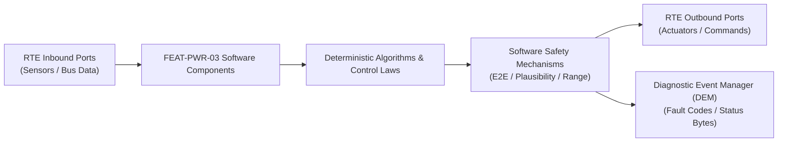

# Software Requirements Specification: Regenerative Braking & One-Pedal Drive Coordination (RBC)
**Feature ID:** `FEAT-PWR-03`  
**Domain:** Electric Powertrain & Energy Management  
**Target ASIL:** ASIL D  
**Compliance Standard:** ISO 26262:2018 (Part 6 - Software Development) / ASPICE PAM v3.1 (SWE.1, SWE.2)  
**Parent System Specification:** [`FEAT-PWR-03_Regen_SysReq.md`](file:///c:/Workset/AntiGravityProjects/TestOptimisationExperiement/system_requirements/FEAT-PWR-03_Regen_SysReq.md)  
**Global Master Specification:** [`spec.md`](file:///c:/Workset/AntiGravityProjects/TestOptimisationExperiement/spec.md)

---

## 1. Software Architecture & Component Structure

This document specifies the AUTOSAR Software Components (SWCs), periodic runnables, algorithmic laws, safety mechanisms, and data ports implementing `FEAT-PWR-03` (Regenerative Braking & One-Pedal Drive Coordination (RBC)).

### AUTOSAR SWC Interaction Diagram

---

## 2. Detailed Software Requirements (SWR_REQ)
*(Multi-Software Requirement Partitioning derived from System Requirements)*

### `SWR-PWR-03-01`: Dynamic Battery & Motor Regen Capability Envelope Calculator
- **Planned Release:** R100
- **ASIL Rating:** ASIL C
- **Parent System Requirement:** [`SYS-PWR-03-01`](file:///c:/Workset/AntiGravityProjects/TestOptimisationExperiement/system_requirements/FEAT-PWR-03_Regen_SysReq.md#sys-pwr-03-01)
- **Allocated AUTOSAR SWC:** `RegenEnvelope_SWC`
- **Execution Rate / Trigger:** 10 ms
- **Worst-Case Execution Time (WCET):** 0.7 ms
- **Software Activation Condition:** Executed cyclically every 10 ms.
- **Algorithmic Description / Logic:**
  > Computes max allowable negative torque: T_regen_max = min(T_motor_gen_limit, P_bms_charge_limit / omega_m). If battery SOC >= 98% or pack temp < -10°C, smoothly reduces T_regen_max to 0 Nm.
- **Software Safety Mechanism:** Smooth derating curve avoids sudden step loss of regenerative engine braking feel.
- **Failure Reaction & DEM Diagnostic Event:** Set T_regen_max = 0 Nm if BMS charge limit signal is missing.
- **Software Port Inputs:** `BMS_Charge_Power_Limit_kW, Motor_RPM, Battery_SOC_Pct, Battery_Temp_C`
- **Software Port Outputs:** `T_Regen_Available_Nm (float32)`
- **Software Verification Criteria:** SIL unit test verifying power-to-torque conversion curves.
- **Traceability Link:** Traces upward to [`SYS-PWR-03-01`](file:///c:/Workset/AntiGravityProjects/TestOptimisationExperiement/system_requirements/FEAT-PWR-03_Regen_SysReq.md#sys-pwr-03-01) and [`FEAT-PWR-03`](file:///c:/Workset/AntiGravityProjects/TestOptimisationExperiement/spec.md).

### `SWR-PWR-03-02`: Brake Blending Coordinator & One-Pedal Creep Standstill Manager
- **Planned Release:** R100
- **ASIL Rating:** ASIL C
- **Parent System Requirement:** [`SYS-PWR-03-01`](file:///c:/Workset/AntiGravityProjects/TestOptimisationExperiement/system_requirements/FEAT-PWR-03_Regen_SysReq.md#sys-pwr-03-01)
- **Allocated AUTOSAR SWC:** `RegenBlending_SWC`
- **Execution Rate / Trigger:** 10 ms
- **Worst-Case Execution Time (WCET):** 1.1 ms
- **Software Activation Condition:** Executed every 10 ms on driver brake stroke.
- **Algorithmic Description / Logic:**
  > Maps pedal stroke to total requested deceleration D_total. If One-Pedal Drive active and pedal released, applies coast regen down to 0 km/h, automatically engaging hydraulic park hold at 0 km/h.
- **Software Safety Mechanism:** Handover to hydraulic park hold validated against zero wheel tick motion.
- **Failure Reaction & DEM Diagnostic Event:** If hydraulic hold fails to build pressure, hold motor at zero speed using position servoloop.
- **Software Port Inputs:** `Brake_Pedal_Stroke_Mm, One_Pedal_Switch_Active, Vehicle_Speed_Mps, T_Regen_Available_Nm`
- **Software Port Outputs:** `Inverter_Regen_Torque_Cmd_Nm, Hydraulic_Decel_Cmd_Mps2`
- **Software Verification Criteria:** Automated HIL test of One-Pedal drive to standstill transitions.
- **Traceability Link:** Traces upward to [`SYS-PWR-03-01`](file:///c:/Workset/AntiGravityProjects/TestOptimisationExperiement/system_requirements/FEAT-PWR-03_Regen_SysReq.md#sys-pwr-03-01) and [`FEAT-PWR-03`](file:///c:/Workset/AntiGravityProjects/TestOptimisationExperiement/spec.md).

### `SWR-PWR-03-03`: ABS Fast-Ramp De-excitation Controller
- **Planned Release:** R100
- **ASIL Rating:** ASIL D
- **Parent System Requirement:** [`SYS-PWR-03-02`](file:///c:/Workset/AntiGravityProjects/TestOptimisationExperiement/system_requirements/FEAT-PWR-03_Regen_SysReq.md#sys-pwr-03-02)
- **Allocated AUTOSAR SWC:** `RegenFastCutoff_SWC`
- **Execution Rate / Trigger:** 5 ms
- **Worst-Case Execution Time (WCET):** 0.4 ms
- **Software Activation Condition:** Executed cyclically every 5 ms.
- **Algorithmic Description / Logic:**
  > Monitors ABS_Active_Flag and ESC_Intervention_Flag. On rising edge of either flag, applies negative slew rate limiter: dTau/dt = 2500 Nm/s, clamping regen torque command to 0.0 Nm in <= 15 ms.
- **Software Safety Mechanism:** Direct high-priority execution path bypassing standard filtering delays.
- **Failure Reaction & DEM Diagnostic Event:** Assert emergency zero torque command over inverter high-priority CAN buffer.
- **Software Port Inputs:** `ABS_Active_Flag, ESC_Intervention_Flag, Current_Regen_Torque_Nm`
- **Software Port Outputs:** `Emergency_Regen_Cutoff_Cmd_Nm`
- **Software Verification Criteria:** Timing test verifying torque zeroing within 15 ms on ABS rising edge.
- **Traceability Link:** Traces upward to [`SYS-PWR-03-02`](file:///c:/Workset/AntiGravityProjects/TestOptimisationExperiement/system_requirements/FEAT-PWR-03_Regen_SysReq.md#sys-pwr-03-02) and [`FEAT-PWR-03`](file:///c:/Workset/AntiGravityProjects/TestOptimisationExperiement/spec.md).

### `SWR-PWR-03-04`: Post-Intervention Regen Re-engagement Debounce Filter
- **Planned Release:** R100
- **ASIL Rating:** ASIL D
- **Parent System Requirement:** [`SYS-PWR-03-02`](file:///c:/Workset/AntiGravityProjects/TestOptimisationExperiement/system_requirements/FEAT-PWR-03_Regen_SysReq.md#sys-pwr-03-02)
- **Allocated AUTOSAR SWC:** `RegenReengagement_SWC`
- **Execution Rate / Trigger:** 10 ms
- **Worst-Case Execution Time (WCET):** 0.5 ms
- **Software Activation Condition:** Executed following ABS/ESC event termination.
- **Algorithmic Description / Logic:**
  > Starts a 500 ms stabilization timer when ABS_Active transitions to FALSE. Keeps regen torque suppressed until timer expires AND vehicle yaw rate error < 0.05 rad/s, then ramps regen back at 150 Nm/s.
- **Software Safety Mechanism:** Prevents rapid oscillation between ABS cycling and regenerative braking.
- **Failure Reaction & DEM Diagnostic Event:** Restart stabilization timer if vehicle yaw rate remains unstable.
- **Software Port Inputs:** `ABS_Active_Flag, Vehicle_Yaw_Rate_Error, Stabilization_Timer_Ms`
- **Software Port Outputs:** `Regen_Reengage_Permit (boolean), Regen_Ramp_Rate_Scale`
- **Software Verification Criteria:** Split-mu transient recovery test in vehicle dynamics simulator.
- **Traceability Link:** Traces upward to [`SYS-PWR-03-02`](file:///c:/Workset/AntiGravityProjects/TestOptimisationExperiement/system_requirements/FEAT-PWR-03_Regen_SysReq.md#sys-pwr-03-02) and [`FEAT-PWR-03`](file:///c:/Workset/AntiGravityProjects/TestOptimisationExperiement/spec.md).

### `SWR-PWR-03-05`: Fast Wheel Slip Motor Inverter Regeneration Trip Commander
- **Planned Release:** R100
- **ASIL Rating:** ASIL D
- **Parent System Requirement:** [`SYS-PWR-03-03`](file:///c:/Workset/AntiGravityProjects/TestOptimisationExperiement/system_requirements/FEAT-PWR-03_Regen_SysReq.md#sys-pwr-03-03)
- **Allocated AUTOSAR SWC:** `RbcSlipCoordinator_SWC`
- **Execution Rate / Trigger:** 2 ms
- **Worst-Case Execution Time (WCET):** 0.15 ms
- **Software Activation Condition:** Executed in 500 Hz high-speed traction ISR.
- **Algorithmic Description / Logic:**
  > Samples ABS slip active flag over dedicated chassis CAN-FD: If Slip_Active == TRUE OR Wheel_Decel > -18 m/s², immediately ramps motor regenerative torque to 0 Nm at slew rate d(T)/dt = 10,000 Nm/s (achieving 0 Nm in < 15 ms).
- **Software Safety Mechanism:** Direct SPI bus trip signal sent directly to motor inverter control core.
- **Failure Reaction & DEM Diagnostic Event:** Command emergency gate shutdown if motor fails to de-torque.
- **Software Port Inputs:** `ESP_Slip_Flag_Array[4], Motor_Actual_Regen_Torque_Nm`
- **Software Port Outputs:** `Fast_Regen_Cutback_Req, Inverter_Torque_Clamp_Nm`
- **Software Verification Criteria:** Low-friction split-mu dyno bench step response testing.
- **Traceability Link:** Traces upward to [`SYS-PWR-03-03`](file:///c:/Workset/AntiGravityProjects/TestOptimisationExperiement/system_requirements/FEAT-PWR-03_Regen_SysReq.md#sys-pwr-03-03) and [`FEAT-PWR-03`](file:///c:/Workset/AntiGravityProjects/TestOptimisationExperiement/spec.md).

### `SWR-PWR-03-06`: ESP Hydraulic Friction Brake Blending Handover Manager
- **Planned Release:** R100
- **ASIL Rating:** ASIL D
- **Parent System Requirement:** [`SYS-PWR-03-03`](file:///c:/Workset/AntiGravityProjects/TestOptimisationExperiement/system_requirements/FEAT-PWR-03_Regen_SysReq.md#sys-pwr-03-03)
- **Allocated AUTOSAR SWC:** `RbcFrictionBlending_SWC`
- **Execution Rate / Trigger:** 5 ms
- **Worst-Case Execution Time (WCET):** 0.3 ms
- **Software Activation Condition:** Active during regen cutback.
- **Algorithmic Description / Logic:**
  > Calculates deceleration deficit: Delta_a = Decel_Demanded - Decel_Motor_Delivered. Transmits friction brake pressure request to ESP: P_caliper = Delta_a * M_veh * R_wheel / (2 * A_piston * mu_pad * r_eff) to guarantee seamless vehicle stopping distance.
- **Software Safety Mechanism:** Deceleration continuity guard: Ensures vehicle deceleration does not drop by > 0.05g during handover.
- **Failure Reaction & DEM Diagnostic Event:** Engage maximum hydraulic booster pressure upon motor cutback failure.
- **Software Port Inputs:** `Delta_a_Decel_Deficit_Mps2, ESP_Master_Pressure_Bar`
- **Software Port Outputs:** `ESP_Pressure_Compensation_Bar, Blending_Handoff_Status_Enum`
- **Software Verification Criteria:** Braking distance repeatability test across 100 cold/wet stops.
- **Traceability Link:** Traces upward to [`SYS-PWR-03-03`](file:///c:/Workset/AntiGravityProjects/TestOptimisationExperiement/system_requirements/FEAT-PWR-03_Regen_SysReq.md#sys-pwr-03-03) and [`FEAT-PWR-03`](file:///c:/Workset/AntiGravityProjects/TestOptimisationExperiement/spec.md).

### `SWR-PWR-03-07`: BMS Charge Acceptance Dynamic Envelope Follower
- **Planned Release:** R200
- **ASIL Rating:** ASIL C
- **Parent System Requirement:** [`SYS-PWR-03-04`](file:///c:/Workset/AntiGravityProjects/TestOptimisationExperiement/system_requirements/FEAT-PWR-03_Regen_SysReq.md#sys-pwr-03-04)
- **Allocated AUTOSAR SWC:** `RbcBmsEnvelopeFollower_SWC`
- **Execution Rate / Trigger:** 10 ms
- **Worst-Case Execution Time (WCET):** 0.4 ms
- **Software Activation Condition:** Cyclic 10 ms task.
- **Algorithmic Description / Logic:**
  > Ingests BMS P_chg_max (kW) over E2E-protected CAN-FD. Calculates maximum allowable motor regenerative torque: T_regen_max = min(T_one_pedal, (P_chg_max * 1000) / (Omega_motor + 0.1)). Clamps motor negative torque within battery electrochemical safe envelope.
- **Software Safety Mechanism:** Battery overvoltage protection: Cuts regen instantly if DC bus voltage exceeds 420V / 840V.
- **Failure Reaction & DEM Diagnostic Event:** Default allowable regen to 0 kW upon BMS communication loss.
- **Software Port Inputs:** `BMS_Max_Charge_Power_kW, DC_Bus_Voltage_V, Motor_Speed_RadS`
- **Software Port Outputs:** `Battery_Clamped_Regen_Torque_Nm, Overvoltage_Safety_Trip (boolean)`
- **Software Verification Criteria:** Full battery pack charge tapering and HIL battery emulator testing.
- **Traceability Link:** Traces upward to [`SYS-PWR-03-04`](file:///c:/Workset/AntiGravityProjects/TestOptimisationExperiement/system_requirements/FEAT-PWR-03_Regen_SysReq.md#sys-pwr-03-04) and [`FEAT-PWR-03`](file:///c:/Workset/AntiGravityProjects/TestOptimisationExperiement/spec.md).

### `SWR-PWR-03-08`: Consistent Pedal Feel Friction Hydraulic Compensator
- **Planned Release:** R200
- **ASIL Rating:** ASIL C
- **Parent System Requirement:** [`SYS-PWR-03-04`](file:///c:/Workset/AntiGravityProjects/TestOptimisationExperiement/system_requirements/FEAT-PWR-03_Regen_SysReq.md#sys-pwr-03-04)
- **Allocated AUTOSAR SWC:** `RbcPedalFeelCompensator_SWC`
- **Execution Rate / Trigger:** 10 ms
- **Worst-Case Execution Time (WCET):** 0.5 ms
- **Software Activation Condition:** Active when battery derating reduces regen.
- **Algorithmic Description / Logic:**
  > When battery SOC > 95% and regen torque is curtailed, automatically commands electric brake booster to apply foundation caliper friction brakes equal to missing regen torque: Driver experiences identical 0.2g one-pedal lift-off deceleration regardless of battery state.
- **Software Safety Mechanism:** Brake pad thermal accumulator model: Monitors rotor temperature during sustained friction compensation.
- **Failure Reaction & DEM Diagnostic Event:** Display 'Regen Braking Temporarily Reduced' cluster prompt if brakes warm.
- **Software Port Inputs:** `Driver_Throttle_Pedal_Pct, Battery_Clamped_Regen_Torque_Nm, Nominal_Regen_Torque_Nm`
- **Software Port Outputs:** `Friction_Caliper_Compensation_Bar, Consistent_Pedal_Feel_Active (boolean)`
- **Software Verification Criteria:** Driver blind subjective pedal feel consistency evaluations across 100% vs 20% SOC.
- **Traceability Link:** Traces upward to [`SYS-PWR-03-04`](file:///c:/Workset/AntiGravityProjects/TestOptimisationExperiement/system_requirements/FEAT-PWR-03_Regen_SysReq.md#sys-pwr-03-04) and [`FEAT-PWR-03`](file:///c:/Workset/AntiGravityProjects/TestOptimisationExperiement/spec.md).

### `SWR-PWR-03-09`: Regenerative Braking Deceleration Intent & Pedal Stroke Mapper - Dynamic Observer & Signal Filter
- **Planned Release:** R200
- **ASIL Rating:** ASIL D
- **Parent System Requirement:** [`SYS-PWR-03-05`](file:///c:/Workset/AntiGravityProjects/TestOptimisationExperiement/system_requirements/FEAT-PWR-03_Regen_SysReq.md#sys-pwr-03-05)
- **Allocated AUTOSAR SWC:** `RbcPedalMapper_SWC`
- **Execution Rate / Trigger:** 5 ms
- **Worst-Case Execution Time (WCET):** 0.3 ms
- **Software Activation Condition:** Executed cyclically every 5 ms.
- **Algorithmic Description / Logic:**
  > Executes signal plausibility filtering, calibration offsets, and discrete state estimation for Regenerative Braking Deceleration Intent & Pedal Stroke Mapper.
- **Software Safety Mechanism:** Range limit plausibility check and E2E alive sequence verification.
- **Failure Reaction & DEM Diagnostic Event:** Set default fallback output and report DEM_EVENT_FEAT_PWR_03_ERR.
- **Software Port Inputs:** `Raw sensor ADC/SENT/SPI values and RTE bus inputs.`
- **Software Port Outputs:** `Filtered physical signals and validity status bitmasks.`
- **Software Verification Criteria:** Unit test and HiL software integration test.
- **Traceability Link:** Traces upward to [`SYS-PWR-03-05`](file:///c:/Workset/AntiGravityProjects/TestOptimisationExperiement/system_requirements/FEAT-PWR-03_Regen_SysReq.md#sys-pwr-03-05) and [`FEAT-PWR-03`](file:///c:/Workset/AntiGravityProjects/TestOptimisationExperiement/spec.md).

### `SWR-PWR-03-10`: Regenerative Braking Deceleration Intent & Pedal Stroke Mapper - Closed-Loop Control Law & Actuator Dispatch
- **Planned Release:** R200
- **ASIL Rating:** ASIL D
- **Parent System Requirement:** [`SYS-PWR-03-05`](file:///c:/Workset/AntiGravityProjects/TestOptimisationExperiement/system_requirements/FEAT-PWR-03_Regen_SysReq.md#sys-pwr-03-05)
- **Allocated AUTOSAR SWC:** `RbcPedalMapper_SWC`
- **Execution Rate / Trigger:** 5 ms
- **Worst-Case Execution Time (WCET):** 0.4 ms
- **Software Activation Condition:** Executed cyclically every 5 ms.
- **Algorithmic Description / Logic:**
  > Evaluates deterministic closed-loop control law, rate limits, and dispatches commands for Regenerative Braking Deceleration Intent & Pedal Stroke Mapper.
- **Software Safety Mechanism:** Command saturation clamping and watchdog program flow monitoring.
- **Failure Reaction & DEM Diagnostic Event:** De-energize actuator output, apply safe fallback clamp, and latch DTC.
- **Software Port Inputs:** `Validated physical state signals from observer SWC.`
- **Software Port Outputs:** `Actuator PWM duty cycles, torque/pressure setpoints, and diagnostic flags.`
- **Software Verification Criteria:** Hardware dynamometer and HiL closed-loop regression test suite.
- **Traceability Link:** Traces upward to [`SYS-PWR-03-05`](file:///c:/Workset/AntiGravityProjects/TestOptimisationExperiement/system_requirements/FEAT-PWR-03_Regen_SysReq.md#sys-pwr-03-05) and [`FEAT-PWR-03`](file:///c:/Workset/AntiGravityProjects/TestOptimisationExperiement/spec.md).

### `SWR-PWR-03-11`: One-Pedal Drive Accelerator Lift-Off Deceleration Synthesizer - Dynamic Observer & Signal Filter
- **Planned Release:** R200
- **ASIL Rating:** ASIL B
- **Parent System Requirement:** [`SYS-PWR-03-06`](file:///c:/Workset/AntiGravityProjects/TestOptimisationExperiement/system_requirements/FEAT-PWR-03_Regen_SysReq.md#sys-pwr-03-06)
- **Allocated AUTOSAR SWC:** `RbcOnePedalDrive_SWC`
- **Execution Rate / Trigger:** 10 ms
- **Worst-Case Execution Time (WCET):** 0.3 ms
- **Software Activation Condition:** Executed cyclically every 10 ms.
- **Algorithmic Description / Logic:**
  > Executes signal plausibility filtering, calibration offsets, and discrete state estimation for One-Pedal Drive Accelerator Lift-Off Deceleration Synthesizer.
- **Software Safety Mechanism:** Range limit plausibility check and E2E alive sequence verification.
- **Failure Reaction & DEM Diagnostic Event:** Set default fallback output and report DEM_EVENT_FEAT_PWR_03_ERR.
- **Software Port Inputs:** `Raw sensor ADC/SENT/SPI values and RTE bus inputs.`
- **Software Port Outputs:** `Filtered physical signals and validity status bitmasks.`
- **Software Verification Criteria:** Unit test and HiL software integration test.
- **Traceability Link:** Traces upward to [`SYS-PWR-03-06`](file:///c:/Workset/AntiGravityProjects/TestOptimisationExperiement/system_requirements/FEAT-PWR-03_Regen_SysReq.md#sys-pwr-03-06) and [`FEAT-PWR-03`](file:///c:/Workset/AntiGravityProjects/TestOptimisationExperiement/spec.md).

### `SWR-PWR-03-12`: One-Pedal Drive Accelerator Lift-Off Deceleration Synthesizer - Closed-Loop Control Law & Actuator Dispatch
- **Planned Release:** R200
- **ASIL Rating:** ASIL B
- **Parent System Requirement:** [`SYS-PWR-03-06`](file:///c:/Workset/AntiGravityProjects/TestOptimisationExperiement/system_requirements/FEAT-PWR-03_Regen_SysReq.md#sys-pwr-03-06)
- **Allocated AUTOSAR SWC:** `RbcOnePedalDrive_SWC`
- **Execution Rate / Trigger:** 10 ms
- **Worst-Case Execution Time (WCET):** 0.4 ms
- **Software Activation Condition:** Executed cyclically every 10 ms.
- **Algorithmic Description / Logic:**
  > Evaluates deterministic closed-loop control law, rate limits, and dispatches commands for One-Pedal Drive Accelerator Lift-Off Deceleration Synthesizer.
- **Software Safety Mechanism:** Command saturation clamping and watchdog program flow monitoring.
- **Failure Reaction & DEM Diagnostic Event:** De-energize actuator output, apply safe fallback clamp, and latch DTC.
- **Software Port Inputs:** `Validated physical state signals from observer SWC.`
- **Software Port Outputs:** `Actuator PWM duty cycles, torque/pressure setpoints, and diagnostic flags.`
- **Software Verification Criteria:** Hardware dynamometer and HiL closed-loop regression test suite.
- **Traceability Link:** Traces upward to [`SYS-PWR-03-06`](file:///c:/Workset/AntiGravityProjects/TestOptimisationExperiement/system_requirements/FEAT-PWR-03_Regen_SysReq.md#sys-pwr-03-06) and [`FEAT-PWR-03`](file:///c:/Workset/AntiGravityProjects/TestOptimisationExperiement/spec.md).

### `SWR-PWR-03-13`: Hydraulic Foundation & Electric Motor Torque Blending Coordinator - Dynamic Observer & Signal Filter
- **Planned Release:** R300
- **ASIL Rating:** ASIL D
- **Parent System Requirement:** [`SYS-PWR-03-07`](file:///c:/Workset/AntiGravityProjects/TestOptimisationExperiement/system_requirements/FEAT-PWR-03_Regen_SysReq.md#sys-pwr-03-07)
- **Allocated AUTOSAR SWC:** `RbcTorqueBlender_SWC`
- **Execution Rate / Trigger:** 5 ms
- **Worst-Case Execution Time (WCET):** 0.3 ms
- **Software Activation Condition:** Executed cyclically every 5 ms.
- **Algorithmic Description / Logic:**
  > Executes signal plausibility filtering, calibration offsets, and discrete state estimation for Hydraulic Foundation & Electric Motor Torque Blending Coordinator.
- **Software Safety Mechanism:** Range limit plausibility check and E2E alive sequence verification.
- **Failure Reaction & DEM Diagnostic Event:** Set default fallback output and report DEM_EVENT_FEAT_PWR_03_ERR.
- **Software Port Inputs:** `Raw sensor ADC/SENT/SPI values and RTE bus inputs.`
- **Software Port Outputs:** `Filtered physical signals and validity status bitmasks.`
- **Software Verification Criteria:** Unit test and HiL software integration test.
- **Traceability Link:** Traces upward to [`SYS-PWR-03-07`](file:///c:/Workset/AntiGravityProjects/TestOptimisationExperiement/system_requirements/FEAT-PWR-03_Regen_SysReq.md#sys-pwr-03-07) and [`FEAT-PWR-03`](file:///c:/Workset/AntiGravityProjects/TestOptimisationExperiement/spec.md).

### `SWR-PWR-03-14`: Hydraulic Foundation & Electric Motor Torque Blending Coordinator - Closed-Loop Control Law & Actuator Dispatch
- **Planned Release:** R300
- **ASIL Rating:** ASIL D
- **Parent System Requirement:** [`SYS-PWR-03-07`](file:///c:/Workset/AntiGravityProjects/TestOptimisationExperiement/system_requirements/FEAT-PWR-03_Regen_SysReq.md#sys-pwr-03-07)
- **Allocated AUTOSAR SWC:** `RbcTorqueBlender_SWC`
- **Execution Rate / Trigger:** 5 ms
- **Worst-Case Execution Time (WCET):** 0.4 ms
- **Software Activation Condition:** Executed cyclically every 5 ms.
- **Algorithmic Description / Logic:**
  > Evaluates deterministic closed-loop control law, rate limits, and dispatches commands for Hydraulic Foundation & Electric Motor Torque Blending Coordinator.
- **Software Safety Mechanism:** Command saturation clamping and watchdog program flow monitoring.
- **Failure Reaction & DEM Diagnostic Event:** De-energize actuator output, apply safe fallback clamp, and latch DTC.
- **Software Port Inputs:** `Validated physical state signals from observer SWC.`
- **Software Port Outputs:** `Actuator PWM duty cycles, torque/pressure setpoints, and diagnostic flags.`
- **Software Verification Criteria:** Hardware dynamometer and HiL closed-loop regression test suite.
- **Traceability Link:** Traces upward to [`SYS-PWR-03-07`](file:///c:/Workset/AntiGravityProjects/TestOptimisationExperiement/system_requirements/FEAT-PWR-03_Regen_SysReq.md#sys-pwr-03-07) and [`FEAT-PWR-03`](file:///c:/Workset/AntiGravityProjects/TestOptimisationExperiement/spec.md).

### `SWR-PWR-03-15`: ABS Wheel Slip Detection & Instantaneous Regen Cutoff Safing - Dynamic Observer & Signal Filter
- **Planned Release:** R400
- **ASIL Rating:** ASIL D
- **Parent System Requirement:** [`SYS-PWR-03-08`](file:///c:/Workset/AntiGravityProjects/TestOptimisationExperiement/system_requirements/FEAT-PWR-03_Regen_SysReq.md#sys-pwr-03-08)
- **Allocated AUTOSAR SWC:** `RbcAbsRegenCutoff_SWC`
- **Execution Rate / Trigger:** 2 ms
- **Worst-Case Execution Time (WCET):** 0.3 ms
- **Software Activation Condition:** Executed cyclically every 2 ms.
- **Algorithmic Description / Logic:**
  > Executes signal plausibility filtering, calibration offsets, and discrete state estimation for ABS Wheel Slip Detection & Instantaneous Regen Cutoff Safing.
- **Software Safety Mechanism:** Range limit plausibility check and E2E alive sequence verification.
- **Failure Reaction & DEM Diagnostic Event:** Set default fallback output and report DEM_EVENT_FEAT_PWR_03_ERR.
- **Software Port Inputs:** `Raw sensor ADC/SENT/SPI values and RTE bus inputs.`
- **Software Port Outputs:** `Filtered physical signals and validity status bitmasks.`
- **Software Verification Criteria:** Unit test and HiL software integration test.
- **Traceability Link:** Traces upward to [`SYS-PWR-03-08`](file:///c:/Workset/AntiGravityProjects/TestOptimisationExperiement/system_requirements/FEAT-PWR-03_Regen_SysReq.md#sys-pwr-03-08) and [`FEAT-PWR-03`](file:///c:/Workset/AntiGravityProjects/TestOptimisationExperiement/spec.md).

### `SWR-PWR-03-16`: ABS Wheel Slip Detection & Instantaneous Regen Cutoff Safing - Closed-Loop Control Law & Actuator Dispatch
- **Planned Release:** R400
- **ASIL Rating:** ASIL D
- **Parent System Requirement:** [`SYS-PWR-03-08`](file:///c:/Workset/AntiGravityProjects/TestOptimisationExperiement/system_requirements/FEAT-PWR-03_Regen_SysReq.md#sys-pwr-03-08)
- **Allocated AUTOSAR SWC:** `RbcAbsRegenCutoff_SWC`
- **Execution Rate / Trigger:** 2 ms
- **Worst-Case Execution Time (WCET):** 0.4 ms
- **Software Activation Condition:** Executed cyclically every 2 ms.
- **Algorithmic Description / Logic:**
  > Evaluates deterministic closed-loop control law, rate limits, and dispatches commands for ABS Wheel Slip Detection & Instantaneous Regen Cutoff Safing.
- **Software Safety Mechanism:** Command saturation clamping and watchdog program flow monitoring.
- **Failure Reaction & DEM Diagnostic Event:** De-energize actuator output, apply safe fallback clamp, and latch DTC.
- **Software Port Inputs:** `Validated physical state signals from observer SWC.`
- **Software Port Outputs:** `Actuator PWM duty cycles, torque/pressure setpoints, and diagnostic flags.`
- **Software Verification Criteria:** Hardware dynamometer and HiL closed-loop regression test suite.
- **Traceability Link:** Traces upward to [`SYS-PWR-03-08`](file:///c:/Workset/AntiGravityProjects/TestOptimisationExperiement/system_requirements/FEAT-PWR-03_Regen_SysReq.md#sys-pwr-03-08) and [`FEAT-PWR-03`](file:///c:/Workset/AntiGravityProjects/TestOptimisationExperiement/spec.md).

### `SWR-PWR-03-17`: High-Voltage Battery Full Charge (SOC > 95%) Regen Derating Envelope - Dynamic Observer & Signal Filter
- **Planned Release:** R300
- **ASIL Rating:** ASIL C
- **Parent System Requirement:** [`SYS-PWR-03-09`](file:///c:/Workset/AntiGravityProjects/TestOptimisationExperiement/system_requirements/FEAT-PWR-03_Regen_SysReq.md#sys-pwr-03-09)
- **Allocated AUTOSAR SWC:** `RbcSocDerater_SWC`
- **Execution Rate / Trigger:** 20 ms
- **Worst-Case Execution Time (WCET):** 0.3 ms
- **Software Activation Condition:** Executed cyclically every 20 ms.
- **Algorithmic Description / Logic:**
  > Executes signal plausibility filtering, calibration offsets, and discrete state estimation for High-Voltage Battery Full Charge (SOC > 95%) Regen Derating Envelope.
- **Software Safety Mechanism:** Range limit plausibility check and E2E alive sequence verification.
- **Failure Reaction & DEM Diagnostic Event:** Set default fallback output and report DEM_EVENT_FEAT_PWR_03_ERR.
- **Software Port Inputs:** `Raw sensor ADC/SENT/SPI values and RTE bus inputs.`
- **Software Port Outputs:** `Filtered physical signals and validity status bitmasks.`
- **Software Verification Criteria:** Unit test and HiL software integration test.
- **Traceability Link:** Traces upward to [`SYS-PWR-03-09`](file:///c:/Workset/AntiGravityProjects/TestOptimisationExperiement/system_requirements/FEAT-PWR-03_Regen_SysReq.md#sys-pwr-03-09) and [`FEAT-PWR-03`](file:///c:/Workset/AntiGravityProjects/TestOptimisationExperiement/spec.md).

### `SWR-PWR-03-18`: High-Voltage Battery Full Charge (SOC > 95%) Regen Derating Envelope - Closed-Loop Control Law & Actuator Dispatch
- **Planned Release:** R300
- **ASIL Rating:** ASIL C
- **Parent System Requirement:** [`SYS-PWR-03-09`](file:///c:/Workset/AntiGravityProjects/TestOptimisationExperiement/system_requirements/FEAT-PWR-03_Regen_SysReq.md#sys-pwr-03-09)
- **Allocated AUTOSAR SWC:** `RbcSocDerater_SWC`
- **Execution Rate / Trigger:** 20 ms
- **Worst-Case Execution Time (WCET):** 0.4 ms
- **Software Activation Condition:** Executed cyclically every 20 ms.
- **Algorithmic Description / Logic:**
  > Evaluates deterministic closed-loop control law, rate limits, and dispatches commands for High-Voltage Battery Full Charge (SOC > 95%) Regen Derating Envelope.
- **Software Safety Mechanism:** Command saturation clamping and watchdog program flow monitoring.
- **Failure Reaction & DEM Diagnostic Event:** De-energize actuator output, apply safe fallback clamp, and latch DTC.
- **Software Port Inputs:** `Validated physical state signals from observer SWC.`
- **Software Port Outputs:** `Actuator PWM duty cycles, torque/pressure setpoints, and diagnostic flags.`
- **Software Verification Criteria:** Hardware dynamometer and HiL closed-loop regression test suite.
- **Traceability Link:** Traces upward to [`SYS-PWR-03-09`](file:///c:/Workset/AntiGravityProjects/TestOptimisationExperiement/system_requirements/FEAT-PWR-03_Regen_SysReq.md#sys-pwr-03-09) and [`FEAT-PWR-03`](file:///c:/Workset/AntiGravityProjects/TestOptimisationExperiement/spec.md).

### `SWR-PWR-03-19`: Low-Temperature Battery Pack Regen Current Ingestion Limiter - Dynamic Observer & Signal Filter
- **Planned Release:** R400
- **ASIL Rating:** ASIL C
- **Parent System Requirement:** [`SYS-PWR-03-10`](file:///c:/Workset/AntiGravityProjects/TestOptimisationExperiement/system_requirements/FEAT-PWR-03_Regen_SysReq.md#sys-pwr-03-10)
- **Allocated AUTOSAR SWC:** `RbcColdDerater_SWC`
- **Execution Rate / Trigger:** 50 ms
- **Worst-Case Execution Time (WCET):** 0.3 ms
- **Software Activation Condition:** Executed cyclically every 50 ms.
- **Algorithmic Description / Logic:**
  > Executes signal plausibility filtering, calibration offsets, and discrete state estimation for Low-Temperature Battery Pack Regen Current Ingestion Limiter.
- **Software Safety Mechanism:** Range limit plausibility check and E2E alive sequence verification.
- **Failure Reaction & DEM Diagnostic Event:** Set default fallback output and report DEM_EVENT_FEAT_PWR_03_ERR.
- **Software Port Inputs:** `Raw sensor ADC/SENT/SPI values and RTE bus inputs.`
- **Software Port Outputs:** `Filtered physical signals and validity status bitmasks.`
- **Software Verification Criteria:** Unit test and HiL software integration test.
- **Traceability Link:** Traces upward to [`SYS-PWR-03-10`](file:///c:/Workset/AntiGravityProjects/TestOptimisationExperiement/system_requirements/FEAT-PWR-03_Regen_SysReq.md#sys-pwr-03-10) and [`FEAT-PWR-03`](file:///c:/Workset/AntiGravityProjects/TestOptimisationExperiement/spec.md).

### `SWR-PWR-03-20`: Low-Temperature Battery Pack Regen Current Ingestion Limiter - Closed-Loop Control Law & Actuator Dispatch
- **Planned Release:** R400
- **ASIL Rating:** ASIL C
- **Parent System Requirement:** [`SYS-PWR-03-10`](file:///c:/Workset/AntiGravityProjects/TestOptimisationExperiement/system_requirements/FEAT-PWR-03_Regen_SysReq.md#sys-pwr-03-10)
- **Allocated AUTOSAR SWC:** `RbcColdDerater_SWC`
- **Execution Rate / Trigger:** 50 ms
- **Worst-Case Execution Time (WCET):** 0.4 ms
- **Software Activation Condition:** Executed cyclically every 50 ms.
- **Algorithmic Description / Logic:**
  > Evaluates deterministic closed-loop control law, rate limits, and dispatches commands for Low-Temperature Battery Pack Regen Current Ingestion Limiter.
- **Software Safety Mechanism:** Command saturation clamping and watchdog program flow monitoring.
- **Failure Reaction & DEM Diagnostic Event:** De-energize actuator output, apply safe fallback clamp, and latch DTC.
- **Software Port Inputs:** `Validated physical state signals from observer SWC.`
- **Software Port Outputs:** `Actuator PWM duty cycles, torque/pressure setpoints, and diagnostic flags.`
- **Software Verification Criteria:** Hardware dynamometer and HiL closed-loop regression test suite.
- **Traceability Link:** Traces upward to [`SYS-PWR-03-10`](file:///c:/Workset/AntiGravityProjects/TestOptimisationExperiement/system_requirements/FEAT-PWR-03_Regen_SysReq.md#sys-pwr-03-10) and [`FEAT-PWR-03`](file:///c:/Workset/AntiGravityProjects/TestOptimisationExperiement/spec.md).

### `SWR-PWR-03-21`: Front/Rear Axle Regen Braking Stability Distribution Law - Dynamic Observer & Signal Filter
- **Planned Release:** R400
- **ASIL Rating:** ASIL D
- **Parent System Requirement:** [`SYS-PWR-03-11`](file:///c:/Workset/AntiGravityProjects/TestOptimisationExperiement/system_requirements/FEAT-PWR-03_Regen_SysReq.md#sys-pwr-03-11)
- **Allocated AUTOSAR SWC:** `RbcAxleDistributor_SWC`
- **Execution Rate / Trigger:** 5 ms
- **Worst-Case Execution Time (WCET):** 0.3 ms
- **Software Activation Condition:** Executed cyclically every 5 ms.
- **Algorithmic Description / Logic:**
  > Executes signal plausibility filtering, calibration offsets, and discrete state estimation for Front/Rear Axle Regen Braking Stability Distribution Law.
- **Software Safety Mechanism:** Range limit plausibility check and E2E alive sequence verification.
- **Failure Reaction & DEM Diagnostic Event:** Set default fallback output and report DEM_EVENT_FEAT_PWR_03_ERR.
- **Software Port Inputs:** `Raw sensor ADC/SENT/SPI values and RTE bus inputs.`
- **Software Port Outputs:** `Filtered physical signals and validity status bitmasks.`
- **Software Verification Criteria:** Unit test and HiL software integration test.
- **Traceability Link:** Traces upward to [`SYS-PWR-03-11`](file:///c:/Workset/AntiGravityProjects/TestOptimisationExperiement/system_requirements/FEAT-PWR-03_Regen_SysReq.md#sys-pwr-03-11) and [`FEAT-PWR-03`](file:///c:/Workset/AntiGravityProjects/TestOptimisationExperiement/spec.md).

### `SWR-PWR-03-22`: Front/Rear Axle Regen Braking Stability Distribution Law - Closed-Loop Control Law & Actuator Dispatch
- **Planned Release:** R400
- **ASIL Rating:** ASIL D
- **Parent System Requirement:** [`SYS-PWR-03-11`](file:///c:/Workset/AntiGravityProjects/TestOptimisationExperiement/system_requirements/FEAT-PWR-03_Regen_SysReq.md#sys-pwr-03-11)
- **Allocated AUTOSAR SWC:** `RbcAxleDistributor_SWC`
- **Execution Rate / Trigger:** 5 ms
- **Worst-Case Execution Time (WCET):** 0.4 ms
- **Software Activation Condition:** Executed cyclically every 5 ms.
- **Algorithmic Description / Logic:**
  > Evaluates deterministic closed-loop control law, rate limits, and dispatches commands for Front/Rear Axle Regen Braking Stability Distribution Law.
- **Software Safety Mechanism:** Command saturation clamping and watchdog program flow monitoring.
- **Failure Reaction & DEM Diagnostic Event:** De-energize actuator output, apply safe fallback clamp, and latch DTC.
- **Software Port Inputs:** `Validated physical state signals from observer SWC.`
- **Software Port Outputs:** `Actuator PWM duty cycles, torque/pressure setpoints, and diagnostic flags.`
- **Software Verification Criteria:** Hardware dynamometer and HiL closed-loop regression test suite.
- **Traceability Link:** Traces upward to [`SYS-PWR-03-11`](file:///c:/Workset/AntiGravityProjects/TestOptimisationExperiement/system_requirements/FEAT-PWR-03_Regen_SysReq.md#sys-pwr-03-11) and [`FEAT-PWR-03`](file:///c:/Workset/AntiGravityProjects/TestOptimisationExperiement/spec.md).

### `SWR-PWR-03-23`: Powertrain Regen Active Driveline Damping & Anti-Shudder Filter - Dynamic Observer & Signal Filter
- **Planned Release:** R500
- **ASIL Rating:** ASIL B
- **Parent System Requirement:** [`SYS-PWR-03-12`](file:///c:/Workset/AntiGravityProjects/TestOptimisationExperiement/system_requirements/FEAT-PWR-03_Regen_SysReq.md#sys-pwr-03-12)
- **Allocated AUTOSAR SWC:** `RbcAntiShudder_SWC`
- **Execution Rate / Trigger:** 5 ms
- **Worst-Case Execution Time (WCET):** 0.3 ms
- **Software Activation Condition:** Executed cyclically every 5 ms.
- **Algorithmic Description / Logic:**
  > Executes signal plausibility filtering, calibration offsets, and discrete state estimation for Powertrain Regen Active Driveline Damping & Anti-Shudder Filter.
- **Software Safety Mechanism:** Range limit plausibility check and E2E alive sequence verification.
- **Failure Reaction & DEM Diagnostic Event:** Set default fallback output and report DEM_EVENT_FEAT_PWR_03_ERR.
- **Software Port Inputs:** `Raw sensor ADC/SENT/SPI values and RTE bus inputs.`
- **Software Port Outputs:** `Filtered physical signals and validity status bitmasks.`
- **Software Verification Criteria:** Unit test and HiL software integration test.
- **Traceability Link:** Traces upward to [`SYS-PWR-03-12`](file:///c:/Workset/AntiGravityProjects/TestOptimisationExperiement/system_requirements/FEAT-PWR-03_Regen_SysReq.md#sys-pwr-03-12) and [`FEAT-PWR-03`](file:///c:/Workset/AntiGravityProjects/TestOptimisationExperiement/spec.md).

### `SWR-PWR-03-24`: Powertrain Regen Active Driveline Damping & Anti-Shudder Filter - Closed-Loop Control Law & Actuator Dispatch
- **Planned Release:** R500
- **ASIL Rating:** ASIL B
- **Parent System Requirement:** [`SYS-PWR-03-12`](file:///c:/Workset/AntiGravityProjects/TestOptimisationExperiement/system_requirements/FEAT-PWR-03_Regen_SysReq.md#sys-pwr-03-12)
- **Allocated AUTOSAR SWC:** `RbcAntiShudder_SWC`
- **Execution Rate / Trigger:** 5 ms
- **Worst-Case Execution Time (WCET):** 0.4 ms
- **Software Activation Condition:** Executed cyclically every 5 ms.
- **Algorithmic Description / Logic:**
  > Evaluates deterministic closed-loop control law, rate limits, and dispatches commands for Powertrain Regen Active Driveline Damping & Anti-Shudder Filter.
- **Software Safety Mechanism:** Command saturation clamping and watchdog program flow monitoring.
- **Failure Reaction & DEM Diagnostic Event:** De-energize actuator output, apply safe fallback clamp, and latch DTC.
- **Software Port Inputs:** `Validated physical state signals from observer SWC.`
- **Software Port Outputs:** `Actuator PWM duty cycles, torque/pressure setpoints, and diagnostic flags.`
- **Software Verification Criteria:** Hardware dynamometer and HiL closed-loop regression test suite.
- **Traceability Link:** Traces upward to [`SYS-PWR-03-12`](file:///c:/Workset/AntiGravityProjects/TestOptimisationExperiement/system_requirements/FEAT-PWR-03_Regen_SysReq.md#sys-pwr-03-12) and [`FEAT-PWR-03`](file:///c:/Workset/AntiGravityProjects/TestOptimisationExperiement/spec.md).

### `SWR-PWR-03-25`: Regenerative Deceleration Brake Lamp Automatic Illumination - Dynamic Observer & Signal Filter
- **Planned Release:** R500
- **ASIL Rating:** ASIL B
- **Parent System Requirement:** [`SYS-PWR-03-13`](file:///c:/Workset/AntiGravityProjects/TestOptimisationExperiement/system_requirements/FEAT-PWR-03_Regen_SysReq.md#sys-pwr-03-13)
- **Allocated AUTOSAR SWC:** `RbcBrakeLampDriver_SWC`
- **Execution Rate / Trigger:** 20 ms
- **Worst-Case Execution Time (WCET):** 0.3 ms
- **Software Activation Condition:** Executed cyclically every 20 ms.
- **Algorithmic Description / Logic:**
  > Executes signal plausibility filtering, calibration offsets, and discrete state estimation for Regenerative Deceleration Brake Lamp Automatic Illumination.
- **Software Safety Mechanism:** Range limit plausibility check and E2E alive sequence verification.
- **Failure Reaction & DEM Diagnostic Event:** Set default fallback output and report DEM_EVENT_FEAT_PWR_03_ERR.
- **Software Port Inputs:** `Raw sensor ADC/SENT/SPI values and RTE bus inputs.`
- **Software Port Outputs:** `Filtered physical signals and validity status bitmasks.`
- **Software Verification Criteria:** Unit test and HiL software integration test.
- **Traceability Link:** Traces upward to [`SYS-PWR-03-13`](file:///c:/Workset/AntiGravityProjects/TestOptimisationExperiement/system_requirements/FEAT-PWR-03_Regen_SysReq.md#sys-pwr-03-13) and [`FEAT-PWR-03`](file:///c:/Workset/AntiGravityProjects/TestOptimisationExperiement/spec.md).

### `SWR-PWR-03-26`: Regenerative Deceleration Brake Lamp Automatic Illumination - Closed-Loop Control Law & Actuator Dispatch
- **Planned Release:** R500
- **ASIL Rating:** ASIL B
- **Parent System Requirement:** [`SYS-PWR-03-13`](file:///c:/Workset/AntiGravityProjects/TestOptimisationExperiement/system_requirements/FEAT-PWR-03_Regen_SysReq.md#sys-pwr-03-13)
- **Allocated AUTOSAR SWC:** `RbcBrakeLampDriver_SWC`
- **Execution Rate / Trigger:** 20 ms
- **Worst-Case Execution Time (WCET):** 0.4 ms
- **Software Activation Condition:** Executed cyclically every 20 ms.
- **Algorithmic Description / Logic:**
  > Evaluates deterministic closed-loop control law, rate limits, and dispatches commands for Regenerative Deceleration Brake Lamp Automatic Illumination.
- **Software Safety Mechanism:** Command saturation clamping and watchdog program flow monitoring.
- **Failure Reaction & DEM Diagnostic Event:** De-energize actuator output, apply safe fallback clamp, and latch DTC.
- **Software Port Inputs:** `Validated physical state signals from observer SWC.`
- **Software Port Outputs:** `Actuator PWM duty cycles, torque/pressure setpoints, and diagnostic flags.`
- **Software Verification Criteria:** Hardware dynamometer and HiL closed-loop regression test suite.
- **Traceability Link:** Traces upward to [`SYS-PWR-03-13`](file:///c:/Workset/AntiGravityProjects/TestOptimisationExperiement/system_requirements/FEAT-PWR-03_Regen_SysReq.md#sys-pwr-03-13) and [`FEAT-PWR-03`](file:///c:/Workset/AntiGravityProjects/TestOptimisationExperiement/spec.md).

### `SWR-PWR-03-27`: DEM Regenerative Braking Fault Isolation & Hydraulic Handover Manager - Dynamic Observer & Signal Filter
- **Planned Release:** R500
- **ASIL Rating:** ASIL D
- **Parent System Requirement:** [`SYS-PWR-03-14`](file:///c:/Workset/AntiGravityProjects/TestOptimisationExperiement/system_requirements/FEAT-PWR-03_Regen_SysReq.md#sys-pwr-03-14)
- **Allocated AUTOSAR SWC:** `RbcDiagnosticManager_SWC`
- **Execution Rate / Trigger:** 10 ms
- **Worst-Case Execution Time (WCET):** 0.3 ms
- **Software Activation Condition:** Executed cyclically every 10 ms.
- **Algorithmic Description / Logic:**
  > Executes signal plausibility filtering, calibration offsets, and discrete state estimation for DEM Regenerative Braking Fault Isolation & Hydraulic Handover Manager.
- **Software Safety Mechanism:** Range limit plausibility check and E2E alive sequence verification.
- **Failure Reaction & DEM Diagnostic Event:** Set default fallback output and report DEM_EVENT_FEAT_PWR_03_ERR.
- **Software Port Inputs:** `Raw sensor ADC/SENT/SPI values and RTE bus inputs.`
- **Software Port Outputs:** `Filtered physical signals and validity status bitmasks.`
- **Software Verification Criteria:** Unit test and HiL software integration test.
- **Traceability Link:** Traces upward to [`SYS-PWR-03-14`](file:///c:/Workset/AntiGravityProjects/TestOptimisationExperiement/system_requirements/FEAT-PWR-03_Regen_SysReq.md#sys-pwr-03-14) and [`FEAT-PWR-03`](file:///c:/Workset/AntiGravityProjects/TestOptimisationExperiement/spec.md).

### `SWR-PWR-03-28`: DEM Regenerative Braking Fault Isolation & Hydraulic Handover Manager - Closed-Loop Control Law & Actuator Dispatch
- **Planned Release:** R500
- **ASIL Rating:** ASIL D
- **Parent System Requirement:** [`SYS-PWR-03-14`](file:///c:/Workset/AntiGravityProjects/TestOptimisationExperiement/system_requirements/FEAT-PWR-03_Regen_SysReq.md#sys-pwr-03-14)
- **Allocated AUTOSAR SWC:** `RbcDiagnosticManager_SWC`
- **Execution Rate / Trigger:** 10 ms
- **Worst-Case Execution Time (WCET):** 0.4 ms
- **Software Activation Condition:** Executed cyclically every 10 ms.
- **Algorithmic Description / Logic:**
  > Evaluates deterministic closed-loop control law, rate limits, and dispatches commands for DEM Regenerative Braking Fault Isolation & Hydraulic Handover Manager.
- **Software Safety Mechanism:** Command saturation clamping and watchdog program flow monitoring.
- **Failure Reaction & DEM Diagnostic Event:** De-energize actuator output, apply safe fallback clamp, and latch DTC.
- **Software Port Inputs:** `Validated physical state signals from observer SWC.`
- **Software Port Outputs:** `Actuator PWM duty cycles, torque/pressure setpoints, and diagnostic flags.`
- **Software Verification Criteria:** Hardware dynamometer and HiL closed-loop regression test suite.
- **Traceability Link:** Traces upward to [`SYS-PWR-03-14`](file:///c:/Workset/AntiGravityProjects/TestOptimisationExperiement/system_requirements/FEAT-PWR-03_Regen_SysReq.md#sys-pwr-03-14) and [`FEAT-PWR-03`](file:///c:/Workset/AntiGravityProjects/TestOptimisationExperiement/spec.md).

### `SWR-PWR-03-29`: Non-Volatile Regeneration Energy Harvest Efficiency Recorder - Dynamic Observer & Signal Filter
- **Planned Release:** R500
- **ASIL Rating:** ASIL B
- **Parent System Requirement:** [`SYS-PWR-03-15`](file:///c:/Workset/AntiGravityProjects/TestOptimisationExperiement/system_requirements/FEAT-PWR-03_Regen_SysReq.md#sys-pwr-03-15)
- **Allocated AUTOSAR SWC:** `RbcEnergyLogger_SWC`
- **Execution Rate / Trigger:** 200 ms
- **Worst-Case Execution Time (WCET):** 0.3 ms
- **Software Activation Condition:** Executed cyclically every 200 ms.
- **Algorithmic Description / Logic:**
  > Executes signal plausibility filtering, calibration offsets, and discrete state estimation for Non-Volatile Regeneration Energy Harvest Efficiency Recorder.
- **Software Safety Mechanism:** Range limit plausibility check and E2E alive sequence verification.
- **Failure Reaction & DEM Diagnostic Event:** Set default fallback output and report DEM_EVENT_FEAT_PWR_03_ERR.
- **Software Port Inputs:** `Raw sensor ADC/SENT/SPI values and RTE bus inputs.`
- **Software Port Outputs:** `Filtered physical signals and validity status bitmasks.`
- **Software Verification Criteria:** Unit test and HiL software integration test.
- **Traceability Link:** Traces upward to [`SYS-PWR-03-15`](file:///c:/Workset/AntiGravityProjects/TestOptimisationExperiement/system_requirements/FEAT-PWR-03_Regen_SysReq.md#sys-pwr-03-15) and [`FEAT-PWR-03`](file:///c:/Workset/AntiGravityProjects/TestOptimisationExperiement/spec.md).

### `SWR-PWR-03-30`: Non-Volatile Regeneration Energy Harvest Efficiency Recorder - Closed-Loop Control Law & Actuator Dispatch
- **Planned Release:** R500
- **ASIL Rating:** ASIL B
- **Parent System Requirement:** [`SYS-PWR-03-15`](file:///c:/Workset/AntiGravityProjects/TestOptimisationExperiement/system_requirements/FEAT-PWR-03_Regen_SysReq.md#sys-pwr-03-15)
- **Allocated AUTOSAR SWC:** `RbcEnergyLogger_SWC`
- **Execution Rate / Trigger:** 200 ms
- **Worst-Case Execution Time (WCET):** 0.4 ms
- **Software Activation Condition:** Executed cyclically every 200 ms.
- **Algorithmic Description / Logic:**
  > Evaluates deterministic closed-loop control law, rate limits, and dispatches commands for Non-Volatile Regeneration Energy Harvest Efficiency Recorder.
- **Software Safety Mechanism:** Command saturation clamping and watchdog program flow monitoring.
- **Failure Reaction & DEM Diagnostic Event:** De-energize actuator output, apply safe fallback clamp, and latch DTC.
- **Software Port Inputs:** `Validated physical state signals from observer SWC.`
- **Software Port Outputs:** `Actuator PWM duty cycles, torque/pressure setpoints, and diagnostic flags.`
- **Software Verification Criteria:** Hardware dynamometer and HiL closed-loop regression test suite.
- **Traceability Link:** Traces upward to [`SYS-PWR-03-15`](file:///c:/Workset/AntiGravityProjects/TestOptimisationExperiement/system_requirements/FEAT-PWR-03_Regen_SysReq.md#sys-pwr-03-15) and [`FEAT-PWR-03`](file:///c:/Workset/AntiGravityProjects/TestOptimisationExperiement/spec.md).

---

## 3. Software-to-System Backward Traceability Matrix

| Software Requirement ID | Planned Release | Allocated SWC | Execution Rate | Upstream System Req | Verification Method |
| :--- | :---: | :--- | :--- | :--- | :--- |
| `SWR-PWR-03-01` | **`R100`** | `RegenEnvelope_SWC` | 10 ms | [`SYS-PWR-03-01`](file:///c:/Workset/AntiGravityProjects/TestOptimisationExperiement/system_requirements/FEAT-PWR-03_Regen_SysReq.md#sys-pwr-03-01) | SIL unit test verifying power-to-torque conversion curves. |
| `SWR-PWR-03-02` | **`R100`** | `RegenBlending_SWC` | 10 ms | [`SYS-PWR-03-01`](file:///c:/Workset/AntiGravityProjects/TestOptimisationExperiement/system_requirements/FEAT-PWR-03_Regen_SysReq.md#sys-pwr-03-01) | Automated HIL test of One-Pedal drive to standstill transitions. |
| `SWR-PWR-03-03` | **`R100`** | `RegenFastCutoff_SWC` | 5 ms | [`SYS-PWR-03-02`](file:///c:/Workset/AntiGravityProjects/TestOptimisationExperiement/system_requirements/FEAT-PWR-03_Regen_SysReq.md#sys-pwr-03-02) | Timing test verifying torque zeroing within 15 ms on ABS rising edge. |
| `SWR-PWR-03-04` | **`R100`** | `RegenReengagement_SWC` | 10 ms | [`SYS-PWR-03-02`](file:///c:/Workset/AntiGravityProjects/TestOptimisationExperiement/system_requirements/FEAT-PWR-03_Regen_SysReq.md#sys-pwr-03-02) | Split-mu transient recovery test in vehicle dynamics simulator. |
| `SWR-PWR-03-05` | **`R100`** | `RbcSlipCoordinator_SWC` | 2 ms | [`SYS-PWR-03-03`](file:///c:/Workset/AntiGravityProjects/TestOptimisationExperiement/system_requirements/FEAT-PWR-03_Regen_SysReq.md#sys-pwr-03-03) | Low-friction split-mu dyno bench step response testing. |
| `SWR-PWR-03-06` | **`R100`** | `RbcFrictionBlending_SWC` | 5 ms | [`SYS-PWR-03-03`](file:///c:/Workset/AntiGravityProjects/TestOptimisationExperiement/system_requirements/FEAT-PWR-03_Regen_SysReq.md#sys-pwr-03-03) | Braking distance repeatability test across 100 cold/wet stops. |
| `SWR-PWR-03-07` | **`R200`** | `RbcBmsEnvelopeFollower_SWC` | 10 ms | [`SYS-PWR-03-04`](file:///c:/Workset/AntiGravityProjects/TestOptimisationExperiement/system_requirements/FEAT-PWR-03_Regen_SysReq.md#sys-pwr-03-04) | Full battery pack charge tapering and HIL battery emulator testing. |
| `SWR-PWR-03-08` | **`R200`** | `RbcPedalFeelCompensator_SWC` | 10 ms | [`SYS-PWR-03-04`](file:///c:/Workset/AntiGravityProjects/TestOptimisationExperiement/system_requirements/FEAT-PWR-03_Regen_SysReq.md#sys-pwr-03-04) | Driver blind subjective pedal feel consistency evaluations across 100% vs 20% SOC. |
| `SWR-PWR-03-09` | **`R200`** | `RbcPedalMapper_SWC` | 5 ms | [`SYS-PWR-03-05`](file:///c:/Workset/AntiGravityProjects/TestOptimisationExperiement/system_requirements/FEAT-PWR-03_Regen_SysReq.md#sys-pwr-03-05) | Unit test and HiL software integration test. |
| `SWR-PWR-03-10` | **`R200`** | `RbcPedalMapper_SWC` | 5 ms | [`SYS-PWR-03-05`](file:///c:/Workset/AntiGravityProjects/TestOptimisationExperiement/system_requirements/FEAT-PWR-03_Regen_SysReq.md#sys-pwr-03-05) | Hardware dynamometer and HiL closed-loop regression test suite. |
| `SWR-PWR-03-11` | **`R200`** | `RbcOnePedalDrive_SWC` | 10 ms | [`SYS-PWR-03-06`](file:///c:/Workset/AntiGravityProjects/TestOptimisationExperiement/system_requirements/FEAT-PWR-03_Regen_SysReq.md#sys-pwr-03-06) | Unit test and HiL software integration test. |
| `SWR-PWR-03-12` | **`R200`** | `RbcOnePedalDrive_SWC` | 10 ms | [`SYS-PWR-03-06`](file:///c:/Workset/AntiGravityProjects/TestOptimisationExperiement/system_requirements/FEAT-PWR-03_Regen_SysReq.md#sys-pwr-03-06) | Hardware dynamometer and HiL closed-loop regression test suite. |
| `SWR-PWR-03-13` | **`R300`** | `RbcTorqueBlender_SWC` | 5 ms | [`SYS-PWR-03-07`](file:///c:/Workset/AntiGravityProjects/TestOptimisationExperiement/system_requirements/FEAT-PWR-03_Regen_SysReq.md#sys-pwr-03-07) | Unit test and HiL software integration test. |
| `SWR-PWR-03-14` | **`R300`** | `RbcTorqueBlender_SWC` | 5 ms | [`SYS-PWR-03-07`](file:///c:/Workset/AntiGravityProjects/TestOptimisationExperiement/system_requirements/FEAT-PWR-03_Regen_SysReq.md#sys-pwr-03-07) | Hardware dynamometer and HiL closed-loop regression test suite. |
| `SWR-PWR-03-15` | **`R400`** | `RbcAbsRegenCutoff_SWC` | 2 ms | [`SYS-PWR-03-08`](file:///c:/Workset/AntiGravityProjects/TestOptimisationExperiement/system_requirements/FEAT-PWR-03_Regen_SysReq.md#sys-pwr-03-08) | Unit test and HiL software integration test. |
| `SWR-PWR-03-16` | **`R400`** | `RbcAbsRegenCutoff_SWC` | 2 ms | [`SYS-PWR-03-08`](file:///c:/Workset/AntiGravityProjects/TestOptimisationExperiement/system_requirements/FEAT-PWR-03_Regen_SysReq.md#sys-pwr-03-08) | Hardware dynamometer and HiL closed-loop regression test suite. |
| `SWR-PWR-03-17` | **`R300`** | `RbcSocDerater_SWC` | 20 ms | [`SYS-PWR-03-09`](file:///c:/Workset/AntiGravityProjects/TestOptimisationExperiement/system_requirements/FEAT-PWR-03_Regen_SysReq.md#sys-pwr-03-09) | Unit test and HiL software integration test. |
| `SWR-PWR-03-18` | **`R300`** | `RbcSocDerater_SWC` | 20 ms | [`SYS-PWR-03-09`](file:///c:/Workset/AntiGravityProjects/TestOptimisationExperiement/system_requirements/FEAT-PWR-03_Regen_SysReq.md#sys-pwr-03-09) | Hardware dynamometer and HiL closed-loop regression test suite. |
| `SWR-PWR-03-19` | **`R400`** | `RbcColdDerater_SWC` | 50 ms | [`SYS-PWR-03-10`](file:///c:/Workset/AntiGravityProjects/TestOptimisationExperiement/system_requirements/FEAT-PWR-03_Regen_SysReq.md#sys-pwr-03-10) | Unit test and HiL software integration test. |
| `SWR-PWR-03-20` | **`R400`** | `RbcColdDerater_SWC` | 50 ms | [`SYS-PWR-03-10`](file:///c:/Workset/AntiGravityProjects/TestOptimisationExperiement/system_requirements/FEAT-PWR-03_Regen_SysReq.md#sys-pwr-03-10) | Hardware dynamometer and HiL closed-loop regression test suite. |
| `SWR-PWR-03-21` | **`R400`** | `RbcAxleDistributor_SWC` | 5 ms | [`SYS-PWR-03-11`](file:///c:/Workset/AntiGravityProjects/TestOptimisationExperiement/system_requirements/FEAT-PWR-03_Regen_SysReq.md#sys-pwr-03-11) | Unit test and HiL software integration test. |
| `SWR-PWR-03-22` | **`R400`** | `RbcAxleDistributor_SWC` | 5 ms | [`SYS-PWR-03-11`](file:///c:/Workset/AntiGravityProjects/TestOptimisationExperiement/system_requirements/FEAT-PWR-03_Regen_SysReq.md#sys-pwr-03-11) | Hardware dynamometer and HiL closed-loop regression test suite. |
| `SWR-PWR-03-23` | **`R500`** | `RbcAntiShudder_SWC` | 5 ms | [`SYS-PWR-03-12`](file:///c:/Workset/AntiGravityProjects/TestOptimisationExperiement/system_requirements/FEAT-PWR-03_Regen_SysReq.md#sys-pwr-03-12) | Unit test and HiL software integration test. |
| `SWR-PWR-03-24` | **`R500`** | `RbcAntiShudder_SWC` | 5 ms | [`SYS-PWR-03-12`](file:///c:/Workset/AntiGravityProjects/TestOptimisationExperiement/system_requirements/FEAT-PWR-03_Regen_SysReq.md#sys-pwr-03-12) | Hardware dynamometer and HiL closed-loop regression test suite. |
| `SWR-PWR-03-25` | **`R500`** | `RbcBrakeLampDriver_SWC` | 20 ms | [`SYS-PWR-03-13`](file:///c:/Workset/AntiGravityProjects/TestOptimisationExperiement/system_requirements/FEAT-PWR-03_Regen_SysReq.md#sys-pwr-03-13) | Unit test and HiL software integration test. |
| `SWR-PWR-03-26` | **`R500`** | `RbcBrakeLampDriver_SWC` | 20 ms | [`SYS-PWR-03-13`](file:///c:/Workset/AntiGravityProjects/TestOptimisationExperiement/system_requirements/FEAT-PWR-03_Regen_SysReq.md#sys-pwr-03-13) | Hardware dynamometer and HiL closed-loop regression test suite. |
| `SWR-PWR-03-27` | **`R500`** | `RbcDiagnosticManager_SWC` | 10 ms | [`SYS-PWR-03-14`](file:///c:/Workset/AntiGravityProjects/TestOptimisationExperiement/system_requirements/FEAT-PWR-03_Regen_SysReq.md#sys-pwr-03-14) | Unit test and HiL software integration test. |
| `SWR-PWR-03-28` | **`R500`** | `RbcDiagnosticManager_SWC` | 10 ms | [`SYS-PWR-03-14`](file:///c:/Workset/AntiGravityProjects/TestOptimisationExperiement/system_requirements/FEAT-PWR-03_Regen_SysReq.md#sys-pwr-03-14) | Hardware dynamometer and HiL closed-loop regression test suite. |
| `SWR-PWR-03-29` | **`R500`** | `RbcEnergyLogger_SWC` | 200 ms | [`SYS-PWR-03-15`](file:///c:/Workset/AntiGravityProjects/TestOptimisationExperiement/system_requirements/FEAT-PWR-03_Regen_SysReq.md#sys-pwr-03-15) | Unit test and HiL software integration test. |
| `SWR-PWR-03-30` | **`R500`** | `RbcEnergyLogger_SWC` | 200 ms | [`SYS-PWR-03-15`](file:///c:/Workset/AntiGravityProjects/TestOptimisationExperiement/system_requirements/FEAT-PWR-03_Regen_SysReq.md#sys-pwr-03-15) | Hardware dynamometer and HiL closed-loop regression test suite. |

- **Parent System Specification Document:** [`FEAT-PWR-03_Regen_SysReq.md`](file:///c:/Workset/AntiGravityProjects/TestOptimisationExperiement/system_requirements/FEAT-PWR-03_Regen_SysReq.md)
- **Master Automotive Specification:** [`spec.md`](file:///c:/Workset/AntiGravityProjects/TestOptimisationExperiement/spec.md)
