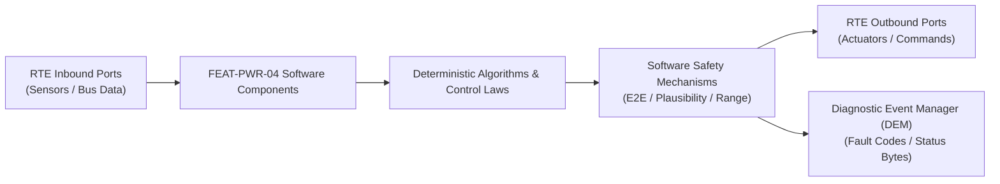

# Software Requirements Specification: Thermal Management & Heat Pump System (TMS)
**Feature ID:** `FEAT-PWR-04`  
**Domain:** Electric Powertrain & Energy Management  
**Target ASIL:** ASIL B  
**Compliance Standard:** ISO 26262:2018 (Part 6 - Software Development) / ASPICE PAM v3.1 (SWE.1, SWE.2)  
**Parent System Specification:** [`FEAT-PWR-04_TMS_SysReq.md`](file:///c:/Workset/AntiGravityProjects/TestOptimisationExperiement/system_requirements/FEAT-PWR-04_TMS_SysReq.md)  
**Global Master Specification:** [`spec.md`](file:///c:/Workset/AntiGravityProjects/TestOptimisationExperiement/spec.md)

---

## 1. Software Architecture & Component Structure

This document specifies the AUTOSAR Software Components (SWCs), periodic runnables, algorithmic laws, safety mechanisms, and data ports implementing `FEAT-PWR-04` (Thermal Management & Heat Pump System (TMS)).

### AUTOSAR SWC Interaction Diagram

---

## 2. Detailed Software Requirements (SWR_REQ)
*(Multi-Software Requirement Partitioning derived from System Requirements)*

### `SWR-PWR-04-01`: Battery Thermal Model Predictive Controller (MPC)
- **Planned Release:** R100
- **ASIL Rating:** ASIL B
- **Parent System Requirement:** [`SYS-PWR-04-01`](file:///c:/Workset/AntiGravityProjects/TestOptimisationExperiement/system_requirements/FEAT-PWR-04_TMS_SysReq.md#sys-pwr-04-01)
- **Allocated AUTOSAR SWC:** `TmsBatteryThermal_SWC`
- **Execution Rate / Trigger:** 100 ms
- **Worst-Case Execution Time (WCET):** 6.5 ms
- **Software Activation Condition:** Executed every 100 ms.
- **Algorithmic Description / Logic:**
  > Predicts pack temperature trajectory using thermal model: C_th * dT/dt = Q_joule(I_pack) - (T_pack - T_coolant)/R_th. Solves MPC optimizing coolant flow rate and chiller compressor speed.
- **Software Safety Mechanism:** Preconditioning limit: Target temp set to 30°C before arrival at DC fast charger.
- **Failure Reaction & DEM Diagnostic Event:** Fallback to PID feedback control if MPC optimizer fails to converge.
- **Software Port Inputs:** `Pack_Current_A, Cell_Temperatures_Array, Coolant_Inlet_Temp_C`
- **Software Port Outputs:** `Target_Coolant_Flow_Lpm, Requested_Chiller_Capacity_kW`
- **Software Verification Criteria:** SIL thermal validation against experimental pack bench data.
- **Traceability Link:** Traces upward to [`SYS-PWR-04-01`](file:///c:/Workset/AntiGravityProjects/TestOptimisationExperiement/system_requirements/FEAT-PWR-04_TMS_SysReq.md#sys-pwr-04-01) and [`FEAT-PWR-04`](file:///c:/Workset/AntiGravityProjects/TestOptimisationExperiement/spec.md).

### `SWR-PWR-04-02`: Multi-Way Coolant Valve Actuator Stepper Servocontrol
- **Planned Release:** R100
- **ASIL Rating:** ASIL B
- **Parent System Requirement:** [`SYS-PWR-04-01`](file:///c:/Workset/AntiGravityProjects/TestOptimisationExperiement/system_requirements/FEAT-PWR-04_TMS_SysReq.md#sys-pwr-04-01)
- **Allocated AUTOSAR SWC:** `TmsValveController_SWC`
- **Execution Rate / Trigger:** 50 ms
- **Worst-Case Execution Time (WCET):** 1.2 ms
- **Software Activation Condition:** Executed every 50 ms.
- **Algorithmic Description / Logic:**
  > Translates requested hydraulic flow mode into discrete rotary valve angles [MODE_PARALLEL: 0 deg, MODE_SERIES: 72 deg, MODE_RADIATOR_BYPASS: 144 deg, MODE_CHILLER_ONLY: 216 deg].
- **Software Safety Mechanism:** Potentiometer feedback validation: Detect valve mechanical jamming in < 500 ms.
- **Failure Reaction & DEM Diagnostic Event:** If valve jams, cycle valve back and forth 3 times to dislodge debris.
- **Software Port Inputs:** `Coolant_Loop_Mode_Enum, Valve_Position_Feedback_Deg`
- **Software Port Outputs:** `Stepper_Motor_Step_Cmd, Valve_Jam_Alert (boolean)`
- **Software Verification Criteria:** Valve endurance test over 150,000 thermal transition cycles.
- **Traceability Link:** Traces upward to [`SYS-PWR-04-01`](file:///c:/Workset/AntiGravityProjects/TestOptimisationExperiement/system_requirements/FEAT-PWR-04_TMS_SysReq.md#sys-pwr-04-01) and [`FEAT-PWR-04`](file:///c:/Workset/AntiGravityProjects/TestOptimisationExperiement/spec.md).

### `SWR-PWR-04-03`: Heat Pump Refrigerant Cycle Thermodynamic Optimizer
- **Planned Release:** R100
- **ASIL Rating:** ASIL B
- **Parent System Requirement:** [`SYS-PWR-04-02`](file:///c:/Workset/AntiGravityProjects/TestOptimisationExperiement/system_requirements/FEAT-PWR-04_TMS_SysReq.md#sys-pwr-04-02)
- **Allocated AUTOSAR SWC:** `TmsHeatPump_SWC`
- **Execution Rate / Trigger:** 100 ms
- **Worst-Case Execution Time (WCET):** 4.8 ms
- **Software Activation Condition:** Executed every 100 ms when cabin heat is active.
- **Algorithmic Description / Logic:**
  > Regulates electric scroll compressor RPM and electronic expansion valve (EXV) superheat to target Delta_T_sh = 5 K. Maximizes coefficient of performance (COP = Q_heat / W_electric).
- **Software Safety Mechanism:** High-pressure safety cutoff: Disengage compressor if P_refrig > 31.5 bar.
- **Failure Reaction & DEM Diagnostic Event:** Seamlessly enable auxiliary PTC heating if heat pump de-ices.
- **Software Port Inputs:** `Refrigerant_High_Pressure_Bar, Refrigerant_Evaporator_Temp, Cabin_Temp_Error`
- **Software Port Outputs:** `Compressor_Speed_RPM (uint16), EXV_Position_Steps (uint16)`
- **Software Verification Criteria:** Psychrometric chamber thermal test under sub-zero ambient conditions.
- **Traceability Link:** Traces upward to [`SYS-PWR-04-02`](file:///c:/Workset/AntiGravityProjects/TestOptimisationExperiement/system_requirements/FEAT-PWR-04_TMS_SysReq.md#sys-pwr-04-02) and [`FEAT-PWR-04`](file:///c:/Workset/AntiGravityProjects/TestOptimisationExperiement/spec.md).

### `SWR-PWR-04-04`: High-Voltage PTC Heater Power Limiting & Interlock
- **Planned Release:** R100
- **ASIL Rating:** ASIL B
- **Parent System Requirement:** [`SYS-PWR-04-02`](file:///c:/Workset/AntiGravityProjects/TestOptimisationExperiement/system_requirements/FEAT-PWR-04_TMS_SysReq.md#sys-pwr-04-02)
- **Allocated AUTOSAR SWC:** `TmsPtcController_SWC`
- **Execution Rate / Trigger:** 50 ms
- **Worst-Case Execution Time (WCET):** 0.8 ms
- **Software Activation Condition:** Executed when auxiliary heating is commanded.
- **Algorithmic Description / Logic:**
  > Commands high-voltage PTC heater power between 0 and 7.0 kW via LIN PWM. Constrains ramp rate to <= 1.0 kW/s to prevent electrical grid voltage transients.
- **Software Safety Mechanism:** Dry-fire protection: Disallow PTC heater power if coolant flow rate < 3.0 L/min.
- **Failure Reaction & DEM Diagnostic Event:** Immediately open PTC high-voltage supply relay if overtemperature sensor trips.
- **Software Port Inputs:** `Requested_PTC_Power_kW, Coolant_Flow_Rate_Lpm, PTC_Internal_Temp_C`
- **Software Port Outputs:** `PTC_PWM_Duty_Cycle, PTC_HV_Relay_Cmd (boolean)`
- **Software Verification Criteria:** Dry-fire and flow-blockage fault injection safety tests.
- **Traceability Link:** Traces upward to [`SYS-PWR-04-02`](file:///c:/Workset/AntiGravityProjects/TestOptimisationExperiement/system_requirements/FEAT-PWR-04_TMS_SysReq.md#sys-pwr-04-02) and [`FEAT-PWR-04`](file:///c:/Workset/AntiGravityProjects/TestOptimisationExperiement/spec.md).

### `SWR-PWR-04-05`: Heat Pump Multi-Port Coolant Valve Position Servocontrol - Dynamic Observer & Signal Filter
- **Planned Release:** R100
- **ASIL Rating:** ASIL B
- **Parent System Requirement:** [`SYS-PWR-04-03`](file:///c:/Workset/AntiGravityProjects/TestOptimisationExperiement/system_requirements/FEAT-PWR-04_TMS_SysReq.md#sys-pwr-04-03)
- **Allocated AUTOSAR SWC:** `TmsCoolantValve_SWC`
- **Execution Rate / Trigger:** 20 ms
- **Worst-Case Execution Time (WCET):** 0.3 ms
- **Software Activation Condition:** Executed cyclically every 20 ms.
- **Algorithmic Description / Logic:**
  > Executes signal plausibility filtering, calibration offsets, and discrete state estimation for Heat Pump Multi-Port Coolant Valve Position Servocontrol.
- **Software Safety Mechanism:** Range limit plausibility check and E2E alive sequence verification.
- **Failure Reaction & DEM Diagnostic Event:** Set default fallback output and report DEM_EVENT_FEAT_PWR_04_ERR.
- **Software Port Inputs:** `Raw sensor ADC/SENT/SPI values and RTE bus inputs.`
- **Software Port Outputs:** `Filtered physical signals and validity status bitmasks.`
- **Software Verification Criteria:** Unit test and HiL software integration test.
- **Traceability Link:** Traces upward to [`SYS-PWR-04-03`](file:///c:/Workset/AntiGravityProjects/TestOptimisationExperiement/system_requirements/FEAT-PWR-04_TMS_SysReq.md#sys-pwr-04-03) and [`FEAT-PWR-04`](file:///c:/Workset/AntiGravityProjects/TestOptimisationExperiement/spec.md).

### `SWR-PWR-04-06`: Heat Pump Multi-Port Coolant Valve Position Servocontrol - Closed-Loop Control Law & Actuator Dispatch
- **Planned Release:** R100
- **ASIL Rating:** ASIL B
- **Parent System Requirement:** [`SYS-PWR-04-03`](file:///c:/Workset/AntiGravityProjects/TestOptimisationExperiement/system_requirements/FEAT-PWR-04_TMS_SysReq.md#sys-pwr-04-03)
- **Allocated AUTOSAR SWC:** `TmsCoolantValve_SWC`
- **Execution Rate / Trigger:** 20 ms
- **Worst-Case Execution Time (WCET):** 0.4 ms
- **Software Activation Condition:** Executed cyclically every 20 ms.
- **Algorithmic Description / Logic:**
  > Evaluates deterministic closed-loop control law, rate limits, and dispatches commands for Heat Pump Multi-Port Coolant Valve Position Servocontrol.
- **Software Safety Mechanism:** Command saturation clamping and watchdog program flow monitoring.
- **Failure Reaction & DEM Diagnostic Event:** De-energize actuator output, apply safe fallback clamp, and latch DTC.
- **Software Port Inputs:** `Validated physical state signals from observer SWC.`
- **Software Port Outputs:** `Actuator PWM duty cycles, torque/pressure setpoints, and diagnostic flags.`
- **Software Verification Criteria:** Hardware dynamometer and HiL closed-loop regression test suite.
- **Traceability Link:** Traces upward to [`SYS-PWR-04-03`](file:///c:/Workset/AntiGravityProjects/TestOptimisationExperiement/system_requirements/FEAT-PWR-04_TMS_SysReq.md#sys-pwr-04-03) and [`FEAT-PWR-04`](file:///c:/Workset/AntiGravityProjects/TestOptimisationExperiement/spec.md).

### `SWR-PWR-04-07`: Electric Scroll AC Compressor High-Voltage Inverter Speed Governor - Dynamic Observer & Signal Filter
- **Planned Release:** R200
- **ASIL Rating:** ASIL B
- **Parent System Requirement:** [`SYS-PWR-04-04`](file:///c:/Workset/AntiGravityProjects/TestOptimisationExperiement/system_requirements/FEAT-PWR-04_TMS_SysReq.md#sys-pwr-04-04)
- **Allocated AUTOSAR SWC:** `TmsCompressorGovernor_SWC`
- **Execution Rate / Trigger:** 50 ms
- **Worst-Case Execution Time (WCET):** 0.3 ms
- **Software Activation Condition:** Executed cyclically every 50 ms.
- **Algorithmic Description / Logic:**
  > Executes signal plausibility filtering, calibration offsets, and discrete state estimation for Electric Scroll AC Compressor High-Voltage Inverter Speed Governor.
- **Software Safety Mechanism:** Range limit plausibility check and E2E alive sequence verification.
- **Failure Reaction & DEM Diagnostic Event:** Set default fallback output and report DEM_EVENT_FEAT_PWR_04_ERR.
- **Software Port Inputs:** `Raw sensor ADC/SENT/SPI values and RTE bus inputs.`
- **Software Port Outputs:** `Filtered physical signals and validity status bitmasks.`
- **Software Verification Criteria:** Unit test and HiL software integration test.
- **Traceability Link:** Traces upward to [`SYS-PWR-04-04`](file:///c:/Workset/AntiGravityProjects/TestOptimisationExperiement/system_requirements/FEAT-PWR-04_TMS_SysReq.md#sys-pwr-04-04) and [`FEAT-PWR-04`](file:///c:/Workset/AntiGravityProjects/TestOptimisationExperiement/spec.md).

### `SWR-PWR-04-08`: Electric Scroll AC Compressor High-Voltage Inverter Speed Governor - Closed-Loop Control Law & Actuator Dispatch
- **Planned Release:** R200
- **ASIL Rating:** ASIL B
- **Parent System Requirement:** [`SYS-PWR-04-04`](file:///c:/Workset/AntiGravityProjects/TestOptimisationExperiement/system_requirements/FEAT-PWR-04_TMS_SysReq.md#sys-pwr-04-04)
- **Allocated AUTOSAR SWC:** `TmsCompressorGovernor_SWC`
- **Execution Rate / Trigger:** 50 ms
- **Worst-Case Execution Time (WCET):** 0.4 ms
- **Software Activation Condition:** Executed cyclically every 50 ms.
- **Algorithmic Description / Logic:**
  > Evaluates deterministic closed-loop control law, rate limits, and dispatches commands for Electric Scroll AC Compressor High-Voltage Inverter Speed Governor.
- **Software Safety Mechanism:** Command saturation clamping and watchdog program flow monitoring.
- **Failure Reaction & DEM Diagnostic Event:** De-energize actuator output, apply safe fallback clamp, and latch DTC.
- **Software Port Inputs:** `Validated physical state signals from observer SWC.`
- **Software Port Outputs:** `Actuator PWM duty cycles, torque/pressure setpoints, and diagnostic flags.`
- **Software Verification Criteria:** Hardware dynamometer and HiL closed-loop regression test suite.
- **Traceability Link:** Traces upward to [`SYS-PWR-04-04`](file:///c:/Workset/AntiGravityProjects/TestOptimisationExperiement/system_requirements/FEAT-PWR-04_TMS_SysReq.md#sys-pwr-04-04) and [`FEAT-PWR-04`](file:///c:/Workset/AntiGravityProjects/TestOptimisationExperiement/spec.md).

### `SWR-PWR-04-09`: Battery Pack Liquid Chiller Heat Exchanger Thermal Regulator - Dynamic Observer & Signal Filter
- **Planned Release:** R200
- **ASIL Rating:** ASIL B
- **Parent System Requirement:** [`SYS-PWR-04-05`](file:///c:/Workset/AntiGravityProjects/TestOptimisationExperiement/system_requirements/FEAT-PWR-04_TMS_SysReq.md#sys-pwr-04-05)
- **Allocated AUTOSAR SWC:** `TmsBatteryChiller_SWC`
- **Execution Rate / Trigger:** 50 ms
- **Worst-Case Execution Time (WCET):** 0.3 ms
- **Software Activation Condition:** Executed cyclically every 50 ms.
- **Algorithmic Description / Logic:**
  > Executes signal plausibility filtering, calibration offsets, and discrete state estimation for Battery Pack Liquid Chiller Heat Exchanger Thermal Regulator.
- **Software Safety Mechanism:** Range limit plausibility check and E2E alive sequence verification.
- **Failure Reaction & DEM Diagnostic Event:** Set default fallback output and report DEM_EVENT_FEAT_PWR_04_ERR.
- **Software Port Inputs:** `Raw sensor ADC/SENT/SPI values and RTE bus inputs.`
- **Software Port Outputs:** `Filtered physical signals and validity status bitmasks.`
- **Software Verification Criteria:** Unit test and HiL software integration test.
- **Traceability Link:** Traces upward to [`SYS-PWR-04-05`](file:///c:/Workset/AntiGravityProjects/TestOptimisationExperiement/system_requirements/FEAT-PWR-04_TMS_SysReq.md#sys-pwr-04-05) and [`FEAT-PWR-04`](file:///c:/Workset/AntiGravityProjects/TestOptimisationExperiement/spec.md).

### `SWR-PWR-04-10`: Battery Pack Liquid Chiller Heat Exchanger Thermal Regulator - Closed-Loop Control Law & Actuator Dispatch
- **Planned Release:** R200
- **ASIL Rating:** ASIL B
- **Parent System Requirement:** [`SYS-PWR-04-05`](file:///c:/Workset/AntiGravityProjects/TestOptimisationExperiement/system_requirements/FEAT-PWR-04_TMS_SysReq.md#sys-pwr-04-05)
- **Allocated AUTOSAR SWC:** `TmsBatteryChiller_SWC`
- **Execution Rate / Trigger:** 50 ms
- **Worst-Case Execution Time (WCET):** 0.4 ms
- **Software Activation Condition:** Executed cyclically every 50 ms.
- **Algorithmic Description / Logic:**
  > Evaluates deterministic closed-loop control law, rate limits, and dispatches commands for Battery Pack Liquid Chiller Heat Exchanger Thermal Regulator.
- **Software Safety Mechanism:** Command saturation clamping and watchdog program flow monitoring.
- **Failure Reaction & DEM Diagnostic Event:** De-energize actuator output, apply safe fallback clamp, and latch DTC.
- **Software Port Inputs:** `Validated physical state signals from observer SWC.`
- **Software Port Outputs:** `Actuator PWM duty cycles, torque/pressure setpoints, and diagnostic flags.`
- **Software Verification Criteria:** Hardware dynamometer and HiL closed-loop regression test suite.
- **Traceability Link:** Traces upward to [`SYS-PWR-04-05`](file:///c:/Workset/AntiGravityProjects/TestOptimisationExperiement/system_requirements/FEAT-PWR-04_TMS_SysReq.md#sys-pwr-04-05) and [`FEAT-PWR-04`](file:///c:/Workset/AntiGravityProjects/TestOptimisationExperiement/spec.md).

### `SWR-PWR-04-11`: Traction Inverter & Motor Waste Heat Scavenging Recirculator - Dynamic Observer & Signal Filter
- **Planned Release:** R200
- **ASIL Rating:** ASIL B
- **Parent System Requirement:** [`SYS-PWR-04-06`](file:///c:/Workset/AntiGravityProjects/TestOptimisationExperiement/system_requirements/FEAT-PWR-04_TMS_SysReq.md#sys-pwr-04-06)
- **Allocated AUTOSAR SWC:** `TmsWasteHeatScavenger_SWC`
- **Execution Rate / Trigger:** 50 ms
- **Worst-Case Execution Time (WCET):** 0.3 ms
- **Software Activation Condition:** Executed cyclically every 50 ms.
- **Algorithmic Description / Logic:**
  > Executes signal plausibility filtering, calibration offsets, and discrete state estimation for Traction Inverter & Motor Waste Heat Scavenging Recirculator.
- **Software Safety Mechanism:** Range limit plausibility check and E2E alive sequence verification.
- **Failure Reaction & DEM Diagnostic Event:** Set default fallback output and report DEM_EVENT_FEAT_PWR_04_ERR.
- **Software Port Inputs:** `Raw sensor ADC/SENT/SPI values and RTE bus inputs.`
- **Software Port Outputs:** `Filtered physical signals and validity status bitmasks.`
- **Software Verification Criteria:** Unit test and HiL software integration test.
- **Traceability Link:** Traces upward to [`SYS-PWR-04-06`](file:///c:/Workset/AntiGravityProjects/TestOptimisationExperiement/system_requirements/FEAT-PWR-04_TMS_SysReq.md#sys-pwr-04-06) and [`FEAT-PWR-04`](file:///c:/Workset/AntiGravityProjects/TestOptimisationExperiement/spec.md).

### `SWR-PWR-04-12`: Traction Inverter & Motor Waste Heat Scavenging Recirculator - Closed-Loop Control Law & Actuator Dispatch
- **Planned Release:** R200
- **ASIL Rating:** ASIL B
- **Parent System Requirement:** [`SYS-PWR-04-06`](file:///c:/Workset/AntiGravityProjects/TestOptimisationExperiement/system_requirements/FEAT-PWR-04_TMS_SysReq.md#sys-pwr-04-06)
- **Allocated AUTOSAR SWC:** `TmsWasteHeatScavenger_SWC`
- **Execution Rate / Trigger:** 50 ms
- **Worst-Case Execution Time (WCET):** 0.4 ms
- **Software Activation Condition:** Executed cyclically every 50 ms.
- **Algorithmic Description / Logic:**
  > Evaluates deterministic closed-loop control law, rate limits, and dispatches commands for Traction Inverter & Motor Waste Heat Scavenging Recirculator.
- **Software Safety Mechanism:** Command saturation clamping and watchdog program flow monitoring.
- **Failure Reaction & DEM Diagnostic Event:** De-energize actuator output, apply safe fallback clamp, and latch DTC.
- **Software Port Inputs:** `Validated physical state signals from observer SWC.`
- **Software Port Outputs:** `Actuator PWM duty cycles, torque/pressure setpoints, and diagnostic flags.`
- **Software Verification Criteria:** Hardware dynamometer and HiL closed-loop regression test suite.
- **Traceability Link:** Traces upward to [`SYS-PWR-04-06`](file:///c:/Workset/AntiGravityProjects/TestOptimisationExperiement/system_requirements/FEAT-PWR-04_TMS_SysReq.md#sys-pwr-04-06) and [`FEAT-PWR-04`](file:///c:/Workset/AntiGravityProjects/TestOptimisationExperiement/spec.md).

### `SWR-PWR-04-13`: Cabin Evaporator Anti-Frost & Electronic Expansion Valve (EXV) Controller - Dynamic Observer & Signal Filter
- **Planned Release:** R300
- **ASIL Rating:** ASIL B
- **Parent System Requirement:** [`SYS-PWR-04-07`](file:///c:/Workset/AntiGravityProjects/TestOptimisationExperiement/system_requirements/FEAT-PWR-04_TMS_SysReq.md#sys-pwr-04-07)
- **Allocated AUTOSAR SWC:** `TmsExvController_SWC`
- **Execution Rate / Trigger:** 20 ms
- **Worst-Case Execution Time (WCET):** 0.3 ms
- **Software Activation Condition:** Executed cyclically every 20 ms.
- **Algorithmic Description / Logic:**
  > Executes signal plausibility filtering, calibration offsets, and discrete state estimation for Cabin Evaporator Anti-Frost & Electronic Expansion Valve (EXV) Controller.
- **Software Safety Mechanism:** Range limit plausibility check and E2E alive sequence verification.
- **Failure Reaction & DEM Diagnostic Event:** Set default fallback output and report DEM_EVENT_FEAT_PWR_04_ERR.
- **Software Port Inputs:** `Raw sensor ADC/SENT/SPI values and RTE bus inputs.`
- **Software Port Outputs:** `Filtered physical signals and validity status bitmasks.`
- **Software Verification Criteria:** Unit test and HiL software integration test.
- **Traceability Link:** Traces upward to [`SYS-PWR-04-07`](file:///c:/Workset/AntiGravityProjects/TestOptimisationExperiement/system_requirements/FEAT-PWR-04_TMS_SysReq.md#sys-pwr-04-07) and [`FEAT-PWR-04`](file:///c:/Workset/AntiGravityProjects/TestOptimisationExperiement/spec.md).

### `SWR-PWR-04-14`: Cabin Evaporator Anti-Frost & Electronic Expansion Valve (EXV) Controller - Closed-Loop Control Law & Actuator Dispatch
- **Planned Release:** R300
- **ASIL Rating:** ASIL B
- **Parent System Requirement:** [`SYS-PWR-04-07`](file:///c:/Workset/AntiGravityProjects/TestOptimisationExperiement/system_requirements/FEAT-PWR-04_TMS_SysReq.md#sys-pwr-04-07)
- **Allocated AUTOSAR SWC:** `TmsExvController_SWC`
- **Execution Rate / Trigger:** 20 ms
- **Worst-Case Execution Time (WCET):** 0.4 ms
- **Software Activation Condition:** Executed cyclically every 20 ms.
- **Algorithmic Description / Logic:**
  > Evaluates deterministic closed-loop control law, rate limits, and dispatches commands for Cabin Evaporator Anti-Frost & Electronic Expansion Valve (EXV) Controller.
- **Software Safety Mechanism:** Command saturation clamping and watchdog program flow monitoring.
- **Failure Reaction & DEM Diagnostic Event:** De-energize actuator output, apply safe fallback clamp, and latch DTC.
- **Software Port Inputs:** `Validated physical state signals from observer SWC.`
- **Software Port Outputs:** `Actuator PWM duty cycles, torque/pressure setpoints, and diagnostic flags.`
- **Software Verification Criteria:** Hardware dynamometer and HiL closed-loop regression test suite.
- **Traceability Link:** Traces upward to [`SYS-PWR-04-07`](file:///c:/Workset/AntiGravityProjects/TestOptimisationExperiement/system_requirements/FEAT-PWR-04_TMS_SysReq.md#sys-pwr-04-07) and [`FEAT-PWR-04`](file:///c:/Workset/AntiGravityProjects/TestOptimisationExperiement/spec.md).

### `SWR-PWR-04-15`: High-Voltage Positive Temperature Coefficient (PTC) Cabin Heater Driver - Dynamic Observer & Signal Filter
- **Planned Release:** R300
- **ASIL Rating:** ASIL B
- **Parent System Requirement:** [`SYS-PWR-04-08`](file:///c:/Workset/AntiGravityProjects/TestOptimisationExperiement/system_requirements/FEAT-PWR-04_TMS_SysReq.md#sys-pwr-04-08)
- **Allocated AUTOSAR SWC:** `TmsPtcHeaterDriver_SWC`
- **Execution Rate / Trigger:** 50 ms
- **Worst-Case Execution Time (WCET):** 0.3 ms
- **Software Activation Condition:** Executed cyclically every 50 ms.
- **Algorithmic Description / Logic:**
  > Executes signal plausibility filtering, calibration offsets, and discrete state estimation for High-Voltage Positive Temperature Coefficient (PTC) Cabin Heater Driver.
- **Software Safety Mechanism:** Range limit plausibility check and E2E alive sequence verification.
- **Failure Reaction & DEM Diagnostic Event:** Set default fallback output and report DEM_EVENT_FEAT_PWR_04_ERR.
- **Software Port Inputs:** `Raw sensor ADC/SENT/SPI values and RTE bus inputs.`
- **Software Port Outputs:** `Filtered physical signals and validity status bitmasks.`
- **Software Verification Criteria:** Unit test and HiL software integration test.
- **Traceability Link:** Traces upward to [`SYS-PWR-04-08`](file:///c:/Workset/AntiGravityProjects/TestOptimisationExperiement/system_requirements/FEAT-PWR-04_TMS_SysReq.md#sys-pwr-04-08) and [`FEAT-PWR-04`](file:///c:/Workset/AntiGravityProjects/TestOptimisationExperiement/spec.md).

### `SWR-PWR-04-16`: High-Voltage Positive Temperature Coefficient (PTC) Cabin Heater Driver - Closed-Loop Control Law & Actuator Dispatch
- **Planned Release:** R300
- **ASIL Rating:** ASIL B
- **Parent System Requirement:** [`SYS-PWR-04-08`](file:///c:/Workset/AntiGravityProjects/TestOptimisationExperiement/system_requirements/FEAT-PWR-04_TMS_SysReq.md#sys-pwr-04-08)
- **Allocated AUTOSAR SWC:** `TmsPtcHeaterDriver_SWC`
- **Execution Rate / Trigger:** 50 ms
- **Worst-Case Execution Time (WCET):** 0.4 ms
- **Software Activation Condition:** Executed cyclically every 50 ms.
- **Algorithmic Description / Logic:**
  > Evaluates deterministic closed-loop control law, rate limits, and dispatches commands for High-Voltage Positive Temperature Coefficient (PTC) Cabin Heater Driver.
- **Software Safety Mechanism:** Command saturation clamping and watchdog program flow monitoring.
- **Failure Reaction & DEM Diagnostic Event:** De-energize actuator output, apply safe fallback clamp, and latch DTC.
- **Software Port Inputs:** `Validated physical state signals from observer SWC.`
- **Software Port Outputs:** `Actuator PWM duty cycles, torque/pressure setpoints, and diagnostic flags.`
- **Software Verification Criteria:** Hardware dynamometer and HiL closed-loop regression test suite.
- **Traceability Link:** Traces upward to [`SYS-PWR-04-08`](file:///c:/Workset/AntiGravityProjects/TestOptimisationExperiement/system_requirements/FEAT-PWR-04_TMS_SysReq.md#sys-pwr-04-08) and [`FEAT-PWR-04`](file:///c:/Workset/AntiGravityProjects/TestOptimisationExperiement/spec.md).

### `SWR-PWR-04-17`: Refrigerant Circuit High/Low Pressure Transducer Plausibility Monitor - Dynamic Observer & Signal Filter
- **Planned Release:** R300
- **ASIL Rating:** ASIL B
- **Parent System Requirement:** [`SYS-PWR-04-09`](file:///c:/Workset/AntiGravityProjects/TestOptimisationExperiement/system_requirements/FEAT-PWR-04_TMS_SysReq.md#sys-pwr-04-09)
- **Allocated AUTOSAR SWC:** `TmsPressureMonitor_SWC`
- **Execution Rate / Trigger:** 20 ms
- **Worst-Case Execution Time (WCET):** 0.3 ms
- **Software Activation Condition:** Executed cyclically every 20 ms.
- **Algorithmic Description / Logic:**
  > Executes signal plausibility filtering, calibration offsets, and discrete state estimation for Refrigerant Circuit High/Low Pressure Transducer Plausibility Monitor.
- **Software Safety Mechanism:** Range limit plausibility check and E2E alive sequence verification.
- **Failure Reaction & DEM Diagnostic Event:** Set default fallback output and report DEM_EVENT_FEAT_PWR_04_ERR.
- **Software Port Inputs:** `Raw sensor ADC/SENT/SPI values and RTE bus inputs.`
- **Software Port Outputs:** `Filtered physical signals and validity status bitmasks.`
- **Software Verification Criteria:** Unit test and HiL software integration test.
- **Traceability Link:** Traces upward to [`SYS-PWR-04-09`](file:///c:/Workset/AntiGravityProjects/TestOptimisationExperiement/system_requirements/FEAT-PWR-04_TMS_SysReq.md#sys-pwr-04-09) and [`FEAT-PWR-04`](file:///c:/Workset/AntiGravityProjects/TestOptimisationExperiement/spec.md).

### `SWR-PWR-04-18`: Refrigerant Circuit High/Low Pressure Transducer Plausibility Monitor - Closed-Loop Control Law & Actuator Dispatch
- **Planned Release:** R300
- **ASIL Rating:** ASIL B
- **Parent System Requirement:** [`SYS-PWR-04-09`](file:///c:/Workset/AntiGravityProjects/TestOptimisationExperiement/system_requirements/FEAT-PWR-04_TMS_SysReq.md#sys-pwr-04-09)
- **Allocated AUTOSAR SWC:** `TmsPressureMonitor_SWC`
- **Execution Rate / Trigger:** 20 ms
- **Worst-Case Execution Time (WCET):** 0.4 ms
- **Software Activation Condition:** Executed cyclically every 20 ms.
- **Algorithmic Description / Logic:**
  > Evaluates deterministic closed-loop control law, rate limits, and dispatches commands for Refrigerant Circuit High/Low Pressure Transducer Plausibility Monitor.
- **Software Safety Mechanism:** Command saturation clamping and watchdog program flow monitoring.
- **Failure Reaction & DEM Diagnostic Event:** De-energize actuator output, apply safe fallback clamp, and latch DTC.
- **Software Port Inputs:** `Validated physical state signals from observer SWC.`
- **Software Port Outputs:** `Actuator PWM duty cycles, torque/pressure setpoints, and diagnostic flags.`
- **Software Verification Criteria:** Hardware dynamometer and HiL closed-loop regression test suite.
- **Traceability Link:** Traces upward to [`SYS-PWR-04-09`](file:///c:/Workset/AntiGravityProjects/TestOptimisationExperiement/system_requirements/FEAT-PWR-04_TMS_SysReq.md#sys-pwr-04-09) and [`FEAT-PWR-04`](file:///c:/Workset/AntiGravityProjects/TestOptimisationExperiement/spec.md).

### `SWR-PWR-04-19`: Radiator Active Grille Shutter (AGS) Aerodynamic Drag Optimizer - Dynamic Observer & Signal Filter
- **Planned Release:** R500
- **ASIL Rating:** ASIL B
- **Parent System Requirement:** [`SYS-PWR-04-10`](file:///c:/Workset/AntiGravityProjects/TestOptimisationExperiement/system_requirements/FEAT-PWR-04_TMS_SysReq.md#sys-pwr-04-10)
- **Allocated AUTOSAR SWC:** `TmsAgsController_SWC`
- **Execution Rate / Trigger:** 100 ms
- **Worst-Case Execution Time (WCET):** 0.3 ms
- **Software Activation Condition:** Executed cyclically every 100 ms.
- **Algorithmic Description / Logic:**
  > Executes signal plausibility filtering, calibration offsets, and discrete state estimation for Radiator Active Grille Shutter (AGS) Aerodynamic Drag Optimizer.
- **Software Safety Mechanism:** Range limit plausibility check and E2E alive sequence verification.
- **Failure Reaction & DEM Diagnostic Event:** Set default fallback output and report DEM_EVENT_FEAT_PWR_04_ERR.
- **Software Port Inputs:** `Raw sensor ADC/SENT/SPI values and RTE bus inputs.`
- **Software Port Outputs:** `Filtered physical signals and validity status bitmasks.`
- **Software Verification Criteria:** Unit test and HiL software integration test.
- **Traceability Link:** Traces upward to [`SYS-PWR-04-10`](file:///c:/Workset/AntiGravityProjects/TestOptimisationExperiement/system_requirements/FEAT-PWR-04_TMS_SysReq.md#sys-pwr-04-10) and [`FEAT-PWR-04`](file:///c:/Workset/AntiGravityProjects/TestOptimisationExperiement/spec.md).

### `SWR-PWR-04-20`: Radiator Active Grille Shutter (AGS) Aerodynamic Drag Optimizer - Closed-Loop Control Law & Actuator Dispatch
- **Planned Release:** R500
- **ASIL Rating:** ASIL B
- **Parent System Requirement:** [`SYS-PWR-04-10`](file:///c:/Workset/AntiGravityProjects/TestOptimisationExperiement/system_requirements/FEAT-PWR-04_TMS_SysReq.md#sys-pwr-04-10)
- **Allocated AUTOSAR SWC:** `TmsAgsController_SWC`
- **Execution Rate / Trigger:** 100 ms
- **Worst-Case Execution Time (WCET):** 0.4 ms
- **Software Activation Condition:** Executed cyclically every 100 ms.
- **Algorithmic Description / Logic:**
  > Evaluates deterministic closed-loop control law, rate limits, and dispatches commands for Radiator Active Grille Shutter (AGS) Aerodynamic Drag Optimizer.
- **Software Safety Mechanism:** Command saturation clamping and watchdog program flow monitoring.
- **Failure Reaction & DEM Diagnostic Event:** De-energize actuator output, apply safe fallback clamp, and latch DTC.
- **Software Port Inputs:** `Validated physical state signals from observer SWC.`
- **Software Port Outputs:** `Actuator PWM duty cycles, torque/pressure setpoints, and diagnostic flags.`
- **Software Verification Criteria:** Hardware dynamometer and HiL closed-loop regression test suite.
- **Traceability Link:** Traces upward to [`SYS-PWR-04-10`](file:///c:/Workset/AntiGravityProjects/TestOptimisationExperiement/system_requirements/FEAT-PWR-04_TMS_SysReq.md#sys-pwr-04-10) and [`FEAT-PWR-04`](file:///c:/Workset/AntiGravityProjects/TestOptimisationExperiement/spec.md).

### `SWR-PWR-04-21`: Coolant Loop Degas Reservoir Fluid Level Sensor Debouncer - Dynamic Observer & Signal Filter
- **Planned Release:** R400
- **ASIL Rating:** ASIL B
- **Parent System Requirement:** [`SYS-PWR-04-11`](file:///c:/Workset/AntiGravityProjects/TestOptimisationExperiement/system_requirements/FEAT-PWR-04_TMS_SysReq.md#sys-pwr-04-11)
- **Allocated AUTOSAR SWC:** `TmsLevelMonitor_SWC`
- **Execution Rate / Trigger:** 200 ms
- **Worst-Case Execution Time (WCET):** 0.3 ms
- **Software Activation Condition:** Executed cyclically every 200 ms.
- **Algorithmic Description / Logic:**
  > Executes signal plausibility filtering, calibration offsets, and discrete state estimation for Coolant Loop Degas Reservoir Fluid Level Sensor Debouncer.
- **Software Safety Mechanism:** Range limit plausibility check and E2E alive sequence verification.
- **Failure Reaction & DEM Diagnostic Event:** Set default fallback output and report DEM_EVENT_FEAT_PWR_04_ERR.
- **Software Port Inputs:** `Raw sensor ADC/SENT/SPI values and RTE bus inputs.`
- **Software Port Outputs:** `Filtered physical signals and validity status bitmasks.`
- **Software Verification Criteria:** Unit test and HiL software integration test.
- **Traceability Link:** Traces upward to [`SYS-PWR-04-11`](file:///c:/Workset/AntiGravityProjects/TestOptimisationExperiement/system_requirements/FEAT-PWR-04_TMS_SysReq.md#sys-pwr-04-11) and [`FEAT-PWR-04`](file:///c:/Workset/AntiGravityProjects/TestOptimisationExperiement/spec.md).

### `SWR-PWR-04-22`: Coolant Loop Degas Reservoir Fluid Level Sensor Debouncer - Closed-Loop Control Law & Actuator Dispatch
- **Planned Release:** R400
- **ASIL Rating:** ASIL B
- **Parent System Requirement:** [`SYS-PWR-04-11`](file:///c:/Workset/AntiGravityProjects/TestOptimisationExperiement/system_requirements/FEAT-PWR-04_TMS_SysReq.md#sys-pwr-04-11)
- **Allocated AUTOSAR SWC:** `TmsLevelMonitor_SWC`
- **Execution Rate / Trigger:** 200 ms
- **Worst-Case Execution Time (WCET):** 0.4 ms
- **Software Activation Condition:** Executed cyclically every 200 ms.
- **Algorithmic Description / Logic:**
  > Evaluates deterministic closed-loop control law, rate limits, and dispatches commands for Coolant Loop Degas Reservoir Fluid Level Sensor Debouncer.
- **Software Safety Mechanism:** Command saturation clamping and watchdog program flow monitoring.
- **Failure Reaction & DEM Diagnostic Event:** De-energize actuator output, apply safe fallback clamp, and latch DTC.
- **Software Port Inputs:** `Validated physical state signals from observer SWC.`
- **Software Port Outputs:** `Actuator PWM duty cycles, torque/pressure setpoints, and diagnostic flags.`
- **Software Verification Criteria:** Hardware dynamometer and HiL closed-loop regression test suite.
- **Traceability Link:** Traces upward to [`SYS-PWR-04-11`](file:///c:/Workset/AntiGravityProjects/TestOptimisationExperiement/system_requirements/FEAT-PWR-04_TMS_SysReq.md#sys-pwr-04-11) and [`FEAT-PWR-04`](file:///c:/Workset/AntiGravityProjects/TestOptimisationExperiement/spec.md).

### `SWR-PWR-04-23`: Sub-Zero Ambient Battery Preconditioning Target Thermal Scheduler - Dynamic Observer & Signal Filter
- **Planned Release:** R400
- **ASIL Rating:** ASIL B
- **Parent System Requirement:** [`SYS-PWR-04-12`](file:///c:/Workset/AntiGravityProjects/TestOptimisationExperiement/system_requirements/FEAT-PWR-04_TMS_SysReq.md#sys-pwr-04-12)
- **Allocated AUTOSAR SWC:** `TmsPreconditioning_SWC`
- **Execution Rate / Trigger:** 500 ms
- **Worst-Case Execution Time (WCET):** 0.3 ms
- **Software Activation Condition:** Executed cyclically every 500 ms.
- **Algorithmic Description / Logic:**
  > Executes signal plausibility filtering, calibration offsets, and discrete state estimation for Sub-Zero Ambient Battery Preconditioning Target Thermal Scheduler.
- **Software Safety Mechanism:** Range limit plausibility check and E2E alive sequence verification.
- **Failure Reaction & DEM Diagnostic Event:** Set default fallback output and report DEM_EVENT_FEAT_PWR_04_ERR.
- **Software Port Inputs:** `Raw sensor ADC/SENT/SPI values and RTE bus inputs.`
- **Software Port Outputs:** `Filtered physical signals and validity status bitmasks.`
- **Software Verification Criteria:** Unit test and HiL software integration test.
- **Traceability Link:** Traces upward to [`SYS-PWR-04-12`](file:///c:/Workset/AntiGravityProjects/TestOptimisationExperiement/system_requirements/FEAT-PWR-04_TMS_SysReq.md#sys-pwr-04-12) and [`FEAT-PWR-04`](file:///c:/Workset/AntiGravityProjects/TestOptimisationExperiement/spec.md).

### `SWR-PWR-04-24`: Sub-Zero Ambient Battery Preconditioning Target Thermal Scheduler - Closed-Loop Control Law & Actuator Dispatch
- **Planned Release:** R400
- **ASIL Rating:** ASIL B
- **Parent System Requirement:** [`SYS-PWR-04-12`](file:///c:/Workset/AntiGravityProjects/TestOptimisationExperiement/system_requirements/FEAT-PWR-04_TMS_SysReq.md#sys-pwr-04-12)
- **Allocated AUTOSAR SWC:** `TmsPreconditioning_SWC`
- **Execution Rate / Trigger:** 500 ms
- **Worst-Case Execution Time (WCET):** 0.4 ms
- **Software Activation Condition:** Executed cyclically every 500 ms.
- **Algorithmic Description / Logic:**
  > Evaluates deterministic closed-loop control law, rate limits, and dispatches commands for Sub-Zero Ambient Battery Preconditioning Target Thermal Scheduler.
- **Software Safety Mechanism:** Command saturation clamping and watchdog program flow monitoring.
- **Failure Reaction & DEM Diagnostic Event:** De-energize actuator output, apply safe fallback clamp, and latch DTC.
- **Software Port Inputs:** `Validated physical state signals from observer SWC.`
- **Software Port Outputs:** `Actuator PWM duty cycles, torque/pressure setpoints, and diagnostic flags.`
- **Software Verification Criteria:** Hardware dynamometer and HiL closed-loop regression test suite.
- **Traceability Link:** Traces upward to [`SYS-PWR-04-12`](file:///c:/Workset/AntiGravityProjects/TestOptimisationExperiement/system_requirements/FEAT-PWR-04_TMS_SysReq.md#sys-pwr-04-12) and [`FEAT-PWR-04`](file:///c:/Workset/AntiGravityProjects/TestOptimisationExperiement/spec.md).

### `SWR-PWR-04-25`: Thermal System Sensor Diagnostic Event Management & DTC Latching - Dynamic Observer & Signal Filter
- **Planned Release:** R500
- **ASIL Rating:** ASIL B
- **Parent System Requirement:** [`SYS-PWR-04-13`](file:///c:/Workset/AntiGravityProjects/TestOptimisationExperiement/system_requirements/FEAT-PWR-04_TMS_SysReq.md#sys-pwr-04-13)
- **Allocated AUTOSAR SWC:** `TmsDiagnosticManager_SWC`
- **Execution Rate / Trigger:** 50 ms
- **Worst-Case Execution Time (WCET):** 0.3 ms
- **Software Activation Condition:** Executed cyclically every 50 ms.
- **Algorithmic Description / Logic:**
  > Executes signal plausibility filtering, calibration offsets, and discrete state estimation for Thermal System Sensor Diagnostic Event Management & DTC Latching.
- **Software Safety Mechanism:** Range limit plausibility check and E2E alive sequence verification.
- **Failure Reaction & DEM Diagnostic Event:** Set default fallback output and report DEM_EVENT_FEAT_PWR_04_ERR.
- **Software Port Inputs:** `Raw sensor ADC/SENT/SPI values and RTE bus inputs.`
- **Software Port Outputs:** `Filtered physical signals and validity status bitmasks.`
- **Software Verification Criteria:** Unit test and HiL software integration test.
- **Traceability Link:** Traces upward to [`SYS-PWR-04-13`](file:///c:/Workset/AntiGravityProjects/TestOptimisationExperiement/system_requirements/FEAT-PWR-04_TMS_SysReq.md#sys-pwr-04-13) and [`FEAT-PWR-04`](file:///c:/Workset/AntiGravityProjects/TestOptimisationExperiement/spec.md).

### `SWR-PWR-04-26`: Thermal System Sensor Diagnostic Event Management & DTC Latching - Closed-Loop Control Law & Actuator Dispatch
- **Planned Release:** R500
- **ASIL Rating:** ASIL B
- **Parent System Requirement:** [`SYS-PWR-04-13`](file:///c:/Workset/AntiGravityProjects/TestOptimisationExperiement/system_requirements/FEAT-PWR-04_TMS_SysReq.md#sys-pwr-04-13)
- **Allocated AUTOSAR SWC:** `TmsDiagnosticManager_SWC`
- **Execution Rate / Trigger:** 50 ms
- **Worst-Case Execution Time (WCET):** 0.4 ms
- **Software Activation Condition:** Executed cyclically every 50 ms.
- **Algorithmic Description / Logic:**
  > Evaluates deterministic closed-loop control law, rate limits, and dispatches commands for Thermal System Sensor Diagnostic Event Management & DTC Latching.
- **Software Safety Mechanism:** Command saturation clamping and watchdog program flow monitoring.
- **Failure Reaction & DEM Diagnostic Event:** De-energize actuator output, apply safe fallback clamp, and latch DTC.
- **Software Port Inputs:** `Validated physical state signals from observer SWC.`
- **Software Port Outputs:** `Actuator PWM duty cycles, torque/pressure setpoints, and diagnostic flags.`
- **Software Verification Criteria:** Hardware dynamometer and HiL closed-loop regression test suite.
- **Traceability Link:** Traces upward to [`SYS-PWR-04-13`](file:///c:/Workset/AntiGravityProjects/TestOptimisationExperiement/system_requirements/FEAT-PWR-04_TMS_SysReq.md#sys-pwr-04-13) and [`FEAT-PWR-04`](file:///c:/Workset/AntiGravityProjects/TestOptimisationExperiement/spec.md).

### `SWR-PWR-04-27`: Thermal Loop Power Budget Arbitration with Powertrain Energy Manager - Dynamic Observer & Signal Filter
- **Planned Release:** R500
- **ASIL Rating:** ASIL B
- **Parent System Requirement:** [`SYS-PWR-04-14`](file:///c:/Workset/AntiGravityProjects/TestOptimisationExperiement/system_requirements/FEAT-PWR-04_TMS_SysReq.md#sys-pwr-04-14)
- **Allocated AUTOSAR SWC:** `TmsPowerArbitrator_SWC`
- **Execution Rate / Trigger:** 50 ms
- **Worst-Case Execution Time (WCET):** 0.3 ms
- **Software Activation Condition:** Executed cyclically every 50 ms.
- **Algorithmic Description / Logic:**
  > Executes signal plausibility filtering, calibration offsets, and discrete state estimation for Thermal Loop Power Budget Arbitration with Powertrain Energy Manager.
- **Software Safety Mechanism:** Range limit plausibility check and E2E alive sequence verification.
- **Failure Reaction & DEM Diagnostic Event:** Set default fallback output and report DEM_EVENT_FEAT_PWR_04_ERR.
- **Software Port Inputs:** `Raw sensor ADC/SENT/SPI values and RTE bus inputs.`
- **Software Port Outputs:** `Filtered physical signals and validity status bitmasks.`
- **Software Verification Criteria:** Unit test and HiL software integration test.
- **Traceability Link:** Traces upward to [`SYS-PWR-04-14`](file:///c:/Workset/AntiGravityProjects/TestOptimisationExperiement/system_requirements/FEAT-PWR-04_TMS_SysReq.md#sys-pwr-04-14) and [`FEAT-PWR-04`](file:///c:/Workset/AntiGravityProjects/TestOptimisationExperiement/spec.md).

### `SWR-PWR-04-28`: Thermal Loop Power Budget Arbitration with Powertrain Energy Manager - Closed-Loop Control Law & Actuator Dispatch
- **Planned Release:** R500
- **ASIL Rating:** ASIL B
- **Parent System Requirement:** [`SYS-PWR-04-14`](file:///c:/Workset/AntiGravityProjects/TestOptimisationExperiement/system_requirements/FEAT-PWR-04_TMS_SysReq.md#sys-pwr-04-14)
- **Allocated AUTOSAR SWC:** `TmsPowerArbitrator_SWC`
- **Execution Rate / Trigger:** 50 ms
- **Worst-Case Execution Time (WCET):** 0.4 ms
- **Software Activation Condition:** Executed cyclically every 50 ms.
- **Algorithmic Description / Logic:**
  > Evaluates deterministic closed-loop control law, rate limits, and dispatches commands for Thermal Loop Power Budget Arbitration with Powertrain Energy Manager.
- **Software Safety Mechanism:** Command saturation clamping and watchdog program flow monitoring.
- **Failure Reaction & DEM Diagnostic Event:** De-energize actuator output, apply safe fallback clamp, and latch DTC.
- **Software Port Inputs:** `Validated physical state signals from observer SWC.`
- **Software Port Outputs:** `Actuator PWM duty cycles, torque/pressure setpoints, and diagnostic flags.`
- **Software Verification Criteria:** Hardware dynamometer and HiL closed-loop regression test suite.
- **Traceability Link:** Traces upward to [`SYS-PWR-04-14`](file:///c:/Workset/AntiGravityProjects/TestOptimisationExperiement/system_requirements/FEAT-PWR-04_TMS_SysReq.md#sys-pwr-04-14) and [`FEAT-PWR-04`](file:///c:/Workset/AntiGravityProjects/TestOptimisationExperiement/spec.md).

### `SWR-PWR-04-29`: Non-Volatile Thermal System Component Operating Hours Logger - Dynamic Observer & Signal Filter
- **Planned Release:** R500
- **ASIL Rating:** ASIL B
- **Parent System Requirement:** [`SYS-PWR-04-15`](file:///c:/Workset/AntiGravityProjects/TestOptimisationExperiement/system_requirements/FEAT-PWR-04_TMS_SysReq.md#sys-pwr-04-15)
- **Allocated AUTOSAR SWC:** `TmsDutyCycleLogger_SWC`
- **Execution Rate / Trigger:** 1000 ms
- **Worst-Case Execution Time (WCET):** 0.3 ms
- **Software Activation Condition:** Executed cyclically every 1000 ms.
- **Algorithmic Description / Logic:**
  > Executes signal plausibility filtering, calibration offsets, and discrete state estimation for Non-Volatile Thermal System Component Operating Hours Logger.
- **Software Safety Mechanism:** Range limit plausibility check and E2E alive sequence verification.
- **Failure Reaction & DEM Diagnostic Event:** Set default fallback output and report DEM_EVENT_FEAT_PWR_04_ERR.
- **Software Port Inputs:** `Raw sensor ADC/SENT/SPI values and RTE bus inputs.`
- **Software Port Outputs:** `Filtered physical signals and validity status bitmasks.`
- **Software Verification Criteria:** Unit test and HiL software integration test.
- **Traceability Link:** Traces upward to [`SYS-PWR-04-15`](file:///c:/Workset/AntiGravityProjects/TestOptimisationExperiement/system_requirements/FEAT-PWR-04_TMS_SysReq.md#sys-pwr-04-15) and [`FEAT-PWR-04`](file:///c:/Workset/AntiGravityProjects/TestOptimisationExperiement/spec.md).

### `SWR-PWR-04-30`: Non-Volatile Thermal System Component Operating Hours Logger - Closed-Loop Control Law & Actuator Dispatch
- **Planned Release:** R500
- **ASIL Rating:** ASIL B
- **Parent System Requirement:** [`SYS-PWR-04-15`](file:///c:/Workset/AntiGravityProjects/TestOptimisationExperiement/system_requirements/FEAT-PWR-04_TMS_SysReq.md#sys-pwr-04-15)
- **Allocated AUTOSAR SWC:** `TmsDutyCycleLogger_SWC`
- **Execution Rate / Trigger:** 1000 ms
- **Worst-Case Execution Time (WCET):** 0.4 ms
- **Software Activation Condition:** Executed cyclically every 1000 ms.
- **Algorithmic Description / Logic:**
  > Evaluates deterministic closed-loop control law, rate limits, and dispatches commands for Non-Volatile Thermal System Component Operating Hours Logger.
- **Software Safety Mechanism:** Command saturation clamping and watchdog program flow monitoring.
- **Failure Reaction & DEM Diagnostic Event:** De-energize actuator output, apply safe fallback clamp, and latch DTC.
- **Software Port Inputs:** `Validated physical state signals from observer SWC.`
- **Software Port Outputs:** `Actuator PWM duty cycles, torque/pressure setpoints, and diagnostic flags.`
- **Software Verification Criteria:** Hardware dynamometer and HiL closed-loop regression test suite.
- **Traceability Link:** Traces upward to [`SYS-PWR-04-15`](file:///c:/Workset/AntiGravityProjects/TestOptimisationExperiement/system_requirements/FEAT-PWR-04_TMS_SysReq.md#sys-pwr-04-15) and [`FEAT-PWR-04`](file:///c:/Workset/AntiGravityProjects/TestOptimisationExperiement/spec.md).

---

## 3. Software-to-System Backward Traceability Matrix

| Software Requirement ID | Planned Release | Allocated SWC | Execution Rate | Upstream System Req | Verification Method |
| :--- | :---: | :--- | :--- | :--- | :--- |
| `SWR-PWR-04-01` | **`R100`** | `TmsBatteryThermal_SWC` | 100 ms | [`SYS-PWR-04-01`](file:///c:/Workset/AntiGravityProjects/TestOptimisationExperiement/system_requirements/FEAT-PWR-04_TMS_SysReq.md#sys-pwr-04-01) | SIL thermal validation against experimental pack bench data. |
| `SWR-PWR-04-02` | **`R100`** | `TmsValveController_SWC` | 50 ms | [`SYS-PWR-04-01`](file:///c:/Workset/AntiGravityProjects/TestOptimisationExperiement/system_requirements/FEAT-PWR-04_TMS_SysReq.md#sys-pwr-04-01) | Valve endurance test over 150,000 thermal transition cycles. |
| `SWR-PWR-04-03` | **`R100`** | `TmsHeatPump_SWC` | 100 ms | [`SYS-PWR-04-02`](file:///c:/Workset/AntiGravityProjects/TestOptimisationExperiement/system_requirements/FEAT-PWR-04_TMS_SysReq.md#sys-pwr-04-02) | Psychrometric chamber thermal test under sub-zero ambient conditions. |
| `SWR-PWR-04-04` | **`R100`** | `TmsPtcController_SWC` | 50 ms | [`SYS-PWR-04-02`](file:///c:/Workset/AntiGravityProjects/TestOptimisationExperiement/system_requirements/FEAT-PWR-04_TMS_SysReq.md#sys-pwr-04-02) | Dry-fire and flow-blockage fault injection safety tests. |
| `SWR-PWR-04-05` | **`R100`** | `TmsCoolantValve_SWC` | 20 ms | [`SYS-PWR-04-03`](file:///c:/Workset/AntiGravityProjects/TestOptimisationExperiement/system_requirements/FEAT-PWR-04_TMS_SysReq.md#sys-pwr-04-03) | Unit test and HiL software integration test. |
| `SWR-PWR-04-06` | **`R100`** | `TmsCoolantValve_SWC` | 20 ms | [`SYS-PWR-04-03`](file:///c:/Workset/AntiGravityProjects/TestOptimisationExperiement/system_requirements/FEAT-PWR-04_TMS_SysReq.md#sys-pwr-04-03) | Hardware dynamometer and HiL closed-loop regression test suite. |
| `SWR-PWR-04-07` | **`R200`** | `TmsCompressorGovernor_SWC` | 50 ms | [`SYS-PWR-04-04`](file:///c:/Workset/AntiGravityProjects/TestOptimisationExperiement/system_requirements/FEAT-PWR-04_TMS_SysReq.md#sys-pwr-04-04) | Unit test and HiL software integration test. |
| `SWR-PWR-04-08` | **`R200`** | `TmsCompressorGovernor_SWC` | 50 ms | [`SYS-PWR-04-04`](file:///c:/Workset/AntiGravityProjects/TestOptimisationExperiement/system_requirements/FEAT-PWR-04_TMS_SysReq.md#sys-pwr-04-04) | Hardware dynamometer and HiL closed-loop regression test suite. |
| `SWR-PWR-04-09` | **`R200`** | `TmsBatteryChiller_SWC` | 50 ms | [`SYS-PWR-04-05`](file:///c:/Workset/AntiGravityProjects/TestOptimisationExperiement/system_requirements/FEAT-PWR-04_TMS_SysReq.md#sys-pwr-04-05) | Unit test and HiL software integration test. |
| `SWR-PWR-04-10` | **`R200`** | `TmsBatteryChiller_SWC` | 50 ms | [`SYS-PWR-04-05`](file:///c:/Workset/AntiGravityProjects/TestOptimisationExperiement/system_requirements/FEAT-PWR-04_TMS_SysReq.md#sys-pwr-04-05) | Hardware dynamometer and HiL closed-loop regression test suite. |
| `SWR-PWR-04-11` | **`R200`** | `TmsWasteHeatScavenger_SWC` | 50 ms | [`SYS-PWR-04-06`](file:///c:/Workset/AntiGravityProjects/TestOptimisationExperiement/system_requirements/FEAT-PWR-04_TMS_SysReq.md#sys-pwr-04-06) | Unit test and HiL software integration test. |
| `SWR-PWR-04-12` | **`R200`** | `TmsWasteHeatScavenger_SWC` | 50 ms | [`SYS-PWR-04-06`](file:///c:/Workset/AntiGravityProjects/TestOptimisationExperiement/system_requirements/FEAT-PWR-04_TMS_SysReq.md#sys-pwr-04-06) | Hardware dynamometer and HiL closed-loop regression test suite. |
| `SWR-PWR-04-13` | **`R300`** | `TmsExvController_SWC` | 20 ms | [`SYS-PWR-04-07`](file:///c:/Workset/AntiGravityProjects/TestOptimisationExperiement/system_requirements/FEAT-PWR-04_TMS_SysReq.md#sys-pwr-04-07) | Unit test and HiL software integration test. |
| `SWR-PWR-04-14` | **`R300`** | `TmsExvController_SWC` | 20 ms | [`SYS-PWR-04-07`](file:///c:/Workset/AntiGravityProjects/TestOptimisationExperiement/system_requirements/FEAT-PWR-04_TMS_SysReq.md#sys-pwr-04-07) | Hardware dynamometer and HiL closed-loop regression test suite. |
| `SWR-PWR-04-15` | **`R300`** | `TmsPtcHeaterDriver_SWC` | 50 ms | [`SYS-PWR-04-08`](file:///c:/Workset/AntiGravityProjects/TestOptimisationExperiement/system_requirements/FEAT-PWR-04_TMS_SysReq.md#sys-pwr-04-08) | Unit test and HiL software integration test. |
| `SWR-PWR-04-16` | **`R300`** | `TmsPtcHeaterDriver_SWC` | 50 ms | [`SYS-PWR-04-08`](file:///c:/Workset/AntiGravityProjects/TestOptimisationExperiement/system_requirements/FEAT-PWR-04_TMS_SysReq.md#sys-pwr-04-08) | Hardware dynamometer and HiL closed-loop regression test suite. |
| `SWR-PWR-04-17` | **`R300`** | `TmsPressureMonitor_SWC` | 20 ms | [`SYS-PWR-04-09`](file:///c:/Workset/AntiGravityProjects/TestOptimisationExperiement/system_requirements/FEAT-PWR-04_TMS_SysReq.md#sys-pwr-04-09) | Unit test and HiL software integration test. |
| `SWR-PWR-04-18` | **`R300`** | `TmsPressureMonitor_SWC` | 20 ms | [`SYS-PWR-04-09`](file:///c:/Workset/AntiGravityProjects/TestOptimisationExperiement/system_requirements/FEAT-PWR-04_TMS_SysReq.md#sys-pwr-04-09) | Hardware dynamometer and HiL closed-loop regression test suite. |
| `SWR-PWR-04-19` | **`R500`** | `TmsAgsController_SWC` | 100 ms | [`SYS-PWR-04-10`](file:///c:/Workset/AntiGravityProjects/TestOptimisationExperiement/system_requirements/FEAT-PWR-04_TMS_SysReq.md#sys-pwr-04-10) | Unit test and HiL software integration test. |
| `SWR-PWR-04-20` | **`R500`** | `TmsAgsController_SWC` | 100 ms | [`SYS-PWR-04-10`](file:///c:/Workset/AntiGravityProjects/TestOptimisationExperiement/system_requirements/FEAT-PWR-04_TMS_SysReq.md#sys-pwr-04-10) | Hardware dynamometer and HiL closed-loop regression test suite. |
| `SWR-PWR-04-21` | **`R400`** | `TmsLevelMonitor_SWC` | 200 ms | [`SYS-PWR-04-11`](file:///c:/Workset/AntiGravityProjects/TestOptimisationExperiement/system_requirements/FEAT-PWR-04_TMS_SysReq.md#sys-pwr-04-11) | Unit test and HiL software integration test. |
| `SWR-PWR-04-22` | **`R400`** | `TmsLevelMonitor_SWC` | 200 ms | [`SYS-PWR-04-11`](file:///c:/Workset/AntiGravityProjects/TestOptimisationExperiement/system_requirements/FEAT-PWR-04_TMS_SysReq.md#sys-pwr-04-11) | Hardware dynamometer and HiL closed-loop regression test suite. |
| `SWR-PWR-04-23` | **`R400`** | `TmsPreconditioning_SWC` | 500 ms | [`SYS-PWR-04-12`](file:///c:/Workset/AntiGravityProjects/TestOptimisationExperiement/system_requirements/FEAT-PWR-04_TMS_SysReq.md#sys-pwr-04-12) | Unit test and HiL software integration test. |
| `SWR-PWR-04-24` | **`R400`** | `TmsPreconditioning_SWC` | 500 ms | [`SYS-PWR-04-12`](file:///c:/Workset/AntiGravityProjects/TestOptimisationExperiement/system_requirements/FEAT-PWR-04_TMS_SysReq.md#sys-pwr-04-12) | Hardware dynamometer and HiL closed-loop regression test suite. |
| `SWR-PWR-04-25` | **`R500`** | `TmsDiagnosticManager_SWC` | 50 ms | [`SYS-PWR-04-13`](file:///c:/Workset/AntiGravityProjects/TestOptimisationExperiement/system_requirements/FEAT-PWR-04_TMS_SysReq.md#sys-pwr-04-13) | Unit test and HiL software integration test. |
| `SWR-PWR-04-26` | **`R500`** | `TmsDiagnosticManager_SWC` | 50 ms | [`SYS-PWR-04-13`](file:///c:/Workset/AntiGravityProjects/TestOptimisationExperiement/system_requirements/FEAT-PWR-04_TMS_SysReq.md#sys-pwr-04-13) | Hardware dynamometer and HiL closed-loop regression test suite. |
| `SWR-PWR-04-27` | **`R500`** | `TmsPowerArbitrator_SWC` | 50 ms | [`SYS-PWR-04-14`](file:///c:/Workset/AntiGravityProjects/TestOptimisationExperiement/system_requirements/FEAT-PWR-04_TMS_SysReq.md#sys-pwr-04-14) | Unit test and HiL software integration test. |
| `SWR-PWR-04-28` | **`R500`** | `TmsPowerArbitrator_SWC` | 50 ms | [`SYS-PWR-04-14`](file:///c:/Workset/AntiGravityProjects/TestOptimisationExperiement/system_requirements/FEAT-PWR-04_TMS_SysReq.md#sys-pwr-04-14) | Hardware dynamometer and HiL closed-loop regression test suite. |
| `SWR-PWR-04-29` | **`R500`** | `TmsDutyCycleLogger_SWC` | 1000 ms | [`SYS-PWR-04-15`](file:///c:/Workset/AntiGravityProjects/TestOptimisationExperiement/system_requirements/FEAT-PWR-04_TMS_SysReq.md#sys-pwr-04-15) | Unit test and HiL software integration test. |
| `SWR-PWR-04-30` | **`R500`** | `TmsDutyCycleLogger_SWC` | 1000 ms | [`SYS-PWR-04-15`](file:///c:/Workset/AntiGravityProjects/TestOptimisationExperiement/system_requirements/FEAT-PWR-04_TMS_SysReq.md#sys-pwr-04-15) | Hardware dynamometer and HiL closed-loop regression test suite. |

- **Parent System Specification Document:** [`FEAT-PWR-04_TMS_SysReq.md`](file:///c:/Workset/AntiGravityProjects/TestOptimisationExperiement/system_requirements/FEAT-PWR-04_TMS_SysReq.md)
- **Master Automotive Specification:** [`spec.md`](file:///c:/Workset/AntiGravityProjects/TestOptimisationExperiement/spec.md)
