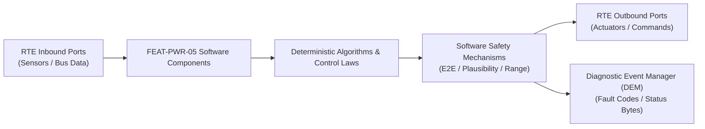

# Software Requirements Specification: On-Board Charger & DC Fast Charging System (OBC-DCFC)
**Feature ID:** `FEAT-PWR-05`  
**Domain:** Electric Powertrain & Energy Management  
**Target ASIL:** ASIL C  
**Compliance Standard:** ISO 26262:2018 (Part 6 - Software Development) / ASPICE PAM v3.1 (SWE.1, SWE.2)  
**Parent System Specification:** [`FEAT-PWR-05_OBC_SysReq.md`](file:///c:/Workset/AntiGravityProjects/TestOptimisationExperiement/system_requirements/FEAT-PWR-05_OBC_SysReq.md)  
**Global Master Specification:** [`spec.md`](file:///c:/Workset/AntiGravityProjects/TestOptimisationExperiement/spec.md)

---

## 1. Software Architecture & Component Structure

This document specifies the AUTOSAR Software Components (SWCs), periodic runnables, algorithmic laws, safety mechanisms, and data ports implementing `FEAT-PWR-05` (On-Board Charger & DC Fast Charging System (OBC-DCFC)).

### AUTOSAR SWC Interaction Diagram

---

## 2. Detailed Software Requirements (SWR_REQ)
*(Multi-Software Requirement Partitioning derived from System Requirements)*

### `SWR-PWR-05-01`: Analog Pilot PWM Duty Cycle & Voltage Threshold Decoder
- **Planned Release:** R100
- **ASIL Rating:** ASIL C
- **Parent System Requirement:** [`SYS-PWR-05-01`](file:///c:/Workset/AntiGravityProjects/TestOptimisationExperiement/system_requirements/FEAT-PWR-05_OBC_SysReq.md#sys-pwr-05-01)
- **Allocated AUTOSAR SWC:** `ObcPilotDecoder_SWC`
- **Execution Rate / Trigger:** 5 ms
- **Worst-Case Execution Time (WCET):** 0.6 ms
- **Software Activation Condition:** Executed cyclically every 5 ms.
- **Algorithmic Description / Logic:**
  > Samples CP analog voltage levels: State A (12V, unplugged), State B (9V, connected), State C (6V, charging). Measures 1 kHz PWM duty cycle: Current_Limit = Duty * 0.6A (for 10-85% duty) or (Duty - 64) * 2.5A (for 85-96% duty).
- **Software Safety Mechanism:** Duty cycle plausibility: Reject duty < 8% or > 97% as invalid pilot signal.
- **Failure Reaction & DEM Diagnostic Event:** Inhibit charging if pilot voltage is out of spec for > 30 ms.
- **Software Port Inputs:** `ADC_CP_Voltage_V, Timer_PWM_Duty_Cycle_Pct`
- **Software Port Outputs:** `EVSE_Current_Limit_A (float32), EVSE_State_Code (uint8)`
- **Software Verification Criteria:** Unit test across entire SAE J1772 duty cycle table.
- **Traceability Link:** Traces upward to [`SYS-PWR-05-01`](file:///c:/Workset/AntiGravityProjects/TestOptimisationExperiement/system_requirements/FEAT-PWR-05_OBC_SysReq.md#sys-pwr-05-01) and [`FEAT-PWR-05`](file:///c:/Workset/AntiGravityProjects/TestOptimisationExperiement/spec.md).

### `SWR-PWR-05-02`: Charge Port Solenoid Locking & Anti-Theft Supervisor
- **Planned Release:** R100
- **ASIL Rating:** ASIL C
- **Parent System Requirement:** [`SYS-PWR-05-01`](file:///c:/Workset/AntiGravityProjects/TestOptimisationExperiement/system_requirements/FEAT-PWR-05_OBC_SysReq.md#sys-pwr-05-01)
- **Allocated AUTOSAR SWC:** `ObcInletLock_SWC`
- **Execution Rate / Trigger:** 20 ms
- **Worst-Case Execution Time (WCET):** 0.7 ms
- **Software Activation Condition:** Executed upon plug insertion.
- **Algorithmic Description / Logic:**
  > Pulses H-bridge motor driver to engage mechanical lock pin over charging plug shoulder. Checks microswitch: If Lock_Pin_Confirmed == TRUE, enables high-voltage power paths.
- **Software Safety Mechanism:** Current feedback monitoring on lock motor to detect mechanical blockage.
- **Failure Reaction & DEM Diagnostic Event:** Do not start charging if lock pin is not fully seated in locked position.
- **Software Port Inputs:** `PP_Connected_Flag, Lock_Microswitch_State, Door_Unlock_Req`
- **Software Port Outputs:** `HBridge_Lock_Motor_Direction, Charging_Permitted_By_Lock (boolean)`
- **Software Verification Criteria:** Physical test bench evaluating locking under mechanical pull forces.
- **Traceability Link:** Traces upward to [`SYS-PWR-05-01`](file:///c:/Workset/AntiGravityProjects/TestOptimisationExperiement/system_requirements/FEAT-PWR-05_OBC_SysReq.md#sys-pwr-05-01) and [`FEAT-PWR-05`](file:///c:/Workset/AntiGravityProjects/TestOptimisationExperiement/spec.md).

### `SWR-PWR-05-03`: ISO 15118 V2G Transfer Protocol & SECC Communication Stack
- **Planned Release:** R100
- **ASIL Rating:** ASIL B / ISO 21434
- **Parent System Requirement:** [`SYS-PWR-05-02`](file:///c:/Workset/AntiGravityProjects/TestOptimisationExperiement/system_requirements/FEAT-PWR-05_OBC_SysReq.md#sys-pwr-05-02)
- **Allocated AUTOSAR SWC:** `Iso15118Stack_SWC`
- **Execution Rate / Trigger:** 20 ms
- **Worst-Case Execution Time (WCET):** 4.5 ms
- **Software Activation Condition:** Executed when PLC link is established.
- **Algorithmic Description / Logic:**
  > Parses EXI (Efficient XML Interchange) messages. Executes SessionSetup, ServiceDiscovery, PaymentDetails, and ChargeLoop states. Formats DC_ChargeLoopReq with BMS requested current and voltage every 100 ms.
- **Software Safety Mechanism:** Communication timeout: If SECC does not respond within 250 ms during ChargeLoop, command emergency current ramp-down.
- **Failure Reaction & DEM Diagnostic Event:** Gracefully terminate session with SessionStopReq on non-recoverable error.
- **Software Port Inputs:** `Inbound_EXI_Buffer, BMS_Target_Voltage_V, BMS_Target_Current_A`
- **Software Port Outputs:** `Outbound_EXI_Buffer, V2G_Charging_Status_Enum`
- **Software Verification Criteria:** Automated protocol conformance test against ISO 15118 test suite.
- **Traceability Link:** Traces upward to [`SYS-PWR-05-02`](file:///c:/Workset/AntiGravityProjects/TestOptimisationExperiement/system_requirements/FEAT-PWR-05_OBC_SysReq.md#sys-pwr-05-02) and [`FEAT-PWR-05`](file:///c:/Workset/AntiGravityProjects/TestOptimisationExperiement/spec.md).

### `SWR-PWR-05-04`: Plug & Charge TLS 1.3 Cryptographic Contract Certificate Authenticator
- **Planned Release:** R100
- **ASIL Rating:** ASIL B / ISO 21434
- **Parent System Requirement:** [`SYS-PWR-05-02`](file:///c:/Workset/AntiGravityProjects/TestOptimisationExperiement/system_requirements/FEAT-PWR-05_OBC_SysReq.md#sys-pwr-05-02)
- **Allocated AUTOSAR SWC:** `PlugAndChargeCrypto_SWC`
- **Execution Rate / Trigger:** Background task
- **Worst-Case Execution Time (WCET):** 18.0 ms (HSM accelerated)
- **Software Activation Condition:** Executed during ContractAuthentication phase.
- **Algorithmic Description / Logic:**
  > Calls Hardware Security Module (HSM) to establish TLS 1.3 connection using ECDHE-ECDSA-AES128-GCM-SHA256. Signs authorization token with stored OEM private key.
- **Software Safety Mechanism:** Cryptographic key storage inside tamper-resistant hardware secure element.
- **Failure Reaction & DEM Diagnostic Event:** Fallback to manual RFID / Smartphone App authentication if TLS handshake fails.
- **Software Port Inputs:** `EVSE_Certificate_Chain, OEM_Root_Certificate, Session_Challenge_Bytes`
- **Software Port Outputs:** `Signed_Contract_Token, PnC_Auth_Success (boolean)`
- **Software Verification Criteria:** Cryptographic test with simulated EVSE public key infrastructure.
- **Traceability Link:** Traces upward to [`SYS-PWR-05-02`](file:///c:/Workset/AntiGravityProjects/TestOptimisationExperiement/system_requirements/FEAT-PWR-05_OBC_SysReq.md#sys-pwr-05-02) and [`FEAT-PWR-05`](file:///c:/Workset/AntiGravityProjects/TestOptimisationExperiement/spec.md).

### `SWR-PWR-05-05`: AC Grid L1/L2/L3 Voltage & Phase Angle Phase-Locked Loop (PLL) Tracker - Dynamic Observer & Signal Filter
- **Planned Release:** R100
- **ASIL Rating:** ASIL C
- **Parent System Requirement:** [`SYS-PWR-05-03`](file:///c:/Workset/AntiGravityProjects/TestOptimisationExperiement/system_requirements/FEAT-PWR-05_OBC_SysReq.md#sys-pwr-05-03)
- **Allocated AUTOSAR SWC:** `ObcPllTracker_SWC`
- **Execution Rate / Trigger:** 0.5 ms
- **Worst-Case Execution Time (WCET):** 0.3 ms
- **Software Activation Condition:** Executed cyclically every 0.5 ms.
- **Algorithmic Description / Logic:**
  > Executes signal plausibility filtering, calibration offsets, and discrete state estimation for AC Grid L1/L2/L3 Voltage & Phase Angle Phase-Locked Loop (PLL) Tracker.
- **Software Safety Mechanism:** Range limit plausibility check and E2E alive sequence verification.
- **Failure Reaction & DEM Diagnostic Event:** Set default fallback output and report DEM_EVENT_FEAT_PWR_05_ERR.
- **Software Port Inputs:** `Raw sensor ADC/SENT/SPI values and RTE bus inputs.`
- **Software Port Outputs:** `Filtered physical signals and validity status bitmasks.`
- **Software Verification Criteria:** Unit test and HiL software integration test.
- **Traceability Link:** Traces upward to [`SYS-PWR-05-03`](file:///c:/Workset/AntiGravityProjects/TestOptimisationExperiement/system_requirements/FEAT-PWR-05_OBC_SysReq.md#sys-pwr-05-03) and [`FEAT-PWR-05`](file:///c:/Workset/AntiGravityProjects/TestOptimisationExperiement/spec.md).

### `SWR-PWR-05-06`: AC Grid L1/L2/L3 Voltage & Phase Angle Phase-Locked Loop (PLL) Tracker - Closed-Loop Control Law & Actuator Dispatch
- **Planned Release:** R100
- **ASIL Rating:** ASIL C
- **Parent System Requirement:** [`SYS-PWR-05-03`](file:///c:/Workset/AntiGravityProjects/TestOptimisationExperiement/system_requirements/FEAT-PWR-05_OBC_SysReq.md#sys-pwr-05-03)
- **Allocated AUTOSAR SWC:** `ObcPllTracker_SWC`
- **Execution Rate / Trigger:** 0.5 ms
- **Worst-Case Execution Time (WCET):** 0.4 ms
- **Software Activation Condition:** Executed cyclically every 0.5 ms.
- **Algorithmic Description / Logic:**
  > Evaluates deterministic closed-loop control law, rate limits, and dispatches commands for AC Grid L1/L2/L3 Voltage & Phase Angle Phase-Locked Loop (PLL) Tracker.
- **Software Safety Mechanism:** Command saturation clamping and watchdog program flow monitoring.
- **Failure Reaction & DEM Diagnostic Event:** De-energize actuator output, apply safe fallback clamp, and latch DTC.
- **Software Port Inputs:** `Validated physical state signals from observer SWC.`
- **Software Port Outputs:** `Actuator PWM duty cycles, torque/pressure setpoints, and diagnostic flags.`
- **Software Verification Criteria:** Hardware dynamometer and HiL closed-loop regression test suite.
- **Traceability Link:** Traces upward to [`SYS-PWR-05-03`](file:///c:/Workset/AntiGravityProjects/TestOptimisationExperiement/system_requirements/FEAT-PWR-05_OBC_SysReq.md#sys-pwr-05-03) and [`FEAT-PWR-05`](file:///c:/Workset/AntiGravityProjects/TestOptimisationExperiement/spec.md).

### `SWR-PWR-05-07`: On-Board Charger Bidirectional PFC Bridge PWM Space Vector Modulator - Dynamic Observer & Signal Filter
- **Planned Release:** R200
- **ASIL Rating:** ASIL C
- **Parent System Requirement:** [`SYS-PWR-05-04`](file:///c:/Workset/AntiGravityProjects/TestOptimisationExperiement/system_requirements/FEAT-PWR-05_OBC_SysReq.md#sys-pwr-05-04)
- **Allocated AUTOSAR SWC:** `ObcPfcModulator_SWC`
- **Execution Rate / Trigger:** 0.5 ms
- **Worst-Case Execution Time (WCET):** 0.3 ms
- **Software Activation Condition:** Executed cyclically every 0.5 ms.
- **Algorithmic Description / Logic:**
  > Executes signal plausibility filtering, calibration offsets, and discrete state estimation for On-Board Charger Bidirectional PFC Bridge PWM Space Vector Modulator.
- **Software Safety Mechanism:** Range limit plausibility check and E2E alive sequence verification.
- **Failure Reaction & DEM Diagnostic Event:** Set default fallback output and report DEM_EVENT_FEAT_PWR_05_ERR.
- **Software Port Inputs:** `Raw sensor ADC/SENT/SPI values and RTE bus inputs.`
- **Software Port Outputs:** `Filtered physical signals and validity status bitmasks.`
- **Software Verification Criteria:** Unit test and HiL software integration test.
- **Traceability Link:** Traces upward to [`SYS-PWR-05-04`](file:///c:/Workset/AntiGravityProjects/TestOptimisationExperiement/system_requirements/FEAT-PWR-05_OBC_SysReq.md#sys-pwr-05-04) and [`FEAT-PWR-05`](file:///c:/Workset/AntiGravityProjects/TestOptimisationExperiement/spec.md).

### `SWR-PWR-05-08`: On-Board Charger Bidirectional PFC Bridge PWM Space Vector Modulator - Closed-Loop Control Law & Actuator Dispatch
- **Planned Release:** R200
- **ASIL Rating:** ASIL C
- **Parent System Requirement:** [`SYS-PWR-05-04`](file:///c:/Workset/AntiGravityProjects/TestOptimisationExperiement/system_requirements/FEAT-PWR-05_OBC_SysReq.md#sys-pwr-05-04)
- **Allocated AUTOSAR SWC:** `ObcPfcModulator_SWC`
- **Execution Rate / Trigger:** 0.5 ms
- **Worst-Case Execution Time (WCET):** 0.4 ms
- **Software Activation Condition:** Executed cyclically every 0.5 ms.
- **Algorithmic Description / Logic:**
  > Evaluates deterministic closed-loop control law, rate limits, and dispatches commands for On-Board Charger Bidirectional PFC Bridge PWM Space Vector Modulator.
- **Software Safety Mechanism:** Command saturation clamping and watchdog program flow monitoring.
- **Failure Reaction & DEM Diagnostic Event:** De-energize actuator output, apply safe fallback clamp, and latch DTC.
- **Software Port Inputs:** `Validated physical state signals from observer SWC.`
- **Software Port Outputs:** `Actuator PWM duty cycles, torque/pressure setpoints, and diagnostic flags.`
- **Software Verification Criteria:** Hardware dynamometer and HiL closed-loop regression test suite.
- **Traceability Link:** Traces upward to [`SYS-PWR-05-04`](file:///c:/Workset/AntiGravityProjects/TestOptimisationExperiement/system_requirements/FEAT-PWR-05_OBC_SysReq.md#sys-pwr-05-04) and [`FEAT-PWR-05`](file:///c:/Workset/AntiGravityProjects/TestOptimisationExperiement/spec.md).

### `SWR-PWR-05-09`: Galvanic Isolated LLC Resonant DC-DC Converter Secondary Rectifier - Dynamic Observer & Signal Filter
- **Planned Release:** R200
- **ASIL Rating:** ASIL C
- **Parent System Requirement:** [`SYS-PWR-05-05`](file:///c:/Workset/AntiGravityProjects/TestOptimisationExperiement/system_requirements/FEAT-PWR-05_OBC_SysReq.md#sys-pwr-05-05)
- **Allocated AUTOSAR SWC:** `ObcLlcConverter_SWC`
- **Execution Rate / Trigger:** 0.5 ms
- **Worst-Case Execution Time (WCET):** 0.3 ms
- **Software Activation Condition:** Executed cyclically every 0.5 ms.
- **Algorithmic Description / Logic:**
  > Executes signal plausibility filtering, calibration offsets, and discrete state estimation for Galvanic Isolated LLC Resonant DC-DC Converter Secondary Rectifier.
- **Software Safety Mechanism:** Range limit plausibility check and E2E alive sequence verification.
- **Failure Reaction & DEM Diagnostic Event:** Set default fallback output and report DEM_EVENT_FEAT_PWR_05_ERR.
- **Software Port Inputs:** `Raw sensor ADC/SENT/SPI values and RTE bus inputs.`
- **Software Port Outputs:** `Filtered physical signals and validity status bitmasks.`
- **Software Verification Criteria:** Unit test and HiL software integration test.
- **Traceability Link:** Traces upward to [`SYS-PWR-05-05`](file:///c:/Workset/AntiGravityProjects/TestOptimisationExperiement/system_requirements/FEAT-PWR-05_OBC_SysReq.md#sys-pwr-05-05) and [`FEAT-PWR-05`](file:///c:/Workset/AntiGravityProjects/TestOptimisationExperiement/spec.md).

### `SWR-PWR-05-10`: Galvanic Isolated LLC Resonant DC-DC Converter Secondary Rectifier - Closed-Loop Control Law & Actuator Dispatch
- **Planned Release:** R200
- **ASIL Rating:** ASIL C
- **Parent System Requirement:** [`SYS-PWR-05-05`](file:///c:/Workset/AntiGravityProjects/TestOptimisationExperiement/system_requirements/FEAT-PWR-05_OBC_SysReq.md#sys-pwr-05-05)
- **Allocated AUTOSAR SWC:** `ObcLlcConverter_SWC`
- **Execution Rate / Trigger:** 0.5 ms
- **Worst-Case Execution Time (WCET):** 0.4 ms
- **Software Activation Condition:** Executed cyclically every 0.5 ms.
- **Algorithmic Description / Logic:**
  > Evaluates deterministic closed-loop control law, rate limits, and dispatches commands for Galvanic Isolated LLC Resonant DC-DC Converter Secondary Rectifier.
- **Software Safety Mechanism:** Command saturation clamping and watchdog program flow monitoring.
- **Failure Reaction & DEM Diagnostic Event:** De-energize actuator output, apply safe fallback clamp, and latch DTC.
- **Software Port Inputs:** `Validated physical state signals from observer SWC.`
- **Software Port Outputs:** `Actuator PWM duty cycles, torque/pressure setpoints, and diagnostic flags.`
- **Software Verification Criteria:** Hardware dynamometer and HiL closed-loop regression test suite.
- **Traceability Link:** Traces upward to [`SYS-PWR-05-05`](file:///c:/Workset/AntiGravityProjects/TestOptimisationExperiement/system_requirements/FEAT-PWR-05_OBC_SysReq.md#sys-pwr-05-05) and [`FEAT-PWR-05`](file:///c:/Workset/AntiGravityProjects/TestOptimisationExperiement/spec.md).

### `SWR-PWR-05-11`: DC Fast Charging Combined Charging System (CCS2) ISO 15118 Protocol Handler - Dynamic Observer & Signal Filter
- **Planned Release:** R200
- **ASIL Rating:** ASIL C
- **Parent System Requirement:** [`SYS-PWR-05-06`](file:///c:/Workset/AntiGravityProjects/TestOptimisationExperiement/system_requirements/FEAT-PWR-05_OBC_SysReq.md#sys-pwr-05-06)
- **Allocated AUTOSAR SWC:** `DcfcIso15118_SWC`
- **Execution Rate / Trigger:** 10 ms
- **Worst-Case Execution Time (WCET):** 0.3 ms
- **Software Activation Condition:** Executed cyclically every 10 ms.
- **Algorithmic Description / Logic:**
  > Executes signal plausibility filtering, calibration offsets, and discrete state estimation for DC Fast Charging Combined Charging System (CCS2) ISO 15118 Protocol Handler.
- **Software Safety Mechanism:** Range limit plausibility check and E2E alive sequence verification.
- **Failure Reaction & DEM Diagnostic Event:** Set default fallback output and report DEM_EVENT_FEAT_PWR_05_ERR.
- **Software Port Inputs:** `Raw sensor ADC/SENT/SPI values and RTE bus inputs.`
- **Software Port Outputs:** `Filtered physical signals and validity status bitmasks.`
- **Software Verification Criteria:** Unit test and HiL software integration test.
- **Traceability Link:** Traces upward to [`SYS-PWR-05-06`](file:///c:/Workset/AntiGravityProjects/TestOptimisationExperiement/system_requirements/FEAT-PWR-05_OBC_SysReq.md#sys-pwr-05-06) and [`FEAT-PWR-05`](file:///c:/Workset/AntiGravityProjects/TestOptimisationExperiement/spec.md).

### `SWR-PWR-05-12`: DC Fast Charging Combined Charging System (CCS2) ISO 15118 Protocol Handler - Closed-Loop Control Law & Actuator Dispatch
- **Planned Release:** R200
- **ASIL Rating:** ASIL C
- **Parent System Requirement:** [`SYS-PWR-05-06`](file:///c:/Workset/AntiGravityProjects/TestOptimisationExperiement/system_requirements/FEAT-PWR-05_OBC_SysReq.md#sys-pwr-05-06)
- **Allocated AUTOSAR SWC:** `DcfcIso15118_SWC`
- **Execution Rate / Trigger:** 10 ms
- **Worst-Case Execution Time (WCET):** 0.4 ms
- **Software Activation Condition:** Executed cyclically every 10 ms.
- **Algorithmic Description / Logic:**
  > Evaluates deterministic closed-loop control law, rate limits, and dispatches commands for DC Fast Charging Combined Charging System (CCS2) ISO 15118 Protocol Handler.
- **Software Safety Mechanism:** Command saturation clamping and watchdog program flow monitoring.
- **Failure Reaction & DEM Diagnostic Event:** De-energize actuator output, apply safe fallback clamp, and latch DTC.
- **Software Port Inputs:** `Validated physical state signals from observer SWC.`
- **Software Port Outputs:** `Actuator PWM duty cycles, torque/pressure setpoints, and diagnostic flags.`
- **Software Verification Criteria:** Hardware dynamometer and HiL closed-loop regression test suite.
- **Traceability Link:** Traces upward to [`SYS-PWR-05-06`](file:///c:/Workset/AntiGravityProjects/TestOptimisationExperiement/system_requirements/FEAT-PWR-05_OBC_SysReq.md#sys-pwr-05-06) and [`FEAT-PWR-05`](file:///c:/Workset/AntiGravityProjects/TestOptimisationExperiement/spec.md).

### `SWR-PWR-05-13`: DIN 70121 & ISO 15118 DC Fast Charge Current Setpoint Negotiator - Dynamic Observer & Signal Filter
- **Planned Release:** R300
- **ASIL Rating:** ASIL C
- **Parent System Requirement:** [`SYS-PWR-05-07`](file:///c:/Workset/AntiGravityProjects/TestOptimisationExperiement/system_requirements/FEAT-PWR-05_OBC_SysReq.md#sys-pwr-05-07)
- **Allocated AUTOSAR SWC:** `DcfcNegotiator_SWC`
- **Execution Rate / Trigger:** 10 ms
- **Worst-Case Execution Time (WCET):** 0.3 ms
- **Software Activation Condition:** Executed cyclically every 10 ms.
- **Algorithmic Description / Logic:**
  > Executes signal plausibility filtering, calibration offsets, and discrete state estimation for DIN 70121 & ISO 15118 DC Fast Charge Current Setpoint Negotiator.
- **Software Safety Mechanism:** Range limit plausibility check and E2E alive sequence verification.
- **Failure Reaction & DEM Diagnostic Event:** Set default fallback output and report DEM_EVENT_FEAT_PWR_05_ERR.
- **Software Port Inputs:** `Raw sensor ADC/SENT/SPI values and RTE bus inputs.`
- **Software Port Outputs:** `Filtered physical signals and validity status bitmasks.`
- **Software Verification Criteria:** Unit test and HiL software integration test.
- **Traceability Link:** Traces upward to [`SYS-PWR-05-07`](file:///c:/Workset/AntiGravityProjects/TestOptimisationExperiement/system_requirements/FEAT-PWR-05_OBC_SysReq.md#sys-pwr-05-07) and [`FEAT-PWR-05`](file:///c:/Workset/AntiGravityProjects/TestOptimisationExperiement/spec.md).

### `SWR-PWR-05-14`: DIN 70121 & ISO 15118 DC Fast Charge Current Setpoint Negotiator - Closed-Loop Control Law & Actuator Dispatch
- **Planned Release:** R300
- **ASIL Rating:** ASIL C
- **Parent System Requirement:** [`SYS-PWR-05-07`](file:///c:/Workset/AntiGravityProjects/TestOptimisationExperiement/system_requirements/FEAT-PWR-05_OBC_SysReq.md#sys-pwr-05-07)
- **Allocated AUTOSAR SWC:** `DcfcNegotiator_SWC`
- **Execution Rate / Trigger:** 10 ms
- **Worst-Case Execution Time (WCET):** 0.4 ms
- **Software Activation Condition:** Executed cyclically every 10 ms.
- **Algorithmic Description / Logic:**
  > Evaluates deterministic closed-loop control law, rate limits, and dispatches commands for DIN 70121 & ISO 15118 DC Fast Charge Current Setpoint Negotiator.
- **Software Safety Mechanism:** Command saturation clamping and watchdog program flow monitoring.
- **Failure Reaction & DEM Diagnostic Event:** De-energize actuator output, apply safe fallback clamp, and latch DTC.
- **Software Port Inputs:** `Validated physical state signals from observer SWC.`
- **Software Port Outputs:** `Actuator PWM duty cycles, torque/pressure setpoints, and diagnostic flags.`
- **Software Verification Criteria:** Hardware dynamometer and HiL closed-loop regression test suite.
- **Traceability Link:** Traces upward to [`SYS-PWR-05-07`](file:///c:/Workset/AntiGravityProjects/TestOptimisationExperiement/system_requirements/FEAT-PWR-05_OBC_SysReq.md#sys-pwr-05-07) and [`FEAT-PWR-05`](file:///c:/Workset/AntiGravityProjects/TestOptimisationExperiement/spec.md).

### `SWR-PWR-05-15`: Charging Inlet Mechanical Locking Pin Actuator & Microswitch Interlock - Dynamic Observer & Signal Filter
- **Planned Release:** R300
- **ASIL Rating:** ASIL C
- **Parent System Requirement:** [`SYS-PWR-05-08`](file:///c:/Workset/AntiGravityProjects/TestOptimisationExperiement/system_requirements/FEAT-PWR-05_OBC_SysReq.md#sys-pwr-05-08)
- **Allocated AUTOSAR SWC:** `ObcInletLock_SWC`
- **Execution Rate / Trigger:** 20 ms
- **Worst-Case Execution Time (WCET):** 0.3 ms
- **Software Activation Condition:** Executed cyclically every 20 ms.
- **Algorithmic Description / Logic:**
  > Executes signal plausibility filtering, calibration offsets, and discrete state estimation for Charging Inlet Mechanical Locking Pin Actuator & Microswitch Interlock.
- **Software Safety Mechanism:** Range limit plausibility check and E2E alive sequence verification.
- **Failure Reaction & DEM Diagnostic Event:** Set default fallback output and report DEM_EVENT_FEAT_PWR_05_ERR.
- **Software Port Inputs:** `Raw sensor ADC/SENT/SPI values and RTE bus inputs.`
- **Software Port Outputs:** `Filtered physical signals and validity status bitmasks.`
- **Software Verification Criteria:** Unit test and HiL software integration test.
- **Traceability Link:** Traces upward to [`SYS-PWR-05-08`](file:///c:/Workset/AntiGravityProjects/TestOptimisationExperiement/system_requirements/FEAT-PWR-05_OBC_SysReq.md#sys-pwr-05-08) and [`FEAT-PWR-05`](file:///c:/Workset/AntiGravityProjects/TestOptimisationExperiement/spec.md).

### `SWR-PWR-05-16`: Charging Inlet Mechanical Locking Pin Actuator & Microswitch Interlock - Closed-Loop Control Law & Actuator Dispatch
- **Planned Release:** R300
- **ASIL Rating:** ASIL C
- **Parent System Requirement:** [`SYS-PWR-05-08`](file:///c:/Workset/AntiGravityProjects/TestOptimisationExperiement/system_requirements/FEAT-PWR-05_OBC_SysReq.md#sys-pwr-05-08)
- **Allocated AUTOSAR SWC:** `ObcInletLock_SWC`
- **Execution Rate / Trigger:** 20 ms
- **Worst-Case Execution Time (WCET):** 0.4 ms
- **Software Activation Condition:** Executed cyclically every 20 ms.
- **Algorithmic Description / Logic:**
  > Evaluates deterministic closed-loop control law, rate limits, and dispatches commands for Charging Inlet Mechanical Locking Pin Actuator & Microswitch Interlock.
- **Software Safety Mechanism:** Command saturation clamping and watchdog program flow monitoring.
- **Failure Reaction & DEM Diagnostic Event:** De-energize actuator output, apply safe fallback clamp, and latch DTC.
- **Software Port Inputs:** `Validated physical state signals from observer SWC.`
- **Software Port Outputs:** `Actuator PWM duty cycles, torque/pressure setpoints, and diagnostic flags.`
- **Software Verification Criteria:** Hardware dynamometer and HiL closed-loop regression test suite.
- **Traceability Link:** Traces upward to [`SYS-PWR-05-08`](file:///c:/Workset/AntiGravityProjects/TestOptimisationExperiement/system_requirements/FEAT-PWR-05_OBC_SysReq.md#sys-pwr-05-08) and [`FEAT-PWR-05`](file:///c:/Workset/AntiGravityProjects/TestOptimisationExperiement/spec.md).

### `SWR-PWR-05-17`: Control Pilot (CP) PWM Duty Cycle Decoder & Proximity Pilot (PP) Sensor - Dynamic Observer & Signal Filter
- **Planned Release:** R300
- **ASIL Rating:** ASIL C
- **Parent System Requirement:** [`SYS-PWR-05-09`](file:///c:/Workset/AntiGravityProjects/TestOptimisationExperiement/system_requirements/FEAT-PWR-05_OBC_SysReq.md#sys-pwr-05-09)
- **Allocated AUTOSAR SWC:** `ObcControlPilot_SWC`
- **Execution Rate / Trigger:** 5 ms
- **Worst-Case Execution Time (WCET):** 0.3 ms
- **Software Activation Condition:** Executed cyclically every 5 ms.
- **Algorithmic Description / Logic:**
  > Executes signal plausibility filtering, calibration offsets, and discrete state estimation for Control Pilot (CP) PWM Duty Cycle Decoder & Proximity Pilot (PP) Sensor.
- **Software Safety Mechanism:** Range limit plausibility check and E2E alive sequence verification.
- **Failure Reaction & DEM Diagnostic Event:** Set default fallback output and report DEM_EVENT_FEAT_PWR_05_ERR.
- **Software Port Inputs:** `Raw sensor ADC/SENT/SPI values and RTE bus inputs.`
- **Software Port Outputs:** `Filtered physical signals and validity status bitmasks.`
- **Software Verification Criteria:** Unit test and HiL software integration test.
- **Traceability Link:** Traces upward to [`SYS-PWR-05-09`](file:///c:/Workset/AntiGravityProjects/TestOptimisationExperiement/system_requirements/FEAT-PWR-05_OBC_SysReq.md#sys-pwr-05-09) and [`FEAT-PWR-05`](file:///c:/Workset/AntiGravityProjects/TestOptimisationExperiement/spec.md).

### `SWR-PWR-05-18`: Control Pilot (CP) PWM Duty Cycle Decoder & Proximity Pilot (PP) Sensor - Closed-Loop Control Law & Actuator Dispatch
- **Planned Release:** R300
- **ASIL Rating:** ASIL C
- **Parent System Requirement:** [`SYS-PWR-05-09`](file:///c:/Workset/AntiGravityProjects/TestOptimisationExperiement/system_requirements/FEAT-PWR-05_OBC_SysReq.md#sys-pwr-05-09)
- **Allocated AUTOSAR SWC:** `ObcControlPilot_SWC`
- **Execution Rate / Trigger:** 5 ms
- **Worst-Case Execution Time (WCET):** 0.4 ms
- **Software Activation Condition:** Executed cyclically every 5 ms.
- **Algorithmic Description / Logic:**
  > Evaluates deterministic closed-loop control law, rate limits, and dispatches commands for Control Pilot (CP) PWM Duty Cycle Decoder & Proximity Pilot (PP) Sensor.
- **Software Safety Mechanism:** Command saturation clamping and watchdog program flow monitoring.
- **Failure Reaction & DEM Diagnostic Event:** De-energize actuator output, apply safe fallback clamp, and latch DTC.
- **Software Port Inputs:** `Validated physical state signals from observer SWC.`
- **Software Port Outputs:** `Actuator PWM duty cycles, torque/pressure setpoints, and diagnostic flags.`
- **Software Verification Criteria:** Hardware dynamometer and HiL closed-loop regression test suite.
- **Traceability Link:** Traces upward to [`SYS-PWR-05-09`](file:///c:/Workset/AntiGravityProjects/TestOptimisationExperiement/system_requirements/FEAT-PWR-05_OBC_SysReq.md#sys-pwr-05-09) and [`FEAT-PWR-05`](file:///c:/Workset/AntiGravityProjects/TestOptimisationExperiement/spec.md).

### `SWR-PWR-05-19`: DC Fast Charge Inlet Dual Thermocouple Over-Temperature Monitor - Dynamic Observer & Signal Filter
- **Planned Release:** R400
- **ASIL Rating:** ASIL C
- **Parent System Requirement:** [`SYS-PWR-05-10`](file:///c:/Workset/AntiGravityProjects/TestOptimisationExperiement/system_requirements/FEAT-PWR-05_OBC_SysReq.md#sys-pwr-05-10)
- **Allocated AUTOSAR SWC:** `DcfcPinThermal_SWC`
- **Execution Rate / Trigger:** 20 ms
- **Worst-Case Execution Time (WCET):** 0.3 ms
- **Software Activation Condition:** Executed cyclically every 20 ms.
- **Algorithmic Description / Logic:**
  > Executes signal plausibility filtering, calibration offsets, and discrete state estimation for DC Fast Charge Inlet Dual Thermocouple Over-Temperature Monitor.
- **Software Safety Mechanism:** Range limit plausibility check and E2E alive sequence verification.
- **Failure Reaction & DEM Diagnostic Event:** Set default fallback output and report DEM_EVENT_FEAT_PWR_05_ERR.
- **Software Port Inputs:** `Raw sensor ADC/SENT/SPI values and RTE bus inputs.`
- **Software Port Outputs:** `Filtered physical signals and validity status bitmasks.`
- **Software Verification Criteria:** Unit test and HiL software integration test.
- **Traceability Link:** Traces upward to [`SYS-PWR-05-10`](file:///c:/Workset/AntiGravityProjects/TestOptimisationExperiement/system_requirements/FEAT-PWR-05_OBC_SysReq.md#sys-pwr-05-10) and [`FEAT-PWR-05`](file:///c:/Workset/AntiGravityProjects/TestOptimisationExperiement/spec.md).

### `SWR-PWR-05-20`: DC Fast Charge Inlet Dual Thermocouple Over-Temperature Monitor - Closed-Loop Control Law & Actuator Dispatch
- **Planned Release:** R400
- **ASIL Rating:** ASIL C
- **Parent System Requirement:** [`SYS-PWR-05-10`](file:///c:/Workset/AntiGravityProjects/TestOptimisationExperiement/system_requirements/FEAT-PWR-05_OBC_SysReq.md#sys-pwr-05-10)
- **Allocated AUTOSAR SWC:** `DcfcPinThermal_SWC`
- **Execution Rate / Trigger:** 20 ms
- **Worst-Case Execution Time (WCET):** 0.4 ms
- **Software Activation Condition:** Executed cyclically every 20 ms.
- **Algorithmic Description / Logic:**
  > Evaluates deterministic closed-loop control law, rate limits, and dispatches commands for DC Fast Charge Inlet Dual Thermocouple Over-Temperature Monitor.
- **Software Safety Mechanism:** Command saturation clamping and watchdog program flow monitoring.
- **Failure Reaction & DEM Diagnostic Event:** De-energize actuator output, apply safe fallback clamp, and latch DTC.
- **Software Port Inputs:** `Validated physical state signals from observer SWC.`
- **Software Port Outputs:** `Actuator PWM duty cycles, torque/pressure setpoints, and diagnostic flags.`
- **Software Verification Criteria:** Hardware dynamometer and HiL closed-loop regression test suite.
- **Traceability Link:** Traces upward to [`SYS-PWR-05-10`](file:///c:/Workset/AntiGravityProjects/TestOptimisationExperiement/system_requirements/FEAT-PWR-05_OBC_SysReq.md#sys-pwr-05-10) and [`FEAT-PWR-05`](file:///c:/Workset/AntiGravityProjects/TestOptimisationExperiement/spec.md).

### `SWR-PWR-05-21`: HV DC Fast Charge Pre-Charge Contactor Sequencing & Inrush Limiter - Dynamic Observer & Signal Filter
- **Planned Release:** R400
- **ASIL Rating:** ASIL D
- **Parent System Requirement:** [`SYS-PWR-05-11`](file:///c:/Workset/AntiGravityProjects/TestOptimisationExperiement/system_requirements/FEAT-PWR-05_OBC_SysReq.md#sys-pwr-05-11)
- **Allocated AUTOSAR SWC:** `DcfcPreCharge_SWC`
- **Execution Rate / Trigger:** 5 ms
- **Worst-Case Execution Time (WCET):** 0.3 ms
- **Software Activation Condition:** Executed cyclically every 5 ms.
- **Algorithmic Description / Logic:**
  > Executes signal plausibility filtering, calibration offsets, and discrete state estimation for HV DC Fast Charge Pre-Charge Contactor Sequencing & Inrush Limiter.
- **Software Safety Mechanism:** Range limit plausibility check and E2E alive sequence verification.
- **Failure Reaction & DEM Diagnostic Event:** Set default fallback output and report DEM_EVENT_FEAT_PWR_05_ERR.
- **Software Port Inputs:** `Raw sensor ADC/SENT/SPI values and RTE bus inputs.`
- **Software Port Outputs:** `Filtered physical signals and validity status bitmasks.`
- **Software Verification Criteria:** Unit test and HiL software integration test.
- **Traceability Link:** Traces upward to [`SYS-PWR-05-11`](file:///c:/Workset/AntiGravityProjects/TestOptimisationExperiement/system_requirements/FEAT-PWR-05_OBC_SysReq.md#sys-pwr-05-11) and [`FEAT-PWR-05`](file:///c:/Workset/AntiGravityProjects/TestOptimisationExperiement/spec.md).

### `SWR-PWR-05-22`: HV DC Fast Charge Pre-Charge Contactor Sequencing & Inrush Limiter - Closed-Loop Control Law & Actuator Dispatch
- **Planned Release:** R400
- **ASIL Rating:** ASIL D
- **Parent System Requirement:** [`SYS-PWR-05-11`](file:///c:/Workset/AntiGravityProjects/TestOptimisationExperiement/system_requirements/FEAT-PWR-05_OBC_SysReq.md#sys-pwr-05-11)
- **Allocated AUTOSAR SWC:** `DcfcPreCharge_SWC`
- **Execution Rate / Trigger:** 5 ms
- **Worst-Case Execution Time (WCET):** 0.4 ms
- **Software Activation Condition:** Executed cyclically every 5 ms.
- **Algorithmic Description / Logic:**
  > Evaluates deterministic closed-loop control law, rate limits, and dispatches commands for HV DC Fast Charge Pre-Charge Contactor Sequencing & Inrush Limiter.
- **Software Safety Mechanism:** Command saturation clamping and watchdog program flow monitoring.
- **Failure Reaction & DEM Diagnostic Event:** De-energize actuator output, apply safe fallback clamp, and latch DTC.
- **Software Port Inputs:** `Validated physical state signals from observer SWC.`
- **Software Port Outputs:** `Actuator PWM duty cycles, torque/pressure setpoints, and diagnostic flags.`
- **Software Verification Criteria:** Hardware dynamometer and HiL closed-loop regression test suite.
- **Traceability Link:** Traces upward to [`SYS-PWR-05-11`](file:///c:/Workset/AntiGravityProjects/TestOptimisationExperiement/system_requirements/FEAT-PWR-05_OBC_SysReq.md#sys-pwr-05-11) and [`FEAT-PWR-05`](file:///c:/Workset/AntiGravityProjects/TestOptimisationExperiement/spec.md).

### `SWR-PWR-05-23`: AC/DC Residual Current Detection (RCD Type B) Earth Leakage Trip - Dynamic Observer & Signal Filter
- **Planned Release:** R400
- **ASIL Rating:** ASIL C
- **Parent System Requirement:** [`SYS-PWR-05-12`](file:///c:/Workset/AntiGravityProjects/TestOptimisationExperiement/system_requirements/FEAT-PWR-05_OBC_SysReq.md#sys-pwr-05-12)
- **Allocated AUTOSAR SWC:** `ObcLeakageProtection_SWC`
- **Execution Rate / Trigger:** 1 ms
- **Worst-Case Execution Time (WCET):** 0.3 ms
- **Software Activation Condition:** Executed cyclically every 1 ms.
- **Algorithmic Description / Logic:**
  > Executes signal plausibility filtering, calibration offsets, and discrete state estimation for AC/DC Residual Current Detection (RCD Type B) Earth Leakage Trip.
- **Software Safety Mechanism:** Range limit plausibility check and E2E alive sequence verification.
- **Failure Reaction & DEM Diagnostic Event:** Set default fallback output and report DEM_EVENT_FEAT_PWR_05_ERR.
- **Software Port Inputs:** `Raw sensor ADC/SENT/SPI values and RTE bus inputs.`
- **Software Port Outputs:** `Filtered physical signals and validity status bitmasks.`
- **Software Verification Criteria:** Unit test and HiL software integration test.
- **Traceability Link:** Traces upward to [`SYS-PWR-05-12`](file:///c:/Workset/AntiGravityProjects/TestOptimisationExperiement/system_requirements/FEAT-PWR-05_OBC_SysReq.md#sys-pwr-05-12) and [`FEAT-PWR-05`](file:///c:/Workset/AntiGravityProjects/TestOptimisationExperiement/spec.md).

### `SWR-PWR-05-24`: AC/DC Residual Current Detection (RCD Type B) Earth Leakage Trip - Closed-Loop Control Law & Actuator Dispatch
- **Planned Release:** R400
- **ASIL Rating:** ASIL C
- **Parent System Requirement:** [`SYS-PWR-05-12`](file:///c:/Workset/AntiGravityProjects/TestOptimisationExperiement/system_requirements/FEAT-PWR-05_OBC_SysReq.md#sys-pwr-05-12)
- **Allocated AUTOSAR SWC:** `ObcLeakageProtection_SWC`
- **Execution Rate / Trigger:** 1 ms
- **Worst-Case Execution Time (WCET):** 0.4 ms
- **Software Activation Condition:** Executed cyclically every 1 ms.
- **Algorithmic Description / Logic:**
  > Evaluates deterministic closed-loop control law, rate limits, and dispatches commands for AC/DC Residual Current Detection (RCD Type B) Earth Leakage Trip.
- **Software Safety Mechanism:** Command saturation clamping and watchdog program flow monitoring.
- **Failure Reaction & DEM Diagnostic Event:** De-energize actuator output, apply safe fallback clamp, and latch DTC.
- **Software Port Inputs:** `Validated physical state signals from observer SWC.`
- **Software Port Outputs:** `Actuator PWM duty cycles, torque/pressure setpoints, and diagnostic flags.`
- **Software Verification Criteria:** Hardware dynamometer and HiL closed-loop regression test suite.
- **Traceability Link:** Traces upward to [`SYS-PWR-05-12`](file:///c:/Workset/AntiGravityProjects/TestOptimisationExperiement/system_requirements/FEAT-PWR-05_OBC_SysReq.md#sys-pwr-05-12) and [`FEAT-PWR-05`](file:///c:/Workset/AntiGravityProjects/TestOptimisationExperiement/spec.md).

### `SWR-PWR-05-25`: Charging System Emergency Stop Remote E-Trip Signal Supervisor - Dynamic Observer & Signal Filter
- **Planned Release:** R500
- **ASIL Rating:** ASIL D
- **Parent System Requirement:** [`SYS-PWR-05-13`](file:///c:/Workset/AntiGravityProjects/TestOptimisationExperiement/system_requirements/FEAT-PWR-05_OBC_SysReq.md#sys-pwr-05-13)
- **Allocated AUTOSAR SWC:** `ObcEmergencyStop_SWC`
- **Execution Rate / Trigger:** 2 ms
- **Worst-Case Execution Time (WCET):** 0.3 ms
- **Software Activation Condition:** Executed cyclically every 2 ms.
- **Algorithmic Description / Logic:**
  > Executes signal plausibility filtering, calibration offsets, and discrete state estimation for Charging System Emergency Stop Remote E-Trip Signal Supervisor.
- **Software Safety Mechanism:** Range limit plausibility check and E2E alive sequence verification.
- **Failure Reaction & DEM Diagnostic Event:** Set default fallback output and report DEM_EVENT_FEAT_PWR_05_ERR.
- **Software Port Inputs:** `Raw sensor ADC/SENT/SPI values and RTE bus inputs.`
- **Software Port Outputs:** `Filtered physical signals and validity status bitmasks.`
- **Software Verification Criteria:** Unit test and HiL software integration test.
- **Traceability Link:** Traces upward to [`SYS-PWR-05-13`](file:///c:/Workset/AntiGravityProjects/TestOptimisationExperiement/system_requirements/FEAT-PWR-05_OBC_SysReq.md#sys-pwr-05-13) and [`FEAT-PWR-05`](file:///c:/Workset/AntiGravityProjects/TestOptimisationExperiement/spec.md).

### `SWR-PWR-05-26`: Charging System Emergency Stop Remote E-Trip Signal Supervisor - Closed-Loop Control Law & Actuator Dispatch
- **Planned Release:** R500
- **ASIL Rating:** ASIL D
- **Parent System Requirement:** [`SYS-PWR-05-13`](file:///c:/Workset/AntiGravityProjects/TestOptimisationExperiement/system_requirements/FEAT-PWR-05_OBC_SysReq.md#sys-pwr-05-13)
- **Allocated AUTOSAR SWC:** `ObcEmergencyStop_SWC`
- **Execution Rate / Trigger:** 2 ms
- **Worst-Case Execution Time (WCET):** 0.4 ms
- **Software Activation Condition:** Executed cyclically every 2 ms.
- **Algorithmic Description / Logic:**
  > Evaluates deterministic closed-loop control law, rate limits, and dispatches commands for Charging System Emergency Stop Remote E-Trip Signal Supervisor.
- **Software Safety Mechanism:** Command saturation clamping and watchdog program flow monitoring.
- **Failure Reaction & DEM Diagnostic Event:** De-energize actuator output, apply safe fallback clamp, and latch DTC.
- **Software Port Inputs:** `Validated physical state signals from observer SWC.`
- **Software Port Outputs:** `Actuator PWM duty cycles, torque/pressure setpoints, and diagnostic flags.`
- **Software Verification Criteria:** Hardware dynamometer and HiL closed-loop regression test suite.
- **Traceability Link:** Traces upward to [`SYS-PWR-05-13`](file:///c:/Workset/AntiGravityProjects/TestOptimisationExperiement/system_requirements/FEAT-PWR-05_OBC_SysReq.md#sys-pwr-05-13) and [`FEAT-PWR-05`](file:///c:/Workset/AntiGravityProjects/TestOptimisationExperiement/spec.md).

### `SWR-PWR-05-27`: DEM Charging Session Diagnostic Event Manager & Error Logger - Dynamic Observer & Signal Filter
- **Planned Release:** R500
- **ASIL Rating:** ASIL B
- **Parent System Requirement:** [`SYS-PWR-05-14`](file:///c:/Workset/AntiGravityProjects/TestOptimisationExperiement/system_requirements/FEAT-PWR-05_OBC_SysReq.md#sys-pwr-05-14)
- **Allocated AUTOSAR SWC:** `ObcDiagnosticManager_SWC`
- **Execution Rate / Trigger:** 20 ms
- **Worst-Case Execution Time (WCET):** 0.3 ms
- **Software Activation Condition:** Executed cyclically every 20 ms.
- **Algorithmic Description / Logic:**
  > Executes signal plausibility filtering, calibration offsets, and discrete state estimation for DEM Charging Session Diagnostic Event Manager & Error Logger.
- **Software Safety Mechanism:** Range limit plausibility check and E2E alive sequence verification.
- **Failure Reaction & DEM Diagnostic Event:** Set default fallback output and report DEM_EVENT_FEAT_PWR_05_ERR.
- **Software Port Inputs:** `Raw sensor ADC/SENT/SPI values and RTE bus inputs.`
- **Software Port Outputs:** `Filtered physical signals and validity status bitmasks.`
- **Software Verification Criteria:** Unit test and HiL software integration test.
- **Traceability Link:** Traces upward to [`SYS-PWR-05-14`](file:///c:/Workset/AntiGravityProjects/TestOptimisationExperiement/system_requirements/FEAT-PWR-05_OBC_SysReq.md#sys-pwr-05-14) and [`FEAT-PWR-05`](file:///c:/Workset/AntiGravityProjects/TestOptimisationExperiement/spec.md).

### `SWR-PWR-05-28`: DEM Charging Session Diagnostic Event Manager & Error Logger - Closed-Loop Control Law & Actuator Dispatch
- **Planned Release:** R500
- **ASIL Rating:** ASIL B
- **Parent System Requirement:** [`SYS-PWR-05-14`](file:///c:/Workset/AntiGravityProjects/TestOptimisationExperiement/system_requirements/FEAT-PWR-05_OBC_SysReq.md#sys-pwr-05-14)
- **Allocated AUTOSAR SWC:** `ObcDiagnosticManager_SWC`
- **Execution Rate / Trigger:** 20 ms
- **Worst-Case Execution Time (WCET):** 0.4 ms
- **Software Activation Condition:** Executed cyclically every 20 ms.
- **Algorithmic Description / Logic:**
  > Evaluates deterministic closed-loop control law, rate limits, and dispatches commands for DEM Charging Session Diagnostic Event Manager & Error Logger.
- **Software Safety Mechanism:** Command saturation clamping and watchdog program flow monitoring.
- **Failure Reaction & DEM Diagnostic Event:** De-energize actuator output, apply safe fallback clamp, and latch DTC.
- **Software Port Inputs:** `Validated physical state signals from observer SWC.`
- **Software Port Outputs:** `Actuator PWM duty cycles, torque/pressure setpoints, and diagnostic flags.`
- **Software Verification Criteria:** Hardware dynamometer and HiL closed-loop regression test suite.
- **Traceability Link:** Traces upward to [`SYS-PWR-05-14`](file:///c:/Workset/AntiGravityProjects/TestOptimisationExperiement/system_requirements/FEAT-PWR-05_OBC_SysReq.md#sys-pwr-05-14) and [`FEAT-PWR-05`](file:///c:/Workset/AntiGravityProjects/TestOptimisationExperiement/spec.md).

### `SWR-PWR-05-29`: Non-Volatile Charging Energy Metering & Battery Degradation Profiler - Dynamic Observer & Signal Filter
- **Planned Release:** R500
- **ASIL Rating:** ASIL B
- **Parent System Requirement:** [`SYS-PWR-05-15`](file:///c:/Workset/AntiGravityProjects/TestOptimisationExperiement/system_requirements/FEAT-PWR-05_OBC_SysReq.md#sys-pwr-05-15)
- **Allocated AUTOSAR SWC:** `ObcEnergyMeter_SWC`
- **Execution Rate / Trigger:** 500 ms
- **Worst-Case Execution Time (WCET):** 0.3 ms
- **Software Activation Condition:** Executed cyclically every 500 ms.
- **Algorithmic Description / Logic:**
  > Executes signal plausibility filtering, calibration offsets, and discrete state estimation for Non-Volatile Charging Energy Metering & Battery Degradation Profiler.
- **Software Safety Mechanism:** Range limit plausibility check and E2E alive sequence verification.
- **Failure Reaction & DEM Diagnostic Event:** Set default fallback output and report DEM_EVENT_FEAT_PWR_05_ERR.
- **Software Port Inputs:** `Raw sensor ADC/SENT/SPI values and RTE bus inputs.`
- **Software Port Outputs:** `Filtered physical signals and validity status bitmasks.`
- **Software Verification Criteria:** Unit test and HiL software integration test.
- **Traceability Link:** Traces upward to [`SYS-PWR-05-15`](file:///c:/Workset/AntiGravityProjects/TestOptimisationExperiement/system_requirements/FEAT-PWR-05_OBC_SysReq.md#sys-pwr-05-15) and [`FEAT-PWR-05`](file:///c:/Workset/AntiGravityProjects/TestOptimisationExperiement/spec.md).

### `SWR-PWR-05-30`: Non-Volatile Charging Energy Metering & Battery Degradation Profiler - Closed-Loop Control Law & Actuator Dispatch
- **Planned Release:** R500
- **ASIL Rating:** ASIL B
- **Parent System Requirement:** [`SYS-PWR-05-15`](file:///c:/Workset/AntiGravityProjects/TestOptimisationExperiement/system_requirements/FEAT-PWR-05_OBC_SysReq.md#sys-pwr-05-15)
- **Allocated AUTOSAR SWC:** `ObcEnergyMeter_SWC`
- **Execution Rate / Trigger:** 500 ms
- **Worst-Case Execution Time (WCET):** 0.4 ms
- **Software Activation Condition:** Executed cyclically every 500 ms.
- **Algorithmic Description / Logic:**
  > Evaluates deterministic closed-loop control law, rate limits, and dispatches commands for Non-Volatile Charging Energy Metering & Battery Degradation Profiler.
- **Software Safety Mechanism:** Command saturation clamping and watchdog program flow monitoring.
- **Failure Reaction & DEM Diagnostic Event:** De-energize actuator output, apply safe fallback clamp, and latch DTC.
- **Software Port Inputs:** `Validated physical state signals from observer SWC.`
- **Software Port Outputs:** `Actuator PWM duty cycles, torque/pressure setpoints, and diagnostic flags.`
- **Software Verification Criteria:** Hardware dynamometer and HiL closed-loop regression test suite.
- **Traceability Link:** Traces upward to [`SYS-PWR-05-15`](file:///c:/Workset/AntiGravityProjects/TestOptimisationExperiement/system_requirements/FEAT-PWR-05_OBC_SysReq.md#sys-pwr-05-15) and [`FEAT-PWR-05`](file:///c:/Workset/AntiGravityProjects/TestOptimisationExperiement/spec.md).

---

## 3. Software-to-System Backward Traceability Matrix

| Software Requirement ID | Planned Release | Allocated SWC | Execution Rate | Upstream System Req | Verification Method |
| :--- | :---: | :--- | :--- | :--- | :--- |
| `SWR-PWR-05-01` | **`R100`** | `ObcPilotDecoder_SWC` | 5 ms | [`SYS-PWR-05-01`](file:///c:/Workset/AntiGravityProjects/TestOptimisationExperiement/system_requirements/FEAT-PWR-05_OBC_SysReq.md#sys-pwr-05-01) | Unit test across entire SAE J1772 duty cycle table. |
| `SWR-PWR-05-02` | **`R100`** | `ObcInletLock_SWC` | 20 ms | [`SYS-PWR-05-01`](file:///c:/Workset/AntiGravityProjects/TestOptimisationExperiement/system_requirements/FEAT-PWR-05_OBC_SysReq.md#sys-pwr-05-01) | Physical test bench evaluating locking under mechanical pull forces. |
| `SWR-PWR-05-03` | **`R100`** | `Iso15118Stack_SWC` | 20 ms | [`SYS-PWR-05-02`](file:///c:/Workset/AntiGravityProjects/TestOptimisationExperiement/system_requirements/FEAT-PWR-05_OBC_SysReq.md#sys-pwr-05-02) | Automated protocol conformance test against ISO 15118 test suite. |
| `SWR-PWR-05-04` | **`R100`** | `PlugAndChargeCrypto_SWC` | Background task | [`SYS-PWR-05-02`](file:///c:/Workset/AntiGravityProjects/TestOptimisationExperiement/system_requirements/FEAT-PWR-05_OBC_SysReq.md#sys-pwr-05-02) | Cryptographic test with simulated EVSE public key infrastructure. |
| `SWR-PWR-05-05` | **`R100`** | `ObcPllTracker_SWC` | 0.5 ms | [`SYS-PWR-05-03`](file:///c:/Workset/AntiGravityProjects/TestOptimisationExperiement/system_requirements/FEAT-PWR-05_OBC_SysReq.md#sys-pwr-05-03) | Unit test and HiL software integration test. |
| `SWR-PWR-05-06` | **`R100`** | `ObcPllTracker_SWC` | 0.5 ms | [`SYS-PWR-05-03`](file:///c:/Workset/AntiGravityProjects/TestOptimisationExperiement/system_requirements/FEAT-PWR-05_OBC_SysReq.md#sys-pwr-05-03) | Hardware dynamometer and HiL closed-loop regression test suite. |
| `SWR-PWR-05-07` | **`R200`** | `ObcPfcModulator_SWC` | 0.5 ms | [`SYS-PWR-05-04`](file:///c:/Workset/AntiGravityProjects/TestOptimisationExperiement/system_requirements/FEAT-PWR-05_OBC_SysReq.md#sys-pwr-05-04) | Unit test and HiL software integration test. |
| `SWR-PWR-05-08` | **`R200`** | `ObcPfcModulator_SWC` | 0.5 ms | [`SYS-PWR-05-04`](file:///c:/Workset/AntiGravityProjects/TestOptimisationExperiement/system_requirements/FEAT-PWR-05_OBC_SysReq.md#sys-pwr-05-04) | Hardware dynamometer and HiL closed-loop regression test suite. |
| `SWR-PWR-05-09` | **`R200`** | `ObcLlcConverter_SWC` | 0.5 ms | [`SYS-PWR-05-05`](file:///c:/Workset/AntiGravityProjects/TestOptimisationExperiement/system_requirements/FEAT-PWR-05_OBC_SysReq.md#sys-pwr-05-05) | Unit test and HiL software integration test. |
| `SWR-PWR-05-10` | **`R200`** | `ObcLlcConverter_SWC` | 0.5 ms | [`SYS-PWR-05-05`](file:///c:/Workset/AntiGravityProjects/TestOptimisationExperiement/system_requirements/FEAT-PWR-05_OBC_SysReq.md#sys-pwr-05-05) | Hardware dynamometer and HiL closed-loop regression test suite. |
| `SWR-PWR-05-11` | **`R200`** | `DcfcIso15118_SWC` | 10 ms | [`SYS-PWR-05-06`](file:///c:/Workset/AntiGravityProjects/TestOptimisationExperiement/system_requirements/FEAT-PWR-05_OBC_SysReq.md#sys-pwr-05-06) | Unit test and HiL software integration test. |
| `SWR-PWR-05-12` | **`R200`** | `DcfcIso15118_SWC` | 10 ms | [`SYS-PWR-05-06`](file:///c:/Workset/AntiGravityProjects/TestOptimisationExperiement/system_requirements/FEAT-PWR-05_OBC_SysReq.md#sys-pwr-05-06) | Hardware dynamometer and HiL closed-loop regression test suite. |
| `SWR-PWR-05-13` | **`R300`** | `DcfcNegotiator_SWC` | 10 ms | [`SYS-PWR-05-07`](file:///c:/Workset/AntiGravityProjects/TestOptimisationExperiement/system_requirements/FEAT-PWR-05_OBC_SysReq.md#sys-pwr-05-07) | Unit test and HiL software integration test. |
| `SWR-PWR-05-14` | **`R300`** | `DcfcNegotiator_SWC` | 10 ms | [`SYS-PWR-05-07`](file:///c:/Workset/AntiGravityProjects/TestOptimisationExperiement/system_requirements/FEAT-PWR-05_OBC_SysReq.md#sys-pwr-05-07) | Hardware dynamometer and HiL closed-loop regression test suite. |
| `SWR-PWR-05-15` | **`R300`** | `ObcInletLock_SWC` | 20 ms | [`SYS-PWR-05-08`](file:///c:/Workset/AntiGravityProjects/TestOptimisationExperiement/system_requirements/FEAT-PWR-05_OBC_SysReq.md#sys-pwr-05-08) | Unit test and HiL software integration test. |
| `SWR-PWR-05-16` | **`R300`** | `ObcInletLock_SWC` | 20 ms | [`SYS-PWR-05-08`](file:///c:/Workset/AntiGravityProjects/TestOptimisationExperiement/system_requirements/FEAT-PWR-05_OBC_SysReq.md#sys-pwr-05-08) | Hardware dynamometer and HiL closed-loop regression test suite. |
| `SWR-PWR-05-17` | **`R300`** | `ObcControlPilot_SWC` | 5 ms | [`SYS-PWR-05-09`](file:///c:/Workset/AntiGravityProjects/TestOptimisationExperiement/system_requirements/FEAT-PWR-05_OBC_SysReq.md#sys-pwr-05-09) | Unit test and HiL software integration test. |
| `SWR-PWR-05-18` | **`R300`** | `ObcControlPilot_SWC` | 5 ms | [`SYS-PWR-05-09`](file:///c:/Workset/AntiGravityProjects/TestOptimisationExperiement/system_requirements/FEAT-PWR-05_OBC_SysReq.md#sys-pwr-05-09) | Hardware dynamometer and HiL closed-loop regression test suite. |
| `SWR-PWR-05-19` | **`R400`** | `DcfcPinThermal_SWC` | 20 ms | [`SYS-PWR-05-10`](file:///c:/Workset/AntiGravityProjects/TestOptimisationExperiement/system_requirements/FEAT-PWR-05_OBC_SysReq.md#sys-pwr-05-10) | Unit test and HiL software integration test. |
| `SWR-PWR-05-20` | **`R400`** | `DcfcPinThermal_SWC` | 20 ms | [`SYS-PWR-05-10`](file:///c:/Workset/AntiGravityProjects/TestOptimisationExperiement/system_requirements/FEAT-PWR-05_OBC_SysReq.md#sys-pwr-05-10) | Hardware dynamometer and HiL closed-loop regression test suite. |
| `SWR-PWR-05-21` | **`R400`** | `DcfcPreCharge_SWC` | 5 ms | [`SYS-PWR-05-11`](file:///c:/Workset/AntiGravityProjects/TestOptimisationExperiement/system_requirements/FEAT-PWR-05_OBC_SysReq.md#sys-pwr-05-11) | Unit test and HiL software integration test. |
| `SWR-PWR-05-22` | **`R400`** | `DcfcPreCharge_SWC` | 5 ms | [`SYS-PWR-05-11`](file:///c:/Workset/AntiGravityProjects/TestOptimisationExperiement/system_requirements/FEAT-PWR-05_OBC_SysReq.md#sys-pwr-05-11) | Hardware dynamometer and HiL closed-loop regression test suite. |
| `SWR-PWR-05-23` | **`R400`** | `ObcLeakageProtection_SWC` | 1 ms | [`SYS-PWR-05-12`](file:///c:/Workset/AntiGravityProjects/TestOptimisationExperiement/system_requirements/FEAT-PWR-05_OBC_SysReq.md#sys-pwr-05-12) | Unit test and HiL software integration test. |
| `SWR-PWR-05-24` | **`R400`** | `ObcLeakageProtection_SWC` | 1 ms | [`SYS-PWR-05-12`](file:///c:/Workset/AntiGravityProjects/TestOptimisationExperiement/system_requirements/FEAT-PWR-05_OBC_SysReq.md#sys-pwr-05-12) | Hardware dynamometer and HiL closed-loop regression test suite. |
| `SWR-PWR-05-25` | **`R500`** | `ObcEmergencyStop_SWC` | 2 ms | [`SYS-PWR-05-13`](file:///c:/Workset/AntiGravityProjects/TestOptimisationExperiement/system_requirements/FEAT-PWR-05_OBC_SysReq.md#sys-pwr-05-13) | Unit test and HiL software integration test. |
| `SWR-PWR-05-26` | **`R500`** | `ObcEmergencyStop_SWC` | 2 ms | [`SYS-PWR-05-13`](file:///c:/Workset/AntiGravityProjects/TestOptimisationExperiement/system_requirements/FEAT-PWR-05_OBC_SysReq.md#sys-pwr-05-13) | Hardware dynamometer and HiL closed-loop regression test suite. |
| `SWR-PWR-05-27` | **`R500`** | `ObcDiagnosticManager_SWC` | 20 ms | [`SYS-PWR-05-14`](file:///c:/Workset/AntiGravityProjects/TestOptimisationExperiement/system_requirements/FEAT-PWR-05_OBC_SysReq.md#sys-pwr-05-14) | Unit test and HiL software integration test. |
| `SWR-PWR-05-28` | **`R500`** | `ObcDiagnosticManager_SWC` | 20 ms | [`SYS-PWR-05-14`](file:///c:/Workset/AntiGravityProjects/TestOptimisationExperiement/system_requirements/FEAT-PWR-05_OBC_SysReq.md#sys-pwr-05-14) | Hardware dynamometer and HiL closed-loop regression test suite. |
| `SWR-PWR-05-29` | **`R500`** | `ObcEnergyMeter_SWC` | 500 ms | [`SYS-PWR-05-15`](file:///c:/Workset/AntiGravityProjects/TestOptimisationExperiement/system_requirements/FEAT-PWR-05_OBC_SysReq.md#sys-pwr-05-15) | Unit test and HiL software integration test. |
| `SWR-PWR-05-30` | **`R500`** | `ObcEnergyMeter_SWC` | 500 ms | [`SYS-PWR-05-15`](file:///c:/Workset/AntiGravityProjects/TestOptimisationExperiement/system_requirements/FEAT-PWR-05_OBC_SysReq.md#sys-pwr-05-15) | Hardware dynamometer and HiL closed-loop regression test suite. |

- **Parent System Specification Document:** [`FEAT-PWR-05_OBC_SysReq.md`](file:///c:/Workset/AntiGravityProjects/TestOptimisationExperiement/system_requirements/FEAT-PWR-05_OBC_SysReq.md)
- **Master Automotive Specification:** [`spec.md`](file:///c:/Workset/AntiGravityProjects/TestOptimisationExperiement/spec.md)
