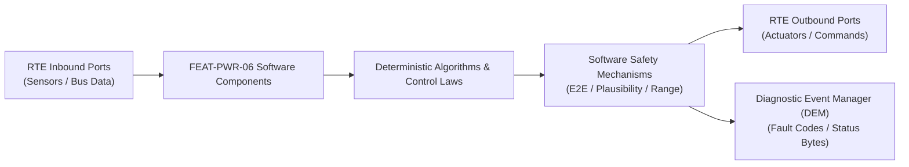

# Software Requirements Specification: Bidirectional Vehicle-to-Load & Vehicle-to-Grid (V2L / V2G)
**Feature ID:** `FEAT-PWR-06`  
**Domain:** Electric Powertrain & Energy Management  
**Target ASIL:** ASIL C  
**Compliance Standard:** ISO 26262:2018 (Part 6 - Software Development) / ASPICE PAM v3.1 (SWE.1, SWE.2)  
**Parent System Specification:** [`FEAT-PWR-06_V2L_SysReq.md`](file:///c:/Workset/AntiGravityProjects/TestOptimisationExperiement/system_requirements/FEAT-PWR-06_V2L_SysReq.md)  
**Global Master Specification:** [`spec.md`](file:///c:/Workset/AntiGravityProjects/TestOptimisationExperiement/spec.md)

---

## 1. Software Architecture & Component Structure

This document specifies the AUTOSAR Software Components (SWCs), periodic runnables, algorithmic laws, safety mechanisms, and data ports implementing `FEAT-PWR-06` (Bidirectional Vehicle-to-Load & Vehicle-to-Grid (V2L / V2G)).

### AUTOSAR SWC Interaction Diagram

---

## 2. Detailed Software Requirements (SWR_REQ)
*(Multi-Software Requirement Partitioning derived from System Requirements)*

### `SWR-PWR-06-01`: High-Speed Residual Current Device (RCD) 10 kHz Comparator
- **Planned Release:** R100
- **ASIL Rating:** ASIL C
- **Parent System Requirement:** [`SYS-PWR-06-01`](file:///c:/Workset/AntiGravityProjects/TestOptimisationExperiement/system_requirements/FEAT-PWR-06_V2L_SysReq.md#sys-pwr-06-01)
- **Allocated AUTOSAR SWC:** `V2lSafetyMonitor_SWC`
- **Execution Rate / Trigger:** 1 ms
- **Worst-Case Execution Time (WCET):** 0.15 ms
- **Software Activation Condition:** Executed in 1000 Hz ISR.
- **Algorithmic Description / Logic:**
  > Samples differential current I_diff = abs(I_line - I_neutral). If I_diff > 30.0 mA AC or I_diff > 6.0 mA DC for >= 2 consecutive samples, asserts hardware relay trip pin.
- **Software Safety Mechanism:** Direct hardware trip output routed to gate driver shutdown line.
- **Failure Reaction & DEM Diagnostic Event:** Latch RCD_Ground_Trip state and require manual power cycle to reset.
- **Software Port Inputs:** `ADC_Current_Line, ADC_Current_Neutral`
- **Software Port Outputs:** `RCD_Trip_Command (boolean), Earth_Leakage_Level_mA`
- **Software Verification Criteria:** Fault injection testing with simulated human body electrical impedance models.
- **Traceability Link:** Traces upward to [`SYS-PWR-06-01`](file:///c:/Workset/AntiGravityProjects/TestOptimisationExperiement/system_requirements/FEAT-PWR-06_V2L_SysReq.md#sys-pwr-06-01) and [`FEAT-PWR-06`](file:///c:/Workset/AntiGravityProjects/TestOptimisationExperiement/spec.md).

### `SWR-PWR-06-02`: Anti-Islanding Frequency Shift & Grid Disconnect Observer
- **Planned Release:** R100
- **ASIL Rating:** ASIL C
- **Parent System Requirement:** [`SYS-PWR-06-01`](file:///c:/Workset/AntiGravityProjects/TestOptimisationExperiement/system_requirements/FEAT-PWR-06_V2L_SysReq.md#sys-pwr-06-01)
- **Allocated AUTOSAR SWC:** `V2gAntiIslanding_SWC`
- **Execution Rate / Trigger:** 10 ms
- **Worst-Case Execution Time (WCET):** 1.1 ms
- **Software Activation Condition:** Executed in grid-tied V2G mode.
- **Algorithmic Description / Logic:**
  > Implements Active Frequency Drift (AFD) algorithm: Injects small phase perturbations into exported current. If utility grid disconnects, voltage frequency drifts outside [49.5, 50.5] Hz, triggering islanding trip in <= 100 ms.
- **Software Safety Mechanism:** Under/over voltage and frequency trip boundaries conforming to IEEE 1547.
- **Failure Reaction & DEM Diagnostic Event:** Isolate utility grid transfer switch in < 16 ms upon grid power collapse.
- **Software Port Inputs:** `Grid_Voltage_Phase_Angle, Grid_Frequency_Hz, Utility_Transfer_Switch_State`
- **Software Port Outputs:** `Islanding_Detected_Flag (boolean), Grid_Disconnect_Relay_Cmd`
- **Software Verification Criteria:** UL 1741 anti-islanding resonant RLC load bench test.
- **Traceability Link:** Traces upward to [`SYS-PWR-06-01`](file:///c:/Workset/AntiGravityProjects/TestOptimisationExperiement/system_requirements/FEAT-PWR-06_V2L_SysReq.md#sys-pwr-06-01) and [`FEAT-PWR-06`](file:///c:/Workset/AntiGravityProjects/TestOptimisationExperiement/spec.md).

### `SWR-PWR-06-03`: DC-AC Unipolar SPWM Sine-Wave Inverter Synthesis
- **Planned Release:** R100
- **ASIL Rating:** ASIL C
- **Parent System Requirement:** [`SYS-PWR-06-02`](file:///c:/Workset/AntiGravityProjects/TestOptimisationExperiement/system_requirements/FEAT-PWR-06_V2L_SysReq.md#sys-pwr-06-02)
- **Allocated AUTOSAR SWC:** `V2lInverterController_SWC`
- **Execution Rate / Trigger:** 1 ms
- **Worst-Case Execution Time (WCET):** 0.3 ms
- **Software Activation Condition:** Executed at 20 kHz PWM carrier rate.
- **Algorithmic Description / Logic:**
  > Generates unipolar Sinusoidal Pulse Width Modulation (SPWM) driving full-bridge IGBT/SiC stage. Closed-loop voltage regulation uses PR (Proportional-Resonant) controller tuned to 50/60 Hz fundamental frequency.
- **Software Safety Mechanism:** Dead-time insertion (1.5 us) prevents shoot-through across bridge legs.
- **Failure Reaction & DEM Diagnostic Event:** Disable PWM pulses if DC-link voltage dips below 250V.
- **Software Port Inputs:** `V_dc_link, Target_AC_RMS_Voltage, Measured_AC_Voltage`
- **Software Port Outputs:** `PWM_Leg_A_Duty, PWM_Leg_B_Duty`
- **Software Verification Criteria:** Harmonic spectrum analysis measuring THD under heavy nonlinear rectifier loads.
- **Traceability Link:** Traces upward to [`SYS-PWR-06-02`](file:///c:/Workset/AntiGravityProjects/TestOptimisationExperiement/system_requirements/FEAT-PWR-06_V2L_SysReq.md#sys-pwr-06-02) and [`FEAT-PWR-06`](file:///c:/Workset/AntiGravityProjects/TestOptimisationExperiement/spec.md).

### `SWR-PWR-06-04`: Battery Discharge Reserve & Inrush Current Overload Protector
- **Planned Release:** R100
- **ASIL Rating:** QM
- **Parent System Requirement:** [`SYS-PWR-06-02`](file:///c:/Workset/AntiGravityProjects/TestOptimisationExperiement/system_requirements/FEAT-PWR-06_V2L_SysReq.md#sys-pwr-06-02)
- **Allocated AUTOSAR SWC:** `V2lPowerGovernor_SWC`
- **Execution Rate / Trigger:** 50 ms
- **Worst-Case Execution Time (WCET):** 0.6 ms
- **Software Activation Condition:** Executed every 50 ms.
- **Algorithmic Description / Logic:**
  > Monitors Battery_SOC. If SOC <= User_Reserve_Cutoff (e.g. 20%), initiates 60-second warning countdown before gracefully de-energizing AC outlet. Allows 120% overload for 10s (refrigerator compressor starting).
- **Software Safety Mechanism:** Thermal energy I^2*t accumulator limits prolonged high-current draws.
- **Failure Reaction & DEM Diagnostic Event:** Shutdown discharge immediately if battery cell temperature drops < -15°C.
- **Software Port Inputs:** `Battery_SOC_Pct, User_Reserve_Limit_Pct, AC_Active_Power_W`
- **Software Port Outputs:** `Remaining_V2L_Hours (float32), Overload_Shutdown_Warning (boolean)`
- **Software Verification Criteria:** Full discharge cycle testing evaluating reserve cutoff accuracy.
- **Traceability Link:** Traces upward to [`SYS-PWR-06-02`](file:///c:/Workset/AntiGravityProjects/TestOptimisationExperiement/system_requirements/FEAT-PWR-06_V2L_SysReq.md#sys-pwr-06-02) and [`FEAT-PWR-06`](file:///c:/Workset/AntiGravityProjects/TestOptimisationExperiement/spec.md).

### `SWR-PWR-06-05`: V2L AC Islanding Grid Synthesizer & Autonomous Voltage Regulator - Dynamic Observer & Signal Filter
- **Planned Release:** R100
- **ASIL Rating:** ASIL C
- **Parent System Requirement:** [`SYS-PWR-06-03`](file:///c:/Workset/AntiGravityProjects/TestOptimisationExperiement/system_requirements/FEAT-PWR-06_V2L_SysReq.md#sys-pwr-06-03)
- **Allocated AUTOSAR SWC:** `V2lGridSynthesizer_SWC`
- **Execution Rate / Trigger:** 0.5 ms
- **Worst-Case Execution Time (WCET):** 0.3 ms
- **Software Activation Condition:** Executed cyclically every 0.5 ms.
- **Algorithmic Description / Logic:**
  > Executes signal plausibility filtering, calibration offsets, and discrete state estimation for V2L AC Islanding Grid Synthesizer & Autonomous Voltage Regulator.
- **Software Safety Mechanism:** Range limit plausibility check and E2E alive sequence verification.
- **Failure Reaction & DEM Diagnostic Event:** Set default fallback output and report DEM_EVENT_FEAT_PWR_06_ERR.
- **Software Port Inputs:** `Raw sensor ADC/SENT/SPI values and RTE bus inputs.`
- **Software Port Outputs:** `Filtered physical signals and validity status bitmasks.`
- **Software Verification Criteria:** Unit test and HiL software integration test.
- **Traceability Link:** Traces upward to [`SYS-PWR-06-03`](file:///c:/Workset/AntiGravityProjects/TestOptimisationExperiement/system_requirements/FEAT-PWR-06_V2L_SysReq.md#sys-pwr-06-03) and [`FEAT-PWR-06`](file:///c:/Workset/AntiGravityProjects/TestOptimisationExperiement/spec.md).

### `SWR-PWR-06-06`: V2L AC Islanding Grid Synthesizer & Autonomous Voltage Regulator - Closed-Loop Control Law & Actuator Dispatch
- **Planned Release:** R100
- **ASIL Rating:** ASIL C
- **Parent System Requirement:** [`SYS-PWR-06-03`](file:///c:/Workset/AntiGravityProjects/TestOptimisationExperiement/system_requirements/FEAT-PWR-06_V2L_SysReq.md#sys-pwr-06-03)
- **Allocated AUTOSAR SWC:** `V2lGridSynthesizer_SWC`
- **Execution Rate / Trigger:** 0.5 ms
- **Worst-Case Execution Time (WCET):** 0.4 ms
- **Software Activation Condition:** Executed cyclically every 0.5 ms.
- **Algorithmic Description / Logic:**
  > Evaluates deterministic closed-loop control law, rate limits, and dispatches commands for V2L AC Islanding Grid Synthesizer & Autonomous Voltage Regulator.
- **Software Safety Mechanism:** Command saturation clamping and watchdog program flow monitoring.
- **Failure Reaction & DEM Diagnostic Event:** De-energize actuator output, apply safe fallback clamp, and latch DTC.
- **Software Port Inputs:** `Validated physical state signals from observer SWC.`
- **Software Port Outputs:** `Actuator PWM duty cycles, torque/pressure setpoints, and diagnostic flags.`
- **Software Verification Criteria:** Hardware dynamometer and HiL closed-loop regression test suite.
- **Traceability Link:** Traces upward to [`SYS-PWR-06-03`](file:///c:/Workset/AntiGravityProjects/TestOptimisationExperiement/system_requirements/FEAT-PWR-06_V2L_SysReq.md#sys-pwr-06-03) and [`FEAT-PWR-06`](file:///c:/Workset/AntiGravityProjects/TestOptimisationExperiement/spec.md).

### `SWR-PWR-06-07`: V2G Bi-Directional Grid-Tied Synchronization & Active Power Dispatcher - Dynamic Observer & Signal Filter
- **Planned Release:** R200
- **ASIL Rating:** ASIL C
- **Parent System Requirement:** [`SYS-PWR-06-04`](file:///c:/Workset/AntiGravityProjects/TestOptimisationExperiement/system_requirements/FEAT-PWR-06_V2L_SysReq.md#sys-pwr-06-04)
- **Allocated AUTOSAR SWC:** `V2gPowerDispatcher_SWC`
- **Execution Rate / Trigger:** 2 ms
- **Worst-Case Execution Time (WCET):** 0.3 ms
- **Software Activation Condition:** Executed cyclically every 2 ms.
- **Algorithmic Description / Logic:**
  > Executes signal plausibility filtering, calibration offsets, and discrete state estimation for V2G Bi-Directional Grid-Tied Synchronization & Active Power Dispatcher.
- **Software Safety Mechanism:** Range limit plausibility check and E2E alive sequence verification.
- **Failure Reaction & DEM Diagnostic Event:** Set default fallback output and report DEM_EVENT_FEAT_PWR_06_ERR.
- **Software Port Inputs:** `Raw sensor ADC/SENT/SPI values and RTE bus inputs.`
- **Software Port Outputs:** `Filtered physical signals and validity status bitmasks.`
- **Software Verification Criteria:** Unit test and HiL software integration test.
- **Traceability Link:** Traces upward to [`SYS-PWR-06-04`](file:///c:/Workset/AntiGravityProjects/TestOptimisationExperiement/system_requirements/FEAT-PWR-06_V2L_SysReq.md#sys-pwr-06-04) and [`FEAT-PWR-06`](file:///c:/Workset/AntiGravityProjects/TestOptimisationExperiement/spec.md).

### `SWR-PWR-06-08`: V2G Bi-Directional Grid-Tied Synchronization & Active Power Dispatcher - Closed-Loop Control Law & Actuator Dispatch
- **Planned Release:** R200
- **ASIL Rating:** ASIL C
- **Parent System Requirement:** [`SYS-PWR-06-04`](file:///c:/Workset/AntiGravityProjects/TestOptimisationExperiement/system_requirements/FEAT-PWR-06_V2L_SysReq.md#sys-pwr-06-04)
- **Allocated AUTOSAR SWC:** `V2gPowerDispatcher_SWC`
- **Execution Rate / Trigger:** 2 ms
- **Worst-Case Execution Time (WCET):** 0.4 ms
- **Software Activation Condition:** Executed cyclically every 2 ms.
- **Algorithmic Description / Logic:**
  > Evaluates deterministic closed-loop control law, rate limits, and dispatches commands for V2G Bi-Directional Grid-Tied Synchronization & Active Power Dispatcher.
- **Software Safety Mechanism:** Command saturation clamping and watchdog program flow monitoring.
- **Failure Reaction & DEM Diagnostic Event:** De-energize actuator output, apply safe fallback clamp, and latch DTC.
- **Software Port Inputs:** `Validated physical state signals from observer SWC.`
- **Software Port Outputs:** `Actuator PWM duty cycles, torque/pressure setpoints, and diagnostic flags.`
- **Software Verification Criteria:** Hardware dynamometer and HiL closed-loop regression test suite.
- **Traceability Link:** Traces upward to [`SYS-PWR-06-04`](file:///c:/Workset/AntiGravityProjects/TestOptimisationExperiement/system_requirements/FEAT-PWR-06_V2L_SysReq.md#sys-pwr-06-04) and [`FEAT-PWR-06`](file:///c:/Workset/AntiGravityProjects/TestOptimisationExperiement/spec.md).

### `SWR-PWR-06-09`: V2L Inrush Current & Overload Electronic Circuit Breaker Safing - Dynamic Observer & Signal Filter
- **Planned Release:** R400
- **ASIL Rating:** ASIL C
- **Parent System Requirement:** [`SYS-PWR-06-05`](file:///c:/Workset/AntiGravityProjects/TestOptimisationExperiement/system_requirements/FEAT-PWR-06_V2L_SysReq.md#sys-pwr-06-05)
- **Allocated AUTOSAR SWC:** `V2lCircuitBreaker_SWC`
- **Execution Rate / Trigger:** 0.5 ms
- **Worst-Case Execution Time (WCET):** 0.3 ms
- **Software Activation Condition:** Executed cyclically every 0.5 ms.
- **Algorithmic Description / Logic:**
  > Executes signal plausibility filtering, calibration offsets, and discrete state estimation for V2L Inrush Current & Overload Electronic Circuit Breaker Safing.
- **Software Safety Mechanism:** Range limit plausibility check and E2E alive sequence verification.
- **Failure Reaction & DEM Diagnostic Event:** Set default fallback output and report DEM_EVENT_FEAT_PWR_06_ERR.
- **Software Port Inputs:** `Raw sensor ADC/SENT/SPI values and RTE bus inputs.`
- **Software Port Outputs:** `Filtered physical signals and validity status bitmasks.`
- **Software Verification Criteria:** Unit test and HiL software integration test.
- **Traceability Link:** Traces upward to [`SYS-PWR-06-05`](file:///c:/Workset/AntiGravityProjects/TestOptimisationExperiement/system_requirements/FEAT-PWR-06_V2L_SysReq.md#sys-pwr-06-05) and [`FEAT-PWR-06`](file:///c:/Workset/AntiGravityProjects/TestOptimisationExperiement/spec.md).

### `SWR-PWR-06-10`: V2L Inrush Current & Overload Electronic Circuit Breaker Safing - Closed-Loop Control Law & Actuator Dispatch
- **Planned Release:** R400
- **ASIL Rating:** ASIL C
- **Parent System Requirement:** [`SYS-PWR-06-05`](file:///c:/Workset/AntiGravityProjects/TestOptimisationExperiement/system_requirements/FEAT-PWR-06_V2L_SysReq.md#sys-pwr-06-05)
- **Allocated AUTOSAR SWC:** `V2lCircuitBreaker_SWC`
- **Execution Rate / Trigger:** 0.5 ms
- **Worst-Case Execution Time (WCET):** 0.4 ms
- **Software Activation Condition:** Executed cyclically every 0.5 ms.
- **Algorithmic Description / Logic:**
  > Evaluates deterministic closed-loop control law, rate limits, and dispatches commands for V2L Inrush Current & Overload Electronic Circuit Breaker Safing.
- **Software Safety Mechanism:** Command saturation clamping and watchdog program flow monitoring.
- **Failure Reaction & DEM Diagnostic Event:** De-energize actuator output, apply safe fallback clamp, and latch DTC.
- **Software Port Inputs:** `Validated physical state signals from observer SWC.`
- **Software Port Outputs:** `Actuator PWM duty cycles, torque/pressure setpoints, and diagnostic flags.`
- **Software Verification Criteria:** Hardware dynamometer and HiL closed-loop regression test suite.
- **Traceability Link:** Traces upward to [`SYS-PWR-06-05`](file:///c:/Workset/AntiGravityProjects/TestOptimisationExperiement/system_requirements/FEAT-PWR-06_V2L_SysReq.md#sys-pwr-06-05) and [`FEAT-PWR-06`](file:///c:/Workset/AntiGravityProjects/TestOptimisationExperiement/spec.md).

### `SWR-PWR-06-11`: Anti-Islanding Utility Power Cut Detection & Immediate Disconnect - Dynamic Observer & Signal Filter
- **Planned Release:** R200
- **ASIL Rating:** ASIL C
- **Parent System Requirement:** [`SYS-PWR-06-06`](file:///c:/Workset/AntiGravityProjects/TestOptimisationExperiement/system_requirements/FEAT-PWR-06_V2L_SysReq.md#sys-pwr-06-06)
- **Allocated AUTOSAR SWC:** `V2gAntiIslanding_SWC`
- **Execution Rate / Trigger:** 2 ms
- **Worst-Case Execution Time (WCET):** 0.3 ms
- **Software Activation Condition:** Executed cyclically every 2 ms.
- **Algorithmic Description / Logic:**
  > Executes signal plausibility filtering, calibration offsets, and discrete state estimation for Anti-Islanding Utility Power Cut Detection & Immediate Disconnect.
- **Software Safety Mechanism:** Range limit plausibility check and E2E alive sequence verification.
- **Failure Reaction & DEM Diagnostic Event:** Set default fallback output and report DEM_EVENT_FEAT_PWR_06_ERR.
- **Software Port Inputs:** `Raw sensor ADC/SENT/SPI values and RTE bus inputs.`
- **Software Port Outputs:** `Filtered physical signals and validity status bitmasks.`
- **Software Verification Criteria:** Unit test and HiL software integration test.
- **Traceability Link:** Traces upward to [`SYS-PWR-06-06`](file:///c:/Workset/AntiGravityProjects/TestOptimisationExperiement/system_requirements/FEAT-PWR-06_V2L_SysReq.md#sys-pwr-06-06) and [`FEAT-PWR-06`](file:///c:/Workset/AntiGravityProjects/TestOptimisationExperiement/spec.md).

### `SWR-PWR-06-12`: Anti-Islanding Utility Power Cut Detection & Immediate Disconnect - Closed-Loop Control Law & Actuator Dispatch
- **Planned Release:** R200
- **ASIL Rating:** ASIL C
- **Parent System Requirement:** [`SYS-PWR-06-06`](file:///c:/Workset/AntiGravityProjects/TestOptimisationExperiement/system_requirements/FEAT-PWR-06_V2L_SysReq.md#sys-pwr-06-06)
- **Allocated AUTOSAR SWC:** `V2gAntiIslanding_SWC`
- **Execution Rate / Trigger:** 2 ms
- **Worst-Case Execution Time (WCET):** 0.4 ms
- **Software Activation Condition:** Executed cyclically every 2 ms.
- **Algorithmic Description / Logic:**
  > Evaluates deterministic closed-loop control law, rate limits, and dispatches commands for Anti-Islanding Utility Power Cut Detection & Immediate Disconnect.
- **Software Safety Mechanism:** Command saturation clamping and watchdog program flow monitoring.
- **Failure Reaction & DEM Diagnostic Event:** De-energize actuator output, apply safe fallback clamp, and latch DTC.
- **Software Port Inputs:** `Validated physical state signals from observer SWC.`
- **Software Port Outputs:** `Actuator PWM duty cycles, torque/pressure setpoints, and diagnostic flags.`
- **Software Verification Criteria:** Hardware dynamometer and HiL closed-loop regression test suite.
- **Traceability Link:** Traces upward to [`SYS-PWR-06-06`](file:///c:/Workset/AntiGravityProjects/TestOptimisationExperiement/system_requirements/FEAT-PWR-06_V2L_SysReq.md#sys-pwr-06-06) and [`FEAT-PWR-06`](file:///c:/Workset/AntiGravityProjects/TestOptimisationExperiement/spec.md).

### `SWR-PWR-06-13`: V2L Discharge Lower Battery SOC Cutoff Threshold Governor - Dynamic Observer & Signal Filter
- **Planned Release:** R300
- **ASIL Rating:** ASIL B
- **Parent System Requirement:** [`SYS-PWR-06-07`](file:///c:/Workset/AntiGravityProjects/TestOptimisationExperiement/system_requirements/FEAT-PWR-06_V2L_SysReq.md#sys-pwr-06-07)
- **Allocated AUTOSAR SWC:** `V2lSocGovernor_SWC`
- **Execution Rate / Trigger:** 100 ms
- **Worst-Case Execution Time (WCET):** 0.3 ms
- **Software Activation Condition:** Executed cyclically every 100 ms.
- **Algorithmic Description / Logic:**
  > Executes signal plausibility filtering, calibration offsets, and discrete state estimation for V2L Discharge Lower Battery SOC Cutoff Threshold Governor.
- **Software Safety Mechanism:** Range limit plausibility check and E2E alive sequence verification.
- **Failure Reaction & DEM Diagnostic Event:** Set default fallback output and report DEM_EVENT_FEAT_PWR_06_ERR.
- **Software Port Inputs:** `Raw sensor ADC/SENT/SPI values and RTE bus inputs.`
- **Software Port Outputs:** `Filtered physical signals and validity status bitmasks.`
- **Software Verification Criteria:** Unit test and HiL software integration test.
- **Traceability Link:** Traces upward to [`SYS-PWR-06-07`](file:///c:/Workset/AntiGravityProjects/TestOptimisationExperiement/system_requirements/FEAT-PWR-06_V2L_SysReq.md#sys-pwr-06-07) and [`FEAT-PWR-06`](file:///c:/Workset/AntiGravityProjects/TestOptimisationExperiement/spec.md).

### `SWR-PWR-06-14`: V2L Discharge Lower Battery SOC Cutoff Threshold Governor - Closed-Loop Control Law & Actuator Dispatch
- **Planned Release:** R300
- **ASIL Rating:** ASIL B
- **Parent System Requirement:** [`SYS-PWR-06-07`](file:///c:/Workset/AntiGravityProjects/TestOptimisationExperiement/system_requirements/FEAT-PWR-06_V2L_SysReq.md#sys-pwr-06-07)
- **Allocated AUTOSAR SWC:** `V2lSocGovernor_SWC`
- **Execution Rate / Trigger:** 100 ms
- **Worst-Case Execution Time (WCET):** 0.4 ms
- **Software Activation Condition:** Executed cyclically every 100 ms.
- **Algorithmic Description / Logic:**
  > Evaluates deterministic closed-loop control law, rate limits, and dispatches commands for V2L Discharge Lower Battery SOC Cutoff Threshold Governor.
- **Software Safety Mechanism:** Command saturation clamping and watchdog program flow monitoring.
- **Failure Reaction & DEM Diagnostic Event:** De-energize actuator output, apply safe fallback clamp, and latch DTC.
- **Software Port Inputs:** `Validated physical state signals from observer SWC.`
- **Software Port Outputs:** `Actuator PWM duty cycles, torque/pressure setpoints, and diagnostic flags.`
- **Software Verification Criteria:** Hardware dynamometer and HiL closed-loop regression test suite.
- **Traceability Link:** Traces upward to [`SYS-PWR-06-07`](file:///c:/Workset/AntiGravityProjects/TestOptimisationExperiement/system_requirements/FEAT-PWR-06_V2L_SysReq.md#sys-pwr-06-07) and [`FEAT-PWR-06`](file:///c:/Workset/AntiGravityProjects/TestOptimisationExperiement/spec.md).

### `SWR-PWR-06-15`: Vehicle External Power Outlet Thermal & Weather Enclosure Interlock - Dynamic Observer & Signal Filter
- **Planned Release:** R300
- **ASIL Rating:** ASIL B
- **Parent System Requirement:** [`SYS-PWR-06-08`](file:///c:/Workset/AntiGravityProjects/TestOptimisationExperiement/system_requirements/FEAT-PWR-06_V2L_SysReq.md#sys-pwr-06-08)
- **Allocated AUTOSAR SWC:** `V2lSocketInterlock_SWC`
- **Execution Rate / Trigger:** 50 ms
- **Worst-Case Execution Time (WCET):** 0.3 ms
- **Software Activation Condition:** Executed cyclically every 50 ms.
- **Algorithmic Description / Logic:**
  > Executes signal plausibility filtering, calibration offsets, and discrete state estimation for Vehicle External Power Outlet Thermal & Weather Enclosure Interlock.
- **Software Safety Mechanism:** Range limit plausibility check and E2E alive sequence verification.
- **Failure Reaction & DEM Diagnostic Event:** Set default fallback output and report DEM_EVENT_FEAT_PWR_06_ERR.
- **Software Port Inputs:** `Raw sensor ADC/SENT/SPI values and RTE bus inputs.`
- **Software Port Outputs:** `Filtered physical signals and validity status bitmasks.`
- **Software Verification Criteria:** Unit test and HiL software integration test.
- **Traceability Link:** Traces upward to [`SYS-PWR-06-08`](file:///c:/Workset/AntiGravityProjects/TestOptimisationExperiement/system_requirements/FEAT-PWR-06_V2L_SysReq.md#sys-pwr-06-08) and [`FEAT-PWR-06`](file:///c:/Workset/AntiGravityProjects/TestOptimisationExperiement/spec.md).

### `SWR-PWR-06-16`: Vehicle External Power Outlet Thermal & Weather Enclosure Interlock - Closed-Loop Control Law & Actuator Dispatch
- **Planned Release:** R300
- **ASIL Rating:** ASIL B
- **Parent System Requirement:** [`SYS-PWR-06-08`](file:///c:/Workset/AntiGravityProjects/TestOptimisationExperiement/system_requirements/FEAT-PWR-06_V2L_SysReq.md#sys-pwr-06-08)
- **Allocated AUTOSAR SWC:** `V2lSocketInterlock_SWC`
- **Execution Rate / Trigger:** 50 ms
- **Worst-Case Execution Time (WCET):** 0.4 ms
- **Software Activation Condition:** Executed cyclically every 50 ms.
- **Algorithmic Description / Logic:**
  > Evaluates deterministic closed-loop control law, rate limits, and dispatches commands for Vehicle External Power Outlet Thermal & Weather Enclosure Interlock.
- **Software Safety Mechanism:** Command saturation clamping and watchdog program flow monitoring.
- **Failure Reaction & DEM Diagnostic Event:** De-energize actuator output, apply safe fallback clamp, and latch DTC.
- **Software Port Inputs:** `Validated physical state signals from observer SWC.`
- **Software Port Outputs:** `Actuator PWM duty cycles, torque/pressure setpoints, and diagnostic flags.`
- **Software Verification Criteria:** Hardware dynamometer and HiL closed-loop regression test suite.
- **Traceability Link:** Traces upward to [`SYS-PWR-06-08`](file:///c:/Workset/AntiGravityProjects/TestOptimisationExperiement/system_requirements/FEAT-PWR-06_V2L_SysReq.md#sys-pwr-06-08) and [`FEAT-PWR-06`](file:///c:/Workset/AntiGravityProjects/TestOptimisationExperiement/spec.md).

### `SWR-PWR-06-17`: V2G Smart Charging Schedule Optimization via ISO 15118-20 Dynamic Pricing - Dynamic Observer & Signal Filter
- **Planned Release:** R300
- **ASIL Rating:** ASIL B
- **Parent System Requirement:** [`SYS-PWR-06-09`](file:///c:/Workset/AntiGravityProjects/TestOptimisationExperiement/system_requirements/FEAT-PWR-06_V2L_SysReq.md#sys-pwr-06-09)
- **Allocated AUTOSAR SWC:** `V2gPriceOptimizer_SWC`
- **Execution Rate / Trigger:** 500 ms
- **Worst-Case Execution Time (WCET):** 0.3 ms
- **Software Activation Condition:** Executed cyclically every 500 ms.
- **Algorithmic Description / Logic:**
  > Executes signal plausibility filtering, calibration offsets, and discrete state estimation for V2G Smart Charging Schedule Optimization via ISO 15118-20 Dynamic Pricing.
- **Software Safety Mechanism:** Range limit plausibility check and E2E alive sequence verification.
- **Failure Reaction & DEM Diagnostic Event:** Set default fallback output and report DEM_EVENT_FEAT_PWR_06_ERR.
- **Software Port Inputs:** `Raw sensor ADC/SENT/SPI values and RTE bus inputs.`
- **Software Port Outputs:** `Filtered physical signals and validity status bitmasks.`
- **Software Verification Criteria:** Unit test and HiL software integration test.
- **Traceability Link:** Traces upward to [`SYS-PWR-06-09`](file:///c:/Workset/AntiGravityProjects/TestOptimisationExperiement/system_requirements/FEAT-PWR-06_V2L_SysReq.md#sys-pwr-06-09) and [`FEAT-PWR-06`](file:///c:/Workset/AntiGravityProjects/TestOptimisationExperiement/spec.md).

### `SWR-PWR-06-18`: V2G Smart Charging Schedule Optimization via ISO 15118-20 Dynamic Pricing - Closed-Loop Control Law & Actuator Dispatch
- **Planned Release:** R300
- **ASIL Rating:** ASIL B
- **Parent System Requirement:** [`SYS-PWR-06-09`](file:///c:/Workset/AntiGravityProjects/TestOptimisationExperiement/system_requirements/FEAT-PWR-06_V2L_SysReq.md#sys-pwr-06-09)
- **Allocated AUTOSAR SWC:** `V2gPriceOptimizer_SWC`
- **Execution Rate / Trigger:** 500 ms
- **Worst-Case Execution Time (WCET):** 0.4 ms
- **Software Activation Condition:** Executed cyclically every 500 ms.
- **Algorithmic Description / Logic:**
  > Evaluates deterministic closed-loop control law, rate limits, and dispatches commands for V2G Smart Charging Schedule Optimization via ISO 15118-20 Dynamic Pricing.
- **Software Safety Mechanism:** Command saturation clamping and watchdog program flow monitoring.
- **Failure Reaction & DEM Diagnostic Event:** De-energize actuator output, apply safe fallback clamp, and latch DTC.
- **Software Port Inputs:** `Validated physical state signals from observer SWC.`
- **Software Port Outputs:** `Actuator PWM duty cycles, torque/pressure setpoints, and diagnostic flags.`
- **Software Verification Criteria:** Hardware dynamometer and HiL closed-loop regression test suite.
- **Traceability Link:** Traces upward to [`SYS-PWR-06-09`](file:///c:/Workset/AntiGravityProjects/TestOptimisationExperiement/system_requirements/FEAT-PWR-06_V2L_SysReq.md#sys-pwr-06-09) and [`FEAT-PWR-06`](file:///c:/Workset/AntiGravityProjects/TestOptimisationExperiement/spec.md).

### `SWR-PWR-06-19`: Galvanic Output Neutral-Ground Bond Switch State Coordinator - Dynamic Observer & Signal Filter
- **Planned Release:** R400
- **ASIL Rating:** ASIL C
- **Parent System Requirement:** [`SYS-PWR-06-10`](file:///c:/Workset/AntiGravityProjects/TestOptimisationExperiement/system_requirements/FEAT-PWR-06_V2L_SysReq.md#sys-pwr-06-10)
- **Allocated AUTOSAR SWC:** `V2lNeutralBond_SWC`
- **Execution Rate / Trigger:** 10 ms
- **Worst-Case Execution Time (WCET):** 0.3 ms
- **Software Activation Condition:** Executed cyclically every 10 ms.
- **Algorithmic Description / Logic:**
  > Executes signal plausibility filtering, calibration offsets, and discrete state estimation for Galvanic Output Neutral-Ground Bond Switch State Coordinator.
- **Software Safety Mechanism:** Range limit plausibility check and E2E alive sequence verification.
- **Failure Reaction & DEM Diagnostic Event:** Set default fallback output and report DEM_EVENT_FEAT_PWR_06_ERR.
- **Software Port Inputs:** `Raw sensor ADC/SENT/SPI values and RTE bus inputs.`
- **Software Port Outputs:** `Filtered physical signals and validity status bitmasks.`
- **Software Verification Criteria:** Unit test and HiL software integration test.
- **Traceability Link:** Traces upward to [`SYS-PWR-06-10`](file:///c:/Workset/AntiGravityProjects/TestOptimisationExperiement/system_requirements/FEAT-PWR-06_V2L_SysReq.md#sys-pwr-06-10) and [`FEAT-PWR-06`](file:///c:/Workset/AntiGravityProjects/TestOptimisationExperiement/spec.md).

### `SWR-PWR-06-20`: Galvanic Output Neutral-Ground Bond Switch State Coordinator - Closed-Loop Control Law & Actuator Dispatch
- **Planned Release:** R400
- **ASIL Rating:** ASIL C
- **Parent System Requirement:** [`SYS-PWR-06-10`](file:///c:/Workset/AntiGravityProjects/TestOptimisationExperiement/system_requirements/FEAT-PWR-06_V2L_SysReq.md#sys-pwr-06-10)
- **Allocated AUTOSAR SWC:** `V2lNeutralBond_SWC`
- **Execution Rate / Trigger:** 10 ms
- **Worst-Case Execution Time (WCET):** 0.4 ms
- **Software Activation Condition:** Executed cyclically every 10 ms.
- **Algorithmic Description / Logic:**
  > Evaluates deterministic closed-loop control law, rate limits, and dispatches commands for Galvanic Output Neutral-Ground Bond Switch State Coordinator.
- **Software Safety Mechanism:** Command saturation clamping and watchdog program flow monitoring.
- **Failure Reaction & DEM Diagnostic Event:** De-energize actuator output, apply safe fallback clamp, and latch DTC.
- **Software Port Inputs:** `Validated physical state signals from observer SWC.`
- **Software Port Outputs:** `Actuator PWM duty cycles, torque/pressure setpoints, and diagnostic flags.`
- **Software Verification Criteria:** Hardware dynamometer and HiL closed-loop regression test suite.
- **Traceability Link:** Traces upward to [`SYS-PWR-06-10`](file:///c:/Workset/AntiGravityProjects/TestOptimisationExperiement/system_requirements/FEAT-PWR-06_V2L_SysReq.md#sys-pwr-06-10) and [`FEAT-PWR-06`](file:///c:/Workset/AntiGravityProjects/TestOptimisationExperiement/spec.md).

### `SWR-PWR-06-21`: Inverter Power Semiconductor Symmetrical Thermal Derater - Dynamic Observer & Signal Filter
- **Planned Release:** R400
- **ASIL Rating:** ASIL B
- **Parent System Requirement:** [`SYS-PWR-06-11`](file:///c:/Workset/AntiGravityProjects/TestOptimisationExperiement/system_requirements/FEAT-PWR-06_V2L_SysReq.md#sys-pwr-06-11)
- **Allocated AUTOSAR SWC:** `V2lThermalDerater_SWC`
- **Execution Rate / Trigger:** 50 ms
- **Worst-Case Execution Time (WCET):** 0.3 ms
- **Software Activation Condition:** Executed cyclically every 50 ms.
- **Algorithmic Description / Logic:**
  > Executes signal plausibility filtering, calibration offsets, and discrete state estimation for Inverter Power Semiconductor Symmetrical Thermal Derater.
- **Software Safety Mechanism:** Range limit plausibility check and E2E alive sequence verification.
- **Failure Reaction & DEM Diagnostic Event:** Set default fallback output and report DEM_EVENT_FEAT_PWR_06_ERR.
- **Software Port Inputs:** `Raw sensor ADC/SENT/SPI values and RTE bus inputs.`
- **Software Port Outputs:** `Filtered physical signals and validity status bitmasks.`
- **Software Verification Criteria:** Unit test and HiL software integration test.
- **Traceability Link:** Traces upward to [`SYS-PWR-06-11`](file:///c:/Workset/AntiGravityProjects/TestOptimisationExperiement/system_requirements/FEAT-PWR-06_V2L_SysReq.md#sys-pwr-06-11) and [`FEAT-PWR-06`](file:///c:/Workset/AntiGravityProjects/TestOptimisationExperiement/spec.md).

### `SWR-PWR-06-22`: Inverter Power Semiconductor Symmetrical Thermal Derater - Closed-Loop Control Law & Actuator Dispatch
- **Planned Release:** R400
- **ASIL Rating:** ASIL B
- **Parent System Requirement:** [`SYS-PWR-06-11`](file:///c:/Workset/AntiGravityProjects/TestOptimisationExperiement/system_requirements/FEAT-PWR-06_V2L_SysReq.md#sys-pwr-06-11)
- **Allocated AUTOSAR SWC:** `V2lThermalDerater_SWC`
- **Execution Rate / Trigger:** 50 ms
- **Worst-Case Execution Time (WCET):** 0.4 ms
- **Software Activation Condition:** Executed cyclically every 50 ms.
- **Algorithmic Description / Logic:**
  > Evaluates deterministic closed-loop control law, rate limits, and dispatches commands for Inverter Power Semiconductor Symmetrical Thermal Derater.
- **Software Safety Mechanism:** Command saturation clamping and watchdog program flow monitoring.
- **Failure Reaction & DEM Diagnostic Event:** De-energize actuator output, apply safe fallback clamp, and latch DTC.
- **Software Port Inputs:** `Validated physical state signals from observer SWC.`
- **Software Port Outputs:** `Actuator PWM duty cycles, torque/pressure setpoints, and diagnostic flags.`
- **Software Verification Criteria:** Hardware dynamometer and HiL closed-loop regression test suite.
- **Traceability Link:** Traces upward to [`SYS-PWR-06-11`](file:///c:/Workset/AntiGravityProjects/TestOptimisationExperiement/system_requirements/FEAT-PWR-06_V2L_SysReq.md#sys-pwr-06-11) and [`FEAT-PWR-06`](file:///c:/Workset/AntiGravityProjects/TestOptimisationExperiement/spec.md).

### `SWR-PWR-06-23`: High-Voltage Battery DC Injection Prevention Inverter Filter - Dynamic Observer & Signal Filter
- **Planned Release:** R400
- **ASIL Rating:** ASIL C
- **Parent System Requirement:** [`SYS-PWR-06-12`](file:///c:/Workset/AntiGravityProjects/TestOptimisationExperiement/system_requirements/FEAT-PWR-06_V2L_SysReq.md#sys-pwr-06-12)
- **Allocated AUTOSAR SWC:** `V2gDcFilter_SWC`
- **Execution Rate / Trigger:** 2 ms
- **Worst-Case Execution Time (WCET):** 0.3 ms
- **Software Activation Condition:** Executed cyclically every 2 ms.
- **Algorithmic Description / Logic:**
  > Executes signal plausibility filtering, calibration offsets, and discrete state estimation for High-Voltage Battery DC Injection Prevention Inverter Filter.
- **Software Safety Mechanism:** Range limit plausibility check and E2E alive sequence verification.
- **Failure Reaction & DEM Diagnostic Event:** Set default fallback output and report DEM_EVENT_FEAT_PWR_06_ERR.
- **Software Port Inputs:** `Raw sensor ADC/SENT/SPI values and RTE bus inputs.`
- **Software Port Outputs:** `Filtered physical signals and validity status bitmasks.`
- **Software Verification Criteria:** Unit test and HiL software integration test.
- **Traceability Link:** Traces upward to [`SYS-PWR-06-12`](file:///c:/Workset/AntiGravityProjects/TestOptimisationExperiement/system_requirements/FEAT-PWR-06_V2L_SysReq.md#sys-pwr-06-12) and [`FEAT-PWR-06`](file:///c:/Workset/AntiGravityProjects/TestOptimisationExperiement/spec.md).

### `SWR-PWR-06-24`: High-Voltage Battery DC Injection Prevention Inverter Filter - Closed-Loop Control Law & Actuator Dispatch
- **Planned Release:** R400
- **ASIL Rating:** ASIL C
- **Parent System Requirement:** [`SYS-PWR-06-12`](file:///c:/Workset/AntiGravityProjects/TestOptimisationExperiement/system_requirements/FEAT-PWR-06_V2L_SysReq.md#sys-pwr-06-12)
- **Allocated AUTOSAR SWC:** `V2gDcFilter_SWC`
- **Execution Rate / Trigger:** 2 ms
- **Worst-Case Execution Time (WCET):** 0.4 ms
- **Software Activation Condition:** Executed cyclically every 2 ms.
- **Algorithmic Description / Logic:**
  > Evaluates deterministic closed-loop control law, rate limits, and dispatches commands for High-Voltage Battery DC Injection Prevention Inverter Filter.
- **Software Safety Mechanism:** Command saturation clamping and watchdog program flow monitoring.
- **Failure Reaction & DEM Diagnostic Event:** De-energize actuator output, apply safe fallback clamp, and latch DTC.
- **Software Port Inputs:** `Validated physical state signals from observer SWC.`
- **Software Port Outputs:** `Actuator PWM duty cycles, torque/pressure setpoints, and diagnostic flags.`
- **Software Verification Criteria:** Hardware dynamometer and HiL closed-loop regression test suite.
- **Traceability Link:** Traces upward to [`SYS-PWR-06-12`](file:///c:/Workset/AntiGravityProjects/TestOptimisationExperiement/system_requirements/FEAT-PWR-06_V2L_SysReq.md#sys-pwr-06-12) and [`FEAT-PWR-06`](file:///c:/Workset/AntiGravityProjects/TestOptimisationExperiement/spec.md).

### `SWR-PWR-06-25`: V2L/V2G System Diagnostic Event Manager & Islanding Event Recorder - Dynamic Observer & Signal Filter
- **Planned Release:** R500
- **ASIL Rating:** ASIL B
- **Parent System Requirement:** [`SYS-PWR-06-13`](file:///c:/Workset/AntiGravityProjects/TestOptimisationExperiement/system_requirements/FEAT-PWR-06_V2L_SysReq.md#sys-pwr-06-13)
- **Allocated AUTOSAR SWC:** `V2lDiagnosticManager_SWC`
- **Execution Rate / Trigger:** 20 ms
- **Worst-Case Execution Time (WCET):** 0.3 ms
- **Software Activation Condition:** Executed cyclically every 20 ms.
- **Algorithmic Description / Logic:**
  > Executes signal plausibility filtering, calibration offsets, and discrete state estimation for V2L/V2G System Diagnostic Event Manager & Islanding Event Recorder.
- **Software Safety Mechanism:** Range limit plausibility check and E2E alive sequence verification.
- **Failure Reaction & DEM Diagnostic Event:** Set default fallback output and report DEM_EVENT_FEAT_PWR_06_ERR.
- **Software Port Inputs:** `Raw sensor ADC/SENT/SPI values and RTE bus inputs.`
- **Software Port Outputs:** `Filtered physical signals and validity status bitmasks.`
- **Software Verification Criteria:** Unit test and HiL software integration test.
- **Traceability Link:** Traces upward to [`SYS-PWR-06-13`](file:///c:/Workset/AntiGravityProjects/TestOptimisationExperiement/system_requirements/FEAT-PWR-06_V2L_SysReq.md#sys-pwr-06-13) and [`FEAT-PWR-06`](file:///c:/Workset/AntiGravityProjects/TestOptimisationExperiement/spec.md).

### `SWR-PWR-06-26`: V2L/V2G System Diagnostic Event Manager & Islanding Event Recorder - Closed-Loop Control Law & Actuator Dispatch
- **Planned Release:** R500
- **ASIL Rating:** ASIL B
- **Parent System Requirement:** [`SYS-PWR-06-13`](file:///c:/Workset/AntiGravityProjects/TestOptimisationExperiement/system_requirements/FEAT-PWR-06_V2L_SysReq.md#sys-pwr-06-13)
- **Allocated AUTOSAR SWC:** `V2lDiagnosticManager_SWC`
- **Execution Rate / Trigger:** 20 ms
- **Worst-Case Execution Time (WCET):** 0.4 ms
- **Software Activation Condition:** Executed cyclically every 20 ms.
- **Algorithmic Description / Logic:**
  > Evaluates deterministic closed-loop control law, rate limits, and dispatches commands for V2L/V2G System Diagnostic Event Manager & Islanding Event Recorder.
- **Software Safety Mechanism:** Command saturation clamping and watchdog program flow monitoring.
- **Failure Reaction & DEM Diagnostic Event:** De-energize actuator output, apply safe fallback clamp, and latch DTC.
- **Software Port Inputs:** `Validated physical state signals from observer SWC.`
- **Software Port Outputs:** `Actuator PWM duty cycles, torque/pressure setpoints, and diagnostic flags.`
- **Software Verification Criteria:** Hardware dynamometer and HiL closed-loop regression test suite.
- **Traceability Link:** Traces upward to [`SYS-PWR-06-13`](file:///c:/Workset/AntiGravityProjects/TestOptimisationExperiement/system_requirements/FEAT-PWR-06_V2L_SysReq.md#sys-pwr-06-13) and [`FEAT-PWR-06`](file:///c:/Workset/AntiGravityProjects/TestOptimisationExperiement/spec.md).

### `SWR-PWR-06-27`: Driver Cockpit & Smartphone App Bi-Directional Power Control Interface - Dynamic Observer & Signal Filter
- **Planned Release:** R500
- **ASIL Rating:** ASIL B
- **Parent System Requirement:** [`SYS-PWR-06-14`](file:///c:/Workset/AntiGravityProjects/TestOptimisationExperiement/system_requirements/FEAT-PWR-06_V2L_SysReq.md#sys-pwr-06-14)
- **Allocated AUTOSAR SWC:** `V2lHmiDispatcher_SWC`
- **Execution Rate / Trigger:** 50 ms
- **Worst-Case Execution Time (WCET):** 0.3 ms
- **Software Activation Condition:** Executed cyclically every 50 ms.
- **Algorithmic Description / Logic:**
  > Executes signal plausibility filtering, calibration offsets, and discrete state estimation for Driver Cockpit & Smartphone App Bi-Directional Power Control Interface.
- **Software Safety Mechanism:** Range limit plausibility check and E2E alive sequence verification.
- **Failure Reaction & DEM Diagnostic Event:** Set default fallback output and report DEM_EVENT_FEAT_PWR_06_ERR.
- **Software Port Inputs:** `Raw sensor ADC/SENT/SPI values and RTE bus inputs.`
- **Software Port Outputs:** `Filtered physical signals and validity status bitmasks.`
- **Software Verification Criteria:** Unit test and HiL software integration test.
- **Traceability Link:** Traces upward to [`SYS-PWR-06-14`](file:///c:/Workset/AntiGravityProjects/TestOptimisationExperiement/system_requirements/FEAT-PWR-06_V2L_SysReq.md#sys-pwr-06-14) and [`FEAT-PWR-06`](file:///c:/Workset/AntiGravityProjects/TestOptimisationExperiement/spec.md).

### `SWR-PWR-06-28`: Driver Cockpit & Smartphone App Bi-Directional Power Control Interface - Closed-Loop Control Law & Actuator Dispatch
- **Planned Release:** R500
- **ASIL Rating:** ASIL B
- **Parent System Requirement:** [`SYS-PWR-06-14`](file:///c:/Workset/AntiGravityProjects/TestOptimisationExperiement/system_requirements/FEAT-PWR-06_V2L_SysReq.md#sys-pwr-06-14)
- **Allocated AUTOSAR SWC:** `V2lHmiDispatcher_SWC`
- **Execution Rate / Trigger:** 50 ms
- **Worst-Case Execution Time (WCET):** 0.4 ms
- **Software Activation Condition:** Executed cyclically every 50 ms.
- **Algorithmic Description / Logic:**
  > Evaluates deterministic closed-loop control law, rate limits, and dispatches commands for Driver Cockpit & Smartphone App Bi-Directional Power Control Interface.
- **Software Safety Mechanism:** Command saturation clamping and watchdog program flow monitoring.
- **Failure Reaction & DEM Diagnostic Event:** De-energize actuator output, apply safe fallback clamp, and latch DTC.
- **Software Port Inputs:** `Validated physical state signals from observer SWC.`
- **Software Port Outputs:** `Actuator PWM duty cycles, torque/pressure setpoints, and diagnostic flags.`
- **Software Verification Criteria:** Hardware dynamometer and HiL closed-loop regression test suite.
- **Traceability Link:** Traces upward to [`SYS-PWR-06-14`](file:///c:/Workset/AntiGravityProjects/TestOptimisationExperiement/system_requirements/FEAT-PWR-06_V2L_SysReq.md#sys-pwr-06-14) and [`FEAT-PWR-06`](file:///c:/Workset/AntiGravityProjects/TestOptimisationExperiement/spec.md).

### `SWR-PWR-06-29`: Non-Volatile Utility Grid Compliance Certification Audit Logger - Dynamic Observer & Signal Filter
- **Planned Release:** R500
- **ASIL Rating:** ASIL B
- **Parent System Requirement:** [`SYS-PWR-06-15`](file:///c:/Workset/AntiGravityProjects/TestOptimisationExperiement/system_requirements/FEAT-PWR-06_V2L_SysReq.md#sys-pwr-06-15)
- **Allocated AUTOSAR SWC:** `V2gAuditLogger_SWC`
- **Execution Rate / Trigger:** 1000 ms
- **Worst-Case Execution Time (WCET):** 0.3 ms
- **Software Activation Condition:** Executed cyclically every 1000 ms.
- **Algorithmic Description / Logic:**
  > Executes signal plausibility filtering, calibration offsets, and discrete state estimation for Non-Volatile Utility Grid Compliance Certification Audit Logger.
- **Software Safety Mechanism:** Range limit plausibility check and E2E alive sequence verification.
- **Failure Reaction & DEM Diagnostic Event:** Set default fallback output and report DEM_EVENT_FEAT_PWR_06_ERR.
- **Software Port Inputs:** `Raw sensor ADC/SENT/SPI values and RTE bus inputs.`
- **Software Port Outputs:** `Filtered physical signals and validity status bitmasks.`
- **Software Verification Criteria:** Unit test and HiL software integration test.
- **Traceability Link:** Traces upward to [`SYS-PWR-06-15`](file:///c:/Workset/AntiGravityProjects/TestOptimisationExperiement/system_requirements/FEAT-PWR-06_V2L_SysReq.md#sys-pwr-06-15) and [`FEAT-PWR-06`](file:///c:/Workset/AntiGravityProjects/TestOptimisationExperiement/spec.md).

### `SWR-PWR-06-30`: Non-Volatile Utility Grid Compliance Certification Audit Logger - Closed-Loop Control Law & Actuator Dispatch
- **Planned Release:** R500
- **ASIL Rating:** ASIL B
- **Parent System Requirement:** [`SYS-PWR-06-15`](file:///c:/Workset/AntiGravityProjects/TestOptimisationExperiement/system_requirements/FEAT-PWR-06_V2L_SysReq.md#sys-pwr-06-15)
- **Allocated AUTOSAR SWC:** `V2gAuditLogger_SWC`
- **Execution Rate / Trigger:** 1000 ms
- **Worst-Case Execution Time (WCET):** 0.4 ms
- **Software Activation Condition:** Executed cyclically every 1000 ms.
- **Algorithmic Description / Logic:**
  > Evaluates deterministic closed-loop control law, rate limits, and dispatches commands for Non-Volatile Utility Grid Compliance Certification Audit Logger.
- **Software Safety Mechanism:** Command saturation clamping and watchdog program flow monitoring.
- **Failure Reaction & DEM Diagnostic Event:** De-energize actuator output, apply safe fallback clamp, and latch DTC.
- **Software Port Inputs:** `Validated physical state signals from observer SWC.`
- **Software Port Outputs:** `Actuator PWM duty cycles, torque/pressure setpoints, and diagnostic flags.`
- **Software Verification Criteria:** Hardware dynamometer and HiL closed-loop regression test suite.
- **Traceability Link:** Traces upward to [`SYS-PWR-06-15`](file:///c:/Workset/AntiGravityProjects/TestOptimisationExperiement/system_requirements/FEAT-PWR-06_V2L_SysReq.md#sys-pwr-06-15) and [`FEAT-PWR-06`](file:///c:/Workset/AntiGravityProjects/TestOptimisationExperiement/spec.md).

---

## 3. Software-to-System Backward Traceability Matrix

| Software Requirement ID | Planned Release | Allocated SWC | Execution Rate | Upstream System Req | Verification Method |
| :--- | :---: | :--- | :--- | :--- | :--- |
| `SWR-PWR-06-01` | **`R100`** | `V2lSafetyMonitor_SWC` | 1 ms | [`SYS-PWR-06-01`](file:///c:/Workset/AntiGravityProjects/TestOptimisationExperiement/system_requirements/FEAT-PWR-06_V2L_SysReq.md#sys-pwr-06-01) | Fault injection testing with simulated human body electrical impedance models. |
| `SWR-PWR-06-02` | **`R100`** | `V2gAntiIslanding_SWC` | 10 ms | [`SYS-PWR-06-01`](file:///c:/Workset/AntiGravityProjects/TestOptimisationExperiement/system_requirements/FEAT-PWR-06_V2L_SysReq.md#sys-pwr-06-01) | UL 1741 anti-islanding resonant RLC load bench test. |
| `SWR-PWR-06-03` | **`R100`** | `V2lInverterController_SWC` | 1 ms | [`SYS-PWR-06-02`](file:///c:/Workset/AntiGravityProjects/TestOptimisationExperiement/system_requirements/FEAT-PWR-06_V2L_SysReq.md#sys-pwr-06-02) | Harmonic spectrum analysis measuring THD under heavy nonlinear rectifier loads. |
| `SWR-PWR-06-04` | **`R100`** | `V2lPowerGovernor_SWC` | 50 ms | [`SYS-PWR-06-02`](file:///c:/Workset/AntiGravityProjects/TestOptimisationExperiement/system_requirements/FEAT-PWR-06_V2L_SysReq.md#sys-pwr-06-02) | Full discharge cycle testing evaluating reserve cutoff accuracy. |
| `SWR-PWR-06-05` | **`R100`** | `V2lGridSynthesizer_SWC` | 0.5 ms | [`SYS-PWR-06-03`](file:///c:/Workset/AntiGravityProjects/TestOptimisationExperiement/system_requirements/FEAT-PWR-06_V2L_SysReq.md#sys-pwr-06-03) | Unit test and HiL software integration test. |
| `SWR-PWR-06-06` | **`R100`** | `V2lGridSynthesizer_SWC` | 0.5 ms | [`SYS-PWR-06-03`](file:///c:/Workset/AntiGravityProjects/TestOptimisationExperiement/system_requirements/FEAT-PWR-06_V2L_SysReq.md#sys-pwr-06-03) | Hardware dynamometer and HiL closed-loop regression test suite. |
| `SWR-PWR-06-07` | **`R200`** | `V2gPowerDispatcher_SWC` | 2 ms | [`SYS-PWR-06-04`](file:///c:/Workset/AntiGravityProjects/TestOptimisationExperiement/system_requirements/FEAT-PWR-06_V2L_SysReq.md#sys-pwr-06-04) | Unit test and HiL software integration test. |
| `SWR-PWR-06-08` | **`R200`** | `V2gPowerDispatcher_SWC` | 2 ms | [`SYS-PWR-06-04`](file:///c:/Workset/AntiGravityProjects/TestOptimisationExperiement/system_requirements/FEAT-PWR-06_V2L_SysReq.md#sys-pwr-06-04) | Hardware dynamometer and HiL closed-loop regression test suite. |
| `SWR-PWR-06-09` | **`R400`** | `V2lCircuitBreaker_SWC` | 0.5 ms | [`SYS-PWR-06-05`](file:///c:/Workset/AntiGravityProjects/TestOptimisationExperiement/system_requirements/FEAT-PWR-06_V2L_SysReq.md#sys-pwr-06-05) | Unit test and HiL software integration test. |
| `SWR-PWR-06-10` | **`R400`** | `V2lCircuitBreaker_SWC` | 0.5 ms | [`SYS-PWR-06-05`](file:///c:/Workset/AntiGravityProjects/TestOptimisationExperiement/system_requirements/FEAT-PWR-06_V2L_SysReq.md#sys-pwr-06-05) | Hardware dynamometer and HiL closed-loop regression test suite. |
| `SWR-PWR-06-11` | **`R200`** | `V2gAntiIslanding_SWC` | 2 ms | [`SYS-PWR-06-06`](file:///c:/Workset/AntiGravityProjects/TestOptimisationExperiement/system_requirements/FEAT-PWR-06_V2L_SysReq.md#sys-pwr-06-06) | Unit test and HiL software integration test. |
| `SWR-PWR-06-12` | **`R200`** | `V2gAntiIslanding_SWC` | 2 ms | [`SYS-PWR-06-06`](file:///c:/Workset/AntiGravityProjects/TestOptimisationExperiement/system_requirements/FEAT-PWR-06_V2L_SysReq.md#sys-pwr-06-06) | Hardware dynamometer and HiL closed-loop regression test suite. |
| `SWR-PWR-06-13` | **`R300`** | `V2lSocGovernor_SWC` | 100 ms | [`SYS-PWR-06-07`](file:///c:/Workset/AntiGravityProjects/TestOptimisationExperiement/system_requirements/FEAT-PWR-06_V2L_SysReq.md#sys-pwr-06-07) | Unit test and HiL software integration test. |
| `SWR-PWR-06-14` | **`R300`** | `V2lSocGovernor_SWC` | 100 ms | [`SYS-PWR-06-07`](file:///c:/Workset/AntiGravityProjects/TestOptimisationExperiement/system_requirements/FEAT-PWR-06_V2L_SysReq.md#sys-pwr-06-07) | Hardware dynamometer and HiL closed-loop regression test suite. |
| `SWR-PWR-06-15` | **`R300`** | `V2lSocketInterlock_SWC` | 50 ms | [`SYS-PWR-06-08`](file:///c:/Workset/AntiGravityProjects/TestOptimisationExperiement/system_requirements/FEAT-PWR-06_V2L_SysReq.md#sys-pwr-06-08) | Unit test and HiL software integration test. |
| `SWR-PWR-06-16` | **`R300`** | `V2lSocketInterlock_SWC` | 50 ms | [`SYS-PWR-06-08`](file:///c:/Workset/AntiGravityProjects/TestOptimisationExperiement/system_requirements/FEAT-PWR-06_V2L_SysReq.md#sys-pwr-06-08) | Hardware dynamometer and HiL closed-loop regression test suite. |
| `SWR-PWR-06-17` | **`R300`** | `V2gPriceOptimizer_SWC` | 500 ms | [`SYS-PWR-06-09`](file:///c:/Workset/AntiGravityProjects/TestOptimisationExperiement/system_requirements/FEAT-PWR-06_V2L_SysReq.md#sys-pwr-06-09) | Unit test and HiL software integration test. |
| `SWR-PWR-06-18` | **`R300`** | `V2gPriceOptimizer_SWC` | 500 ms | [`SYS-PWR-06-09`](file:///c:/Workset/AntiGravityProjects/TestOptimisationExperiement/system_requirements/FEAT-PWR-06_V2L_SysReq.md#sys-pwr-06-09) | Hardware dynamometer and HiL closed-loop regression test suite. |
| `SWR-PWR-06-19` | **`R400`** | `V2lNeutralBond_SWC` | 10 ms | [`SYS-PWR-06-10`](file:///c:/Workset/AntiGravityProjects/TestOptimisationExperiement/system_requirements/FEAT-PWR-06_V2L_SysReq.md#sys-pwr-06-10) | Unit test and HiL software integration test. |
| `SWR-PWR-06-20` | **`R400`** | `V2lNeutralBond_SWC` | 10 ms | [`SYS-PWR-06-10`](file:///c:/Workset/AntiGravityProjects/TestOptimisationExperiement/system_requirements/FEAT-PWR-06_V2L_SysReq.md#sys-pwr-06-10) | Hardware dynamometer and HiL closed-loop regression test suite. |
| `SWR-PWR-06-21` | **`R400`** | `V2lThermalDerater_SWC` | 50 ms | [`SYS-PWR-06-11`](file:///c:/Workset/AntiGravityProjects/TestOptimisationExperiement/system_requirements/FEAT-PWR-06_V2L_SysReq.md#sys-pwr-06-11) | Unit test and HiL software integration test. |
| `SWR-PWR-06-22` | **`R400`** | `V2lThermalDerater_SWC` | 50 ms | [`SYS-PWR-06-11`](file:///c:/Workset/AntiGravityProjects/TestOptimisationExperiement/system_requirements/FEAT-PWR-06_V2L_SysReq.md#sys-pwr-06-11) | Hardware dynamometer and HiL closed-loop regression test suite. |
| `SWR-PWR-06-23` | **`R400`** | `V2gDcFilter_SWC` | 2 ms | [`SYS-PWR-06-12`](file:///c:/Workset/AntiGravityProjects/TestOptimisationExperiement/system_requirements/FEAT-PWR-06_V2L_SysReq.md#sys-pwr-06-12) | Unit test and HiL software integration test. |
| `SWR-PWR-06-24` | **`R400`** | `V2gDcFilter_SWC` | 2 ms | [`SYS-PWR-06-12`](file:///c:/Workset/AntiGravityProjects/TestOptimisationExperiement/system_requirements/FEAT-PWR-06_V2L_SysReq.md#sys-pwr-06-12) | Hardware dynamometer and HiL closed-loop regression test suite. |
| `SWR-PWR-06-25` | **`R500`** | `V2lDiagnosticManager_SWC` | 20 ms | [`SYS-PWR-06-13`](file:///c:/Workset/AntiGravityProjects/TestOptimisationExperiement/system_requirements/FEAT-PWR-06_V2L_SysReq.md#sys-pwr-06-13) | Unit test and HiL software integration test. |
| `SWR-PWR-06-26` | **`R500`** | `V2lDiagnosticManager_SWC` | 20 ms | [`SYS-PWR-06-13`](file:///c:/Workset/AntiGravityProjects/TestOptimisationExperiement/system_requirements/FEAT-PWR-06_V2L_SysReq.md#sys-pwr-06-13) | Hardware dynamometer and HiL closed-loop regression test suite. |
| `SWR-PWR-06-27` | **`R500`** | `V2lHmiDispatcher_SWC` | 50 ms | [`SYS-PWR-06-14`](file:///c:/Workset/AntiGravityProjects/TestOptimisationExperiement/system_requirements/FEAT-PWR-06_V2L_SysReq.md#sys-pwr-06-14) | Unit test and HiL software integration test. |
| `SWR-PWR-06-28` | **`R500`** | `V2lHmiDispatcher_SWC` | 50 ms | [`SYS-PWR-06-14`](file:///c:/Workset/AntiGravityProjects/TestOptimisationExperiement/system_requirements/FEAT-PWR-06_V2L_SysReq.md#sys-pwr-06-14) | Hardware dynamometer and HiL closed-loop regression test suite. |
| `SWR-PWR-06-29` | **`R500`** | `V2gAuditLogger_SWC` | 1000 ms | [`SYS-PWR-06-15`](file:///c:/Workset/AntiGravityProjects/TestOptimisationExperiement/system_requirements/FEAT-PWR-06_V2L_SysReq.md#sys-pwr-06-15) | Unit test and HiL software integration test. |
| `SWR-PWR-06-30` | **`R500`** | `V2gAuditLogger_SWC` | 1000 ms | [`SYS-PWR-06-15`](file:///c:/Workset/AntiGravityProjects/TestOptimisationExperiement/system_requirements/FEAT-PWR-06_V2L_SysReq.md#sys-pwr-06-15) | Hardware dynamometer and HiL closed-loop regression test suite. |

- **Parent System Specification Document:** [`FEAT-PWR-06_V2L_SysReq.md`](file:///c:/Workset/AntiGravityProjects/TestOptimisationExperiement/system_requirements/FEAT-PWR-06_V2L_SysReq.md)
- **Master Automotive Specification:** [`spec.md`](file:///c:/Workset/AntiGravityProjects/TestOptimisationExperiement/spec.md)
