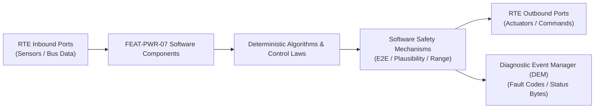

# Software Requirements Specification: Electric Axle Disconnect & Multi-Speed Shifting (e-Axle)
**Feature ID:** `FEAT-PWR-07`  
**Domain:** Electric Powertrain & Energy Management  
**Target ASIL:** ASIL C  
**Compliance Standard:** ISO 26262:2018 (Part 6 - Software Development) / ASPICE PAM v3.1 (SWE.1, SWE.2)  
**Parent System Specification:** [`FEAT-PWR-07_eAxle_SysReq.md`](file:///c:/Workset/AntiGravityProjects/TestOptimisationExperiement/system_requirements/FEAT-PWR-07_eAxle_SysReq.md)  
**Global Master Specification:** [`spec.md`](file:///c:/Workset/AntiGravityProjects/TestOptimisationExperiement/spec.md)

---

## 1. Software Architecture & Component Structure

This document specifies the AUTOSAR Software Components (SWCs), periodic runnables, algorithmic laws, safety mechanisms, and data ports implementing `FEAT-PWR-07` (Electric Axle Disconnect & Multi-Speed Shifting (e-Axle)).

### AUTOSAR SWC Interaction Diagram

---

## 2. Detailed Software Requirements (SWR_REQ)
*(Multi-Software Requirement Partitioning derived from System Requirements)*

### `SWR-PWR-07-01`: Torque-Interruption Speed Matching Servoloop
- **Planned Release:** R100
- **ASIL Rating:** ASIL C
- **Parent System Requirement:** [`SYS-PWR-07-01`](file:///c:/Workset/AntiGravityProjects/TestOptimisationExperiement/system_requirements/FEAT-PWR-07_eAxle_SysReq.md#sys-pwr-07-01)
- **Allocated AUTOSAR SWC:** `AxleShiftSync_SWC`
- **Execution Rate / Trigger:** 2 ms
- **Worst-Case Execution Time (WCET):** 0.4 ms
- **Software Activation Condition:** Executed during gear change sequence.
- **Algorithmic Description / Logic:**
  > Ramps motor torque to 0 Nm in 30 ms. Switches motor from Torque Control to Speed Control mode: Omega_target = Omega_shaft * Gear_Ratio_2. Runs PI governor: T_sync = K_p * e_omega + K_i * int(e).
- **Software Safety Mechanism:** Speed window guard: Engagement permit issued ONLY when |Omega_motor - Omega_target| <= 20 RPM.
- **Failure Reaction & DEM Diagnostic Event:** If speed matching takes > 250 ms, abort shift and resume origin gear.
- **Software Port Inputs:** `Motor_Rotor_Speed_RPM, Shaft_Speed_RPM, Shift_Phase_Enum`
- **Software Port Outputs:** `Sync_Speed_Demand_RPM, Engage_Permit_Flag (boolean)`
- **Software Verification Criteria:** Dyno telemetry analysis measuring speed error at tooth engagement.
- **Traceability Link:** Traces upward to [`SYS-PWR-07-01`](file:///c:/Workset/AntiGravityProjects/TestOptimisationExperiement/system_requirements/FEAT-PWR-07_eAxle_SysReq.md#sys-pwr-07-01) and [`FEAT-PWR-07`](file:///c:/Workset/AntiGravityProjects/TestOptimisationExperiement/spec.md).

### `SWR-PWR-07-02`: Electromagnetic Shift Fork Solenoid H-Bridge Driver
- **Planned Release:** R100
- **ASIL Rating:** ASIL C
- **Parent System Requirement:** [`SYS-PWR-07-01`](file:///c:/Workset/AntiGravityProjects/TestOptimisationExperiement/system_requirements/FEAT-PWR-07_eAxle_SysReq.md#sys-pwr-07-01)
- **Allocated AUTOSAR SWC:** `AxleForkDriver_SWC`
- **Execution Rate / Trigger:** 2 ms
- **Worst-Case Execution Time (WCET):** 0.5 ms
- **Software Activation Condition:** Executed upon Engage_Permit_Flag.
- **Algorithmic Description / Logic:**
  > Commands H-bridge driver with 12V pulse to move shift fork into target dog teeth. Verifies linear position hall sensor: Target_Pos +- 0.5 mm reached within 80 ms.
- **Software Safety Mechanism:** Peak-and-hold current profiling: 10A pull-in current for 50 ms, followed by 2A hold current to prevent coil overheating.
- **Failure Reaction & DEM Diagnostic Event:** Reverse H-bridge direction if position sensor detects incomplete travel (tooth-on-tooth block).
- **Software Port Inputs:** `Engage_Permit_Flag, Shift_Fork_Hall_Position_Mm`
- **Software Port Outputs:** `Fork_HBridge_PWM_Duty, Shift_Completed_Flag (boolean)`
- **Software Verification Criteria:** Endurance test across 200,000 shift cycles on automated test bench.
- **Traceability Link:** Traces upward to [`SYS-PWR-07-01`](file:///c:/Workset/AntiGravityProjects/TestOptimisationExperiement/system_requirements/FEAT-PWR-07_eAxle_SysReq.md#sys-pwr-07-01) and [`FEAT-PWR-07`](file:///c:/Workset/AntiGravityProjects/TestOptimisationExperiement/spec.md).

### `SWR-PWR-07-03`: Axle Decoupling Efficiency Coordinator & Tip-In Re-engagement
- **Planned Release:** R100
- **ASIL Rating:** ASIL C
- **Parent System Requirement:** [`SYS-PWR-07-02`](file:///c:/Workset/AntiGravityProjects/TestOptimisationExperiement/system_requirements/FEAT-PWR-07_eAxle_SysReq.md#sys-pwr-07-02)
- **Allocated AUTOSAR SWC:** `AxleDisconnectManager_SWC`
- **Execution Rate / Trigger:** 10 ms
- **Worst-Case Execution Time (WCET):** 0.7 ms
- **Software Activation Condition:** Executed every 10 ms.
- **Algorithmic Description / Logic:**
  > Evaluates disconnect criteria: Cruising at speed > 65 km/h, road grade < 4%, and driver torque demand < 120 Nm. If sudden torque request > 200 Nm (accelerator tip-in), re-engages axle in <= 150 ms.
- **Software Safety Mechanism:** Rapid reconnect override: Wheel slip or ESP intervention unconditionally forces reconnect.
- **Failure Reaction & DEM Diagnostic Event:** If disconnect solenoid fails to release, leave axle coupled in AWD mode.
- **Software Port Inputs:** `Driver_Torque_Demand_Nm, Vehicle_Speed_Mps, Road_Grade_Pct, Wheel_Slip_Flag`
- **Software Port Outputs:** `Axle_Disconnect_Command (boolean), Coupling_Status_Enum`
- **Software Verification Criteria:** Vehicle acceleration testing on low-friction split-mu test surfaces.
- **Traceability Link:** Traces upward to [`SYS-PWR-07-02`](file:///c:/Workset/AntiGravityProjects/TestOptimisationExperiement/system_requirements/FEAT-PWR-07_eAxle_SysReq.md#sys-pwr-07-02) and [`FEAT-PWR-07`](file:///c:/Workset/AntiGravityProjects/TestOptimisationExperiement/spec.md).

### `SWR-PWR-07-04`: Dog Teeth Tooth-Butt Jamming Recovery Algorithm
- **Planned Release:** R100
- **ASIL Rating:** ASIL C
- **Parent System Requirement:** [`SYS-PWR-07-02`](file:///c:/Workset/AntiGravityProjects/TestOptimisationExperiement/system_requirements/FEAT-PWR-07_eAxle_SysReq.md#sys-pwr-07-02)
- **Allocated AUTOSAR SWC:** `AxleToothAntiJam_SWC`
- **Execution Rate / Trigger:** 5 ms
- **Worst-Case Execution Time (WCET):** 0.3 ms
- **Software Activation Condition:** Executed when fork travel stalls midway.
- **Algorithmic Description / Logic:**
  > If fork position stalls at tooth-butt collision zone for > 30 ms, commands motor to inject a micro-dither torque pulse (+-5 Nm @ 50 Hz) to rotate shaft by 5 degrees, allowing dog teeth to mesh smoothly.
- **Software Safety Mechanism:** Dither pulse limited to maximum 100 ms to avoid mechanical gear clatter.
- **Failure Reaction & DEM Diagnostic Event:** Retract fork to neutral and re-attempt shift if jam persists after 2 pulses.
- **Software Port Inputs:** `Fork_Hall_Position_Mm, Dither_Attempt_Counter`
- **Software Port Outputs:** `Motor_Dither_Torque_Pulse_Nm, Retract_Fork_Req (boolean)`
- **Software Verification Criteria:** High-speed camera observation of dog clutch teeth meshing.
- **Traceability Link:** Traces upward to [`SYS-PWR-07-02`](file:///c:/Workset/AntiGravityProjects/TestOptimisationExperiement/system_requirements/FEAT-PWR-07_eAxle_SysReq.md#sys-pwr-07-02) and [`FEAT-PWR-07`](file:///c:/Workset/AntiGravityProjects/TestOptimisationExperiement/spec.md).

### `SWR-PWR-07-05`: Electric Axle Dog-Clutch Disconnect Solenoid Actuator Position Controller - Dynamic Observer & Signal Filter
- **Planned Release:** R100
- **ASIL Rating:** ASIL C
- **Parent System Requirement:** [`SYS-PWR-07-03`](file:///c:/Workset/AntiGravityProjects/TestOptimisationExperiement/system_requirements/FEAT-PWR-07_eAxle_SysReq.md#sys-pwr-07-03)
- **Allocated AUTOSAR SWC:** `EaxleClutchController_SWC`
- **Execution Rate / Trigger:** 5 ms
- **Worst-Case Execution Time (WCET):** 0.3 ms
- **Software Activation Condition:** Executed cyclically every 5 ms.
- **Algorithmic Description / Logic:**
  > Executes signal plausibility filtering, calibration offsets, and discrete state estimation for Electric Axle Dog-Clutch Disconnect Solenoid Actuator Position Controller.
- **Software Safety Mechanism:** Range limit plausibility check and E2E alive sequence verification.
- **Failure Reaction & DEM Diagnostic Event:** Set default fallback output and report DEM_EVENT_FEAT_PWR_07_ERR.
- **Software Port Inputs:** `Raw sensor ADC/SENT/SPI values and RTE bus inputs.`
- **Software Port Outputs:** `Filtered physical signals and validity status bitmasks.`
- **Software Verification Criteria:** Unit test and HiL software integration test.
- **Traceability Link:** Traces upward to [`SYS-PWR-07-03`](file:///c:/Workset/AntiGravityProjects/TestOptimisationExperiement/system_requirements/FEAT-PWR-07_eAxle_SysReq.md#sys-pwr-07-03) and [`FEAT-PWR-07`](file:///c:/Workset/AntiGravityProjects/TestOptimisationExperiement/spec.md).

### `SWR-PWR-07-06`: Electric Axle Dog-Clutch Disconnect Solenoid Actuator Position Controller - Closed-Loop Control Law & Actuator Dispatch
- **Planned Release:** R100
- **ASIL Rating:** ASIL C
- **Parent System Requirement:** [`SYS-PWR-07-03`](file:///c:/Workset/AntiGravityProjects/TestOptimisationExperiement/system_requirements/FEAT-PWR-07_eAxle_SysReq.md#sys-pwr-07-03)
- **Allocated AUTOSAR SWC:** `EaxleClutchController_SWC`
- **Execution Rate / Trigger:** 5 ms
- **Worst-Case Execution Time (WCET):** 0.4 ms
- **Software Activation Condition:** Executed cyclically every 5 ms.
- **Algorithmic Description / Logic:**
  > Evaluates deterministic closed-loop control law, rate limits, and dispatches commands for Electric Axle Dog-Clutch Disconnect Solenoid Actuator Position Controller.
- **Software Safety Mechanism:** Command saturation clamping and watchdog program flow monitoring.
- **Failure Reaction & DEM Diagnostic Event:** De-energize actuator output, apply safe fallback clamp, and latch DTC.
- **Software Port Inputs:** `Validated physical state signals from observer SWC.`
- **Software Port Outputs:** `Actuator PWM duty cycles, torque/pressure setpoints, and diagnostic flags.`
- **Software Verification Criteria:** Hardware dynamometer and HiL closed-loop regression test suite.
- **Traceability Link:** Traces upward to [`SYS-PWR-07-03`](file:///c:/Workset/AntiGravityProjects/TestOptimisationExperiement/system_requirements/FEAT-PWR-07_eAxle_SysReq.md#sys-pwr-07-03) and [`FEAT-PWR-07`](file:///c:/Workset/AntiGravityProjects/TestOptimisationExperiement/spec.md).

### `SWR-PWR-07-07`: Secondary Motor Zero-Torque Speed Synchronization Prior to Engagement - Dynamic Observer & Signal Filter
- **Planned Release:** R200
- **ASIL Rating:** ASIL C
- **Parent System Requirement:** [`SYS-PWR-07-04`](file:///c:/Workset/AntiGravityProjects/TestOptimisationExperiement/system_requirements/FEAT-PWR-07_eAxle_SysReq.md#sys-pwr-07-04)
- **Allocated AUTOSAR SWC:** `EaxleSpeedSync_SWC`
- **Execution Rate / Trigger:** 5 ms
- **Worst-Case Execution Time (WCET):** 0.3 ms
- **Software Activation Condition:** Executed cyclically every 5 ms.
- **Algorithmic Description / Logic:**
  > Executes signal plausibility filtering, calibration offsets, and discrete state estimation for Secondary Motor Zero-Torque Speed Synchronization Prior to Engagement.
- **Software Safety Mechanism:** Range limit plausibility check and E2E alive sequence verification.
- **Failure Reaction & DEM Diagnostic Event:** Set default fallback output and report DEM_EVENT_FEAT_PWR_07_ERR.
- **Software Port Inputs:** `Raw sensor ADC/SENT/SPI values and RTE bus inputs.`
- **Software Port Outputs:** `Filtered physical signals and validity status bitmasks.`
- **Software Verification Criteria:** Unit test and HiL software integration test.
- **Traceability Link:** Traces upward to [`SYS-PWR-07-04`](file:///c:/Workset/AntiGravityProjects/TestOptimisationExperiement/system_requirements/FEAT-PWR-07_eAxle_SysReq.md#sys-pwr-07-04) and [`FEAT-PWR-07`](file:///c:/Workset/AntiGravityProjects/TestOptimisationExperiement/spec.md).

### `SWR-PWR-07-08`: Secondary Motor Zero-Torque Speed Synchronization Prior to Engagement - Closed-Loop Control Law & Actuator Dispatch
- **Planned Release:** R200
- **ASIL Rating:** ASIL C
- **Parent System Requirement:** [`SYS-PWR-07-04`](file:///c:/Workset/AntiGravityProjects/TestOptimisationExperiement/system_requirements/FEAT-PWR-07_eAxle_SysReq.md#sys-pwr-07-04)
- **Allocated AUTOSAR SWC:** `EaxleSpeedSync_SWC`
- **Execution Rate / Trigger:** 5 ms
- **Worst-Case Execution Time (WCET):** 0.4 ms
- **Software Activation Condition:** Executed cyclically every 5 ms.
- **Algorithmic Description / Logic:**
  > Evaluates deterministic closed-loop control law, rate limits, and dispatches commands for Secondary Motor Zero-Torque Speed Synchronization Prior to Engagement.
- **Software Safety Mechanism:** Command saturation clamping and watchdog program flow monitoring.
- **Failure Reaction & DEM Diagnostic Event:** De-energize actuator output, apply safe fallback clamp, and latch DTC.
- **Software Port Inputs:** `Validated physical state signals from observer SWC.`
- **Software Port Outputs:** `Actuator PWM duty cycles, torque/pressure setpoints, and diagnostic flags.`
- **Software Verification Criteria:** Hardware dynamometer and HiL closed-loop regression test suite.
- **Traceability Link:** Traces upward to [`SYS-PWR-07-04`](file:///c:/Workset/AntiGravityProjects/TestOptimisationExperiement/system_requirements/FEAT-PWR-07_eAxle_SysReq.md#sys-pwr-07-04) and [`FEAT-PWR-07`](file:///c:/Workset/AntiGravityProjects/TestOptimisationExperiement/spec.md).

### `SWR-PWR-07-09`: 2-Speed Planetary Gearbox Dual-Brake Shift Sequencing Engine - Dynamic Observer & Signal Filter
- **Planned Release:** R200
- **ASIL Rating:** ASIL C
- **Parent System Requirement:** [`SYS-PWR-07-05`](file:///c:/Workset/AntiGravityProjects/TestOptimisationExperiement/system_requirements/FEAT-PWR-07_eAxle_SysReq.md#sys-pwr-07-05)
- **Allocated AUTOSAR SWC:** `EaxleShiftSequencer_SWC`
- **Execution Rate / Trigger:** 5 ms
- **Worst-Case Execution Time (WCET):** 0.3 ms
- **Software Activation Condition:** Executed cyclically every 5 ms.
- **Algorithmic Description / Logic:**
  > Executes signal plausibility filtering, calibration offsets, and discrete state estimation for 2-Speed Planetary Gearbox Dual-Brake Shift Sequencing Engine.
- **Software Safety Mechanism:** Range limit plausibility check and E2E alive sequence verification.
- **Failure Reaction & DEM Diagnostic Event:** Set default fallback output and report DEM_EVENT_FEAT_PWR_07_ERR.
- **Software Port Inputs:** `Raw sensor ADC/SENT/SPI values and RTE bus inputs.`
- **Software Port Outputs:** `Filtered physical signals and validity status bitmasks.`
- **Software Verification Criteria:** Unit test and HiL software integration test.
- **Traceability Link:** Traces upward to [`SYS-PWR-07-05`](file:///c:/Workset/AntiGravityProjects/TestOptimisationExperiement/system_requirements/FEAT-PWR-07_eAxle_SysReq.md#sys-pwr-07-05) and [`FEAT-PWR-07`](file:///c:/Workset/AntiGravityProjects/TestOptimisationExperiement/spec.md).

### `SWR-PWR-07-10`: 2-Speed Planetary Gearbox Dual-Brake Shift Sequencing Engine - Closed-Loop Control Law & Actuator Dispatch
- **Planned Release:** R200
- **ASIL Rating:** ASIL C
- **Parent System Requirement:** [`SYS-PWR-07-05`](file:///c:/Workset/AntiGravityProjects/TestOptimisationExperiement/system_requirements/FEAT-PWR-07_eAxle_SysReq.md#sys-pwr-07-05)
- **Allocated AUTOSAR SWC:** `EaxleShiftSequencer_SWC`
- **Execution Rate / Trigger:** 5 ms
- **Worst-Case Execution Time (WCET):** 0.4 ms
- **Software Activation Condition:** Executed cyclically every 5 ms.
- **Algorithmic Description / Logic:**
  > Evaluates deterministic closed-loop control law, rate limits, and dispatches commands for 2-Speed Planetary Gearbox Dual-Brake Shift Sequencing Engine.
- **Software Safety Mechanism:** Command saturation clamping and watchdog program flow monitoring.
- **Failure Reaction & DEM Diagnostic Event:** De-energize actuator output, apply safe fallback clamp, and latch DTC.
- **Software Port Inputs:** `Validated physical state signals from observer SWC.`
- **Software Port Outputs:** `Actuator PWM duty cycles, torque/pressure setpoints, and diagnostic flags.`
- **Software Verification Criteria:** Hardware dynamometer and HiL closed-loop regression test suite.
- **Traceability Link:** Traces upward to [`SYS-PWR-07-05`](file:///c:/Workset/AntiGravityProjects/TestOptimisationExperiement/system_requirements/FEAT-PWR-07_eAxle_SysReq.md#sys-pwr-07-05) and [`FEAT-PWR-07`](file:///c:/Workset/AntiGravityProjects/TestOptimisationExperiement/spec.md).

### `SWR-PWR-07-11`: Shift Drum Electromechanical Rotary Encoder Angle Closed-Loop Servo - Dynamic Observer & Signal Filter
- **Planned Release:** R200
- **ASIL Rating:** ASIL C
- **Parent System Requirement:** [`SYS-PWR-07-06`](file:///c:/Workset/AntiGravityProjects/TestOptimisationExperiement/system_requirements/FEAT-PWR-07_eAxle_SysReq.md#sys-pwr-07-06)
- **Allocated AUTOSAR SWC:** `EaxleDrumServo_SWC`
- **Execution Rate / Trigger:** 2 ms
- **Worst-Case Execution Time (WCET):** 0.3 ms
- **Software Activation Condition:** Executed cyclically every 2 ms.
- **Algorithmic Description / Logic:**
  > Executes signal plausibility filtering, calibration offsets, and discrete state estimation for Shift Drum Electromechanical Rotary Encoder Angle Closed-Loop Servo.
- **Software Safety Mechanism:** Range limit plausibility check and E2E alive sequence verification.
- **Failure Reaction & DEM Diagnostic Event:** Set default fallback output and report DEM_EVENT_FEAT_PWR_07_ERR.
- **Software Port Inputs:** `Raw sensor ADC/SENT/SPI values and RTE bus inputs.`
- **Software Port Outputs:** `Filtered physical signals and validity status bitmasks.`
- **Software Verification Criteria:** Unit test and HiL software integration test.
- **Traceability Link:** Traces upward to [`SYS-PWR-07-06`](file:///c:/Workset/AntiGravityProjects/TestOptimisationExperiement/system_requirements/FEAT-PWR-07_eAxle_SysReq.md#sys-pwr-07-06) and [`FEAT-PWR-07`](file:///c:/Workset/AntiGravityProjects/TestOptimisationExperiement/spec.md).

### `SWR-PWR-07-12`: Shift Drum Electromechanical Rotary Encoder Angle Closed-Loop Servo - Closed-Loop Control Law & Actuator Dispatch
- **Planned Release:** R200
- **ASIL Rating:** ASIL C
- **Parent System Requirement:** [`SYS-PWR-07-06`](file:///c:/Workset/AntiGravityProjects/TestOptimisationExperiement/system_requirements/FEAT-PWR-07_eAxle_SysReq.md#sys-pwr-07-06)
- **Allocated AUTOSAR SWC:** `EaxleDrumServo_SWC`
- **Execution Rate / Trigger:** 2 ms
- **Worst-Case Execution Time (WCET):** 0.4 ms
- **Software Activation Condition:** Executed cyclically every 2 ms.
- **Algorithmic Description / Logic:**
  > Evaluates deterministic closed-loop control law, rate limits, and dispatches commands for Shift Drum Electromechanical Rotary Encoder Angle Closed-Loop Servo.
- **Software Safety Mechanism:** Command saturation clamping and watchdog program flow monitoring.
- **Failure Reaction & DEM Diagnostic Event:** De-energize actuator output, apply safe fallback clamp, and latch DTC.
- **Software Port Inputs:** `Validated physical state signals from observer SWC.`
- **Software Port Outputs:** `Actuator PWM duty cycles, torque/pressure setpoints, and diagnostic flags.`
- **Software Verification Criteria:** Hardware dynamometer and HiL closed-loop regression test suite.
- **Traceability Link:** Traces upward to [`SYS-PWR-07-06`](file:///c:/Workset/AntiGravityProjects/TestOptimisationExperiement/system_requirements/FEAT-PWR-07_eAxle_SysReq.md#sys-pwr-07-06) and [`FEAT-PWR-07`](file:///c:/Workset/AntiGravityProjects/TestOptimisationExperiement/spec.md).

### `SWR-PWR-07-13`: Mechanical Jam & Spline Tooth-on-Tooth Collision Re-Try Logic - Dynamic Observer & Signal Filter
- **Planned Release:** R300
- **ASIL Rating:** ASIL C
- **Parent System Requirement:** [`SYS-PWR-07-07`](file:///c:/Workset/AntiGravityProjects/TestOptimisationExperiement/system_requirements/FEAT-PWR-07_eAxle_SysReq.md#sys-pwr-07-07)
- **Allocated AUTOSAR SWC:** `EaxleToothAligner_SWC`
- **Execution Rate / Trigger:** 10 ms
- **Worst-Case Execution Time (WCET):** 0.3 ms
- **Software Activation Condition:** Executed cyclically every 10 ms.
- **Algorithmic Description / Logic:**
  > Executes signal plausibility filtering, calibration offsets, and discrete state estimation for Mechanical Jam & Spline Tooth-on-Tooth Collision Re-Try Logic.
- **Software Safety Mechanism:** Range limit plausibility check and E2E alive sequence verification.
- **Failure Reaction & DEM Diagnostic Event:** Set default fallback output and report DEM_EVENT_FEAT_PWR_07_ERR.
- **Software Port Inputs:** `Raw sensor ADC/SENT/SPI values and RTE bus inputs.`
- **Software Port Outputs:** `Filtered physical signals and validity status bitmasks.`
- **Software Verification Criteria:** Unit test and HiL software integration test.
- **Traceability Link:** Traces upward to [`SYS-PWR-07-07`](file:///c:/Workset/AntiGravityProjects/TestOptimisationExperiement/system_requirements/FEAT-PWR-07_eAxle_SysReq.md#sys-pwr-07-07) and [`FEAT-PWR-07`](file:///c:/Workset/AntiGravityProjects/TestOptimisationExperiement/spec.md).

### `SWR-PWR-07-14`: Mechanical Jam & Spline Tooth-on-Tooth Collision Re-Try Logic - Closed-Loop Control Law & Actuator Dispatch
- **Planned Release:** R300
- **ASIL Rating:** ASIL C
- **Parent System Requirement:** [`SYS-PWR-07-07`](file:///c:/Workset/AntiGravityProjects/TestOptimisationExperiement/system_requirements/FEAT-PWR-07_eAxle_SysReq.md#sys-pwr-07-07)
- **Allocated AUTOSAR SWC:** `EaxleToothAligner_SWC`
- **Execution Rate / Trigger:** 10 ms
- **Worst-Case Execution Time (WCET):** 0.4 ms
- **Software Activation Condition:** Executed cyclically every 10 ms.
- **Algorithmic Description / Logic:**
  > Evaluates deterministic closed-loop control law, rate limits, and dispatches commands for Mechanical Jam & Spline Tooth-on-Tooth Collision Re-Try Logic.
- **Software Safety Mechanism:** Command saturation clamping and watchdog program flow monitoring.
- **Failure Reaction & DEM Diagnostic Event:** De-energize actuator output, apply safe fallback clamp, and latch DTC.
- **Software Port Inputs:** `Validated physical state signals from observer SWC.`
- **Software Port Outputs:** `Actuator PWM duty cycles, torque/pressure setpoints, and diagnostic flags.`
- **Software Verification Criteria:** Hardware dynamometer and HiL closed-loop regression test suite.
- **Traceability Link:** Traces upward to [`SYS-PWR-07-07`](file:///c:/Workset/AntiGravityProjects/TestOptimisationExperiement/system_requirements/FEAT-PWR-07_eAxle_SysReq.md#sys-pwr-07-07) and [`FEAT-PWR-07`](file:///c:/Workset/AntiGravityProjects/TestOptimisationExperiement/spec.md).

### `SWR-PWR-07-15`: Axle Disconnect Drag Reduction Efficiency Maximizer - Dynamic Observer & Signal Filter
- **Planned Release:** R300
- **ASIL Rating:** ASIL B
- **Parent System Requirement:** [`SYS-PWR-07-08`](file:///c:/Workset/AntiGravityProjects/TestOptimisationExperiement/system_requirements/FEAT-PWR-07_eAxle_SysReq.md#sys-pwr-07-08)
- **Allocated AUTOSAR SWC:** `EaxleEfficiencyManager_SWC`
- **Execution Rate / Trigger:** 50 ms
- **Worst-Case Execution Time (WCET):** 0.3 ms
- **Software Activation Condition:** Executed cyclically every 50 ms.
- **Algorithmic Description / Logic:**
  > Executes signal plausibility filtering, calibration offsets, and discrete state estimation for Axle Disconnect Drag Reduction Efficiency Maximizer.
- **Software Safety Mechanism:** Range limit plausibility check and E2E alive sequence verification.
- **Failure Reaction & DEM Diagnostic Event:** Set default fallback output and report DEM_EVENT_FEAT_PWR_07_ERR.
- **Software Port Inputs:** `Raw sensor ADC/SENT/SPI values and RTE bus inputs.`
- **Software Port Outputs:** `Filtered physical signals and validity status bitmasks.`
- **Software Verification Criteria:** Unit test and HiL software integration test.
- **Traceability Link:** Traces upward to [`SYS-PWR-07-08`](file:///c:/Workset/AntiGravityProjects/TestOptimisationExperiement/system_requirements/FEAT-PWR-07_eAxle_SysReq.md#sys-pwr-07-08) and [`FEAT-PWR-07`](file:///c:/Workset/AntiGravityProjects/TestOptimisationExperiement/spec.md).

### `SWR-PWR-07-16`: Axle Disconnect Drag Reduction Efficiency Maximizer - Closed-Loop Control Law & Actuator Dispatch
- **Planned Release:** R300
- **ASIL Rating:** ASIL B
- **Parent System Requirement:** [`SYS-PWR-07-08`](file:///c:/Workset/AntiGravityProjects/TestOptimisationExperiement/system_requirements/FEAT-PWR-07_eAxle_SysReq.md#sys-pwr-07-08)
- **Allocated AUTOSAR SWC:** `EaxleEfficiencyManager_SWC`
- **Execution Rate / Trigger:** 50 ms
- **Worst-Case Execution Time (WCET):** 0.4 ms
- **Software Activation Condition:** Executed cyclically every 50 ms.
- **Algorithmic Description / Logic:**
  > Evaluates deterministic closed-loop control law, rate limits, and dispatches commands for Axle Disconnect Drag Reduction Efficiency Maximizer.
- **Software Safety Mechanism:** Command saturation clamping and watchdog program flow monitoring.
- **Failure Reaction & DEM Diagnostic Event:** De-energize actuator output, apply safe fallback clamp, and latch DTC.
- **Software Port Inputs:** `Validated physical state signals from observer SWC.`
- **Software Port Outputs:** `Actuator PWM duty cycles, torque/pressure setpoints, and diagnostic flags.`
- **Software Verification Criteria:** Hardware dynamometer and HiL closed-loop regression test suite.
- **Traceability Link:** Traces upward to [`SYS-PWR-07-08`](file:///c:/Workset/AntiGravityProjects/TestOptimisationExperiement/system_requirements/FEAT-PWR-07_eAxle_SysReq.md#sys-pwr-07-08) and [`FEAT-PWR-07`](file:///c:/Workset/AntiGravityProjects/TestOptimisationExperiement/spec.md).

### `SWR-PWR-07-17`: Cold Temperature Gearbox Oil Viscosity Warming & Shift Inhibit Governor - Dynamic Observer & Signal Filter
- **Planned Release:** R300
- **ASIL Rating:** ASIL B
- **Parent System Requirement:** [`SYS-PWR-07-09`](file:///c:/Workset/AntiGravityProjects/TestOptimisationExperiement/system_requirements/FEAT-PWR-07_eAxle_SysReq.md#sys-pwr-07-09)
- **Allocated AUTOSAR SWC:** `EaxleColdShiftGovernor_SWC`
- **Execution Rate / Trigger:** 100 ms
- **Worst-Case Execution Time (WCET):** 0.3 ms
- **Software Activation Condition:** Executed cyclically every 100 ms.
- **Algorithmic Description / Logic:**
  > Executes signal plausibility filtering, calibration offsets, and discrete state estimation for Cold Temperature Gearbox Oil Viscosity Warming & Shift Inhibit Governor.
- **Software Safety Mechanism:** Range limit plausibility check and E2E alive sequence verification.
- **Failure Reaction & DEM Diagnostic Event:** Set default fallback output and report DEM_EVENT_FEAT_PWR_07_ERR.
- **Software Port Inputs:** `Raw sensor ADC/SENT/SPI values and RTE bus inputs.`
- **Software Port Outputs:** `Filtered physical signals and validity status bitmasks.`
- **Software Verification Criteria:** Unit test and HiL software integration test.
- **Traceability Link:** Traces upward to [`SYS-PWR-07-09`](file:///c:/Workset/AntiGravityProjects/TestOptimisationExperiement/system_requirements/FEAT-PWR-07_eAxle_SysReq.md#sys-pwr-07-09) and [`FEAT-PWR-07`](file:///c:/Workset/AntiGravityProjects/TestOptimisationExperiement/spec.md).

### `SWR-PWR-07-18`: Cold Temperature Gearbox Oil Viscosity Warming & Shift Inhibit Governor - Closed-Loop Control Law & Actuator Dispatch
- **Planned Release:** R300
- **ASIL Rating:** ASIL B
- **Parent System Requirement:** [`SYS-PWR-07-09`](file:///c:/Workset/AntiGravityProjects/TestOptimisationExperiement/system_requirements/FEAT-PWR-07_eAxle_SysReq.md#sys-pwr-07-09)
- **Allocated AUTOSAR SWC:** `EaxleColdShiftGovernor_SWC`
- **Execution Rate / Trigger:** 100 ms
- **Worst-Case Execution Time (WCET):** 0.4 ms
- **Software Activation Condition:** Executed cyclically every 100 ms.
- **Algorithmic Description / Logic:**
  > Evaluates deterministic closed-loop control law, rate limits, and dispatches commands for Cold Temperature Gearbox Oil Viscosity Warming & Shift Inhibit Governor.
- **Software Safety Mechanism:** Command saturation clamping and watchdog program flow monitoring.
- **Failure Reaction & DEM Diagnostic Event:** De-energize actuator output, apply safe fallback clamp, and latch DTC.
- **Software Port Inputs:** `Validated physical state signals from observer SWC.`
- **Software Port Outputs:** `Actuator PWM duty cycles, torque/pressure setpoints, and diagnostic flags.`
- **Software Verification Criteria:** Hardware dynamometer and HiL closed-loop regression test suite.
- **Traceability Link:** Traces upward to [`SYS-PWR-07-09`](file:///c:/Workset/AntiGravityProjects/TestOptimisationExperiement/system_requirements/FEAT-PWR-07_eAxle_SysReq.md#sys-pwr-07-09) and [`FEAT-PWR-07`](file:///c:/Workset/AntiGravityProjects/TestOptimisationExperiement/spec.md).

### `SWR-PWR-07-19`: Emergency All-Wheel Drive Instantaneous Axle Re-Connect Dispatcher - Dynamic Observer & Signal Filter
- **Planned Release:** R400
- **ASIL Rating:** ASIL C
- **Parent System Requirement:** [`SYS-PWR-07-10`](file:///c:/Workset/AntiGravityProjects/TestOptimisationExperiement/system_requirements/FEAT-PWR-07_eAxle_SysReq.md#sys-pwr-07-10)
- **Allocated AUTOSAR SWC:** `EaxleFastReconnect_SWC`
- **Execution Rate / Trigger:** 5 ms
- **Worst-Case Execution Time (WCET):** 0.3 ms
- **Software Activation Condition:** Executed cyclically every 5 ms.
- **Algorithmic Description / Logic:**
  > Executes signal plausibility filtering, calibration offsets, and discrete state estimation for Emergency All-Wheel Drive Instantaneous Axle Re-Connect Dispatcher.
- **Software Safety Mechanism:** Range limit plausibility check and E2E alive sequence verification.
- **Failure Reaction & DEM Diagnostic Event:** Set default fallback output and report DEM_EVENT_FEAT_PWR_07_ERR.
- **Software Port Inputs:** `Raw sensor ADC/SENT/SPI values and RTE bus inputs.`
- **Software Port Outputs:** `Filtered physical signals and validity status bitmasks.`
- **Software Verification Criteria:** Unit test and HiL software integration test.
- **Traceability Link:** Traces upward to [`SYS-PWR-07-10`](file:///c:/Workset/AntiGravityProjects/TestOptimisationExperiement/system_requirements/FEAT-PWR-07_eAxle_SysReq.md#sys-pwr-07-10) and [`FEAT-PWR-07`](file:///c:/Workset/AntiGravityProjects/TestOptimisationExperiement/spec.md).

### `SWR-PWR-07-20`: Emergency All-Wheel Drive Instantaneous Axle Re-Connect Dispatcher - Closed-Loop Control Law & Actuator Dispatch
- **Planned Release:** R400
- **ASIL Rating:** ASIL C
- **Parent System Requirement:** [`SYS-PWR-07-10`](file:///c:/Workset/AntiGravityProjects/TestOptimisationExperiement/system_requirements/FEAT-PWR-07_eAxle_SysReq.md#sys-pwr-07-10)
- **Allocated AUTOSAR SWC:** `EaxleFastReconnect_SWC`
- **Execution Rate / Trigger:** 5 ms
- **Worst-Case Execution Time (WCET):** 0.4 ms
- **Software Activation Condition:** Executed cyclically every 5 ms.
- **Algorithmic Description / Logic:**
  > Evaluates deterministic closed-loop control law, rate limits, and dispatches commands for Emergency All-Wheel Drive Instantaneous Axle Re-Connect Dispatcher.
- **Software Safety Mechanism:** Command saturation clamping and watchdog program flow monitoring.
- **Failure Reaction & DEM Diagnostic Event:** De-energize actuator output, apply safe fallback clamp, and latch DTC.
- **Software Port Inputs:** `Validated physical state signals from observer SWC.`
- **Software Port Outputs:** `Actuator PWM duty cycles, torque/pressure setpoints, and diagnostic flags.`
- **Software Verification Criteria:** Hardware dynamometer and HiL closed-loop regression test suite.
- **Traceability Link:** Traces upward to [`SYS-PWR-07-10`](file:///c:/Workset/AntiGravityProjects/TestOptimisationExperiement/system_requirements/FEAT-PWR-07_eAxle_SysReq.md#sys-pwr-07-10) and [`FEAT-PWR-07`](file:///c:/Workset/AntiGravityProjects/TestOptimisationExperiement/spec.md).

### `SWR-PWR-07-21`: Multi-Disk Clutches Wear Life & Friction Lining Degradation Observer - Dynamic Observer & Signal Filter
- **Planned Release:** R400
- **ASIL Rating:** ASIL B
- **Parent System Requirement:** [`SYS-PWR-07-11`](file:///c:/Workset/AntiGravityProjects/TestOptimisationExperiement/system_requirements/FEAT-PWR-07_eAxle_SysReq.md#sys-pwr-07-11)
- **Allocated AUTOSAR SWC:** `EaxleClutchWearObserver_SWC`
- **Execution Rate / Trigger:** 200 ms
- **Worst-Case Execution Time (WCET):** 0.3 ms
- **Software Activation Condition:** Executed cyclically every 200 ms.
- **Algorithmic Description / Logic:**
  > Executes signal plausibility filtering, calibration offsets, and discrete state estimation for Multi-Disk Clutches Wear Life & Friction Lining Degradation Observer.
- **Software Safety Mechanism:** Range limit plausibility check and E2E alive sequence verification.
- **Failure Reaction & DEM Diagnostic Event:** Set default fallback output and report DEM_EVENT_FEAT_PWR_07_ERR.
- **Software Port Inputs:** `Raw sensor ADC/SENT/SPI values and RTE bus inputs.`
- **Software Port Outputs:** `Filtered physical signals and validity status bitmasks.`
- **Software Verification Criteria:** Unit test and HiL software integration test.
- **Traceability Link:** Traces upward to [`SYS-PWR-07-11`](file:///c:/Workset/AntiGravityProjects/TestOptimisationExperiement/system_requirements/FEAT-PWR-07_eAxle_SysReq.md#sys-pwr-07-11) and [`FEAT-PWR-07`](file:///c:/Workset/AntiGravityProjects/TestOptimisationExperiement/spec.md).

### `SWR-PWR-07-22`: Multi-Disk Clutches Wear Life & Friction Lining Degradation Observer - Closed-Loop Control Law & Actuator Dispatch
- **Planned Release:** R400
- **ASIL Rating:** ASIL B
- **Parent System Requirement:** [`SYS-PWR-07-11`](file:///c:/Workset/AntiGravityProjects/TestOptimisationExperiement/system_requirements/FEAT-PWR-07_eAxle_SysReq.md#sys-pwr-07-11)
- **Allocated AUTOSAR SWC:** `EaxleClutchWearObserver_SWC`
- **Execution Rate / Trigger:** 200 ms
- **Worst-Case Execution Time (WCET):** 0.4 ms
- **Software Activation Condition:** Executed cyclically every 200 ms.
- **Algorithmic Description / Logic:**
  > Evaluates deterministic closed-loop control law, rate limits, and dispatches commands for Multi-Disk Clutches Wear Life & Friction Lining Degradation Observer.
- **Software Safety Mechanism:** Command saturation clamping and watchdog program flow monitoring.
- **Failure Reaction & DEM Diagnostic Event:** De-energize actuator output, apply safe fallback clamp, and latch DTC.
- **Software Port Inputs:** `Validated physical state signals from observer SWC.`
- **Software Port Outputs:** `Actuator PWM duty cycles, torque/pressure setpoints, and diagnostic flags.`
- **Software Verification Criteria:** Hardware dynamometer and HiL closed-loop regression test suite.
- **Traceability Link:** Traces upward to [`SYS-PWR-07-11`](file:///c:/Workset/AntiGravityProjects/TestOptimisationExperiement/system_requirements/FEAT-PWR-07_eAxle_SysReq.md#sys-pwr-07-11) and [`FEAT-PWR-07`](file:///c:/Workset/AntiGravityProjects/TestOptimisationExperiement/spec.md).

### `SWR-PWR-07-23`: Dual Redundant Clutch Position Proximity Hall Sensor Plausibility Monitor - Dynamic Observer & Signal Filter
- **Planned Release:** R400
- **ASIL Rating:** ASIL C
- **Parent System Requirement:** [`SYS-PWR-07-12`](file:///c:/Workset/AntiGravityProjects/TestOptimisationExperiement/system_requirements/FEAT-PWR-07_eAxle_SysReq.md#sys-pwr-07-12)
- **Allocated AUTOSAR SWC:** `EaxlePositionCrossCheck_SWC`
- **Execution Rate / Trigger:** 2 ms
- **Worst-Case Execution Time (WCET):** 0.3 ms
- **Software Activation Condition:** Executed cyclically every 2 ms.
- **Algorithmic Description / Logic:**
  > Executes signal plausibility filtering, calibration offsets, and discrete state estimation for Dual Redundant Clutch Position Proximity Hall Sensor Plausibility Monitor.
- **Software Safety Mechanism:** Range limit plausibility check and E2E alive sequence verification.
- **Failure Reaction & DEM Diagnostic Event:** Set default fallback output and report DEM_EVENT_FEAT_PWR_07_ERR.
- **Software Port Inputs:** `Raw sensor ADC/SENT/SPI values and RTE bus inputs.`
- **Software Port Outputs:** `Filtered physical signals and validity status bitmasks.`
- **Software Verification Criteria:** Unit test and HiL software integration test.
- **Traceability Link:** Traces upward to [`SYS-PWR-07-12`](file:///c:/Workset/AntiGravityProjects/TestOptimisationExperiement/system_requirements/FEAT-PWR-07_eAxle_SysReq.md#sys-pwr-07-12) and [`FEAT-PWR-07`](file:///c:/Workset/AntiGravityProjects/TestOptimisationExperiement/spec.md).

### `SWR-PWR-07-24`: Dual Redundant Clutch Position Proximity Hall Sensor Plausibility Monitor - Closed-Loop Control Law & Actuator Dispatch
- **Planned Release:** R400
- **ASIL Rating:** ASIL C
- **Parent System Requirement:** [`SYS-PWR-07-12`](file:///c:/Workset/AntiGravityProjects/TestOptimisationExperiement/system_requirements/FEAT-PWR-07_eAxle_SysReq.md#sys-pwr-07-12)
- **Allocated AUTOSAR SWC:** `EaxlePositionCrossCheck_SWC`
- **Execution Rate / Trigger:** 2 ms
- **Worst-Case Execution Time (WCET):** 0.4 ms
- **Software Activation Condition:** Executed cyclically every 2 ms.
- **Algorithmic Description / Logic:**
  > Evaluates deterministic closed-loop control law, rate limits, and dispatches commands for Dual Redundant Clutch Position Proximity Hall Sensor Plausibility Monitor.
- **Software Safety Mechanism:** Command saturation clamping and watchdog program flow monitoring.
- **Failure Reaction & DEM Diagnostic Event:** De-energize actuator output, apply safe fallback clamp, and latch DTC.
- **Software Port Inputs:** `Validated physical state signals from observer SWC.`
- **Software Port Outputs:** `Actuator PWM duty cycles, torque/pressure setpoints, and diagnostic flags.`
- **Software Verification Criteria:** Hardware dynamometer and HiL closed-loop regression test suite.
- **Traceability Link:** Traces upward to [`SYS-PWR-07-12`](file:///c:/Workset/AntiGravityProjects/TestOptimisationExperiement/system_requirements/FEAT-PWR-07_eAxle_SysReq.md#sys-pwr-07-12) and [`FEAT-PWR-07`](file:///c:/Workset/AntiGravityProjects/TestOptimisationExperiement/spec.md).

### `SWR-PWR-07-25`: DEM Transmission Shifting Fault Diagnostics & Limp-Gear Latching - Dynamic Observer & Signal Filter
- **Planned Release:** R500
- **ASIL Rating:** ASIL C
- **Parent System Requirement:** [`SYS-PWR-07-13`](file:///c:/Workset/AntiGravityProjects/TestOptimisationExperiement/system_requirements/FEAT-PWR-07_eAxle_SysReq.md#sys-pwr-07-13)
- **Allocated AUTOSAR SWC:** `EaxleDiagnosticManager_SWC`
- **Execution Rate / Trigger:** 20 ms
- **Worst-Case Execution Time (WCET):** 0.3 ms
- **Software Activation Condition:** Executed cyclically every 20 ms.
- **Algorithmic Description / Logic:**
  > Executes signal plausibility filtering, calibration offsets, and discrete state estimation for DEM Transmission Shifting Fault Diagnostics & Limp-Gear Latching.
- **Software Safety Mechanism:** Range limit plausibility check and E2E alive sequence verification.
- **Failure Reaction & DEM Diagnostic Event:** Set default fallback output and report DEM_EVENT_FEAT_PWR_07_ERR.
- **Software Port Inputs:** `Raw sensor ADC/SENT/SPI values and RTE bus inputs.`
- **Software Port Outputs:** `Filtered physical signals and validity status bitmasks.`
- **Software Verification Criteria:** Unit test and HiL software integration test.
- **Traceability Link:** Traces upward to [`SYS-PWR-07-13`](file:///c:/Workset/AntiGravityProjects/TestOptimisationExperiement/system_requirements/FEAT-PWR-07_eAxle_SysReq.md#sys-pwr-07-13) and [`FEAT-PWR-07`](file:///c:/Workset/AntiGravityProjects/TestOptimisationExperiement/spec.md).

### `SWR-PWR-07-26`: DEM Transmission Shifting Fault Diagnostics & Limp-Gear Latching - Closed-Loop Control Law & Actuator Dispatch
- **Planned Release:** R500
- **ASIL Rating:** ASIL C
- **Parent System Requirement:** [`SYS-PWR-07-13`](file:///c:/Workset/AntiGravityProjects/TestOptimisationExperiement/system_requirements/FEAT-PWR-07_eAxle_SysReq.md#sys-pwr-07-13)
- **Allocated AUTOSAR SWC:** `EaxleDiagnosticManager_SWC`
- **Execution Rate / Trigger:** 20 ms
- **Worst-Case Execution Time (WCET):** 0.4 ms
- **Software Activation Condition:** Executed cyclically every 20 ms.
- **Algorithmic Description / Logic:**
  > Evaluates deterministic closed-loop control law, rate limits, and dispatches commands for DEM Transmission Shifting Fault Diagnostics & Limp-Gear Latching.
- **Software Safety Mechanism:** Command saturation clamping and watchdog program flow monitoring.
- **Failure Reaction & DEM Diagnostic Event:** De-energize actuator output, apply safe fallback clamp, and latch DTC.
- **Software Port Inputs:** `Validated physical state signals from observer SWC.`
- **Software Port Outputs:** `Actuator PWM duty cycles, torque/pressure setpoints, and diagnostic flags.`
- **Software Verification Criteria:** Hardware dynamometer and HiL closed-loop regression test suite.
- **Traceability Link:** Traces upward to [`SYS-PWR-07-13`](file:///c:/Workset/AntiGravityProjects/TestOptimisationExperiement/system_requirements/FEAT-PWR-07_eAxle_SysReq.md#sys-pwr-07-13) and [`FEAT-PWR-07`](file:///c:/Workset/AntiGravityProjects/TestOptimisationExperiement/spec.md).

### `SWR-PWR-07-27`: Instrument Cluster e-Axle Active Drive Mode & Gear Display Serializer - Dynamic Observer & Signal Filter
- **Planned Release:** R500
- **ASIL Rating:** ASIL B
- **Parent System Requirement:** [`SYS-PWR-07-14`](file:///c:/Workset/AntiGravityProjects/TestOptimisationExperiement/system_requirements/FEAT-PWR-07_eAxle_SysReq.md#sys-pwr-07-14)
- **Allocated AUTOSAR SWC:** `EaxleHmiDispatcher_SWC`
- **Execution Rate / Trigger:** 20 ms
- **Worst-Case Execution Time (WCET):** 0.3 ms
- **Software Activation Condition:** Executed cyclically every 20 ms.
- **Algorithmic Description / Logic:**
  > Executes signal plausibility filtering, calibration offsets, and discrete state estimation for Instrument Cluster e-Axle Active Drive Mode & Gear Display Serializer.
- **Software Safety Mechanism:** Range limit plausibility check and E2E alive sequence verification.
- **Failure Reaction & DEM Diagnostic Event:** Set default fallback output and report DEM_EVENT_FEAT_PWR_07_ERR.
- **Software Port Inputs:** `Raw sensor ADC/SENT/SPI values and RTE bus inputs.`
- **Software Port Outputs:** `Filtered physical signals and validity status bitmasks.`
- **Software Verification Criteria:** Unit test and HiL software integration test.
- **Traceability Link:** Traces upward to [`SYS-PWR-07-14`](file:///c:/Workset/AntiGravityProjects/TestOptimisationExperiement/system_requirements/FEAT-PWR-07_eAxle_SysReq.md#sys-pwr-07-14) and [`FEAT-PWR-07`](file:///c:/Workset/AntiGravityProjects/TestOptimisationExperiement/spec.md).

### `SWR-PWR-07-28`: Instrument Cluster e-Axle Active Drive Mode & Gear Display Serializer - Closed-Loop Control Law & Actuator Dispatch
- **Planned Release:** R500
- **ASIL Rating:** ASIL B
- **Parent System Requirement:** [`SYS-PWR-07-14`](file:///c:/Workset/AntiGravityProjects/TestOptimisationExperiement/system_requirements/FEAT-PWR-07_eAxle_SysReq.md#sys-pwr-07-14)
- **Allocated AUTOSAR SWC:** `EaxleHmiDispatcher_SWC`
- **Execution Rate / Trigger:** 20 ms
- **Worst-Case Execution Time (WCET):** 0.4 ms
- **Software Activation Condition:** Executed cyclically every 20 ms.
- **Algorithmic Description / Logic:**
  > Evaluates deterministic closed-loop control law, rate limits, and dispatches commands for Instrument Cluster e-Axle Active Drive Mode & Gear Display Serializer.
- **Software Safety Mechanism:** Command saturation clamping and watchdog program flow monitoring.
- **Failure Reaction & DEM Diagnostic Event:** De-energize actuator output, apply safe fallback clamp, and latch DTC.
- **Software Port Inputs:** `Validated physical state signals from observer SWC.`
- **Software Port Outputs:** `Actuator PWM duty cycles, torque/pressure setpoints, and diagnostic flags.`
- **Software Verification Criteria:** Hardware dynamometer and HiL closed-loop regression test suite.
- **Traceability Link:** Traces upward to [`SYS-PWR-07-14`](file:///c:/Workset/AntiGravityProjects/TestOptimisationExperiement/system_requirements/FEAT-PWR-07_eAxle_SysReq.md#sys-pwr-07-14) and [`FEAT-PWR-07`](file:///c:/Workset/AntiGravityProjects/TestOptimisationExperiement/spec.md).

### `SWR-PWR-07-29`: Non-Volatile Transmission Shift Counts & Actuator Cycles Audit Recorder - Dynamic Observer & Signal Filter
- **Planned Release:** R500
- **ASIL Rating:** ASIL B
- **Parent System Requirement:** [`SYS-PWR-07-15`](file:///c:/Workset/AntiGravityProjects/TestOptimisationExperiement/system_requirements/FEAT-PWR-07_eAxle_SysReq.md#sys-pwr-07-15)
- **Allocated AUTOSAR SWC:** `EaxleShiftLogger_SWC`
- **Execution Rate / Trigger:** 1000 ms
- **Worst-Case Execution Time (WCET):** 0.3 ms
- **Software Activation Condition:** Executed cyclically every 1000 ms.
- **Algorithmic Description / Logic:**
  > Executes signal plausibility filtering, calibration offsets, and discrete state estimation for Non-Volatile Transmission Shift Counts & Actuator Cycles Audit Recorder.
- **Software Safety Mechanism:** Range limit plausibility check and E2E alive sequence verification.
- **Failure Reaction & DEM Diagnostic Event:** Set default fallback output and report DEM_EVENT_FEAT_PWR_07_ERR.
- **Software Port Inputs:** `Raw sensor ADC/SENT/SPI values and RTE bus inputs.`
- **Software Port Outputs:** `Filtered physical signals and validity status bitmasks.`
- **Software Verification Criteria:** Unit test and HiL software integration test.
- **Traceability Link:** Traces upward to [`SYS-PWR-07-15`](file:///c:/Workset/AntiGravityProjects/TestOptimisationExperiement/system_requirements/FEAT-PWR-07_eAxle_SysReq.md#sys-pwr-07-15) and [`FEAT-PWR-07`](file:///c:/Workset/AntiGravityProjects/TestOptimisationExperiement/spec.md).

### `SWR-PWR-07-30`: Non-Volatile Transmission Shift Counts & Actuator Cycles Audit Recorder - Closed-Loop Control Law & Actuator Dispatch
- **Planned Release:** R500
- **ASIL Rating:** ASIL B
- **Parent System Requirement:** [`SYS-PWR-07-15`](file:///c:/Workset/AntiGravityProjects/TestOptimisationExperiement/system_requirements/FEAT-PWR-07_eAxle_SysReq.md#sys-pwr-07-15)
- **Allocated AUTOSAR SWC:** `EaxleShiftLogger_SWC`
- **Execution Rate / Trigger:** 1000 ms
- **Worst-Case Execution Time (WCET):** 0.4 ms
- **Software Activation Condition:** Executed cyclically every 1000 ms.
- **Algorithmic Description / Logic:**
  > Evaluates deterministic closed-loop control law, rate limits, and dispatches commands for Non-Volatile Transmission Shift Counts & Actuator Cycles Audit Recorder.
- **Software Safety Mechanism:** Command saturation clamping and watchdog program flow monitoring.
- **Failure Reaction & DEM Diagnostic Event:** De-energize actuator output, apply safe fallback clamp, and latch DTC.
- **Software Port Inputs:** `Validated physical state signals from observer SWC.`
- **Software Port Outputs:** `Actuator PWM duty cycles, torque/pressure setpoints, and diagnostic flags.`
- **Software Verification Criteria:** Hardware dynamometer and HiL closed-loop regression test suite.
- **Traceability Link:** Traces upward to [`SYS-PWR-07-15`](file:///c:/Workset/AntiGravityProjects/TestOptimisationExperiement/system_requirements/FEAT-PWR-07_eAxle_SysReq.md#sys-pwr-07-15) and [`FEAT-PWR-07`](file:///c:/Workset/AntiGravityProjects/TestOptimisationExperiement/spec.md).

---

## 3. Software-to-System Backward Traceability Matrix

| Software Requirement ID | Planned Release | Allocated SWC | Execution Rate | Upstream System Req | Verification Method |
| :--- | :---: | :--- | :--- | :--- | :--- |
| `SWR-PWR-07-01` | **`R100`** | `AxleShiftSync_SWC` | 2 ms | [`SYS-PWR-07-01`](file:///c:/Workset/AntiGravityProjects/TestOptimisationExperiement/system_requirements/FEAT-PWR-07_eAxle_SysReq.md#sys-pwr-07-01) | Dyno telemetry analysis measuring speed error at tooth engagement. |
| `SWR-PWR-07-02` | **`R100`** | `AxleForkDriver_SWC` | 2 ms | [`SYS-PWR-07-01`](file:///c:/Workset/AntiGravityProjects/TestOptimisationExperiement/system_requirements/FEAT-PWR-07_eAxle_SysReq.md#sys-pwr-07-01) | Endurance test across 200,000 shift cycles on automated test bench. |
| `SWR-PWR-07-03` | **`R100`** | `AxleDisconnectManager_SWC` | 10 ms | [`SYS-PWR-07-02`](file:///c:/Workset/AntiGravityProjects/TestOptimisationExperiement/system_requirements/FEAT-PWR-07_eAxle_SysReq.md#sys-pwr-07-02) | Vehicle acceleration testing on low-friction split-mu test surfaces. |
| `SWR-PWR-07-04` | **`R100`** | `AxleToothAntiJam_SWC` | 5 ms | [`SYS-PWR-07-02`](file:///c:/Workset/AntiGravityProjects/TestOptimisationExperiement/system_requirements/FEAT-PWR-07_eAxle_SysReq.md#sys-pwr-07-02) | High-speed camera observation of dog clutch teeth meshing. |
| `SWR-PWR-07-05` | **`R100`** | `EaxleClutchController_SWC` | 5 ms | [`SYS-PWR-07-03`](file:///c:/Workset/AntiGravityProjects/TestOptimisationExperiement/system_requirements/FEAT-PWR-07_eAxle_SysReq.md#sys-pwr-07-03) | Unit test and HiL software integration test. |
| `SWR-PWR-07-06` | **`R100`** | `EaxleClutchController_SWC` | 5 ms | [`SYS-PWR-07-03`](file:///c:/Workset/AntiGravityProjects/TestOptimisationExperiement/system_requirements/FEAT-PWR-07_eAxle_SysReq.md#sys-pwr-07-03) | Hardware dynamometer and HiL closed-loop regression test suite. |
| `SWR-PWR-07-07` | **`R200`** | `EaxleSpeedSync_SWC` | 5 ms | [`SYS-PWR-07-04`](file:///c:/Workset/AntiGravityProjects/TestOptimisationExperiement/system_requirements/FEAT-PWR-07_eAxle_SysReq.md#sys-pwr-07-04) | Unit test and HiL software integration test. |
| `SWR-PWR-07-08` | **`R200`** | `EaxleSpeedSync_SWC` | 5 ms | [`SYS-PWR-07-04`](file:///c:/Workset/AntiGravityProjects/TestOptimisationExperiement/system_requirements/FEAT-PWR-07_eAxle_SysReq.md#sys-pwr-07-04) | Hardware dynamometer and HiL closed-loop regression test suite. |
| `SWR-PWR-07-09` | **`R200`** | `EaxleShiftSequencer_SWC` | 5 ms | [`SYS-PWR-07-05`](file:///c:/Workset/AntiGravityProjects/TestOptimisationExperiement/system_requirements/FEAT-PWR-07_eAxle_SysReq.md#sys-pwr-07-05) | Unit test and HiL software integration test. |
| `SWR-PWR-07-10` | **`R200`** | `EaxleShiftSequencer_SWC` | 5 ms | [`SYS-PWR-07-05`](file:///c:/Workset/AntiGravityProjects/TestOptimisationExperiement/system_requirements/FEAT-PWR-07_eAxle_SysReq.md#sys-pwr-07-05) | Hardware dynamometer and HiL closed-loop regression test suite. |
| `SWR-PWR-07-11` | **`R200`** | `EaxleDrumServo_SWC` | 2 ms | [`SYS-PWR-07-06`](file:///c:/Workset/AntiGravityProjects/TestOptimisationExperiement/system_requirements/FEAT-PWR-07_eAxle_SysReq.md#sys-pwr-07-06) | Unit test and HiL software integration test. |
| `SWR-PWR-07-12` | **`R200`** | `EaxleDrumServo_SWC` | 2 ms | [`SYS-PWR-07-06`](file:///c:/Workset/AntiGravityProjects/TestOptimisationExperiement/system_requirements/FEAT-PWR-07_eAxle_SysReq.md#sys-pwr-07-06) | Hardware dynamometer and HiL closed-loop regression test suite. |
| `SWR-PWR-07-13` | **`R300`** | `EaxleToothAligner_SWC` | 10 ms | [`SYS-PWR-07-07`](file:///c:/Workset/AntiGravityProjects/TestOptimisationExperiement/system_requirements/FEAT-PWR-07_eAxle_SysReq.md#sys-pwr-07-07) | Unit test and HiL software integration test. |
| `SWR-PWR-07-14` | **`R300`** | `EaxleToothAligner_SWC` | 10 ms | [`SYS-PWR-07-07`](file:///c:/Workset/AntiGravityProjects/TestOptimisationExperiement/system_requirements/FEAT-PWR-07_eAxle_SysReq.md#sys-pwr-07-07) | Hardware dynamometer and HiL closed-loop regression test suite. |
| `SWR-PWR-07-15` | **`R300`** | `EaxleEfficiencyManager_SWC` | 50 ms | [`SYS-PWR-07-08`](file:///c:/Workset/AntiGravityProjects/TestOptimisationExperiement/system_requirements/FEAT-PWR-07_eAxle_SysReq.md#sys-pwr-07-08) | Unit test and HiL software integration test. |
| `SWR-PWR-07-16` | **`R300`** | `EaxleEfficiencyManager_SWC` | 50 ms | [`SYS-PWR-07-08`](file:///c:/Workset/AntiGravityProjects/TestOptimisationExperiement/system_requirements/FEAT-PWR-07_eAxle_SysReq.md#sys-pwr-07-08) | Hardware dynamometer and HiL closed-loop regression test suite. |
| `SWR-PWR-07-17` | **`R300`** | `EaxleColdShiftGovernor_SWC` | 100 ms | [`SYS-PWR-07-09`](file:///c:/Workset/AntiGravityProjects/TestOptimisationExperiement/system_requirements/FEAT-PWR-07_eAxle_SysReq.md#sys-pwr-07-09) | Unit test and HiL software integration test. |
| `SWR-PWR-07-18` | **`R300`** | `EaxleColdShiftGovernor_SWC` | 100 ms | [`SYS-PWR-07-09`](file:///c:/Workset/AntiGravityProjects/TestOptimisationExperiement/system_requirements/FEAT-PWR-07_eAxle_SysReq.md#sys-pwr-07-09) | Hardware dynamometer and HiL closed-loop regression test suite. |
| `SWR-PWR-07-19` | **`R400`** | `EaxleFastReconnect_SWC` | 5 ms | [`SYS-PWR-07-10`](file:///c:/Workset/AntiGravityProjects/TestOptimisationExperiement/system_requirements/FEAT-PWR-07_eAxle_SysReq.md#sys-pwr-07-10) | Unit test and HiL software integration test. |
| `SWR-PWR-07-20` | **`R400`** | `EaxleFastReconnect_SWC` | 5 ms | [`SYS-PWR-07-10`](file:///c:/Workset/AntiGravityProjects/TestOptimisationExperiement/system_requirements/FEAT-PWR-07_eAxle_SysReq.md#sys-pwr-07-10) | Hardware dynamometer and HiL closed-loop regression test suite. |
| `SWR-PWR-07-21` | **`R400`** | `EaxleClutchWearObserver_SWC` | 200 ms | [`SYS-PWR-07-11`](file:///c:/Workset/AntiGravityProjects/TestOptimisationExperiement/system_requirements/FEAT-PWR-07_eAxle_SysReq.md#sys-pwr-07-11) | Unit test and HiL software integration test. |
| `SWR-PWR-07-22` | **`R400`** | `EaxleClutchWearObserver_SWC` | 200 ms | [`SYS-PWR-07-11`](file:///c:/Workset/AntiGravityProjects/TestOptimisationExperiement/system_requirements/FEAT-PWR-07_eAxle_SysReq.md#sys-pwr-07-11) | Hardware dynamometer and HiL closed-loop regression test suite. |
| `SWR-PWR-07-23` | **`R400`** | `EaxlePositionCrossCheck_SWC` | 2 ms | [`SYS-PWR-07-12`](file:///c:/Workset/AntiGravityProjects/TestOptimisationExperiement/system_requirements/FEAT-PWR-07_eAxle_SysReq.md#sys-pwr-07-12) | Unit test and HiL software integration test. |
| `SWR-PWR-07-24` | **`R400`** | `EaxlePositionCrossCheck_SWC` | 2 ms | [`SYS-PWR-07-12`](file:///c:/Workset/AntiGravityProjects/TestOptimisationExperiement/system_requirements/FEAT-PWR-07_eAxle_SysReq.md#sys-pwr-07-12) | Hardware dynamometer and HiL closed-loop regression test suite. |
| `SWR-PWR-07-25` | **`R500`** | `EaxleDiagnosticManager_SWC` | 20 ms | [`SYS-PWR-07-13`](file:///c:/Workset/AntiGravityProjects/TestOptimisationExperiement/system_requirements/FEAT-PWR-07_eAxle_SysReq.md#sys-pwr-07-13) | Unit test and HiL software integration test. |
| `SWR-PWR-07-26` | **`R500`** | `EaxleDiagnosticManager_SWC` | 20 ms | [`SYS-PWR-07-13`](file:///c:/Workset/AntiGravityProjects/TestOptimisationExperiement/system_requirements/FEAT-PWR-07_eAxle_SysReq.md#sys-pwr-07-13) | Hardware dynamometer and HiL closed-loop regression test suite. |
| `SWR-PWR-07-27` | **`R500`** | `EaxleHmiDispatcher_SWC` | 20 ms | [`SYS-PWR-07-14`](file:///c:/Workset/AntiGravityProjects/TestOptimisationExperiement/system_requirements/FEAT-PWR-07_eAxle_SysReq.md#sys-pwr-07-14) | Unit test and HiL software integration test. |
| `SWR-PWR-07-28` | **`R500`** | `EaxleHmiDispatcher_SWC` | 20 ms | [`SYS-PWR-07-14`](file:///c:/Workset/AntiGravityProjects/TestOptimisationExperiement/system_requirements/FEAT-PWR-07_eAxle_SysReq.md#sys-pwr-07-14) | Hardware dynamometer and HiL closed-loop regression test suite. |
| `SWR-PWR-07-29` | **`R500`** | `EaxleShiftLogger_SWC` | 1000 ms | [`SYS-PWR-07-15`](file:///c:/Workset/AntiGravityProjects/TestOptimisationExperiement/system_requirements/FEAT-PWR-07_eAxle_SysReq.md#sys-pwr-07-15) | Unit test and HiL software integration test. |
| `SWR-PWR-07-30` | **`R500`** | `EaxleShiftLogger_SWC` | 1000 ms | [`SYS-PWR-07-15`](file:///c:/Workset/AntiGravityProjects/TestOptimisationExperiement/system_requirements/FEAT-PWR-07_eAxle_SysReq.md#sys-pwr-07-15) | Hardware dynamometer and HiL closed-loop regression test suite. |

- **Parent System Specification Document:** [`FEAT-PWR-07_eAxle_SysReq.md`](file:///c:/Workset/AntiGravityProjects/TestOptimisationExperiement/system_requirements/FEAT-PWR-07_eAxle_SysReq.md)
- **Master Automotive Specification:** [`spec.md`](file:///c:/Workset/AntiGravityProjects/TestOptimisationExperiement/spec.md)
