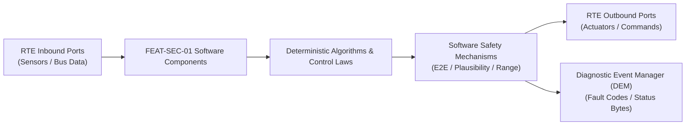

# Software Requirements Specification: Central Security Gateway & SecOC Intrusion Detection
**Feature ID:** `FEAT-SEC-01`  
**Domain:** Connectivity, Security & Diagnostics  
**Target ASIL:** ASIL B / ISO 21434  
**Compliance Standard:** ISO 26262:2018 (Part 6 - Software Development) / ASPICE PAM v3.1 (SWE.1, SWE.2)  
**Parent System Specification:** [`FEAT-SEC-01_SecOC_SysReq.md`](file:///c:/Workset/AntiGravityProjects/TestOptimisationExperiement/system_requirements/FEAT-SEC-01_SecOC_SysReq.md)  
**Global Master Specification:** [`spec.md`](file:///c:/Workset/AntiGravityProjects/TestOptimisationExperiement/spec.md)

---

## 1. Software Architecture & Component Structure

This document specifies the AUTOSAR Software Components (SWCs), periodic runnables, algorithmic laws, safety mechanisms, and data ports implementing `FEAT-SEC-01` (Central Security Gateway & SecOC Intrusion Detection).

### AUTOSAR SWC Interaction Diagram

---

## 2. Detailed Software Requirements (SWR_REQ)
*(Multi-Software Requirement Partitioning derived from System Requirements)*

### `SWR-SEC-01-01`: Hardware-Accelerated AES-128-CMAC Computation Engine
- **Planned Release:** R100
- **ASIL Rating:** ASIL B
- **Parent System Requirement:** [`SYS-SEC-01-01`](file:///c:/Workset/AntiGravityProjects/TestOptimisationExperiement/system_requirements/FEAT-SEC-01_SecOC_SysReq.md#sys-sec-01-01)
- **Allocated AUTOSAR SWC:** `SecocVerification_SWC`
- **Execution Rate / Trigger:** Interrupt-driven (<= 1 ms)
- **Worst-Case Execution Time (WCET):** 0.35 ms (hardware crypto)
- **Software Activation Condition:** Executed on RX message interrupt.
- **Algorithmic Description / Logic:**
  > Appends local freshness counter to received payload: M = Payload || Freshness. Computes MAC = AES-128-CMAC(K_session, M). Truncates to 64 bits. Compares with received MAC. If identical, marks PDU authenticated.
- **Software Safety Mechanism:** Constant-time memory comparison to prevent cryptographic timing side-channel attacks.
- **Failure Reaction & DEM Diagnostic Event:** Drop packet and increment Security_Violation_Counter if MACs differ.
- **Software Port Inputs:** `RX_Payload_Buffer, RX_MAC_Buffer, Freshness_Value_64Bit`
- **Software Port Outputs:** `Authenticated_PDU_Buffer, SecOC_Result_Enum`
- **Software Verification Criteria:** NIST SP 800-38B CMAC test vectors and timing jitter analysis.
- **Traceability Link:** Traces upward to [`SYS-SEC-01-01`](file:///c:/Workset/AntiGravityProjects/TestOptimisationExperiement/system_requirements/FEAT-SEC-01_SecOC_SysReq.md#sys-sec-01-01) and [`FEAT-SEC-01`](file:///c:/Workset/AntiGravityProjects/TestOptimisationExperiement/spec.md).

### `SWR-SEC-01-02`: Synchronized Monotonic Freshness Value Manager (FVM)
- **Planned Release:** R100
- **ASIL Rating:** ASIL B
- **Parent System Requirement:** [`SYS-SEC-01-01`](file:///c:/Workset/AntiGravityProjects/TestOptimisationExperiement/system_requirements/FEAT-SEC-01_SecOC_SysReq.md#sys-sec-01-01)
- **Allocated AUTOSAR SWC:** `FvmCoordinator_SWC`
- **Execution Rate / Trigger:** 10 ms
- **Worst-Case Execution Time (WCET):** 0.4 ms
- **Software Activation Condition:** Executed cyclically every 10 ms.
- **Algorithmic Description / Logic:**
  > Maintains Trip Counter (16-bit), Reset Counter (16-bit), and Message Counter (32-bit). Broadcasts authenticated FVM Sync message every 500 ms. Verifies message freshness is strictly monotonic.
- **Software Safety Mechanism:** Non-volatile persistence of Trip Counter prevents counter replay across power cycles.
- **Failure Reaction & DEM Diagnostic Event:** If message counter rolls over, increment Reset Counter and re-authenticate.
- **Software Port Inputs:** `Local_Timestamp, FVM_Sync_PDU, Persistent_Trip_Counter`
- **Software Port Outputs:** `Full_Freshness_Value_64Bit (uint64)`
- **Software Verification Criteria:** Counter overflow and out-of-order packet sequence testing.
- **Traceability Link:** Traces upward to [`SYS-SEC-01-01`](file:///c:/Workset/AntiGravityProjects/TestOptimisationExperiement/system_requirements/FEAT-SEC-01_SecOC_SysReq.md#sys-sec-01-01) and [`FEAT-SEC-01`](file:///c:/Workset/AntiGravityProjects/TestOptimisationExperiement/spec.md).

### `SWR-SEC-01-03`: Automotive Ethernet Switch Firewall Whitelist Filter
- **Planned Release:** R100
- **ASIL Rating:** QM / ISO 21434
- **Parent System Requirement:** [`SYS-SEC-01-02`](file:///c:/Workset/AntiGravityProjects/TestOptimisationExperiement/system_requirements/FEAT-SEC-01_SecOC_SysReq.md#sys-sec-01-02)
- **Allocated AUTOSAR SWC:** `GatewayFirewall_SWC`
- **Execution Rate / Trigger:** Interrupt-driven
- **Worst-Case Execution Time (WCET):** 0.2 ms
- **Software Activation Condition:** Executed on inbound Ethernet switch frames.
- **Algorithmic Description / Logic:**
  > Inspects Ethernet header: Checks Source MAC, Target IP, Layer 4 Port, and SOME/IP Service ID against static whitelist matrix. If tuple does not exist in whitelist, packet is dropped.
- **Software Safety Mechanism:** Default-Deny policy: Any unconfigured service or port is blocked by default.
- **Failure Reaction & DEM Diagnostic Event:** Log unauthorized packet header details to security audit circular buffer.
- **Software Port Inputs:** `Ethernet_Frame_Header_Bytes, Routing_Whitelist_Table`
- **Software Port Outputs:** `Forward_Permitted (boolean)`
- **Software Verification Criteria:** Automated penetration testing with unauthorized port scanners.
- **Traceability Link:** Traces upward to [`SYS-SEC-01-02`](file:///c:/Workset/AntiGravityProjects/TestOptimisationExperiement/system_requirements/FEAT-SEC-01_SecOC_SysReq.md#sys-sec-01-02) and [`FEAT-SEC-01`](file:///c:/Workset/AntiGravityProjects/TestOptimisationExperiement/spec.md).

### `SWR-SEC-01-04`: Intrusion Detection System (IDS) Traffic Anomaly & DoS Monitor
- **Planned Release:** R100
- **ASIL Rating:** QM / ISO 21434
- **Parent System Requirement:** [`SYS-SEC-01-02`](file:///c:/Workset/AntiGravityProjects/TestOptimisationExperiement/system_requirements/FEAT-SEC-01_SecOC_SysReq.md#sys-sec-01-02)
- **Allocated AUTOSAR SWC:** `IdsSecurityMonitor_SWC`
- **Execution Rate / Trigger:** 10 ms
- **Worst-Case Execution Time (WCET):** 0.7 ms
- **Software Activation Condition:** Executed every 10 ms.
- **Algorithmic Description / Logic:**
  > Tracks packet arrival rates per ID: Delta_t = t_now - t_last. If Delta_t < minimum inter-arrival time (e.g. 5 ms for a 20 ms cyclic frame), or total port rate > 1000 msg/s, flags DoS attack and throttles port.
- **Software Safety Mechanism:** Token-bucket rate limiter permits short micro-bursts but clamps sustained floods.
- **Failure Reaction & DEM Diagnostic Event:** Serialize RFC 5424 syslog audit event and trigger cellular telematics alert.
- **Software Port Inputs:** `Port_Frame_Counters, Message_Arrival_Timestamps`
- **Software Port Outputs:** `Port_Rate_Limit_Enforce (boolean), Security_Event_Record`
- **Software Verification Criteria:** Network flood injection testing up to 100 Mbps line saturation.
- **Traceability Link:** Traces upward to [`SYS-SEC-01-02`](file:///c:/Workset/AntiGravityProjects/TestOptimisationExperiement/system_requirements/FEAT-SEC-01_SecOC_SysReq.md#sys-sec-01-02) and [`FEAT-SEC-01`](file:///c:/Workset/AntiGravityProjects/TestOptimisationExperiement/spec.md).

### `SWR-SEC-01-05`: HSM Dedicated Crypto Accelerator AES-CMAC & ECDSA Engine
- **Planned Release:** R100
- **ASIL Rating:** ASIL D
- **Parent System Requirement:** [`SYS-SEC-01-03`](file:///c:/Workset/AntiGravityProjects/TestOptimisationExperiement/system_requirements/FEAT-SEC-01_SecOC_SysReq.md#sys-sec-01-03)
- **Allocated AUTOSAR SWC:** `SecOcHsmDriver_SWC`
- **Execution Rate / Trigger:** 1 ms
- **Worst-Case Execution Time (WCET):** 0.15 ms
- **Software Activation Condition:** Executed in crypto coprocessor ISR.
- **Algorithmic Description / Logic:**
  > Directs hardware cryptographic engine to compute AES-128 CMAC and verify ECDSA-P256 digital signatures without exposing raw key bytes to main CPU cores. Completes AES-CMAC operation in <= 15 microseconds.
- **Software Safety Mechanism:** Memory isolation: HSM internal SRAM is physically invisible to primary CPU bus.
- **Failure Reaction & DEM Diagnostic Event:** Lock HSM crypto engine and trigger hardware tamper alarm upon unauthorized read.
- **Software Port Inputs:** `HSM_Key_Handle, Raw_PDU_Payload_Buffer, Crypto_Operation_Type`
- **Software Port Outputs:** `Computed_MAC_Tag[8], Signature_Verification_Result (boolean)`
- **Software Verification Criteria:** FIPS 140-3 Level 3 cryptographic algorithm validation suite.
- **Traceability Link:** Traces upward to [`SYS-SEC-01-03`](file:///c:/Workset/AntiGravityProjects/TestOptimisationExperiement/system_requirements/FEAT-SEC-01_SecOC_SysReq.md#sys-sec-01-03) and [`FEAT-SEC-01`](file:///c:/Workset/AntiGravityProjects/TestOptimisationExperiement/spec.md).

### `SWR-SEC-01-06`: Authenticated Secure Boot RSA-4096 / ECDSA Chain-of-Trust Verifier
- **Planned Release:** R100
- **ASIL Rating:** ASIL D
- **Parent System Requirement:** [`SYS-SEC-01-03`](file:///c:/Workset/AntiGravityProjects/TestOptimisationExperiement/system_requirements/FEAT-SEC-01_SecOC_SysReq.md#sys-sec-01-03)
- **Allocated AUTOSAR SWC:** `SecOcSecureBoot_SWC`
- **Execution Rate / Trigger:** 1 ms
- **Worst-Case Execution Time (WCET):** 12.5 ms
- **Software Activation Condition:** Executed at microcontroller boot phase.
- **Algorithmic Description / Logic:**
  > Executes staged verification: 1) HSM ROM verifies Bootloader public key; 2) Bootloader verifies Application OS hash using SHA-256 and RSA-4096 signature; 3) Only jumps to application reset handler if signature is 100% mathematically valid.
- **Software Safety Mechanism:** Anti-rollback counter: Rejects firmware with version number lower than OTP fuse register.
- **Failure Reaction & DEM Diagnostic Event:** Trap CPU in infinite debug loop if firmware authentication fails.
- **Software Port Inputs:** `Application_Flash_Image, Public_Key_Certificate_Chain, AntiRollback_OTP_Fuse`
- **Software Port Outputs:** `Boot_Permit_Signal, Secure_Boot_Integrity_Status`
- **Software Verification Criteria:** Malicious tampered firmware injection test validating boot refusal.
- **Traceability Link:** Traces upward to [`SYS-SEC-01-03`](file:///c:/Workset/AntiGravityProjects/TestOptimisationExperiement/system_requirements/FEAT-SEC-01_SecOC_SysReq.md#sys-sec-01-03) and [`FEAT-SEC-01`](file:///c:/Workset/AntiGravityProjects/TestOptimisationExperiement/spec.md).

### `SWR-SEC-01-07`: CAN-FD Line-Rate Bus Flooding & ID Whitelist Hardware Filter
- **Planned Release:** R200
- **ASIL Rating:** ISO 21434 / UNECE R155
- **Parent System Requirement:** [`SYS-SEC-01-04`](file:///c:/Workset/AntiGravityProjects/TestOptimisationExperiement/system_requirements/FEAT-SEC-01_SecOC_SysReq.md#sys-sec-01-04)
- **Allocated AUTOSAR SWC:** `SecOcFirewallFilter_SWC`
- **Execution Rate / Trigger:** 1 ms
- **Worst-Case Execution Time (WCET):** 0.2 ms
- **Software Activation Condition:** Hardware gateway packet ingress interrupt.
- **Algorithmic Description / Logic:**
  > Inspects incoming CAN-FD frames against strict hardware whitelist: Verifies CAN ID, DLC length, and payload format. Drops unauthorized CAN IDs. Computes instantaneous bus load: If bus load > 85% for > 50 ms, throttles offending source node.
- **Software Safety Mechanism:** Bypass protection: Safety-critical brake and steering CAN IDs (0x100 - 0x1FF) cannot be blocked.
- **Failure Reaction & DEM Diagnostic Event:** Isolate compromised OBD-II diagnostic port from internal powertrain bus.
- **Software Port Inputs:** `Ingress_CAN_ID, Ingress_DLC, Gateway_Port_Index`
- **Software Port Outputs:** `Packet_Forward_Permit (boolean), Filtered_Drop_Counter`
- **Software Verification Criteria:** CAN bus fuzz testing injecting 100,000 invalid frames per second.
- **Traceability Link:** Traces upward to [`SYS-SEC-01-04`](file:///c:/Workset/AntiGravityProjects/TestOptimisationExperiement/system_requirements/FEAT-SEC-01_SecOC_SysReq.md#sys-sec-01-04) and [`FEAT-SEC-01`](file:///c:/Workset/AntiGravityProjects/TestOptimisationExperiement/spec.md).

### `SWR-SEC-01-08`: Vehicle Intrusion Detection System (IDS) Security Event Reporter
- **Planned Release:** R200
- **ASIL Rating:** ISO 21434 / UNECE R155
- **Parent System Requirement:** [`SYS-SEC-01-04`](file:///c:/Workset/AntiGravityProjects/TestOptimisationExperiement/system_requirements/FEAT-SEC-01_SecOC_SysReq.md#sys-sec-01-04)
- **Allocated AUTOSAR SWC:** `SecOcIdsReporter_SWC`
- **Execution Rate / Trigger:** 100 ms
- **Worst-Case Execution Time (WCET):** 0.8 ms
- **Software Activation Condition:** Cyclic 100 ms task.
- **Algorithmic Description / Logic:**
  > Aggregates security events from all network gateways: Formats standard Security Event Frame (SEF according to AUTOSAR IDS). Rates severity (Low: message jitter, High: invalid SecOC MAC, Critical: OBD diagnostic brute force). Dispatches event to onboard Security Event Memory and cloud VSOC.
- **Software Safety Mechanism:** Rate limiter on reporting: Prevents IDS reporter itself from overwhelming vehicle network during attack.
- **Failure Reaction & DEM Diagnostic Event:** Store security events in non-volatile flash if cloud connection is offline.
- **Software Port Inputs:** `Security_Event_Raw_Queue[32], Cloud_VSOC_Connection_Status`
- **Software Port Outputs:** `Formatted_SEF_PDU, Security_Audit_Log_Record`
- **Software Verification Criteria:** Automated security orchestration test verifying cloud VSOC alert dispatch in < 1.0s.
- **Traceability Link:** Traces upward to [`SYS-SEC-01-04`](file:///c:/Workset/AntiGravityProjects/TestOptimisationExperiement/system_requirements/FEAT-SEC-01_SecOC_SysReq.md#sys-sec-01-04) and [`FEAT-SEC-01`](file:///c:/Workset/AntiGravityProjects/TestOptimisationExperiement/spec.md).

### `SWR-SEC-01-09`: AUTOSAR Secure On-Board Communication (SecOC) AES-128 CMAC Verifier - Dynamic Observer & Signal Filter
- **Planned Release:** R200
- **ASIL Rating:** ASIL B
- **Parent System Requirement:** [`SYS-SEC-01-05`](file:///c:/Workset/AntiGravityProjects/TestOptimisationExperiement/system_requirements/FEAT-SEC-01_SecOC_SysReq.md#sys-sec-01-05)
- **Allocated AUTOSAR SWC:** `SecOcCmacVerifier_SWC`
- **Execution Rate / Trigger:** 1 ms
- **Worst-Case Execution Time (WCET):** 0.3 ms
- **Software Activation Condition:** Executed cyclically every 1 ms.
- **Algorithmic Description / Logic:**
  > Executes signal plausibility filtering, calibration offsets, and discrete state estimation for AUTOSAR Secure On-Board Communication (SecOC) AES-128 CMAC Verifier.
- **Software Safety Mechanism:** Range limit plausibility check and E2E alive sequence verification.
- **Failure Reaction & DEM Diagnostic Event:** Set default fallback output and report DEM_EVENT_FEAT_SEC_01_ERR.
- **Software Port Inputs:** `Raw sensor ADC/SENT/SPI values and RTE bus inputs.`
- **Software Port Outputs:** `Filtered physical signals and validity status bitmasks.`
- **Software Verification Criteria:** Unit test and HiL software integration test.
- **Traceability Link:** Traces upward to [`SYS-SEC-01-05`](file:///c:/Workset/AntiGravityProjects/TestOptimisationExperiement/system_requirements/FEAT-SEC-01_SecOC_SysReq.md#sys-sec-01-05) and [`FEAT-SEC-01`](file:///c:/Workset/AntiGravityProjects/TestOptimisationExperiement/spec.md).

### `SWR-SEC-01-10`: AUTOSAR Secure On-Board Communication (SecOC) AES-128 CMAC Verifier - Closed-Loop Control Law & Actuator Dispatch
- **Planned Release:** R200
- **ASIL Rating:** ASIL B
- **Parent System Requirement:** [`SYS-SEC-01-05`](file:///c:/Workset/AntiGravityProjects/TestOptimisationExperiement/system_requirements/FEAT-SEC-01_SecOC_SysReq.md#sys-sec-01-05)
- **Allocated AUTOSAR SWC:** `SecOcCmacVerifier_SWC`
- **Execution Rate / Trigger:** 1 ms
- **Worst-Case Execution Time (WCET):** 0.4 ms
- **Software Activation Condition:** Executed cyclically every 1 ms.
- **Algorithmic Description / Logic:**
  > Evaluates deterministic closed-loop control law, rate limits, and dispatches commands for AUTOSAR Secure On-Board Communication (SecOC) AES-128 CMAC Verifier.
- **Software Safety Mechanism:** Command saturation clamping and watchdog program flow monitoring.
- **Failure Reaction & DEM Diagnostic Event:** De-energize actuator output, apply safe fallback clamp, and latch DTC.
- **Software Port Inputs:** `Validated physical state signals from observer SWC.`
- **Software Port Outputs:** `Actuator PWM duty cycles, torque/pressure setpoints, and diagnostic flags.`
- **Software Verification Criteria:** Hardware dynamometer and HiL closed-loop regression test suite.
- **Traceability Link:** Traces upward to [`SYS-SEC-01-05`](file:///c:/Workset/AntiGravityProjects/TestOptimisationExperiement/system_requirements/FEAT-SEC-01_SecOC_SysReq.md#sys-sec-01-05) and [`FEAT-SEC-01`](file:///c:/Workset/AntiGravityProjects/TestOptimisationExperiement/spec.md).

### `SWR-SEC-01-11`: SecOC Freshness Value Manager (FVM) Synchronization & Trip Counter Engine - Dynamic Observer & Signal Filter
- **Planned Release:** R200
- **ASIL Rating:** ASIL B
- **Parent System Requirement:** [`SYS-SEC-01-06`](file:///c:/Workset/AntiGravityProjects/TestOptimisationExperiement/system_requirements/FEAT-SEC-01_SecOC_SysReq.md#sys-sec-01-06)
- **Allocated AUTOSAR SWC:** `SecOcFvmManager_SWC`
- **Execution Rate / Trigger:** 1 ms
- **Worst-Case Execution Time (WCET):** 0.3 ms
- **Software Activation Condition:** Executed cyclically every 1 ms.
- **Algorithmic Description / Logic:**
  > Executes signal plausibility filtering, calibration offsets, and discrete state estimation for SecOC Freshness Value Manager (FVM) Synchronization & Trip Counter Engine.
- **Software Safety Mechanism:** Range limit plausibility check and E2E alive sequence verification.
- **Failure Reaction & DEM Diagnostic Event:** Set default fallback output and report DEM_EVENT_FEAT_SEC_01_ERR.
- **Software Port Inputs:** `Raw sensor ADC/SENT/SPI values and RTE bus inputs.`
- **Software Port Outputs:** `Filtered physical signals and validity status bitmasks.`
- **Software Verification Criteria:** Unit test and HiL software integration test.
- **Traceability Link:** Traces upward to [`SYS-SEC-01-06`](file:///c:/Workset/AntiGravityProjects/TestOptimisationExperiement/system_requirements/FEAT-SEC-01_SecOC_SysReq.md#sys-sec-01-06) and [`FEAT-SEC-01`](file:///c:/Workset/AntiGravityProjects/TestOptimisationExperiement/spec.md).

### `SWR-SEC-01-12`: SecOC Freshness Value Manager (FVM) Synchronization & Trip Counter Engine - Closed-Loop Control Law & Actuator Dispatch
- **Planned Release:** R200
- **ASIL Rating:** ASIL B
- **Parent System Requirement:** [`SYS-SEC-01-06`](file:///c:/Workset/AntiGravityProjects/TestOptimisationExperiement/system_requirements/FEAT-SEC-01_SecOC_SysReq.md#sys-sec-01-06)
- **Allocated AUTOSAR SWC:** `SecOcFvmManager_SWC`
- **Execution Rate / Trigger:** 1 ms
- **Worst-Case Execution Time (WCET):** 0.4 ms
- **Software Activation Condition:** Executed cyclically every 1 ms.
- **Algorithmic Description / Logic:**
  > Evaluates deterministic closed-loop control law, rate limits, and dispatches commands for SecOC Freshness Value Manager (FVM) Synchronization & Trip Counter Engine.
- **Software Safety Mechanism:** Command saturation clamping and watchdog program flow monitoring.
- **Failure Reaction & DEM Diagnostic Event:** De-energize actuator output, apply safe fallback clamp, and latch DTC.
- **Software Port Inputs:** `Validated physical state signals from observer SWC.`
- **Software Port Outputs:** `Actuator PWM duty cycles, torque/pressure setpoints, and diagnostic flags.`
- **Software Verification Criteria:** Hardware dynamometer and HiL closed-loop regression test suite.
- **Traceability Link:** Traces upward to [`SYS-SEC-01-06`](file:///c:/Workset/AntiGravityProjects/TestOptimisationExperiement/system_requirements/FEAT-SEC-01_SecOC_SysReq.md#sys-sec-01-06) and [`FEAT-SEC-01`](file:///c:/Workset/AntiGravityProjects/TestOptimisationExperiement/spec.md).

### `SWR-SEC-01-13`: Central Security Gateway CAN-FD / Ethernet Stateful Packet Firewall - Dynamic Observer & Signal Filter
- **Planned Release:** R300
- **ASIL Rating:** ASIL B
- **Parent System Requirement:** [`SYS-SEC-01-07`](file:///c:/Workset/AntiGravityProjects/TestOptimisationExperiement/system_requirements/FEAT-SEC-01_SecOC_SysReq.md#sys-sec-01-07)
- **Allocated AUTOSAR SWC:** `SecGatewayFirewall_SWC`
- **Execution Rate / Trigger:** 0.5 ms
- **Worst-Case Execution Time (WCET):** 0.3 ms
- **Software Activation Condition:** Executed cyclically every 0.5 ms.
- **Algorithmic Description / Logic:**
  > Executes signal plausibility filtering, calibration offsets, and discrete state estimation for Central Security Gateway CAN-FD / Ethernet Stateful Packet Firewall.
- **Software Safety Mechanism:** Range limit plausibility check and E2E alive sequence verification.
- **Failure Reaction & DEM Diagnostic Event:** Set default fallback output and report DEM_EVENT_FEAT_SEC_01_ERR.
- **Software Port Inputs:** `Raw sensor ADC/SENT/SPI values and RTE bus inputs.`
- **Software Port Outputs:** `Filtered physical signals and validity status bitmasks.`
- **Software Verification Criteria:** Unit test and HiL software integration test.
- **Traceability Link:** Traces upward to [`SYS-SEC-01-07`](file:///c:/Workset/AntiGravityProjects/TestOptimisationExperiement/system_requirements/FEAT-SEC-01_SecOC_SysReq.md#sys-sec-01-07) and [`FEAT-SEC-01`](file:///c:/Workset/AntiGravityProjects/TestOptimisationExperiement/spec.md).

### `SWR-SEC-01-14`: Central Security Gateway CAN-FD / Ethernet Stateful Packet Firewall - Closed-Loop Control Law & Actuator Dispatch
- **Planned Release:** R300
- **ASIL Rating:** ASIL B
- **Parent System Requirement:** [`SYS-SEC-01-07`](file:///c:/Workset/AntiGravityProjects/TestOptimisationExperiement/system_requirements/FEAT-SEC-01_SecOC_SysReq.md#sys-sec-01-07)
- **Allocated AUTOSAR SWC:** `SecGatewayFirewall_SWC`
- **Execution Rate / Trigger:** 0.5 ms
- **Worst-Case Execution Time (WCET):** 0.4 ms
- **Software Activation Condition:** Executed cyclically every 0.5 ms.
- **Algorithmic Description / Logic:**
  > Evaluates deterministic closed-loop control law, rate limits, and dispatches commands for Central Security Gateway CAN-FD / Ethernet Stateful Packet Firewall.
- **Software Safety Mechanism:** Command saturation clamping and watchdog program flow monitoring.
- **Failure Reaction & DEM Diagnostic Event:** De-energize actuator output, apply safe fallback clamp, and latch DTC.
- **Software Port Inputs:** `Validated physical state signals from observer SWC.`
- **Software Port Outputs:** `Actuator PWM duty cycles, torque/pressure setpoints, and diagnostic flags.`
- **Software Verification Criteria:** Hardware dynamometer and HiL closed-loop regression test suite.
- **Traceability Link:** Traces upward to [`SYS-SEC-01-07`](file:///c:/Workset/AntiGravityProjects/TestOptimisationExperiement/system_requirements/FEAT-SEC-01_SecOC_SysReq.md#sys-sec-01-07) and [`FEAT-SEC-01`](file:///c:/Workset/AntiGravityProjects/TestOptimisationExperiement/spec.md).

### `SWR-SEC-01-15`: Hardware Security Module (HSM) Cryptographic Key Storage & Secure Boot Interlock - Dynamic Observer & Signal Filter
- **Planned Release:** R300
- **ASIL Rating:** ASIL B
- **Parent System Requirement:** [`SYS-SEC-01-08`](file:///c:/Workset/AntiGravityProjects/TestOptimisationExperiement/system_requirements/FEAT-SEC-01_SecOC_SysReq.md#sys-sec-01-08)
- **Allocated AUTOSAR SWC:** `SecHsmKeyManager_SWC`
- **Execution Rate / Trigger:** 5 ms
- **Worst-Case Execution Time (WCET):** 0.3 ms
- **Software Activation Condition:** Executed cyclically every 5 ms.
- **Algorithmic Description / Logic:**
  > Executes signal plausibility filtering, calibration offsets, and discrete state estimation for Hardware Security Module (HSM) Cryptographic Key Storage & Secure Boot Interlock.
- **Software Safety Mechanism:** Range limit plausibility check and E2E alive sequence verification.
- **Failure Reaction & DEM Diagnostic Event:** Set default fallback output and report DEM_EVENT_FEAT_SEC_01_ERR.
- **Software Port Inputs:** `Raw sensor ADC/SENT/SPI values and RTE bus inputs.`
- **Software Port Outputs:** `Filtered physical signals and validity status bitmasks.`
- **Software Verification Criteria:** Unit test and HiL software integration test.
- **Traceability Link:** Traces upward to [`SYS-SEC-01-08`](file:///c:/Workset/AntiGravityProjects/TestOptimisationExperiement/system_requirements/FEAT-SEC-01_SecOC_SysReq.md#sys-sec-01-08) and [`FEAT-SEC-01`](file:///c:/Workset/AntiGravityProjects/TestOptimisationExperiement/spec.md).

### `SWR-SEC-01-16`: Hardware Security Module (HSM) Cryptographic Key Storage & Secure Boot Interlock - Closed-Loop Control Law & Actuator Dispatch
- **Planned Release:** R300
- **ASIL Rating:** ASIL B
- **Parent System Requirement:** [`SYS-SEC-01-08`](file:///c:/Workset/AntiGravityProjects/TestOptimisationExperiement/system_requirements/FEAT-SEC-01_SecOC_SysReq.md#sys-sec-01-08)
- **Allocated AUTOSAR SWC:** `SecHsmKeyManager_SWC`
- **Execution Rate / Trigger:** 5 ms
- **Worst-Case Execution Time (WCET):** 0.4 ms
- **Software Activation Condition:** Executed cyclically every 5 ms.
- **Algorithmic Description / Logic:**
  > Evaluates deterministic closed-loop control law, rate limits, and dispatches commands for Hardware Security Module (HSM) Cryptographic Key Storage & Secure Boot Interlock.
- **Software Safety Mechanism:** Command saturation clamping and watchdog program flow monitoring.
- **Failure Reaction & DEM Diagnostic Event:** De-energize actuator output, apply safe fallback clamp, and latch DTC.
- **Software Port Inputs:** `Validated physical state signals from observer SWC.`
- **Software Port Outputs:** `Actuator PWM duty cycles, torque/pressure setpoints, and diagnostic flags.`
- **Software Verification Criteria:** Hardware dynamometer and HiL closed-loop regression test suite.
- **Traceability Link:** Traces upward to [`SYS-SEC-01-08`](file:///c:/Workset/AntiGravityProjects/TestOptimisationExperiement/system_requirements/FEAT-SEC-01_SecOC_SysReq.md#sys-sec-01-08) and [`FEAT-SEC-01`](file:///c:/Workset/AntiGravityProjects/TestOptimisationExperiement/spec.md).

### `SWR-SEC-01-17`: Controller Area Network Intrusion Detection System (CAN-IDS) Rate Anomaly Detector - Dynamic Observer & Signal Filter
- **Planned Release:** R300
- **ASIL Rating:** ASIL B
- **Parent System Requirement:** [`SYS-SEC-01-09`](file:///c:/Workset/AntiGravityProjects/TestOptimisationExperiement/system_requirements/FEAT-SEC-01_SecOC_SysReq.md#sys-sec-01-09)
- **Allocated AUTOSAR SWC:** `SecCanIdsDetector_SWC`
- **Execution Rate / Trigger:** 2 ms
- **Worst-Case Execution Time (WCET):** 0.3 ms
- **Software Activation Condition:** Executed cyclically every 2 ms.
- **Algorithmic Description / Logic:**
  > Executes signal plausibility filtering, calibration offsets, and discrete state estimation for Controller Area Network Intrusion Detection System (CAN-IDS) Rate Anomaly Detector.
- **Software Safety Mechanism:** Range limit plausibility check and E2E alive sequence verification.
- **Failure Reaction & DEM Diagnostic Event:** Set default fallback output and report DEM_EVENT_FEAT_SEC_01_ERR.
- **Software Port Inputs:** `Raw sensor ADC/SENT/SPI values and RTE bus inputs.`
- **Software Port Outputs:** `Filtered physical signals and validity status bitmasks.`
- **Software Verification Criteria:** Unit test and HiL software integration test.
- **Traceability Link:** Traces upward to [`SYS-SEC-01-09`](file:///c:/Workset/AntiGravityProjects/TestOptimisationExperiement/system_requirements/FEAT-SEC-01_SecOC_SysReq.md#sys-sec-01-09) and [`FEAT-SEC-01`](file:///c:/Workset/AntiGravityProjects/TestOptimisationExperiement/spec.md).

### `SWR-SEC-01-18`: Controller Area Network Intrusion Detection System (CAN-IDS) Rate Anomaly Detector - Closed-Loop Control Law & Actuator Dispatch
- **Planned Release:** R300
- **ASIL Rating:** ASIL B
- **Parent System Requirement:** [`SYS-SEC-01-09`](file:///c:/Workset/AntiGravityProjects/TestOptimisationExperiement/system_requirements/FEAT-SEC-01_SecOC_SysReq.md#sys-sec-01-09)
- **Allocated AUTOSAR SWC:** `SecCanIdsDetector_SWC`
- **Execution Rate / Trigger:** 2 ms
- **Worst-Case Execution Time (WCET):** 0.4 ms
- **Software Activation Condition:** Executed cyclically every 2 ms.
- **Algorithmic Description / Logic:**
  > Evaluates deterministic closed-loop control law, rate limits, and dispatches commands for Controller Area Network Intrusion Detection System (CAN-IDS) Rate Anomaly Detector.
- **Software Safety Mechanism:** Command saturation clamping and watchdog program flow monitoring.
- **Failure Reaction & DEM Diagnostic Event:** De-energize actuator output, apply safe fallback clamp, and latch DTC.
- **Software Port Inputs:** `Validated physical state signals from observer SWC.`
- **Software Port Outputs:** `Actuator PWM duty cycles, torque/pressure setpoints, and diagnostic flags.`
- **Software Verification Criteria:** Hardware dynamometer and HiL closed-loop regression test suite.
- **Traceability Link:** Traces upward to [`SYS-SEC-01-09`](file:///c:/Workset/AntiGravityProjects/TestOptimisationExperiement/system_requirements/FEAT-SEC-01_SecOC_SysReq.md#sys-sec-01-09) and [`FEAT-SEC-01`](file:///c:/Workset/AntiGravityProjects/TestOptimisationExperiement/spec.md).

### `SWR-SEC-01-19`: Automotive Ethernet IEEE 802.1Q MACsec Hardware Encryption Layer - Dynamic Observer & Signal Filter
- **Planned Release:** R400
- **ASIL Rating:** ASIL B
- **Parent System Requirement:** [`SYS-SEC-01-10`](file:///c:/Workset/AntiGravityProjects/TestOptimisationExperiement/system_requirements/FEAT-SEC-01_SecOC_SysReq.md#sys-sec-01-10)
- **Allocated AUTOSAR SWC:** `SecEthernetMacsec_SWC`
- **Execution Rate / Trigger:** 0.5 ms
- **Worst-Case Execution Time (WCET):** 0.3 ms
- **Software Activation Condition:** Executed cyclically every 0.5 ms.
- **Algorithmic Description / Logic:**
  > Executes signal plausibility filtering, calibration offsets, and discrete state estimation for Automotive Ethernet IEEE 802.1Q MACsec Hardware Encryption Layer.
- **Software Safety Mechanism:** Range limit plausibility check and E2E alive sequence verification.
- **Failure Reaction & DEM Diagnostic Event:** Set default fallback output and report DEM_EVENT_FEAT_SEC_01_ERR.
- **Software Port Inputs:** `Raw sensor ADC/SENT/SPI values and RTE bus inputs.`
- **Software Port Outputs:** `Filtered physical signals and validity status bitmasks.`
- **Software Verification Criteria:** Unit test and HiL software integration test.
- **Traceability Link:** Traces upward to [`SYS-SEC-01-10`](file:///c:/Workset/AntiGravityProjects/TestOptimisationExperiement/system_requirements/FEAT-SEC-01_SecOC_SysReq.md#sys-sec-01-10) and [`FEAT-SEC-01`](file:///c:/Workset/AntiGravityProjects/TestOptimisationExperiement/spec.md).

### `SWR-SEC-01-20`: Automotive Ethernet IEEE 802.1Q MACsec Hardware Encryption Layer - Closed-Loop Control Law & Actuator Dispatch
- **Planned Release:** R400
- **ASIL Rating:** ASIL B
- **Parent System Requirement:** [`SYS-SEC-01-10`](file:///c:/Workset/AntiGravityProjects/TestOptimisationExperiement/system_requirements/FEAT-SEC-01_SecOC_SysReq.md#sys-sec-01-10)
- **Allocated AUTOSAR SWC:** `SecEthernetMacsec_SWC`
- **Execution Rate / Trigger:** 0.5 ms
- **Worst-Case Execution Time (WCET):** 0.4 ms
- **Software Activation Condition:** Executed cyclically every 0.5 ms.
- **Algorithmic Description / Logic:**
  > Evaluates deterministic closed-loop control law, rate limits, and dispatches commands for Automotive Ethernet IEEE 802.1Q MACsec Hardware Encryption Layer.
- **Software Safety Mechanism:** Command saturation clamping and watchdog program flow monitoring.
- **Failure Reaction & DEM Diagnostic Event:** De-energize actuator output, apply safe fallback clamp, and latch DTC.
- **Software Port Inputs:** `Validated physical state signals from observer SWC.`
- **Software Port Outputs:** `Actuator PWM duty cycles, torque/pressure setpoints, and diagnostic flags.`
- **Software Verification Criteria:** Hardware dynamometer and HiL closed-loop regression test suite.
- **Traceability Link:** Traces upward to [`SYS-SEC-01-10`](file:///c:/Workset/AntiGravityProjects/TestOptimisationExperiement/system_requirements/FEAT-SEC-01_SecOC_SysReq.md#sys-sec-01-10) and [`FEAT-SEC-01`](file:///c:/Workset/AntiGravityProjects/TestOptimisationExperiement/spec.md).

### `SWR-SEC-01-21`: Diagnostic Service UDS $27 SecurityAccess 256-Bit Challenge-Response Engine - Dynamic Observer & Signal Filter
- **Planned Release:** R500
- **ASIL Rating:** ASIL B
- **Parent System Requirement:** [`SYS-SEC-01-11`](file:///c:/Workset/AntiGravityProjects/TestOptimisationExperiement/system_requirements/FEAT-SEC-01_SecOC_SysReq.md#sys-sec-01-11)
- **Allocated AUTOSAR SWC:** `SecUdsSecurityAccess_SWC`
- **Execution Rate / Trigger:** 20 ms
- **Worst-Case Execution Time (WCET):** 0.3 ms
- **Software Activation Condition:** Executed cyclically every 20 ms.
- **Algorithmic Description / Logic:**
  > Executes signal plausibility filtering, calibration offsets, and discrete state estimation for Diagnostic Service UDS $27 SecurityAccess 256-Bit Challenge-Response Engine.
- **Software Safety Mechanism:** Range limit plausibility check and E2E alive sequence verification.
- **Failure Reaction & DEM Diagnostic Event:** Set default fallback output and report DEM_EVENT_FEAT_SEC_01_ERR.
- **Software Port Inputs:** `Raw sensor ADC/SENT/SPI values and RTE bus inputs.`
- **Software Port Outputs:** `Filtered physical signals and validity status bitmasks.`
- **Software Verification Criteria:** Unit test and HiL software integration test.
- **Traceability Link:** Traces upward to [`SYS-SEC-01-11`](file:///c:/Workset/AntiGravityProjects/TestOptimisationExperiement/system_requirements/FEAT-SEC-01_SecOC_SysReq.md#sys-sec-01-11) and [`FEAT-SEC-01`](file:///c:/Workset/AntiGravityProjects/TestOptimisationExperiement/spec.md).

### `SWR-SEC-01-22`: Diagnostic Service UDS $27 SecurityAccess 256-Bit Challenge-Response Engine - Closed-Loop Control Law & Actuator Dispatch
- **Planned Release:** R500
- **ASIL Rating:** ASIL B
- **Parent System Requirement:** [`SYS-SEC-01-11`](file:///c:/Workset/AntiGravityProjects/TestOptimisationExperiement/system_requirements/FEAT-SEC-01_SecOC_SysReq.md#sys-sec-01-11)
- **Allocated AUTOSAR SWC:** `SecUdsSecurityAccess_SWC`
- **Execution Rate / Trigger:** 20 ms
- **Worst-Case Execution Time (WCET):** 0.4 ms
- **Software Activation Condition:** Executed cyclically every 20 ms.
- **Algorithmic Description / Logic:**
  > Evaluates deterministic closed-loop control law, rate limits, and dispatches commands for Diagnostic Service UDS $27 SecurityAccess 256-Bit Challenge-Response Engine.
- **Software Safety Mechanism:** Command saturation clamping and watchdog program flow monitoring.
- **Failure Reaction & DEM Diagnostic Event:** De-energize actuator output, apply safe fallback clamp, and latch DTC.
- **Software Port Inputs:** `Validated physical state signals from observer SWC.`
- **Software Port Outputs:** `Actuator PWM duty cycles, torque/pressure setpoints, and diagnostic flags.`
- **Software Verification Criteria:** Hardware dynamometer and HiL closed-loop regression test suite.
- **Traceability Link:** Traces upward to [`SYS-SEC-01-11`](file:///c:/Workset/AntiGravityProjects/TestOptimisationExperiement/system_requirements/FEAT-SEC-01_SecOC_SysReq.md#sys-sec-01-11) and [`FEAT-SEC-01`](file:///c:/Workset/AntiGravityProjects/TestOptimisationExperiement/spec.md).

### `SWR-SEC-01-23`: Security Gateway Cyber Incident Logging & Intrusion Detection Dispatcher (IDS-M) - Dynamic Observer & Signal Filter
- **Planned Release:** R400
- **ASIL Rating:** ASIL B
- **Parent System Requirement:** [`SYS-SEC-01-12`](file:///c:/Workset/AntiGravityProjects/TestOptimisationExperiement/system_requirements/FEAT-SEC-01_SecOC_SysReq.md#sys-sec-01-12)
- **Allocated AUTOSAR SWC:** `SecIdsmDispatcher_SWC`
- **Execution Rate / Trigger:** 50 ms
- **Worst-Case Execution Time (WCET):** 0.3 ms
- **Software Activation Condition:** Executed cyclically every 50 ms.
- **Algorithmic Description / Logic:**
  > Executes signal plausibility filtering, calibration offsets, and discrete state estimation for Security Gateway Cyber Incident Logging & Intrusion Detection Dispatcher (IDS-M).
- **Software Safety Mechanism:** Range limit plausibility check and E2E alive sequence verification.
- **Failure Reaction & DEM Diagnostic Event:** Set default fallback output and report DEM_EVENT_FEAT_SEC_01_ERR.
- **Software Port Inputs:** `Raw sensor ADC/SENT/SPI values and RTE bus inputs.`
- **Software Port Outputs:** `Filtered physical signals and validity status bitmasks.`
- **Software Verification Criteria:** Unit test and HiL software integration test.
- **Traceability Link:** Traces upward to [`SYS-SEC-01-12`](file:///c:/Workset/AntiGravityProjects/TestOptimisationExperiement/system_requirements/FEAT-SEC-01_SecOC_SysReq.md#sys-sec-01-12) and [`FEAT-SEC-01`](file:///c:/Workset/AntiGravityProjects/TestOptimisationExperiement/spec.md).

### `SWR-SEC-01-24`: Security Gateway Cyber Incident Logging & Intrusion Detection Dispatcher (IDS-M) - Closed-Loop Control Law & Actuator Dispatch
- **Planned Release:** R400
- **ASIL Rating:** ASIL B
- **Parent System Requirement:** [`SYS-SEC-01-12`](file:///c:/Workset/AntiGravityProjects/TestOptimisationExperiement/system_requirements/FEAT-SEC-01_SecOC_SysReq.md#sys-sec-01-12)
- **Allocated AUTOSAR SWC:** `SecIdsmDispatcher_SWC`
- **Execution Rate / Trigger:** 50 ms
- **Worst-Case Execution Time (WCET):** 0.4 ms
- **Software Activation Condition:** Executed cyclically every 50 ms.
- **Algorithmic Description / Logic:**
  > Evaluates deterministic closed-loop control law, rate limits, and dispatches commands for Security Gateway Cyber Incident Logging & Intrusion Detection Dispatcher (IDS-M).
- **Software Safety Mechanism:** Command saturation clamping and watchdog program flow monitoring.
- **Failure Reaction & DEM Diagnostic Event:** De-energize actuator output, apply safe fallback clamp, and latch DTC.
- **Software Port Inputs:** `Validated physical state signals from observer SWC.`
- **Software Port Outputs:** `Actuator PWM duty cycles, torque/pressure setpoints, and diagnostic flags.`
- **Software Verification Criteria:** Hardware dynamometer and HiL closed-loop regression test suite.
- **Traceability Link:** Traces upward to [`SYS-SEC-01-12`](file:///c:/Workset/AntiGravityProjects/TestOptimisationExperiement/system_requirements/FEAT-SEC-01_SecOC_SysReq.md#sys-sec-01-12) and [`FEAT-SEC-01`](file:///c:/Workset/AntiGravityProjects/TestOptimisationExperiement/spec.md).

### `SWR-SEC-01-25`: Automotive Denial-of-Service (DoS) Bus-Off Prevention & Babbling Idiot Clamp - Dynamic Observer & Signal Filter
- **Planned Release:** R500
- **ASIL Rating:** ASIL B
- **Parent System Requirement:** [`SYS-SEC-01-13`](file:///c:/Workset/AntiGravityProjects/TestOptimisationExperiement/system_requirements/FEAT-SEC-01_SecOC_SysReq.md#sys-sec-01-13)
- **Allocated AUTOSAR SWC:** `SecBabblingClamp_SWC`
- **Execution Rate / Trigger:** 1 ms
- **Worst-Case Execution Time (WCET):** 0.3 ms
- **Software Activation Condition:** Executed cyclically every 1 ms.
- **Algorithmic Description / Logic:**
  > Executes signal plausibility filtering, calibration offsets, and discrete state estimation for Automotive Denial-of-Service (DoS) Bus-Off Prevention & Babbling Idiot Clamp.
- **Software Safety Mechanism:** Range limit plausibility check and E2E alive sequence verification.
- **Failure Reaction & DEM Diagnostic Event:** Set default fallback output and report DEM_EVENT_FEAT_SEC_01_ERR.
- **Software Port Inputs:** `Raw sensor ADC/SENT/SPI values and RTE bus inputs.`
- **Software Port Outputs:** `Filtered physical signals and validity status bitmasks.`
- **Software Verification Criteria:** Unit test and HiL software integration test.
- **Traceability Link:** Traces upward to [`SYS-SEC-01-13`](file:///c:/Workset/AntiGravityProjects/TestOptimisationExperiement/system_requirements/FEAT-SEC-01_SecOC_SysReq.md#sys-sec-01-13) and [`FEAT-SEC-01`](file:///c:/Workset/AntiGravityProjects/TestOptimisationExperiement/spec.md).

### `SWR-SEC-01-26`: Automotive Denial-of-Service (DoS) Bus-Off Prevention & Babbling Idiot Clamp - Closed-Loop Control Law & Actuator Dispatch
- **Planned Release:** R500
- **ASIL Rating:** ASIL B
- **Parent System Requirement:** [`SYS-SEC-01-13`](file:///c:/Workset/AntiGravityProjects/TestOptimisationExperiement/system_requirements/FEAT-SEC-01_SecOC_SysReq.md#sys-sec-01-13)
- **Allocated AUTOSAR SWC:** `SecBabblingClamp_SWC`
- **Execution Rate / Trigger:** 1 ms
- **Worst-Case Execution Time (WCET):** 0.4 ms
- **Software Activation Condition:** Executed cyclically every 1 ms.
- **Algorithmic Description / Logic:**
  > Evaluates deterministic closed-loop control law, rate limits, and dispatches commands for Automotive Denial-of-Service (DoS) Bus-Off Prevention & Babbling Idiot Clamp.
- **Software Safety Mechanism:** Command saturation clamping and watchdog program flow monitoring.
- **Failure Reaction & DEM Diagnostic Event:** De-energize actuator output, apply safe fallback clamp, and latch DTC.
- **Software Port Inputs:** `Validated physical state signals from observer SWC.`
- **Software Port Outputs:** `Actuator PWM duty cycles, torque/pressure setpoints, and diagnostic flags.`
- **Software Verification Criteria:** Hardware dynamometer and HiL closed-loop regression test suite.
- **Traceability Link:** Traces upward to [`SYS-SEC-01-13`](file:///c:/Workset/AntiGravityProjects/TestOptimisationExperiement/system_requirements/FEAT-SEC-01_SecOC_SysReq.md#sys-sec-01-13) and [`FEAT-SEC-01`](file:///c:/Workset/AntiGravityProjects/TestOptimisationExperiement/spec.md).

### `SWR-SEC-01-27`: Diagnostic Port (OBD-II) Hardware Physical Access Firewalled Gateway Gatekeeper - Dynamic Observer & Signal Filter
- **Planned Release:** R500
- **ASIL Rating:** ASIL B
- **Parent System Requirement:** [`SYS-SEC-01-14`](file:///c:/Workset/AntiGravityProjects/TestOptimisationExperiement/system_requirements/FEAT-SEC-01_SecOC_SysReq.md#sys-sec-01-14)
- **Allocated AUTOSAR SWC:** `SecObdGatekeeper_SWC`
- **Execution Rate / Trigger:** 10 ms
- **Worst-Case Execution Time (WCET):** 0.3 ms
- **Software Activation Condition:** Executed cyclically every 10 ms.
- **Algorithmic Description / Logic:**
  > Executes signal plausibility filtering, calibration offsets, and discrete state estimation for Diagnostic Port (OBD-II) Hardware Physical Access Firewalled Gateway Gatekeeper.
- **Software Safety Mechanism:** Range limit plausibility check and E2E alive sequence verification.
- **Failure Reaction & DEM Diagnostic Event:** Set default fallback output and report DEM_EVENT_FEAT_SEC_01_ERR.
- **Software Port Inputs:** `Raw sensor ADC/SENT/SPI values and RTE bus inputs.`
- **Software Port Outputs:** `Filtered physical signals and validity status bitmasks.`
- **Software Verification Criteria:** Unit test and HiL software integration test.
- **Traceability Link:** Traces upward to [`SYS-SEC-01-14`](file:///c:/Workset/AntiGravityProjects/TestOptimisationExperiement/system_requirements/FEAT-SEC-01_SecOC_SysReq.md#sys-sec-01-14) and [`FEAT-SEC-01`](file:///c:/Workset/AntiGravityProjects/TestOptimisationExperiement/spec.md).

### `SWR-SEC-01-28`: Diagnostic Port (OBD-II) Hardware Physical Access Firewalled Gateway Gatekeeper - Closed-Loop Control Law & Actuator Dispatch
- **Planned Release:** R500
- **ASIL Rating:** ASIL B
- **Parent System Requirement:** [`SYS-SEC-01-14`](file:///c:/Workset/AntiGravityProjects/TestOptimisationExperiement/system_requirements/FEAT-SEC-01_SecOC_SysReq.md#sys-sec-01-14)
- **Allocated AUTOSAR SWC:** `SecObdGatekeeper_SWC`
- **Execution Rate / Trigger:** 10 ms
- **Worst-Case Execution Time (WCET):** 0.4 ms
- **Software Activation Condition:** Executed cyclically every 10 ms.
- **Algorithmic Description / Logic:**
  > Evaluates deterministic closed-loop control law, rate limits, and dispatches commands for Diagnostic Port (OBD-II) Hardware Physical Access Firewalled Gateway Gatekeeper.
- **Software Safety Mechanism:** Command saturation clamping and watchdog program flow monitoring.
- **Failure Reaction & DEM Diagnostic Event:** De-energize actuator output, apply safe fallback clamp, and latch DTC.
- **Software Port Inputs:** `Validated physical state signals from observer SWC.`
- **Software Port Outputs:** `Actuator PWM duty cycles, torque/pressure setpoints, and diagnostic flags.`
- **Software Verification Criteria:** Hardware dynamometer and HiL closed-loop regression test suite.
- **Traceability Link:** Traces upward to [`SYS-SEC-01-14`](file:///c:/Workset/AntiGravityProjects/TestOptimisationExperiement/system_requirements/FEAT-SEC-01_SecOC_SysReq.md#sys-sec-01-14) and [`FEAT-SEC-01`](file:///c:/Workset/AntiGravityProjects/TestOptimisationExperiement/spec.md).

### `SWR-SEC-01-29`: DEM Cybersecurity Event Diagnostic Event Manager & Security Quorum Buffer - Dynamic Observer & Signal Filter
- **Planned Release:** R500
- **ASIL Rating:** ASIL B
- **Parent System Requirement:** [`SYS-SEC-01-15`](file:///c:/Workset/AntiGravityProjects/TestOptimisationExperiement/system_requirements/FEAT-SEC-01_SecOC_SysReq.md#sys-sec-01-15)
- **Allocated AUTOSAR SWC:** `SecDiagnosticManager_SWC`
- **Execution Rate / Trigger:** 20 ms
- **Worst-Case Execution Time (WCET):** 0.3 ms
- **Software Activation Condition:** Executed cyclically every 20 ms.
- **Algorithmic Description / Logic:**
  > Executes signal plausibility filtering, calibration offsets, and discrete state estimation for DEM Cybersecurity Event Diagnostic Event Manager & Security Quorum Buffer.
- **Software Safety Mechanism:** Range limit plausibility check and E2E alive sequence verification.
- **Failure Reaction & DEM Diagnostic Event:** Set default fallback output and report DEM_EVENT_FEAT_SEC_01_ERR.
- **Software Port Inputs:** `Raw sensor ADC/SENT/SPI values and RTE bus inputs.`
- **Software Port Outputs:** `Filtered physical signals and validity status bitmasks.`
- **Software Verification Criteria:** Unit test and HiL software integration test.
- **Traceability Link:** Traces upward to [`SYS-SEC-01-15`](file:///c:/Workset/AntiGravityProjects/TestOptimisationExperiement/system_requirements/FEAT-SEC-01_SecOC_SysReq.md#sys-sec-01-15) and [`FEAT-SEC-01`](file:///c:/Workset/AntiGravityProjects/TestOptimisationExperiement/spec.md).

### `SWR-SEC-01-30`: DEM Cybersecurity Event Diagnostic Event Manager & Security Quorum Buffer - Closed-Loop Control Law & Actuator Dispatch
- **Planned Release:** R500
- **ASIL Rating:** ASIL B
- **Parent System Requirement:** [`SYS-SEC-01-15`](file:///c:/Workset/AntiGravityProjects/TestOptimisationExperiement/system_requirements/FEAT-SEC-01_SecOC_SysReq.md#sys-sec-01-15)
- **Allocated AUTOSAR SWC:** `SecDiagnosticManager_SWC`
- **Execution Rate / Trigger:** 20 ms
- **Worst-Case Execution Time (WCET):** 0.4 ms
- **Software Activation Condition:** Executed cyclically every 20 ms.
- **Algorithmic Description / Logic:**
  > Evaluates deterministic closed-loop control law, rate limits, and dispatches commands for DEM Cybersecurity Event Diagnostic Event Manager & Security Quorum Buffer.
- **Software Safety Mechanism:** Command saturation clamping and watchdog program flow monitoring.
- **Failure Reaction & DEM Diagnostic Event:** De-energize actuator output, apply safe fallback clamp, and latch DTC.
- **Software Port Inputs:** `Validated physical state signals from observer SWC.`
- **Software Port Outputs:** `Actuator PWM duty cycles, torque/pressure setpoints, and diagnostic flags.`
- **Software Verification Criteria:** Hardware dynamometer and HiL closed-loop regression test suite.
- **Traceability Link:** Traces upward to [`SYS-SEC-01-15`](file:///c:/Workset/AntiGravityProjects/TestOptimisationExperiement/system_requirements/FEAT-SEC-01_SecOC_SysReq.md#sys-sec-01-15) and [`FEAT-SEC-01`](file:///c:/Workset/AntiGravityProjects/TestOptimisationExperiement/spec.md).

---

## 3. Software-to-System Backward Traceability Matrix

| Software Requirement ID | Planned Release | Allocated SWC | Execution Rate | Upstream System Req | Verification Method |
| :--- | :---: | :--- | :--- | :--- | :--- |
| `SWR-SEC-01-01` | **`R100`** | `SecocVerification_SWC` | Interrupt-driven (<= 1 ms) | [`SYS-SEC-01-01`](file:///c:/Workset/AntiGravityProjects/TestOptimisationExperiement/system_requirements/FEAT-SEC-01_SecOC_SysReq.md#sys-sec-01-01) | NIST SP 800-38B CMAC test vectors and timing jitter analysis. |
| `SWR-SEC-01-02` | **`R100`** | `FvmCoordinator_SWC` | 10 ms | [`SYS-SEC-01-01`](file:///c:/Workset/AntiGravityProjects/TestOptimisationExperiement/system_requirements/FEAT-SEC-01_SecOC_SysReq.md#sys-sec-01-01) | Counter overflow and out-of-order packet sequence testing. |
| `SWR-SEC-01-03` | **`R100`** | `GatewayFirewall_SWC` | Interrupt-driven | [`SYS-SEC-01-02`](file:///c:/Workset/AntiGravityProjects/TestOptimisationExperiement/system_requirements/FEAT-SEC-01_SecOC_SysReq.md#sys-sec-01-02) | Automated penetration testing with unauthorized port scanners. |
| `SWR-SEC-01-04` | **`R100`** | `IdsSecurityMonitor_SWC` | 10 ms | [`SYS-SEC-01-02`](file:///c:/Workset/AntiGravityProjects/TestOptimisationExperiement/system_requirements/FEAT-SEC-01_SecOC_SysReq.md#sys-sec-01-02) | Network flood injection testing up to 100 Mbps line saturation. |
| `SWR-SEC-01-05` | **`R100`** | `SecOcHsmDriver_SWC` | 1 ms | [`SYS-SEC-01-03`](file:///c:/Workset/AntiGravityProjects/TestOptimisationExperiement/system_requirements/FEAT-SEC-01_SecOC_SysReq.md#sys-sec-01-03) | FIPS 140-3 Level 3 cryptographic algorithm validation suite. |
| `SWR-SEC-01-06` | **`R100`** | `SecOcSecureBoot_SWC` | 1 ms | [`SYS-SEC-01-03`](file:///c:/Workset/AntiGravityProjects/TestOptimisationExperiement/system_requirements/FEAT-SEC-01_SecOC_SysReq.md#sys-sec-01-03) | Malicious tampered firmware injection test validating boot refusal. |
| `SWR-SEC-01-07` | **`R200`** | `SecOcFirewallFilter_SWC` | 1 ms | [`SYS-SEC-01-04`](file:///c:/Workset/AntiGravityProjects/TestOptimisationExperiement/system_requirements/FEAT-SEC-01_SecOC_SysReq.md#sys-sec-01-04) | CAN bus fuzz testing injecting 100,000 invalid frames per second. |
| `SWR-SEC-01-08` | **`R200`** | `SecOcIdsReporter_SWC` | 100 ms | [`SYS-SEC-01-04`](file:///c:/Workset/AntiGravityProjects/TestOptimisationExperiement/system_requirements/FEAT-SEC-01_SecOC_SysReq.md#sys-sec-01-04) | Automated security orchestration test verifying cloud VSOC alert dispatch in < 1.0s. |
| `SWR-SEC-01-09` | **`R200`** | `SecOcCmacVerifier_SWC` | 1 ms | [`SYS-SEC-01-05`](file:///c:/Workset/AntiGravityProjects/TestOptimisationExperiement/system_requirements/FEAT-SEC-01_SecOC_SysReq.md#sys-sec-01-05) | Unit test and HiL software integration test. |
| `SWR-SEC-01-10` | **`R200`** | `SecOcCmacVerifier_SWC` | 1 ms | [`SYS-SEC-01-05`](file:///c:/Workset/AntiGravityProjects/TestOptimisationExperiement/system_requirements/FEAT-SEC-01_SecOC_SysReq.md#sys-sec-01-05) | Hardware dynamometer and HiL closed-loop regression test suite. |
| `SWR-SEC-01-11` | **`R200`** | `SecOcFvmManager_SWC` | 1 ms | [`SYS-SEC-01-06`](file:///c:/Workset/AntiGravityProjects/TestOptimisationExperiement/system_requirements/FEAT-SEC-01_SecOC_SysReq.md#sys-sec-01-06) | Unit test and HiL software integration test. |
| `SWR-SEC-01-12` | **`R200`** | `SecOcFvmManager_SWC` | 1 ms | [`SYS-SEC-01-06`](file:///c:/Workset/AntiGravityProjects/TestOptimisationExperiement/system_requirements/FEAT-SEC-01_SecOC_SysReq.md#sys-sec-01-06) | Hardware dynamometer and HiL closed-loop regression test suite. |
| `SWR-SEC-01-13` | **`R300`** | `SecGatewayFirewall_SWC` | 0.5 ms | [`SYS-SEC-01-07`](file:///c:/Workset/AntiGravityProjects/TestOptimisationExperiement/system_requirements/FEAT-SEC-01_SecOC_SysReq.md#sys-sec-01-07) | Unit test and HiL software integration test. |
| `SWR-SEC-01-14` | **`R300`** | `SecGatewayFirewall_SWC` | 0.5 ms | [`SYS-SEC-01-07`](file:///c:/Workset/AntiGravityProjects/TestOptimisationExperiement/system_requirements/FEAT-SEC-01_SecOC_SysReq.md#sys-sec-01-07) | Hardware dynamometer and HiL closed-loop regression test suite. |
| `SWR-SEC-01-15` | **`R300`** | `SecHsmKeyManager_SWC` | 5 ms | [`SYS-SEC-01-08`](file:///c:/Workset/AntiGravityProjects/TestOptimisationExperiement/system_requirements/FEAT-SEC-01_SecOC_SysReq.md#sys-sec-01-08) | Unit test and HiL software integration test. |
| `SWR-SEC-01-16` | **`R300`** | `SecHsmKeyManager_SWC` | 5 ms | [`SYS-SEC-01-08`](file:///c:/Workset/AntiGravityProjects/TestOptimisationExperiement/system_requirements/FEAT-SEC-01_SecOC_SysReq.md#sys-sec-01-08) | Hardware dynamometer and HiL closed-loop regression test suite. |
| `SWR-SEC-01-17` | **`R300`** | `SecCanIdsDetector_SWC` | 2 ms | [`SYS-SEC-01-09`](file:///c:/Workset/AntiGravityProjects/TestOptimisationExperiement/system_requirements/FEAT-SEC-01_SecOC_SysReq.md#sys-sec-01-09) | Unit test and HiL software integration test. |
| `SWR-SEC-01-18` | **`R300`** | `SecCanIdsDetector_SWC` | 2 ms | [`SYS-SEC-01-09`](file:///c:/Workset/AntiGravityProjects/TestOptimisationExperiement/system_requirements/FEAT-SEC-01_SecOC_SysReq.md#sys-sec-01-09) | Hardware dynamometer and HiL closed-loop regression test suite. |
| `SWR-SEC-01-19` | **`R400`** | `SecEthernetMacsec_SWC` | 0.5 ms | [`SYS-SEC-01-10`](file:///c:/Workset/AntiGravityProjects/TestOptimisationExperiement/system_requirements/FEAT-SEC-01_SecOC_SysReq.md#sys-sec-01-10) | Unit test and HiL software integration test. |
| `SWR-SEC-01-20` | **`R400`** | `SecEthernetMacsec_SWC` | 0.5 ms | [`SYS-SEC-01-10`](file:///c:/Workset/AntiGravityProjects/TestOptimisationExperiement/system_requirements/FEAT-SEC-01_SecOC_SysReq.md#sys-sec-01-10) | Hardware dynamometer and HiL closed-loop regression test suite. |
| `SWR-SEC-01-21` | **`R500`** | `SecUdsSecurityAccess_SWC` | 20 ms | [`SYS-SEC-01-11`](file:///c:/Workset/AntiGravityProjects/TestOptimisationExperiement/system_requirements/FEAT-SEC-01_SecOC_SysReq.md#sys-sec-01-11) | Unit test and HiL software integration test. |
| `SWR-SEC-01-22` | **`R500`** | `SecUdsSecurityAccess_SWC` | 20 ms | [`SYS-SEC-01-11`](file:///c:/Workset/AntiGravityProjects/TestOptimisationExperiement/system_requirements/FEAT-SEC-01_SecOC_SysReq.md#sys-sec-01-11) | Hardware dynamometer and HiL closed-loop regression test suite. |
| `SWR-SEC-01-23` | **`R400`** | `SecIdsmDispatcher_SWC` | 50 ms | [`SYS-SEC-01-12`](file:///c:/Workset/AntiGravityProjects/TestOptimisationExperiement/system_requirements/FEAT-SEC-01_SecOC_SysReq.md#sys-sec-01-12) | Unit test and HiL software integration test. |
| `SWR-SEC-01-24` | **`R400`** | `SecIdsmDispatcher_SWC` | 50 ms | [`SYS-SEC-01-12`](file:///c:/Workset/AntiGravityProjects/TestOptimisationExperiement/system_requirements/FEAT-SEC-01_SecOC_SysReq.md#sys-sec-01-12) | Hardware dynamometer and HiL closed-loop regression test suite. |
| `SWR-SEC-01-25` | **`R500`** | `SecBabblingClamp_SWC` | 1 ms | [`SYS-SEC-01-13`](file:///c:/Workset/AntiGravityProjects/TestOptimisationExperiement/system_requirements/FEAT-SEC-01_SecOC_SysReq.md#sys-sec-01-13) | Unit test and HiL software integration test. |
| `SWR-SEC-01-26` | **`R500`** | `SecBabblingClamp_SWC` | 1 ms | [`SYS-SEC-01-13`](file:///c:/Workset/AntiGravityProjects/TestOptimisationExperiement/system_requirements/FEAT-SEC-01_SecOC_SysReq.md#sys-sec-01-13) | Hardware dynamometer and HiL closed-loop regression test suite. |
| `SWR-SEC-01-27` | **`R500`** | `SecObdGatekeeper_SWC` | 10 ms | [`SYS-SEC-01-14`](file:///c:/Workset/AntiGravityProjects/TestOptimisationExperiement/system_requirements/FEAT-SEC-01_SecOC_SysReq.md#sys-sec-01-14) | Unit test and HiL software integration test. |
| `SWR-SEC-01-28` | **`R500`** | `SecObdGatekeeper_SWC` | 10 ms | [`SYS-SEC-01-14`](file:///c:/Workset/AntiGravityProjects/TestOptimisationExperiement/system_requirements/FEAT-SEC-01_SecOC_SysReq.md#sys-sec-01-14) | Hardware dynamometer and HiL closed-loop regression test suite. |
| `SWR-SEC-01-29` | **`R500`** | `SecDiagnosticManager_SWC` | 20 ms | [`SYS-SEC-01-15`](file:///c:/Workset/AntiGravityProjects/TestOptimisationExperiement/system_requirements/FEAT-SEC-01_SecOC_SysReq.md#sys-sec-01-15) | Unit test and HiL software integration test. |
| `SWR-SEC-01-30` | **`R500`** | `SecDiagnosticManager_SWC` | 20 ms | [`SYS-SEC-01-15`](file:///c:/Workset/AntiGravityProjects/TestOptimisationExperiement/system_requirements/FEAT-SEC-01_SecOC_SysReq.md#sys-sec-01-15) | Hardware dynamometer and HiL closed-loop regression test suite. |

- **Parent System Specification Document:** [`FEAT-SEC-01_SecOC_SysReq.md`](file:///c:/Workset/AntiGravityProjects/TestOptimisationExperiement/system_requirements/FEAT-SEC-01_SecOC_SysReq.md)
- **Master Automotive Specification:** [`spec.md`](file:///c:/Workset/AntiGravityProjects/TestOptimisationExperiement/spec.md)
