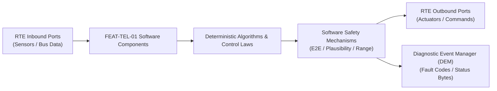

# Software Requirements Specification: Firmware Over-The-Air (FOTA) Update Orchestrator
**Feature ID:** `FEAT-TEL-01`  
**Domain:** Connectivity, Security & Diagnostics  
**Target ASIL:** ASIL B / ISO 21434 / UNECE R156  
**Compliance Standard:** ISO 26262:2018 (Part 6 - Software Development) / ASPICE PAM v3.1 (SWE.1, SWE.2)  
**Parent System Specification:** [`FEAT-TEL-01_FOTA_SysReq.md`](file:///c:/Workset/AntiGravityProjects/TestOptimisationExperiement/system_requirements/FEAT-TEL-01_FOTA_SysReq.md)  
**Global Master Specification:** [`spec.md`](file:///c:/Workset/AntiGravityProjects/TestOptimisationExperiement/spec.md)

---

## 1. Software Architecture & Component Structure

This document specifies the AUTOSAR Software Components (SWCs), periodic runnables, algorithmic laws, safety mechanisms, and data ports implementing `FEAT-TEL-01` (Firmware Over-The-Air (FOTA) Update Orchestrator).

### AUTOSAR SWC Interaction Diagram

---

## 2. Detailed Software Requirements (SWR_REQ)
*(Multi-Software Requirement Partitioning derived from System Requirements)*

### `SWR-TEL-01-01`: Manifest XML Parser & Cryptographic Signature Verifier
- **Planned Release:** R100
- **ASIL Rating:** QM / ISO 21434
- **Parent System Requirement:** [`SYS-TEL-01-01`](file:///c:/Workset/AntiGravityProjects/TestOptimisationExperiement/system_requirements/FEAT-TEL-01_FOTA_SysReq.md#sys-tel-01-01)
- **Allocated AUTOSAR SWC:** `FotaManifestVerifier_SWC`
- **Execution Rate / Trigger:** Background event
- **Worst-Case Execution Time (WCET):** 12.0 ms
- **Software Activation Condition:** Executed on download completion.
- **Algorithmic Description / Logic:**
  > Parses manifest containing ECU compatibility matrix, target software version, dependencies, and SHA-256 chunk hashes. Invokes HSM to verify ECDSA-P384 signature over entire manifest.
- **Software Safety Mechanism:** Strict dependency enforcement: Rejects firmware if dependent ECU versions mismatch.
- **Failure Reaction & DEM Diagnostic Event:** Delete all downloaded files upon signature validation failure.
- **Software Port Inputs:** `Downloaded_Manifest_File, HSM_Root_Certificate`
- **Software Port Outputs:** `Manifest_Valid (boolean), Target_ECU_Install_List`
- **Software Verification Criteria:** Unit test against valid and corrupted XML manifests.
- **Traceability Link:** Traces upward to [`SYS-TEL-01-01`](file:///c:/Workset/AntiGravityProjects/TestOptimisationExperiement/system_requirements/FEAT-TEL-01_FOTA_SysReq.md#sys-tel-01-01) and [`FEAT-TEL-01`](file:///c:/Workset/AntiGravityProjects/TestOptimisationExperiement/spec.md).

### `SWR-TEL-01-02`: Hardware Security Module (HSM) AES-256-GCM Chunk Decryptor
- **Planned Release:** R100
- **ASIL Rating:** QM / ISO 21434
- **Parent System Requirement:** [`SYS-TEL-01-01`](file:///c:/Workset/AntiGravityProjects/TestOptimisationExperiement/system_requirements/FEAT-TEL-01_FOTA_SysReq.md#sys-tel-01-01)
- **Allocated AUTOSAR SWC:** `FotaDecryptor_SWC`
- **Execution Rate / Trigger:** Background event
- **Worst-Case Execution Time (WCET):** 15.0 ms
- **Software Activation Condition:** Executed during binary staging.
- **Algorithmic Description / Logic:**
  > Decrypts 64 KB binary chunks using AES-256-GCM authenticated cipher. Validates 128-bit authentication tag for each chunk. Verifies progressive Merkle hash tree.
- **Software Safety Mechanism:** Zero plain-text persistence on external unencrypted flash memory.
- **Failure Reaction & DEM Diagnostic Event:** Abort staging if any chunk authentication tag fails to match.
- **Software Port Inputs:** `Encrypted_Chunk_Buffer, Decryption_Session_Key`
- **Software Port Outputs:** `Decrypted_Chunk_Buffer, Chunk_Hash_Verified (boolean)`
- **Software Verification Criteria:** NIST cryptographic test vector suite verification.
- **Traceability Link:** Traces upward to [`SYS-TEL-01-01`](file:///c:/Workset/AntiGravityProjects/TestOptimisationExperiement/system_requirements/FEAT-TEL-01_FOTA_SysReq.md#sys-tel-01-01) and [`FEAT-TEL-01`](file:///c:/Workset/AntiGravityProjects/TestOptimisationExperiement/spec.md).

### `SWR-TEL-01-03`: Vehicle Safety Interlocks Pre-Condition Gatekeeper
- **Planned Release:** R100
- **ASIL Rating:** ASIL B
- **Parent System Requirement:** [`SYS-TEL-01-02`](file:///c:/Workset/AntiGravityProjects/TestOptimisationExperiement/system_requirements/FEAT-TEL-01_FOTA_SysReq.md#sys-tel-01-02)
- **Allocated AUTOSAR SWC:** `FotaSafetyInterlock_SWC`
- **Execution Rate / Trigger:** 100 ms
- **Worst-Case Execution Time (WCET):** 0.6 ms
- **Software Activation Condition:** Executed prior to flashing.
- **Algorithmic Description / Logic:**
  > Polls: (Gear == PARK) && (Speed == 0.0) && (V_12V >= 12.4) && (SOC >= 50.0) && (Vehicle_Locked == TRUE). If any condition transitions to FALSE during 30s confirmation window, abort install.
- **Software Safety Mechanism:** Continuous monitoring: Keeps polling interlocks during initial flash handshake.
- **Failure Reaction & DEM Diagnostic Event:** Set Install_Blocked_Reason code and notify driver via cluster.
- **Software Port Inputs:** `Gear_State, Vehicle_Speed_Mps, V_12V, SOC_Pct, Lock_State`
- **Software Port Outputs:** `Install_Safe_Permit (boolean)`
- **Software Verification Criteria:** Automated boundary testing of all vehicle interlock signals.
- **Traceability Link:** Traces upward to [`SYS-TEL-01-02`](file:///c:/Workset/AntiGravityProjects/TestOptimisationExperiement/system_requirements/FEAT-TEL-01_FOTA_SysReq.md#sys-tel-01-02) and [`FEAT-TEL-01`](file:///c:/Workset/AntiGravityProjects/TestOptimisationExperiement/spec.md).

### `SWR-TEL-01-04`: Cluster HMI Consent & Installation Countdown Timer
- **Planned Release:** R100
- **ASIL Rating:** QM
- **Parent System Requirement:** [`SYS-TEL-01-02`](file:///c:/Workset/AntiGravityProjects/TestOptimisationExperiement/system_requirements/FEAT-TEL-01_FOTA_SysReq.md#sys-tel-01-02)
- **Allocated AUTOSAR SWC:** `FotaHmiConsent_SWC`
- **Execution Rate / Trigger:** 100 ms
- **Worst-Case Execution Time (WCET):** 0.5 ms
- **Software Activation Condition:** Executed upon manifest verification.
- **Algorithmic Description / Logic:**
  > Presents installation dialogue to driver: 'Update Ready. Estimated Time: 25 min. Vehicle cannot be driven.' Requires explicit PIN or button press consent; starts 120s countdown.
- **Software Safety Mechanism:** Allows driver to cancel update prior to countdown expiration.
- **Failure Reaction & DEM Diagnostic Event:** Postpone update if driver does not provide affirmative consent.
- **Software Port Inputs:** `User_Touch_Input, Countdown_Timer_Sec`
- **Software Port Outputs:** `Driver_Consent_Confirmed (boolean), Scheduled_Install_Timestamp`
- **Software Verification Criteria:** HMI user interaction simulation testing.
- **Traceability Link:** Traces upward to [`SYS-TEL-01-02`](file:///c:/Workset/AntiGravityProjects/TestOptimisationExperiement/system_requirements/FEAT-TEL-01_FOTA_SysReq.md#sys-tel-01-02) and [`FEAT-TEL-01`](file:///c:/Workset/AntiGravityProjects/TestOptimisationExperiement/spec.md).

### `SWR-TEL-01-05`: UDS Diagnostic Service 0x34/0x36/0x37 Flashing Orchestrator
- **Planned Release:** R100
- **ASIL Rating:** ASIL B
- **Parent System Requirement:** [`SYS-TEL-01-03`](file:///c:/Workset/AntiGravityProjects/TestOptimisationExperiement/system_requirements/FEAT-TEL-01_FOTA_SysReq.md#sys-tel-01-03)
- **Allocated AUTOSAR SWC:** `FotaUdsFlashing_SWC`
- **Execution Rate / Trigger:** 20 ms
- **Worst-Case Execution Time (WCET):** 3.2 ms
- **Software Activation Condition:** Executed during active flashing phase.
- **Algorithmic Description / Logic:**
  > Executes standard diagnostic sequence: 0x10 0x02 (ProgrammingSession) -> 0x27 (SecurityAccess) -> 0x34 (RequestDownload) -> 0x36 (TransferData chunks to Bank B) -> 0x37 (RequestTransferExit) -> 0x31 (CheckMemoryRoutine).
- **Software Safety Mechanism:** CRC-32 verification performed on target ECU before exit programming session.
- **Failure Reaction & DEM Diagnostic Event:** If any UDS service returns Negative Response Code (NRC), halt and initiate rollback.
- **Software Port Inputs:** `Target_ECU_Address, Decrypted_Binary_Stream`
- **Software Port Outputs:** `UDS_Diagnostic_Tx_PDU, Flashing_Progress_Pct`
- **Software Verification Criteria:** CANoe.DiVa automated flash programming test suite.
- **Traceability Link:** Traces upward to [`SYS-TEL-01-03`](file:///c:/Workset/AntiGravityProjects/TestOptimisationExperiement/system_requirements/FEAT-TEL-01_FOTA_SysReq.md#sys-tel-01-03) and [`FEAT-TEL-01`](file:///c:/Workset/AntiGravityProjects/TestOptimisationExperiement/spec.md).

### `SWR-TEL-01-06`: Dual-Bank Bootloader Pointer Switcher & Watchdog Recovery
- **Planned Release:** R100
- **ASIL Rating:** ASIL B
- **Parent System Requirement:** [`SYS-TEL-01-03`](file:///c:/Workset/AntiGravityProjects/TestOptimisationExperiement/system_requirements/FEAT-TEL-01_FOTA_SysReq.md#sys-tel-01-03)
- **Allocated AUTOSAR SWC:** `FotaBootSupervisor_SWC`
- **Execution Rate / Trigger:** 50 ms
- **Worst-Case Execution Time (WCET):** 0.8 ms
- **Software Activation Condition:** Executed post-flash completion.
- **Algorithmic Description / Logic:**
  > Flips non-volatile boot configuration register to point to Bank B. Commands target ECU reset (0x11 0x01). Starts 60.0-second confirmation timer: ECU must report healthy UDS diagnostic session. If timer expires, flips boot pointer back to Bank A.
- **Software Safety Mechanism:** Hardware watchdog fallback: Unrefreshed hardware watchdog forces boot back to Bank A.
- **Failure Reaction & DEM Diagnostic Event:** Revert to Bank A and log failure diagnostic report to cloud backend.
- **Software Port Inputs:** `Target_ECU_Boot_Report_PDU, Post_Boot_Timer_Sec`
- **Software Port Outputs:** `Active_Boot_Bank_Select_Bit, Rollback_Executed_Flag`
- **Software Verification Criteria:** Corrupted Bank B binary injection verifying automated rollback to Bank A.
- **Traceability Link:** Traces upward to [`SYS-TEL-01-03`](file:///c:/Workset/AntiGravityProjects/TestOptimisationExperiement/system_requirements/FEAT-TEL-01_FOTA_SysReq.md#sys-tel-01-03) and [`FEAT-TEL-01`](file:///c:/Workset/AntiGravityProjects/TestOptimisationExperiement/spec.md).

### `SWR-TEL-01-07`: Bsdiff Differential Delta Binary Decompression Engine
- **Planned Release:** R200
- **ASIL Rating:** ASIL B
- **Parent System Requirement:** [`SYS-TEL-01-04`](file:///c:/Workset/AntiGravityProjects/TestOptimisationExperiement/system_requirements/FEAT-TEL-01_FOTA_SysReq.md#sys-tel-01-04)
- **Allocated AUTOSAR SWC:** `FotaDeltaReconstructor_SWC`
- **Execution Rate / Trigger:** 50 ms
- **Worst-Case Execution Time (WCET):** 4.5 ms
- **Software Activation Condition:** Executed during binary staging phase.
- **Algorithmic Description / Logic:**
  > Applies bsdiff/bspatch differential decompression algorithm: Reads existing flash Bank A binary and differential delta patch stream. Synthesizes new Bank B image. Computes SHA-256 hash across reconstructed 128 MB image: Confirms match with signed manifest.
- **Software Safety Mechanism:** Cryptographic memory guard: Reconstructed image stored in write-protected eMMC partition.
- **Failure Reaction & DEM Diagnostic Event:** Delete staged file and request re-download if reconstructed hash does not match.
- **Software Port Inputs:** `Delta_Patch_Byte_Stream, Origin_Firmware_BankA_Bytes`
- **Software Port Outputs:** `Reconstructed_BankB_Firmware_Bytes, Hash_Verification_Passed_Flag`
- **Software Verification Criteria:** Automated regression testing across 100 firmware delta patch versions.
- **Traceability Link:** Traces upward to [`SYS-TEL-01-04`](file:///c:/Workset/AntiGravityProjects/TestOptimisationExperiement/system_requirements/FEAT-TEL-01_FOTA_SysReq.md#sys-tel-01-04) and [`FEAT-TEL-01`](file:///c:/Workset/AntiGravityProjects/TestOptimisationExperiement/spec.md).

### `SWR-TEL-01-08`: Non-Volatile Chunk Staging & Resume Checkpoint Manager
- **Planned Release:** R200
- **ASIL Rating:** ASIL B
- **Parent System Requirement:** [`SYS-TEL-01-04`](file:///c:/Workset/AntiGravityProjects/TestOptimisationExperiement/system_requirements/FEAT-TEL-01_FOTA_SysReq.md#sys-tel-01-04)
- **Allocated AUTOSAR SWC:** `FotaChunkCheckpoint_SWC`
- **Execution Rate / Trigger:** 100 ms
- **Worst-Case Execution Time (WCET):** 1.2 ms
- **Software Activation Condition:** Active during cellular download.
- **Algorithmic Description / Logic:**
  > Manages 4 MB chunk staging: Writes each downloaded chunk to eMMC storage and updates persistent bitmap index. If cellular connection is interrupted or ignition turns off, resumes exactly from missing chunk upon next wake-up.
- **Software Safety Mechanism:** Flash wear leveling: Restricts staging writes to dedicated update partition.
- **Failure Reaction & DEM Diagnostic Event:** Retry download of corrupted chunk up to 5 times before failing campaign.
- **Software Port Inputs:** `Chunk_Sequence_Index, Chunk_Payload_Buffer[4096], Cellular_Link_Active_Flag`
- **Software Port Outputs:** `Chunk_Bitmap_Status_Array[32], Download_Resumed_Offset_Bytes`
- **Software Verification Criteria:** Power cut-off and cell tower handoff interruption resilience testing.
- **Traceability Link:** Traces upward to [`SYS-TEL-01-04`](file:///c:/Workset/AntiGravityProjects/TestOptimisationExperiement/system_requirements/FEAT-TEL-01_FOTA_SysReq.md#sys-tel-01-04) and [`FEAT-TEL-01`](file:///c:/Workset/AntiGravityProjects/TestOptimisationExperiement/spec.md).

### `SWR-TEL-01-09`: Vehicle Overnight Update Scheduler & Driver HMI Consent Flow
- **Planned Release:** R500
- **ASIL Rating:** QM
- **Parent System Requirement:** [`SYS-TEL-01-05`](file:///c:/Workset/AntiGravityProjects/TestOptimisationExperiement/system_requirements/FEAT-TEL-01_FOTA_SysReq.md#sys-tel-01-05)
- **Allocated AUTOSAR SWC:** `FotaScheduler_SWC`
- **Execution Rate / Trigger:** 1000 ms
- **Worst-Case Execution Time (WCET):** 0.5 ms
- **Software Activation Condition:** Cyclic 1 Hz task.
- **Algorithmic Description / Logic:**
  > Manages user interaction: Prompts driver on central screen 'Software Update Ready (Est. 25 min) - Install Now or Schedule Tonight at 02:00?'. If scheduled, wakes vehicle telematics via RTC alarm at 01:50 AM to verify pre-conditions and commence flashing.
- **Software Safety Mechanism:** Hazard warning check: Prohibits automatic update if vehicle hazard lights are blinking.
- **Failure Reaction & DEM Diagnostic Event:** Cancel overnight update if battery drops below 50% SOC prior to install window.
- **Software Port Inputs:** `User_Schedule_Selection_Enum, Vehicle_RTC_Clock, Traction_Battery_SOC`
- **Software Port Outputs:** `RTC_Alarm_Wakeup_Register, Scheduled_Update_Pending_Flag`
- **Software Verification Criteria:** HMI user workflow testing and RTC overnight wakeup verification.
- **Traceability Link:** Traces upward to [`SYS-TEL-01-05`](file:///c:/Workset/AntiGravityProjects/TestOptimisationExperiement/system_requirements/FEAT-TEL-01_FOTA_SysReq.md#sys-tel-01-05) and [`FEAT-TEL-01`](file:///c:/Workset/AntiGravityProjects/TestOptimisationExperiement/spec.md).

### `SWR-TEL-01-10`: UNECE R156 Software Identification (RXSWIN) & Audit Logger
- **Planned Release:** R500
- **ASIL Rating:** ISO 24089 / UNECE R156
- **Parent System Requirement:** [`SYS-TEL-01-05`](file:///c:/Workset/AntiGravityProjects/TestOptimisationExperiement/system_requirements/FEAT-TEL-01_FOTA_SysReq.md#sys-tel-01-05)
- **Allocated AUTOSAR SWC:** `FotaAuditLogger_SWC`
- **Execution Rate / Trigger:** 100 ms
- **Worst-Case Execution Time (WCET):** 0.8 ms
- **Software Activation Condition:** Executed upon installation completion or failure.
- **Algorithmic Description / Logic:**
  > Generates regulatory Regulation X Software Identification Number (RXSWIN conforming to UNECE R156): Signs updated vehicle ECU software bill-of-materials with HSM private key. Appends cryptographic audit entry to tamper-proof internal blackbox.
- **Software Safety Mechanism:** Non-volatile append-only flash logging preventing erasure of software history.
- **Failure Reaction & DEM Diagnostic Event:** Transmit audit log immediately to OEM cloud backend upon next cellular connection.
- **Software Port Inputs:** `Updated_ECU_Versions_Array[16], HSM_Private_Key_Handle, Install_Result_Code`
- **Software Port Outputs:** `Certified_Vehicle_RXSWIN_String, Cloud_Campaign_Report_Payload`
- **Software Verification Criteria:** Type-approval compliance inspection according to UNECE R156.
- **Traceability Link:** Traces upward to [`SYS-TEL-01-05`](file:///c:/Workset/AntiGravityProjects/TestOptimisationExperiement/system_requirements/FEAT-TEL-01_FOTA_SysReq.md#sys-tel-01-05) and [`FEAT-TEL-01`](file:///c:/Workset/AntiGravityProjects/TestOptimisationExperiement/spec.md).

### `SWR-TEL-01-11`: UNECE R156 Software Update Management System (SUMS) Cryptographic Manifest Validator - Dynamic Observer & Signal Filter
- **Planned Release:** R500
- **ASIL Rating:** ASIL B
- **Parent System Requirement:** [`SYS-TEL-01-06`](file:///c:/Workset/AntiGravityProjects/TestOptimisationExperiement/system_requirements/FEAT-TEL-01_FOTA_SysReq.md#sys-tel-01-06)
- **Allocated AUTOSAR SWC:** `FotaManifestValidator_SWC`
- **Execution Rate / Trigger:** 200 ms
- **Worst-Case Execution Time (WCET):** 0.3 ms
- **Software Activation Condition:** Executed cyclically every 200 ms.
- **Algorithmic Description / Logic:**
  > Executes signal plausibility filtering, calibration offsets, and discrete state estimation for UNECE R156 Software Update Management System (SUMS) Cryptographic Manifest Validator.
- **Software Safety Mechanism:** Range limit plausibility check and E2E alive sequence verification.
- **Failure Reaction & DEM Diagnostic Event:** Set default fallback output and report DEM_EVENT_FEAT_TEL_01_ERR.
- **Software Port Inputs:** `Raw sensor ADC/SENT/SPI values and RTE bus inputs.`
- **Software Port Outputs:** `Filtered physical signals and validity status bitmasks.`
- **Software Verification Criteria:** Unit test and HiL software integration test.
- **Traceability Link:** Traces upward to [`SYS-TEL-01-06`](file:///c:/Workset/AntiGravityProjects/TestOptimisationExperiement/system_requirements/FEAT-TEL-01_FOTA_SysReq.md#sys-tel-01-06) and [`FEAT-TEL-01`](file:///c:/Workset/AntiGravityProjects/TestOptimisationExperiement/spec.md).

### `SWR-TEL-01-12`: UNECE R156 Software Update Management System (SUMS) Cryptographic Manifest Validator - Closed-Loop Control Law & Actuator Dispatch
- **Planned Release:** R500
- **ASIL Rating:** ASIL B
- **Parent System Requirement:** [`SYS-TEL-01-06`](file:///c:/Workset/AntiGravityProjects/TestOptimisationExperiement/system_requirements/FEAT-TEL-01_FOTA_SysReq.md#sys-tel-01-06)
- **Allocated AUTOSAR SWC:** `FotaManifestValidator_SWC`
- **Execution Rate / Trigger:** 200 ms
- **Worst-Case Execution Time (WCET):** 0.4 ms
- **Software Activation Condition:** Executed cyclically every 200 ms.
- **Algorithmic Description / Logic:**
  > Evaluates deterministic closed-loop control law, rate limits, and dispatches commands for UNECE R156 Software Update Management System (SUMS) Cryptographic Manifest Validator.
- **Software Safety Mechanism:** Command saturation clamping and watchdog program flow monitoring.
- **Failure Reaction & DEM Diagnostic Event:** De-energize actuator output, apply safe fallback clamp, and latch DTC.
- **Software Port Inputs:** `Validated physical state signals from observer SWC.`
- **Software Port Outputs:** `Actuator PWM duty cycles, torque/pressure setpoints, and diagnostic flags.`
- **Software Verification Criteria:** Hardware dynamometer and HiL closed-loop regression test suite.
- **Traceability Link:** Traces upward to [`SYS-TEL-01-06`](file:///c:/Workset/AntiGravityProjects/TestOptimisationExperiement/system_requirements/FEAT-TEL-01_FOTA_SysReq.md#sys-tel-01-06) and [`FEAT-TEL-01`](file:///c:/Workset/AntiGravityProjects/TestOptimisationExperiement/spec.md).

### `SWR-TEL-01-13`: A/B Dual-Bank Flash Memory Hardware Swap & Atomic Rollback Engine - Dynamic Observer & Signal Filter
- **Planned Release:** R300
- **ASIL Rating:** ASIL B
- **Parent System Requirement:** [`SYS-TEL-01-07`](file:///c:/Workset/AntiGravityProjects/TestOptimisationExperiement/system_requirements/FEAT-TEL-01_FOTA_SysReq.md#sys-tel-01-07)
- **Allocated AUTOSAR SWC:** `FotaBankSwapEngine_SWC`
- **Execution Rate / Trigger:** 100 ms
- **Worst-Case Execution Time (WCET):** 0.3 ms
- **Software Activation Condition:** Executed cyclically every 100 ms.
- **Algorithmic Description / Logic:**
  > Executes signal plausibility filtering, calibration offsets, and discrete state estimation for A/B Dual-Bank Flash Memory Hardware Swap & Atomic Rollback Engine.
- **Software Safety Mechanism:** Range limit plausibility check and E2E alive sequence verification.
- **Failure Reaction & DEM Diagnostic Event:** Set default fallback output and report DEM_EVENT_FEAT_TEL_01_ERR.
- **Software Port Inputs:** `Raw sensor ADC/SENT/SPI values and RTE bus inputs.`
- **Software Port Outputs:** `Filtered physical signals and validity status bitmasks.`
- **Software Verification Criteria:** Unit test and HiL software integration test.
- **Traceability Link:** Traces upward to [`SYS-TEL-01-07`](file:///c:/Workset/AntiGravityProjects/TestOptimisationExperiement/system_requirements/FEAT-TEL-01_FOTA_SysReq.md#sys-tel-01-07) and [`FEAT-TEL-01`](file:///c:/Workset/AntiGravityProjects/TestOptimisationExperiement/spec.md).

### `SWR-TEL-01-14`: A/B Dual-Bank Flash Memory Hardware Swap & Atomic Rollback Engine - Closed-Loop Control Law & Actuator Dispatch
- **Planned Release:** R300
- **ASIL Rating:** ASIL B
- **Parent System Requirement:** [`SYS-TEL-01-07`](file:///c:/Workset/AntiGravityProjects/TestOptimisationExperiement/system_requirements/FEAT-TEL-01_FOTA_SysReq.md#sys-tel-01-07)
- **Allocated AUTOSAR SWC:** `FotaBankSwapEngine_SWC`
- **Execution Rate / Trigger:** 100 ms
- **Worst-Case Execution Time (WCET):** 0.4 ms
- **Software Activation Condition:** Executed cyclically every 100 ms.
- **Algorithmic Description / Logic:**
  > Evaluates deterministic closed-loop control law, rate limits, and dispatches commands for A/B Dual-Bank Flash Memory Hardware Swap & Atomic Rollback Engine.
- **Software Safety Mechanism:** Command saturation clamping and watchdog program flow monitoring.
- **Failure Reaction & DEM Diagnostic Event:** De-energize actuator output, apply safe fallback clamp, and latch DTC.
- **Software Port Inputs:** `Validated physical state signals from observer SWC.`
- **Software Port Outputs:** `Actuator PWM duty cycles, torque/pressure setpoints, and diagnostic flags.`
- **Software Verification Criteria:** Hardware dynamometer and HiL closed-loop regression test suite.
- **Traceability Link:** Traces upward to [`SYS-TEL-01-07`](file:///c:/Workset/AntiGravityProjects/TestOptimisationExperiement/system_requirements/FEAT-TEL-01_FOTA_SysReq.md#sys-tel-01-07) and [`FEAT-TEL-01`](file:///c:/Workset/AntiGravityProjects/TestOptimisationExperiement/spec.md).

### `SWR-TEL-01-15`: Cellular 5G / Wi-Fi Delta-Compression Firmware Package Downloader - Dynamic Observer & Signal Filter
- **Planned Release:** R300
- **ASIL Rating:** ASIL B
- **Parent System Requirement:** [`SYS-TEL-01-08`](file:///c:/Workset/AntiGravityProjects/TestOptimisationExperiement/system_requirements/FEAT-TEL-01_FOTA_SysReq.md#sys-tel-01-08)
- **Allocated AUTOSAR SWC:** `FotaPackageDownloader_SWC`
- **Execution Rate / Trigger:** 500 ms
- **Worst-Case Execution Time (WCET):** 0.3 ms
- **Software Activation Condition:** Executed cyclically every 500 ms.
- **Algorithmic Description / Logic:**
  > Executes signal plausibility filtering, calibration offsets, and discrete state estimation for Cellular 5G / Wi-Fi Delta-Compression Firmware Package Downloader.
- **Software Safety Mechanism:** Range limit plausibility check and E2E alive sequence verification.
- **Failure Reaction & DEM Diagnostic Event:** Set default fallback output and report DEM_EVENT_FEAT_TEL_01_ERR.
- **Software Port Inputs:** `Raw sensor ADC/SENT/SPI values and RTE bus inputs.`
- **Software Port Outputs:** `Filtered physical signals and validity status bitmasks.`
- **Software Verification Criteria:** Unit test and HiL software integration test.
- **Traceability Link:** Traces upward to [`SYS-TEL-01-08`](file:///c:/Workset/AntiGravityProjects/TestOptimisationExperiement/system_requirements/FEAT-TEL-01_FOTA_SysReq.md#sys-tel-01-08) and [`FEAT-TEL-01`](file:///c:/Workset/AntiGravityProjects/TestOptimisationExperiement/spec.md).

### `SWR-TEL-01-16`: Cellular 5G / Wi-Fi Delta-Compression Firmware Package Downloader - Closed-Loop Control Law & Actuator Dispatch
- **Planned Release:** R300
- **ASIL Rating:** ASIL B
- **Parent System Requirement:** [`SYS-TEL-01-08`](file:///c:/Workset/AntiGravityProjects/TestOptimisationExperiement/system_requirements/FEAT-TEL-01_FOTA_SysReq.md#sys-tel-01-08)
- **Allocated AUTOSAR SWC:** `FotaPackageDownloader_SWC`
- **Execution Rate / Trigger:** 500 ms
- **Worst-Case Execution Time (WCET):** 0.4 ms
- **Software Activation Condition:** Executed cyclically every 500 ms.
- **Algorithmic Description / Logic:**
  > Evaluates deterministic closed-loop control law, rate limits, and dispatches commands for Cellular 5G / Wi-Fi Delta-Compression Firmware Package Downloader.
- **Software Safety Mechanism:** Command saturation clamping and watchdog program flow monitoring.
- **Failure Reaction & DEM Diagnostic Event:** De-energize actuator output, apply safe fallback clamp, and latch DTC.
- **Software Port Inputs:** `Validated physical state signals from observer SWC.`
- **Software Port Outputs:** `Actuator PWM duty cycles, torque/pressure setpoints, and diagnostic flags.`
- **Software Verification Criteria:** Hardware dynamometer and HiL closed-loop regression test suite.
- **Traceability Link:** Traces upward to [`SYS-TEL-01-08`](file:///c:/Workset/AntiGravityProjects/TestOptimisationExperiement/system_requirements/FEAT-TEL-01_FOTA_SysReq.md#sys-tel-01-08) and [`FEAT-TEL-01`](file:///c:/Workset/AntiGravityProjects/TestOptimisationExperiement/spec.md).

### `SWR-TEL-01-17`: Vehicle State-of-Charge & Parked Safety Precondition Evaluator - Dynamic Observer & Signal Filter
- **Planned Release:** R300
- **ASIL Rating:** ASIL B
- **Parent System Requirement:** [`SYS-TEL-01-09`](file:///c:/Workset/AntiGravityProjects/TestOptimisationExperiement/system_requirements/FEAT-TEL-01_FOTA_SysReq.md#sys-tel-01-09)
- **Allocated AUTOSAR SWC:** `FotaPreconditionChecker_SWC`
- **Execution Rate / Trigger:** 200 ms
- **Worst-Case Execution Time (WCET):** 0.3 ms
- **Software Activation Condition:** Executed cyclically every 200 ms.
- **Algorithmic Description / Logic:**
  > Executes signal plausibility filtering, calibration offsets, and discrete state estimation for Vehicle State-of-Charge & Parked Safety Precondition Evaluator.
- **Software Safety Mechanism:** Range limit plausibility check and E2E alive sequence verification.
- **Failure Reaction & DEM Diagnostic Event:** Set default fallback output and report DEM_EVENT_FEAT_TEL_01_ERR.
- **Software Port Inputs:** `Raw sensor ADC/SENT/SPI values and RTE bus inputs.`
- **Software Port Outputs:** `Filtered physical signals and validity status bitmasks.`
- **Software Verification Criteria:** Unit test and HiL software integration test.
- **Traceability Link:** Traces upward to [`SYS-TEL-01-09`](file:///c:/Workset/AntiGravityProjects/TestOptimisationExperiement/system_requirements/FEAT-TEL-01_FOTA_SysReq.md#sys-tel-01-09) and [`FEAT-TEL-01`](file:///c:/Workset/AntiGravityProjects/TestOptimisationExperiement/spec.md).

### `SWR-TEL-01-18`: Vehicle State-of-Charge & Parked Safety Precondition Evaluator - Closed-Loop Control Law & Actuator Dispatch
- **Planned Release:** R300
- **ASIL Rating:** ASIL B
- **Parent System Requirement:** [`SYS-TEL-01-09`](file:///c:/Workset/AntiGravityProjects/TestOptimisationExperiement/system_requirements/FEAT-TEL-01_FOTA_SysReq.md#sys-tel-01-09)
- **Allocated AUTOSAR SWC:** `FotaPreconditionChecker_SWC`
- **Execution Rate / Trigger:** 200 ms
- **Worst-Case Execution Time (WCET):** 0.4 ms
- **Software Activation Condition:** Executed cyclically every 200 ms.
- **Algorithmic Description / Logic:**
  > Evaluates deterministic closed-loop control law, rate limits, and dispatches commands for Vehicle State-of-Charge & Parked Safety Precondition Evaluator.
- **Software Safety Mechanism:** Command saturation clamping and watchdog program flow monitoring.
- **Failure Reaction & DEM Diagnostic Event:** De-energize actuator output, apply safe fallback clamp, and latch DTC.
- **Software Port Inputs:** `Validated physical state signals from observer SWC.`
- **Software Port Outputs:** `Actuator PWM duty cycles, torque/pressure setpoints, and diagnostic flags.`
- **Software Verification Criteria:** Hardware dynamometer and HiL closed-loop regression test suite.
- **Traceability Link:** Traces upward to [`SYS-TEL-01-09`](file:///c:/Workset/AntiGravityProjects/TestOptimisationExperiement/system_requirements/FEAT-TEL-01_FOTA_SysReq.md#sys-tel-01-09) and [`FEAT-TEL-01`](file:///c:/Workset/AntiGravityProjects/TestOptimisationExperiement/spec.md).

### `SWR-TEL-01-19`: Driver Consent & Scheduled Overnight Installation Calendar Manager - Dynamic Observer & Signal Filter
- **Planned Release:** R400
- **ASIL Rating:** ASIL A
- **Parent System Requirement:** [`SYS-TEL-01-10`](file:///c:/Workset/AntiGravityProjects/TestOptimisationExperiement/system_requirements/FEAT-TEL-01_FOTA_SysReq.md#sys-tel-01-10)
- **Allocated AUTOSAR SWC:** `FotaConsentManager_SWC`
- **Execution Rate / Trigger:** 500 ms
- **Worst-Case Execution Time (WCET):** 0.3 ms
- **Software Activation Condition:** Executed cyclically every 500 ms.
- **Algorithmic Description / Logic:**
  > Executes signal plausibility filtering, calibration offsets, and discrete state estimation for Driver Consent & Scheduled Overnight Installation Calendar Manager.
- **Software Safety Mechanism:** Range limit plausibility check and E2E alive sequence verification.
- **Failure Reaction & DEM Diagnostic Event:** Set default fallback output and report DEM_EVENT_FEAT_TEL_01_ERR.
- **Software Port Inputs:** `Raw sensor ADC/SENT/SPI values and RTE bus inputs.`
- **Software Port Outputs:** `Filtered physical signals and validity status bitmasks.`
- **Software Verification Criteria:** Unit test and HiL software integration test.
- **Traceability Link:** Traces upward to [`SYS-TEL-01-10`](file:///c:/Workset/AntiGravityProjects/TestOptimisationExperiement/system_requirements/FEAT-TEL-01_FOTA_SysReq.md#sys-tel-01-10) and [`FEAT-TEL-01`](file:///c:/Workset/AntiGravityProjects/TestOptimisationExperiement/spec.md).

### `SWR-TEL-01-20`: Driver Consent & Scheduled Overnight Installation Calendar Manager - Closed-Loop Control Law & Actuator Dispatch
- **Planned Release:** R400
- **ASIL Rating:** ASIL A
- **Parent System Requirement:** [`SYS-TEL-01-10`](file:///c:/Workset/AntiGravityProjects/TestOptimisationExperiement/system_requirements/FEAT-TEL-01_FOTA_SysReq.md#sys-tel-01-10)
- **Allocated AUTOSAR SWC:** `FotaConsentManager_SWC`
- **Execution Rate / Trigger:** 500 ms
- **Worst-Case Execution Time (WCET):** 0.4 ms
- **Software Activation Condition:** Executed cyclically every 500 ms.
- **Algorithmic Description / Logic:**
  > Evaluates deterministic closed-loop control law, rate limits, and dispatches commands for Driver Consent & Scheduled Overnight Installation Calendar Manager.
- **Software Safety Mechanism:** Command saturation clamping and watchdog program flow monitoring.
- **Failure Reaction & DEM Diagnostic Event:** De-energize actuator output, apply safe fallback clamp, and latch DTC.
- **Software Port Inputs:** `Validated physical state signals from observer SWC.`
- **Software Port Outputs:** `Actuator PWM duty cycles, torque/pressure setpoints, and diagnostic flags.`
- **Software Verification Criteria:** Hardware dynamometer and HiL closed-loop regression test suite.
- **Traceability Link:** Traces upward to [`SYS-TEL-01-10`](file:///c:/Workset/AntiGravityProjects/TestOptimisationExperiement/system_requirements/FEAT-TEL-01_FOTA_SysReq.md#sys-tel-01-10) and [`FEAT-TEL-01`](file:///c:/Workset/AntiGravityProjects/TestOptimisationExperiement/spec.md).

### `SWR-TEL-01-21`: ECU Flash Programming Routine Control & UDS Diagnostics Orchestrator - Dynamic Observer & Signal Filter
- **Planned Release:** R500
- **ASIL Rating:** ASIL B
- **Parent System Requirement:** [`SYS-TEL-01-11`](file:///c:/Workset/AntiGravityProjects/TestOptimisationExperiement/system_requirements/FEAT-TEL-01_FOTA_SysReq.md#sys-tel-01-11)
- **Allocated AUTOSAR SWC:** `FotaUdsOrchestrator_SWC`
- **Execution Rate / Trigger:** 50 ms
- **Worst-Case Execution Time (WCET):** 0.3 ms
- **Software Activation Condition:** Executed cyclically every 50 ms.
- **Algorithmic Description / Logic:**
  > Executes signal plausibility filtering, calibration offsets, and discrete state estimation for ECU Flash Programming Routine Control & UDS Diagnostics Orchestrator.
- **Software Safety Mechanism:** Range limit plausibility check and E2E alive sequence verification.
- **Failure Reaction & DEM Diagnostic Event:** Set default fallback output and report DEM_EVENT_FEAT_TEL_01_ERR.
- **Software Port Inputs:** `Raw sensor ADC/SENT/SPI values and RTE bus inputs.`
- **Software Port Outputs:** `Filtered physical signals and validity status bitmasks.`
- **Software Verification Criteria:** Unit test and HiL software integration test.
- **Traceability Link:** Traces upward to [`SYS-TEL-01-11`](file:///c:/Workset/AntiGravityProjects/TestOptimisationExperiement/system_requirements/FEAT-TEL-01_FOTA_SysReq.md#sys-tel-01-11) and [`FEAT-TEL-01`](file:///c:/Workset/AntiGravityProjects/TestOptimisationExperiement/spec.md).

### `SWR-TEL-01-22`: ECU Flash Programming Routine Control & UDS Diagnostics Orchestrator - Closed-Loop Control Law & Actuator Dispatch
- **Planned Release:** R500
- **ASIL Rating:** ASIL B
- **Parent System Requirement:** [`SYS-TEL-01-11`](file:///c:/Workset/AntiGravityProjects/TestOptimisationExperiement/system_requirements/FEAT-TEL-01_FOTA_SysReq.md#sys-tel-01-11)
- **Allocated AUTOSAR SWC:** `FotaUdsOrchestrator_SWC`
- **Execution Rate / Trigger:** 50 ms
- **Worst-Case Execution Time (WCET):** 0.4 ms
- **Software Activation Condition:** Executed cyclically every 50 ms.
- **Algorithmic Description / Logic:**
  > Evaluates deterministic closed-loop control law, rate limits, and dispatches commands for ECU Flash Programming Routine Control & UDS Diagnostics Orchestrator.
- **Software Safety Mechanism:** Command saturation clamping and watchdog program flow monitoring.
- **Failure Reaction & DEM Diagnostic Event:** De-energize actuator output, apply safe fallback clamp, and latch DTC.
- **Software Port Inputs:** `Validated physical state signals from observer SWC.`
- **Software Port Outputs:** `Actuator PWM duty cycles, torque/pressure setpoints, and diagnostic flags.`
- **Software Verification Criteria:** Hardware dynamometer and HiL closed-loop regression test suite.
- **Traceability Link:** Traces upward to [`SYS-TEL-01-11`](file:///c:/Workset/AntiGravityProjects/TestOptimisationExperiement/system_requirements/FEAT-TEL-01_FOTA_SysReq.md#sys-tel-01-11) and [`FEAT-TEL-01`](file:///c:/Workset/AntiGravityProjects/TestOptimisationExperiement/spec.md).

### `SWR-TEL-01-23`: Post-Flash Microcontroller Memory Integrity CRC-32 & Self-Test Verifier - Dynamic Observer & Signal Filter
- **Planned Release:** R400
- **ASIL Rating:** ASIL B
- **Parent System Requirement:** [`SYS-TEL-01-12`](file:///c:/Workset/AntiGravityProjects/TestOptimisationExperiement/system_requirements/FEAT-TEL-01_FOTA_SysReq.md#sys-tel-01-12)
- **Allocated AUTOSAR SWC:** `FotaIntegrityVerifier_SWC`
- **Execution Rate / Trigger:** 200 ms
- **Worst-Case Execution Time (WCET):** 0.3 ms
- **Software Activation Condition:** Executed cyclically every 200 ms.
- **Algorithmic Description / Logic:**
  > Executes signal plausibility filtering, calibration offsets, and discrete state estimation for Post-Flash Microcontroller Memory Integrity CRC-32 & Self-Test Verifier.
- **Software Safety Mechanism:** Range limit plausibility check and E2E alive sequence verification.
- **Failure Reaction & DEM Diagnostic Event:** Set default fallback output and report DEM_EVENT_FEAT_TEL_01_ERR.
- **Software Port Inputs:** `Raw sensor ADC/SENT/SPI values and RTE bus inputs.`
- **Software Port Outputs:** `Filtered physical signals and validity status bitmasks.`
- **Software Verification Criteria:** Unit test and HiL software integration test.
- **Traceability Link:** Traces upward to [`SYS-TEL-01-12`](file:///c:/Workset/AntiGravityProjects/TestOptimisationExperiement/system_requirements/FEAT-TEL-01_FOTA_SysReq.md#sys-tel-01-12) and [`FEAT-TEL-01`](file:///c:/Workset/AntiGravityProjects/TestOptimisationExperiement/spec.md).

### `SWR-TEL-01-24`: Post-Flash Microcontroller Memory Integrity CRC-32 & Self-Test Verifier - Closed-Loop Control Law & Actuator Dispatch
- **Planned Release:** R400
- **ASIL Rating:** ASIL B
- **Parent System Requirement:** [`SYS-TEL-01-12`](file:///c:/Workset/AntiGravityProjects/TestOptimisationExperiement/system_requirements/FEAT-TEL-01_FOTA_SysReq.md#sys-tel-01-12)
- **Allocated AUTOSAR SWC:** `FotaIntegrityVerifier_SWC`
- **Execution Rate / Trigger:** 200 ms
- **Worst-Case Execution Time (WCET):** 0.4 ms
- **Software Activation Condition:** Executed cyclically every 200 ms.
- **Algorithmic Description / Logic:**
  > Evaluates deterministic closed-loop control law, rate limits, and dispatches commands for Post-Flash Microcontroller Memory Integrity CRC-32 & Self-Test Verifier.
- **Software Safety Mechanism:** Command saturation clamping and watchdog program flow monitoring.
- **Failure Reaction & DEM Diagnostic Event:** De-energize actuator output, apply safe fallback clamp, and latch DTC.
- **Software Port Inputs:** `Validated physical state signals from observer SWC.`
- **Software Port Outputs:** `Actuator PWM duty cycles, torque/pressure setpoints, and diagnostic flags.`
- **Software Verification Criteria:** Hardware dynamometer and HiL closed-loop regression test suite.
- **Traceability Link:** Traces upward to [`SYS-TEL-01-12`](file:///c:/Workset/AntiGravityProjects/TestOptimisationExperiement/system_requirements/FEAT-TEL-01_FOTA_SysReq.md#sys-tel-01-12) and [`FEAT-TEL-01`](file:///c:/Workset/AntiGravityProjects/TestOptimisationExperiement/spec.md).

### `SWR-TEL-01-25`: Automated Rollback Trigger on ECU Boot-Failure or Watchdog Crash - Dynamic Observer & Signal Filter
- **Planned Release:** R400
- **ASIL Rating:** ASIL B
- **Parent System Requirement:** [`SYS-TEL-01-13`](file:///c:/Workset/AntiGravityProjects/TestOptimisationExperiement/system_requirements/FEAT-TEL-01_FOTA_SysReq.md#sys-tel-01-13)
- **Allocated AUTOSAR SWC:** `FotaRollbackManager_SWC`
- **Execution Rate / Trigger:** 50 ms
- **Worst-Case Execution Time (WCET):** 0.3 ms
- **Software Activation Condition:** Executed cyclically every 50 ms.
- **Algorithmic Description / Logic:**
  > Executes signal plausibility filtering, calibration offsets, and discrete state estimation for Automated Rollback Trigger on ECU Boot-Failure or Watchdog Crash.
- **Software Safety Mechanism:** Range limit plausibility check and E2E alive sequence verification.
- **Failure Reaction & DEM Diagnostic Event:** Set default fallback output and report DEM_EVENT_FEAT_TEL_01_ERR.
- **Software Port Inputs:** `Raw sensor ADC/SENT/SPI values and RTE bus inputs.`
- **Software Port Outputs:** `Filtered physical signals and validity status bitmasks.`
- **Software Verification Criteria:** Unit test and HiL software integration test.
- **Traceability Link:** Traces upward to [`SYS-TEL-01-13`](file:///c:/Workset/AntiGravityProjects/TestOptimisationExperiement/system_requirements/FEAT-TEL-01_FOTA_SysReq.md#sys-tel-01-13) and [`FEAT-TEL-01`](file:///c:/Workset/AntiGravityProjects/TestOptimisationExperiement/spec.md).

### `SWR-TEL-01-26`: Automated Rollback Trigger on ECU Boot-Failure or Watchdog Crash - Closed-Loop Control Law & Actuator Dispatch
- **Planned Release:** R400
- **ASIL Rating:** ASIL B
- **Parent System Requirement:** [`SYS-TEL-01-13`](file:///c:/Workset/AntiGravityProjects/TestOptimisationExperiement/system_requirements/FEAT-TEL-01_FOTA_SysReq.md#sys-tel-01-13)
- **Allocated AUTOSAR SWC:** `FotaRollbackManager_SWC`
- **Execution Rate / Trigger:** 50 ms
- **Worst-Case Execution Time (WCET):** 0.4 ms
- **Software Activation Condition:** Executed cyclically every 50 ms.
- **Algorithmic Description / Logic:**
  > Evaluates deterministic closed-loop control law, rate limits, and dispatches commands for Automated Rollback Trigger on ECU Boot-Failure or Watchdog Crash.
- **Software Safety Mechanism:** Command saturation clamping and watchdog program flow monitoring.
- **Failure Reaction & DEM Diagnostic Event:** De-energize actuator output, apply safe fallback clamp, and latch DTC.
- **Software Port Inputs:** `Validated physical state signals from observer SWC.`
- **Software Port Outputs:** `Actuator PWM duty cycles, torque/pressure setpoints, and diagnostic flags.`
- **Software Verification Criteria:** Hardware dynamometer and HiL closed-loop regression test suite.
- **Traceability Link:** Traces upward to [`SYS-TEL-01-13`](file:///c:/Workset/AntiGravityProjects/TestOptimisationExperiement/system_requirements/FEAT-TEL-01_FOTA_SysReq.md#sys-tel-01-13) and [`FEAT-TEL-01`](file:///c:/Workset/AntiGravityProjects/TestOptimisationExperiement/spec.md).

### `SWR-TEL-01-27`: Cloud Telematics Server Installation Status & Campaign Completion Dispatcher - Dynamic Observer & Signal Filter
- **Planned Release:** R500
- **ASIL Rating:** ASIL B
- **Parent System Requirement:** [`SYS-TEL-01-14`](file:///c:/Workset/AntiGravityProjects/TestOptimisationExperiement/system_requirements/FEAT-TEL-01_FOTA_SysReq.md#sys-tel-01-14)
- **Allocated AUTOSAR SWC:** `FotaTelemetryDispatcher_SWC`
- **Execution Rate / Trigger:** 500 ms
- **Worst-Case Execution Time (WCET):** 0.3 ms
- **Software Activation Condition:** Executed cyclically every 500 ms.
- **Algorithmic Description / Logic:**
  > Executes signal plausibility filtering, calibration offsets, and discrete state estimation for Cloud Telematics Server Installation Status & Campaign Completion Dispatcher.
- **Software Safety Mechanism:** Range limit plausibility check and E2E alive sequence verification.
- **Failure Reaction & DEM Diagnostic Event:** Set default fallback output and report DEM_EVENT_FEAT_TEL_01_ERR.
- **Software Port Inputs:** `Raw sensor ADC/SENT/SPI values and RTE bus inputs.`
- **Software Port Outputs:** `Filtered physical signals and validity status bitmasks.`
- **Software Verification Criteria:** Unit test and HiL software integration test.
- **Traceability Link:** Traces upward to [`SYS-TEL-01-14`](file:///c:/Workset/AntiGravityProjects/TestOptimisationExperiement/system_requirements/FEAT-TEL-01_FOTA_SysReq.md#sys-tel-01-14) and [`FEAT-TEL-01`](file:///c:/Workset/AntiGravityProjects/TestOptimisationExperiement/spec.md).

### `SWR-TEL-01-28`: Cloud Telematics Server Installation Status & Campaign Completion Dispatcher - Closed-Loop Control Law & Actuator Dispatch
- **Planned Release:** R500
- **ASIL Rating:** ASIL B
- **Parent System Requirement:** [`SYS-TEL-01-14`](file:///c:/Workset/AntiGravityProjects/TestOptimisationExperiement/system_requirements/FEAT-TEL-01_FOTA_SysReq.md#sys-tel-01-14)
- **Allocated AUTOSAR SWC:** `FotaTelemetryDispatcher_SWC`
- **Execution Rate / Trigger:** 500 ms
- **Worst-Case Execution Time (WCET):** 0.4 ms
- **Software Activation Condition:** Executed cyclically every 500 ms.
- **Algorithmic Description / Logic:**
  > Evaluates deterministic closed-loop control law, rate limits, and dispatches commands for Cloud Telematics Server Installation Status & Campaign Completion Dispatcher.
- **Software Safety Mechanism:** Command saturation clamping and watchdog program flow monitoring.
- **Failure Reaction & DEM Diagnostic Event:** De-energize actuator output, apply safe fallback clamp, and latch DTC.
- **Software Port Inputs:** `Validated physical state signals from observer SWC.`
- **Software Port Outputs:** `Actuator PWM duty cycles, torque/pressure setpoints, and diagnostic flags.`
- **Software Verification Criteria:** Hardware dynamometer and HiL closed-loop regression test suite.
- **Traceability Link:** Traces upward to [`SYS-TEL-01-14`](file:///c:/Workset/AntiGravityProjects/TestOptimisationExperiement/system_requirements/FEAT-TEL-01_FOTA_SysReq.md#sys-tel-01-14) and [`FEAT-TEL-01`](file:///c:/Workset/AntiGravityProjects/TestOptimisationExperiement/spec.md).

### `SWR-TEL-01-29`: DEM FOTA Diagnostic Trouble Code Qualification & Error History Logger - Dynamic Observer & Signal Filter
- **Planned Release:** R500
- **ASIL Rating:** ASIL B
- **Parent System Requirement:** [`SYS-TEL-01-15`](file:///c:/Workset/AntiGravityProjects/TestOptimisationExperiement/system_requirements/FEAT-TEL-01_FOTA_SysReq.md#sys-tel-01-15)
- **Allocated AUTOSAR SWC:** `FotaDiagnosticManager_SWC`
- **Execution Rate / Trigger:** 50 ms
- **Worst-Case Execution Time (WCET):** 0.3 ms
- **Software Activation Condition:** Executed cyclically every 50 ms.
- **Algorithmic Description / Logic:**
  > Executes signal plausibility filtering, calibration offsets, and discrete state estimation for DEM FOTA Diagnostic Trouble Code Qualification & Error History Logger.
- **Software Safety Mechanism:** Range limit plausibility check and E2E alive sequence verification.
- **Failure Reaction & DEM Diagnostic Event:** Set default fallback output and report DEM_EVENT_FEAT_TEL_01_ERR.
- **Software Port Inputs:** `Raw sensor ADC/SENT/SPI values and RTE bus inputs.`
- **Software Port Outputs:** `Filtered physical signals and validity status bitmasks.`
- **Software Verification Criteria:** Unit test and HiL software integration test.
- **Traceability Link:** Traces upward to [`SYS-TEL-01-15`](file:///c:/Workset/AntiGravityProjects/TestOptimisationExperiement/system_requirements/FEAT-TEL-01_FOTA_SysReq.md#sys-tel-01-15) and [`FEAT-TEL-01`](file:///c:/Workset/AntiGravityProjects/TestOptimisationExperiement/spec.md).

### `SWR-TEL-01-30`: DEM FOTA Diagnostic Trouble Code Qualification & Error History Logger - Closed-Loop Control Law & Actuator Dispatch
- **Planned Release:** R500
- **ASIL Rating:** ASIL B
- **Parent System Requirement:** [`SYS-TEL-01-15`](file:///c:/Workset/AntiGravityProjects/TestOptimisationExperiement/system_requirements/FEAT-TEL-01_FOTA_SysReq.md#sys-tel-01-15)
- **Allocated AUTOSAR SWC:** `FotaDiagnosticManager_SWC`
- **Execution Rate / Trigger:** 50 ms
- **Worst-Case Execution Time (WCET):** 0.4 ms
- **Software Activation Condition:** Executed cyclically every 50 ms.
- **Algorithmic Description / Logic:**
  > Evaluates deterministic closed-loop control law, rate limits, and dispatches commands for DEM FOTA Diagnostic Trouble Code Qualification & Error History Logger.
- **Software Safety Mechanism:** Command saturation clamping and watchdog program flow monitoring.
- **Failure Reaction & DEM Diagnostic Event:** De-energize actuator output, apply safe fallback clamp, and latch DTC.
- **Software Port Inputs:** `Validated physical state signals from observer SWC.`
- **Software Port Outputs:** `Actuator PWM duty cycles, torque/pressure setpoints, and diagnostic flags.`
- **Software Verification Criteria:** Hardware dynamometer and HiL closed-loop regression test suite.
- **Traceability Link:** Traces upward to [`SYS-TEL-01-15`](file:///c:/Workset/AntiGravityProjects/TestOptimisationExperiement/system_requirements/FEAT-TEL-01_FOTA_SysReq.md#sys-tel-01-15) and [`FEAT-TEL-01`](file:///c:/Workset/AntiGravityProjects/TestOptimisationExperiement/spec.md).

---

## 3. Software-to-System Backward Traceability Matrix

| Software Requirement ID | Planned Release | Allocated SWC | Execution Rate | Upstream System Req | Verification Method |
| :--- | :---: | :--- | :--- | :--- | :--- |
| `SWR-TEL-01-01` | **`R100`** | `FotaManifestVerifier_SWC` | Background event | [`SYS-TEL-01-01`](file:///c:/Workset/AntiGravityProjects/TestOptimisationExperiement/system_requirements/FEAT-TEL-01_FOTA_SysReq.md#sys-tel-01-01) | Unit test against valid and corrupted XML manifests. |
| `SWR-TEL-01-02` | **`R100`** | `FotaDecryptor_SWC` | Background event | [`SYS-TEL-01-01`](file:///c:/Workset/AntiGravityProjects/TestOptimisationExperiement/system_requirements/FEAT-TEL-01_FOTA_SysReq.md#sys-tel-01-01) | NIST cryptographic test vector suite verification. |
| `SWR-TEL-01-03` | **`R100`** | `FotaSafetyInterlock_SWC` | 100 ms | [`SYS-TEL-01-02`](file:///c:/Workset/AntiGravityProjects/TestOptimisationExperiement/system_requirements/FEAT-TEL-01_FOTA_SysReq.md#sys-tel-01-02) | Automated boundary testing of all vehicle interlock signals. |
| `SWR-TEL-01-04` | **`R100`** | `FotaHmiConsent_SWC` | 100 ms | [`SYS-TEL-01-02`](file:///c:/Workset/AntiGravityProjects/TestOptimisationExperiement/system_requirements/FEAT-TEL-01_FOTA_SysReq.md#sys-tel-01-02) | HMI user interaction simulation testing. |
| `SWR-TEL-01-05` | **`R100`** | `FotaUdsFlashing_SWC` | 20 ms | [`SYS-TEL-01-03`](file:///c:/Workset/AntiGravityProjects/TestOptimisationExperiement/system_requirements/FEAT-TEL-01_FOTA_SysReq.md#sys-tel-01-03) | CANoe.DiVa automated flash programming test suite. |
| `SWR-TEL-01-06` | **`R100`** | `FotaBootSupervisor_SWC` | 50 ms | [`SYS-TEL-01-03`](file:///c:/Workset/AntiGravityProjects/TestOptimisationExperiement/system_requirements/FEAT-TEL-01_FOTA_SysReq.md#sys-tel-01-03) | Corrupted Bank B binary injection verifying automated rollback to Bank A. |
| `SWR-TEL-01-07` | **`R200`** | `FotaDeltaReconstructor_SWC` | 50 ms | [`SYS-TEL-01-04`](file:///c:/Workset/AntiGravityProjects/TestOptimisationExperiement/system_requirements/FEAT-TEL-01_FOTA_SysReq.md#sys-tel-01-04) | Automated regression testing across 100 firmware delta patch versions. |
| `SWR-TEL-01-08` | **`R200`** | `FotaChunkCheckpoint_SWC` | 100 ms | [`SYS-TEL-01-04`](file:///c:/Workset/AntiGravityProjects/TestOptimisationExperiement/system_requirements/FEAT-TEL-01_FOTA_SysReq.md#sys-tel-01-04) | Power cut-off and cell tower handoff interruption resilience testing. |
| `SWR-TEL-01-09` | **`R500`** | `FotaScheduler_SWC` | 1000 ms | [`SYS-TEL-01-05`](file:///c:/Workset/AntiGravityProjects/TestOptimisationExperiement/system_requirements/FEAT-TEL-01_FOTA_SysReq.md#sys-tel-01-05) | HMI user workflow testing and RTC overnight wakeup verification. |
| `SWR-TEL-01-10` | **`R500`** | `FotaAuditLogger_SWC` | 100 ms | [`SYS-TEL-01-05`](file:///c:/Workset/AntiGravityProjects/TestOptimisationExperiement/system_requirements/FEAT-TEL-01_FOTA_SysReq.md#sys-tel-01-05) | Type-approval compliance inspection according to UNECE R156. |
| `SWR-TEL-01-11` | **`R500`** | `FotaManifestValidator_SWC` | 200 ms | [`SYS-TEL-01-06`](file:///c:/Workset/AntiGravityProjects/TestOptimisationExperiement/system_requirements/FEAT-TEL-01_FOTA_SysReq.md#sys-tel-01-06) | Unit test and HiL software integration test. |
| `SWR-TEL-01-12` | **`R500`** | `FotaManifestValidator_SWC` | 200 ms | [`SYS-TEL-01-06`](file:///c:/Workset/AntiGravityProjects/TestOptimisationExperiement/system_requirements/FEAT-TEL-01_FOTA_SysReq.md#sys-tel-01-06) | Hardware dynamometer and HiL closed-loop regression test suite. |
| `SWR-TEL-01-13` | **`R300`** | `FotaBankSwapEngine_SWC` | 100 ms | [`SYS-TEL-01-07`](file:///c:/Workset/AntiGravityProjects/TestOptimisationExperiement/system_requirements/FEAT-TEL-01_FOTA_SysReq.md#sys-tel-01-07) | Unit test and HiL software integration test. |
| `SWR-TEL-01-14` | **`R300`** | `FotaBankSwapEngine_SWC` | 100 ms | [`SYS-TEL-01-07`](file:///c:/Workset/AntiGravityProjects/TestOptimisationExperiement/system_requirements/FEAT-TEL-01_FOTA_SysReq.md#sys-tel-01-07) | Hardware dynamometer and HiL closed-loop regression test suite. |
| `SWR-TEL-01-15` | **`R300`** | `FotaPackageDownloader_SWC` | 500 ms | [`SYS-TEL-01-08`](file:///c:/Workset/AntiGravityProjects/TestOptimisationExperiement/system_requirements/FEAT-TEL-01_FOTA_SysReq.md#sys-tel-01-08) | Unit test and HiL software integration test. |
| `SWR-TEL-01-16` | **`R300`** | `FotaPackageDownloader_SWC` | 500 ms | [`SYS-TEL-01-08`](file:///c:/Workset/AntiGravityProjects/TestOptimisationExperiement/system_requirements/FEAT-TEL-01_FOTA_SysReq.md#sys-tel-01-08) | Hardware dynamometer and HiL closed-loop regression test suite. |
| `SWR-TEL-01-17` | **`R300`** | `FotaPreconditionChecker_SWC` | 200 ms | [`SYS-TEL-01-09`](file:///c:/Workset/AntiGravityProjects/TestOptimisationExperiement/system_requirements/FEAT-TEL-01_FOTA_SysReq.md#sys-tel-01-09) | Unit test and HiL software integration test. |
| `SWR-TEL-01-18` | **`R300`** | `FotaPreconditionChecker_SWC` | 200 ms | [`SYS-TEL-01-09`](file:///c:/Workset/AntiGravityProjects/TestOptimisationExperiement/system_requirements/FEAT-TEL-01_FOTA_SysReq.md#sys-tel-01-09) | Hardware dynamometer and HiL closed-loop regression test suite. |
| `SWR-TEL-01-19` | **`R400`** | `FotaConsentManager_SWC` | 500 ms | [`SYS-TEL-01-10`](file:///c:/Workset/AntiGravityProjects/TestOptimisationExperiement/system_requirements/FEAT-TEL-01_FOTA_SysReq.md#sys-tel-01-10) | Unit test and HiL software integration test. |
| `SWR-TEL-01-20` | **`R400`** | `FotaConsentManager_SWC` | 500 ms | [`SYS-TEL-01-10`](file:///c:/Workset/AntiGravityProjects/TestOptimisationExperiement/system_requirements/FEAT-TEL-01_FOTA_SysReq.md#sys-tel-01-10) | Hardware dynamometer and HiL closed-loop regression test suite. |
| `SWR-TEL-01-21` | **`R500`** | `FotaUdsOrchestrator_SWC` | 50 ms | [`SYS-TEL-01-11`](file:///c:/Workset/AntiGravityProjects/TestOptimisationExperiement/system_requirements/FEAT-TEL-01_FOTA_SysReq.md#sys-tel-01-11) | Unit test and HiL software integration test. |
| `SWR-TEL-01-22` | **`R500`** | `FotaUdsOrchestrator_SWC` | 50 ms | [`SYS-TEL-01-11`](file:///c:/Workset/AntiGravityProjects/TestOptimisationExperiement/system_requirements/FEAT-TEL-01_FOTA_SysReq.md#sys-tel-01-11) | Hardware dynamometer and HiL closed-loop regression test suite. |
| `SWR-TEL-01-23` | **`R400`** | `FotaIntegrityVerifier_SWC` | 200 ms | [`SYS-TEL-01-12`](file:///c:/Workset/AntiGravityProjects/TestOptimisationExperiement/system_requirements/FEAT-TEL-01_FOTA_SysReq.md#sys-tel-01-12) | Unit test and HiL software integration test. |
| `SWR-TEL-01-24` | **`R400`** | `FotaIntegrityVerifier_SWC` | 200 ms | [`SYS-TEL-01-12`](file:///c:/Workset/AntiGravityProjects/TestOptimisationExperiement/system_requirements/FEAT-TEL-01_FOTA_SysReq.md#sys-tel-01-12) | Hardware dynamometer and HiL closed-loop regression test suite. |
| `SWR-TEL-01-25` | **`R400`** | `FotaRollbackManager_SWC` | 50 ms | [`SYS-TEL-01-13`](file:///c:/Workset/AntiGravityProjects/TestOptimisationExperiement/system_requirements/FEAT-TEL-01_FOTA_SysReq.md#sys-tel-01-13) | Unit test and HiL software integration test. |
| `SWR-TEL-01-26` | **`R400`** | `FotaRollbackManager_SWC` | 50 ms | [`SYS-TEL-01-13`](file:///c:/Workset/AntiGravityProjects/TestOptimisationExperiement/system_requirements/FEAT-TEL-01_FOTA_SysReq.md#sys-tel-01-13) | Hardware dynamometer and HiL closed-loop regression test suite. |
| `SWR-TEL-01-27` | **`R500`** | `FotaTelemetryDispatcher_SWC` | 500 ms | [`SYS-TEL-01-14`](file:///c:/Workset/AntiGravityProjects/TestOptimisationExperiement/system_requirements/FEAT-TEL-01_FOTA_SysReq.md#sys-tel-01-14) | Unit test and HiL software integration test. |
| `SWR-TEL-01-28` | **`R500`** | `FotaTelemetryDispatcher_SWC` | 500 ms | [`SYS-TEL-01-14`](file:///c:/Workset/AntiGravityProjects/TestOptimisationExperiement/system_requirements/FEAT-TEL-01_FOTA_SysReq.md#sys-tel-01-14) | Hardware dynamometer and HiL closed-loop regression test suite. |
| `SWR-TEL-01-29` | **`R500`** | `FotaDiagnosticManager_SWC` | 50 ms | [`SYS-TEL-01-15`](file:///c:/Workset/AntiGravityProjects/TestOptimisationExperiement/system_requirements/FEAT-TEL-01_FOTA_SysReq.md#sys-tel-01-15) | Unit test and HiL software integration test. |
| `SWR-TEL-01-30` | **`R500`** | `FotaDiagnosticManager_SWC` | 50 ms | [`SYS-TEL-01-15`](file:///c:/Workset/AntiGravityProjects/TestOptimisationExperiement/system_requirements/FEAT-TEL-01_FOTA_SysReq.md#sys-tel-01-15) | Hardware dynamometer and HiL closed-loop regression test suite. |

- **Parent System Specification Document:** [`FEAT-TEL-01_FOTA_SysReq.md`](file:///c:/Workset/AntiGravityProjects/TestOptimisationExperiement/system_requirements/FEAT-TEL-01_FOTA_SysReq.md)
- **Master Automotive Specification:** [`spec.md`](file:///c:/Workset/AntiGravityProjects/TestOptimisationExperiement/spec.md)
