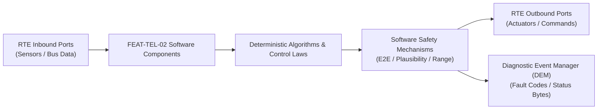

# Software Requirements Specification: Cellular Vehicle-to-Everything Safety Warnings (C-V2X)
**Feature ID:** `FEAT-TEL-02`  
**Domain:** Connectivity, Security & Diagnostics  
**Target ASIL:** ASIL B  
**Compliance Standard:** ISO 26262:2018 (Part 6 - Software Development) / ASPICE PAM v3.1 (SWE.1, SWE.2)  
**Parent System Specification:** [`FEAT-TEL-02_V2X_SysReq.md`](file:///c:/Workset/AntiGravityProjects/TestOptimisationExperiement/system_requirements/FEAT-TEL-02_V2X_SysReq.md)  
**Global Master Specification:** [`spec.md`](file:///c:/Workset/AntiGravityProjects/TestOptimisationExperiement/spec.md)

---

## 1. Software Architecture & Component Structure

This document specifies the AUTOSAR Software Components (SWCs), periodic runnables, algorithmic laws, safety mechanisms, and data ports implementing `FEAT-TEL-02` (Cellular Vehicle-to-Everything Safety Warnings (C-V2X)).

### AUTOSAR SWC Interaction Diagram

---

## 2. Detailed Software Requirements (SWR_REQ)
*(Multi-Software Requirement Partitioning derived from System Requirements)*

### `SWR-TEL-02-01`: SAE J2735 / ETSI ITS Basic Safety Message Formatter
- **Planned Release:** R100
- **ASIL Rating:** ASIL B
- **Parent System Requirement:** [`SYS-TEL-02-01`](file:///c:/Workset/AntiGravityProjects/TestOptimisationExperiement/system_requirements/FEAT-TEL-02_V2X_SysReq.md#sys-tel-02-01)
- **Allocated AUTOSAR SWC:** `V2xMessageStack_SWC`
- **Execution Rate / Trigger:** 100 ms
- **Worst-Case Execution Time (WCET):** 2.4 ms
- **Software Activation Condition:** Executed cyclically every 100 ms.
- **Algorithmic Description / Logic:**
  > Encodes BSM Part I UPER ASN.1 buffer: [msgCount, id, secMark, lat, long, elev, accuracy, speed, heading, angle, accelSet, brakes, size]. Transmits over PC5 interface via Linux socket API.
- **Software Safety Mechanism:** MAC address pseudonym rotation every 5 minutes to prevent vehicle tracking.
- **Failure Reaction & DEM Diagnostic Event:** If GNSS position uncertainty > 5.0 m, flag position as DEGRADED in message header.
- **Software Port Inputs:** `GNSS_Latitude, GNSS_Longitude, Ego_Speed_Mps, Ego_Heading_Deg`
- **Software Port Outputs:** `Encoded_BSM_Buffer[256]`
- **Software Verification Criteria:** ASN.1 syntax conformance testing against SAE J2735 standard.
- **Traceability Link:** Traces upward to [`SYS-TEL-02-01`](file:///c:/Workset/AntiGravityProjects/TestOptimisationExperiement/system_requirements/FEAT-TEL-02_V2X_SysReq.md#sys-tel-02-01) and [`FEAT-TEL-02`](file:///c:/Workset/AntiGravityProjects/TestOptimisationExperiement/spec.md).

### `SWR-TEL-02-02`: IEEE 1609.2 / ETSI TS 103 097 Elliptic Curve Security Verifier
- **Planned Release:** R100
- **ASIL Rating:** ASIL B / ISO 21434
- **Parent System Requirement:** [`SYS-TEL-02-01`](file:///c:/Workset/AntiGravityProjects/TestOptimisationExperiement/system_requirements/FEAT-TEL-02_V2X_SysReq.md#sys-tel-02-01)
- **Allocated AUTOSAR SWC:** `V2xSecurityVerifier_SWC`
- **Execution Rate / Trigger:** Event-driven
- **Worst-Case Execution Time (WCET):** 6.5 ms (HSM accelerated)
- **Software Activation Condition:** Executed on every incoming V2X packet.
- **Algorithmic Description / Logic:**
  > Verifies ECDSA NIST-P256 signature using public key extracted from certificate. Checks certificate validity period, geographical scope, and verifies against local Certificate Revocation List (CRL).
- **Software Safety Mechanism:** Replay window check: Discard packet if timestamp difference abs(t_rx - t_tx) > 200 ms.
- **Failure Reaction & DEM Diagnostic Event:** Silently drop unauthenticated or invalid packets; increment security audit counter.
- **Software Port Inputs:** `Inbound_V2X_Signed_Packet, Local_CRL_Database`
- **Software Port Outputs:** `Packet_Authenticated_Flag (boolean), Verified_Payload_Buffer`
- **Software Verification Criteria:** Cryptographic fuzzing test with invalid, expired, and revoked certificates.
- **Traceability Link:** Traces upward to [`SYS-TEL-02-01`](file:///c:/Workset/AntiGravityProjects/TestOptimisationExperiement/system_requirements/FEAT-TEL-02_V2X_SysReq.md#sys-tel-02-01) and [`FEAT-TEL-02`](file:///c:/Workset/AntiGravityProjects/TestOptimisationExperiement/spec.md).

### `SWR-TEL-02-03`: Intersection Collision Threat & Blind Spot Geometry Resolver
- **Planned Release:** R100
- **ASIL Rating:** ASIL B
- **Parent System Requirement:** [`SYS-TEL-02-02`](file:///c:/Workset/AntiGravityProjects/TestOptimisationExperiement/system_requirements/FEAT-TEL-02_V2X_SysReq.md#sys-tel-02-02)
- **Allocated AUTOSAR SWC:** `V2xThreatResolver_SWC`
- **Execution Rate / Trigger:** 20 ms
- **Worst-Case Execution Time (WCET):** 1.8 ms
- **Software Activation Condition:** Executed every 20 ms on verified peer targets.
- **Algorithmic Description / Logic:**
  > Projects trajectory intersection point: Evaluates time-to-intersection (TTI) for cross-traffic approaching at 90 degrees. If delta_TTI < 1.5s and line-of-sight is obstructed by buildings, triggers Blind Intersection Alert.
- **Software Safety Mechanism:** Ego path cross-check: Confirms ego vehicle is actively on path intersecting peer.
- **Failure Reaction & DEM Diagnostic Event:** Suppress alert if peer vehicle indicates it has already come to complete stop.
- **Software Port Inputs:** `Peer_Position, Peer_Velocity, Peer_Heading, Ego_Pose, Ego_Speed`
- **Software Port Outputs:** `Intersection_Collision_Threat (boolean), Threat_TTI_Sec`
- **Software Verification Criteria:** SIL scenario testing of blind-corner cross-traffic encounters.
- **Traceability Link:** Traces upward to [`SYS-TEL-02-02`](file:///c:/Workset/AntiGravityProjects/TestOptimisationExperiement/system_requirements/FEAT-TEL-02_V2X_SysReq.md#sys-tel-02-02) and [`FEAT-TEL-02`](file:///c:/Workset/AntiGravityProjects/TestOptimisationExperiement/spec.md).

### `SWR-TEL-02-04`: Emergency Vehicle & Electronic Brake Light (EEBL) HMI Dispatcher
- **Planned Release:** R100
- **ASIL Rating:** QM
- **Parent System Requirement:** [`SYS-TEL-02-02`](file:///c:/Workset/AntiGravityProjects/TestOptimisationExperiement/system_requirements/FEAT-TEL-02_V2X_SysReq.md#sys-tel-02-02)
- **Allocated AUTOSAR SWC:** `V2xHmiDispatcher_SWC`
- **Execution Rate / Trigger:** 50 ms
- **Worst-Case Execution Time (WCET):** 0.6 ms
- **Software Activation Condition:** Executed upon threat detection.
- **Algorithmic Description / Logic:**
  > If Peer_Brake_Status indicates hard deceleration (> 4.0 m/s²) 2 to 5 cars ahead: Displays EEBL warning icon. If Emergency Vehicle approaching with siren active: Displays direction arrow (Behind / Left / Right).
- **Software Safety Mechanism:** Alert priority coordinator: ADAS immediate radar/camera alerts take precedence over V2X warnings.
- **Failure Reaction & DEM Diagnostic Event:** Clear alert if peer stops transmitting for > 1.0 second.
- **Software Port Inputs:** `Intersection_Collision_Threat, Peer_Special_Vehicle_Code`
- **Software Port Outputs:** `HUD_V2X_Alert_PDU, Instrument_Cluster_V2X_PopUp`
- **Software Verification Criteria:** Cockpit HMI visual integration and priority arbitration testing.
- **Traceability Link:** Traces upward to [`SYS-TEL-02-02`](file:///c:/Workset/AntiGravityProjects/TestOptimisationExperiement/system_requirements/FEAT-TEL-02_V2X_SysReq.md#sys-tel-02-02) and [`FEAT-TEL-02`](file:///c:/Workset/AntiGravityProjects/TestOptimisationExperiement/spec.md).

### `SWR-TEL-02-05`: Cellular V2X (C-V2X) PC5 Direct Sidelink 5.9 GHz RF Transceiver Interface - Dynamic Observer & Signal Filter
- **Planned Release:** R100
- **ASIL Rating:** ASIL B
- **Parent System Requirement:** [`SYS-TEL-02-03`](file:///c:/Workset/AntiGravityProjects/TestOptimisationExperiement/system_requirements/FEAT-TEL-02_V2X_SysReq.md#sys-tel-02-03)
- **Allocated AUTOSAR SWC:** `V2xPc5Transceiver_SWC`
- **Execution Rate / Trigger:** 5 ms
- **Worst-Case Execution Time (WCET):** 0.3 ms
- **Software Activation Condition:** Executed cyclically every 5 ms.
- **Algorithmic Description / Logic:**
  > Executes signal plausibility filtering, calibration offsets, and discrete state estimation for Cellular V2X (C-V2X) PC5 Direct Sidelink 5.9 GHz RF Transceiver Interface.
- **Software Safety Mechanism:** Range limit plausibility check and E2E alive sequence verification.
- **Failure Reaction & DEM Diagnostic Event:** Set default fallback output and report DEM_EVENT_FEAT_TEL_02_ERR.
- **Software Port Inputs:** `Raw sensor ADC/SENT/SPI values and RTE bus inputs.`
- **Software Port Outputs:** `Filtered physical signals and validity status bitmasks.`
- **Software Verification Criteria:** Unit test and HiL software integration test.
- **Traceability Link:** Traces upward to [`SYS-TEL-02-03`](file:///c:/Workset/AntiGravityProjects/TestOptimisationExperiement/system_requirements/FEAT-TEL-02_V2X_SysReq.md#sys-tel-02-03) and [`FEAT-TEL-02`](file:///c:/Workset/AntiGravityProjects/TestOptimisationExperiement/spec.md).

### `SWR-TEL-02-06`: Cellular V2X (C-V2X) PC5 Direct Sidelink 5.9 GHz RF Transceiver Interface - Closed-Loop Control Law & Actuator Dispatch
- **Planned Release:** R100
- **ASIL Rating:** ASIL B
- **Parent System Requirement:** [`SYS-TEL-02-03`](file:///c:/Workset/AntiGravityProjects/TestOptimisationExperiement/system_requirements/FEAT-TEL-02_V2X_SysReq.md#sys-tel-02-03)
- **Allocated AUTOSAR SWC:** `V2xPc5Transceiver_SWC`
- **Execution Rate / Trigger:** 5 ms
- **Worst-Case Execution Time (WCET):** 0.4 ms
- **Software Activation Condition:** Executed cyclically every 5 ms.
- **Algorithmic Description / Logic:**
  > Evaluates deterministic closed-loop control law, rate limits, and dispatches commands for Cellular V2X (C-V2X) PC5 Direct Sidelink 5.9 GHz RF Transceiver Interface.
- **Software Safety Mechanism:** Command saturation clamping and watchdog program flow monitoring.
- **Failure Reaction & DEM Diagnostic Event:** De-energize actuator output, apply safe fallback clamp, and latch DTC.
- **Software Port Inputs:** `Validated physical state signals from observer SWC.`
- **Software Port Outputs:** `Actuator PWM duty cycles, torque/pressure setpoints, and diagnostic flags.`
- **Software Verification Criteria:** Hardware dynamometer and HiL closed-loop regression test suite.
- **Traceability Link:** Traces upward to [`SYS-TEL-02-03`](file:///c:/Workset/AntiGravityProjects/TestOptimisationExperiement/system_requirements/FEAT-TEL-02_V2X_SysReq.md#sys-tel-02-03) and [`FEAT-TEL-02`](file:///c:/Workset/AntiGravityProjects/TestOptimisationExperiement/spec.md).

### `SWR-TEL-02-07`: SAE J2735 / ETSI Basic Safety Message (BSM / CAM) Dynamic Encoder - Dynamic Observer & Signal Filter
- **Planned Release:** R200
- **ASIL Rating:** ASIL B
- **Parent System Requirement:** [`SYS-TEL-02-04`](file:///c:/Workset/AntiGravityProjects/TestOptimisationExperiement/system_requirements/FEAT-TEL-02_V2X_SysReq.md#sys-tel-02-04)
- **Allocated AUTOSAR SWC:** `V2xBsmEncoder_SWC`
- **Execution Rate / Trigger:** 10 ms
- **Worst-Case Execution Time (WCET):** 0.3 ms
- **Software Activation Condition:** Executed cyclically every 10 ms.
- **Algorithmic Description / Logic:**
  > Executes signal plausibility filtering, calibration offsets, and discrete state estimation for SAE J2735 / ETSI Basic Safety Message (BSM / CAM) Dynamic Encoder.
- **Software Safety Mechanism:** Range limit plausibility check and E2E alive sequence verification.
- **Failure Reaction & DEM Diagnostic Event:** Set default fallback output and report DEM_EVENT_FEAT_TEL_02_ERR.
- **Software Port Inputs:** `Raw sensor ADC/SENT/SPI values and RTE bus inputs.`
- **Software Port Outputs:** `Filtered physical signals and validity status bitmasks.`
- **Software Verification Criteria:** Unit test and HiL software integration test.
- **Traceability Link:** Traces upward to [`SYS-TEL-02-04`](file:///c:/Workset/AntiGravityProjects/TestOptimisationExperiement/system_requirements/FEAT-TEL-02_V2X_SysReq.md#sys-tel-02-04) and [`FEAT-TEL-02`](file:///c:/Workset/AntiGravityProjects/TestOptimisationExperiement/spec.md).

### `SWR-TEL-02-08`: SAE J2735 / ETSI Basic Safety Message (BSM / CAM) Dynamic Encoder - Closed-Loop Control Law & Actuator Dispatch
- **Planned Release:** R200
- **ASIL Rating:** ASIL B
- **Parent System Requirement:** [`SYS-TEL-02-04`](file:///c:/Workset/AntiGravityProjects/TestOptimisationExperiement/system_requirements/FEAT-TEL-02_V2X_SysReq.md#sys-tel-02-04)
- **Allocated AUTOSAR SWC:** `V2xBsmEncoder_SWC`
- **Execution Rate / Trigger:** 10 ms
- **Worst-Case Execution Time (WCET):** 0.4 ms
- **Software Activation Condition:** Executed cyclically every 10 ms.
- **Algorithmic Description / Logic:**
  > Evaluates deterministic closed-loop control law, rate limits, and dispatches commands for SAE J2735 / ETSI Basic Safety Message (BSM / CAM) Dynamic Encoder.
- **Software Safety Mechanism:** Command saturation clamping and watchdog program flow monitoring.
- **Failure Reaction & DEM Diagnostic Event:** De-energize actuator output, apply safe fallback clamp, and latch DTC.
- **Software Port Inputs:** `Validated physical state signals from observer SWC.`
- **Software Port Outputs:** `Actuator PWM duty cycles, torque/pressure setpoints, and diagnostic flags.`
- **Software Verification Criteria:** Hardware dynamometer and HiL closed-loop regression test suite.
- **Traceability Link:** Traces upward to [`SYS-TEL-02-04`](file:///c:/Workset/AntiGravityProjects/TestOptimisationExperiement/system_requirements/FEAT-TEL-02_V2X_SysReq.md#sys-tel-02-04) and [`FEAT-TEL-02`](file:///c:/Workset/AntiGravityProjects/TestOptimisationExperiement/spec.md).

### `SWR-TEL-02-09`: Intersection Collision Warning (ICW) Blind Crossing Path Evaluator - Dynamic Observer & Signal Filter
- **Planned Release:** R200
- **ASIL Rating:** ASIL B
- **Parent System Requirement:** [`SYS-TEL-02-05`](file:///c:/Workset/AntiGravityProjects/TestOptimisationExperiement/system_requirements/FEAT-TEL-02_V2X_SysReq.md#sys-tel-02-05)
- **Allocated AUTOSAR SWC:** `V2xIcwEvaluator_SWC`
- **Execution Rate / Trigger:** 10 ms
- **Worst-Case Execution Time (WCET):** 0.3 ms
- **Software Activation Condition:** Executed cyclically every 10 ms.
- **Algorithmic Description / Logic:**
  > Executes signal plausibility filtering, calibration offsets, and discrete state estimation for Intersection Collision Warning (ICW) Blind Crossing Path Evaluator.
- **Software Safety Mechanism:** Range limit plausibility check and E2E alive sequence verification.
- **Failure Reaction & DEM Diagnostic Event:** Set default fallback output and report DEM_EVENT_FEAT_TEL_02_ERR.
- **Software Port Inputs:** `Raw sensor ADC/SENT/SPI values and RTE bus inputs.`
- **Software Port Outputs:** `Filtered physical signals and validity status bitmasks.`
- **Software Verification Criteria:** Unit test and HiL software integration test.
- **Traceability Link:** Traces upward to [`SYS-TEL-02-05`](file:///c:/Workset/AntiGravityProjects/TestOptimisationExperiement/system_requirements/FEAT-TEL-02_V2X_SysReq.md#sys-tel-02-05) and [`FEAT-TEL-02`](file:///c:/Workset/AntiGravityProjects/TestOptimisationExperiement/spec.md).

### `SWR-TEL-02-10`: Intersection Collision Warning (ICW) Blind Crossing Path Evaluator - Closed-Loop Control Law & Actuator Dispatch
- **Planned Release:** R200
- **ASIL Rating:** ASIL B
- **Parent System Requirement:** [`SYS-TEL-02-05`](file:///c:/Workset/AntiGravityProjects/TestOptimisationExperiement/system_requirements/FEAT-TEL-02_V2X_SysReq.md#sys-tel-02-05)
- **Allocated AUTOSAR SWC:** `V2xIcwEvaluator_SWC`
- **Execution Rate / Trigger:** 10 ms
- **Worst-Case Execution Time (WCET):** 0.4 ms
- **Software Activation Condition:** Executed cyclically every 10 ms.
- **Algorithmic Description / Logic:**
  > Evaluates deterministic closed-loop control law, rate limits, and dispatches commands for Intersection Collision Warning (ICW) Blind Crossing Path Evaluator.
- **Software Safety Mechanism:** Command saturation clamping and watchdog program flow monitoring.
- **Failure Reaction & DEM Diagnostic Event:** De-energize actuator output, apply safe fallback clamp, and latch DTC.
- **Software Port Inputs:** `Validated physical state signals from observer SWC.`
- **Software Port Outputs:** `Actuator PWM duty cycles, torque/pressure setpoints, and diagnostic flags.`
- **Software Verification Criteria:** Hardware dynamometer and HiL closed-loop regression test suite.
- **Traceability Link:** Traces upward to [`SYS-TEL-02-05`](file:///c:/Workset/AntiGravityProjects/TestOptimisationExperiement/system_requirements/FEAT-TEL-02_V2X_SysReq.md#sys-tel-02-05) and [`FEAT-TEL-02`](file:///c:/Workset/AntiGravityProjects/TestOptimisationExperiement/spec.md).

### `SWR-TEL-02-11`: Emergency Electronic Brake Light (EEBL) Remote Vehicle Hard Braking Receiver - Dynamic Observer & Signal Filter
- **Planned Release:** R200
- **ASIL Rating:** ASIL B
- **Parent System Requirement:** [`SYS-TEL-02-06`](file:///c:/Workset/AntiGravityProjects/TestOptimisationExperiement/system_requirements/FEAT-TEL-02_V2X_SysReq.md#sys-tel-02-06)
- **Allocated AUTOSAR SWC:** `V2xEeblReceiver_SWC`
- **Execution Rate / Trigger:** 10 ms
- **Worst-Case Execution Time (WCET):** 0.3 ms
- **Software Activation Condition:** Executed cyclically every 10 ms.
- **Algorithmic Description / Logic:**
  > Executes signal plausibility filtering, calibration offsets, and discrete state estimation for Emergency Electronic Brake Light (EEBL) Remote Vehicle Hard Braking Receiver.
- **Software Safety Mechanism:** Range limit plausibility check and E2E alive sequence verification.
- **Failure Reaction & DEM Diagnostic Event:** Set default fallback output and report DEM_EVENT_FEAT_TEL_02_ERR.
- **Software Port Inputs:** `Raw sensor ADC/SENT/SPI values and RTE bus inputs.`
- **Software Port Outputs:** `Filtered physical signals and validity status bitmasks.`
- **Software Verification Criteria:** Unit test and HiL software integration test.
- **Traceability Link:** Traces upward to [`SYS-TEL-02-06`](file:///c:/Workset/AntiGravityProjects/TestOptimisationExperiement/system_requirements/FEAT-TEL-02_V2X_SysReq.md#sys-tel-02-06) and [`FEAT-TEL-02`](file:///c:/Workset/AntiGravityProjects/TestOptimisationExperiement/spec.md).

### `SWR-TEL-02-12`: Emergency Electronic Brake Light (EEBL) Remote Vehicle Hard Braking Receiver - Closed-Loop Control Law & Actuator Dispatch
- **Planned Release:** R200
- **ASIL Rating:** ASIL B
- **Parent System Requirement:** [`SYS-TEL-02-06`](file:///c:/Workset/AntiGravityProjects/TestOptimisationExperiement/system_requirements/FEAT-TEL-02_V2X_SysReq.md#sys-tel-02-06)
- **Allocated AUTOSAR SWC:** `V2xEeblReceiver_SWC`
- **Execution Rate / Trigger:** 10 ms
- **Worst-Case Execution Time (WCET):** 0.4 ms
- **Software Activation Condition:** Executed cyclically every 10 ms.
- **Algorithmic Description / Logic:**
  > Evaluates deterministic closed-loop control law, rate limits, and dispatches commands for Emergency Electronic Brake Light (EEBL) Remote Vehicle Hard Braking Receiver.
- **Software Safety Mechanism:** Command saturation clamping and watchdog program flow monitoring.
- **Failure Reaction & DEM Diagnostic Event:** De-energize actuator output, apply safe fallback clamp, and latch DTC.
- **Software Port Inputs:** `Validated physical state signals from observer SWC.`
- **Software Port Outputs:** `Actuator PWM duty cycles, torque/pressure setpoints, and diagnostic flags.`
- **Software Verification Criteria:** Hardware dynamometer and HiL closed-loop regression test suite.
- **Traceability Link:** Traces upward to [`SYS-TEL-02-06`](file:///c:/Workset/AntiGravityProjects/TestOptimisationExperiement/system_requirements/FEAT-TEL-02_V2X_SysReq.md#sys-tel-02-06) and [`FEAT-TEL-02`](file:///c:/Workset/AntiGravityProjects/TestOptimisationExperiement/spec.md).

### `SWR-TEL-02-13`: Emergency Vehicle Approaching (EVA) Siren & Trajectory Audible Clear Alert - Dynamic Observer & Signal Filter
- **Planned Release:** R300
- **ASIL Rating:** ASIL B
- **Parent System Requirement:** [`SYS-TEL-02-07`](file:///c:/Workset/AntiGravityProjects/TestOptimisationExperiement/system_requirements/FEAT-TEL-02_V2X_SysReq.md#sys-tel-02-07)
- **Allocated AUTOSAR SWC:** `V2xEvaNotifier_SWC`
- **Execution Rate / Trigger:** 20 ms
- **Worst-Case Execution Time (WCET):** 0.3 ms
- **Software Activation Condition:** Executed cyclically every 20 ms.
- **Algorithmic Description / Logic:**
  > Executes signal plausibility filtering, calibration offsets, and discrete state estimation for Emergency Vehicle Approaching (EVA) Siren & Trajectory Audible Clear Alert.
- **Software Safety Mechanism:** Range limit plausibility check and E2E alive sequence verification.
- **Failure Reaction & DEM Diagnostic Event:** Set default fallback output and report DEM_EVENT_FEAT_TEL_02_ERR.
- **Software Port Inputs:** `Raw sensor ADC/SENT/SPI values and RTE bus inputs.`
- **Software Port Outputs:** `Filtered physical signals and validity status bitmasks.`
- **Software Verification Criteria:** Unit test and HiL software integration test.
- **Traceability Link:** Traces upward to [`SYS-TEL-02-07`](file:///c:/Workset/AntiGravityProjects/TestOptimisationExperiement/system_requirements/FEAT-TEL-02_V2X_SysReq.md#sys-tel-02-07) and [`FEAT-TEL-02`](file:///c:/Workset/AntiGravityProjects/TestOptimisationExperiement/spec.md).

### `SWR-TEL-02-14`: Emergency Vehicle Approaching (EVA) Siren & Trajectory Audible Clear Alert - Closed-Loop Control Law & Actuator Dispatch
- **Planned Release:** R300
- **ASIL Rating:** ASIL B
- **Parent System Requirement:** [`SYS-TEL-02-07`](file:///c:/Workset/AntiGravityProjects/TestOptimisationExperiement/system_requirements/FEAT-TEL-02_V2X_SysReq.md#sys-tel-02-07)
- **Allocated AUTOSAR SWC:** `V2xEvaNotifier_SWC`
- **Execution Rate / Trigger:** 20 ms
- **Worst-Case Execution Time (WCET):** 0.4 ms
- **Software Activation Condition:** Executed cyclically every 20 ms.
- **Algorithmic Description / Logic:**
  > Evaluates deterministic closed-loop control law, rate limits, and dispatches commands for Emergency Vehicle Approaching (EVA) Siren & Trajectory Audible Clear Alert.
- **Software Safety Mechanism:** Command saturation clamping and watchdog program flow monitoring.
- **Failure Reaction & DEM Diagnostic Event:** De-energize actuator output, apply safe fallback clamp, and latch DTC.
- **Software Port Inputs:** `Validated physical state signals from observer SWC.`
- **Software Port Outputs:** `Actuator PWM duty cycles, torque/pressure setpoints, and diagnostic flags.`
- **Software Verification Criteria:** Hardware dynamometer and HiL closed-loop regression test suite.
- **Traceability Link:** Traces upward to [`SYS-TEL-02-07`](file:///c:/Workset/AntiGravityProjects/TestOptimisationExperiement/system_requirements/FEAT-TEL-02_V2X_SysReq.md#sys-tel-02-07) and [`FEAT-TEL-02`](file:///c:/Workset/AntiGravityProjects/TestOptimisationExperiement/spec.md).

### `SWR-TEL-02-15`: Signal Phase and Timing (SPaT) Green Light Optimal Speed Advisory (GLOSA) - Dynamic Observer & Signal Filter
- **Planned Release:** R300
- **ASIL Rating:** ASIL A
- **Parent System Requirement:** [`SYS-TEL-02-08`](file:///c:/Workset/AntiGravityProjects/TestOptimisationExperiement/system_requirements/FEAT-TEL-02_V2X_SysReq.md#sys-tel-02-08)
- **Allocated AUTOSAR SWC:** `V2xGlosaAdvisor_SWC`
- **Execution Rate / Trigger:** 50 ms
- **Worst-Case Execution Time (WCET):** 0.3 ms
- **Software Activation Condition:** Executed cyclically every 50 ms.
- **Algorithmic Description / Logic:**
  > Executes signal plausibility filtering, calibration offsets, and discrete state estimation for Signal Phase and Timing (SPaT) Green Light Optimal Speed Advisory (GLOSA).
- **Software Safety Mechanism:** Range limit plausibility check and E2E alive sequence verification.
- **Failure Reaction & DEM Diagnostic Event:** Set default fallback output and report DEM_EVENT_FEAT_TEL_02_ERR.
- **Software Port Inputs:** `Raw sensor ADC/SENT/SPI values and RTE bus inputs.`
- **Software Port Outputs:** `Filtered physical signals and validity status bitmasks.`
- **Software Verification Criteria:** Unit test and HiL software integration test.
- **Traceability Link:** Traces upward to [`SYS-TEL-02-08`](file:///c:/Workset/AntiGravityProjects/TestOptimisationExperiement/system_requirements/FEAT-TEL-02_V2X_SysReq.md#sys-tel-02-08) and [`FEAT-TEL-02`](file:///c:/Workset/AntiGravityProjects/TestOptimisationExperiement/spec.md).

### `SWR-TEL-02-16`: Signal Phase and Timing (SPaT) Green Light Optimal Speed Advisory (GLOSA) - Closed-Loop Control Law & Actuator Dispatch
- **Planned Release:** R300
- **ASIL Rating:** ASIL A
- **Parent System Requirement:** [`SYS-TEL-02-08`](file:///c:/Workset/AntiGravityProjects/TestOptimisationExperiement/system_requirements/FEAT-TEL-02_V2X_SysReq.md#sys-tel-02-08)
- **Allocated AUTOSAR SWC:** `V2xGlosaAdvisor_SWC`
- **Execution Rate / Trigger:** 50 ms
- **Worst-Case Execution Time (WCET):** 0.4 ms
- **Software Activation Condition:** Executed cyclically every 50 ms.
- **Algorithmic Description / Logic:**
  > Evaluates deterministic closed-loop control law, rate limits, and dispatches commands for Signal Phase and Timing (SPaT) Green Light Optimal Speed Advisory (GLOSA).
- **Software Safety Mechanism:** Command saturation clamping and watchdog program flow monitoring.
- **Failure Reaction & DEM Diagnostic Event:** De-energize actuator output, apply safe fallback clamp, and latch DTC.
- **Software Port Inputs:** `Validated physical state signals from observer SWC.`
- **Software Port Outputs:** `Actuator PWM duty cycles, torque/pressure setpoints, and diagnostic flags.`
- **Software Verification Criteria:** Hardware dynamometer and HiL closed-loop regression test suite.
- **Traceability Link:** Traces upward to [`SYS-TEL-02-08`](file:///c:/Workset/AntiGravityProjects/TestOptimisationExperiement/system_requirements/FEAT-TEL-02_V2X_SysReq.md#sys-tel-02-08) and [`FEAT-TEL-02`](file:///c:/Workset/AntiGravityProjects/TestOptimisationExperiement/spec.md).

### `SWR-TEL-02-17`: V2X Security Credential Management System (SCMS) Certificate Pseudonym Verifier - Dynamic Observer & Signal Filter
- **Planned Release:** R300
- **ASIL Rating:** ASIL B
- **Parent System Requirement:** [`SYS-TEL-02-09`](file:///c:/Workset/AntiGravityProjects/TestOptimisationExperiement/system_requirements/FEAT-TEL-02_V2X_SysReq.md#sys-tel-02-09)
- **Allocated AUTOSAR SWC:** `V2xSecurityVerifier_SWC`
- **Execution Rate / Trigger:** 10 ms
- **Worst-Case Execution Time (WCET):** 0.3 ms
- **Software Activation Condition:** Executed cyclically every 10 ms.
- **Algorithmic Description / Logic:**
  > Executes signal plausibility filtering, calibration offsets, and discrete state estimation for V2X Security Credential Management System (SCMS) Certificate Pseudonym Verifier.
- **Software Safety Mechanism:** Range limit plausibility check and E2E alive sequence verification.
- **Failure Reaction & DEM Diagnostic Event:** Set default fallback output and report DEM_EVENT_FEAT_TEL_02_ERR.
- **Software Port Inputs:** `Raw sensor ADC/SENT/SPI values and RTE bus inputs.`
- **Software Port Outputs:** `Filtered physical signals and validity status bitmasks.`
- **Software Verification Criteria:** Unit test and HiL software integration test.
- **Traceability Link:** Traces upward to [`SYS-TEL-02-09`](file:///c:/Workset/AntiGravityProjects/TestOptimisationExperiement/system_requirements/FEAT-TEL-02_V2X_SysReq.md#sys-tel-02-09) and [`FEAT-TEL-02`](file:///c:/Workset/AntiGravityProjects/TestOptimisationExperiement/spec.md).

### `SWR-TEL-02-18`: V2X Security Credential Management System (SCMS) Certificate Pseudonym Verifier - Closed-Loop Control Law & Actuator Dispatch
- **Planned Release:** R300
- **ASIL Rating:** ASIL B
- **Parent System Requirement:** [`SYS-TEL-02-09`](file:///c:/Workset/AntiGravityProjects/TestOptimisationExperiement/system_requirements/FEAT-TEL-02_V2X_SysReq.md#sys-tel-02-09)
- **Allocated AUTOSAR SWC:** `V2xSecurityVerifier_SWC`
- **Execution Rate / Trigger:** 10 ms
- **Worst-Case Execution Time (WCET):** 0.4 ms
- **Software Activation Condition:** Executed cyclically every 10 ms.
- **Algorithmic Description / Logic:**
  > Evaluates deterministic closed-loop control law, rate limits, and dispatches commands for V2X Security Credential Management System (SCMS) Certificate Pseudonym Verifier.
- **Software Safety Mechanism:** Command saturation clamping and watchdog program flow monitoring.
- **Failure Reaction & DEM Diagnostic Event:** De-energize actuator output, apply safe fallback clamp, and latch DTC.
- **Software Port Inputs:** `Validated physical state signals from observer SWC.`
- **Software Port Outputs:** `Actuator PWM duty cycles, torque/pressure setpoints, and diagnostic flags.`
- **Software Verification Criteria:** Hardware dynamometer and HiL closed-loop regression test suite.
- **Traceability Link:** Traces upward to [`SYS-TEL-02-09`](file:///c:/Workset/AntiGravityProjects/TestOptimisationExperiement/system_requirements/FEAT-TEL-02_V2X_SysReq.md#sys-tel-02-09) and [`FEAT-TEL-02`](file:///c:/Workset/AntiGravityProjects/TestOptimisationExperiement/spec.md).

### `SWR-TEL-02-19`: V2X Message GPS Timestamp Plausibility & Replay Attack Defense Filter - Dynamic Observer & Signal Filter
- **Planned Release:** R400
- **ASIL Rating:** ASIL B
- **Parent System Requirement:** [`SYS-TEL-02-10`](file:///c:/Workset/AntiGravityProjects/TestOptimisationExperiement/system_requirements/FEAT-TEL-02_V2X_SysReq.md#sys-tel-02-10)
- **Allocated AUTOSAR SWC:** `V2xReplayDefense_SWC`
- **Execution Rate / Trigger:** 5 ms
- **Worst-Case Execution Time (WCET):** 0.3 ms
- **Software Activation Condition:** Executed cyclically every 5 ms.
- **Algorithmic Description / Logic:**
  > Executes signal plausibility filtering, calibration offsets, and discrete state estimation for V2X Message GPS Timestamp Plausibility & Replay Attack Defense Filter.
- **Software Safety Mechanism:** Range limit plausibility check and E2E alive sequence verification.
- **Failure Reaction & DEM Diagnostic Event:** Set default fallback output and report DEM_EVENT_FEAT_TEL_02_ERR.
- **Software Port Inputs:** `Raw sensor ADC/SENT/SPI values and RTE bus inputs.`
- **Software Port Outputs:** `Filtered physical signals and validity status bitmasks.`
- **Software Verification Criteria:** Unit test and HiL software integration test.
- **Traceability Link:** Traces upward to [`SYS-TEL-02-10`](file:///c:/Workset/AntiGravityProjects/TestOptimisationExperiement/system_requirements/FEAT-TEL-02_V2X_SysReq.md#sys-tel-02-10) and [`FEAT-TEL-02`](file:///c:/Workset/AntiGravityProjects/TestOptimisationExperiement/spec.md).

### `SWR-TEL-02-20`: V2X Message GPS Timestamp Plausibility & Replay Attack Defense Filter - Closed-Loop Control Law & Actuator Dispatch
- **Planned Release:** R400
- **ASIL Rating:** ASIL B
- **Parent System Requirement:** [`SYS-TEL-02-10`](file:///c:/Workset/AntiGravityProjects/TestOptimisationExperiement/system_requirements/FEAT-TEL-02_V2X_SysReq.md#sys-tel-02-10)
- **Allocated AUTOSAR SWC:** `V2xReplayDefense_SWC`
- **Execution Rate / Trigger:** 5 ms
- **Worst-Case Execution Time (WCET):** 0.4 ms
- **Software Activation Condition:** Executed cyclically every 5 ms.
- **Algorithmic Description / Logic:**
  > Evaluates deterministic closed-loop control law, rate limits, and dispatches commands for V2X Message GPS Timestamp Plausibility & Replay Attack Defense Filter.
- **Software Safety Mechanism:** Command saturation clamping and watchdog program flow monitoring.
- **Failure Reaction & DEM Diagnostic Event:** De-energize actuator output, apply safe fallback clamp, and latch DTC.
- **Software Port Inputs:** `Validated physical state signals from observer SWC.`
- **Software Port Outputs:** `Actuator PWM duty cycles, torque/pressure setpoints, and diagnostic flags.`
- **Software Verification Criteria:** Hardware dynamometer and HiL closed-loop regression test suite.
- **Traceability Link:** Traces upward to [`SYS-TEL-02-10`](file:///c:/Workset/AntiGravityProjects/TestOptimisationExperiement/system_requirements/FEAT-TEL-02_V2X_SysReq.md#sys-tel-02-10) and [`FEAT-TEL-02`](file:///c:/Workset/AntiGravityProjects/TestOptimisationExperiement/spec.md).

### `SWR-TEL-02-21`: Instrument Cluster & Head-Up Display V2X Warning Visual Graphic Dispatcher - Dynamic Observer & Signal Filter
- **Planned Release:** R400
- **ASIL Rating:** ASIL B
- **Parent System Requirement:** [`SYS-TEL-02-11`](file:///c:/Workset/AntiGravityProjects/TestOptimisationExperiement/system_requirements/FEAT-TEL-02_V2X_SysReq.md#sys-tel-02-11)
- **Allocated AUTOSAR SWC:** `V2xHmiDispatcher_SWC`
- **Execution Rate / Trigger:** 20 ms
- **Worst-Case Execution Time (WCET):** 0.3 ms
- **Software Activation Condition:** Executed cyclically every 20 ms.
- **Algorithmic Description / Logic:**
  > Executes signal plausibility filtering, calibration offsets, and discrete state estimation for Instrument Cluster & Head-Up Display V2X Warning Visual Graphic Dispatcher.
- **Software Safety Mechanism:** Range limit plausibility check and E2E alive sequence verification.
- **Failure Reaction & DEM Diagnostic Event:** Set default fallback output and report DEM_EVENT_FEAT_TEL_02_ERR.
- **Software Port Inputs:** `Raw sensor ADC/SENT/SPI values and RTE bus inputs.`
- **Software Port Outputs:** `Filtered physical signals and validity status bitmasks.`
- **Software Verification Criteria:** Unit test and HiL software integration test.
- **Traceability Link:** Traces upward to [`SYS-TEL-02-11`](file:///c:/Workset/AntiGravityProjects/TestOptimisationExperiement/system_requirements/FEAT-TEL-02_V2X_SysReq.md#sys-tel-02-11) and [`FEAT-TEL-02`](file:///c:/Workset/AntiGravityProjects/TestOptimisationExperiement/spec.md).

### `SWR-TEL-02-22`: Instrument Cluster & Head-Up Display V2X Warning Visual Graphic Dispatcher - Closed-Loop Control Law & Actuator Dispatch
- **Planned Release:** R400
- **ASIL Rating:** ASIL B
- **Parent System Requirement:** [`SYS-TEL-02-11`](file:///c:/Workset/AntiGravityProjects/TestOptimisationExperiement/system_requirements/FEAT-TEL-02_V2X_SysReq.md#sys-tel-02-11)
- **Allocated AUTOSAR SWC:** `V2xHmiDispatcher_SWC`
- **Execution Rate / Trigger:** 20 ms
- **Worst-Case Execution Time (WCET):** 0.4 ms
- **Software Activation Condition:** Executed cyclically every 20 ms.
- **Algorithmic Description / Logic:**
  > Evaluates deterministic closed-loop control law, rate limits, and dispatches commands for Instrument Cluster & Head-Up Display V2X Warning Visual Graphic Dispatcher.
- **Software Safety Mechanism:** Command saturation clamping and watchdog program flow monitoring.
- **Failure Reaction & DEM Diagnostic Event:** De-energize actuator output, apply safe fallback clamp, and latch DTC.
- **Software Port Inputs:** `Validated physical state signals from observer SWC.`
- **Software Port Outputs:** `Actuator PWM duty cycles, torque/pressure setpoints, and diagnostic flags.`
- **Software Verification Criteria:** Hardware dynamometer and HiL closed-loop regression test suite.
- **Traceability Link:** Traces upward to [`SYS-TEL-02-11`](file:///c:/Workset/AntiGravityProjects/TestOptimisationExperiement/system_requirements/FEAT-TEL-02_V2X_SysReq.md#sys-tel-02-11) and [`FEAT-TEL-02`](file:///c:/Workset/AntiGravityProjects/TestOptimisationExperiement/spec.md).

### `SWR-TEL-02-23`: DEM V2X RF Transceiver Diagnostics & Communication Loss Monitor - Dynamic Observer & Signal Filter
- **Planned Release:** R500
- **ASIL Rating:** ASIL B
- **Parent System Requirement:** [`SYS-TEL-02-12`](file:///c:/Workset/AntiGravityProjects/TestOptimisationExperiement/system_requirements/FEAT-TEL-02_V2X_SysReq.md#sys-tel-02-12)
- **Allocated AUTOSAR SWC:** `V2xDiagnosticManager_SWC`
- **Execution Rate / Trigger:** 50 ms
- **Worst-Case Execution Time (WCET):** 0.3 ms
- **Software Activation Condition:** Executed cyclically every 50 ms.
- **Algorithmic Description / Logic:**
  > Executes signal plausibility filtering, calibration offsets, and discrete state estimation for DEM V2X RF Transceiver Diagnostics & Communication Loss Monitor.
- **Software Safety Mechanism:** Range limit plausibility check and E2E alive sequence verification.
- **Failure Reaction & DEM Diagnostic Event:** Set default fallback output and report DEM_EVENT_FEAT_TEL_02_ERR.
- **Software Port Inputs:** `Raw sensor ADC/SENT/SPI values and RTE bus inputs.`
- **Software Port Outputs:** `Filtered physical signals and validity status bitmasks.`
- **Software Verification Criteria:** Unit test and HiL software integration test.
- **Traceability Link:** Traces upward to [`SYS-TEL-02-12`](file:///c:/Workset/AntiGravityProjects/TestOptimisationExperiement/system_requirements/FEAT-TEL-02_V2X_SysReq.md#sys-tel-02-12) and [`FEAT-TEL-02`](file:///c:/Workset/AntiGravityProjects/TestOptimisationExperiement/spec.md).

### `SWR-TEL-02-24`: DEM V2X RF Transceiver Diagnostics & Communication Loss Monitor - Closed-Loop Control Law & Actuator Dispatch
- **Planned Release:** R500
- **ASIL Rating:** ASIL B
- **Parent System Requirement:** [`SYS-TEL-02-12`](file:///c:/Workset/AntiGravityProjects/TestOptimisationExperiement/system_requirements/FEAT-TEL-02_V2X_SysReq.md#sys-tel-02-12)
- **Allocated AUTOSAR SWC:** `V2xDiagnosticManager_SWC`
- **Execution Rate / Trigger:** 50 ms
- **Worst-Case Execution Time (WCET):** 0.4 ms
- **Software Activation Condition:** Executed cyclically every 50 ms.
- **Algorithmic Description / Logic:**
  > Evaluates deterministic closed-loop control law, rate limits, and dispatches commands for DEM V2X RF Transceiver Diagnostics & Communication Loss Monitor.
- **Software Safety Mechanism:** Command saturation clamping and watchdog program flow monitoring.
- **Failure Reaction & DEM Diagnostic Event:** De-energize actuator output, apply safe fallback clamp, and latch DTC.
- **Software Port Inputs:** `Validated physical state signals from observer SWC.`
- **Software Port Outputs:** `Actuator PWM duty cycles, torque/pressure setpoints, and diagnostic flags.`
- **Software Verification Criteria:** Hardware dynamometer and HiL closed-loop regression test suite.
- **Traceability Link:** Traces upward to [`SYS-TEL-02-12`](file:///c:/Workset/AntiGravityProjects/TestOptimisationExperiement/system_requirements/FEAT-TEL-02_V2X_SysReq.md#sys-tel-02-12) and [`FEAT-TEL-02`](file:///c:/Workset/AntiGravityProjects/TestOptimisationExperiement/spec.md).

### `SWR-TEL-02-25`: Non-Volatile V2X Safety Alerts & Hazardous Road Weather Incident Logger - Dynamic Observer & Signal Filter
- **Planned Release:** R500
- **ASIL Rating:** ASIL B
- **Parent System Requirement:** [`SYS-TEL-02-13`](file:///c:/Workset/AntiGravityProjects/TestOptimisationExperiement/system_requirements/FEAT-TEL-02_V2X_SysReq.md#sys-tel-02-13)
- **Allocated AUTOSAR SWC:** `V2xIncidentLogger_SWC`
- **Execution Rate / Trigger:** 500 ms
- **Worst-Case Execution Time (WCET):** 0.3 ms
- **Software Activation Condition:** Executed cyclically every 500 ms.
- **Algorithmic Description / Logic:**
  > Executes signal plausibility filtering, calibration offsets, and discrete state estimation for Non-Volatile V2X Safety Alerts & Hazardous Road Weather Incident Logger.
- **Software Safety Mechanism:** Range limit plausibility check and E2E alive sequence verification.
- **Failure Reaction & DEM Diagnostic Event:** Set default fallback output and report DEM_EVENT_FEAT_TEL_02_ERR.
- **Software Port Inputs:** `Raw sensor ADC/SENT/SPI values and RTE bus inputs.`
- **Software Port Outputs:** `Filtered physical signals and validity status bitmasks.`
- **Software Verification Criteria:** Unit test and HiL software integration test.
- **Traceability Link:** Traces upward to [`SYS-TEL-02-13`](file:///c:/Workset/AntiGravityProjects/TestOptimisationExperiement/system_requirements/FEAT-TEL-02_V2X_SysReq.md#sys-tel-02-13) and [`FEAT-TEL-02`](file:///c:/Workset/AntiGravityProjects/TestOptimisationExperiement/spec.md).

### `SWR-TEL-02-26`: Non-Volatile V2X Safety Alerts & Hazardous Road Weather Incident Logger - Closed-Loop Control Law & Actuator Dispatch
- **Planned Release:** R500
- **ASIL Rating:** ASIL B
- **Parent System Requirement:** [`SYS-TEL-02-13`](file:///c:/Workset/AntiGravityProjects/TestOptimisationExperiement/system_requirements/FEAT-TEL-02_V2X_SysReq.md#sys-tel-02-13)
- **Allocated AUTOSAR SWC:** `V2xIncidentLogger_SWC`
- **Execution Rate / Trigger:** 500 ms
- **Worst-Case Execution Time (WCET):** 0.4 ms
- **Software Activation Condition:** Executed cyclically every 500 ms.
- **Algorithmic Description / Logic:**
  > Evaluates deterministic closed-loop control law, rate limits, and dispatches commands for Non-Volatile V2X Safety Alerts & Hazardous Road Weather Incident Logger.
- **Software Safety Mechanism:** Command saturation clamping and watchdog program flow monitoring.
- **Failure Reaction & DEM Diagnostic Event:** De-energize actuator output, apply safe fallback clamp, and latch DTC.
- **Software Port Inputs:** `Validated physical state signals from observer SWC.`
- **Software Port Outputs:** `Actuator PWM duty cycles, torque/pressure setpoints, and diagnostic flags.`
- **Software Verification Criteria:** Hardware dynamometer and HiL closed-loop regression test suite.
- **Traceability Link:** Traces upward to [`SYS-TEL-02-13`](file:///c:/Workset/AntiGravityProjects/TestOptimisationExperiement/system_requirements/FEAT-TEL-02_V2X_SysReq.md#sys-tel-02-13) and [`FEAT-TEL-02`](file:///c:/Workset/AntiGravityProjects/TestOptimisationExperiement/spec.md).

### `SWR-TEL-02-27`: Road Works Warning (RWW) Construction Lane Closure Decoupler - Dynamic Observer & Signal Filter
- **Planned Release:** R500
- **ASIL Rating:** ASIL B
- **Parent System Requirement:** [`SYS-TEL-02-14`](file:///c:/Workset/AntiGravityProjects/TestOptimisationExperiement/system_requirements/FEAT-TEL-02_V2X_SysReq.md#sys-tel-02-14)
- **Allocated AUTOSAR SWC:** `V2xRwwParser_SWC`
- **Execution Rate / Trigger:** 50 ms
- **Worst-Case Execution Time (WCET):** 0.3 ms
- **Software Activation Condition:** Executed cyclically every 50 ms.
- **Algorithmic Description / Logic:**
  > Executes signal plausibility filtering, calibration offsets, and discrete state estimation for Road Works Warning (RWW) Construction Lane Closure Decoupler.
- **Software Safety Mechanism:** Range limit plausibility check and E2E alive sequence verification.
- **Failure Reaction & DEM Diagnostic Event:** Set default fallback output and report DEM_EVENT_FEAT_TEL_02_ERR.
- **Software Port Inputs:** `Raw sensor ADC/SENT/SPI values and RTE bus inputs.`
- **Software Port Outputs:** `Filtered physical signals and validity status bitmasks.`
- **Software Verification Criteria:** Unit test and HiL software integration test.
- **Traceability Link:** Traces upward to [`SYS-TEL-02-14`](file:///c:/Workset/AntiGravityProjects/TestOptimisationExperiement/system_requirements/FEAT-TEL-02_V2X_SysReq.md#sys-tel-02-14) and [`FEAT-TEL-02`](file:///c:/Workset/AntiGravityProjects/TestOptimisationExperiement/spec.md).

### `SWR-TEL-02-28`: Road Works Warning (RWW) Construction Lane Closure Decoupler - Closed-Loop Control Law & Actuator Dispatch
- **Planned Release:** R500
- **ASIL Rating:** ASIL B
- **Parent System Requirement:** [`SYS-TEL-02-14`](file:///c:/Workset/AntiGravityProjects/TestOptimisationExperiement/system_requirements/FEAT-TEL-02_V2X_SysReq.md#sys-tel-02-14)
- **Allocated AUTOSAR SWC:** `V2xRwwParser_SWC`
- **Execution Rate / Trigger:** 50 ms
- **Worst-Case Execution Time (WCET):** 0.4 ms
- **Software Activation Condition:** Executed cyclically every 50 ms.
- **Algorithmic Description / Logic:**
  > Evaluates deterministic closed-loop control law, rate limits, and dispatches commands for Road Works Warning (RWW) Construction Lane Closure Decoupler.
- **Software Safety Mechanism:** Command saturation clamping and watchdog program flow monitoring.
- **Failure Reaction & DEM Diagnostic Event:** De-energize actuator output, apply safe fallback clamp, and latch DTC.
- **Software Port Inputs:** `Validated physical state signals from observer SWC.`
- **Software Port Outputs:** `Actuator PWM duty cycles, torque/pressure setpoints, and diagnostic flags.`
- **Software Verification Criteria:** Hardware dynamometer and HiL closed-loop regression test suite.
- **Traceability Link:** Traces upward to [`SYS-TEL-02-14`](file:///c:/Workset/AntiGravityProjects/TestOptimisationExperiement/system_requirements/FEAT-TEL-02_V2X_SysReq.md#sys-tel-02-14) and [`FEAT-TEL-02`](file:///c:/Workset/AntiGravityProjects/TestOptimisationExperiement/spec.md).

### `SWR-TEL-02-29`: V2X Congestion Control Sidelink Channel Busy Ratio (CBR) Power Manager - Dynamic Observer & Signal Filter
- **Planned Release:** R500
- **ASIL Rating:** ASIL B
- **Parent System Requirement:** [`SYS-TEL-02-15`](file:///c:/Workset/AntiGravityProjects/TestOptimisationExperiement/system_requirements/FEAT-TEL-02_V2X_SysReq.md#sys-tel-02-15)
- **Allocated AUTOSAR SWC:** `V2xCbrPowerManager_SWC`
- **Execution Rate / Trigger:** 20 ms
- **Worst-Case Execution Time (WCET):** 0.3 ms
- **Software Activation Condition:** Executed cyclically every 20 ms.
- **Algorithmic Description / Logic:**
  > Executes signal plausibility filtering, calibration offsets, and discrete state estimation for V2X Congestion Control Sidelink Channel Busy Ratio (CBR) Power Manager.
- **Software Safety Mechanism:** Range limit plausibility check and E2E alive sequence verification.
- **Failure Reaction & DEM Diagnostic Event:** Set default fallback output and report DEM_EVENT_FEAT_TEL_02_ERR.
- **Software Port Inputs:** `Raw sensor ADC/SENT/SPI values and RTE bus inputs.`
- **Software Port Outputs:** `Filtered physical signals and validity status bitmasks.`
- **Software Verification Criteria:** Unit test and HiL software integration test.
- **Traceability Link:** Traces upward to [`SYS-TEL-02-15`](file:///c:/Workset/AntiGravityProjects/TestOptimisationExperiement/system_requirements/FEAT-TEL-02_V2X_SysReq.md#sys-tel-02-15) and [`FEAT-TEL-02`](file:///c:/Workset/AntiGravityProjects/TestOptimisationExperiement/spec.md).

### `SWR-TEL-02-30`: V2X Congestion Control Sidelink Channel Busy Ratio (CBR) Power Manager - Closed-Loop Control Law & Actuator Dispatch
- **Planned Release:** R500
- **ASIL Rating:** ASIL B
- **Parent System Requirement:** [`SYS-TEL-02-15`](file:///c:/Workset/AntiGravityProjects/TestOptimisationExperiement/system_requirements/FEAT-TEL-02_V2X_SysReq.md#sys-tel-02-15)
- **Allocated AUTOSAR SWC:** `V2xCbrPowerManager_SWC`
- **Execution Rate / Trigger:** 20 ms
- **Worst-Case Execution Time (WCET):** 0.4 ms
- **Software Activation Condition:** Executed cyclically every 20 ms.
- **Algorithmic Description / Logic:**
  > Evaluates deterministic closed-loop control law, rate limits, and dispatches commands for V2X Congestion Control Sidelink Channel Busy Ratio (CBR) Power Manager.
- **Software Safety Mechanism:** Command saturation clamping and watchdog program flow monitoring.
- **Failure Reaction & DEM Diagnostic Event:** De-energize actuator output, apply safe fallback clamp, and latch DTC.
- **Software Port Inputs:** `Validated physical state signals from observer SWC.`
- **Software Port Outputs:** `Actuator PWM duty cycles, torque/pressure setpoints, and diagnostic flags.`
- **Software Verification Criteria:** Hardware dynamometer and HiL closed-loop regression test suite.
- **Traceability Link:** Traces upward to [`SYS-TEL-02-15`](file:///c:/Workset/AntiGravityProjects/TestOptimisationExperiement/system_requirements/FEAT-TEL-02_V2X_SysReq.md#sys-tel-02-15) and [`FEAT-TEL-02`](file:///c:/Workset/AntiGravityProjects/TestOptimisationExperiement/spec.md).

---

## 3. Software-to-System Backward Traceability Matrix

| Software Requirement ID | Planned Release | Allocated SWC | Execution Rate | Upstream System Req | Verification Method |
| :--- | :---: | :--- | :--- | :--- | :--- |
| `SWR-TEL-02-01` | **`R100`** | `V2xMessageStack_SWC` | 100 ms | [`SYS-TEL-02-01`](file:///c:/Workset/AntiGravityProjects/TestOptimisationExperiement/system_requirements/FEAT-TEL-02_V2X_SysReq.md#sys-tel-02-01) | ASN.1 syntax conformance testing against SAE J2735 standard. |
| `SWR-TEL-02-02` | **`R100`** | `V2xSecurityVerifier_SWC` | Event-driven | [`SYS-TEL-02-01`](file:///c:/Workset/AntiGravityProjects/TestOptimisationExperiement/system_requirements/FEAT-TEL-02_V2X_SysReq.md#sys-tel-02-01) | Cryptographic fuzzing test with invalid, expired, and revoked certificates. |
| `SWR-TEL-02-03` | **`R100`** | `V2xThreatResolver_SWC` | 20 ms | [`SYS-TEL-02-02`](file:///c:/Workset/AntiGravityProjects/TestOptimisationExperiement/system_requirements/FEAT-TEL-02_V2X_SysReq.md#sys-tel-02-02) | SIL scenario testing of blind-corner cross-traffic encounters. |
| `SWR-TEL-02-04` | **`R100`** | `V2xHmiDispatcher_SWC` | 50 ms | [`SYS-TEL-02-02`](file:///c:/Workset/AntiGravityProjects/TestOptimisationExperiement/system_requirements/FEAT-TEL-02_V2X_SysReq.md#sys-tel-02-02) | Cockpit HMI visual integration and priority arbitration testing. |
| `SWR-TEL-02-05` | **`R100`** | `V2xPc5Transceiver_SWC` | 5 ms | [`SYS-TEL-02-03`](file:///c:/Workset/AntiGravityProjects/TestOptimisationExperiement/system_requirements/FEAT-TEL-02_V2X_SysReq.md#sys-tel-02-03) | Unit test and HiL software integration test. |
| `SWR-TEL-02-06` | **`R100`** | `V2xPc5Transceiver_SWC` | 5 ms | [`SYS-TEL-02-03`](file:///c:/Workset/AntiGravityProjects/TestOptimisationExperiement/system_requirements/FEAT-TEL-02_V2X_SysReq.md#sys-tel-02-03) | Hardware dynamometer and HiL closed-loop regression test suite. |
| `SWR-TEL-02-07` | **`R200`** | `V2xBsmEncoder_SWC` | 10 ms | [`SYS-TEL-02-04`](file:///c:/Workset/AntiGravityProjects/TestOptimisationExperiement/system_requirements/FEAT-TEL-02_V2X_SysReq.md#sys-tel-02-04) | Unit test and HiL software integration test. |
| `SWR-TEL-02-08` | **`R200`** | `V2xBsmEncoder_SWC` | 10 ms | [`SYS-TEL-02-04`](file:///c:/Workset/AntiGravityProjects/TestOptimisationExperiement/system_requirements/FEAT-TEL-02_V2X_SysReq.md#sys-tel-02-04) | Hardware dynamometer and HiL closed-loop regression test suite. |
| `SWR-TEL-02-09` | **`R200`** | `V2xIcwEvaluator_SWC` | 10 ms | [`SYS-TEL-02-05`](file:///c:/Workset/AntiGravityProjects/TestOptimisationExperiement/system_requirements/FEAT-TEL-02_V2X_SysReq.md#sys-tel-02-05) | Unit test and HiL software integration test. |
| `SWR-TEL-02-10` | **`R200`** | `V2xIcwEvaluator_SWC` | 10 ms | [`SYS-TEL-02-05`](file:///c:/Workset/AntiGravityProjects/TestOptimisationExperiement/system_requirements/FEAT-TEL-02_V2X_SysReq.md#sys-tel-02-05) | Hardware dynamometer and HiL closed-loop regression test suite. |
| `SWR-TEL-02-11` | **`R200`** | `V2xEeblReceiver_SWC` | 10 ms | [`SYS-TEL-02-06`](file:///c:/Workset/AntiGravityProjects/TestOptimisationExperiement/system_requirements/FEAT-TEL-02_V2X_SysReq.md#sys-tel-02-06) | Unit test and HiL software integration test. |
| `SWR-TEL-02-12` | **`R200`** | `V2xEeblReceiver_SWC` | 10 ms | [`SYS-TEL-02-06`](file:///c:/Workset/AntiGravityProjects/TestOptimisationExperiement/system_requirements/FEAT-TEL-02_V2X_SysReq.md#sys-tel-02-06) | Hardware dynamometer and HiL closed-loop regression test suite. |
| `SWR-TEL-02-13` | **`R300`** | `V2xEvaNotifier_SWC` | 20 ms | [`SYS-TEL-02-07`](file:///c:/Workset/AntiGravityProjects/TestOptimisationExperiement/system_requirements/FEAT-TEL-02_V2X_SysReq.md#sys-tel-02-07) | Unit test and HiL software integration test. |
| `SWR-TEL-02-14` | **`R300`** | `V2xEvaNotifier_SWC` | 20 ms | [`SYS-TEL-02-07`](file:///c:/Workset/AntiGravityProjects/TestOptimisationExperiement/system_requirements/FEAT-TEL-02_V2X_SysReq.md#sys-tel-02-07) | Hardware dynamometer and HiL closed-loop regression test suite. |
| `SWR-TEL-02-15` | **`R300`** | `V2xGlosaAdvisor_SWC` | 50 ms | [`SYS-TEL-02-08`](file:///c:/Workset/AntiGravityProjects/TestOptimisationExperiement/system_requirements/FEAT-TEL-02_V2X_SysReq.md#sys-tel-02-08) | Unit test and HiL software integration test. |
| `SWR-TEL-02-16` | **`R300`** | `V2xGlosaAdvisor_SWC` | 50 ms | [`SYS-TEL-02-08`](file:///c:/Workset/AntiGravityProjects/TestOptimisationExperiement/system_requirements/FEAT-TEL-02_V2X_SysReq.md#sys-tel-02-08) | Hardware dynamometer and HiL closed-loop regression test suite. |
| `SWR-TEL-02-17` | **`R300`** | `V2xSecurityVerifier_SWC` | 10 ms | [`SYS-TEL-02-09`](file:///c:/Workset/AntiGravityProjects/TestOptimisationExperiement/system_requirements/FEAT-TEL-02_V2X_SysReq.md#sys-tel-02-09) | Unit test and HiL software integration test. |
| `SWR-TEL-02-18` | **`R300`** | `V2xSecurityVerifier_SWC` | 10 ms | [`SYS-TEL-02-09`](file:///c:/Workset/AntiGravityProjects/TestOptimisationExperiement/system_requirements/FEAT-TEL-02_V2X_SysReq.md#sys-tel-02-09) | Hardware dynamometer and HiL closed-loop regression test suite. |
| `SWR-TEL-02-19` | **`R400`** | `V2xReplayDefense_SWC` | 5 ms | [`SYS-TEL-02-10`](file:///c:/Workset/AntiGravityProjects/TestOptimisationExperiement/system_requirements/FEAT-TEL-02_V2X_SysReq.md#sys-tel-02-10) | Unit test and HiL software integration test. |
| `SWR-TEL-02-20` | **`R400`** | `V2xReplayDefense_SWC` | 5 ms | [`SYS-TEL-02-10`](file:///c:/Workset/AntiGravityProjects/TestOptimisationExperiement/system_requirements/FEAT-TEL-02_V2X_SysReq.md#sys-tel-02-10) | Hardware dynamometer and HiL closed-loop regression test suite. |
| `SWR-TEL-02-21` | **`R400`** | `V2xHmiDispatcher_SWC` | 20 ms | [`SYS-TEL-02-11`](file:///c:/Workset/AntiGravityProjects/TestOptimisationExperiement/system_requirements/FEAT-TEL-02_V2X_SysReq.md#sys-tel-02-11) | Unit test and HiL software integration test. |
| `SWR-TEL-02-22` | **`R400`** | `V2xHmiDispatcher_SWC` | 20 ms | [`SYS-TEL-02-11`](file:///c:/Workset/AntiGravityProjects/TestOptimisationExperiement/system_requirements/FEAT-TEL-02_V2X_SysReq.md#sys-tel-02-11) | Hardware dynamometer and HiL closed-loop regression test suite. |
| `SWR-TEL-02-23` | **`R500`** | `V2xDiagnosticManager_SWC` | 50 ms | [`SYS-TEL-02-12`](file:///c:/Workset/AntiGravityProjects/TestOptimisationExperiement/system_requirements/FEAT-TEL-02_V2X_SysReq.md#sys-tel-02-12) | Unit test and HiL software integration test. |
| `SWR-TEL-02-24` | **`R500`** | `V2xDiagnosticManager_SWC` | 50 ms | [`SYS-TEL-02-12`](file:///c:/Workset/AntiGravityProjects/TestOptimisationExperiement/system_requirements/FEAT-TEL-02_V2X_SysReq.md#sys-tel-02-12) | Hardware dynamometer and HiL closed-loop regression test suite. |
| `SWR-TEL-02-25` | **`R500`** | `V2xIncidentLogger_SWC` | 500 ms | [`SYS-TEL-02-13`](file:///c:/Workset/AntiGravityProjects/TestOptimisationExperiement/system_requirements/FEAT-TEL-02_V2X_SysReq.md#sys-tel-02-13) | Unit test and HiL software integration test. |
| `SWR-TEL-02-26` | **`R500`** | `V2xIncidentLogger_SWC` | 500 ms | [`SYS-TEL-02-13`](file:///c:/Workset/AntiGravityProjects/TestOptimisationExperiement/system_requirements/FEAT-TEL-02_V2X_SysReq.md#sys-tel-02-13) | Hardware dynamometer and HiL closed-loop regression test suite. |
| `SWR-TEL-02-27` | **`R500`** | `V2xRwwParser_SWC` | 50 ms | [`SYS-TEL-02-14`](file:///c:/Workset/AntiGravityProjects/TestOptimisationExperiement/system_requirements/FEAT-TEL-02_V2X_SysReq.md#sys-tel-02-14) | Unit test and HiL software integration test. |
| `SWR-TEL-02-28` | **`R500`** | `V2xRwwParser_SWC` | 50 ms | [`SYS-TEL-02-14`](file:///c:/Workset/AntiGravityProjects/TestOptimisationExperiement/system_requirements/FEAT-TEL-02_V2X_SysReq.md#sys-tel-02-14) | Hardware dynamometer and HiL closed-loop regression test suite. |
| `SWR-TEL-02-29` | **`R500`** | `V2xCbrPowerManager_SWC` | 20 ms | [`SYS-TEL-02-15`](file:///c:/Workset/AntiGravityProjects/TestOptimisationExperiement/system_requirements/FEAT-TEL-02_V2X_SysReq.md#sys-tel-02-15) | Unit test and HiL software integration test. |
| `SWR-TEL-02-30` | **`R500`** | `V2xCbrPowerManager_SWC` | 20 ms | [`SYS-TEL-02-15`](file:///c:/Workset/AntiGravityProjects/TestOptimisationExperiement/system_requirements/FEAT-TEL-02_V2X_SysReq.md#sys-tel-02-15) | Hardware dynamometer and HiL closed-loop regression test suite. |

- **Parent System Specification Document:** [`FEAT-TEL-02_V2X_SysReq.md`](file:///c:/Workset/AntiGravityProjects/TestOptimisationExperiement/system_requirements/FEAT-TEL-02_V2X_SysReq.md)
- **Master Automotive Specification:** [`spec.md`](file:///c:/Workset/AntiGravityProjects/TestOptimisationExperiement/spec.md)
