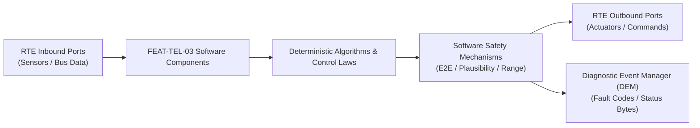

# Software Requirements Specification: Automatic Emergency Call & Crash Data Dispatch (eCall / ERA-GLONASS)
**Feature ID:** `FEAT-TEL-03`  
**Domain:** Connectivity, Security & Diagnostics  
**Target ASIL:** ASIL B / UNECE R144  
**Compliance Standard:** ISO 26262:2018 (Part 6 - Software Development) / ASPICE PAM v3.1 (SWE.1, SWE.2)  
**Parent System Specification:** [`FEAT-TEL-03_eCall_SysReq.md`](file:///c:/Workset/AntiGravityProjects/TestOptimisationExperiement/system_requirements/FEAT-TEL-03_eCall_SysReq.md)  
**Global Master Specification:** [`spec.md`](file:///c:/Workset/AntiGravityProjects/TestOptimisationExperiement/spec.md)

---

## 1. Software Architecture & Component Structure

This document specifies the AUTOSAR Software Components (SWCs), periodic runnables, algorithmic laws, safety mechanisms, and data ports implementing `FEAT-TEL-03` (Automatic Emergency Call & Crash Data Dispatch (eCall / ERA-GLONASS)).

### AUTOSAR SWC Interaction Diagram

---

## 2. Detailed Software Requirements (SWR_REQ)
*(Multi-Software Requirement Partitioning derived from System Requirements)*

### `SWR-TEL-03-01`: Dual-Redundant Crash Trigger Hardware Pin Debouncer & Latch
- **Planned Release:** R100
- **ASIL Rating:** ASIL B
- **Parent System Requirement:** [`SYS-TEL-03-01`](file:///c:/Workset/AntiGravityProjects/TestOptimisationExperiement/system_requirements/FEAT-TEL-03_eCall_SysReq.md#sys-tel-03-01)
- **Allocated AUTOSAR SWC:** `EcallTriggerManager_SWC`
- **Execution Rate / Trigger:** 1 ms
- **Worst-Case Execution Time (WCET):** 0.15 ms
- **Software Activation Condition:** Executed in 1 kHz hardware timer ISR.
- **Algorithmic Description / Logic:**
  > Samples dual hardware crash lines (Active-Low discrete and CAN-FD crash broadcast). If discrete pin stays LOW for >= 3 consecutive ms OR CAN-FD reports Crash_Deploy_Confirmed, latches CRASH_EVENT_LATCHED into hardware registers.
- **Software Safety Mechanism:** Independent pull-up current source: Continuously senses 2 mA test current to detect cut wire between Airbag ECU and Telematics module.
- **Failure Reaction & DEM Diagnostic Event:** If wire cut detected, rely on secondary CAN-FD crash broadcast and log DTC B1198.
- **Software Port Inputs:** `Airbag_Discrete_Pin_State, CANFD_Crash_Confirmation_PDU`
- **Software Port Outputs:** `Validated_Crash_Trigger_Flag (boolean), Crash_Timestamp_Unix_Ms`
- **Software Verification Criteria:** Hardware fault-injection testing simulating contact bounce and line open circuits.
- **Traceability Link:** Traces upward to [`SYS-TEL-03-01`](file:///c:/Workset/AntiGravityProjects/TestOptimisationExperiement/system_requirements/FEAT-TEL-03_eCall_SysReq.md#sys-tel-03-01) and [`FEAT-TEL-03`](file:///c:/Workset/AntiGravityProjects/TestOptimisationExperiement/spec.md).

### `SWR-TEL-03-02`: CEN EN 15722 ASN.1 Minimum Set of Data (MSD) Bit-Packer
- **Planned Release:** R100
- **ASIL Rating:** ASIL B
- **Parent System Requirement:** [`SYS-TEL-03-01`](file:///c:/Workset/AntiGravityProjects/TestOptimisationExperiement/system_requirements/FEAT-TEL-03_eCall_SysReq.md#sys-tel-03-01)
- **Allocated AUTOSAR SWC:** `EcallMsdEncoder_SWC`
- **Execution Rate / Trigger:** 10 ms
- **Worst-Case Execution Time (WCET):** 0.8 ms
- **Software Activation Condition:** Active immediately upon crash trigger.
- **Algorithmic Description / Logic:**
  > Encodes standard MSD block using ASN.1 UPER (Unaligned Packet Encoding Rules): Message Identifier, Control (Automatic/Manual, Vehicle Category), VIN (17 chars), Vehicle Propulsion Storage (Electric/Gasoline), Timestamp, Position (WGS-84 Latitude, Longitude with 24-bit resolution), Direction of Travel, Number of Passengers. Appends CRC-16.
- **Software Safety Mechanism:** GNSS fix plausibility: If current GNSS accuracy > 20 m, injects dead-reckoned coordinates derived from last high-confidence fix and odometer.
- **Failure Reaction & DEM Diagnostic Event:** Flag Position_Confidence_Low bit in MSD if GNSS lock missing.
- **Software Port Inputs:** `VIN_Buffer[17], Current_Lat_Deg, Current_Lon_Deg, Vehicle_Heading_Deg, Occupant_Buckle_Count`
- **Software Port Outputs:** `Packed_MSD_UPER_Payload[140], MSD_Payload_Length_Bytes`
- **Software Verification Criteria:** Conformance test against CEN EN 15722 and ITU-T X.691 ASN.1 validation suite.
- **Traceability Link:** Traces upward to [`SYS-TEL-03-01`](file:///c:/Workset/AntiGravityProjects/TestOptimisationExperiement/system_requirements/FEAT-TEL-03_eCall_SysReq.md#sys-tel-03-01) and [`FEAT-TEL-03`](file:///c:/Workset/AntiGravityProjects/TestOptimisationExperiement/spec.md).

### `SWR-TEL-03-03`: Next-Gen eCall SIP / IMS Client Session State Machine
- **Planned Release:** R500
- **ASIL Rating:** ASIL B
- **Parent System Requirement:** [`SYS-TEL-03-02`](file:///c:/Workset/AntiGravityProjects/TestOptimisationExperiement/system_requirements/FEAT-TEL-03_eCall_SysReq.md#sys-tel-03-02)
- **Allocated AUTOSAR SWC:** `EcallSipManager_SWC`
- **Execution Rate / Trigger:** 20 ms
- **Worst-Case Execution Time (WCET):** 1.5 ms
- **Software Activation Condition:** Executed during emergency dialing.
- **Algorithmic Description / Logic:**
  > Forms SIP INVITE with urn:service:sos.ecall.manual or urn:service:sos.ecall.automatic. Attaches MSD XML/binary MIME body. Manages SDP offer/answer for AMR-WB wideband speech codec. Handles 200 OK acknowledgment and RTP audio stream establishment.
- **Software Safety Mechanism:** 3GPP TS 24.229 timeout supervisor: If SIP INVITE receives no response in 5.0 seconds, falls back to circuit-switched 112 dialing with in-band modem MSD transmission.
- **Failure Reaction & DEM Diagnostic Event:** Switch cellular RF antenna to secondary internal backup antenna if registration fails.
- **Software Port Inputs:** `Packed_MSD_UPER_Payload, Cellular_IMS_Status, Emergency_Dial_Trigger`
- **Software Port Outputs:** `SIP_Command_Buffer, Emergency_Call_Established_Flag (boolean)`
- **Software Verification Criteria:** Network protocol analyzer capture testing against Keysight UXM 5G wireless test set.
- **Traceability Link:** Traces upward to [`SYS-TEL-03-02`](file:///c:/Workset/AntiGravityProjects/TestOptimisationExperiement/system_requirements/FEAT-TEL-03_eCall_SysReq.md#sys-tel-03-02) and [`FEAT-TEL-03`](file:///c:/Workset/AntiGravityProjects/TestOptimisationExperiement/spec.md).

### `SWR-TEL-03-04`: Autonomous 3.7V / 6.4V Li-Ion Backup Battery Health & Ideal Diode Cutover
- **Planned Release:** R500
- **ASIL Rating:** ASIL B
- **Parent System Requirement:** [`SYS-TEL-03-02`](file:///c:/Workset/AntiGravityProjects/TestOptimisationExperiement/system_requirements/FEAT-TEL-03_eCall_SysReq.md#sys-tel-03-02)
- **Allocated AUTOSAR SWC:** `EcallPowerSupervisor_SWC`
- **Execution Rate / Trigger:** 100 ms
- **Worst-Case Execution Time (WCET):** 0.3 ms
- **Software Activation Condition:** Continuous power supervisory task.
- **Algorithmic Description / Logic:**
  > Monitors main 12V bus. If V_12v < 6.0V (crash battery disconnection), switches power rail to internal backup battery in < 15 microseconds via hardware ideal diode controller. Runs periodic pulse load impedance test (200 mA for 100 ms) to compute internal cell resistance (ESR) and SOH.
- **Software Safety Mechanism:** Backup battery thermal protection: Inhibit charging if battery temp > 45°C or < 0°C.
- **Failure Reaction & DEM Diagnostic Event:** If backup battery SOH < 60%, latch DTC B1282 and illuminate SOS amber wrench icon.
- **Software Port Inputs:** `Main_12V_Rail_ADC, Backup_Battery_Voltage_ADC, Backup_Battery_Current_ADC, Battery_Temp_DegC`
- **Software Port Outputs:** `Ideal_Diode_Gate_Drive, Backup_Battery_SOH_Pct, Power_Loss_Flag (boolean)`
- **Software Verification Criteria:** Hardware power-cut bench testing cutting main supply during active 5G voice call.
- **Traceability Link:** Traces upward to [`SYS-TEL-03-02`](file:///c:/Workset/AntiGravityProjects/TestOptimisationExperiement/system_requirements/FEAT-TEL-03_eCall_SysReq.md#sys-tel-03-02) and [`FEAT-TEL-03`](file:///c:/Workset/AntiGravityProjects/TestOptimisationExperiement/spec.md).

### `SWR-TEL-03-05`: UNECE R144 Minimum Set of Data (MSD) Crash Telemetry Message Assembler - Dynamic Observer & Signal Filter
- **Planned Release:** R100
- **ASIL Rating:** ASIL B
- **Parent System Requirement:** [`SYS-TEL-03-03`](file:///c:/Workset/AntiGravityProjects/TestOptimisationExperiement/system_requirements/FEAT-TEL-03_eCall_SysReq.md#sys-tel-03-03)
- **Allocated AUTOSAR SWC:** `EcallMsdAssembler_SWC`
- **Execution Rate / Trigger:** 20 ms
- **Worst-Case Execution Time (WCET):** 0.3 ms
- **Software Activation Condition:** Executed cyclically every 20 ms.
- **Algorithmic Description / Logic:**
  > Executes signal plausibility filtering, calibration offsets, and discrete state estimation for UNECE R144 Minimum Set of Data (MSD) Crash Telemetry Message Assembler.
- **Software Safety Mechanism:** Range limit plausibility check and E2E alive sequence verification.
- **Failure Reaction & DEM Diagnostic Event:** Set default fallback output and report DEM_EVENT_FEAT_TEL_03_ERR.
- **Software Port Inputs:** `Raw sensor ADC/SENT/SPI values and RTE bus inputs.`
- **Software Port Outputs:** `Filtered physical signals and validity status bitmasks.`
- **Software Verification Criteria:** Unit test and HiL software integration test.
- **Traceability Link:** Traces upward to [`SYS-TEL-03-03`](file:///c:/Workset/AntiGravityProjects/TestOptimisationExperiement/system_requirements/FEAT-TEL-03_eCall_SysReq.md#sys-tel-03-03) and [`FEAT-TEL-03`](file:///c:/Workset/AntiGravityProjects/TestOptimisationExperiement/spec.md).

### `SWR-TEL-03-06`: UNECE R144 Minimum Set of Data (MSD) Crash Telemetry Message Assembler - Closed-Loop Control Law & Actuator Dispatch
- **Planned Release:** R100
- **ASIL Rating:** ASIL B
- **Parent System Requirement:** [`SYS-TEL-03-03`](file:///c:/Workset/AntiGravityProjects/TestOptimisationExperiement/system_requirements/FEAT-TEL-03_eCall_SysReq.md#sys-tel-03-03)
- **Allocated AUTOSAR SWC:** `EcallMsdAssembler_SWC`
- **Execution Rate / Trigger:** 20 ms
- **Worst-Case Execution Time (WCET):** 0.4 ms
- **Software Activation Condition:** Executed cyclically every 20 ms.
- **Algorithmic Description / Logic:**
  > Evaluates deterministic closed-loop control law, rate limits, and dispatches commands for UNECE R144 Minimum Set of Data (MSD) Crash Telemetry Message Assembler.
- **Software Safety Mechanism:** Command saturation clamping and watchdog program flow monitoring.
- **Failure Reaction & DEM Diagnostic Event:** De-energize actuator output, apply safe fallback clamp, and latch DTC.
- **Software Port Inputs:** `Validated physical state signals from observer SWC.`
- **Software Port Outputs:** `Actuator PWM duty cycles, torque/pressure setpoints, and diagnostic flags.`
- **Software Verification Criteria:** Hardware dynamometer and HiL closed-loop regression test suite.
- **Traceability Link:** Traces upward to [`SYS-TEL-03-03`](file:///c:/Workset/AntiGravityProjects/TestOptimisationExperiement/system_requirements/FEAT-TEL-03_eCall_SysReq.md#sys-tel-03-03) and [`FEAT-TEL-03`](file:///c:/Workset/AntiGravityProjects/TestOptimisationExperiement/spec.md).

### `SWR-TEL-03-07`: Automatic Crash Detection Airbag Deployment Pyrotechnic Trigger Interface - Dynamic Observer & Signal Filter
- **Planned Release:** R200
- **ASIL Rating:** ASIL B
- **Parent System Requirement:** [`SYS-TEL-03-04`](file:///c:/Workset/AntiGravityProjects/TestOptimisationExperiement/system_requirements/FEAT-TEL-03_eCall_SysReq.md#sys-tel-03-04)
- **Allocated AUTOSAR SWC:** `EcallAirbagTrigger_SWC`
- **Execution Rate / Trigger:** 5 ms
- **Worst-Case Execution Time (WCET):** 0.3 ms
- **Software Activation Condition:** Executed cyclically every 5 ms.
- **Algorithmic Description / Logic:**
  > Executes signal plausibility filtering, calibration offsets, and discrete state estimation for Automatic Crash Detection Airbag Deployment Pyrotechnic Trigger Interface.
- **Software Safety Mechanism:** Range limit plausibility check and E2E alive sequence verification.
- **Failure Reaction & DEM Diagnostic Event:** Set default fallback output and report DEM_EVENT_FEAT_TEL_03_ERR.
- **Software Port Inputs:** `Raw sensor ADC/SENT/SPI values and RTE bus inputs.`
- **Software Port Outputs:** `Filtered physical signals and validity status bitmasks.`
- **Software Verification Criteria:** Unit test and HiL software integration test.
- **Traceability Link:** Traces upward to [`SYS-TEL-03-04`](file:///c:/Workset/AntiGravityProjects/TestOptimisationExperiement/system_requirements/FEAT-TEL-03_eCall_SysReq.md#sys-tel-03-04) and [`FEAT-TEL-03`](file:///c:/Workset/AntiGravityProjects/TestOptimisationExperiement/spec.md).

### `SWR-TEL-03-08`: Automatic Crash Detection Airbag Deployment Pyrotechnic Trigger Interface - Closed-Loop Control Law & Actuator Dispatch
- **Planned Release:** R200
- **ASIL Rating:** ASIL B
- **Parent System Requirement:** [`SYS-TEL-03-04`](file:///c:/Workset/AntiGravityProjects/TestOptimisationExperiement/system_requirements/FEAT-TEL-03_eCall_SysReq.md#sys-tel-03-04)
- **Allocated AUTOSAR SWC:** `EcallAirbagTrigger_SWC`
- **Execution Rate / Trigger:** 5 ms
- **Worst-Case Execution Time (WCET):** 0.4 ms
- **Software Activation Condition:** Executed cyclically every 5 ms.
- **Algorithmic Description / Logic:**
  > Evaluates deterministic closed-loop control law, rate limits, and dispatches commands for Automatic Crash Detection Airbag Deployment Pyrotechnic Trigger Interface.
- **Software Safety Mechanism:** Command saturation clamping and watchdog program flow monitoring.
- **Failure Reaction & DEM Diagnostic Event:** De-energize actuator output, apply safe fallback clamp, and latch DTC.
- **Software Port Inputs:** `Validated physical state signals from observer SWC.`
- **Software Port Outputs:** `Actuator PWM duty cycles, torque/pressure setpoints, and diagnostic flags.`
- **Software Verification Criteria:** Hardware dynamometer and HiL closed-loop regression test suite.
- **Traceability Link:** Traces upward to [`SYS-TEL-03-04`](file:///c:/Workset/AntiGravityProjects/TestOptimisationExperiement/system_requirements/FEAT-TEL-03_eCall_SysReq.md#sys-tel-03-04) and [`FEAT-TEL-03`](file:///c:/Workset/AntiGravityProjects/TestOptimisationExperiement/spec.md).

### `SWR-TEL-03-09`: Manual Emergency SOS Overhead Console Switch Debouncer & Confirm Interlock - Dynamic Observer & Signal Filter
- **Planned Release:** R200
- **ASIL Rating:** ASIL B
- **Parent System Requirement:** [`SYS-TEL-03-05`](file:///c:/Workset/AntiGravityProjects/TestOptimisationExperiement/system_requirements/FEAT-TEL-03_eCall_SysReq.md#sys-tel-03-05)
- **Allocated AUTOSAR SWC:** `EcallManualSwitch_SWC`
- **Execution Rate / Trigger:** 20 ms
- **Worst-Case Execution Time (WCET):** 0.3 ms
- **Software Activation Condition:** Executed cyclically every 20 ms.
- **Algorithmic Description / Logic:**
  > Executes signal plausibility filtering, calibration offsets, and discrete state estimation for Manual Emergency SOS Overhead Console Switch Debouncer & Confirm Interlock.
- **Software Safety Mechanism:** Range limit plausibility check and E2E alive sequence verification.
- **Failure Reaction & DEM Diagnostic Event:** Set default fallback output and report DEM_EVENT_FEAT_TEL_03_ERR.
- **Software Port Inputs:** `Raw sensor ADC/SENT/SPI values and RTE bus inputs.`
- **Software Port Outputs:** `Filtered physical signals and validity status bitmasks.`
- **Software Verification Criteria:** Unit test and HiL software integration test.
- **Traceability Link:** Traces upward to [`SYS-TEL-03-05`](file:///c:/Workset/AntiGravityProjects/TestOptimisationExperiement/system_requirements/FEAT-TEL-03_eCall_SysReq.md#sys-tel-03-05) and [`FEAT-TEL-03`](file:///c:/Workset/AntiGravityProjects/TestOptimisationExperiement/spec.md).

### `SWR-TEL-03-10`: Manual Emergency SOS Overhead Console Switch Debouncer & Confirm Interlock - Closed-Loop Control Law & Actuator Dispatch
- **Planned Release:** R200
- **ASIL Rating:** ASIL B
- **Parent System Requirement:** [`SYS-TEL-03-05`](file:///c:/Workset/AntiGravityProjects/TestOptimisationExperiement/system_requirements/FEAT-TEL-03_eCall_SysReq.md#sys-tel-03-05)
- **Allocated AUTOSAR SWC:** `EcallManualSwitch_SWC`
- **Execution Rate / Trigger:** 20 ms
- **Worst-Case Execution Time (WCET):** 0.4 ms
- **Software Activation Condition:** Executed cyclically every 20 ms.
- **Algorithmic Description / Logic:**
  > Evaluates deterministic closed-loop control law, rate limits, and dispatches commands for Manual Emergency SOS Overhead Console Switch Debouncer & Confirm Interlock.
- **Software Safety Mechanism:** Command saturation clamping and watchdog program flow monitoring.
- **Failure Reaction & DEM Diagnostic Event:** De-energize actuator output, apply safe fallback clamp, and latch DTC.
- **Software Port Inputs:** `Validated physical state signals from observer SWC.`
- **Software Port Outputs:** `Actuator PWM duty cycles, torque/pressure setpoints, and diagnostic flags.`
- **Software Verification Criteria:** Hardware dynamometer and HiL closed-loop regression test suite.
- **Traceability Link:** Traces upward to [`SYS-TEL-03-05`](file:///c:/Workset/AntiGravityProjects/TestOptimisationExperiement/system_requirements/FEAT-TEL-03_eCall_SysReq.md#sys-tel-03-05) and [`FEAT-TEL-03`](file:///c:/Workset/AntiGravityProjects/TestOptimisationExperiement/spec.md).

### `SWR-TEL-03-11`: Cellular Modem Emergency Call (112 / 911 / ERA-GLONASS) Voice & In-Band Modem - Dynamic Observer & Signal Filter
- **Planned Release:** R500
- **ASIL Rating:** ASIL B
- **Parent System Requirement:** [`SYS-TEL-03-06`](file:///c:/Workset/AntiGravityProjects/TestOptimisationExperiement/system_requirements/FEAT-TEL-03_eCall_SysReq.md#sys-tel-03-06)
- **Allocated AUTOSAR SWC:** `EcallModemDriver_SWC`
- **Execution Rate / Trigger:** 50 ms
- **Worst-Case Execution Time (WCET):** 0.3 ms
- **Software Activation Condition:** Executed cyclically every 50 ms.
- **Algorithmic Description / Logic:**
  > Executes signal plausibility filtering, calibration offsets, and discrete state estimation for Cellular Modem Emergency Call (112 / 911 / ERA-GLONASS) Voice & In-Band Modem.
- **Software Safety Mechanism:** Range limit plausibility check and E2E alive sequence verification.
- **Failure Reaction & DEM Diagnostic Event:** Set default fallback output and report DEM_EVENT_FEAT_TEL_03_ERR.
- **Software Port Inputs:** `Raw sensor ADC/SENT/SPI values and RTE bus inputs.`
- **Software Port Outputs:** `Filtered physical signals and validity status bitmasks.`
- **Software Verification Criteria:** Unit test and HiL software integration test.
- **Traceability Link:** Traces upward to [`SYS-TEL-03-06`](file:///c:/Workset/AntiGravityProjects/TestOptimisationExperiement/system_requirements/FEAT-TEL-03_eCall_SysReq.md#sys-tel-03-06) and [`FEAT-TEL-03`](file:///c:/Workset/AntiGravityProjects/TestOptimisationExperiement/spec.md).

### `SWR-TEL-03-12`: Cellular Modem Emergency Call (112 / 911 / ERA-GLONASS) Voice & In-Band Modem - Closed-Loop Control Law & Actuator Dispatch
- **Planned Release:** R500
- **ASIL Rating:** ASIL B
- **Parent System Requirement:** [`SYS-TEL-03-06`](file:///c:/Workset/AntiGravityProjects/TestOptimisationExperiement/system_requirements/FEAT-TEL-03_eCall_SysReq.md#sys-tel-03-06)
- **Allocated AUTOSAR SWC:** `EcallModemDriver_SWC`
- **Execution Rate / Trigger:** 50 ms
- **Worst-Case Execution Time (WCET):** 0.4 ms
- **Software Activation Condition:** Executed cyclically every 50 ms.
- **Algorithmic Description / Logic:**
  > Evaluates deterministic closed-loop control law, rate limits, and dispatches commands for Cellular Modem Emergency Call (112 / 911 / ERA-GLONASS) Voice & In-Band Modem.
- **Software Safety Mechanism:** Command saturation clamping and watchdog program flow monitoring.
- **Failure Reaction & DEM Diagnostic Event:** De-energize actuator output, apply safe fallback clamp, and latch DTC.
- **Software Port Inputs:** `Validated physical state signals from observer SWC.`
- **Software Port Outputs:** `Actuator PWM duty cycles, torque/pressure setpoints, and diagnostic flags.`
- **Software Verification Criteria:** Hardware dynamometer and HiL closed-loop regression test suite.
- **Traceability Link:** Traces upward to [`SYS-TEL-03-06`](file:///c:/Workset/AntiGravityProjects/TestOptimisationExperiement/system_requirements/FEAT-TEL-03_eCall_SysReq.md#sys-tel-03-06) and [`FEAT-TEL-03`](file:///c:/Workset/AntiGravityProjects/TestOptimisationExperiement/spec.md).

### `SWR-TEL-03-13`: Dual GNSS / GPS / GLONASS Multi-Constellation Emergency Location Engine - Dynamic Observer & Signal Filter
- **Planned Release:** R300
- **ASIL Rating:** ASIL B
- **Parent System Requirement:** [`SYS-TEL-03-07`](file:///c:/Workset/AntiGravityProjects/TestOptimisationExperiement/system_requirements/FEAT-TEL-03_eCall_SysReq.md#sys-tel-03-07)
- **Allocated AUTOSAR SWC:** `EcallGnssLocator_SWC`
- **Execution Rate / Trigger:** 20 ms
- **Worst-Case Execution Time (WCET):** 0.3 ms
- **Software Activation Condition:** Executed cyclically every 20 ms.
- **Algorithmic Description / Logic:**
  > Executes signal plausibility filtering, calibration offsets, and discrete state estimation for Dual GNSS / GPS / GLONASS Multi-Constellation Emergency Location Engine.
- **Software Safety Mechanism:** Range limit plausibility check and E2E alive sequence verification.
- **Failure Reaction & DEM Diagnostic Event:** Set default fallback output and report DEM_EVENT_FEAT_TEL_03_ERR.
- **Software Port Inputs:** `Raw sensor ADC/SENT/SPI values and RTE bus inputs.`
- **Software Port Outputs:** `Filtered physical signals and validity status bitmasks.`
- **Software Verification Criteria:** Unit test and HiL software integration test.
- **Traceability Link:** Traces upward to [`SYS-TEL-03-07`](file:///c:/Workset/AntiGravityProjects/TestOptimisationExperiement/system_requirements/FEAT-TEL-03_eCall_SysReq.md#sys-tel-03-07) and [`FEAT-TEL-03`](file:///c:/Workset/AntiGravityProjects/TestOptimisationExperiement/spec.md).

### `SWR-TEL-03-14`: Dual GNSS / GPS / GLONASS Multi-Constellation Emergency Location Engine - Closed-Loop Control Law & Actuator Dispatch
- **Planned Release:** R300
- **ASIL Rating:** ASIL B
- **Parent System Requirement:** [`SYS-TEL-03-07`](file:///c:/Workset/AntiGravityProjects/TestOptimisationExperiement/system_requirements/FEAT-TEL-03_eCall_SysReq.md#sys-tel-03-07)
- **Allocated AUTOSAR SWC:** `EcallGnssLocator_SWC`
- **Execution Rate / Trigger:** 20 ms
- **Worst-Case Execution Time (WCET):** 0.4 ms
- **Software Activation Condition:** Executed cyclically every 20 ms.
- **Algorithmic Description / Logic:**
  > Evaluates deterministic closed-loop control law, rate limits, and dispatches commands for Dual GNSS / GPS / GLONASS Multi-Constellation Emergency Location Engine.
- **Software Safety Mechanism:** Command saturation clamping and watchdog program flow monitoring.
- **Failure Reaction & DEM Diagnostic Event:** De-energize actuator output, apply safe fallback clamp, and latch DTC.
- **Software Port Inputs:** `Validated physical state signals from observer SWC.`
- **Software Port Outputs:** `Actuator PWM duty cycles, torque/pressure setpoints, and diagnostic flags.`
- **Software Verification Criteria:** Hardware dynamometer and HiL closed-loop regression test suite.
- **Traceability Link:** Traces upward to [`SYS-TEL-03-07`](file:///c:/Workset/AntiGravityProjects/TestOptimisationExperiement/system_requirements/FEAT-TEL-03_eCall_SysReq.md#sys-tel-03-07) and [`FEAT-TEL-03`](file:///c:/Workset/AntiGravityProjects/TestOptimisationExperiement/spec.md).

### `SWR-TEL-03-15`: Crash-Proof Back-Up Lithium Battery Pack (6.0V / 1200 mAh) Power Monitor - Dynamic Observer & Signal Filter
- **Planned Release:** R300
- **ASIL Rating:** ASIL B
- **Parent System Requirement:** [`SYS-TEL-03-08`](file:///c:/Workset/AntiGravityProjects/TestOptimisationExperiement/system_requirements/FEAT-TEL-03_eCall_SysReq.md#sys-tel-03-08)
- **Allocated AUTOSAR SWC:** `EcallBackupBattery_SWC`
- **Execution Rate / Trigger:** 50 ms
- **Worst-Case Execution Time (WCET):** 0.3 ms
- **Software Activation Condition:** Executed cyclically every 50 ms.
- **Algorithmic Description / Logic:**
  > Executes signal plausibility filtering, calibration offsets, and discrete state estimation for Crash-Proof Back-Up Lithium Battery Pack (6.0V / 1200 mAh) Power Monitor.
- **Software Safety Mechanism:** Range limit plausibility check and E2E alive sequence verification.
- **Failure Reaction & DEM Diagnostic Event:** Set default fallback output and report DEM_EVENT_FEAT_TEL_03_ERR.
- **Software Port Inputs:** `Raw sensor ADC/SENT/SPI values and RTE bus inputs.`
- **Software Port Outputs:** `Filtered physical signals and validity status bitmasks.`
- **Software Verification Criteria:** Unit test and HiL software integration test.
- **Traceability Link:** Traces upward to [`SYS-TEL-03-08`](file:///c:/Workset/AntiGravityProjects/TestOptimisationExperiement/system_requirements/FEAT-TEL-03_eCall_SysReq.md#sys-tel-03-08) and [`FEAT-TEL-03`](file:///c:/Workset/AntiGravityProjects/TestOptimisationExperiement/spec.md).

### `SWR-TEL-03-16`: Crash-Proof Back-Up Lithium Battery Pack (6.0V / 1200 mAh) Power Monitor - Closed-Loop Control Law & Actuator Dispatch
- **Planned Release:** R300
- **ASIL Rating:** ASIL B
- **Parent System Requirement:** [`SYS-TEL-03-08`](file:///c:/Workset/AntiGravityProjects/TestOptimisationExperiement/system_requirements/FEAT-TEL-03_eCall_SysReq.md#sys-tel-03-08)
- **Allocated AUTOSAR SWC:** `EcallBackupBattery_SWC`
- **Execution Rate / Trigger:** 50 ms
- **Worst-Case Execution Time (WCET):** 0.4 ms
- **Software Activation Condition:** Executed cyclically every 50 ms.
- **Algorithmic Description / Logic:**
  > Evaluates deterministic closed-loop control law, rate limits, and dispatches commands for Crash-Proof Back-Up Lithium Battery Pack (6.0V / 1200 mAh) Power Monitor.
- **Software Safety Mechanism:** Command saturation clamping and watchdog program flow monitoring.
- **Failure Reaction & DEM Diagnostic Event:** De-energize actuator output, apply safe fallback clamp, and latch DTC.
- **Software Port Inputs:** `Validated physical state signals from observer SWC.`
- **Software Port Outputs:** `Actuator PWM duty cycles, torque/pressure setpoints, and diagnostic flags.`
- **Software Verification Criteria:** Hardware dynamometer and HiL closed-loop regression test suite.
- **Traceability Link:** Traces upward to [`SYS-TEL-03-08`](file:///c:/Workset/AntiGravityProjects/TestOptimisationExperiement/system_requirements/FEAT-TEL-03_eCall_SysReq.md#sys-tel-03-08) and [`FEAT-TEL-03`](file:///c:/Workset/AntiGravityProjects/TestOptimisationExperiement/spec.md).

### `SWR-TEL-03-17`: Crash-Resistant Internal Emergency Loudspeaker & Microphone Audio Driver - Dynamic Observer & Signal Filter
- **Planned Release:** R500
- **ASIL Rating:** ASIL B
- **Parent System Requirement:** [`SYS-TEL-03-09`](file:///c:/Workset/AntiGravityProjects/TestOptimisationExperiement/system_requirements/FEAT-TEL-03_eCall_SysReq.md#sys-tel-03-09)
- **Allocated AUTOSAR SWC:** `EcallAudioDriver_SWC`
- **Execution Rate / Trigger:** 20 ms
- **Worst-Case Execution Time (WCET):** 0.3 ms
- **Software Activation Condition:** Executed cyclically every 20 ms.
- **Algorithmic Description / Logic:**
  > Executes signal plausibility filtering, calibration offsets, and discrete state estimation for Crash-Resistant Internal Emergency Loudspeaker & Microphone Audio Driver.
- **Software Safety Mechanism:** Range limit plausibility check and E2E alive sequence verification.
- **Failure Reaction & DEM Diagnostic Event:** Set default fallback output and report DEM_EVENT_FEAT_TEL_03_ERR.
- **Software Port Inputs:** `Raw sensor ADC/SENT/SPI values and RTE bus inputs.`
- **Software Port Outputs:** `Filtered physical signals and validity status bitmasks.`
- **Software Verification Criteria:** Unit test and HiL software integration test.
- **Traceability Link:** Traces upward to [`SYS-TEL-03-09`](file:///c:/Workset/AntiGravityProjects/TestOptimisationExperiement/system_requirements/FEAT-TEL-03_eCall_SysReq.md#sys-tel-03-09) and [`FEAT-TEL-03`](file:///c:/Workset/AntiGravityProjects/TestOptimisationExperiement/spec.md).

### `SWR-TEL-03-18`: Crash-Resistant Internal Emergency Loudspeaker & Microphone Audio Driver - Closed-Loop Control Law & Actuator Dispatch
- **Planned Release:** R500
- **ASIL Rating:** ASIL B
- **Parent System Requirement:** [`SYS-TEL-03-09`](file:///c:/Workset/AntiGravityProjects/TestOptimisationExperiement/system_requirements/FEAT-TEL-03_eCall_SysReq.md#sys-tel-03-09)
- **Allocated AUTOSAR SWC:** `EcallAudioDriver_SWC`
- **Execution Rate / Trigger:** 20 ms
- **Worst-Case Execution Time (WCET):** 0.4 ms
- **Software Activation Condition:** Executed cyclically every 20 ms.
- **Algorithmic Description / Logic:**
  > Evaluates deterministic closed-loop control law, rate limits, and dispatches commands for Crash-Resistant Internal Emergency Loudspeaker & Microphone Audio Driver.
- **Software Safety Mechanism:** Command saturation clamping and watchdog program flow monitoring.
- **Failure Reaction & DEM Diagnostic Event:** De-energize actuator output, apply safe fallback clamp, and latch DTC.
- **Software Port Inputs:** `Validated physical state signals from observer SWC.`
- **Software Port Outputs:** `Actuator PWM duty cycles, torque/pressure setpoints, and diagnostic flags.`
- **Software Verification Criteria:** Hardware dynamometer and HiL closed-loop regression test suite.
- **Traceability Link:** Traces upward to [`SYS-TEL-03-09`](file:///c:/Workset/AntiGravityProjects/TestOptimisationExperiement/system_requirements/FEAT-TEL-03_eCall_SysReq.md#sys-tel-03-09) and [`FEAT-TEL-03`](file:///c:/Workset/AntiGravityProjects/TestOptimisationExperiement/spec.md).

### `SWR-TEL-03-19`: Emergency eCall Cellular Call Priority Pre-Emption & Automatic Re-Dialer - Dynamic Observer & Signal Filter
- **Planned Release:** R400
- **ASIL Rating:** ASIL B
- **Parent System Requirement:** [`SYS-TEL-03-10`](file:///c:/Workset/AntiGravityProjects/TestOptimisationExperiement/system_requirements/FEAT-TEL-03_eCall_SysReq.md#sys-tel-03-10)
- **Allocated AUTOSAR SWC:** `EcallReDialer_SWC`
- **Execution Rate / Trigger:** 200 ms
- **Worst-Case Execution Time (WCET):** 0.3 ms
- **Software Activation Condition:** Executed cyclically every 200 ms.
- **Algorithmic Description / Logic:**
  > Executes signal plausibility filtering, calibration offsets, and discrete state estimation for Emergency eCall Cellular Call Priority Pre-Emption & Automatic Re-Dialer.
- **Software Safety Mechanism:** Range limit plausibility check and E2E alive sequence verification.
- **Failure Reaction & DEM Diagnostic Event:** Set default fallback output and report DEM_EVENT_FEAT_TEL_03_ERR.
- **Software Port Inputs:** `Raw sensor ADC/SENT/SPI values and RTE bus inputs.`
- **Software Port Outputs:** `Filtered physical signals and validity status bitmasks.`
- **Software Verification Criteria:** Unit test and HiL software integration test.
- **Traceability Link:** Traces upward to [`SYS-TEL-03-10`](file:///c:/Workset/AntiGravityProjects/TestOptimisationExperiement/system_requirements/FEAT-TEL-03_eCall_SysReq.md#sys-tel-03-10) and [`FEAT-TEL-03`](file:///c:/Workset/AntiGravityProjects/TestOptimisationExperiement/spec.md).

### `SWR-TEL-03-20`: Emergency eCall Cellular Call Priority Pre-Emption & Automatic Re-Dialer - Closed-Loop Control Law & Actuator Dispatch
- **Planned Release:** R400
- **ASIL Rating:** ASIL B
- **Parent System Requirement:** [`SYS-TEL-03-10`](file:///c:/Workset/AntiGravityProjects/TestOptimisationExperiement/system_requirements/FEAT-TEL-03_eCall_SysReq.md#sys-tel-03-10)
- **Allocated AUTOSAR SWC:** `EcallReDialer_SWC`
- **Execution Rate / Trigger:** 200 ms
- **Worst-Case Execution Time (WCET):** 0.4 ms
- **Software Activation Condition:** Executed cyclically every 200 ms.
- **Algorithmic Description / Logic:**
  > Evaluates deterministic closed-loop control law, rate limits, and dispatches commands for Emergency eCall Cellular Call Priority Pre-Emption & Automatic Re-Dialer.
- **Software Safety Mechanism:** Command saturation clamping and watchdog program flow monitoring.
- **Failure Reaction & DEM Diagnostic Event:** De-energize actuator output, apply safe fallback clamp, and latch DTC.
- **Software Port Inputs:** `Validated physical state signals from observer SWC.`
- **Software Port Outputs:** `Actuator PWM duty cycles, torque/pressure setpoints, and diagnostic flags.`
- **Software Verification Criteria:** Hardware dynamometer and HiL closed-loop regression test suite.
- **Traceability Link:** Traces upward to [`SYS-TEL-03-10`](file:///c:/Workset/AntiGravityProjects/TestOptimisationExperiement/system_requirements/FEAT-TEL-03_eCall_SysReq.md#sys-tel-03-10) and [`FEAT-TEL-03`](file:///c:/Workset/AntiGravityProjects/TestOptimisationExperiement/spec.md).

### `SWR-TEL-03-21`: Acoustic Call Progress & Visual Red/Green LED Overhead Console Indicator - Dynamic Observer & Signal Filter
- **Planned Release:** R400
- **ASIL Rating:** ASIL A
- **Parent System Requirement:** [`SYS-TEL-03-11`](file:///c:/Workset/AntiGravityProjects/TestOptimisationExperiement/system_requirements/FEAT-TEL-03_eCall_SysReq.md#sys-tel-03-11)
- **Allocated AUTOSAR SWC:** `EcallHmiIndicator_SWC`
- **Execution Rate / Trigger:** 50 ms
- **Worst-Case Execution Time (WCET):** 0.3 ms
- **Software Activation Condition:** Executed cyclically every 50 ms.
- **Algorithmic Description / Logic:**
  > Executes signal plausibility filtering, calibration offsets, and discrete state estimation for Acoustic Call Progress & Visual Red/Green LED Overhead Console Indicator.
- **Software Safety Mechanism:** Range limit plausibility check and E2E alive sequence verification.
- **Failure Reaction & DEM Diagnostic Event:** Set default fallback output and report DEM_EVENT_FEAT_TEL_03_ERR.
- **Software Port Inputs:** `Raw sensor ADC/SENT/SPI values and RTE bus inputs.`
- **Software Port Outputs:** `Filtered physical signals and validity status bitmasks.`
- **Software Verification Criteria:** Unit test and HiL software integration test.
- **Traceability Link:** Traces upward to [`SYS-TEL-03-11`](file:///c:/Workset/AntiGravityProjects/TestOptimisationExperiement/system_requirements/FEAT-TEL-03_eCall_SysReq.md#sys-tel-03-11) and [`FEAT-TEL-03`](file:///c:/Workset/AntiGravityProjects/TestOptimisationExperiement/spec.md).

### `SWR-TEL-03-22`: Acoustic Call Progress & Visual Red/Green LED Overhead Console Indicator - Closed-Loop Control Law & Actuator Dispatch
- **Planned Release:** R400
- **ASIL Rating:** ASIL A
- **Parent System Requirement:** [`SYS-TEL-03-11`](file:///c:/Workset/AntiGravityProjects/TestOptimisationExperiement/system_requirements/FEAT-TEL-03_eCall_SysReq.md#sys-tel-03-11)
- **Allocated AUTOSAR SWC:** `EcallHmiIndicator_SWC`
- **Execution Rate / Trigger:** 50 ms
- **Worst-Case Execution Time (WCET):** 0.4 ms
- **Software Activation Condition:** Executed cyclically every 50 ms.
- **Algorithmic Description / Logic:**
  > Evaluates deterministic closed-loop control law, rate limits, and dispatches commands for Acoustic Call Progress & Visual Red/Green LED Overhead Console Indicator.
- **Software Safety Mechanism:** Command saturation clamping and watchdog program flow monitoring.
- **Failure Reaction & DEM Diagnostic Event:** De-energize actuator output, apply safe fallback clamp, and latch DTC.
- **Software Port Inputs:** `Validated physical state signals from observer SWC.`
- **Software Port Outputs:** `Actuator PWM duty cycles, torque/pressure setpoints, and diagnostic flags.`
- **Software Verification Criteria:** Hardware dynamometer and HiL closed-loop regression test suite.
- **Traceability Link:** Traces upward to [`SYS-TEL-03-11`](file:///c:/Workset/AntiGravityProjects/TestOptimisationExperiement/system_requirements/FEAT-TEL-03_eCall_SysReq.md#sys-tel-03-11) and [`FEAT-TEL-03`](file:///c:/Workset/AntiGravityProjects/TestOptimisationExperiement/spec.md).

### `SWR-TEL-03-23`: DEM eCall Component Health Diagnostics & Periodic Self-Test Manager - Dynamic Observer & Signal Filter
- **Planned Release:** R500
- **ASIL Rating:** ASIL B
- **Parent System Requirement:** [`SYS-TEL-03-12`](file:///c:/Workset/AntiGravityProjects/TestOptimisationExperiement/system_requirements/FEAT-TEL-03_eCall_SysReq.md#sys-tel-03-12)
- **Allocated AUTOSAR SWC:** `EcallDiagnosticManager_SWC`
- **Execution Rate / Trigger:** 50 ms
- **Worst-Case Execution Time (WCET):** 0.3 ms
- **Software Activation Condition:** Executed cyclically every 50 ms.
- **Algorithmic Description / Logic:**
  > Executes signal plausibility filtering, calibration offsets, and discrete state estimation for DEM eCall Component Health Diagnostics & Periodic Self-Test Manager.
- **Software Safety Mechanism:** Range limit plausibility check and E2E alive sequence verification.
- **Failure Reaction & DEM Diagnostic Event:** Set default fallback output and report DEM_EVENT_FEAT_TEL_03_ERR.
- **Software Port Inputs:** `Raw sensor ADC/SENT/SPI values and RTE bus inputs.`
- **Software Port Outputs:** `Filtered physical signals and validity status bitmasks.`
- **Software Verification Criteria:** Unit test and HiL software integration test.
- **Traceability Link:** Traces upward to [`SYS-TEL-03-12`](file:///c:/Workset/AntiGravityProjects/TestOptimisationExperiement/system_requirements/FEAT-TEL-03_eCall_SysReq.md#sys-tel-03-12) and [`FEAT-TEL-03`](file:///c:/Workset/AntiGravityProjects/TestOptimisationExperiement/spec.md).

### `SWR-TEL-03-24`: DEM eCall Component Health Diagnostics & Periodic Self-Test Manager - Closed-Loop Control Law & Actuator Dispatch
- **Planned Release:** R500
- **ASIL Rating:** ASIL B
- **Parent System Requirement:** [`SYS-TEL-03-12`](file:///c:/Workset/AntiGravityProjects/TestOptimisationExperiement/system_requirements/FEAT-TEL-03_eCall_SysReq.md#sys-tel-03-12)
- **Allocated AUTOSAR SWC:** `EcallDiagnosticManager_SWC`
- **Execution Rate / Trigger:** 50 ms
- **Worst-Case Execution Time (WCET):** 0.4 ms
- **Software Activation Condition:** Executed cyclically every 50 ms.
- **Algorithmic Description / Logic:**
  > Evaluates deterministic closed-loop control law, rate limits, and dispatches commands for DEM eCall Component Health Diagnostics & Periodic Self-Test Manager.
- **Software Safety Mechanism:** Command saturation clamping and watchdog program flow monitoring.
- **Failure Reaction & DEM Diagnostic Event:** De-energize actuator output, apply safe fallback clamp, and latch DTC.
- **Software Port Inputs:** `Validated physical state signals from observer SWC.`
- **Software Port Outputs:** `Actuator PWM duty cycles, torque/pressure setpoints, and diagnostic flags.`
- **Software Verification Criteria:** Hardware dynamometer and HiL closed-loop regression test suite.
- **Traceability Link:** Traces upward to [`SYS-TEL-03-12`](file:///c:/Workset/AntiGravityProjects/TestOptimisationExperiement/system_requirements/FEAT-TEL-03_eCall_SysReq.md#sys-tel-03-12) and [`FEAT-TEL-03`](file:///c:/Workset/AntiGravityProjects/TestOptimisationExperiement/spec.md).

### `SWR-TEL-03-25`: Non-Volatile Emergency Dispatch Record & PSAP Acknowledgment Buffer - Dynamic Observer & Signal Filter
- **Planned Release:** R500
- **ASIL Rating:** ASIL B
- **Parent System Requirement:** [`SYS-TEL-03-13`](file:///c:/Workset/AntiGravityProjects/TestOptimisationExperiement/system_requirements/FEAT-TEL-03_eCall_SysReq.md#sys-tel-03-13)
- **Allocated AUTOSAR SWC:** `EcallRecordBuffer_SWC`
- **Execution Rate / Trigger:** 500 ms
- **Worst-Case Execution Time (WCET):** 0.3 ms
- **Software Activation Condition:** Executed cyclically every 500 ms.
- **Algorithmic Description / Logic:**
  > Executes signal plausibility filtering, calibration offsets, and discrete state estimation for Non-Volatile Emergency Dispatch Record & PSAP Acknowledgment Buffer.
- **Software Safety Mechanism:** Range limit plausibility check and E2E alive sequence verification.
- **Failure Reaction & DEM Diagnostic Event:** Set default fallback output and report DEM_EVENT_FEAT_TEL_03_ERR.
- **Software Port Inputs:** `Raw sensor ADC/SENT/SPI values and RTE bus inputs.`
- **Software Port Outputs:** `Filtered physical signals and validity status bitmasks.`
- **Software Verification Criteria:** Unit test and HiL software integration test.
- **Traceability Link:** Traces upward to [`SYS-TEL-03-13`](file:///c:/Workset/AntiGravityProjects/TestOptimisationExperiement/system_requirements/FEAT-TEL-03_eCall_SysReq.md#sys-tel-03-13) and [`FEAT-TEL-03`](file:///c:/Workset/AntiGravityProjects/TestOptimisationExperiement/spec.md).

### `SWR-TEL-03-26`: Non-Volatile Emergency Dispatch Record & PSAP Acknowledgment Buffer - Closed-Loop Control Law & Actuator Dispatch
- **Planned Release:** R500
- **ASIL Rating:** ASIL B
- **Parent System Requirement:** [`SYS-TEL-03-13`](file:///c:/Workset/AntiGravityProjects/TestOptimisationExperiement/system_requirements/FEAT-TEL-03_eCall_SysReq.md#sys-tel-03-13)
- **Allocated AUTOSAR SWC:** `EcallRecordBuffer_SWC`
- **Execution Rate / Trigger:** 500 ms
- **Worst-Case Execution Time (WCET):** 0.4 ms
- **Software Activation Condition:** Executed cyclically every 500 ms.
- **Algorithmic Description / Logic:**
  > Evaluates deterministic closed-loop control law, rate limits, and dispatches commands for Non-Volatile Emergency Dispatch Record & PSAP Acknowledgment Buffer.
- **Software Safety Mechanism:** Command saturation clamping and watchdog program flow monitoring.
- **Failure Reaction & DEM Diagnostic Event:** De-energize actuator output, apply safe fallback clamp, and latch DTC.
- **Software Port Inputs:** `Validated physical state signals from observer SWC.`
- **Software Port Outputs:** `Actuator PWM duty cycles, torque/pressure setpoints, and diagnostic flags.`
- **Software Verification Criteria:** Hardware dynamometer and HiL closed-loop regression test suite.
- **Traceability Link:** Traces upward to [`SYS-TEL-03-13`](file:///c:/Workset/AntiGravityProjects/TestOptimisationExperiement/system_requirements/FEAT-TEL-03_eCall_SysReq.md#sys-tel-03-13) and [`FEAT-TEL-03`](file:///c:/Workset/AntiGravityProjects/TestOptimisationExperiement/spec.md).

### `SWR-TEL-03-27`: Rollover Sensor Secondary Severe Incident Trigger Interlock - Dynamic Observer & Signal Filter
- **Planned Release:** R500
- **ASIL Rating:** ASIL B
- **Parent System Requirement:** [`SYS-TEL-03-14`](file:///c:/Workset/AntiGravityProjects/TestOptimisationExperiement/system_requirements/FEAT-TEL-03_eCall_SysReq.md#sys-tel-03-14)
- **Allocated AUTOSAR SWC:** `EcallRolloverTrigger_SWC`
- **Execution Rate / Trigger:** 20 ms
- **Worst-Case Execution Time (WCET):** 0.3 ms
- **Software Activation Condition:** Executed cyclically every 20 ms.
- **Algorithmic Description / Logic:**
  > Executes signal plausibility filtering, calibration offsets, and discrete state estimation for Rollover Sensor Secondary Severe Incident Trigger Interlock.
- **Software Safety Mechanism:** Range limit plausibility check and E2E alive sequence verification.
- **Failure Reaction & DEM Diagnostic Event:** Set default fallback output and report DEM_EVENT_FEAT_TEL_03_ERR.
- **Software Port Inputs:** `Raw sensor ADC/SENT/SPI values and RTE bus inputs.`
- **Software Port Outputs:** `Filtered physical signals and validity status bitmasks.`
- **Software Verification Criteria:** Unit test and HiL software integration test.
- **Traceability Link:** Traces upward to [`SYS-TEL-03-14`](file:///c:/Workset/AntiGravityProjects/TestOptimisationExperiement/system_requirements/FEAT-TEL-03_eCall_SysReq.md#sys-tel-03-14) and [`FEAT-TEL-03`](file:///c:/Workset/AntiGravityProjects/TestOptimisationExperiement/spec.md).

### `SWR-TEL-03-28`: Rollover Sensor Secondary Severe Incident Trigger Interlock - Closed-Loop Control Law & Actuator Dispatch
- **Planned Release:** R500
- **ASIL Rating:** ASIL B
- **Parent System Requirement:** [`SYS-TEL-03-14`](file:///c:/Workset/AntiGravityProjects/TestOptimisationExperiement/system_requirements/FEAT-TEL-03_eCall_SysReq.md#sys-tel-03-14)
- **Allocated AUTOSAR SWC:** `EcallRolloverTrigger_SWC`
- **Execution Rate / Trigger:** 20 ms
- **Worst-Case Execution Time (WCET):** 0.4 ms
- **Software Activation Condition:** Executed cyclically every 20 ms.
- **Algorithmic Description / Logic:**
  > Evaluates deterministic closed-loop control law, rate limits, and dispatches commands for Rollover Sensor Secondary Severe Incident Trigger Interlock.
- **Software Safety Mechanism:** Command saturation clamping and watchdog program flow monitoring.
- **Failure Reaction & DEM Diagnostic Event:** De-energize actuator output, apply safe fallback clamp, and latch DTC.
- **Software Port Inputs:** `Validated physical state signals from observer SWC.`
- **Software Port Outputs:** `Actuator PWM duty cycles, torque/pressure setpoints, and diagnostic flags.`
- **Software Verification Criteria:** Hardware dynamometer and HiL closed-loop regression test suite.
- **Traceability Link:** Traces upward to [`SYS-TEL-03-14`](file:///c:/Workset/AntiGravityProjects/TestOptimisationExperiement/system_requirements/FEAT-TEL-03_eCall_SysReq.md#sys-tel-03-14) and [`FEAT-TEL-03`](file:///c:/Workset/AntiGravityProjects/TestOptimisationExperiement/spec.md).

### `SWR-TEL-03-29`: eCall SIM Card / eSIM Profile Health & Network Registration Supervisor - Dynamic Observer & Signal Filter
- **Planned Release:** R500
- **ASIL Rating:** ASIL B
- **Parent System Requirement:** [`SYS-TEL-03-15`](file:///c:/Workset/AntiGravityProjects/TestOptimisationExperiement/system_requirements/FEAT-TEL-03_eCall_SysReq.md#sys-tel-03-15)
- **Allocated AUTOSAR SWC:** `EcallEsimSupervisor_SWC`
- **Execution Rate / Trigger:** 200 ms
- **Worst-Case Execution Time (WCET):** 0.3 ms
- **Software Activation Condition:** Executed cyclically every 200 ms.
- **Algorithmic Description / Logic:**
  > Executes signal plausibility filtering, calibration offsets, and discrete state estimation for eCall SIM Card / eSIM Profile Health & Network Registration Supervisor.
- **Software Safety Mechanism:** Range limit plausibility check and E2E alive sequence verification.
- **Failure Reaction & DEM Diagnostic Event:** Set default fallback output and report DEM_EVENT_FEAT_TEL_03_ERR.
- **Software Port Inputs:** `Raw sensor ADC/SENT/SPI values and RTE bus inputs.`
- **Software Port Outputs:** `Filtered physical signals and validity status bitmasks.`
- **Software Verification Criteria:** Unit test and HiL software integration test.
- **Traceability Link:** Traces upward to [`SYS-TEL-03-15`](file:///c:/Workset/AntiGravityProjects/TestOptimisationExperiement/system_requirements/FEAT-TEL-03_eCall_SysReq.md#sys-tel-03-15) and [`FEAT-TEL-03`](file:///c:/Workset/AntiGravityProjects/TestOptimisationExperiement/spec.md).

### `SWR-TEL-03-30`: eCall SIM Card / eSIM Profile Health & Network Registration Supervisor - Closed-Loop Control Law & Actuator Dispatch
- **Planned Release:** R500
- **ASIL Rating:** ASIL B
- **Parent System Requirement:** [`SYS-TEL-03-15`](file:///c:/Workset/AntiGravityProjects/TestOptimisationExperiement/system_requirements/FEAT-TEL-03_eCall_SysReq.md#sys-tel-03-15)
- **Allocated AUTOSAR SWC:** `EcallEsimSupervisor_SWC`
- **Execution Rate / Trigger:** 200 ms
- **Worst-Case Execution Time (WCET):** 0.4 ms
- **Software Activation Condition:** Executed cyclically every 200 ms.
- **Algorithmic Description / Logic:**
  > Evaluates deterministic closed-loop control law, rate limits, and dispatches commands for eCall SIM Card / eSIM Profile Health & Network Registration Supervisor.
- **Software Safety Mechanism:** Command saturation clamping and watchdog program flow monitoring.
- **Failure Reaction & DEM Diagnostic Event:** De-energize actuator output, apply safe fallback clamp, and latch DTC.
- **Software Port Inputs:** `Validated physical state signals from observer SWC.`
- **Software Port Outputs:** `Actuator PWM duty cycles, torque/pressure setpoints, and diagnostic flags.`
- **Software Verification Criteria:** Hardware dynamometer and HiL closed-loop regression test suite.
- **Traceability Link:** Traces upward to [`SYS-TEL-03-15`](file:///c:/Workset/AntiGravityProjects/TestOptimisationExperiement/system_requirements/FEAT-TEL-03_eCall_SysReq.md#sys-tel-03-15) and [`FEAT-TEL-03`](file:///c:/Workset/AntiGravityProjects/TestOptimisationExperiement/spec.md).

---

## 3. Software-to-System Backward Traceability Matrix

| Software Requirement ID | Planned Release | Allocated SWC | Execution Rate | Upstream System Req | Verification Method |
| :--- | :---: | :--- | :--- | :--- | :--- |
| `SWR-TEL-03-01` | **`R100`** | `EcallTriggerManager_SWC` | 1 ms | [`SYS-TEL-03-01`](file:///c:/Workset/AntiGravityProjects/TestOptimisationExperiement/system_requirements/FEAT-TEL-03_eCall_SysReq.md#sys-tel-03-01) | Hardware fault-injection testing simulating contact bounce and line open circuits. |
| `SWR-TEL-03-02` | **`R100`** | `EcallMsdEncoder_SWC` | 10 ms | [`SYS-TEL-03-01`](file:///c:/Workset/AntiGravityProjects/TestOptimisationExperiement/system_requirements/FEAT-TEL-03_eCall_SysReq.md#sys-tel-03-01) | Conformance test against CEN EN 15722 and ITU-T X.691 ASN.1 validation suite. |
| `SWR-TEL-03-03` | **`R500`** | `EcallSipManager_SWC` | 20 ms | [`SYS-TEL-03-02`](file:///c:/Workset/AntiGravityProjects/TestOptimisationExperiement/system_requirements/FEAT-TEL-03_eCall_SysReq.md#sys-tel-03-02) | Network protocol analyzer capture testing against Keysight UXM 5G wireless test set. |
| `SWR-TEL-03-04` | **`R500`** | `EcallPowerSupervisor_SWC` | 100 ms | [`SYS-TEL-03-02`](file:///c:/Workset/AntiGravityProjects/TestOptimisationExperiement/system_requirements/FEAT-TEL-03_eCall_SysReq.md#sys-tel-03-02) | Hardware power-cut bench testing cutting main supply during active 5G voice call. |
| `SWR-TEL-03-05` | **`R100`** | `EcallMsdAssembler_SWC` | 20 ms | [`SYS-TEL-03-03`](file:///c:/Workset/AntiGravityProjects/TestOptimisationExperiement/system_requirements/FEAT-TEL-03_eCall_SysReq.md#sys-tel-03-03) | Unit test and HiL software integration test. |
| `SWR-TEL-03-06` | **`R100`** | `EcallMsdAssembler_SWC` | 20 ms | [`SYS-TEL-03-03`](file:///c:/Workset/AntiGravityProjects/TestOptimisationExperiement/system_requirements/FEAT-TEL-03_eCall_SysReq.md#sys-tel-03-03) | Hardware dynamometer and HiL closed-loop regression test suite. |
| `SWR-TEL-03-07` | **`R200`** | `EcallAirbagTrigger_SWC` | 5 ms | [`SYS-TEL-03-04`](file:///c:/Workset/AntiGravityProjects/TestOptimisationExperiement/system_requirements/FEAT-TEL-03_eCall_SysReq.md#sys-tel-03-04) | Unit test and HiL software integration test. |
| `SWR-TEL-03-08` | **`R200`** | `EcallAirbagTrigger_SWC` | 5 ms | [`SYS-TEL-03-04`](file:///c:/Workset/AntiGravityProjects/TestOptimisationExperiement/system_requirements/FEAT-TEL-03_eCall_SysReq.md#sys-tel-03-04) | Hardware dynamometer and HiL closed-loop regression test suite. |
| `SWR-TEL-03-09` | **`R200`** | `EcallManualSwitch_SWC` | 20 ms | [`SYS-TEL-03-05`](file:///c:/Workset/AntiGravityProjects/TestOptimisationExperiement/system_requirements/FEAT-TEL-03_eCall_SysReq.md#sys-tel-03-05) | Unit test and HiL software integration test. |
| `SWR-TEL-03-10` | **`R200`** | `EcallManualSwitch_SWC` | 20 ms | [`SYS-TEL-03-05`](file:///c:/Workset/AntiGravityProjects/TestOptimisationExperiement/system_requirements/FEAT-TEL-03_eCall_SysReq.md#sys-tel-03-05) | Hardware dynamometer and HiL closed-loop regression test suite. |
| `SWR-TEL-03-11` | **`R500`** | `EcallModemDriver_SWC` | 50 ms | [`SYS-TEL-03-06`](file:///c:/Workset/AntiGravityProjects/TestOptimisationExperiement/system_requirements/FEAT-TEL-03_eCall_SysReq.md#sys-tel-03-06) | Unit test and HiL software integration test. |
| `SWR-TEL-03-12` | **`R500`** | `EcallModemDriver_SWC` | 50 ms | [`SYS-TEL-03-06`](file:///c:/Workset/AntiGravityProjects/TestOptimisationExperiement/system_requirements/FEAT-TEL-03_eCall_SysReq.md#sys-tel-03-06) | Hardware dynamometer and HiL closed-loop regression test suite. |
| `SWR-TEL-03-13` | **`R300`** | `EcallGnssLocator_SWC` | 20 ms | [`SYS-TEL-03-07`](file:///c:/Workset/AntiGravityProjects/TestOptimisationExperiement/system_requirements/FEAT-TEL-03_eCall_SysReq.md#sys-tel-03-07) | Unit test and HiL software integration test. |
| `SWR-TEL-03-14` | **`R300`** | `EcallGnssLocator_SWC` | 20 ms | [`SYS-TEL-03-07`](file:///c:/Workset/AntiGravityProjects/TestOptimisationExperiement/system_requirements/FEAT-TEL-03_eCall_SysReq.md#sys-tel-03-07) | Hardware dynamometer and HiL closed-loop regression test suite. |
| `SWR-TEL-03-15` | **`R300`** | `EcallBackupBattery_SWC` | 50 ms | [`SYS-TEL-03-08`](file:///c:/Workset/AntiGravityProjects/TestOptimisationExperiement/system_requirements/FEAT-TEL-03_eCall_SysReq.md#sys-tel-03-08) | Unit test and HiL software integration test. |
| `SWR-TEL-03-16` | **`R300`** | `EcallBackupBattery_SWC` | 50 ms | [`SYS-TEL-03-08`](file:///c:/Workset/AntiGravityProjects/TestOptimisationExperiement/system_requirements/FEAT-TEL-03_eCall_SysReq.md#sys-tel-03-08) | Hardware dynamometer and HiL closed-loop regression test suite. |
| `SWR-TEL-03-17` | **`R500`** | `EcallAudioDriver_SWC` | 20 ms | [`SYS-TEL-03-09`](file:///c:/Workset/AntiGravityProjects/TestOptimisationExperiement/system_requirements/FEAT-TEL-03_eCall_SysReq.md#sys-tel-03-09) | Unit test and HiL software integration test. |
| `SWR-TEL-03-18` | **`R500`** | `EcallAudioDriver_SWC` | 20 ms | [`SYS-TEL-03-09`](file:///c:/Workset/AntiGravityProjects/TestOptimisationExperiement/system_requirements/FEAT-TEL-03_eCall_SysReq.md#sys-tel-03-09) | Hardware dynamometer and HiL closed-loop regression test suite. |
| `SWR-TEL-03-19` | **`R400`** | `EcallReDialer_SWC` | 200 ms | [`SYS-TEL-03-10`](file:///c:/Workset/AntiGravityProjects/TestOptimisationExperiement/system_requirements/FEAT-TEL-03_eCall_SysReq.md#sys-tel-03-10) | Unit test and HiL software integration test. |
| `SWR-TEL-03-20` | **`R400`** | `EcallReDialer_SWC` | 200 ms | [`SYS-TEL-03-10`](file:///c:/Workset/AntiGravityProjects/TestOptimisationExperiement/system_requirements/FEAT-TEL-03_eCall_SysReq.md#sys-tel-03-10) | Hardware dynamometer and HiL closed-loop regression test suite. |
| `SWR-TEL-03-21` | **`R400`** | `EcallHmiIndicator_SWC` | 50 ms | [`SYS-TEL-03-11`](file:///c:/Workset/AntiGravityProjects/TestOptimisationExperiement/system_requirements/FEAT-TEL-03_eCall_SysReq.md#sys-tel-03-11) | Unit test and HiL software integration test. |
| `SWR-TEL-03-22` | **`R400`** | `EcallHmiIndicator_SWC` | 50 ms | [`SYS-TEL-03-11`](file:///c:/Workset/AntiGravityProjects/TestOptimisationExperiement/system_requirements/FEAT-TEL-03_eCall_SysReq.md#sys-tel-03-11) | Hardware dynamometer and HiL closed-loop regression test suite. |
| `SWR-TEL-03-23` | **`R500`** | `EcallDiagnosticManager_SWC` | 50 ms | [`SYS-TEL-03-12`](file:///c:/Workset/AntiGravityProjects/TestOptimisationExperiement/system_requirements/FEAT-TEL-03_eCall_SysReq.md#sys-tel-03-12) | Unit test and HiL software integration test. |
| `SWR-TEL-03-24` | **`R500`** | `EcallDiagnosticManager_SWC` | 50 ms | [`SYS-TEL-03-12`](file:///c:/Workset/AntiGravityProjects/TestOptimisationExperiement/system_requirements/FEAT-TEL-03_eCall_SysReq.md#sys-tel-03-12) | Hardware dynamometer and HiL closed-loop regression test suite. |
| `SWR-TEL-03-25` | **`R500`** | `EcallRecordBuffer_SWC` | 500 ms | [`SYS-TEL-03-13`](file:///c:/Workset/AntiGravityProjects/TestOptimisationExperiement/system_requirements/FEAT-TEL-03_eCall_SysReq.md#sys-tel-03-13) | Unit test and HiL software integration test. |
| `SWR-TEL-03-26` | **`R500`** | `EcallRecordBuffer_SWC` | 500 ms | [`SYS-TEL-03-13`](file:///c:/Workset/AntiGravityProjects/TestOptimisationExperiement/system_requirements/FEAT-TEL-03_eCall_SysReq.md#sys-tel-03-13) | Hardware dynamometer and HiL closed-loop regression test suite. |
| `SWR-TEL-03-27` | **`R500`** | `EcallRolloverTrigger_SWC` | 20 ms | [`SYS-TEL-03-14`](file:///c:/Workset/AntiGravityProjects/TestOptimisationExperiement/system_requirements/FEAT-TEL-03_eCall_SysReq.md#sys-tel-03-14) | Unit test and HiL software integration test. |
| `SWR-TEL-03-28` | **`R500`** | `EcallRolloverTrigger_SWC` | 20 ms | [`SYS-TEL-03-14`](file:///c:/Workset/AntiGravityProjects/TestOptimisationExperiement/system_requirements/FEAT-TEL-03_eCall_SysReq.md#sys-tel-03-14) | Hardware dynamometer and HiL closed-loop regression test suite. |
| `SWR-TEL-03-29` | **`R500`** | `EcallEsimSupervisor_SWC` | 200 ms | [`SYS-TEL-03-15`](file:///c:/Workset/AntiGravityProjects/TestOptimisationExperiement/system_requirements/FEAT-TEL-03_eCall_SysReq.md#sys-tel-03-15) | Unit test and HiL software integration test. |
| `SWR-TEL-03-30` | **`R500`** | `EcallEsimSupervisor_SWC` | 200 ms | [`SYS-TEL-03-15`](file:///c:/Workset/AntiGravityProjects/TestOptimisationExperiement/system_requirements/FEAT-TEL-03_eCall_SysReq.md#sys-tel-03-15) | Hardware dynamometer and HiL closed-loop regression test suite. |

- **Parent System Specification Document:** [`FEAT-TEL-03_eCall_SysReq.md`](file:///c:/Workset/AntiGravityProjects/TestOptimisationExperiement/system_requirements/FEAT-TEL-03_eCall_SysReq.md)
- **Master Automotive Specification:** [`spec.md`](file:///c:/Workset/AntiGravityProjects/TestOptimisationExperiement/spec.md)
