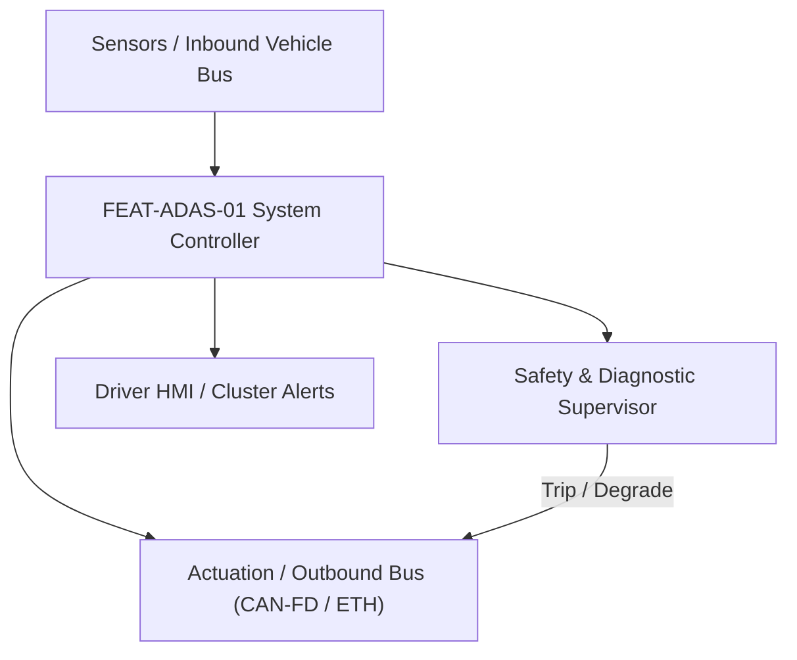
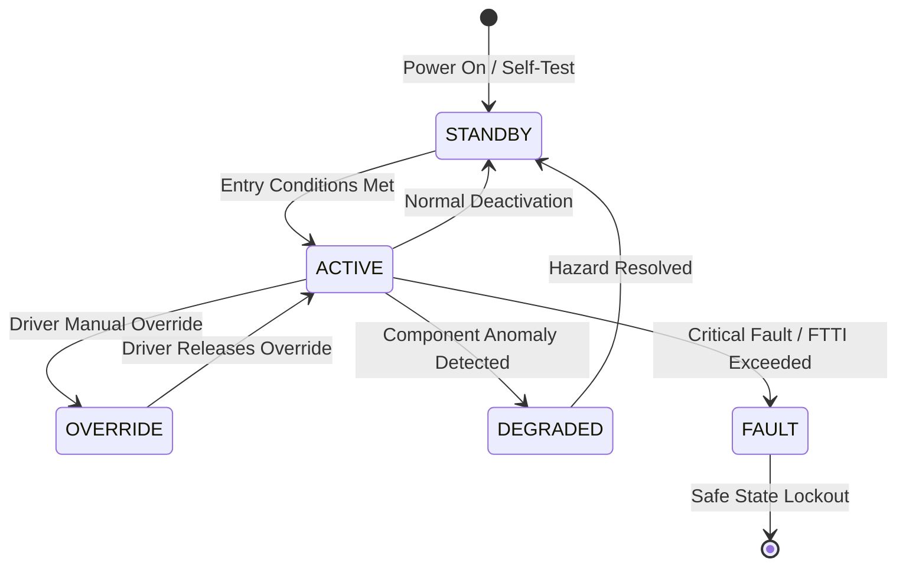

# System Requirements Specification: Adaptive Cruise Control with Stop & Go (ACC)
**Feature ID:** `FEAT-ADAS-01`  
**Domain:** ADAS & Autonomous Driving  
**Target ASIL:** ASIL B  
**Compliance Standard:** ISO 26262:2018 (Part 4 - System Development) / ASPICE PAM v3.1 (SYS.2, SYS.3)  
**Parent Master Specification:** [`spec.md`](file:///c:/Workset/AntiGravityProjects/TestOptimisationExperiement/spec.md#feat-adas-01-acc)  
**Derived Software Specification:** [`FEAT-ADAS-01_ACC_SwReq.md`](file:///c:/Workset/AntiGravityProjects/TestOptimisationExperiement/software_requirements/FEAT-ADAS-01_ACC_SwReq.md)

---

## 1. Feature Overview & Operational Scope

Maintains driver-set cruising speed and dynamic headway clearance to lead vehicles from 0 km/h to 160 km/h with Stop-and-Go capability, curve speed preview, overtaking assist, and low-friction weather derating.

### Operational Context Architecture

---

## 2. Activation Logic & Operational States

- **Preconditions:** Ignition ON, Driver seatbelt buckled, All doors closed, ESC active with no active chassis faults.
- **Entry Conditions:** Driver presses 'ACC_SET' or 'ACC_RESUME' on steering wheel switch AND vehicle speed between 0 and 160 km/h.
- **Deactivation Conditions:** Driver brake pedal pressed (> 3% travel), driver presses 'ACC_CANCEL', EPB engaged, ESC intervention, or sensor blockage detected.
- **Driver Override Behavior:** Driver throttle press overrides speed control without disengaging ACC; release of throttle returns vehicle to ACC set speed. Brake pedal press causes immediate transition to STANDBY within 50 ms.
- **Operational State Progression:**  
  `OFF` -> `STANDBY` -> `ACTIVE_SPEED_CONTROL` -> `ACTIVE_GAP_CONTROL` -> `STANDSTILL_HOLD` -> `OVERRIDE_THROTTLE` -> `OVERRIDE_BRAKE` -> `FAULT_SHUTDOWN`

### State Transition Diagram

---

## 3. Functional Safety & Failure Mitigation Concept

- **Functional Safety Goal:** SG-ACC-01: Prevent unintended acceleration towards forward obstacle; ensure maximum deceleration within safe envelope.
- **Fault Tolerant Time Interval (FTTI):** 200 ms
- **Safe State Definition:** Transition to STANDBY; zero requested acceleration; release propulsion torque to baseline driver request.
- **Warning & Escalation Strategy:** Visual prompt on Instrument Cluster at Level 1, audio chime (800 Hz) at Level 2, red takeover request at Level 3 if standstill hold exceeds 3 minutes.

### Failure Modes & Degradation Handling
- **Camera Dropout:** If camera track stream halts for > 60 ms, fall back to radar-only tracking with degraded target classification (limit max speed to 100 km/h).
- **Comm Timeout:** If CAN-FD checksum or rolling counter fails for >= 3 consecutive frames (60 ms), trip safe state shutoff.
- **Radar Blindness:** If radar SNR drops below 6 dB (snow/mud/rain), declare sensor blindness within 500 ms, ramp down acceleration to 0 m/s² over 2.0s, transition to STANDBY, and notify driver via cluster message.

---

## 4. System Requirements (SYS_REQ)
*(Note: Each System Requirement is systematically partitioned into multiple Child Software Requirements)*

### `SYS-ADAS-01-01`: Lead Target Kinematics Estimation & Selection
- **Planned Release:** R100
- **ASIL Rating:** ASIL B
- **Parent Feature:** [`FEAT-ADAS-01`](file:///c:/Workset/AntiGravityProjects/TestOptimisationExperiement/spec.md#feat-adas-01)
- **Requirement Statement:**
  > The System SHALL fuse 77 GHz radar detections and front camera object tracks at 20 ms cyclic period to identify the Closest In-Path Vehicle (CIPV), estimating longitudinal distance (d_rel +- 0.5 m) and relative velocity (v_rel +- 0.2 m/s).
- **Activation Logic:** Active when ACC State is ACTIVE_SPEED_CONTROL or ACTIVE_GAP_CONTROL.
- **Fault Tolerant Time Interval (FTTI):** 100 ms
- **Safe State Action:** Invalidate CIPV tracking, revert to free-flow speed regulation if path is clear, or prompt driver takeover.
- **Failure Detection & Reaction:** If sensor disagreement exceeds 3.0 m in distance, latch CIPV as UNRELIABLE and disengage gap control within 100 ms.
- **Input Interfaces:** `RAD_TargetArray (CAN-FD, 50 Hz), CAM_ObjectTracks (Ethernet SOME/IP, 30 Hz), Ego_Speed (Wheel pulse, 100 Hz)`
- **Output Interfaces:** `CIPV_Target_Data (struct Kinematics_t), CIPV_Valid_Flag (boolean)`
- **System Verification Method:** HIL sensor target simulator injection testing against ISO 15622 standards.
- **Derived Child Software Requirements (1:N Link):**
  - [`SWR-ADAS-01-01`](file:///c:/Workset/AntiGravityProjects/TestOptimisationExperiement/software_requirements/FEAT-ADAS-01_ACC_SwReq.md#swr-adas-01-01)
  - [`SWR-ADAS-01-02`](file:///c:/Workset/AntiGravityProjects/TestOptimisationExperiement/software_requirements/FEAT-ADAS-01_ACC_SwReq.md#swr-adas-01-02)
  - [`SWR-ADAS-01-03`](file:///c:/Workset/AntiGravityProjects/TestOptimisationExperiement/software_requirements/FEAT-ADAS-01_ACC_SwReq.md#swr-adas-01-03)

### `SYS-ADAS-01-02`: Longitudinal Acceleration & Jerk Regulation
- **Planned Release:** R100
- **ASIL Rating:** ASIL B
- **Parent Feature:** [`FEAT-ADAS-01`](file:///c:/Workset/AntiGravityProjects/TestOptimisationExperiement/spec.md#feat-adas-01)
- **Requirement Statement:**
  > The System SHALL compute acceleration commands between -3.5 m/s² and +2.0 m/s² based on configured time headway (tau in {1.0s, 1.4s, 1.8s, 2.2s}), constraining positive jerk to <= +1.5 m/s³ and negative jerk to >= -2.5 m/s³.
- **Activation Logic:** Active when CIPV is valid and ACC State is ACTIVE_GAP_CONTROL.
- **Fault Tolerant Time Interval (FTTI):** 200 ms
- **Safe State Action:** Clamp acceleration request to 0.0 m/s² and hand over deceleration control to foundation brakes.
- **Failure Detection & Reaction:** If requested acceleration exceeds mechanical boundary limits, rate-limit command and log DTC P05C1.
- **Input Interfaces:** `CIPV_Target_Data, Ego_Speed, Driver_Gap_Selector, Road_Grade_Pct`
- **Output Interfaces:** `ACC_Target_Accel_Cmd (m/s²), ACC_Decel_Request_Flag (boolean)`
- **System Verification Method:** Vehicle dynamometer testing and closed-loop SIL Matlab/Simulink simulation.
- **Derived Child Software Requirements (1:N Link):**
  - [`SWR-ADAS-01-04`](file:///c:/Workset/AntiGravityProjects/TestOptimisationExperiement/software_requirements/FEAT-ADAS-01_ACC_SwReq.md#swr-adas-01-04)
  - [`SWR-ADAS-01-05`](file:///c:/Workset/AntiGravityProjects/TestOptimisationExperiement/software_requirements/FEAT-ADAS-01_ACC_SwReq.md#swr-adas-01-05)
  - [`SWR-ADAS-01-06`](file:///c:/Workset/AntiGravityProjects/TestOptimisationExperiement/software_requirements/FEAT-ADAS-01_ACC_SwReq.md#swr-adas-01-06)

### `SYS-ADAS-01-03`: Supervisory State Management & Driver Takeover Arbitration
- **Planned Release:** R100
- **ASIL Rating:** ASIL B
- **Parent Feature:** [`FEAT-ADAS-01`](file:///c:/Workset/AntiGravityProjects/TestOptimisationExperiement/spec.md#feat-adas-01)
- **Requirement Statement:**
  > The System SHALL supervise operational states and enforce immediate disengagement to STANDBY within <= 50 ms upon driver brake pedal travel exceeding 3.0% or driver steering torque exceeding 4.0 Nm.
- **Activation Logic:** Always active while ignition state is RUN.
- **Fault Tolerant Time Interval (FTTI):** 50 ms
- **Safe State Action:** Force state machine into STANDBY; disable autonomous powertrain torque requests.
- **Failure Detection & Reaction:** If brake pedal position sensor signals disagree by > 5%, force immediate fallback to STANDBY.
- **Input Interfaces:** `Brake_Pedal_Travel_Pct, Steering_Wheel_Torque, ACC_Buttons_CAN, EPB_Status`
- **Output Interfaces:** `ACC_Operational_State_Enum, Cluster_ACC_Display_Msg, EPB_Hold_Req`
- **System Verification Method:** Chassis HIL test bench fault injection testing.
- **Derived Child Software Requirements (1:N Link):**
  - [`SWR-ADAS-01-07`](file:///c:/Workset/AntiGravityProjects/TestOptimisationExperiement/software_requirements/FEAT-ADAS-01_ACC_SwReq.md#swr-adas-01-07)
  - [`SWR-ADAS-01-08`](file:///c:/Workset/AntiGravityProjects/TestOptimisationExperiement/software_requirements/FEAT-ADAS-01_ACC_SwReq.md#swr-adas-01-08)
  - [`SWR-ADAS-01-09`](file:///c:/Workset/AntiGravityProjects/TestOptimisationExperiement/software_requirements/FEAT-ADAS-01_ACC_SwReq.md#swr-adas-01-09)

### `SYS-ADAS-01-04`: Driver Set-Speed Stepper & Legal Velocity Interlocks
- **Planned Release:** R200
- **ASIL Rating:** ASIL B
- **Parent Feature:** [`FEAT-ADAS-01`](file:///c:/Workset/AntiGravityProjects/TestOptimisationExperiement/spec.md#feat-adas-01)
- **Requirement Statement:**
  > The System SHALL process driver steering wheel cruise switches, supporting short press increments (+-1 km/h) and long press increments (+-10 km/h), while bounding set speed between 30 km/h and 160 km/h.
- **Activation Logic:** Active in STANDBY and ACTIVE states.
- **Fault Tolerant Time Interval (FTTI):** 100 ms
- **Safe State Action:** Maintain last valid commanded speed; ignore erroneous button presses.
- **Failure Detection & Reaction:** If switch contact stuck closed > 5.0 seconds, latch switch error and inhibit set-speed modification.
- **Input Interfaces:** `Steering_Switch_Resistive_Ladder_ADC, CAN_Switch_PDU, Vehicle_Speed_Kmph`
- **Output Interfaces:** `ACC_Set_Speed_Target_Kmph, Switch_Debounce_Status`
- **System Verification Method:** HMI switch automated endurance and bounce pattern bench testing.
- **Derived Child Software Requirements (1:N Link):**
  - [`SWR-ADAS-01-10`](file:///c:/Workset/AntiGravityProjects/TestOptimisationExperiement/software_requirements/FEAT-ADAS-01_ACC_SwReq.md#swr-adas-01-10)
  - [`SWR-ADAS-01-11`](file:///c:/Workset/AntiGravityProjects/TestOptimisationExperiement/software_requirements/FEAT-ADAS-01_ACC_SwReq.md#swr-adas-01-11)

### `SYS-ADAS-01-05`: Road Curvature Lookahead & Lateral G-Force Adaptation
- **Planned Release:** R200
- **ASIL Rating:** ASIL B
- **Parent Feature:** [`FEAT-ADAS-01`](file:///c:/Workset/AntiGravityProjects/TestOptimisationExperiement/spec.md#feat-adas-01)
- **Requirement Statement:**
  > The System SHALL ingest forward road curvature (kappa up to 150 m ahead) from front camera and navigation e-horizon, automatically derating target cruising speed to constrain steady-state lateral acceleration to <= 2.5 m/s².
- **Activation Logic:** Active in ACTIVE_SPEED_CONTROL and ACTIVE_GAP_CONTROL states.
- **Fault Tolerant Time Interval (FTTI):** 250 ms
- **Safe State Action:** Limit speed to baseline straight-line set speed.
- **Failure Detection & Reaction:** If map horizon confidence drops below 70%, rely exclusively on vision lane polynomial curvature.
- **Input Interfaces:** `Camera_Lane_Curvature_Kappa, Navigation_Horizon_Radius_M, Vehicle_Speed_Mps`
- **Output Interfaces:** `Curvature_Derated_Speed_Target_Kmph, Curve_Preview_Active_Flag`
- **System Verification Method:** Proving ground curved roadway dynamic test tracks.
- **Derived Child Software Requirements (1:N Link):**
  - [`SWR-ADAS-01-12`](file:///c:/Workset/AntiGravityProjects/TestOptimisationExperiement/software_requirements/FEAT-ADAS-01_ACC_SwReq.md#swr-adas-01-12)
  - [`SWR-ADAS-01-13`](file:///c:/Workset/AntiGravityProjects/TestOptimisationExperiement/software_requirements/FEAT-ADAS-01_ACC_SwReq.md#swr-adas-01-13)

### `SYS-ADAS-01-06`: Overtaking Assist & Adjacent Lane Headway Coordination
- **Planned Release:** R200
- **ASIL Rating:** ASIL B
- **Parent Feature:** [`FEAT-ADAS-01`](file:///c:/Workset/AntiGravityProjects/TestOptimisationExperiement/spec.md#feat-adas-01)
- **Requirement Statement:**
  > The System SHALL detect driver turn indicator activation during highway following: If adjacent passing lane is clear, system SHALL reduce target headway gap and command anticipatory acceleration (+0.8 m/s²) to facilitate fluid overtaking.
- **Activation Logic:** Active when vehicle speed > 60 km/h with lead vehicle present.
- **Fault Tolerant Time Interval (FTTI):** 100 ms
- **Safe State Action:** Cease overtaking acceleration bias; return to baseline gap regulation.
- **Failure Detection & Reaction:** Abort overtaking boost immediately if rear corner radar detects blind spot obstacle.
- **Input Interfaces:** `Turn_Signal_Stalk_State, Blind_Spot_Target_Status, Lead_Vehicle_Distance_M`
- **Output Interfaces:** `Overtake_Accel_Bias_Mps2, Dynamic_Headway_Scaling_Factor`
- **System Verification Method:** Multi-lane highway simulation with overtaking cut-out maneuvers.
- **Derived Child Software Requirements (1:N Link):**
  - [`SWR-ADAS-01-14`](file:///c:/Workset/AntiGravityProjects/TestOptimisationExperiement/software_requirements/FEAT-ADAS-01_ACC_SwReq.md#swr-adas-01-14)
  - [`SWR-ADAS-01-15`](file:///c:/Workset/AntiGravityProjects/TestOptimisationExperiement/software_requirements/FEAT-ADAS-01_ACC_SwReq.md#swr-adas-01-15)

### `SYS-ADAS-01-07`: Low-Friction Road Adaptation & Rain Derating
- **Planned Release:** R300
- **ASIL Rating:** ASIL B
- **Parent Feature:** [`FEAT-ADAS-01`](file:///c:/Workset/AntiGravityProjects/TestOptimisationExperiement/spec.md#feat-adas-01)
- **Requirement Statement:**
  > The System SHALL monitor windshield wiper speed and ABS wheel slip friction estimates: Upon low friction detection (mu < 0.5), system SHALL derate max acceleration to +1.2 m/s² and expand minimum headway time to >= 1.8 seconds.
- **Activation Logic:** Active at all times when ACC is engaged.
- **Fault Tolerant Time Interval (FTTI):** 200 ms
- **Safe State Action:** Default to wet-road conservative headway profile.
- **Failure Detection & Reaction:** If friction estimator faults, assume worst-case wet asphalt (mu = 0.6).
- **Input Interfaces:** `Wiper_Continuous_Mode_Bit, Rain_Intensity_Sensor, ESC_Road_Friction_Mu`
- **Output Interfaces:** `Max_Allowable_Accel_Mps2, Enforced_Min_Headway_Sec`
- **System Verification Method:** Skidpad wet asphalt test track verification according to ISO 15622.
- **Derived Child Software Requirements (1:N Link):**
  - [`SWR-ADAS-01-16`](file:///c:/Workset/AntiGravityProjects/TestOptimisationExperiement/software_requirements/FEAT-ADAS-01_ACC_SwReq.md#swr-adas-01-16)
  - [`SWR-ADAS-01-17`](file:///c:/Workset/AntiGravityProjects/TestOptimisationExperiement/software_requirements/FEAT-ADAS-01_ACC_SwReq.md#swr-adas-01-17)

### `SYS-ADAS-01-08`: Brake Lamp Actuation & Stop-and-Go Autonomous Drive-Off
- **Planned Release:** R300
- **ASIL Rating:** ASIL B / ECE R13H
- **Parent Feature:** [`FEAT-ADAS-01`](file:///c:/Workset/AntiGravityProjects/TestOptimisationExperiement/spec.md#feat-adas-01)
- **Requirement Statement:**
  > The System SHALL command vehicle brake lamps ON when deceleration <= -0.7 m/s² and OFF when > -0.4 m/s² (ECE R13H), and manage Stop-and-Go auto-resume within 3.0s of standstill or issue lead vehicle departure chimes.
- **Activation Logic:** Active during active deceleration and standstill states.
- **Fault Tolerant Time Interval (FTTI):** 100 ms
- **Safe State Action:** Illuminate physical brake lamps; require manual driver pedal/button tap to drive off.
- **Failure Detection & Reaction:** If brake lamp relay feedback confirms failure, log DTC B1320 and illuminate cluster tell-tale.
- **Input Interfaces:** `ACC_Target_Accel_Cmd, Standstill_Duration_Sec, Lead_Vehicle_DriveOff_Detected`
- **Output Interfaces:** `Brake_Lamp_Driver_Relay_Cmd, Lead_Vehicle_Depart_Chime_Req`
- **System Verification Method:** ECE R13H brake lamp timing test and stop-and-go city traffic test suite.
- **Derived Child Software Requirements (1:N Link):**
  - [`SWR-ADAS-01-18`](file:///c:/Workset/AntiGravityProjects/TestOptimisationExperiement/software_requirements/FEAT-ADAS-01_ACC_SwReq.md#swr-adas-01-18)
  - [`SWR-ADAS-01-19`](file:///c:/Workset/AntiGravityProjects/TestOptimisationExperiement/software_requirements/FEAT-ADAS-01_ACC_SwReq.md#swr-adas-01-19)
  - [`SWR-ADAS-01-20`](file:///c:/Workset/AntiGravityProjects/TestOptimisationExperiement/software_requirements/FEAT-ADAS-01_ACC_SwReq.md#swr-adas-01-20)

### `SYS-ADAS-01-09`: Curve Speed Preview & Transverse G Regulation
- **Planned Release:** R300
- **ASIL Rating:** ASIL B
- **Parent Feature:** [`FEAT-ADAS-01`](file:///c:/Workset/AntiGravityProjects/TestOptimisationExperiement/spec.md#feat-adas-01)
- **Requirement Statement:**
  > The System SHALL Limit vehicle speed on upcoming road curvature based on digital map and camera clothoid radius (a_y <= 2.2 m/s²).
- **Activation Logic:** Active during normal vehicle operation when feature state is active.
- **Fault Tolerant Time Interval (FTTI):** 100 ms
- **Safe State Action:** Transition to safe state or safe degradation tier within FTTI budget.
- **Failure Detection & Reaction:** Isolate faulted channel, latch DEM diagnostic trouble code, and inform driver.
- **Input Interfaces:** `Sensor signals, vehicle dynamics data, and bus frames via RTE.`
- **Output Interfaces:** `Actuator commands, diagnostic event flags, and cluster alerts.`
- **System Verification Method:** HiL test bench and dynamometer automated verification.
- **Derived Child Software Requirements (1:N Link):**
  - [`SWR-ADAS-01-21`](file:///c:/Workset/AntiGravityProjects/TestOptimisationExperiement/software_requirements/FEAT-ADAS-01_ACC_SwReq.md#swr-adas-01-21)
  - [`SWR-ADAS-01-22`](file:///c:/Workset/AntiGravityProjects/TestOptimisationExperiement/software_requirements/FEAT-ADAS-01_ACC_SwReq.md#swr-adas-01-22)

### `SYS-ADAS-01-10`: Stop-and-Go Automatic Standstill Hold & Creep Management
- **Planned Release:** R400
- **ASIL Rating:** ASIL B
- **Parent Feature:** [`FEAT-ADAS-01`](file:///c:/Workset/AntiGravityProjects/TestOptimisationExperiement/spec.md#feat-adas-01)
- **Requirement Statement:**
  > The System SHALL Hold vehicle stationary via foundation brakes at standstill, re-engaging drive within 3.0s if lead vehicle departs.
- **Activation Logic:** Active during normal vehicle operation when feature state is active.
- **Fault Tolerant Time Interval (FTTI):** 150 ms
- **Safe State Action:** Transition to safe state or safe degradation tier within FTTI budget.
- **Failure Detection & Reaction:** Isolate faulted channel, latch DEM diagnostic trouble code, and inform driver.
- **Input Interfaces:** `Sensor signals, vehicle dynamics data, and bus frames via RTE.`
- **Output Interfaces:** `Actuator commands, diagnostic event flags, and cluster alerts.`
- **System Verification Method:** HiL test bench and dynamometer automated verification.
- **Derived Child Software Requirements (1:N Link):**
  - [`SWR-ADAS-01-23`](file:///c:/Workset/AntiGravityProjects/TestOptimisationExperiement/software_requirements/FEAT-ADAS-01_ACC_SwReq.md#swr-adas-01-23)
  - [`SWR-ADAS-01-24`](file:///c:/Workset/AntiGravityProjects/TestOptimisationExperiement/software_requirements/FEAT-ADAS-01_ACC_SwReq.md#swr-adas-01-24)

### `SYS-ADAS-01-11`: Overtake Assist & Adjacent Lane Indicator Trigger
- **Planned Release:** R400
- **ASIL Rating:** ASIL B
- **Parent Feature:** [`FEAT-ADAS-01`](file:///c:/Workset/AntiGravityProjects/TestOptimisationExperiement/spec.md#feat-adas-01)
- **Requirement Statement:**
  > The System SHALL Command temporary gap acceleration when driver activates left turn signal with open overtaking lane.
- **Activation Logic:** Active during normal vehicle operation when feature state is active.
- **Fault Tolerant Time Interval (FTTI):** 200 ms
- **Safe State Action:** Transition to safe state or safe degradation tier within FTTI budget.
- **Failure Detection & Reaction:** Isolate faulted channel, latch DEM diagnostic trouble code, and inform driver.
- **Input Interfaces:** `Sensor signals, vehicle dynamics data, and bus frames via RTE.`
- **Output Interfaces:** `Actuator commands, diagnostic event flags, and cluster alerts.`
- **System Verification Method:** HiL test bench and dynamometer automated verification.
- **Derived Child Software Requirements (1:N Link):**
  - [`SWR-ADAS-01-25`](file:///c:/Workset/AntiGravityProjects/TestOptimisationExperiement/software_requirements/FEAT-ADAS-01_ACC_SwReq.md#swr-adas-01-25)
  - [`SWR-ADAS-01-26`](file:///c:/Workset/AntiGravityProjects/TestOptimisationExperiement/software_requirements/FEAT-ADAS-01_ACC_SwReq.md#swr-adas-01-26)

### `SYS-ADAS-01-12`: Adverse Weather & Sensor Degraded Speed Derating
- **Planned Release:** R400
- **ASIL Rating:** ASIL B
- **Parent Feature:** [`FEAT-ADAS-01`](file:///c:/Workset/AntiGravityProjects/TestOptimisationExperiement/spec.md#feat-adas-01)
- **Requirement Statement:**
  > The System SHALL Derate maximum allowed ACC set-speed from 160 km/h to 90 km/h upon heavy rain or reduced radar SNR.
- **Activation Logic:** Active during normal vehicle operation when feature state is active.
- **Fault Tolerant Time Interval (FTTI):** 500 ms
- **Safe State Action:** Transition to safe state or safe degradation tier within FTTI budget.
- **Failure Detection & Reaction:** Isolate faulted channel, latch DEM diagnostic trouble code, and inform driver.
- **Input Interfaces:** `Sensor signals, vehicle dynamics data, and bus frames via RTE.`
- **Output Interfaces:** `Actuator commands, diagnostic event flags, and cluster alerts.`
- **System Verification Method:** HiL test bench and dynamometer automated verification.
- **Derived Child Software Requirements (1:N Link):**
  - [`SWR-ADAS-01-27`](file:///c:/Workset/AntiGravityProjects/TestOptimisationExperiement/software_requirements/FEAT-ADAS-01_ACC_SwReq.md#swr-adas-01-27)
  - [`SWR-ADAS-01-28`](file:///c:/Workset/AntiGravityProjects/TestOptimisationExperiement/software_requirements/FEAT-ADAS-01_ACC_SwReq.md#swr-adas-01-28)

### `SYS-ADAS-01-13`: Driver Throttle & Brake Pedal Takeover Arbitration
- **Planned Release:** R500
- **ASIL Rating:** ASIL B
- **Parent Feature:** [`FEAT-ADAS-01`](file:///c:/Workset/AntiGravityProjects/TestOptimisationExperiement/spec.md#feat-adas-01)
- **Requirement Statement:**
  > The System SHALL Seamlessly suppress ACC acceleration upon throttle press and immediately cancel to STANDBY upon brake pedal apply.
- **Activation Logic:** Active during normal vehicle operation when feature state is active.
- **Fault Tolerant Time Interval (FTTI):** 50 ms
- **Safe State Action:** Transition to safe state or safe degradation tier within FTTI budget.
- **Failure Detection & Reaction:** Isolate faulted channel, latch DEM diagnostic trouble code, and inform driver.
- **Input Interfaces:** `Sensor signals, vehicle dynamics data, and bus frames via RTE.`
- **Output Interfaces:** `Actuator commands, diagnostic event flags, and cluster alerts.`
- **System Verification Method:** HiL test bench and dynamometer automated verification.
- **Derived Child Software Requirements (1:N Link):**
  - [`SWR-ADAS-01-29`](file:///c:/Workset/AntiGravityProjects/TestOptimisationExperiement/software_requirements/FEAT-ADAS-01_ACC_SwReq.md#swr-adas-01-29)
  - [`SWR-ADAS-01-30`](file:///c:/Workset/AntiGravityProjects/TestOptimisationExperiement/software_requirements/FEAT-ADAS-01_ACC_SwReq.md#swr-adas-01-30)

### `SYS-ADAS-01-14`: ACC E2E CAN-FD & Automotive Ethernet Frame Protection
- **Planned Release:** R500
- **ASIL Rating:** ASIL B
- **Parent Feature:** [`FEAT-ADAS-01`](file:///c:/Workset/AntiGravityProjects/TestOptimisationExperiement/spec.md#feat-adas-01)
- **Requirement Statement:**
  > The System SHALL Supervise E2E Profile 5 CRC-16 and 4-bit alive counter on chassis braking and powertrain acceleration commands.
- **Activation Logic:** Active during normal vehicle operation when feature state is active.
- **Fault Tolerant Time Interval (FTTI):** 40 ms
- **Safe State Action:** Transition to safe state or safe degradation tier within FTTI budget.
- **Failure Detection & Reaction:** Isolate faulted channel, latch DEM diagnostic trouble code, and inform driver.
- **Input Interfaces:** `Sensor signals, vehicle dynamics data, and bus frames via RTE.`
- **Output Interfaces:** `Actuator commands, diagnostic event flags, and cluster alerts.`
- **System Verification Method:** HiL test bench and dynamometer automated verification.
- **Derived Child Software Requirements (1:N Link):**
  - [`SWR-ADAS-01-31`](file:///c:/Workset/AntiGravityProjects/TestOptimisationExperiement/software_requirements/FEAT-ADAS-01_ACC_SwReq.md#swr-adas-01-31)
  - [`SWR-ADAS-01-32`](file:///c:/Workset/AntiGravityProjects/TestOptimisationExperiement/software_requirements/FEAT-ADAS-01_ACC_SwReq.md#swr-adas-01-32)

### `SYS-ADAS-01-15`: Instrument Cluster & HUD Multi-Level HMI Annunciation
- **Planned Release:** R500
- **ASIL Rating:** ASIL B
- **Parent Feature:** [`FEAT-ADAS-01`](file:///c:/Workset/AntiGravityProjects/TestOptimisationExperiement/spec.md#feat-adas-01)
- **Requirement Statement:**
  > The System SHALL Broadcast lead vehicle distance bars, target speed setpoints, and takeover prompts to cluster and AR-HUD.
- **Activation Logic:** Active during normal vehicle operation when feature state is active.
- **Fault Tolerant Time Interval (FTTI):** 100 ms
- **Safe State Action:** Transition to safe state or safe degradation tier within FTTI budget.
- **Failure Detection & Reaction:** Isolate faulted channel, latch DEM diagnostic trouble code, and inform driver.
- **Input Interfaces:** `Sensor signals, vehicle dynamics data, and bus frames via RTE.`
- **Output Interfaces:** `Actuator commands, diagnostic event flags, and cluster alerts.`
- **System Verification Method:** HiL test bench and dynamometer automated verification.
- **Derived Child Software Requirements (1:N Link):**
  - [`SWR-ADAS-01-33`](file:///c:/Workset/AntiGravityProjects/TestOptimisationExperiement/software_requirements/FEAT-ADAS-01_ACC_SwReq.md#swr-adas-01-33)
  - [`SWR-ADAS-01-34`](file:///c:/Workset/AntiGravityProjects/TestOptimisationExperiement/software_requirements/FEAT-ADAS-01_ACC_SwReq.md#swr-adas-01-34)

---

## 5. System-to-Software Traceability Summary

| System Requirement ID | Planned Release | ASIL | Title | Derived Software Requirements (1:N) | Verification Method |
| :--- | :---: | :--- | :--- | :--- | :--- |
| `SYS-ADAS-01-01` | **`R100`** | ASIL B | Lead Target Kinematics Estimation & Selection | [`SWR-ADAS-01-01`](file:///c:/Workset/AntiGravityProjects/TestOptimisationExperiement/software_requirements/FEAT-ADAS-01_ACC_SwReq.md#swr-adas-01-01), [`SWR-ADAS-01-02`](file:///c:/Workset/AntiGravityProjects/TestOptimisationExperiement/software_requirements/FEAT-ADAS-01_ACC_SwReq.md#swr-adas-01-02), [`SWR-ADAS-01-03`](file:///c:/Workset/AntiGravityProjects/TestOptimisationExperiement/software_requirements/FEAT-ADAS-01_ACC_SwReq.md#swr-adas-01-03) | HIL sensor target simulator injection testing against ISO 15622 standards. |
| `SYS-ADAS-01-02` | **`R100`** | ASIL B | Longitudinal Acceleration & Jerk Regulation | [`SWR-ADAS-01-04`](file:///c:/Workset/AntiGravityProjects/TestOptimisationExperiement/software_requirements/FEAT-ADAS-01_ACC_SwReq.md#swr-adas-01-04), [`SWR-ADAS-01-05`](file:///c:/Workset/AntiGravityProjects/TestOptimisationExperiement/software_requirements/FEAT-ADAS-01_ACC_SwReq.md#swr-adas-01-05), [`SWR-ADAS-01-06`](file:///c:/Workset/AntiGravityProjects/TestOptimisationExperiement/software_requirements/FEAT-ADAS-01_ACC_SwReq.md#swr-adas-01-06) | Vehicle dynamometer testing and closed-loop SIL Matlab/Simulink simulation. |
| `SYS-ADAS-01-03` | **`R100`** | ASIL B | Supervisory State Management & Driver Takeover Arbitration | [`SWR-ADAS-01-07`](file:///c:/Workset/AntiGravityProjects/TestOptimisationExperiement/software_requirements/FEAT-ADAS-01_ACC_SwReq.md#swr-adas-01-07), [`SWR-ADAS-01-08`](file:///c:/Workset/AntiGravityProjects/TestOptimisationExperiement/software_requirements/FEAT-ADAS-01_ACC_SwReq.md#swr-adas-01-08), [`SWR-ADAS-01-09`](file:///c:/Workset/AntiGravityProjects/TestOptimisationExperiement/software_requirements/FEAT-ADAS-01_ACC_SwReq.md#swr-adas-01-09) | Chassis HIL test bench fault injection testing. |
| `SYS-ADAS-01-04` | **`R200`** | ASIL B | Driver Set-Speed Stepper & Legal Velocity Interlocks | [`SWR-ADAS-01-10`](file:///c:/Workset/AntiGravityProjects/TestOptimisationExperiement/software_requirements/FEAT-ADAS-01_ACC_SwReq.md#swr-adas-01-10), [`SWR-ADAS-01-11`](file:///c:/Workset/AntiGravityProjects/TestOptimisationExperiement/software_requirements/FEAT-ADAS-01_ACC_SwReq.md#swr-adas-01-11) | HMI switch automated endurance and bounce pattern bench testing. |
| `SYS-ADAS-01-05` | **`R200`** | ASIL B | Road Curvature Lookahead & Lateral G-Force Adaptation | [`SWR-ADAS-01-12`](file:///c:/Workset/AntiGravityProjects/TestOptimisationExperiement/software_requirements/FEAT-ADAS-01_ACC_SwReq.md#swr-adas-01-12), [`SWR-ADAS-01-13`](file:///c:/Workset/AntiGravityProjects/TestOptimisationExperiement/software_requirements/FEAT-ADAS-01_ACC_SwReq.md#swr-adas-01-13) | Proving ground curved roadway dynamic test tracks. |
| `SYS-ADAS-01-06` | **`R200`** | ASIL B | Overtaking Assist & Adjacent Lane Headway Coordination | [`SWR-ADAS-01-14`](file:///c:/Workset/AntiGravityProjects/TestOptimisationExperiement/software_requirements/FEAT-ADAS-01_ACC_SwReq.md#swr-adas-01-14), [`SWR-ADAS-01-15`](file:///c:/Workset/AntiGravityProjects/TestOptimisationExperiement/software_requirements/FEAT-ADAS-01_ACC_SwReq.md#swr-adas-01-15) | Multi-lane highway simulation with overtaking cut-out maneuvers. |
| `SYS-ADAS-01-07` | **`R300`** | ASIL B | Low-Friction Road Adaptation & Rain Derating | [`SWR-ADAS-01-16`](file:///c:/Workset/AntiGravityProjects/TestOptimisationExperiement/software_requirements/FEAT-ADAS-01_ACC_SwReq.md#swr-adas-01-16), [`SWR-ADAS-01-17`](file:///c:/Workset/AntiGravityProjects/TestOptimisationExperiement/software_requirements/FEAT-ADAS-01_ACC_SwReq.md#swr-adas-01-17) | Skidpad wet asphalt test track verification according to ISO 15622. |
| `SYS-ADAS-01-08` | **`R300`** | ASIL B / ECE R13H | Brake Lamp Actuation & Stop-and-Go Autonomous Drive-Off | [`SWR-ADAS-01-18`](file:///c:/Workset/AntiGravityProjects/TestOptimisationExperiement/software_requirements/FEAT-ADAS-01_ACC_SwReq.md#swr-adas-01-18), [`SWR-ADAS-01-19`](file:///c:/Workset/AntiGravityProjects/TestOptimisationExperiement/software_requirements/FEAT-ADAS-01_ACC_SwReq.md#swr-adas-01-19), [`SWR-ADAS-01-20`](file:///c:/Workset/AntiGravityProjects/TestOptimisationExperiement/software_requirements/FEAT-ADAS-01_ACC_SwReq.md#swr-adas-01-20) | ECE R13H brake lamp timing test and stop-and-go city traffic test suite. |
| `SYS-ADAS-01-09` | **`R300`** | ASIL B | Curve Speed Preview & Transverse G Regulation | [`SWR-ADAS-01-21`](file:///c:/Workset/AntiGravityProjects/TestOptimisationExperiement/software_requirements/FEAT-ADAS-01_ACC_SwReq.md#swr-adas-01-21), [`SWR-ADAS-01-22`](file:///c:/Workset/AntiGravityProjects/TestOptimisationExperiement/software_requirements/FEAT-ADAS-01_ACC_SwReq.md#swr-adas-01-22) | HiL test bench and dynamometer automated verification. |
| `SYS-ADAS-01-10` | **`R400`** | ASIL B | Stop-and-Go Automatic Standstill Hold & Creep Management | [`SWR-ADAS-01-23`](file:///c:/Workset/AntiGravityProjects/TestOptimisationExperiement/software_requirements/FEAT-ADAS-01_ACC_SwReq.md#swr-adas-01-23), [`SWR-ADAS-01-24`](file:///c:/Workset/AntiGravityProjects/TestOptimisationExperiement/software_requirements/FEAT-ADAS-01_ACC_SwReq.md#swr-adas-01-24) | HiL test bench and dynamometer automated verification. |
| `SYS-ADAS-01-11` | **`R400`** | ASIL B | Overtake Assist & Adjacent Lane Indicator Trigger | [`SWR-ADAS-01-25`](file:///c:/Workset/AntiGravityProjects/TestOptimisationExperiement/software_requirements/FEAT-ADAS-01_ACC_SwReq.md#swr-adas-01-25), [`SWR-ADAS-01-26`](file:///c:/Workset/AntiGravityProjects/TestOptimisationExperiement/software_requirements/FEAT-ADAS-01_ACC_SwReq.md#swr-adas-01-26) | HiL test bench and dynamometer automated verification. |
| `SYS-ADAS-01-12` | **`R400`** | ASIL B | Adverse Weather & Sensor Degraded Speed Derating | [`SWR-ADAS-01-27`](file:///c:/Workset/AntiGravityProjects/TestOptimisationExperiement/software_requirements/FEAT-ADAS-01_ACC_SwReq.md#swr-adas-01-27), [`SWR-ADAS-01-28`](file:///c:/Workset/AntiGravityProjects/TestOptimisationExperiement/software_requirements/FEAT-ADAS-01_ACC_SwReq.md#swr-adas-01-28) | HiL test bench and dynamometer automated verification. |
| `SYS-ADAS-01-13` | **`R500`** | ASIL B | Driver Throttle & Brake Pedal Takeover Arbitration | [`SWR-ADAS-01-29`](file:///c:/Workset/AntiGravityProjects/TestOptimisationExperiement/software_requirements/FEAT-ADAS-01_ACC_SwReq.md#swr-adas-01-29), [`SWR-ADAS-01-30`](file:///c:/Workset/AntiGravityProjects/TestOptimisationExperiement/software_requirements/FEAT-ADAS-01_ACC_SwReq.md#swr-adas-01-30) | HiL test bench and dynamometer automated verification. |
| `SYS-ADAS-01-14` | **`R500`** | ASIL B | ACC E2E CAN-FD & Automotive Ethernet Frame Protection | [`SWR-ADAS-01-31`](file:///c:/Workset/AntiGravityProjects/TestOptimisationExperiement/software_requirements/FEAT-ADAS-01_ACC_SwReq.md#swr-adas-01-31), [`SWR-ADAS-01-32`](file:///c:/Workset/AntiGravityProjects/TestOptimisationExperiement/software_requirements/FEAT-ADAS-01_ACC_SwReq.md#swr-adas-01-32) | HiL test bench and dynamometer automated verification. |
| `SYS-ADAS-01-15` | **`R500`** | ASIL B | Instrument Cluster & HUD Multi-Level HMI Annunciation | [`SWR-ADAS-01-33`](file:///c:/Workset/AntiGravityProjects/TestOptimisationExperiement/software_requirements/FEAT-ADAS-01_ACC_SwReq.md#swr-adas-01-33), [`SWR-ADAS-01-34`](file:///c:/Workset/AntiGravityProjects/TestOptimisationExperiement/software_requirements/FEAT-ADAS-01_ACC_SwReq.md#swr-adas-01-34) | HiL test bench and dynamometer automated verification. |

- **Upstream Feature Link:** [`spec.md` (FEAT-ADAS-01)](file:///c:/Workset/AntiGravityProjects/TestOptimisationExperiement/spec.md#feat-adas-01)
- **Software Requirements Specification:** [`FEAT-ADAS-01_ACC_SwReq.md`](file:///c:/Workset/AntiGravityProjects/TestOptimisationExperiement/software_requirements/FEAT-ADAS-01_ACC_SwReq.md)
