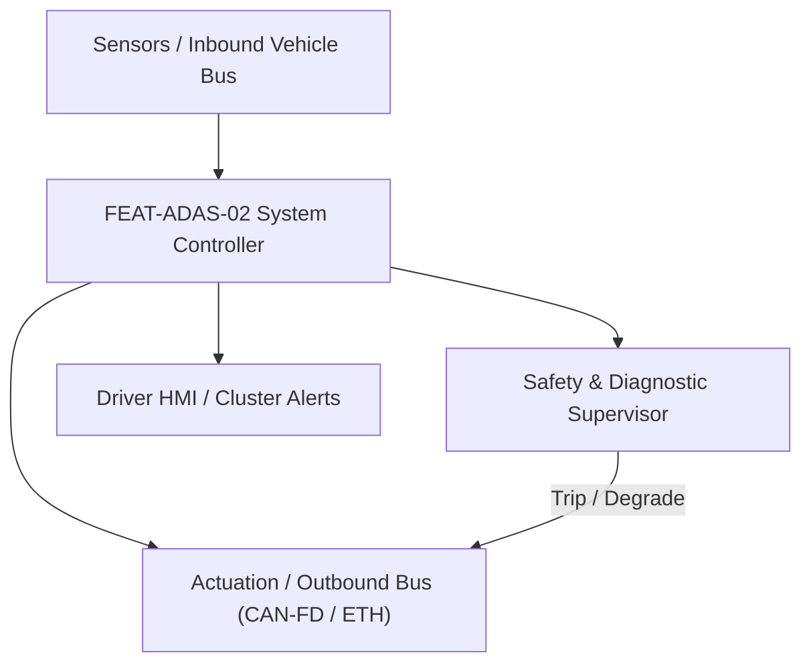
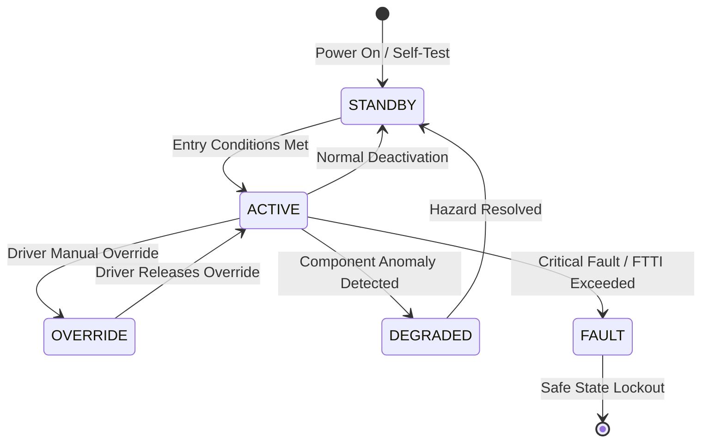

# System Requirements Specification: Autonomous Emergency Braking (AEB / VRU)
**Feature ID:** `FEAT-ADAS-02`  
**Domain:** ADAS & Autonomous Driving  
**Target ASIL:** ASIL D  
**Compliance Standard:** ISO 26262:2018 (Part 4 - System Development) / ASPICE PAM v3.1 (SYS.2, SYS.3)  
**Parent Master Specification:** [`spec.md`](file:///c:/Workset/AntiGravityProjects/TestOptimisationExperiement/spec.md#feat-adas-02-aeb)  
**Derived Software Specification:** [`FEAT-ADAS-02_AEB_SwReq.md`](file:///c:/Workset/AntiGravityProjects/TestOptimisationExperiement/software_requirements/FEAT-ADAS-02_AEB_SwReq.md)

---

## 1. Feature Overview & Operational Scope

Multi-tier collision mitigation system evaluating forward vehicles, pedestrians, and cyclists up to 150 m ahead, executing pre-crash brake prefill, dynamic haptic warnings, full emergency deceleration (-10.0 m/s²), and evasive steering assist.

### Operational Context Architecture

---

## 2. Activation Logic & Operational States

- **Preconditions:** Ignition in RUN, vehicle speed between 10 km/h and 130 km/h (vehicles) or 10 km/h to 85 km/h (pedestrians/cyclists), ESC operational.
- **Entry Conditions:** Target detected in collision trajectory with Time-to-Collision (TTC) below warning threshold (TTC <= 2.6s) or braking threshold (TTC <= 0.9s).
- **Deactivation Conditions:** Collision threat resolved, target departs path, driver performs evasive steering maneuver (steering angle rate > 300 deg/s), or accelerator kickdown.
- **Driver Override Behavior:** Driver steering evasion (> 300 deg/s) suppresses braking intervention to allow obstacle circumnavigation. Driver throttle kickdown cancels AEB if hazard clear.
- **Operational State Progression:**  
  `MONITORING` -> `STAGE_1_FCW_WARNING` -> `STAGE_2_PREFILL_JERK` -> `STAGE_3_FULL_BRAKING` -> `POST_CRASH_HOLD` -> `SUPPRESSED` -> `FAULT_SHUTDOWN`

### State Transition Diagram

---

## 3. Functional Safety & Failure Mitigation Concept

- **Functional Safety Goal:** SG-AEB-01: Prevent collision or mitigate impact speed; avoid hazardous false-positive emergency braking.
- **Fault Tolerant Time Interval (FTTI):** 50 ms
- **Safe State Definition:** Immediately release autonomous brake command to 0 m/s² and revert to driver mechanical pedal command.
- **Warning & Escalation Strategy:** Visual head-up display red warning + 1.2 kHz pulsed acoustic chime at Stage 1, followed by 0.3g haptic brake pulse at Stage 2.

### Failure Modes & Degradation Handling
- **Hydraulic Actuator Degraded:** If primary hydraulic brake channel fails, failover to secondary electric brake booster channel within 15 ms.
- **Radar Vision Discrepancy:** If radar detects target but camera indicates completely clear path at < 30 m, suppress braking intervention to prevent false phantom braking.
- **Single Sensor Fault:** If camera fails, inhibit pedestrian/cyclist AEB; allow radar-only vehicle AEB with reduced maximum deceleration (-5.0 m/s²).

---

## 4. System Requirements (SYS_REQ)
*(Note: Each System Requirement is systematically partitioned into multiple Child Software Requirements)*

### `SYS-ADAS-02-01`: Multi-Stage Collision Threat Assessment & TTC Calculation
- **Planned Release:** R100
- **ASIL Rating:** ASIL D
- **Parent Feature:** [`FEAT-ADAS-02`](file:///c:/Workset/AntiGravityProjects/TestOptimisationExperiement/spec.md#feat-adas-02)
- **Requirement Statement:**
  > The System SHALL compute longitudinal Time-To-Collision (TTC) and Time-To-Brake (TTB) at 10 ms period with +-30 ms accuracy for all forward targets within 150 m, classifying risk tiers.
- **Activation Logic:** Active at vehicle speeds from 4 km/h to 160 km/h.
- **Fault Tolerant Time Interval (FTTI):** 40 ms
- **Safe State Action:** Invalidate TTC; inhibit active autonomous brake interventions.
- **Failure Detection & Reaction:** If relative velocity signal jumps > 15 m/s in a single frame, reject as unphysical outlier.
- **Input Interfaces:** `Radar_Tracks_Array[32], Camera_3D_Bounding_Boxes[16], Vehicle_Velocity_Mps`
- **Output Interfaces:** `Critical_Threat_TTC_Sec, Threat_Level_Enum, Target_ID_Critical`
- **System Verification Method:** Euro NCAP Car-to-Car Rear Moving and Braking test scenarios.
- **Derived Child Software Requirements (1:N Link):**
  - [`SWR-ADAS-02-01`](file:///c:/Workset/AntiGravityProjects/TestOptimisationExperiement/software_requirements/FEAT-ADAS-02_AEB_SwReq.md#swr-adas-02-01)
  - [`SWR-ADAS-02-02`](file:///c:/Workset/AntiGravityProjects/TestOptimisationExperiement/software_requirements/FEAT-ADAS-02_AEB_SwReq.md#swr-adas-02-02)
  - [`SWR-ADAS-02-03`](file:///c:/Workset/AntiGravityProjects/TestOptimisationExperiement/software_requirements/FEAT-ADAS-02_AEB_SwReq.md#swr-adas-02-03)

### `SYS-ADAS-02-02`: Vulnerable Road User (VRU Pedestrian & Cyclist) Cross-Kinematics
- **Planned Release:** R100
- **ASIL Rating:** ASIL D
- **Parent Feature:** [`FEAT-ADAS-02`](file:///c:/Workset/AntiGravityProjects/TestOptimisationExperiement/spec.md#feat-adas-02)
- **Requirement Statement:**
  > The System SHALL track crossing pedestrians and cyclists up to 60 m ahead, calculating lateral crossing trajectory intersection points within <= 20 ms to prevent VRU collisions up to 60 km/h.
- **Activation Logic:** Active at vehicle speeds from 4 km/h to 80 km/h.
- **Fault Tolerant Time Interval (FTTI):** 50 ms
- **Safe State Action:** Transition to degraded vehicle-only AEB mode; alert driver via cluster icon.
- **Failure Detection & Reaction:** If vision classification confidence drops below 60%, suppress false positive brake trips.
- **Input Interfaces:** `Camera_VRU_Keypoints, Radar_MicroDoppler_Spectra, Ego_Speed_Mps`
- **Output Interfaces:** `VRU_Crossing_TTC_Sec, VRU_Impact_Offset_Y_Meters, VRU_Threat_Flag`
- **System Verification Method:** Euro NCAP Pedestrian Crossing (CPFA, CPNA) articulated dummy tests.
- **Derived Child Software Requirements (1:N Link):**
  - [`SWR-ADAS-02-04`](file:///c:/Workset/AntiGravityProjects/TestOptimisationExperiement/software_requirements/FEAT-ADAS-02_AEB_SwReq.md#swr-adas-02-04)
  - [`SWR-ADAS-02-05`](file:///c:/Workset/AntiGravityProjects/TestOptimisationExperiement/software_requirements/FEAT-ADAS-02_AEB_SwReq.md#swr-adas-02-05)

### `SYS-ADAS-02-03`: Pre-Crash Brake Hydraulic Pre-Filling & Dynamic Booster Rise
- **Planned Release:** R100
- **ASIL Rating:** ASIL D
- **Parent Feature:** [`FEAT-ADAS-02`](file:///c:/Workset/AntiGravityProjects/TestOptimisationExperiement/spec.md#feat-adas-02)
- **Requirement Statement:**
  > The System SHALL command brake caliper pre-filling to eliminate pad-to-rotor clearance (building 5 bar hydraulic pressure in <= 50 ms) whenever TTC drops below 2.2 seconds.
- **Activation Logic:** Active when Threat_Level >= PRE_FILL.
- **Fault Tolerant Time Interval (FTTI):** 40 ms
- **Safe State Action:** Release pre-fill pressure back to 0 bar; restore open hydraulic circuit.
- **Failure Detection & Reaction:** If pressure transducer fails to register pressure rise within 60 ms, log DTC C1201.
- **Input Interfaces:** `Critical_Threat_TTC_Sec, Master_Cylinder_Pressure_Sensor`
- **Output Interfaces:** `Brake_Prefill_Active_Flag, Caliper_Precharge_Pressure_Cmd`
- **System Verification Method:** Hydraulic test bench response time measurements under cold and hot brake conditions.
- **Derived Child Software Requirements (1:N Link):**
  - [`SWR-ADAS-02-06`](file:///c:/Workset/AntiGravityProjects/TestOptimisationExperiement/software_requirements/FEAT-ADAS-02_AEB_SwReq.md#swr-adas-02-06)
  - [`SWR-ADAS-02-07`](file:///c:/Workset/AntiGravityProjects/TestOptimisationExperiement/software_requirements/FEAT-ADAS-02_AEB_SwReq.md#swr-adas-02-07)

### `SYS-ADAS-02-04`: Multi-Stage Autonomous Emergency Deceleration Intervention
- **Planned Release:** R200
- **ASIL Rating:** ASIL D
- **Parent Feature:** [`FEAT-ADAS-02`](file:///c:/Workset/AntiGravityProjects/TestOptimisationExperiement/spec.md#feat-adas-02)
- **Requirement Statement:**
  > The System SHALL execute autonomous deceleration in 3 sequential stages: Stage 1 FCW Alert (TTC <= 2.4s), Stage 2 Haptic Brake Jerk -3.5 m/s² for 400 ms (TTC <= 1.6s), and Stage 3 Full Emergency Braking up to -10.0 m/s² (TTC <= 0.9s).
- **Activation Logic:** Active when collision is imminent and driver has not reacted.
- **Fault Tolerant Time Interval (FTTI):** 40 ms
- **Safe State Action:** Clamp deceleration request to zero upon vehicle standstill or threat cleared.
- **Failure Detection & Reaction:** If deceleration rate does not meet demand within 100 ms, escalate to secondary hydraulic circuit.
- **Input Interfaces:** `Critical_Threat_TTC_Sec, Driver_Brake_Override_Travel, Vehicle_Speed_Mps`
- **Output Interfaces:** `AEB_Decel_Request_Mps2, Haptic_Warning_Pulse_Req, FCW_Audio_Visual_Trigger`
- **System Verification Method:** Euro NCAP Car-to-Car Stationary (CCRs) and Braking (CCRb) track evaluations.
- **Derived Child Software Requirements (1:N Link):**
  - [`SWR-ADAS-02-08`](file:///c:/Workset/AntiGravityProjects/TestOptimisationExperiement/software_requirements/FEAT-ADAS-02_AEB_SwReq.md#swr-adas-02-08)
  - [`SWR-ADAS-02-09`](file:///c:/Workset/AntiGravityProjects/TestOptimisationExperiement/software_requirements/FEAT-ADAS-02_AEB_SwReq.md#swr-adas-02-09)
  - [`SWR-ADAS-02-10`](file:///c:/Workset/AntiGravityProjects/TestOptimisationExperiement/software_requirements/FEAT-ADAS-02_AEB_SwReq.md#swr-adas-02-10)

### `SYS-ADAS-02-05`: Emergency Evasive Steering Assist (ESA) Steering Wheel Overlay
- **Planned Release:** R200
- **ASIL Rating:** ASIL D
- **Parent Feature:** [`FEAT-ADAS-02`](file:///c:/Workset/AntiGravityProjects/TestOptimisationExperiement/spec.md#feat-adas-02)
- **Requirement Statement:**
  > The System SHALL command EPS steering torque overlay (up to +-3.0 Nm) to assist driver evasive steering maneuver when braking alone cannot avoid collision but adjacent escape corridor is clear.
- **Activation Logic:** Active when driver initiates evasive steering (torque > 2.0 Nm) and TTC <= 1.2s.
- **Fault Tolerant Time Interval (FTTI):** 30 ms
- **Safe State Action:** Zero steering torque overlay; allow driver 100% manual steering control.
- **Failure Detection & Reaction:** Inhibit steering assist if adjacent escape lane is occupied by oncoming or blind spot vehicle.
- **Input Interfaces:** `Driver_Steering_Torque_Nm, Escape_Corridor_Occupancy_Bitmask, Critical_Threat_TTC_Sec`
- **Output Interfaces:** `EPS_Evasive_Torque_Overlay_Nm, ESA_Active_Flag (boolean)`
- **System Verification Method:** ISO 3888-2 severe double lane-change evasive maneuver tests.
- **Derived Child Software Requirements (1:N Link):**
  - [`SWR-ADAS-02-11`](file:///c:/Workset/AntiGravityProjects/TestOptimisationExperiement/software_requirements/FEAT-ADAS-02_AEB_SwReq.md#swr-adas-02-11)
  - [`SWR-ADAS-02-12`](file:///c:/Workset/AntiGravityProjects/TestOptimisationExperiement/software_requirements/FEAT-ADAS-02_AEB_SwReq.md#swr-adas-02-12)

### `SYS-ADAS-02-06`: Post-Collision Secondary Impact Braking & Hazard Latch
- **Planned Release:** R200
- **ASIL Rating:** ASIL D
- **Parent Feature:** [`FEAT-ADAS-02`](file:///c:/Workset/AntiGravityProjects/TestOptimisationExperiement/spec.md#feat-adas-02)
- **Requirement Statement:**
  > The System SHALL automatically hold vehicle stationary with maximum brake pressure for 5.0 seconds following an airbag deployment or severe collision impact to prevent secondary barrier/pileup collisions.
- **Activation Logic:** Triggered by Airbag crash discrete pulse or deceleration spike > 5g.
- **Fault Tolerant Time Interval (FTTI):** 20 ms
- **Safe State Action:** Lock hydraulic calipers at 80 bar; engage Electric Parking Brake (EPB).
- **Failure Detection & Reaction:** If hydraulic pressure bleeds off, command mechanical EPB lock.
- **Input Interfaces:** `Airbag_ECU_Crash_Pulse_Pin, IMU_Longitudinal_Accel_Mps2, Wheel_Speed_Ticks`
- **Output Interfaces:** `Secondary_Collision_Brake_Hold_Cmd, Hazard_Light_Fast_Flash_Req`
- **System Verification Method:** Sled crash pulse simulator tests and high-G sensor impact triggering.
- **Derived Child Software Requirements (1:N Link):**
  - [`SWR-ADAS-02-13`](file:///c:/Workset/AntiGravityProjects/TestOptimisationExperiement/software_requirements/FEAT-ADAS-02_AEB_SwReq.md#swr-adas-02-13)
  - [`SWR-ADAS-02-14`](file:///c:/Workset/AntiGravityProjects/TestOptimisationExperiement/software_requirements/FEAT-ADAS-02_AEB_SwReq.md#swr-adas-02-14)

### `SYS-ADAS-02-07`: Cross-Junction Oncoming Traffic & Turn AEB Assist
- **Planned Release:** R300
- **ASIL Rating:** ASIL D
- **Parent Feature:** [`FEAT-ADAS-02`](file:///c:/Workset/AntiGravityProjects/TestOptimisationExperiement/spec.md#feat-adas-02)
- **Requirement Statement:**
  > The System SHALL Detect oncoming vehicles during left/right turns across traffic and command emergency braking in <= 80 ms.
- **Activation Logic:** Active during normal vehicle operation when feature state is active.
- **Fault Tolerant Time Interval (FTTI):** 30 ms
- **Safe State Action:** Transition to safe state or safe degradation tier within FTTI budget.
- **Failure Detection & Reaction:** Isolate faulted channel, latch DEM diagnostic trouble code, and inform driver.
- **Input Interfaces:** `Sensor signals, vehicle dynamics data, and bus frames via RTE.`
- **Output Interfaces:** `Actuator commands, diagnostic event flags, and cluster alerts.`
- **System Verification Method:** HiL test bench and dynamometer automated verification.
- **Derived Child Software Requirements (1:N Link):**
  - [`SWR-ADAS-02-15`](file:///c:/Workset/AntiGravityProjects/TestOptimisationExperiement/software_requirements/FEAT-ADAS-02_AEB_SwReq.md#swr-adas-02-15)
  - [`SWR-ADAS-02-16`](file:///c:/Workset/AntiGravityProjects/TestOptimisationExperiement/software_requirements/FEAT-ADAS-02_AEB_SwReq.md#swr-adas-02-16)

### `SYS-ADAS-02-08`: Pedestrian & Vulnerable Road User (VRU) Lateral Path Prediction
- **Planned Release:** R300
- **ASIL Rating:** ASIL D
- **Parent Feature:** [`FEAT-ADAS-02`](file:///c:/Workset/AntiGravityProjects/TestOptimisationExperiement/spec.md#feat-adas-02)
- **Requirement Statement:**
  > The System SHALL Track lateral velocity of crossing pedestrians/cyclists and trigger full brake when collision envelope is crossed.
- **Activation Logic:** Active during normal vehicle operation when feature state is active.
- **Fault Tolerant Time Interval (FTTI):** 30 ms
- **Safe State Action:** Transition to safe state or safe degradation tier within FTTI budget.
- **Failure Detection & Reaction:** Isolate faulted channel, latch DEM diagnostic trouble code, and inform driver.
- **Input Interfaces:** `Sensor signals, vehicle dynamics data, and bus frames via RTE.`
- **Output Interfaces:** `Actuator commands, diagnostic event flags, and cluster alerts.`
- **System Verification Method:** HiL test bench and dynamometer automated verification.
- **Derived Child Software Requirements (1:N Link):**
  - [`SWR-ADAS-02-17`](file:///c:/Workset/AntiGravityProjects/TestOptimisationExperiement/software_requirements/FEAT-ADAS-02_AEB_SwReq.md#swr-adas-02-17)
  - [`SWR-ADAS-02-18`](file:///c:/Workset/AntiGravityProjects/TestOptimisationExperiement/software_requirements/FEAT-ADAS-02_AEB_SwReq.md#swr-adas-02-18)

### `SYS-ADAS-02-09`: Evasive Steering Maneuver Assist (EMA) Torque Superposition
- **Planned Release:** R300
- **ASIL Rating:** ASIL D
- **Parent Feature:** [`FEAT-ADAS-02`](file:///c:/Workset/AntiGravityProjects/TestOptimisationExperiement/spec.md#feat-adas-02)
- **Requirement Statement:**
  > The System SHALL Superimpose up to +-3.0 Nm steering torque assist to support driver emergency obstacle avoidance.
- **Activation Logic:** Active during normal vehicle operation when feature state is active.
- **Fault Tolerant Time Interval (FTTI):** 20 ms
- **Safe State Action:** Transition to safe state or safe degradation tier within FTTI budget.
- **Failure Detection & Reaction:** Isolate faulted channel, latch DEM diagnostic trouble code, and inform driver.
- **Input Interfaces:** `Sensor signals, vehicle dynamics data, and bus frames via RTE.`
- **Output Interfaces:** `Actuator commands, diagnostic event flags, and cluster alerts.`
- **System Verification Method:** HiL test bench and dynamometer automated verification.
- **Derived Child Software Requirements (1:N Link):**
  - [`SWR-ADAS-02-19`](file:///c:/Workset/AntiGravityProjects/TestOptimisationExperiement/software_requirements/FEAT-ADAS-02_AEB_SwReq.md#swr-adas-02-19)
  - [`SWR-ADAS-02-20`](file:///c:/Workset/AntiGravityProjects/TestOptimisationExperiement/software_requirements/FEAT-ADAS-02_AEB_SwReq.md#swr-adas-02-20)

### `SYS-ADAS-02-10`: Brake Caliper Hydraulic Pre-Fill & Zero-Clearance Booster
- **Planned Release:** R400
- **ASIL Rating:** ASIL D
- **Parent Feature:** [`FEAT-ADAS-02`](file:///c:/Workset/AntiGravityProjects/TestOptimisationExperiement/spec.md#feat-adas-02)
- **Requirement Statement:**
  > The System SHALL Apply 4.0 bar hydraulic prefill pressure to calipers upon critical FCW stage to eliminate pad travel lag.
- **Activation Logic:** Active during normal vehicle operation when feature state is active.
- **Fault Tolerant Time Interval (FTTI):** 20 ms
- **Safe State Action:** Transition to safe state or safe degradation tier within FTTI budget.
- **Failure Detection & Reaction:** Isolate faulted channel, latch DEM diagnostic trouble code, and inform driver.
- **Input Interfaces:** `Sensor signals, vehicle dynamics data, and bus frames via RTE.`
- **Output Interfaces:** `Actuator commands, diagnostic event flags, and cluster alerts.`
- **System Verification Method:** HiL test bench and dynamometer automated verification.
- **Derived Child Software Requirements (1:N Link):**
  - [`SWR-ADAS-02-21`](file:///c:/Workset/AntiGravityProjects/TestOptimisationExperiement/software_requirements/FEAT-ADAS-02_AEB_SwReq.md#swr-adas-02-21)
  - [`SWR-ADAS-02-22`](file:///c:/Workset/AntiGravityProjects/TestOptimisationExperiement/software_requirements/FEAT-ADAS-02_AEB_SwReq.md#swr-adas-02-22)

### `SYS-ADAS-02-11`: Reversible Seatbelt Pre-Tensioning & Window Closure Safing
- **Planned Release:** R400
- **ASIL Rating:** ASIL D
- **Parent Feature:** [`FEAT-ADAS-02`](file:///c:/Workset/AntiGravityProjects/TestOptimisationExperiement/spec.md#feat-adas-02)
- **Requirement Statement:**
  > The System SHALL Trigger motorized seatbelt pre-tensioners (250 N) and close open windows 1.2s prior to unavoidable impact.
- **Activation Logic:** Active during normal vehicle operation when feature state is active.
- **Fault Tolerant Time Interval (FTTI):** 30 ms
- **Safe State Action:** Transition to safe state or safe degradation tier within FTTI budget.
- **Failure Detection & Reaction:** Isolate faulted channel, latch DEM diagnostic trouble code, and inform driver.
- **Input Interfaces:** `Sensor signals, vehicle dynamics data, and bus frames via RTE.`
- **Output Interfaces:** `Actuator commands, diagnostic event flags, and cluster alerts.`
- **System Verification Method:** HiL test bench and dynamometer automated verification.
- **Derived Child Software Requirements (1:N Link):**
  - [`SWR-ADAS-02-23`](file:///c:/Workset/AntiGravityProjects/TestOptimisationExperiement/software_requirements/FEAT-ADAS-02_AEB_SwReq.md#swr-adas-02-23)
  - [`SWR-ADAS-02-24`](file:///c:/Workset/AntiGravityProjects/TestOptimisationExperiement/software_requirements/FEAT-ADAS-02_AEB_SwReq.md#swr-adas-02-24)

### `SYS-ADAS-02-12`: Driver Panic Steering & Throttle Suppression Logic
- **Planned Release:** R400
- **ASIL Rating:** ASIL D
- **Parent Feature:** [`FEAT-ADAS-02`](file:///c:/Workset/AntiGravityProjects/TestOptimisationExperiement/spec.md#feat-adas-02)
- **Requirement Statement:**
  > The System SHALL Inhibit accelerator kickdown override during qualified AEB emergency interventions unless steering away.
- **Activation Logic:** Active during normal vehicle operation when feature state is active.
- **Fault Tolerant Time Interval (FTTI):** 20 ms
- **Safe State Action:** Transition to safe state or safe degradation tier within FTTI budget.
- **Failure Detection & Reaction:** Isolate faulted channel, latch DEM diagnostic trouble code, and inform driver.
- **Input Interfaces:** `Sensor signals, vehicle dynamics data, and bus frames via RTE.`
- **Output Interfaces:** `Actuator commands, diagnostic event flags, and cluster alerts.`
- **System Verification Method:** HiL test bench and dynamometer automated verification.
- **Derived Child Software Requirements (1:N Link):**
  - [`SWR-ADAS-02-25`](file:///c:/Workset/AntiGravityProjects/TestOptimisationExperiement/software_requirements/FEAT-ADAS-02_AEB_SwReq.md#swr-adas-02-25)
  - [`SWR-ADAS-02-26`](file:///c:/Workset/AntiGravityProjects/TestOptimisationExperiement/software_requirements/FEAT-ADAS-02_AEB_SwReq.md#swr-adas-02-26)

### `SYS-ADAS-02-13`: Post-Crash Autonomous Deceleration & Secondary Collision Prevention
- **Planned Release:** R500
- **ASIL Rating:** ASIL D
- **Parent Feature:** [`FEAT-ADAS-02`](file:///c:/Workset/AntiGravityProjects/TestOptimisationExperiement/spec.md#feat-adas-02)
- **Requirement Statement:**
  > The System SHALL Maintain 100 bar brake pressure for 3.0s following collision impact to prevent secondary vehicular impacts.
- **Activation Logic:** Active during normal vehicle operation when feature state is active.
- **Fault Tolerant Time Interval (FTTI):** 40 ms
- **Safe State Action:** Transition to safe state or safe degradation tier within FTTI budget.
- **Failure Detection & Reaction:** Isolate faulted channel, latch DEM diagnostic trouble code, and inform driver.
- **Input Interfaces:** `Sensor signals, vehicle dynamics data, and bus frames via RTE.`
- **Output Interfaces:** `Actuator commands, diagnostic event flags, and cluster alerts.`
- **System Verification Method:** HiL test bench and dynamometer automated verification.
- **Derived Child Software Requirements (1:N Link):**
  - [`SWR-ADAS-02-27`](file:///c:/Workset/AntiGravityProjects/TestOptimisationExperiement/software_requirements/FEAT-ADAS-02_AEB_SwReq.md#swr-adas-02-27)
  - [`SWR-ADAS-02-28`](file:///c:/Workset/AntiGravityProjects/TestOptimisationExperiement/software_requirements/FEAT-ADAS-02_AEB_SwReq.md#swr-adas-02-28)

### `SYS-ADAS-02-14`: Dual Core Lockstep Safing & Unintended Braking Supervisor
- **Planned Release:** R400
- **ASIL Rating:** ASIL D
- **Parent Feature:** [`FEAT-ADAS-02`](file:///c:/Workset/AntiGravityProjects/TestOptimisationExperiement/spec.md#feat-adas-02)
- **Requirement Statement:**
  > The System SHALL Cross-check acceleration negative command against radar/camera target range in independent core comparator.
- **Activation Logic:** Active during normal vehicle operation when feature state is active.
- **Fault Tolerant Time Interval (FTTI):** 15 ms
- **Safe State Action:** Transition to safe state or safe degradation tier within FTTI budget.
- **Failure Detection & Reaction:** Isolate faulted channel, latch DEM diagnostic trouble code, and inform driver.
- **Input Interfaces:** `Sensor signals, vehicle dynamics data, and bus frames via RTE.`
- **Output Interfaces:** `Actuator commands, diagnostic event flags, and cluster alerts.`
- **System Verification Method:** HiL test bench and dynamometer automated verification.
- **Derived Child Software Requirements (1:N Link):**
  - [`SWR-ADAS-02-29`](file:///c:/Workset/AntiGravityProjects/TestOptimisationExperiement/software_requirements/FEAT-ADAS-02_AEB_SwReq.md#swr-adas-02-29)
  - [`SWR-ADAS-02-30`](file:///c:/Workset/AntiGravityProjects/TestOptimisationExperiement/software_requirements/FEAT-ADAS-02_AEB_SwReq.md#swr-adas-02-30)

### `SYS-ADAS-02-15`: DEM Non-Volatile Freeze-Frame Crash Event Recording
- **Planned Release:** R500
- **ASIL Rating:** ASIL B
- **Parent Feature:** [`FEAT-ADAS-02`](file:///c:/Workset/AntiGravityProjects/TestOptimisationExperiement/spec.md#feat-adas-02)
- **Requirement Statement:**
  > The System SHALL Record 128-byte pre-crash and post-crash dynamics buffer to flash memory upon qualified AEB activation.
- **Activation Logic:** Active during normal vehicle operation when feature state is active.
- **Fault Tolerant Time Interval (FTTI):** 50 ms
- **Safe State Action:** Transition to safe state or safe degradation tier within FTTI budget.
- **Failure Detection & Reaction:** Isolate faulted channel, latch DEM diagnostic trouble code, and inform driver.
- **Input Interfaces:** `Sensor signals, vehicle dynamics data, and bus frames via RTE.`
- **Output Interfaces:** `Actuator commands, diagnostic event flags, and cluster alerts.`
- **System Verification Method:** HiL test bench and dynamometer automated verification.
- **Derived Child Software Requirements (1:N Link):**
  - [`SWR-ADAS-02-31`](file:///c:/Workset/AntiGravityProjects/TestOptimisationExperiement/software_requirements/FEAT-ADAS-02_AEB_SwReq.md#swr-adas-02-31)
  - [`SWR-ADAS-02-32`](file:///c:/Workset/AntiGravityProjects/TestOptimisationExperiement/software_requirements/FEAT-ADAS-02_AEB_SwReq.md#swr-adas-02-32)

---

## 5. System-to-Software Traceability Summary

| System Requirement ID | Planned Release | ASIL | Title | Derived Software Requirements (1:N) | Verification Method |
| :--- | :---: | :--- | :--- | :--- | :--- |
| `SYS-ADAS-02-01` | **`R100`** | ASIL D | Multi-Stage Collision Threat Assessment & TTC Calculation | [`SWR-ADAS-02-01`](file:///c:/Workset/AntiGravityProjects/TestOptimisationExperiement/software_requirements/FEAT-ADAS-02_AEB_SwReq.md#swr-adas-02-01), [`SWR-ADAS-02-02`](file:///c:/Workset/AntiGravityProjects/TestOptimisationExperiement/software_requirements/FEAT-ADAS-02_AEB_SwReq.md#swr-adas-02-02), [`SWR-ADAS-02-03`](file:///c:/Workset/AntiGravityProjects/TestOptimisationExperiement/software_requirements/FEAT-ADAS-02_AEB_SwReq.md#swr-adas-02-03) | Euro NCAP Car-to-Car Rear Moving and Braking test scenarios. |
| `SYS-ADAS-02-02` | **`R100`** | ASIL D | Vulnerable Road User (VRU Pedestrian & Cyclist) Cross-Kinematics | [`SWR-ADAS-02-04`](file:///c:/Workset/AntiGravityProjects/TestOptimisationExperiement/software_requirements/FEAT-ADAS-02_AEB_SwReq.md#swr-adas-02-04), [`SWR-ADAS-02-05`](file:///c:/Workset/AntiGravityProjects/TestOptimisationExperiement/software_requirements/FEAT-ADAS-02_AEB_SwReq.md#swr-adas-02-05) | Euro NCAP Pedestrian Crossing (CPFA, CPNA) articulated dummy tests. |
| `SYS-ADAS-02-03` | **`R100`** | ASIL D | Pre-Crash Brake Hydraulic Pre-Filling & Dynamic Booster Rise | [`SWR-ADAS-02-06`](file:///c:/Workset/AntiGravityProjects/TestOptimisationExperiement/software_requirements/FEAT-ADAS-02_AEB_SwReq.md#swr-adas-02-06), [`SWR-ADAS-02-07`](file:///c:/Workset/AntiGravityProjects/TestOptimisationExperiement/software_requirements/FEAT-ADAS-02_AEB_SwReq.md#swr-adas-02-07) | Hydraulic test bench response time measurements under cold and hot brake conditions. |
| `SYS-ADAS-02-04` | **`R200`** | ASIL D | Multi-Stage Autonomous Emergency Deceleration Intervention | [`SWR-ADAS-02-08`](file:///c:/Workset/AntiGravityProjects/TestOptimisationExperiement/software_requirements/FEAT-ADAS-02_AEB_SwReq.md#swr-adas-02-08), [`SWR-ADAS-02-09`](file:///c:/Workset/AntiGravityProjects/TestOptimisationExperiement/software_requirements/FEAT-ADAS-02_AEB_SwReq.md#swr-adas-02-09), [`SWR-ADAS-02-10`](file:///c:/Workset/AntiGravityProjects/TestOptimisationExperiement/software_requirements/FEAT-ADAS-02_AEB_SwReq.md#swr-adas-02-10) | Euro NCAP Car-to-Car Stationary (CCRs) and Braking (CCRb) track evaluations. |
| `SYS-ADAS-02-05` | **`R200`** | ASIL D | Emergency Evasive Steering Assist (ESA) Steering Wheel Overlay | [`SWR-ADAS-02-11`](file:///c:/Workset/AntiGravityProjects/TestOptimisationExperiement/software_requirements/FEAT-ADAS-02_AEB_SwReq.md#swr-adas-02-11), [`SWR-ADAS-02-12`](file:///c:/Workset/AntiGravityProjects/TestOptimisationExperiement/software_requirements/FEAT-ADAS-02_AEB_SwReq.md#swr-adas-02-12) | ISO 3888-2 severe double lane-change evasive maneuver tests. |
| `SYS-ADAS-02-06` | **`R200`** | ASIL D | Post-Collision Secondary Impact Braking & Hazard Latch | [`SWR-ADAS-02-13`](file:///c:/Workset/AntiGravityProjects/TestOptimisationExperiement/software_requirements/FEAT-ADAS-02_AEB_SwReq.md#swr-adas-02-13), [`SWR-ADAS-02-14`](file:///c:/Workset/AntiGravityProjects/TestOptimisationExperiement/software_requirements/FEAT-ADAS-02_AEB_SwReq.md#swr-adas-02-14) | Sled crash pulse simulator tests and high-G sensor impact triggering. |
| `SYS-ADAS-02-07` | **`R300`** | ASIL D | Cross-Junction Oncoming Traffic & Turn AEB Assist | [`SWR-ADAS-02-15`](file:///c:/Workset/AntiGravityProjects/TestOptimisationExperiement/software_requirements/FEAT-ADAS-02_AEB_SwReq.md#swr-adas-02-15), [`SWR-ADAS-02-16`](file:///c:/Workset/AntiGravityProjects/TestOptimisationExperiement/software_requirements/FEAT-ADAS-02_AEB_SwReq.md#swr-adas-02-16) | HiL test bench and dynamometer automated verification. |
| `SYS-ADAS-02-08` | **`R300`** | ASIL D | Pedestrian & Vulnerable Road User (VRU) Lateral Path Prediction | [`SWR-ADAS-02-17`](file:///c:/Workset/AntiGravityProjects/TestOptimisationExperiement/software_requirements/FEAT-ADAS-02_AEB_SwReq.md#swr-adas-02-17), [`SWR-ADAS-02-18`](file:///c:/Workset/AntiGravityProjects/TestOptimisationExperiement/software_requirements/FEAT-ADAS-02_AEB_SwReq.md#swr-adas-02-18) | HiL test bench and dynamometer automated verification. |
| `SYS-ADAS-02-09` | **`R300`** | ASIL D | Evasive Steering Maneuver Assist (EMA) Torque Superposition | [`SWR-ADAS-02-19`](file:///c:/Workset/AntiGravityProjects/TestOptimisationExperiement/software_requirements/FEAT-ADAS-02_AEB_SwReq.md#swr-adas-02-19), [`SWR-ADAS-02-20`](file:///c:/Workset/AntiGravityProjects/TestOptimisationExperiement/software_requirements/FEAT-ADAS-02_AEB_SwReq.md#swr-adas-02-20) | HiL test bench and dynamometer automated verification. |
| `SYS-ADAS-02-10` | **`R400`** | ASIL D | Brake Caliper Hydraulic Pre-Fill & Zero-Clearance Booster | [`SWR-ADAS-02-21`](file:///c:/Workset/AntiGravityProjects/TestOptimisationExperiement/software_requirements/FEAT-ADAS-02_AEB_SwReq.md#swr-adas-02-21), [`SWR-ADAS-02-22`](file:///c:/Workset/AntiGravityProjects/TestOptimisationExperiement/software_requirements/FEAT-ADAS-02_AEB_SwReq.md#swr-adas-02-22) | HiL test bench and dynamometer automated verification. |
| `SYS-ADAS-02-11` | **`R400`** | ASIL D | Reversible Seatbelt Pre-Tensioning & Window Closure Safing | [`SWR-ADAS-02-23`](file:///c:/Workset/AntiGravityProjects/TestOptimisationExperiement/software_requirements/FEAT-ADAS-02_AEB_SwReq.md#swr-adas-02-23), [`SWR-ADAS-02-24`](file:///c:/Workset/AntiGravityProjects/TestOptimisationExperiement/software_requirements/FEAT-ADAS-02_AEB_SwReq.md#swr-adas-02-24) | HiL test bench and dynamometer automated verification. |
| `SYS-ADAS-02-12` | **`R400`** | ASIL D | Driver Panic Steering & Throttle Suppression Logic | [`SWR-ADAS-02-25`](file:///c:/Workset/AntiGravityProjects/TestOptimisationExperiement/software_requirements/FEAT-ADAS-02_AEB_SwReq.md#swr-adas-02-25), [`SWR-ADAS-02-26`](file:///c:/Workset/AntiGravityProjects/TestOptimisationExperiement/software_requirements/FEAT-ADAS-02_AEB_SwReq.md#swr-adas-02-26) | HiL test bench and dynamometer automated verification. |
| `SYS-ADAS-02-13` | **`R500`** | ASIL D | Post-Crash Autonomous Deceleration & Secondary Collision Prevention | [`SWR-ADAS-02-27`](file:///c:/Workset/AntiGravityProjects/TestOptimisationExperiement/software_requirements/FEAT-ADAS-02_AEB_SwReq.md#swr-adas-02-27), [`SWR-ADAS-02-28`](file:///c:/Workset/AntiGravityProjects/TestOptimisationExperiement/software_requirements/FEAT-ADAS-02_AEB_SwReq.md#swr-adas-02-28) | HiL test bench and dynamometer automated verification. |
| `SYS-ADAS-02-14` | **`R400`** | ASIL D | Dual Core Lockstep Safing & Unintended Braking Supervisor | [`SWR-ADAS-02-29`](file:///c:/Workset/AntiGravityProjects/TestOptimisationExperiement/software_requirements/FEAT-ADAS-02_AEB_SwReq.md#swr-adas-02-29), [`SWR-ADAS-02-30`](file:///c:/Workset/AntiGravityProjects/TestOptimisationExperiement/software_requirements/FEAT-ADAS-02_AEB_SwReq.md#swr-adas-02-30) | HiL test bench and dynamometer automated verification. |
| `SYS-ADAS-02-15` | **`R500`** | ASIL B | DEM Non-Volatile Freeze-Frame Crash Event Recording | [`SWR-ADAS-02-31`](file:///c:/Workset/AntiGravityProjects/TestOptimisationExperiement/software_requirements/FEAT-ADAS-02_AEB_SwReq.md#swr-adas-02-31), [`SWR-ADAS-02-32`](file:///c:/Workset/AntiGravityProjects/TestOptimisationExperiement/software_requirements/FEAT-ADAS-02_AEB_SwReq.md#swr-adas-02-32) | HiL test bench and dynamometer automated verification. |

- **Upstream Feature Link:** [`spec.md` (FEAT-ADAS-02)](file:///c:/Workset/AntiGravityProjects/TestOptimisationExperiement/spec.md#feat-adas-02)
- **Software Requirements Specification:** [`FEAT-ADAS-02_AEB_SwReq.md`](file:///c:/Workset/AntiGravityProjects/TestOptimisationExperiement/software_requirements/FEAT-ADAS-02_AEB_SwReq.md)
