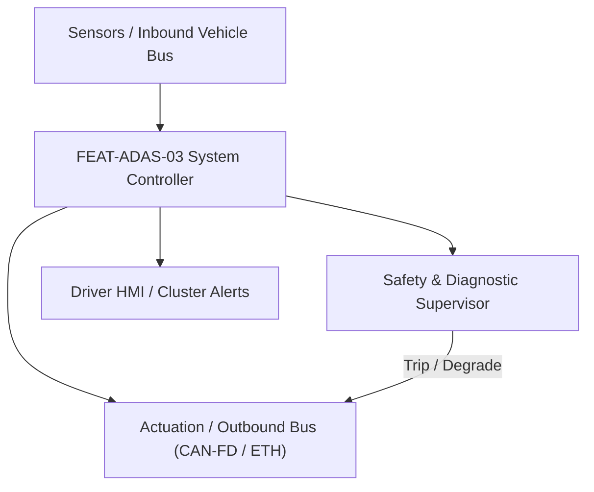
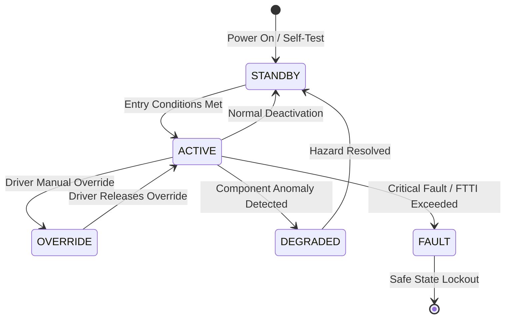

# System Requirements Specification: Lane Centering Assist & Emergency Lane Keeping (LCA-ELK)
**Feature ID:** `FEAT-ADAS-03`  
**Domain:** ADAS & Autonomous Driving  
**Target ASIL:** ASIL B  
**Compliance Standard:** ISO 26262:2018 (Part 4 - System Development) / ASPICE PAM v3.1 (SYS.2, SYS.3)  
**Parent Master Specification:** [`spec.md`](file:///c:/Workset/AntiGravityProjects/TestOptimisationExperiement/spec.md#feat-adas-03-lca)  
**Derived Software Specification:** [`FEAT-ADAS-03_LCA_SwReq.md`](file:///c:/Workset/AntiGravityProjects/TestOptimisationExperiement/software_requirements/FEAT-ADAS-03_LCA_SwReq.md)

---

## 1. Feature Overview & Operational Scope

Continuous steering assistance maintaining vehicle in center of travel lane from 0 to 180 km/h, combined with Emergency Lane Keeping (ELK) to prevent road departure and head-on collisions with oncoming traffic.

### Operational Context Architecture

---

## 2. Activation Logic & Operational States

- **Preconditions:** Ignition RUN, Camera clear, EPS healthy, Both lane boundaries detected with confidence > 70%, Speed 0-180 km/h.
- **Entry Conditions:** Driver activates LCA switch OR vehicle begins unintended drift toward road edge.
- **Deactivation Conditions:** Driver intentional turn signal, hands-off timeout exceeded (15s), or lane markings lost.
- **Driver Override Behavior:** Driver applying > 3.0 Nm handwheel torque immediately overrides centering; system re-engages automatically when driver releases torque inside lane.
- **Operational State Progression:**  
  `OFF` -> `PASSIVE_SEARCH` -> `ACTIVE_CENTERING` -> `HANDS_OFF_WARNING_1` -> `HANDS_OFF_WARNING_2` -> `ELK_EMERGENCY_INTERVENTION` -> `DRIVER_OVERRIDE` -> `FAULT_LOCKED`

### State Transition Diagram

---

## 3. Functional Safety & Failure Mitigation Concept

- **Functional Safety Goal:** SG-LCA-01: Prevent unintended lane departure and avoid uncommanded steering torque > 3.5 Nm.
- **Fault Tolerant Time Interval (FTTI):** 50 ms
- **Safe State Definition:** Ramp down steering assist torque to 0 Nm in <= 100 ms; restore 100% manual driver control.
- **Warning & Escalation Strategy:** Level 1: Amber steering wheel on cluster; Level 2: Acoustic chime; Level 3: Haptic brake jerk pulse.

### Failure Modes & Degradation Handling
- **Camera Sun Glare:** If camera blind due to sun glare, maintain lane for up to 500 ms using dead reckoning, then ramp torque to zero.
- **Eps Comm Loss:** If EPS CAN-FD message drops for 2 consecutive cycles, deactivate centering and alert driver.

---

## 4. System Requirements (SYS_REQ)
*(Note: Each System Requirement is systematically partitioned into multiple Child Software Requirements)*

### `SYS-ADAS-03-01`: Camera Lane Boundary Polynomial Model & Centerline Synthesis
- **Planned Release:** R100
- **ASIL Rating:** ASIL B
- **Parent Feature:** [`FEAT-ADAS-03`](file:///c:/Workset/AntiGravityProjects/TestOptimisationExperiement/spec.md#feat-adas-03)
- **Requirement Statement:**
  > The System SHALL sample front camera lane detections at 30 Hz, fit 3rd-order polynomials y(x) = c0 + c1*x + c2*x^2 + c3*x^3 for left and right boundaries, and compute target lane centerline trajectory within +-5 cm accuracy.
- **Activation Logic:** Active when vehicle speed > 0 km/h.
- **Fault Tolerant Time Interval (FTTI):** 60 ms
- **Safe State Action:** Invalidate centerline; ramp torque to zero.
- **Failure Detection & Reaction:** If one lane boundary is obscured, extrapolate centerline based on road width memory (3.5 m).
- **Input Interfaces:** `Camera_Lane_Markers_Left_Right, Vehicle_Speed_Mps, Vehicle_Yaw_Rate`
- **Output Interfaces:** `Target_Centerline_Polynomial[4], Lane_Width_Meters, Centerline_Confidence`
- **System Verification Method:** Real-world road geometry marker benchmark tests conforming to ISO 11270.
- **Derived Child Software Requirements (1:N Link):**
  - [`SWR-ADAS-03-01`](file:///c:/Workset/AntiGravityProjects/TestOptimisationExperiement/software_requirements/FEAT-ADAS-03_LCA_SwReq.md#swr-adas-03-01)
  - [`SWR-ADAS-03-02`](file:///c:/Workset/AntiGravityProjects/TestOptimisationExperiement/software_requirements/FEAT-ADAS-03_LCA_SwReq.md#swr-adas-03-02)

### `SYS-ADAS-03-02`: Electric Power Steering (EPS) Angle & Torque Overlay Servo
- **Planned Release:** R500
- **ASIL Rating:** ASIL B
- **Parent Feature:** [`FEAT-ADAS-03`](file:///c:/Workset/AntiGravityProjects/TestOptimisationExperiement/spec.md#feat-adas-03)
- **Requirement Statement:**
  > The System SHALL compute target road wheel angle and transmit steering torque overlay demands (up to +-3.5 Nm, rate limited to <= 5.0 Nm/s) to EPS ECU over CAN-FD at 10 ms period to track lane centerline.
- **Activation Logic:** Active when LCA is in ACTIVE_CENTERING state.
- **Fault Tolerant Time Interval (FTTI):** 50 ms
- **Safe State Action:** Zero steering torque request; open assist interface.
- **Failure Detection & Reaction:** If EPS reports torque saturation or internal fault, abort assist within 20 ms.
- **Input Interfaces:** `Target_Centerline_Polynomial, Ego_Heading_Error_Rad, Lateral_Offset_Y_Meters`
- **Output Interfaces:** `EPS_Steering_Torque_Cmd_Nm, EPS_Target_Angle_Demand_Deg`
- **System Verification Method:** Chassis HIL steering robot test rig dynamic lane tracking.
- **Derived Child Software Requirements (1:N Link):**
  - [`SWR-ADAS-03-03`](file:///c:/Workset/AntiGravityProjects/TestOptimisationExperiement/software_requirements/FEAT-ADAS-03_LCA_SwReq.md#swr-adas-03-03)
  - [`SWR-ADAS-03-04`](file:///c:/Workset/AntiGravityProjects/TestOptimisationExperiement/software_requirements/FEAT-ADAS-03_LCA_SwReq.md#swr-adas-03-04)

### `SYS-ADAS-03-03`: Capacitive Hands-On Detection (HOD) & Driver Takeover Sequencer
- **Planned Release:** R100
- **ASIL Rating:** ASIL B
- **Parent Feature:** [`FEAT-ADAS-03`](file:///c:/Workset/AntiGravityProjects/TestOptimisationExperiement/spec.md#feat-adas-03)
- **Requirement Statement:**
  > The System SHALL sample capacitive steering wheel rim sensors at 100 Hz: If driver hands-off detected for > 15.0 seconds, system SHALL execute 3-tier takeover escalation, disengaging LCA and performing in-lane deceleration if ignored.
- **Activation Logic:** Active during active lane centering.
- **Fault Tolerant Time Interval (FTTI):** 100 ms
- **Safe State Action:** Escalate to Level 3 hazard flashers and safe in-lane stop.
- **Failure Detection & Reaction:** If capacitive sensor shorts, fallback to steering torque micro-movement detection.
- **Input Interfaces:** `Capacitive_Rim_Sensor_Zones[4], Steering_Torque_Sensor_Nm`
- **Output Interfaces:** `Hands_On_Status (boolean), Takeover_Escalation_Stage_Enum`
- **System Verification Method:** Hands-off timer accuracy and escalation sequence bench tests.
- **Derived Child Software Requirements (1:N Link):**
  - [`SWR-ADAS-03-05`](file:///c:/Workset/AntiGravityProjects/TestOptimisationExperiement/software_requirements/FEAT-ADAS-03_LCA_SwReq.md#swr-adas-03-05)
  - [`SWR-ADAS-03-06`](file:///c:/Workset/AntiGravityProjects/TestOptimisationExperiement/software_requirements/FEAT-ADAS-03_LCA_SwReq.md#swr-adas-03-06)

### `SYS-ADAS-03-04`: Emergency Lane Keeping (ELK) Oncoming & Road Edge Avoidance
- **Planned Release:** R200
- **ASIL Rating:** ASIL B
- **Parent Feature:** [`FEAT-ADAS-03`](file:///c:/Workset/AntiGravityProjects/TestOptimisationExperiement/spec.md#feat-adas-03)
- **Requirement Statement:**
  > The System SHALL intervene with emergency steering torque (up to +-4.5 Nm) if vehicle departs lane towards oncoming traffic or grass road edge with no turn signal active (Euro NCAP ELK criteria).
- **Activation Logic:** Active at speeds between 60 km/h and 140 km/h.
- **Fault Tolerant Time Interval (FTTI):** 40 ms
- **Safe State Action:** Release steering torque when vehicle heading aligns safely with lane heading.
- **Failure Detection & Reaction:** Inhibit ELK if driver inputs aggressive counter-steering (> 5 Nm).
- **Input Interfaces:** `Time_To_Line_Crossing_Sec, Oncoming_Traffic_Threat_Flag, Road_Edge_Detected_Flag`
- **Output Interfaces:** `ELK_Intervention_Torque_Nm, ELK_Active_Indicator_Req`
- **System Verification Method:** Euro NCAP ELK Road Edge and Oncoming Vehicle test track protocols.
- **Derived Child Software Requirements (1:N Link):**
  - [`SWR-ADAS-03-07`](file:///c:/Workset/AntiGravityProjects/TestOptimisationExperiement/software_requirements/FEAT-ADAS-03_LCA_SwReq.md#swr-adas-03-07)
  - [`SWR-ADAS-03-08`](file:///c:/Workset/AntiGravityProjects/TestOptimisationExperiement/software_requirements/FEAT-ADAS-03_LCA_SwReq.md#swr-adas-03-08)

### `SYS-ADAS-03-05`: Degraded Single-Boundary Tracking & Construction Zone Mode
- **Planned Release:** R200
- **ASIL Rating:** ASIL B
- **Parent Feature:** [`FEAT-ADAS-03`](file:///c:/Workset/AntiGravityProjects/TestOptimisationExperiement/spec.md#feat-adas-03)
- **Requirement Statement:**
  > The System SHALL maintain stable degraded tracking using single detected road edge or barrier line when one boundary is missing (e.g. highway construction cones), restricting lateral G to <= 1.5 m/s².
- **Activation Logic:** Active when single lane boundary confidence > 80% and other boundary < 30%.
- **Fault Tolerant Time Interval (FTTI):** 100 ms
- **Safe State Action:** Prompt driver takeover and smoothly fade out torque.
- **Failure Detection & Reaction:** If single boundary ends abruptly, hold heading for 300 ms then disengage.
- **Input Interfaces:** `Single_Boundary_Polynomial, Construction_Cone_Array[8], Ego_Speed_Mps`
- **Output Interfaces:** `Single_Boundary_Tracking_Active (boolean), Virtual_Offset_Distance_M`
- **System Verification Method:** Construction zone test track with orange cones and asphalt seams.
- **Derived Child Software Requirements (1:N Link):**
  - [`SWR-ADAS-03-09`](file:///c:/Workset/AntiGravityProjects/TestOptimisationExperiement/software_requirements/FEAT-ADAS-03_LCA_SwReq.md#swr-adas-03-09)
  - [`SWR-ADAS-03-10`](file:///c:/Workset/AntiGravityProjects/TestOptimisationExperiement/software_requirements/FEAT-ADAS-03_LCA_SwReq.md#swr-adas-03-10)

### `SYS-ADAS-03-06`: Camera Video Stream Road Edge & Barrier Kinematic Boundary Estimator
- **Planned Release:** R200
- **ASIL Rating:** ASIL B
- **Parent Feature:** [`FEAT-ADAS-03`](file:///c:/Workset/AntiGravityProjects/TestOptimisationExperiement/spec.md#feat-adas-03)
- **Requirement Statement:**
  > The System SHALL Estimate distance to unpainted road boundaries, curbs, and guardrails at 20 ms cycle.
- **Activation Logic:** Active during normal vehicle operation when feature state is active.
- **Fault Tolerant Time Interval (FTTI):** 50 ms
- **Safe State Action:** Transition to safe state or safe degradation tier within FTTI budget.
- **Failure Detection & Reaction:** Isolate faulted channel, latch DEM diagnostic trouble code, and inform driver.
- **Input Interfaces:** `Sensor signals, vehicle dynamics data, and bus frames via RTE.`
- **Output Interfaces:** `Actuator commands, diagnostic event flags, and cluster alerts.`
- **System Verification Method:** HiL test bench and dynamometer automated verification.
- **Derived Child Software Requirements (1:N Link):**
  - [`SWR-ADAS-03-11`](file:///c:/Workset/AntiGravityProjects/TestOptimisationExperiement/software_requirements/FEAT-ADAS-03_LCA_SwReq.md#swr-adas-03-11)
  - [`SWR-ADAS-03-12`](file:///c:/Workset/AntiGravityProjects/TestOptimisationExperiement/software_requirements/FEAT-ADAS-03_LCA_SwReq.md#swr-adas-03-12)

### `SYS-ADAS-03-07`: Clothoid Lane Model 3rd-Degree Polynomial Tracking Filter
- **Planned Release:** R300
- **ASIL Rating:** ASIL B
- **Parent Feature:** [`FEAT-ADAS-03`](file:///c:/Workset/AntiGravityProjects/TestOptimisationExperiement/spec.md#feat-adas-03)
- **Requirement Statement:**
  > The System SHALL Filter clothoid curvature parameters c0, c1, c2 to predict lane center trajectory with lag < 25 ms.
- **Activation Logic:** Active during normal vehicle operation when feature state is active.
- **Fault Tolerant Time Interval (FTTI):** 40 ms
- **Safe State Action:** Transition to safe state or safe degradation tier within FTTI budget.
- **Failure Detection & Reaction:** Isolate faulted channel, latch DEM diagnostic trouble code, and inform driver.
- **Input Interfaces:** `Sensor signals, vehicle dynamics data, and bus frames via RTE.`
- **Output Interfaces:** `Actuator commands, diagnostic event flags, and cluster alerts.`
- **System Verification Method:** HiL test bench and dynamometer automated verification.
- **Derived Child Software Requirements (1:N Link):**
  - [`SWR-ADAS-03-13`](file:///c:/Workset/AntiGravityProjects/TestOptimisationExperiement/software_requirements/FEAT-ADAS-03_LCA_SwReq.md#swr-adas-03-13)
  - [`SWR-ADAS-03-14`](file:///c:/Workset/AntiGravityProjects/TestOptimisationExperiement/software_requirements/FEAT-ADAS-03_LCA_SwReq.md#swr-adas-03-14)

### `SYS-ADAS-03-08`: Emergency Lane Keeping (ELK) Oncoming Vehicle Hazard Mitigator
- **Planned Release:** R300
- **ASIL Rating:** ASIL B
- **Parent Feature:** [`FEAT-ADAS-03`](file:///c:/Workset/AntiGravityProjects/TestOptimisationExperiement/spec.md#feat-adas-03)
- **Requirement Statement:**
  > The System SHALL Detect road departure into oncoming traffic lane and apply urgent corrective steering counter-torque.
- **Activation Logic:** Active during normal vehicle operation when feature state is active.
- **Fault Tolerant Time Interval (FTTI):** 30 ms
- **Safe State Action:** Transition to safe state or safe degradation tier within FTTI budget.
- **Failure Detection & Reaction:** Isolate faulted channel, latch DEM diagnostic trouble code, and inform driver.
- **Input Interfaces:** `Sensor signals, vehicle dynamics data, and bus frames via RTE.`
- **Output Interfaces:** `Actuator commands, diagnostic event flags, and cluster alerts.`
- **System Verification Method:** HiL test bench and dynamometer automated verification.
- **Derived Child Software Requirements (1:N Link):**
  - [`SWR-ADAS-03-15`](file:///c:/Workset/AntiGravityProjects/TestOptimisationExperiement/software_requirements/FEAT-ADAS-03_LCA_SwReq.md#swr-adas-03-15)
  - [`SWR-ADAS-03-16`](file:///c:/Workset/AntiGravityProjects/TestOptimisationExperiement/software_requirements/FEAT-ADAS-03_LCA_SwReq.md#swr-adas-03-16)

### `SYS-ADAS-03-09`: Driver Capacitive Hands-On Detection (HOD) Supervisor
- **Planned Release:** R300
- **ASIL Rating:** ASIL B
- **Parent Feature:** [`FEAT-ADAS-03`](file:///c:/Workset/AntiGravityProjects/TestOptimisationExperiement/spec.md#feat-adas-03)
- **Requirement Statement:**
  > The System SHALL Sample steering wheel capacitive touch sensors at 50 Hz, escalating hands-off warnings after 15s.
- **Activation Logic:** Active during normal vehicle operation when feature state is active.
- **Fault Tolerant Time Interval (FTTI):** 100 ms
- **Safe State Action:** Transition to safe state or safe degradation tier within FTTI budget.
- **Failure Detection & Reaction:** Isolate faulted channel, latch DEM diagnostic trouble code, and inform driver.
- **Input Interfaces:** `Sensor signals, vehicle dynamics data, and bus frames via RTE.`
- **Output Interfaces:** `Actuator commands, diagnostic event flags, and cluster alerts.`
- **System Verification Method:** HiL test bench and dynamometer automated verification.
- **Derived Child Software Requirements (1:N Link):**
  - [`SWR-ADAS-03-17`](file:///c:/Workset/AntiGravityProjects/TestOptimisationExperiement/software_requirements/FEAT-ADAS-03_LCA_SwReq.md#swr-adas-03-17)
  - [`SWR-ADAS-03-18`](file:///c:/Workset/AntiGravityProjects/TestOptimisationExperiement/software_requirements/FEAT-ADAS-03_LCA_SwReq.md#swr-adas-03-18)

### `SYS-ADAS-03-10`: Turn Signal Lane Change Suppression & Override Deactivation
- **Planned Release:** R400
- **ASIL Rating:** ASIL B
- **Parent Feature:** [`FEAT-ADAS-03`](file:///c:/Workset/AntiGravityProjects/TestOptimisationExperiement/spec.md#feat-adas-03)
- **Requirement Statement:**
  > The System SHALL Temporarily suppress lane keeping counter-torque when driver signals intentional lane departure.
- **Activation Logic:** Active during normal vehicle operation when feature state is active.
- **Fault Tolerant Time Interval (FTTI):** 40 ms
- **Safe State Action:** Transition to safe state or safe degradation tier within FTTI budget.
- **Failure Detection & Reaction:** Isolate faulted channel, latch DEM diagnostic trouble code, and inform driver.
- **Input Interfaces:** `Sensor signals, vehicle dynamics data, and bus frames via RTE.`
- **Output Interfaces:** `Actuator commands, diagnostic event flags, and cluster alerts.`
- **System Verification Method:** HiL test bench and dynamometer automated verification.
- **Derived Child Software Requirements (1:N Link):**
  - [`SWR-ADAS-03-19`](file:///c:/Workset/AntiGravityProjects/TestOptimisationExperiement/software_requirements/FEAT-ADAS-03_LCA_SwReq.md#swr-adas-03-19)
  - [`SWR-ADAS-03-20`](file:///c:/Workset/AntiGravityProjects/TestOptimisationExperiement/software_requirements/FEAT-ADAS-03_LCA_SwReq.md#swr-adas-03-20)

### `SYS-ADAS-03-11`: EPS Steering Torque Overlay Maximum Authority Clamp
- **Planned Release:** R500
- **ASIL Rating:** ASIL B
- **Parent Feature:** [`FEAT-ADAS-03`](file:///c:/Workset/AntiGravityProjects/TestOptimisationExperiement/spec.md#feat-adas-03)
- **Requirement Statement:**
  > The System SHALL Strictly constrain overlay torque demand to <= 3.0 Nm to allow effortless driver manual override.
- **Activation Logic:** Active during normal vehicle operation when feature state is active.
- **Fault Tolerant Time Interval (FTTI):** 20 ms
- **Safe State Action:** Transition to safe state or safe degradation tier within FTTI budget.
- **Failure Detection & Reaction:** Isolate faulted channel, latch DEM diagnostic trouble code, and inform driver.
- **Input Interfaces:** `Sensor signals, vehicle dynamics data, and bus frames via RTE.`
- **Output Interfaces:** `Actuator commands, diagnostic event flags, and cluster alerts.`
- **System Verification Method:** HiL test bench and dynamometer automated verification.
- **Derived Child Software Requirements (1:N Link):**
  - [`SWR-ADAS-03-21`](file:///c:/Workset/AntiGravityProjects/TestOptimisationExperiement/software_requirements/FEAT-ADAS-03_LCA_SwReq.md#swr-adas-03-21)
  - [`SWR-ADAS-03-22`](file:///c:/Workset/AntiGravityProjects/TestOptimisationExperiement/software_requirements/FEAT-ADAS-03_LCA_SwReq.md#swr-adas-03-22)

### `SYS-ADAS-03-12`: Wet Surface Low-Contrast Marker Confidence Degradation
- **Planned Release:** R400
- **ASIL Rating:** ASIL B
- **Parent Feature:** [`FEAT-ADAS-03`](file:///c:/Workset/AntiGravityProjects/TestOptimisationExperiement/spec.md#feat-adas-03)
- **Requirement Statement:**
  > The System SHALL Smoothly reduce lateral control gain when lane marker visual contrast drops below 35%.
- **Activation Logic:** Active during normal vehicle operation when feature state is active.
- **Fault Tolerant Time Interval (FTTI):** 200 ms
- **Safe State Action:** Transition to safe state or safe degradation tier within FTTI budget.
- **Failure Detection & Reaction:** Isolate faulted channel, latch DEM diagnostic trouble code, and inform driver.
- **Input Interfaces:** `Sensor signals, vehicle dynamics data, and bus frames via RTE.`
- **Output Interfaces:** `Actuator commands, diagnostic event flags, and cluster alerts.`
- **System Verification Method:** HiL test bench and dynamometer automated verification.
- **Derived Child Software Requirements (1:N Link):**
  - [`SWR-ADAS-03-23`](file:///c:/Workset/AntiGravityProjects/TestOptimisationExperiement/software_requirements/FEAT-ADAS-03_LCA_SwReq.md#swr-adas-03-23)
  - [`SWR-ADAS-03-24`](file:///c:/Workset/AntiGravityProjects/TestOptimisationExperiement/software_requirements/FEAT-ADAS-03_LCA_SwReq.md#swr-adas-03-24)

### `SYS-ADAS-03-13`: HMI Visual Lane Departure Tell-Tale & Haptic Vibration Annunciation
- **Planned Release:** R500
- **ASIL Rating:** ASIL B
- **Parent Feature:** [`FEAT-ADAS-03`](file:///c:/Workset/AntiGravityProjects/TestOptimisationExperiement/spec.md#feat-adas-03)
- **Requirement Statement:**
  > The System SHALL Trigger cluster lane graphics and steering wheel haptic vibration pulse upon departure.
- **Activation Logic:** Active during normal vehicle operation when feature state is active.
- **Fault Tolerant Time Interval (FTTI):** 50 ms
- **Safe State Action:** Transition to safe state or safe degradation tier within FTTI budget.
- **Failure Detection & Reaction:** Isolate faulted channel, latch DEM diagnostic trouble code, and inform driver.
- **Input Interfaces:** `Sensor signals, vehicle dynamics data, and bus frames via RTE.`
- **Output Interfaces:** `Actuator commands, diagnostic event flags, and cluster alerts.`
- **System Verification Method:** HiL test bench and dynamometer automated verification.
- **Derived Child Software Requirements (1:N Link):**
  - [`SWR-ADAS-03-25`](file:///c:/Workset/AntiGravityProjects/TestOptimisationExperiement/software_requirements/FEAT-ADAS-03_LCA_SwReq.md#swr-adas-03-25)
  - [`SWR-ADAS-03-26`](file:///c:/Workset/AntiGravityProjects/TestOptimisationExperiement/software_requirements/FEAT-ADAS-03_LCA_SwReq.md#swr-adas-03-26)

### `SYS-ADAS-03-14`: LCA System Fault Passive Disengagement & Fail-Silent Isolation
- **Planned Release:** R500
- **ASIL Rating:** ASIL B
- **Parent Feature:** [`FEAT-ADAS-03`](file:///c:/Workset/AntiGravityProjects/TestOptimisationExperiement/spec.md#feat-adas-03)
- **Requirement Statement:**
  > The System SHALL Ramp down steering overlay torque to zero within 200 ms upon sensor fault without vehicle jerk.
- **Activation Logic:** Active during normal vehicle operation when feature state is active.
- **Fault Tolerant Time Interval (FTTI):** 30 ms
- **Safe State Action:** Transition to safe state or safe degradation tier within FTTI budget.
- **Failure Detection & Reaction:** Isolate faulted channel, latch DEM diagnostic trouble code, and inform driver.
- **Input Interfaces:** `Sensor signals, vehicle dynamics data, and bus frames via RTE.`
- **Output Interfaces:** `Actuator commands, diagnostic event flags, and cluster alerts.`
- **System Verification Method:** HiL test bench and dynamometer automated verification.
- **Derived Child Software Requirements (1:N Link):**
  - [`SWR-ADAS-03-27`](file:///c:/Workset/AntiGravityProjects/TestOptimisationExperiement/software_requirements/FEAT-ADAS-03_LCA_SwReq.md#swr-adas-03-27)
  - [`SWR-ADAS-03-28`](file:///c:/Workset/AntiGravityProjects/TestOptimisationExperiement/software_requirements/FEAT-ADAS-03_LCA_SwReq.md#swr-adas-03-28)

### `SYS-ADAS-03-15`: DEM Lane Boundary Diagnostics & Camera Blockage Evaluation
- **Planned Release:** R500
- **ASIL Rating:** ASIL B
- **Parent Feature:** [`FEAT-ADAS-03`](file:///c:/Workset/AntiGravityProjects/TestOptimisationExperiement/spec.md#feat-adas-03)
- **Requirement Statement:**
  > The System SHALL Log DEM diagnostic trouble codes and prompt driver when front camera lens is obscured.
- **Activation Logic:** Active during normal vehicle operation when feature state is active.
- **Fault Tolerant Time Interval (FTTI):** 100 ms
- **Safe State Action:** Transition to safe state or safe degradation tier within FTTI budget.
- **Failure Detection & Reaction:** Isolate faulted channel, latch DEM diagnostic trouble code, and inform driver.
- **Input Interfaces:** `Sensor signals, vehicle dynamics data, and bus frames via RTE.`
- **Output Interfaces:** `Actuator commands, diagnostic event flags, and cluster alerts.`
- **System Verification Method:** HiL test bench and dynamometer automated verification.
- **Derived Child Software Requirements (1:N Link):**
  - [`SWR-ADAS-03-29`](file:///c:/Workset/AntiGravityProjects/TestOptimisationExperiement/software_requirements/FEAT-ADAS-03_LCA_SwReq.md#swr-adas-03-29)
  - [`SWR-ADAS-03-30`](file:///c:/Workset/AntiGravityProjects/TestOptimisationExperiement/software_requirements/FEAT-ADAS-03_LCA_SwReq.md#swr-adas-03-30)

---

## 5. System-to-Software Traceability Summary

| System Requirement ID | Planned Release | ASIL | Title | Derived Software Requirements (1:N) | Verification Method |
| :--- | :---: | :--- | :--- | :--- | :--- |
| `SYS-ADAS-03-01` | **`R100`** | ASIL B | Camera Lane Boundary Polynomial Model & Centerline Synthesis | [`SWR-ADAS-03-01`](file:///c:/Workset/AntiGravityProjects/TestOptimisationExperiement/software_requirements/FEAT-ADAS-03_LCA_SwReq.md#swr-adas-03-01), [`SWR-ADAS-03-02`](file:///c:/Workset/AntiGravityProjects/TestOptimisationExperiement/software_requirements/FEAT-ADAS-03_LCA_SwReq.md#swr-adas-03-02) | Real-world road geometry marker benchmark tests conforming to ISO 11270. |
| `SYS-ADAS-03-02` | **`R500`** | ASIL B | Electric Power Steering (EPS) Angle & Torque Overlay Servo | [`SWR-ADAS-03-03`](file:///c:/Workset/AntiGravityProjects/TestOptimisationExperiement/software_requirements/FEAT-ADAS-03_LCA_SwReq.md#swr-adas-03-03), [`SWR-ADAS-03-04`](file:///c:/Workset/AntiGravityProjects/TestOptimisationExperiement/software_requirements/FEAT-ADAS-03_LCA_SwReq.md#swr-adas-03-04) | Chassis HIL steering robot test rig dynamic lane tracking. |
| `SYS-ADAS-03-03` | **`R100`** | ASIL B | Capacitive Hands-On Detection (HOD) & Driver Takeover Sequencer | [`SWR-ADAS-03-05`](file:///c:/Workset/AntiGravityProjects/TestOptimisationExperiement/software_requirements/FEAT-ADAS-03_LCA_SwReq.md#swr-adas-03-05), [`SWR-ADAS-03-06`](file:///c:/Workset/AntiGravityProjects/TestOptimisationExperiement/software_requirements/FEAT-ADAS-03_LCA_SwReq.md#swr-adas-03-06) | Hands-off timer accuracy and escalation sequence bench tests. |
| `SYS-ADAS-03-04` | **`R200`** | ASIL B | Emergency Lane Keeping (ELK) Oncoming & Road Edge Avoidance | [`SWR-ADAS-03-07`](file:///c:/Workset/AntiGravityProjects/TestOptimisationExperiement/software_requirements/FEAT-ADAS-03_LCA_SwReq.md#swr-adas-03-07), [`SWR-ADAS-03-08`](file:///c:/Workset/AntiGravityProjects/TestOptimisationExperiement/software_requirements/FEAT-ADAS-03_LCA_SwReq.md#swr-adas-03-08) | Euro NCAP ELK Road Edge and Oncoming Vehicle test track protocols. |
| `SYS-ADAS-03-05` | **`R200`** | ASIL B | Degraded Single-Boundary Tracking & Construction Zone Mode | [`SWR-ADAS-03-09`](file:///c:/Workset/AntiGravityProjects/TestOptimisationExperiement/software_requirements/FEAT-ADAS-03_LCA_SwReq.md#swr-adas-03-09), [`SWR-ADAS-03-10`](file:///c:/Workset/AntiGravityProjects/TestOptimisationExperiement/software_requirements/FEAT-ADAS-03_LCA_SwReq.md#swr-adas-03-10) | Construction zone test track with orange cones and asphalt seams. |
| `SYS-ADAS-03-06` | **`R200`** | ASIL B | Camera Video Stream Road Edge & Barrier Kinematic Boundary Estimator | [`SWR-ADAS-03-11`](file:///c:/Workset/AntiGravityProjects/TestOptimisationExperiement/software_requirements/FEAT-ADAS-03_LCA_SwReq.md#swr-adas-03-11), [`SWR-ADAS-03-12`](file:///c:/Workset/AntiGravityProjects/TestOptimisationExperiement/software_requirements/FEAT-ADAS-03_LCA_SwReq.md#swr-adas-03-12) | HiL test bench and dynamometer automated verification. |
| `SYS-ADAS-03-07` | **`R300`** | ASIL B | Clothoid Lane Model 3rd-Degree Polynomial Tracking Filter | [`SWR-ADAS-03-13`](file:///c:/Workset/AntiGravityProjects/TestOptimisationExperiement/software_requirements/FEAT-ADAS-03_LCA_SwReq.md#swr-adas-03-13), [`SWR-ADAS-03-14`](file:///c:/Workset/AntiGravityProjects/TestOptimisationExperiement/software_requirements/FEAT-ADAS-03_LCA_SwReq.md#swr-adas-03-14) | HiL test bench and dynamometer automated verification. |
| `SYS-ADAS-03-08` | **`R300`** | ASIL B | Emergency Lane Keeping (ELK) Oncoming Vehicle Hazard Mitigator | [`SWR-ADAS-03-15`](file:///c:/Workset/AntiGravityProjects/TestOptimisationExperiement/software_requirements/FEAT-ADAS-03_LCA_SwReq.md#swr-adas-03-15), [`SWR-ADAS-03-16`](file:///c:/Workset/AntiGravityProjects/TestOptimisationExperiement/software_requirements/FEAT-ADAS-03_LCA_SwReq.md#swr-adas-03-16) | HiL test bench and dynamometer automated verification. |
| `SYS-ADAS-03-09` | **`R300`** | ASIL B | Driver Capacitive Hands-On Detection (HOD) Supervisor | [`SWR-ADAS-03-17`](file:///c:/Workset/AntiGravityProjects/TestOptimisationExperiement/software_requirements/FEAT-ADAS-03_LCA_SwReq.md#swr-adas-03-17), [`SWR-ADAS-03-18`](file:///c:/Workset/AntiGravityProjects/TestOptimisationExperiement/software_requirements/FEAT-ADAS-03_LCA_SwReq.md#swr-adas-03-18) | HiL test bench and dynamometer automated verification. |
| `SYS-ADAS-03-10` | **`R400`** | ASIL B | Turn Signal Lane Change Suppression & Override Deactivation | [`SWR-ADAS-03-19`](file:///c:/Workset/AntiGravityProjects/TestOptimisationExperiement/software_requirements/FEAT-ADAS-03_LCA_SwReq.md#swr-adas-03-19), [`SWR-ADAS-03-20`](file:///c:/Workset/AntiGravityProjects/TestOptimisationExperiement/software_requirements/FEAT-ADAS-03_LCA_SwReq.md#swr-adas-03-20) | HiL test bench and dynamometer automated verification. |
| `SYS-ADAS-03-11` | **`R500`** | ASIL B | EPS Steering Torque Overlay Maximum Authority Clamp | [`SWR-ADAS-03-21`](file:///c:/Workset/AntiGravityProjects/TestOptimisationExperiement/software_requirements/FEAT-ADAS-03_LCA_SwReq.md#swr-adas-03-21), [`SWR-ADAS-03-22`](file:///c:/Workset/AntiGravityProjects/TestOptimisationExperiement/software_requirements/FEAT-ADAS-03_LCA_SwReq.md#swr-adas-03-22) | HiL test bench and dynamometer automated verification. |
| `SYS-ADAS-03-12` | **`R400`** | ASIL B | Wet Surface Low-Contrast Marker Confidence Degradation | [`SWR-ADAS-03-23`](file:///c:/Workset/AntiGravityProjects/TestOptimisationExperiement/software_requirements/FEAT-ADAS-03_LCA_SwReq.md#swr-adas-03-23), [`SWR-ADAS-03-24`](file:///c:/Workset/AntiGravityProjects/TestOptimisationExperiement/software_requirements/FEAT-ADAS-03_LCA_SwReq.md#swr-adas-03-24) | HiL test bench and dynamometer automated verification. |
| `SYS-ADAS-03-13` | **`R500`** | ASIL B | HMI Visual Lane Departure Tell-Tale & Haptic Vibration Annunciation | [`SWR-ADAS-03-25`](file:///c:/Workset/AntiGravityProjects/TestOptimisationExperiement/software_requirements/FEAT-ADAS-03_LCA_SwReq.md#swr-adas-03-25), [`SWR-ADAS-03-26`](file:///c:/Workset/AntiGravityProjects/TestOptimisationExperiement/software_requirements/FEAT-ADAS-03_LCA_SwReq.md#swr-adas-03-26) | HiL test bench and dynamometer automated verification. |
| `SYS-ADAS-03-14` | **`R500`** | ASIL B | LCA System Fault Passive Disengagement & Fail-Silent Isolation | [`SWR-ADAS-03-27`](file:///c:/Workset/AntiGravityProjects/TestOptimisationExperiement/software_requirements/FEAT-ADAS-03_LCA_SwReq.md#swr-adas-03-27), [`SWR-ADAS-03-28`](file:///c:/Workset/AntiGravityProjects/TestOptimisationExperiement/software_requirements/FEAT-ADAS-03_LCA_SwReq.md#swr-adas-03-28) | HiL test bench and dynamometer automated verification. |
| `SYS-ADAS-03-15` | **`R500`** | ASIL B | DEM Lane Boundary Diagnostics & Camera Blockage Evaluation | [`SWR-ADAS-03-29`](file:///c:/Workset/AntiGravityProjects/TestOptimisationExperiement/software_requirements/FEAT-ADAS-03_LCA_SwReq.md#swr-adas-03-29), [`SWR-ADAS-03-30`](file:///c:/Workset/AntiGravityProjects/TestOptimisationExperiement/software_requirements/FEAT-ADAS-03_LCA_SwReq.md#swr-adas-03-30) | HiL test bench and dynamometer automated verification. |

- **Upstream Feature Link:** [`spec.md` (FEAT-ADAS-03)](file:///c:/Workset/AntiGravityProjects/TestOptimisationExperiement/spec.md#feat-adas-03)
- **Software Requirements Specification:** [`FEAT-ADAS-03_LCA_SwReq.md`](file:///c:/Workset/AntiGravityProjects/TestOptimisationExperiement/software_requirements/FEAT-ADAS-03_LCA_SwReq.md)
