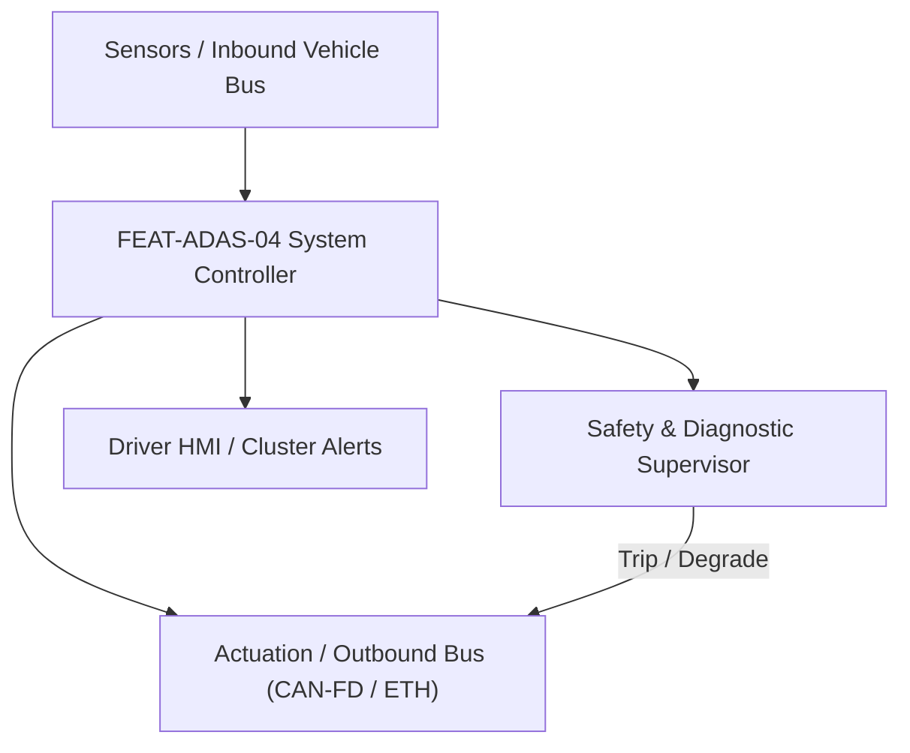
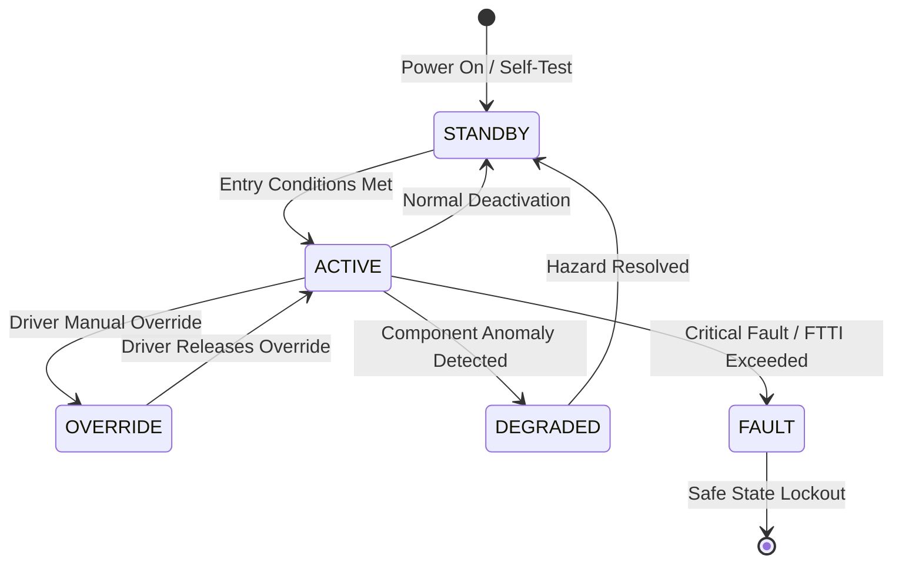

# System Requirements Specification: Traffic Jam Pilot L3 Hands-Off (TJP)
**Feature ID:** `FEAT-ADAS-04`  
**Domain:** ADAS & Autonomous Driving  
**Target ASIL:** ASIL D  
**Compliance Standard:** ISO 26262:2018 (Part 4 - System Development) / ASPICE PAM v3.1 (SYS.2, SYS.3)  
**Parent Master Specification:** [`spec.md`](file:///c:/Workset/AntiGravityProjects/TestOptimisationExperiement/spec.md#feat-adas-04-tjp)  
**Derived Software Specification:** [`FEAT-ADAS-04_TJP_SwReq.md`](file:///c:/Workset/AntiGravityProjects/TestOptimisationExperiement/software_requirements/FEAT-ADAS-04_TJP_SwReq.md)

---

## 1. Feature Overview & Operational Scope

SAE Level 3 automated driving system in dense motorway traffic up to 60 km/h, legally allowing driver to take eyes off road with automated fail-operational safety and Minimum Risk Maneuver (MRM).

### Operational Context Architecture

---

## 2. Activation Logic & Operational States

- **Preconditions:** Vehicle on access-controlled divided highway (HD Map verified), no pedestrians/cyclists present, clear lane markings, speed <= 60 km/h, driver monitoring camera active, dual-redundant steering and braking healthy.
- **Entry Conditions:** Driver presses 'TJP Pilot' button on steering wheel; system confirms Operational Design Domain (ODD) conditions met within 500 ms.
- **Deactivation Conditions:** Driver presses brake pedal, driver steers with torque > 5.0 Nm, speed exceeds 65 km/h, highway terminates, or weather degrades sensor visibility.
- **Driver Override Behavior:** Driver can take over at any moment by firmly grabbing steering wheel and depressing brake/accelerator pedal.
- **Operational State Progression:**  
  `ODD_MONITORING` -> `PILOT_AVAILABLE` -> `PILOT_ACTIVE` -> `TRANSITION_DEMAND_ISSUED` -> `MINIMUM_RISK_MANEUVER` -> `FAULT_LOCKOUT`

### State Transition Diagram

---

## 3. Functional Safety & Failure Mitigation Concept

- **Functional Safety Goal:** SG-TJP-01: Maintain fail-operational trajectory control; safely execute Minimum Risk Maneuver (MRM) within 10s if driver fails to resume control.
- **Fault Tolerant Time Interval (FTTI):** 250 ms
- **Safe State Definition:** Execute automated safe stop within current lane or shoulder with hazard lights active.
- **Warning & Escalation Strategy:** 10-second Takeover Request (TOR) escalation: Optical steering wheel LEDs flash red, acoustic alarm, seat vibration pulses.

### Failure Modes & Degradation Handling
- **Localization Loss:** If GNSS-RTK loses satellite lock, continue dead-reckoning via IMU and HD camera landmark correlation for up to 30s while initiating TOR.
- **Primary Computer Fault:** Dual-lockstep safety processor seamlessly takes over motion planner within 10 ms.

---

## 4. System Requirements (SYS_REQ)
*(Note: Each System Requirement is systematically partitioned into multiple Child Software Requirements)*

### `SYS-ADAS-04-01`: Operational Design Domain (ODD) Multi-Condition Validator
- **Planned Release:** R100
- **ASIL Rating:** ASIL D
- **Parent Feature:** [`FEAT-ADAS-04`](file:///c:/Workset/AntiGravityProjects/TestOptimisationExperiement/spec.md#feat-adas-04)
- **Requirement Statement:**
  > The System SHALL continuously verify all TJP ODD conditions (Motorway with physical median, No pedestrians, Speed <= 60 km/h, Weather clear, Lead vehicle present, High-definition map localization valid) at 20 ms period before permitting engagement.
- **Activation Logic:** Active at all times when TJP is requested or engaged.
- **Fault Tolerant Time Interval (FTTI):** 50 ms
- **Safe State Action:** Issue immediate Takeover Request (TOR); disallow L3 engagement.
- **Failure Detection & Reaction:** If vehicle speed exceeds 65 km/h for > 2.0 seconds, initiate transition to Level 2 or driver handover.
- **Input Interfaces:** `GNSS_Road_Class_Enum, Speed_Limit_Kmph, Camera_Pedestrian_Count, Weather_Sensor_State`
- **Output Interfaces:** `TJP_ODD_Permit_Flag (boolean), ODD_Violation_Reason_Code`
- **System Verification Method:** ODD boundary test matrix according to UNECE R157 Automated Lane Keeping Systems.
- **Derived Child Software Requirements (1:N Link):**
  - [`SWR-ADAS-04-01`](file:///c:/Workset/AntiGravityProjects/TestOptimisationExperiement/software_requirements/FEAT-ADAS-04_TJP_SwReq.md#swr-adas-04-01)
  - [`SWR-ADAS-04-02`](file:///c:/Workset/AntiGravityProjects/TestOptimisationExperiement/software_requirements/FEAT-ADAS-04_TJP_SwReq.md#swr-adas-04-02)

### `SYS-ADAS-04-02`: Dual-Compute Lockstep Redundancy & Cross-Voting Arbiter
- **Planned Release:** R400
- **ASIL Rating:** ASIL D
- **Parent Feature:** [`FEAT-ADAS-04`](file:///c:/Workset/AntiGravityProjects/TestOptimisationExperiement/spec.md#feat-adas-04)
- **Requirement Statement:**
  > The System SHALL execute trajectory planning and actuation commands synchronously across Primary ADAS SoC and Secondary Safety Controller, cross-voting results at 10 ms period (command delta <= 0.2 m/s² and <= 0.1 deg) to guarantee fail-operational autonomy.
- **Activation Logic:** Active at all times when TJP is active.
- **Fault Tolerant Time Interval (FTTI):** 20 ms
- **Safe State Action:** Secondary controller seizes control to execute fail-operational Minimum Risk Maneuver.
- **Failure Detection & Reaction:** If Primary SoC crashes, Secondary Controller continues automated driving for >= 10 seconds without interruption.
- **Input Interfaces:** `Primary_Command_Vector[4], Secondary_Command_Vector[4], Inter_Processor_Heartbeat`
- **Output Interfaces:** `Voted_Actuation_Command_Vector, Compute_Channel_Health_Status`
- **System Verification Method:** Fault injection testing injecting hardware core panics on primary SoC.
- **Derived Child Software Requirements (1:N Link):**
  - [`SWR-ADAS-04-03`](file:///c:/Workset/AntiGravityProjects/TestOptimisationExperiement/software_requirements/FEAT-ADAS-04_TJP_SwReq.md#swr-adas-04-03)
  - [`SWR-ADAS-04-04`](file:///c:/Workset/AntiGravityProjects/TestOptimisationExperiement/software_requirements/FEAT-ADAS-04_TJP_SwReq.md#swr-adas-04-04)

### `SYS-ADAS-04-03`: Low-Speed Combined Longitudinal & Lateral Path Follower
- **Planned Release:** R100
- **ASIL Rating:** ASIL D
- **Parent Feature:** [`FEAT-ADAS-04`](file:///c:/Workset/AntiGravityProjects/TestOptimisationExperiement/spec.md#feat-adas-04)
- **Requirement Statement:**
  > The System SHALL control vehicle acceleration (-4.0 to +1.5 m/s²) and steering (up to +-30 deg road wheel angle) at 10 ms period to maintain center of lane and 1.2s headway to lead vehicle with zero driver intervention.
- **Activation Logic:** Active in TJP_ENGAGED state.
- **Fault Tolerant Time Interval (FTTI):** 40 ms
- **Safe State Action:** Transition to MRM in-lane deceleration.
- **Failure Detection & Reaction:** If lead vehicle performs emergency stop (-8 m/s²), command full emergency braking simultaneously.
- **Input Interfaces:** `Lead_Vehicle_Kinematics, Fused_Lane_Centerline, Ego_Vehicle_Motion_State`
- **Output Interfaces:** `Target_Drive_Torque_Nm, Target_Brake_Pressure_Bar, EPS_Target_Angle_Deg`
- **System Verification Method:** Stop-and-go dense traffic simulation and live track testing under UNECE R157.
- **Derived Child Software Requirements (1:N Link):**
  - [`SWR-ADAS-04-05`](file:///c:/Workset/AntiGravityProjects/TestOptimisationExperiement/software_requirements/FEAT-ADAS-04_TJP_SwReq.md#swr-adas-04-05)
  - [`SWR-ADAS-04-06`](file:///c:/Workset/AntiGravityProjects/TestOptimisationExperiement/software_requirements/FEAT-ADAS-04_TJP_SwReq.md#swr-adas-04-06)

### `SYS-ADAS-04-04`: Driver Takeover Request (TOR) 10-Second Escalation Sequencer
- **Planned Release:** R100
- **ASIL Rating:** ASIL D
- **Parent Feature:** [`FEAT-ADAS-04`](file:///c:/Workset/AntiGravityProjects/TestOptimisationExperiement/spec.md#feat-adas-04)
- **Requirement Statement:**
  > The System SHALL issue a 10.0-second structured Takeover Request (TOR) upon ODD exit or sensor fault: Visual red takeover display + Acoustic escalating chime (up to 85 dB) + Haptic seat vibration, verifying driver hands on wheel and eyes on road.
- **Activation Logic:** Triggered when ODD conditions fail or system anomaly occurs.
- **Fault Tolerant Time Interval (FTTI):** 100 ms
- **Safe State Action:** Initiate Minimum Risk Maneuver (MRM) at exactly 10.0 seconds if driver fails to respond.
- **Failure Detection & Reaction:** If driver takes over within 10s, smoothly transition control to driver within 200 ms.
- **Input Interfaces:** `TOR_Trigger_Reason_Enum, Driver_Hands_On_Status, DMS_Eyes_On_Road_Status`
- **Output Interfaces:** `TOR_Stage_Enum, Takeover_Countdown_Sec, TOR_Audio_Chime_Pattern`
- **System Verification Method:** Human factors simulator testing of driver takeover reaction times under secondary tasks.
- **Derived Child Software Requirements (1:N Link):**
  - [`SWR-ADAS-04-07`](file:///c:/Workset/AntiGravityProjects/TestOptimisationExperiement/software_requirements/FEAT-ADAS-04_TJP_SwReq.md#swr-adas-04-07)
  - [`SWR-ADAS-04-08`](file:///c:/Workset/AntiGravityProjects/TestOptimisationExperiement/software_requirements/FEAT-ADAS-04_TJP_SwReq.md#swr-adas-04-08)

### `SYS-ADAS-04-05`: Minimum Risk Maneuver (MRM) Automated In-Lane Emergency Stop
- **Planned Release:** R200
- **ASIL Rating:** ASIL D
- **Parent Feature:** [`FEAT-ADAS-04`](file:///c:/Workset/AntiGravityProjects/TestOptimisationExperiement/spec.md#feat-adas-04)
- **Requirement Statement:**
  > The System SHALL bring vehicle to a controlled stop inside the travel lane (decelerating at -2.5 m/s²), flash hazard warning lights, engage EPB, unlock doors, and trigger eCall emergency dispatch if driver is unresponsive after 10s TOR.
- **Activation Logic:** Triggered upon expiration of 10-second Takeover Request with no driver reaction.
- **Fault Tolerant Time Interval (FTTI):** 100 ms
- **Safe State Action:** Vehicle stopped stationary; hazard lamps flashing; high-voltage interlocks monitored.
- **Failure Detection & Reaction:** If lead vehicle stops ahead during MRM, increase deceleration to avoid collision.
- **Input Interfaces:** `TOR_Expired_Flag, Current_Vehicle_Speed_Mps, Surround_Obstacle_Map`
- **Output Interfaces:** `MRM_Decel_Command_Mps2, Hazard_Lights_Command, Door_Unlock_Cmd, eCall_Dispatch_Req`
- **System Verification Method:** Automated in-lane MRM deceleration and standstill safety testing (UNECE R157).
- **Derived Child Software Requirements (1:N Link):**
  - [`SWR-ADAS-04-09`](file:///c:/Workset/AntiGravityProjects/TestOptimisationExperiement/software_requirements/FEAT-ADAS-04_TJP_SwReq.md#swr-adas-04-09)
  - [`SWR-ADAS-04-10`](file:///c:/Workset/AntiGravityProjects/TestOptimisationExperiement/software_requirements/FEAT-ADAS-04_TJP_SwReq.md#swr-adas-04-10)

### `SYS-ADAS-04-06`: L3 ODD Boundary Dynamic Validator & Speed Envelope Gate
- **Planned Release:** R200
- **ASIL Rating:** ASIL D
- **Parent Feature:** [`FEAT-ADAS-04`](file:///c:/Workset/AntiGravityProjects/TestOptimisationExperiement/spec.md#feat-adas-04)
- **Requirement Statement:**
  > The System SHALL Confirm vehicle is on geofenced divided motorway with zero oncoming traffic and speed <= 60 km/h.
- **Activation Logic:** Active during normal vehicle operation when feature state is active.
- **Fault Tolerant Time Interval (FTTI):** 50 ms
- **Safe State Action:** Transition to safe state or safe degradation tier within FTTI budget.
- **Failure Detection & Reaction:** Isolate faulted channel, latch DEM diagnostic trouble code, and inform driver.
- **Input Interfaces:** `Sensor signals, vehicle dynamics data, and bus frames via RTE.`
- **Output Interfaces:** `Actuator commands, diagnostic event flags, and cluster alerts.`
- **System Verification Method:** HiL test bench and dynamometer automated verification.
- **Derived Child Software Requirements (1:N Link):**
  - [`SWR-ADAS-04-11`](file:///c:/Workset/AntiGravityProjects/TestOptimisationExperiement/software_requirements/FEAT-ADAS-04_TJP_SwReq.md#swr-adas-04-11)
  - [`SWR-ADAS-04-12`](file:///c:/Workset/AntiGravityProjects/TestOptimisationExperiement/software_requirements/FEAT-ADAS-04_TJP_SwReq.md#swr-adas-04-12)

### `SYS-ADAS-04-07`: Triple Sensor Perception Fusion (Dual Lidar, Camera, Radar)
- **Planned Release:** R500
- **ASIL Rating:** ASIL D
- **Parent Feature:** [`FEAT-ADAS-04`](file:///c:/Workset/AntiGravityProjects/TestOptimisationExperiement/spec.md#feat-adas-04)
- **Requirement Statement:**
  > The System SHALL Fuse 3D lidar point clouds with camera objects at 30 Hz for 360-degree obstacle validation.
- **Activation Logic:** Active during normal vehicle operation when feature state is active.
- **Fault Tolerant Time Interval (FTTI):** 30 ms
- **Safe State Action:** Transition to safe state or safe degradation tier within FTTI budget.
- **Failure Detection & Reaction:** Isolate faulted channel, latch DEM diagnostic trouble code, and inform driver.
- **Input Interfaces:** `Sensor signals, vehicle dynamics data, and bus frames via RTE.`
- **Output Interfaces:** `Actuator commands, diagnostic event flags, and cluster alerts.`
- **System Verification Method:** HiL test bench and dynamometer automated verification.
- **Derived Child Software Requirements (1:N Link):**
  - [`SWR-ADAS-04-13`](file:///c:/Workset/AntiGravityProjects/TestOptimisationExperiement/software_requirements/FEAT-ADAS-04_TJP_SwReq.md#swr-adas-04-13)
  - [`SWR-ADAS-04-14`](file:///c:/Workset/AntiGravityProjects/TestOptimisationExperiement/software_requirements/FEAT-ADAS-04_TJP_SwReq.md#swr-adas-04-14)

### `SYS-ADAS-04-08`: HD Map & GNSS RTK Decimeter-Level Localization Cross-Monitor
- **Planned Release:** R300
- **ASIL Rating:** ASIL D
- **Parent Feature:** [`FEAT-ADAS-04`](file:///c:/Workset/AntiGravityProjects/TestOptimisationExperiement/spec.md#feat-adas-04)
- **Requirement Statement:**
  > The System SHALL Validate ego-vehicle lane positioning against HD map vector attributes with error <= 0.15 m.
- **Activation Logic:** Active during normal vehicle operation when feature state is active.
- **Fault Tolerant Time Interval (FTTI):** 50 ms
- **Safe State Action:** Transition to safe state or safe degradation tier within FTTI budget.
- **Failure Detection & Reaction:** Isolate faulted channel, latch DEM diagnostic trouble code, and inform driver.
- **Input Interfaces:** `Sensor signals, vehicle dynamics data, and bus frames via RTE.`
- **Output Interfaces:** `Actuator commands, diagnostic event flags, and cluster alerts.`
- **System Verification Method:** HiL test bench and dynamometer automated verification.
- **Derived Child Software Requirements (1:N Link):**
  - [`SWR-ADAS-04-15`](file:///c:/Workset/AntiGravityProjects/TestOptimisationExperiement/software_requirements/FEAT-ADAS-04_TJP_SwReq.md#swr-adas-04-15)
  - [`SWR-ADAS-04-16`](file:///c:/Workset/AntiGravityProjects/TestOptimisationExperiement/software_requirements/FEAT-ADAS-04_TJP_SwReq.md#swr-adas-04-16)

### `SYS-ADAS-04-09`: Driver Availability Recognition & DMS Gaze Continuous Tracker
- **Planned Release:** R300
- **ASIL Rating:** ASIL D
- **Parent Feature:** [`FEAT-ADAS-04`](file:///c:/Workset/AntiGravityProjects/TestOptimisationExperiement/spec.md#feat-adas-04)
- **Requirement Statement:**
  > The System SHALL Monitor driver face orientation and pupil dilation to verify driver readiness within 10-second window.
- **Activation Logic:** Active during normal vehicle operation when feature state is active.
- **Fault Tolerant Time Interval (FTTI):** 100 ms
- **Safe State Action:** Transition to safe state or safe degradation tier within FTTI budget.
- **Failure Detection & Reaction:** Isolate faulted channel, latch DEM diagnostic trouble code, and inform driver.
- **Input Interfaces:** `Sensor signals, vehicle dynamics data, and bus frames via RTE.`
- **Output Interfaces:** `Actuator commands, diagnostic event flags, and cluster alerts.`
- **System Verification Method:** HiL test bench and dynamometer automated verification.
- **Derived Child Software Requirements (1:N Link):**
  - [`SWR-ADAS-04-17`](file:///c:/Workset/AntiGravityProjects/TestOptimisationExperiement/software_requirements/FEAT-ADAS-04_TJP_SwReq.md#swr-adas-04-17)
  - [`SWR-ADAS-04-18`](file:///c:/Workset/AntiGravityProjects/TestOptimisationExperiement/software_requirements/FEAT-ADAS-04_TJP_SwReq.md#swr-adas-04-18)

### `SYS-ADAS-04-10`: 10-Second Transition Demand (TD) Handover Sequence Governor
- **Planned Release:** R500
- **ASIL Rating:** ASIL D
- **Parent Feature:** [`FEAT-ADAS-04`](file:///c:/Workset/AntiGravityProjects/TestOptimisationExperiement/spec.md#feat-adas-04)
- **Requirement Statement:**
  > The System SHALL Execute multi-stage visual/acoustic/haptic escalation sequence prompting driver to resume control.
- **Activation Logic:** Active during normal vehicle operation when feature state is active.
- **Fault Tolerant Time Interval (FTTI):** 100 ms
- **Safe State Action:** Transition to safe state or safe degradation tier within FTTI budget.
- **Failure Detection & Reaction:** Isolate faulted channel, latch DEM diagnostic trouble code, and inform driver.
- **Input Interfaces:** `Sensor signals, vehicle dynamics data, and bus frames via RTE.`
- **Output Interfaces:** `Actuator commands, diagnostic event flags, and cluster alerts.`
- **System Verification Method:** HiL test bench and dynamometer automated verification.
- **Derived Child Software Requirements (1:N Link):**
  - [`SWR-ADAS-04-19`](file:///c:/Workset/AntiGravityProjects/TestOptimisationExperiement/software_requirements/FEAT-ADAS-04_TJP_SwReq.md#swr-adas-04-19)
  - [`SWR-ADAS-04-20`](file:///c:/Workset/AntiGravityProjects/TestOptimisationExperiement/software_requirements/FEAT-ADAS-04_TJP_SwReq.md#swr-adas-04-20)

### `SYS-ADAS-04-11`: Minimum Risk Maneuver (MRM) Safe-Stop Controlled Trajectory
- **Planned Release:** R400
- **ASIL Rating:** ASIL D
- **Parent Feature:** [`FEAT-ADAS-04`](file:///c:/Workset/AntiGravityProjects/TestOptimisationExperiement/spec.md#feat-adas-04)
- **Requirement Statement:**
  > The System SHALL Execute automatic controlled braking stop within lane (-2.5 m/s²) if driver fails to resume control.
- **Activation Logic:** Active during normal vehicle operation when feature state is active.
- **Fault Tolerant Time Interval (FTTI):** 40 ms
- **Safe State Action:** Transition to safe state or safe degradation tier within FTTI budget.
- **Failure Detection & Reaction:** Isolate faulted channel, latch DEM diagnostic trouble code, and inform driver.
- **Input Interfaces:** `Sensor signals, vehicle dynamics data, and bus frames via RTE.`
- **Output Interfaces:** `Actuator commands, diagnostic event flags, and cluster alerts.`
- **System Verification Method:** HiL test bench and dynamometer automated verification.
- **Derived Child Software Requirements (1:N Link):**
  - [`SWR-ADAS-04-21`](file:///c:/Workset/AntiGravityProjects/TestOptimisationExperiement/software_requirements/FEAT-ADAS-04_TJP_SwReq.md#swr-adas-04-21)
  - [`SWR-ADAS-04-22`](file:///c:/Workset/AntiGravityProjects/TestOptimisationExperiement/software_requirements/FEAT-ADAS-04_TJP_SwReq.md#swr-adas-04-22)

### `SYS-ADAS-04-12`: Automated Hazard Warning Flasher & E-Call Trigger Dispatcher
- **Planned Release:** R400
- **ASIL Rating:** ASIL B
- **Parent Feature:** [`FEAT-ADAS-04`](file:///c:/Workset/AntiGravityProjects/TestOptimisationExperiement/spec.md#feat-adas-04)
- **Requirement Statement:**
  > The System SHALL Activate vehicle hazard warning flashers upon initiation of Minimum Risk Maneuver stop.
- **Activation Logic:** Active during normal vehicle operation when feature state is active.
- **Fault Tolerant Time Interval (FTTI):** 100 ms
- **Safe State Action:** Transition to safe state or safe degradation tier within FTTI budget.
- **Failure Detection & Reaction:** Isolate faulted channel, latch DEM diagnostic trouble code, and inform driver.
- **Input Interfaces:** `Sensor signals, vehicle dynamics data, and bus frames via RTE.`
- **Output Interfaces:** `Actuator commands, diagnostic event flags, and cluster alerts.`
- **System Verification Method:** HiL test bench and dynamometer automated verification.
- **Derived Child Software Requirements (1:N Link):**
  - [`SWR-ADAS-04-23`](file:///c:/Workset/AntiGravityProjects/TestOptimisationExperiement/software_requirements/FEAT-ADAS-04_TJP_SwReq.md#swr-adas-04-23)
  - [`SWR-ADAS-04-24`](file:///c:/Workset/AntiGravityProjects/TestOptimisationExperiement/software_requirements/FEAT-ADAS-04_TJP_SwReq.md#swr-adas-04-24)

### `SYS-ADAS-04-13`: Redundant Steering & Braking Communication Heartbeat Monitor
- **Planned Release:** R500
- **ASIL Rating:** ASIL D
- **Parent Feature:** [`FEAT-ADAS-04`](file:///c:/Workset/AntiGravityProjects/TestOptimisationExperiement/spec.md#feat-adas-04)
- **Requirement Statement:**
  > The System SHALL Cross-check primary and secondary steering/braking actuator ready status at 100 Hz.
- **Activation Logic:** Active during normal vehicle operation when feature state is active.
- **Fault Tolerant Time Interval (FTTI):** 15 ms
- **Safe State Action:** Transition to safe state or safe degradation tier within FTTI budget.
- **Failure Detection & Reaction:** Isolate faulted channel, latch DEM diagnostic trouble code, and inform driver.
- **Input Interfaces:** `Sensor signals, vehicle dynamics data, and bus frames via RTE.`
- **Output Interfaces:** `Actuator commands, diagnostic event flags, and cluster alerts.`
- **System Verification Method:** HiL test bench and dynamometer automated verification.
- **Derived Child Software Requirements (1:N Link):**
  - [`SWR-ADAS-04-25`](file:///c:/Workset/AntiGravityProjects/TestOptimisationExperiement/software_requirements/FEAT-ADAS-04_TJP_SwReq.md#swr-adas-04-25)
  - [`SWR-ADAS-04-26`](file:///c:/Workset/AntiGravityProjects/TestOptimisationExperiement/software_requirements/FEAT-ADAS-04_TJP_SwReq.md#swr-adas-04-26)

### `SYS-ADAS-04-14`: Event Data Recorder (EDR) Autonomous Control State Logger
- **Planned Release:** R500
- **ASIL Rating:** ASIL B
- **Parent Feature:** [`FEAT-ADAS-04`](file:///c:/Workset/AntiGravityProjects/TestOptimisationExperiement/spec.md#feat-adas-04)
- **Requirement Statement:**
  > The System SHALL Record continuous 30-second rolling circular buffer of control transitions and driver takeover.
- **Activation Logic:** Active during normal vehicle operation when feature state is active.
- **Fault Tolerant Time Interval (FTTI):** 50 ms
- **Safe State Action:** Transition to safe state or safe degradation tier within FTTI budget.
- **Failure Detection & Reaction:** Isolate faulted channel, latch DEM diagnostic trouble code, and inform driver.
- **Input Interfaces:** `Sensor signals, vehicle dynamics data, and bus frames via RTE.`
- **Output Interfaces:** `Actuator commands, diagnostic event flags, and cluster alerts.`
- **System Verification Method:** HiL test bench and dynamometer automated verification.
- **Derived Child Software Requirements (1:N Link):**
  - [`SWR-ADAS-04-27`](file:///c:/Workset/AntiGravityProjects/TestOptimisationExperiement/software_requirements/FEAT-ADAS-04_TJP_SwReq.md#swr-adas-04-27)
  - [`SWR-ADAS-04-28`](file:///c:/Workset/AntiGravityProjects/TestOptimisationExperiement/software_requirements/FEAT-ADAS-04_TJP_SwReq.md#swr-adas-04-28)

### `SYS-ADAS-04-15`: DEM Level 3 Operational Diagnostics & Hardware Failure Latching
- **Planned Release:** R500
- **ASIL Rating:** ASIL D
- **Parent Feature:** [`FEAT-ADAS-04`](file:///c:/Workset/AntiGravityProjects/TestOptimisationExperiement/spec.md#feat-adas-04)
- **Requirement Statement:**
  > The System SHALL Latch critical L3 hardware failure status and inhibit re-engagement until complete service clearance.
- **Activation Logic:** Active during normal vehicle operation when feature state is active.
- **Fault Tolerant Time Interval (FTTI):** 30 ms
- **Safe State Action:** Transition to safe state or safe degradation tier within FTTI budget.
- **Failure Detection & Reaction:** Isolate faulted channel, latch DEM diagnostic trouble code, and inform driver.
- **Input Interfaces:** `Sensor signals, vehicle dynamics data, and bus frames via RTE.`
- **Output Interfaces:** `Actuator commands, diagnostic event flags, and cluster alerts.`
- **System Verification Method:** HiL test bench and dynamometer automated verification.
- **Derived Child Software Requirements (1:N Link):**
  - [`SWR-ADAS-04-29`](file:///c:/Workset/AntiGravityProjects/TestOptimisationExperiement/software_requirements/FEAT-ADAS-04_TJP_SwReq.md#swr-adas-04-29)
  - [`SWR-ADAS-04-30`](file:///c:/Workset/AntiGravityProjects/TestOptimisationExperiement/software_requirements/FEAT-ADAS-04_TJP_SwReq.md#swr-adas-04-30)

---

## 5. System-to-Software Traceability Summary

| System Requirement ID | Planned Release | ASIL | Title | Derived Software Requirements (1:N) | Verification Method |
| :--- | :---: | :--- | :--- | :--- | :--- |
| `SYS-ADAS-04-01` | **`R100`** | ASIL D | Operational Design Domain (ODD) Multi-Condition Validator | [`SWR-ADAS-04-01`](file:///c:/Workset/AntiGravityProjects/TestOptimisationExperiement/software_requirements/FEAT-ADAS-04_TJP_SwReq.md#swr-adas-04-01), [`SWR-ADAS-04-02`](file:///c:/Workset/AntiGravityProjects/TestOptimisationExperiement/software_requirements/FEAT-ADAS-04_TJP_SwReq.md#swr-adas-04-02) | ODD boundary test matrix according to UNECE R157 Automated Lane Keeping Systems. |
| `SYS-ADAS-04-02` | **`R400`** | ASIL D | Dual-Compute Lockstep Redundancy & Cross-Voting Arbiter | [`SWR-ADAS-04-03`](file:///c:/Workset/AntiGravityProjects/TestOptimisationExperiement/software_requirements/FEAT-ADAS-04_TJP_SwReq.md#swr-adas-04-03), [`SWR-ADAS-04-04`](file:///c:/Workset/AntiGravityProjects/TestOptimisationExperiement/software_requirements/FEAT-ADAS-04_TJP_SwReq.md#swr-adas-04-04) | Fault injection testing injecting hardware core panics on primary SoC. |
| `SYS-ADAS-04-03` | **`R100`** | ASIL D | Low-Speed Combined Longitudinal & Lateral Path Follower | [`SWR-ADAS-04-05`](file:///c:/Workset/AntiGravityProjects/TestOptimisationExperiement/software_requirements/FEAT-ADAS-04_TJP_SwReq.md#swr-adas-04-05), [`SWR-ADAS-04-06`](file:///c:/Workset/AntiGravityProjects/TestOptimisationExperiement/software_requirements/FEAT-ADAS-04_TJP_SwReq.md#swr-adas-04-06) | Stop-and-go dense traffic simulation and live track testing under UNECE R157. |
| `SYS-ADAS-04-04` | **`R100`** | ASIL D | Driver Takeover Request (TOR) 10-Second Escalation Sequencer | [`SWR-ADAS-04-07`](file:///c:/Workset/AntiGravityProjects/TestOptimisationExperiement/software_requirements/FEAT-ADAS-04_TJP_SwReq.md#swr-adas-04-07), [`SWR-ADAS-04-08`](file:///c:/Workset/AntiGravityProjects/TestOptimisationExperiement/software_requirements/FEAT-ADAS-04_TJP_SwReq.md#swr-adas-04-08) | Human factors simulator testing of driver takeover reaction times under secondary tasks. |
| `SYS-ADAS-04-05` | **`R200`** | ASIL D | Minimum Risk Maneuver (MRM) Automated In-Lane Emergency Stop | [`SWR-ADAS-04-09`](file:///c:/Workset/AntiGravityProjects/TestOptimisationExperiement/software_requirements/FEAT-ADAS-04_TJP_SwReq.md#swr-adas-04-09), [`SWR-ADAS-04-10`](file:///c:/Workset/AntiGravityProjects/TestOptimisationExperiement/software_requirements/FEAT-ADAS-04_TJP_SwReq.md#swr-adas-04-10) | Automated in-lane MRM deceleration and standstill safety testing (UNECE R157). |
| `SYS-ADAS-04-06` | **`R200`** | ASIL D | L3 ODD Boundary Dynamic Validator & Speed Envelope Gate | [`SWR-ADAS-04-11`](file:///c:/Workset/AntiGravityProjects/TestOptimisationExperiement/software_requirements/FEAT-ADAS-04_TJP_SwReq.md#swr-adas-04-11), [`SWR-ADAS-04-12`](file:///c:/Workset/AntiGravityProjects/TestOptimisationExperiement/software_requirements/FEAT-ADAS-04_TJP_SwReq.md#swr-adas-04-12) | HiL test bench and dynamometer automated verification. |
| `SYS-ADAS-04-07` | **`R500`** | ASIL D | Triple Sensor Perception Fusion (Dual Lidar, Camera, Radar) | [`SWR-ADAS-04-13`](file:///c:/Workset/AntiGravityProjects/TestOptimisationExperiement/software_requirements/FEAT-ADAS-04_TJP_SwReq.md#swr-adas-04-13), [`SWR-ADAS-04-14`](file:///c:/Workset/AntiGravityProjects/TestOptimisationExperiement/software_requirements/FEAT-ADAS-04_TJP_SwReq.md#swr-adas-04-14) | HiL test bench and dynamometer automated verification. |
| `SYS-ADAS-04-08` | **`R300`** | ASIL D | HD Map & GNSS RTK Decimeter-Level Localization Cross-Monitor | [`SWR-ADAS-04-15`](file:///c:/Workset/AntiGravityProjects/TestOptimisationExperiement/software_requirements/FEAT-ADAS-04_TJP_SwReq.md#swr-adas-04-15), [`SWR-ADAS-04-16`](file:///c:/Workset/AntiGravityProjects/TestOptimisationExperiement/software_requirements/FEAT-ADAS-04_TJP_SwReq.md#swr-adas-04-16) | HiL test bench and dynamometer automated verification. |
| `SYS-ADAS-04-09` | **`R300`** | ASIL D | Driver Availability Recognition & DMS Gaze Continuous Tracker | [`SWR-ADAS-04-17`](file:///c:/Workset/AntiGravityProjects/TestOptimisationExperiement/software_requirements/FEAT-ADAS-04_TJP_SwReq.md#swr-adas-04-17), [`SWR-ADAS-04-18`](file:///c:/Workset/AntiGravityProjects/TestOptimisationExperiement/software_requirements/FEAT-ADAS-04_TJP_SwReq.md#swr-adas-04-18) | HiL test bench and dynamometer automated verification. |
| `SYS-ADAS-04-10` | **`R500`** | ASIL D | 10-Second Transition Demand (TD) Handover Sequence Governor | [`SWR-ADAS-04-19`](file:///c:/Workset/AntiGravityProjects/TestOptimisationExperiement/software_requirements/FEAT-ADAS-04_TJP_SwReq.md#swr-adas-04-19), [`SWR-ADAS-04-20`](file:///c:/Workset/AntiGravityProjects/TestOptimisationExperiement/software_requirements/FEAT-ADAS-04_TJP_SwReq.md#swr-adas-04-20) | HiL test bench and dynamometer automated verification. |
| `SYS-ADAS-04-11` | **`R400`** | ASIL D | Minimum Risk Maneuver (MRM) Safe-Stop Controlled Trajectory | [`SWR-ADAS-04-21`](file:///c:/Workset/AntiGravityProjects/TestOptimisationExperiement/software_requirements/FEAT-ADAS-04_TJP_SwReq.md#swr-adas-04-21), [`SWR-ADAS-04-22`](file:///c:/Workset/AntiGravityProjects/TestOptimisationExperiement/software_requirements/FEAT-ADAS-04_TJP_SwReq.md#swr-adas-04-22) | HiL test bench and dynamometer automated verification. |
| `SYS-ADAS-04-12` | **`R400`** | ASIL B | Automated Hazard Warning Flasher & E-Call Trigger Dispatcher | [`SWR-ADAS-04-23`](file:///c:/Workset/AntiGravityProjects/TestOptimisationExperiement/software_requirements/FEAT-ADAS-04_TJP_SwReq.md#swr-adas-04-23), [`SWR-ADAS-04-24`](file:///c:/Workset/AntiGravityProjects/TestOptimisationExperiement/software_requirements/FEAT-ADAS-04_TJP_SwReq.md#swr-adas-04-24) | HiL test bench and dynamometer automated verification. |
| `SYS-ADAS-04-13` | **`R500`** | ASIL D | Redundant Steering & Braking Communication Heartbeat Monitor | [`SWR-ADAS-04-25`](file:///c:/Workset/AntiGravityProjects/TestOptimisationExperiement/software_requirements/FEAT-ADAS-04_TJP_SwReq.md#swr-adas-04-25), [`SWR-ADAS-04-26`](file:///c:/Workset/AntiGravityProjects/TestOptimisationExperiement/software_requirements/FEAT-ADAS-04_TJP_SwReq.md#swr-adas-04-26) | HiL test bench and dynamometer automated verification. |
| `SYS-ADAS-04-14` | **`R500`** | ASIL B | Event Data Recorder (EDR) Autonomous Control State Logger | [`SWR-ADAS-04-27`](file:///c:/Workset/AntiGravityProjects/TestOptimisationExperiement/software_requirements/FEAT-ADAS-04_TJP_SwReq.md#swr-adas-04-27), [`SWR-ADAS-04-28`](file:///c:/Workset/AntiGravityProjects/TestOptimisationExperiement/software_requirements/FEAT-ADAS-04_TJP_SwReq.md#swr-adas-04-28) | HiL test bench and dynamometer automated verification. |
| `SYS-ADAS-04-15` | **`R500`** | ASIL D | DEM Level 3 Operational Diagnostics & Hardware Failure Latching | [`SWR-ADAS-04-29`](file:///c:/Workset/AntiGravityProjects/TestOptimisationExperiement/software_requirements/FEAT-ADAS-04_TJP_SwReq.md#swr-adas-04-29), [`SWR-ADAS-04-30`](file:///c:/Workset/AntiGravityProjects/TestOptimisationExperiement/software_requirements/FEAT-ADAS-04_TJP_SwReq.md#swr-adas-04-30) | HiL test bench and dynamometer automated verification. |

- **Upstream Feature Link:** [`spec.md` (FEAT-ADAS-04)](file:///c:/Workset/AntiGravityProjects/TestOptimisationExperiement/spec.md#feat-adas-04)
- **Software Requirements Specification:** [`FEAT-ADAS-04_TJP_SwReq.md`](file:///c:/Workset/AntiGravityProjects/TestOptimisationExperiement/software_requirements/FEAT-ADAS-04_TJP_SwReq.md)
