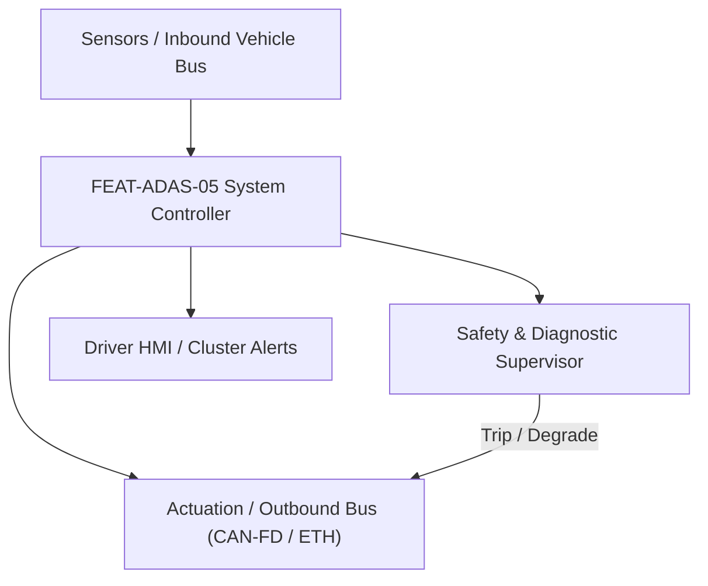
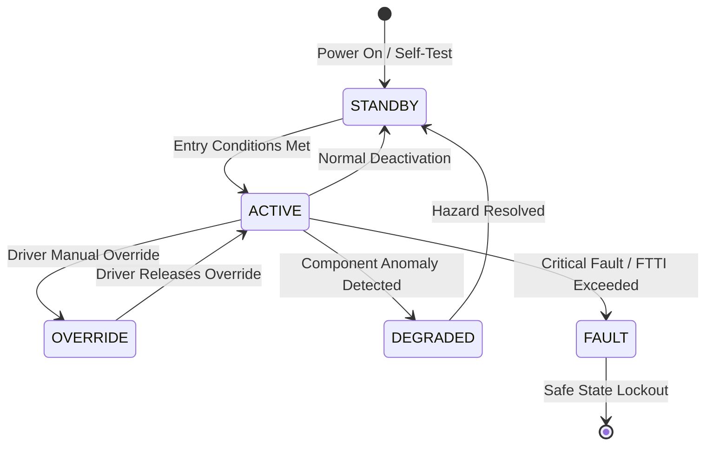

# System Requirements Specification: Highway Pilot & Navigate on Autopilot (HWP-NOA)
**Feature ID:** `FEAT-ADAS-05`  
**Domain:** ADAS & Autonomous Driving  
**Target ASIL:** ASIL D  
**Compliance Standard:** ISO 26262:2018 (Part 4 - System Development) / ASPICE PAM v3.1 (SYS.2, SYS.3)  
**Parent Master Specification:** [`spec.md`](file:///c:/Workset/AntiGravityProjects/TestOptimisationExperiement/spec.md#feat-adas-05-hwp)  
**Derived Software Specification:** [`FEAT-ADAS-05_HWP_SwReq.md`](file:///c:/Workset/AntiGravityProjects/TestOptimisationExperiement/software_requirements/FEAT-ADAS-05_HWP_SwReq.md)

---

## 1. Feature Overview & Operational Scope

Full point-to-point automated highway navigation executing autonomous ramp on/off transitions, high-speed automated lane changes, and overtake maneuvers up to 130 km/h.

### Operational Context Architecture

---

## 2. Activation Logic & Operational States

- **Preconditions:** HD map route programmed in navigation, 360-degree LiDAR/Radar/Camera suite validated, driver in seat, weather clear.
- **Entry Conditions:** Vehicle merges onto highway corridor; driver double-taps cruise stalk or confirms on center screen.
- **Deactivation Conditions:** Destination highway exit reached, manual driver takeover (> 3 Nm torque), or unmapped road boundary reached.
- **Driver Override Behavior:** Turn signal stalk tap commands immediate supervised lane change; manual steering input instantly pauses autonomous lateral control.
- **Operational State Progression:**  
  `ROUTE_MONITORING` -> `PILOT_ENGAGED` -> `OVERTAKE_RECOMMENDED` -> `AUTONOMOUS_LANE_CHANGE` -> `RAMP_NAVIGATING` -> `ABORT_TRANSITION`

### State Transition Diagram

---

## 3. Functional Safety & Failure Mitigation Concept

- **Functional Safety Goal:** SG-HWP-01: Guarantee collision-free highway lane changes and ramp maneuvering; maintain safe longitudinal following distance at 130 km/h.
- **Fault Tolerant Time Interval (FTTI):** 100 ms
- **Safe State Definition:** Abort active lane change, return to center of original lane, and match prevailing traffic speed.
- **Warning & Escalation Strategy:** AR-HUD highlights target lane path in green; chime alerts driver 500 m before mandatory highway exit ramp.

### Failure Modes & Degradation Handling
- **Adjacent Lane Blind Spot:** If rear corner radar detects high-speed closing vehicle (closing speed > 40 km/h), abort lane change within 50 ms.
- **Gnss Multipath:** If urban canyon degrades GNSS positioning, utilize vision visual-inertial odometry (VIO) matching overhead sign gantries.

---

## 4. System Requirements (SYS_REQ)
*(Note: Each System Requirement is systematically partitioned into multiple Child Software Requirements)*

### `SYS-ADAS-05-01`: High-Definition Map & Multi-Constellation RTK Localization
- **Planned Release:** R100
- **ASIL Rating:** ASIL D
- **Parent Feature:** [`FEAT-ADAS-05`](file:///c:/Workset/AntiGravityProjects/TestOptimisationExperiement/spec.md#feat-adas-05)
- **Requirement Statement:**
  > The System SHALL fuse dual-frequency GNSS-RTK, IMU dead-reckoning, and camera visual landmark matching against HD map vector layers to calculate ego vehicle pose with <= 10 cm lateral accuracy at 50 Hz.
- **Activation Logic:** Active when vehicle enters HD-mapped highway corridors.
- **Fault Tolerant Time Interval (FTTI):** 40 ms
- **Safe State Action:** Degrade to standard lane centering (LCA); prompt driver takeover.
- **Failure Detection & Reaction:** If GNSS-RTK correction link drops > 2.0s, coast on visual odometry for max 5.0 seconds.
- **Input Interfaces:** `GNSS_RTK_NMEA_Stream, IMU_6DOF_Acceleration_AngularRate, Camera_Visual_Landmark_Vectors, HD_Map_Layer_Tile`
- **Output Interfaces:** `Ego_Pose_6DOF_Global, Map_Matched_Lane_ID, Localization_Confidence_Metric`
- **System Verification Method:** Real-world ground truth RTK base station verification over 1000 km.
- **Derived Child Software Requirements (1:N Link):**
  - [`SWR-ADAS-05-01`](file:///c:/Workset/AntiGravityProjects/TestOptimisationExperiement/software_requirements/FEAT-ADAS-05_HWP_SwReq.md#swr-adas-05-01)
  - [`SWR-ADAS-05-02`](file:///c:/Workset/AntiGravityProjects/TestOptimisationExperiement/software_requirements/FEAT-ADAS-05_HWP_SwReq.md#swr-adas-05-02)

### `SYS-ADAS-05-02`: Automated Lane Change (ALC) Safe Gap & Trajectory Synthesis
- **Planned Release:** R100
- **ASIL Rating:** ASIL D
- **Parent Feature:** [`FEAT-ADAS-05`](file:///c:/Workset/AntiGravityProjects/TestOptimisationExperiement/spec.md#feat-adas-05)
- **Requirement Statement:**
  > The System SHALL evaluate 360-degree radar/camera obstacle bounding boxes, identify target lane longitudinal gap (>= 25 m), and synthesize 5th-order polynomial lane change trajectory executed in 3.5 to 6.5 seconds.
- **Activation Logic:** Active when route planner requests lane change or driver taps turn signal.
- **Fault Tolerant Time Interval (FTTI):** 50 ms
- **Safe State Action:** Abort lane change; return smoothly to center of origin lane.
- **Failure Detection & Reaction:** If closing target approaches from behind at > 30 km/h delta speed, cancel lane change immediately.
- **Input Interfaces:** `Target_Lane_Gap_Leading_Distance, Target_Lane_Gap_Trailing_Distance, Surround_Tracks_Array[32]`
- **Output Interfaces:** `ALC_Trajectory_Polynomial[6], Turn_Signal_Command_Enum, ALC_Progress_State`
- **System Verification Method:** Multi-vehicle dynamic simulation of highway cut-in and lane change scenarios.
- **Derived Child Software Requirements (1:N Link):**
  - [`SWR-ADAS-05-03`](file:///c:/Workset/AntiGravityProjects/TestOptimisationExperiement/software_requirements/FEAT-ADAS-05_HWP_SwReq.md#swr-adas-05-03)
  - [`SWR-ADAS-05-04`](file:///c:/Workset/AntiGravityProjects/TestOptimisationExperiement/software_requirements/FEAT-ADAS-05_HWP_SwReq.md#swr-adas-05-04)

### `SYS-ADAS-05-03`: Highway Interchange Ramp Branching & Merge/Diverge Coordinator
- **Planned Release:** R100
- **ASIL Rating:** ASIL D
- **Parent Feature:** [`FEAT-ADAS-05`](file:///c:/Workset/AntiGravityProjects/TestOptimisationExperiement/spec.md#feat-adas-05)
- **Requirement Statement:**
  > The System SHALL track navigation route splits, decelerate from cruising speed to ramp advisory speed (e.g. 50 km/h) over 300 m preview, and steer across interchange diverge gore areas with zero driver input.
- **Activation Logic:** Active 1000 m prior to designated highway exit or interchange fork.
- **Fault Tolerant Time Interval (FTTI):** 50 ms
- **Safe State Action:** Transition to Level 2 driver takeover if ramp markings are degraded.
- **Failure Detection & Reaction:** If exit ramp is blocked by stationary traffic, stop safely in lane or continue main highway.
- **Input Interfaces:** `Distance_To_Exit_Ramp_M, Ramp_Advisory_Speed_Kmph, Gore_Area_Polygon_Points`
- **Output Interfaces:** `Ramp_Decel_Profile_Cmd, Diverge_Steering_Trajectory, Interchange_Active_Flag`
- **System Verification Method:** Real-world cloverleaf and trumpet interchange track testing.
- **Derived Child Software Requirements (1:N Link):**
  - [`SWR-ADAS-05-05`](file:///c:/Workset/AntiGravityProjects/TestOptimisationExperiement/software_requirements/FEAT-ADAS-05_HWP_SwReq.md#swr-adas-05-05)
  - [`SWR-ADAS-05-06`](file:///c:/Workset/AntiGravityProjects/TestOptimisationExperiement/software_requirements/FEAT-ADAS-05_HWP_SwReq.md#swr-adas-05-06)

### `SYS-ADAS-05-04`: Dynamic Highway Speed Limit Adherence & Toll Plaza Slowdown
- **Planned Release:** R200
- **ASIL Rating:** ASIL B
- **Parent Feature:** [`FEAT-ADAS-05`](file:///c:/Workset/AntiGravityProjects/TestOptimisationExperiement/spec.md#feat-adas-05)
- **Requirement Statement:**
  > The System SHALL modulate vehicle target speed to comply with dynamic electronic overhead gantry signs, variable speed limits, and automatically ramp speed down to 20 km/h when approaching electronic toll gates.
- **Activation Logic:** Active in HWP_ENGAGED state.
- **Fault Tolerant Time Interval (FTTI):** 200 ms
- **Safe State Action:** Clamp speed to default legal motorway speed limit.
- **Failure Detection & Reaction:** If toll lane barriers are down, command vehicle to a complete stop 10 m before gate.
- **Input Interfaces:** `Overhead_Gantry_Speed_Sign, Distance_To_Toll_Gate_M, Current_Legal_Speed_Limit_Kmph`
- **Output Interfaces:** `Advisory_Highway_Speed_Cmd_Kmph, Toll_Plaza_Approaching_Flag`
- **System Verification Method:** Camera OCR test against variable matrix signs and electronic toll plaza approaches.
- **Derived Child Software Requirements (1:N Link):**
  - [`SWR-ADAS-05-07`](file:///c:/Workset/AntiGravityProjects/TestOptimisationExperiement/software_requirements/FEAT-ADAS-05_HWP_SwReq.md#swr-adas-05-07)
  - [`SWR-ADAS-05-08`](file:///c:/Workset/AntiGravityProjects/TestOptimisationExperiement/software_requirements/FEAT-ADAS-05_HWP_SwReq.md#swr-adas-05-08)

### `SYS-ADAS-05-05`: Road Work Pylon & Coned Lane Shift Evasion
- **Planned Release:** R200
- **ASIL Rating:** ASIL D
- **Parent Feature:** [`FEAT-ADAS-05`](file:///c:/Workset/AntiGravityProjects/TestOptimisationExperiement/spec.md#feat-adas-05)
- **Requirement Statement:**
  > The System SHALL detect highway construction zones (traffic cones, arrow boards, concrete jersey barriers up to 100 m ahead) and execute smooth lateral trajectory offsets to follow temporary coned lane shifts.
- **Activation Logic:** Active when construction markers detected on highway.
- **Fault Tolerant Time Interval (FTTI):** 60 ms
- **Safe State Action:** Prompt immediate driver takeover; reduce speed to 40 km/h.
- **Failure Detection & Reaction:** If cones obstruct all travel lanes, bring vehicle to a safe stop.
- **Input Interfaces:** `Traffic_Cone_Clusters[16], Arrow_Board_Flashing_Symbol_Enum, Jersey_Barrier_Points`
- **Output Interfaces:** `Construction_Offset_Path_Polynomial, Lane_Shift_Active_Flag`
- **System Verification Method:** Proving ground dynamic test track with real orange highway construction pylons.
- **Derived Child Software Requirements (1:N Link):**
  - [`SWR-ADAS-05-09`](file:///c:/Workset/AntiGravityProjects/TestOptimisationExperiement/software_requirements/FEAT-ADAS-05_HWP_SwReq.md#swr-adas-05-09)
  - [`SWR-ADAS-05-10`](file:///c:/Workset/AntiGravityProjects/TestOptimisationExperiement/software_requirements/FEAT-ADAS-05_HWP_SwReq.md#swr-adas-05-10)

### `SYS-ADAS-05-06`: High-Speed Highway Navigation Point-to-Point Route Optimizer
- **Planned Release:** R200
- **ASIL Rating:** ASIL D
- **Parent Feature:** [`FEAT-ADAS-05`](file:///c:/Workset/AntiGravityProjects/TestOptimisationExperiement/spec.md#feat-adas-05)
- **Requirement Statement:**
  > The System SHALL Calculate lane-level navigation waypoints across multi-lane highway networks at 100 ms cycle.
- **Activation Logic:** Active during normal vehicle operation when feature state is active.
- **Fault Tolerant Time Interval (FTTI):** 100 ms
- **Safe State Action:** Transition to safe state or safe degradation tier within FTTI budget.
- **Failure Detection & Reaction:** Isolate faulted channel, latch DEM diagnostic trouble code, and inform driver.
- **Input Interfaces:** `Sensor signals, vehicle dynamics data, and bus frames via RTE.`
- **Output Interfaces:** `Actuator commands, diagnostic event flags, and cluster alerts.`
- **System Verification Method:** HiL test bench and dynamometer automated verification.
- **Derived Child Software Requirements (1:N Link):**
  - [`SWR-ADAS-05-11`](file:///c:/Workset/AntiGravityProjects/TestOptimisationExperiement/software_requirements/FEAT-ADAS-05_HWP_SwReq.md#swr-adas-05-11)
  - [`SWR-ADAS-05-12`](file:///c:/Workset/AntiGravityProjects/TestOptimisationExperiement/software_requirements/FEAT-ADAS-05_HWP_SwReq.md#swr-adas-05-12)

### `SYS-ADAS-05-07`: Automated Lane Change Trajectory Generator & Gap Evaluator
- **Planned Release:** R300
- **ASIL Rating:** ASIL D
- **Parent Feature:** [`FEAT-ADAS-05`](file:///c:/Workset/AntiGravityProjects/TestOptimisationExperiement/spec.md#feat-adas-05)
- **Requirement Statement:**
  > The System SHALL Evaluate forward, side, and rear radar clearance before initiating automated lane change maneuver.
- **Activation Logic:** Active during normal vehicle operation when feature state is active.
- **Fault Tolerant Time Interval (FTTI):** 40 ms
- **Safe State Action:** Transition to safe state or safe degradation tier within FTTI budget.
- **Failure Detection & Reaction:** Isolate faulted channel, latch DEM diagnostic trouble code, and inform driver.
- **Input Interfaces:** `Sensor signals, vehicle dynamics data, and bus frames via RTE.`
- **Output Interfaces:** `Actuator commands, diagnostic event flags, and cluster alerts.`
- **System Verification Method:** HiL test bench and dynamometer automated verification.
- **Derived Child Software Requirements (1:N Link):**
  - [`SWR-ADAS-05-13`](file:///c:/Workset/AntiGravityProjects/TestOptimisationExperiement/software_requirements/FEAT-ADAS-05_HWP_SwReq.md#swr-adas-05-13)
  - [`SWR-ADAS-05-14`](file:///c:/Workset/AntiGravityProjects/TestOptimisationExperiement/software_requirements/FEAT-ADAS-05_HWP_SwReq.md#swr-adas-05-14)

### `SYS-ADAS-05-08`: Blind Spot & Fast-Approaching Rear Vehicle TTC Safety Assessor
- **Planned Release:** R300
- **ASIL Rating:** ASIL D
- **Parent Feature:** [`FEAT-ADAS-05`](file:///c:/Workset/AntiGravityProjects/TestOptimisationExperiement/spec.md#feat-adas-05)
- **Requirement Statement:**
  > The System SHALL Calculate time-to-collision with vehicles in target lane up to 120 m rearward (TTC > 4.5s required).
- **Activation Logic:** Active during normal vehicle operation when feature state is active.
- **Fault Tolerant Time Interval (FTTI):** 30 ms
- **Safe State Action:** Transition to safe state or safe degradation tier within FTTI budget.
- **Failure Detection & Reaction:** Isolate faulted channel, latch DEM diagnostic trouble code, and inform driver.
- **Input Interfaces:** `Sensor signals, vehicle dynamics data, and bus frames via RTE.`
- **Output Interfaces:** `Actuator commands, diagnostic event flags, and cluster alerts.`
- **System Verification Method:** HiL test bench and dynamometer automated verification.
- **Derived Child Software Requirements (1:N Link):**
  - [`SWR-ADAS-05-15`](file:///c:/Workset/AntiGravityProjects/TestOptimisationExperiement/software_requirements/FEAT-ADAS-05_HWP_SwReq.md#swr-adas-05-15)
  - [`SWR-ADAS-05-16`](file:///c:/Workset/AntiGravityProjects/TestOptimisationExperiement/software_requirements/FEAT-ADAS-05_HWP_SwReq.md#swr-adas-05-16)

### `SYS-ADAS-05-09`: High-Speed Interchange Ramp Merging & Speed Adaptation Governor
- **Planned Release:** R300
- **ASIL Rating:** ASIL D
- **Parent Feature:** [`FEAT-ADAS-05`](file:///c:/Workset/AntiGravityProjects/TestOptimisationExperiement/spec.md#feat-adas-05)
- **Requirement Statement:**
  > The System SHALL Govern speed smoothly from 130 km/h down to ramp advisory speed (60 km/h) based on curvature.
- **Activation Logic:** Active during normal vehicle operation when feature state is active.
- **Fault Tolerant Time Interval (FTTI):** 50 ms
- **Safe State Action:** Transition to safe state or safe degradation tier within FTTI budget.
- **Failure Detection & Reaction:** Isolate faulted channel, latch DEM diagnostic trouble code, and inform driver.
- **Input Interfaces:** `Sensor signals, vehicle dynamics data, and bus frames via RTE.`
- **Output Interfaces:** `Actuator commands, diagnostic event flags, and cluster alerts.`
- **System Verification Method:** HiL test bench and dynamometer automated verification.
- **Derived Child Software Requirements (1:N Link):**
  - [`SWR-ADAS-05-17`](file:///c:/Workset/AntiGravityProjects/TestOptimisationExperiement/software_requirements/FEAT-ADAS-05_HWP_SwReq.md#swr-adas-05-17)
  - [`SWR-ADAS-05-18`](file:///c:/Workset/AntiGravityProjects/TestOptimisationExperiement/software_requirements/FEAT-ADAS-05_HWP_SwReq.md#swr-adas-05-18)

### `SYS-ADAS-05-10`: Dynamic 360-Degree Safety Corridor Buffer Envelope Calculator
- **Planned Release:** R400
- **ASIL Rating:** ASIL D
- **Parent Feature:** [`FEAT-ADAS-05`](file:///c:/Workset/AntiGravityProjects/TestOptimisationExperiement/spec.md#feat-adas-05)
- **Requirement Statement:**
  > The System SHALL Maintain dynamic safety polygon buffer around vehicle perimeter scaling with ego velocity.
- **Activation Logic:** Active during normal vehicle operation when feature state is active.
- **Fault Tolerant Time Interval (FTTI):** 30 ms
- **Safe State Action:** Transition to safe state or safe degradation tier within FTTI budget.
- **Failure Detection & Reaction:** Isolate faulted channel, latch DEM diagnostic trouble code, and inform driver.
- **Input Interfaces:** `Sensor signals, vehicle dynamics data, and bus frames via RTE.`
- **Output Interfaces:** `Actuator commands, diagnostic event flags, and cluster alerts.`
- **System Verification Method:** HiL test bench and dynamometer automated verification.
- **Derived Child Software Requirements (1:N Link):**
  - [`SWR-ADAS-05-19`](file:///c:/Workset/AntiGravityProjects/TestOptimisationExperiement/software_requirements/FEAT-ADAS-05_HWP_SwReq.md#swr-adas-05-19)
  - [`SWR-ADAS-05-20`](file:///c:/Workset/AntiGravityProjects/TestOptimisationExperiement/software_requirements/FEAT-ADAS-05_HWP_SwReq.md#swr-adas-05-20)

### `SYS-ADAS-05-11`: Longitudinal & Lateral Actuation Coordinated Command Dispatcher
- **Planned Release:** R400
- **ASIL Rating:** ASIL D
- **Parent Feature:** [`FEAT-ADAS-05`](file:///c:/Workset/AntiGravityProjects/TestOptimisationExperiement/spec.md#feat-adas-05)
- **Requirement Statement:**
  > The System SHALL Synchronize steering angle and propulsion torque setpoints over chassis CAN-FD with E2E CRC.
- **Activation Logic:** Active during normal vehicle operation when feature state is active.
- **Fault Tolerant Time Interval (FTTI):** 20 ms
- **Safe State Action:** Transition to safe state or safe degradation tier within FTTI budget.
- **Failure Detection & Reaction:** Isolate faulted channel, latch DEM diagnostic trouble code, and inform driver.
- **Input Interfaces:** `Sensor signals, vehicle dynamics data, and bus frames via RTE.`
- **Output Interfaces:** `Actuator commands, diagnostic event flags, and cluster alerts.`
- **System Verification Method:** HiL test bench and dynamometer automated verification.
- **Derived Child Software Requirements (1:N Link):**
  - [`SWR-ADAS-05-21`](file:///c:/Workset/AntiGravityProjects/TestOptimisationExperiement/software_requirements/FEAT-ADAS-05_HWP_SwReq.md#swr-adas-05-21)
  - [`SWR-ADAS-05-22`](file:///c:/Workset/AntiGravityProjects/TestOptimisationExperiement/software_requirements/FEAT-ADAS-05_HWP_SwReq.md#swr-adas-05-22)

### `SYS-ADAS-05-12`: Driver Steering Nudge Override Cancellation & Smooth Handover
- **Planned Release:** R400
- **ASIL Rating:** ASIL D
- **Parent Feature:** [`FEAT-ADAS-05`](file:///c:/Workset/AntiGravityProjects/TestOptimisationExperiement/spec.md#feat-adas-05)
- **Requirement Statement:**
  > The System SHALL Detect driver steering input (> 2.0 Nm) and seamlessly yield lateral authority to human driver.
- **Activation Logic:** Active during normal vehicle operation when feature state is active.
- **Fault Tolerant Time Interval (FTTI):** 30 ms
- **Safe State Action:** Transition to safe state or safe degradation tier within FTTI budget.
- **Failure Detection & Reaction:** Isolate faulted channel, latch DEM diagnostic trouble code, and inform driver.
- **Input Interfaces:** `Sensor signals, vehicle dynamics data, and bus frames via RTE.`
- **Output Interfaces:** `Actuator commands, diagnostic event flags, and cluster alerts.`
- **System Verification Method:** HiL test bench and dynamometer automated verification.
- **Derived Child Software Requirements (1:N Link):**
  - [`SWR-ADAS-05-23`](file:///c:/Workset/AntiGravityProjects/TestOptimisationExperiement/software_requirements/FEAT-ADAS-05_HWP_SwReq.md#swr-adas-05-23)
  - [`SWR-ADAS-05-24`](file:///c:/Workset/AntiGravityProjects/TestOptimisationExperiement/software_requirements/FEAT-ADAS-05_HWP_SwReq.md#swr-adas-05-24)

### `SYS-ADAS-05-13`: Inclement Weather & Low Visibility Highway ODD Limiter
- **Planned Release:** R500
- **ASIL Rating:** ASIL B
- **Parent Feature:** [`FEAT-ADAS-05`](file:///c:/Workset/AntiGravityProjects/TestOptimisationExperiement/spec.md#feat-adas-05)
- **Requirement Statement:**
  > The System SHALL Restrict automated highway pilot operation when visibility drops below 150 m or wiper speed is high.
- **Activation Logic:** Active during normal vehicle operation when feature state is active.
- **Fault Tolerant Time Interval (FTTI):** 200 ms
- **Safe State Action:** Transition to safe state or safe degradation tier within FTTI budget.
- **Failure Detection & Reaction:** Isolate faulted channel, latch DEM diagnostic trouble code, and inform driver.
- **Input Interfaces:** `Sensor signals, vehicle dynamics data, and bus frames via RTE.`
- **Output Interfaces:** `Actuator commands, diagnostic event flags, and cluster alerts.`
- **System Verification Method:** HiL test bench and dynamometer automated verification.
- **Derived Child Software Requirements (1:N Link):**
  - [`SWR-ADAS-05-25`](file:///c:/Workset/AntiGravityProjects/TestOptimisationExperiement/software_requirements/FEAT-ADAS-05_HWP_SwReq.md#swr-adas-05-25)
  - [`SWR-ADAS-05-26`](file:///c:/Workset/AntiGravityProjects/TestOptimisationExperiement/software_requirements/FEAT-ADAS-05_HWP_SwReq.md#swr-adas-05-26)

### `SYS-ADAS-05-14`: Redundant Dual-Compute Platform Synchronization & Failover Engine
- **Planned Release:** R400
- **ASIL Rating:** ASIL D
- **Parent Feature:** [`FEAT-ADAS-05`](file:///c:/Workset/AntiGravityProjects/TestOptimisationExperiement/spec.md#feat-adas-05)
- **Requirement Statement:**
  > The System SHALL Mirror trajectory plans across primary and secondary compute cores; failover in <= 15 ms.
- **Activation Logic:** Active during normal vehicle operation when feature state is active.
- **Fault Tolerant Time Interval (FTTI):** 15 ms
- **Safe State Action:** Transition to safe state or safe degradation tier within FTTI budget.
- **Failure Detection & Reaction:** Isolate faulted channel, latch DEM diagnostic trouble code, and inform driver.
- **Input Interfaces:** `Sensor signals, vehicle dynamics data, and bus frames via RTE.`
- **Output Interfaces:** `Actuator commands, diagnostic event flags, and cluster alerts.`
- **System Verification Method:** HiL test bench and dynamometer automated verification.
- **Derived Child Software Requirements (1:N Link):**
  - [`SWR-ADAS-05-27`](file:///c:/Workset/AntiGravityProjects/TestOptimisationExperiement/software_requirements/FEAT-ADAS-05_HWP_SwReq.md#swr-adas-05-27)
  - [`SWR-ADAS-05-28`](file:///c:/Workset/AntiGravityProjects/TestOptimisationExperiement/software_requirements/FEAT-ADAS-05_HWP_SwReq.md#swr-adas-05-28)

### `SYS-ADAS-05-15`: DEM Diagnostic Freeze-Frame & Highway Event Recorder
- **Planned Release:** R500
- **ASIL Rating:** ASIL B
- **Parent Feature:** [`FEAT-ADAS-05`](file:///c:/Workset/AntiGravityProjects/TestOptimisationExperiement/spec.md#feat-adas-05)
- **Requirement Statement:**
  > The System SHALL Log diagnostic trouble codes and non-volatile operational traces upon any aborted maneuver.
- **Activation Logic:** Active during normal vehicle operation when feature state is active.
- **Fault Tolerant Time Interval (FTTI):** 50 ms
- **Safe State Action:** Transition to safe state or safe degradation tier within FTTI budget.
- **Failure Detection & Reaction:** Isolate faulted channel, latch DEM diagnostic trouble code, and inform driver.
- **Input Interfaces:** `Sensor signals, vehicle dynamics data, and bus frames via RTE.`
- **Output Interfaces:** `Actuator commands, diagnostic event flags, and cluster alerts.`
- **System Verification Method:** HiL test bench and dynamometer automated verification.
- **Derived Child Software Requirements (1:N Link):**
  - [`SWR-ADAS-05-29`](file:///c:/Workset/AntiGravityProjects/TestOptimisationExperiement/software_requirements/FEAT-ADAS-05_HWP_SwReq.md#swr-adas-05-29)
  - [`SWR-ADAS-05-30`](file:///c:/Workset/AntiGravityProjects/TestOptimisationExperiement/software_requirements/FEAT-ADAS-05_HWP_SwReq.md#swr-adas-05-30)

---

## 5. System-to-Software Traceability Summary

| System Requirement ID | Planned Release | ASIL | Title | Derived Software Requirements (1:N) | Verification Method |
| :--- | :---: | :--- | :--- | :--- | :--- |
| `SYS-ADAS-05-01` | **`R100`** | ASIL D | High-Definition Map & Multi-Constellation RTK Localization | [`SWR-ADAS-05-01`](file:///c:/Workset/AntiGravityProjects/TestOptimisationExperiement/software_requirements/FEAT-ADAS-05_HWP_SwReq.md#swr-adas-05-01), [`SWR-ADAS-05-02`](file:///c:/Workset/AntiGravityProjects/TestOptimisationExperiement/software_requirements/FEAT-ADAS-05_HWP_SwReq.md#swr-adas-05-02) | Real-world ground truth RTK base station verification over 1000 km. |
| `SYS-ADAS-05-02` | **`R100`** | ASIL D | Automated Lane Change (ALC) Safe Gap & Trajectory Synthesis | [`SWR-ADAS-05-03`](file:///c:/Workset/AntiGravityProjects/TestOptimisationExperiement/software_requirements/FEAT-ADAS-05_HWP_SwReq.md#swr-adas-05-03), [`SWR-ADAS-05-04`](file:///c:/Workset/AntiGravityProjects/TestOptimisationExperiement/software_requirements/FEAT-ADAS-05_HWP_SwReq.md#swr-adas-05-04) | Multi-vehicle dynamic simulation of highway cut-in and lane change scenarios. |
| `SYS-ADAS-05-03` | **`R100`** | ASIL D | Highway Interchange Ramp Branching & Merge/Diverge Coordinator | [`SWR-ADAS-05-05`](file:///c:/Workset/AntiGravityProjects/TestOptimisationExperiement/software_requirements/FEAT-ADAS-05_HWP_SwReq.md#swr-adas-05-05), [`SWR-ADAS-05-06`](file:///c:/Workset/AntiGravityProjects/TestOptimisationExperiement/software_requirements/FEAT-ADAS-05_HWP_SwReq.md#swr-adas-05-06) | Real-world cloverleaf and trumpet interchange track testing. |
| `SYS-ADAS-05-04` | **`R200`** | ASIL B | Dynamic Highway Speed Limit Adherence & Toll Plaza Slowdown | [`SWR-ADAS-05-07`](file:///c:/Workset/AntiGravityProjects/TestOptimisationExperiement/software_requirements/FEAT-ADAS-05_HWP_SwReq.md#swr-adas-05-07), [`SWR-ADAS-05-08`](file:///c:/Workset/AntiGravityProjects/TestOptimisationExperiement/software_requirements/FEAT-ADAS-05_HWP_SwReq.md#swr-adas-05-08) | Camera OCR test against variable matrix signs and electronic toll plaza approaches. |
| `SYS-ADAS-05-05` | **`R200`** | ASIL D | Road Work Pylon & Coned Lane Shift Evasion | [`SWR-ADAS-05-09`](file:///c:/Workset/AntiGravityProjects/TestOptimisationExperiement/software_requirements/FEAT-ADAS-05_HWP_SwReq.md#swr-adas-05-09), [`SWR-ADAS-05-10`](file:///c:/Workset/AntiGravityProjects/TestOptimisationExperiement/software_requirements/FEAT-ADAS-05_HWP_SwReq.md#swr-adas-05-10) | Proving ground dynamic test track with real orange highway construction pylons. |
| `SYS-ADAS-05-06` | **`R200`** | ASIL D | High-Speed Highway Navigation Point-to-Point Route Optimizer | [`SWR-ADAS-05-11`](file:///c:/Workset/AntiGravityProjects/TestOptimisationExperiement/software_requirements/FEAT-ADAS-05_HWP_SwReq.md#swr-adas-05-11), [`SWR-ADAS-05-12`](file:///c:/Workset/AntiGravityProjects/TestOptimisationExperiement/software_requirements/FEAT-ADAS-05_HWP_SwReq.md#swr-adas-05-12) | HiL test bench and dynamometer automated verification. |
| `SYS-ADAS-05-07` | **`R300`** | ASIL D | Automated Lane Change Trajectory Generator & Gap Evaluator | [`SWR-ADAS-05-13`](file:///c:/Workset/AntiGravityProjects/TestOptimisationExperiement/software_requirements/FEAT-ADAS-05_HWP_SwReq.md#swr-adas-05-13), [`SWR-ADAS-05-14`](file:///c:/Workset/AntiGravityProjects/TestOptimisationExperiement/software_requirements/FEAT-ADAS-05_HWP_SwReq.md#swr-adas-05-14) | HiL test bench and dynamometer automated verification. |
| `SYS-ADAS-05-08` | **`R300`** | ASIL D | Blind Spot & Fast-Approaching Rear Vehicle TTC Safety Assessor | [`SWR-ADAS-05-15`](file:///c:/Workset/AntiGravityProjects/TestOptimisationExperiement/software_requirements/FEAT-ADAS-05_HWP_SwReq.md#swr-adas-05-15), [`SWR-ADAS-05-16`](file:///c:/Workset/AntiGravityProjects/TestOptimisationExperiement/software_requirements/FEAT-ADAS-05_HWP_SwReq.md#swr-adas-05-16) | HiL test bench and dynamometer automated verification. |
| `SYS-ADAS-05-09` | **`R300`** | ASIL D | High-Speed Interchange Ramp Merging & Speed Adaptation Governor | [`SWR-ADAS-05-17`](file:///c:/Workset/AntiGravityProjects/TestOptimisationExperiement/software_requirements/FEAT-ADAS-05_HWP_SwReq.md#swr-adas-05-17), [`SWR-ADAS-05-18`](file:///c:/Workset/AntiGravityProjects/TestOptimisationExperiement/software_requirements/FEAT-ADAS-05_HWP_SwReq.md#swr-adas-05-18) | HiL test bench and dynamometer automated verification. |
| `SYS-ADAS-05-10` | **`R400`** | ASIL D | Dynamic 360-Degree Safety Corridor Buffer Envelope Calculator | [`SWR-ADAS-05-19`](file:///c:/Workset/AntiGravityProjects/TestOptimisationExperiement/software_requirements/FEAT-ADAS-05_HWP_SwReq.md#swr-adas-05-19), [`SWR-ADAS-05-20`](file:///c:/Workset/AntiGravityProjects/TestOptimisationExperiement/software_requirements/FEAT-ADAS-05_HWP_SwReq.md#swr-adas-05-20) | HiL test bench and dynamometer automated verification. |
| `SYS-ADAS-05-11` | **`R400`** | ASIL D | Longitudinal & Lateral Actuation Coordinated Command Dispatcher | [`SWR-ADAS-05-21`](file:///c:/Workset/AntiGravityProjects/TestOptimisationExperiement/software_requirements/FEAT-ADAS-05_HWP_SwReq.md#swr-adas-05-21), [`SWR-ADAS-05-22`](file:///c:/Workset/AntiGravityProjects/TestOptimisationExperiement/software_requirements/FEAT-ADAS-05_HWP_SwReq.md#swr-adas-05-22) | HiL test bench and dynamometer automated verification. |
| `SYS-ADAS-05-12` | **`R400`** | ASIL D | Driver Steering Nudge Override Cancellation & Smooth Handover | [`SWR-ADAS-05-23`](file:///c:/Workset/AntiGravityProjects/TestOptimisationExperiement/software_requirements/FEAT-ADAS-05_HWP_SwReq.md#swr-adas-05-23), [`SWR-ADAS-05-24`](file:///c:/Workset/AntiGravityProjects/TestOptimisationExperiement/software_requirements/FEAT-ADAS-05_HWP_SwReq.md#swr-adas-05-24) | HiL test bench and dynamometer automated verification. |
| `SYS-ADAS-05-13` | **`R500`** | ASIL B | Inclement Weather & Low Visibility Highway ODD Limiter | [`SWR-ADAS-05-25`](file:///c:/Workset/AntiGravityProjects/TestOptimisationExperiement/software_requirements/FEAT-ADAS-05_HWP_SwReq.md#swr-adas-05-25), [`SWR-ADAS-05-26`](file:///c:/Workset/AntiGravityProjects/TestOptimisationExperiement/software_requirements/FEAT-ADAS-05_HWP_SwReq.md#swr-adas-05-26) | HiL test bench and dynamometer automated verification. |
| `SYS-ADAS-05-14` | **`R400`** | ASIL D | Redundant Dual-Compute Platform Synchronization & Failover Engine | [`SWR-ADAS-05-27`](file:///c:/Workset/AntiGravityProjects/TestOptimisationExperiement/software_requirements/FEAT-ADAS-05_HWP_SwReq.md#swr-adas-05-27), [`SWR-ADAS-05-28`](file:///c:/Workset/AntiGravityProjects/TestOptimisationExperiement/software_requirements/FEAT-ADAS-05_HWP_SwReq.md#swr-adas-05-28) | HiL test bench and dynamometer automated verification. |
| `SYS-ADAS-05-15` | **`R500`** | ASIL B | DEM Diagnostic Freeze-Frame & Highway Event Recorder | [`SWR-ADAS-05-29`](file:///c:/Workset/AntiGravityProjects/TestOptimisationExperiement/software_requirements/FEAT-ADAS-05_HWP_SwReq.md#swr-adas-05-29), [`SWR-ADAS-05-30`](file:///c:/Workset/AntiGravityProjects/TestOptimisationExperiement/software_requirements/FEAT-ADAS-05_HWP_SwReq.md#swr-adas-05-30) | HiL test bench and dynamometer automated verification. |

- **Upstream Feature Link:** [`spec.md` (FEAT-ADAS-05)](file:///c:/Workset/AntiGravityProjects/TestOptimisationExperiement/spec.md#feat-adas-05)
- **Software Requirements Specification:** [`FEAT-ADAS-05_HWP_SwReq.md`](file:///c:/Workset/AntiGravityProjects/TestOptimisationExperiement/software_requirements/FEAT-ADAS-05_HWP_SwReq.md)
