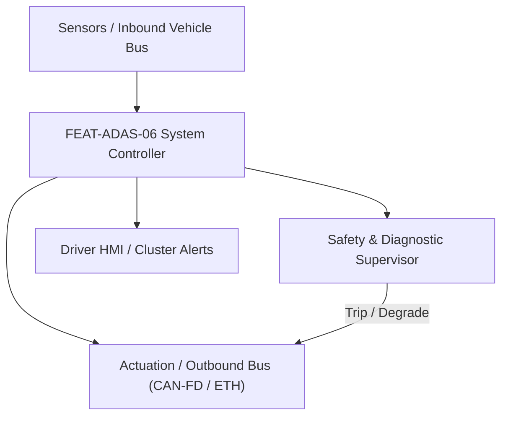
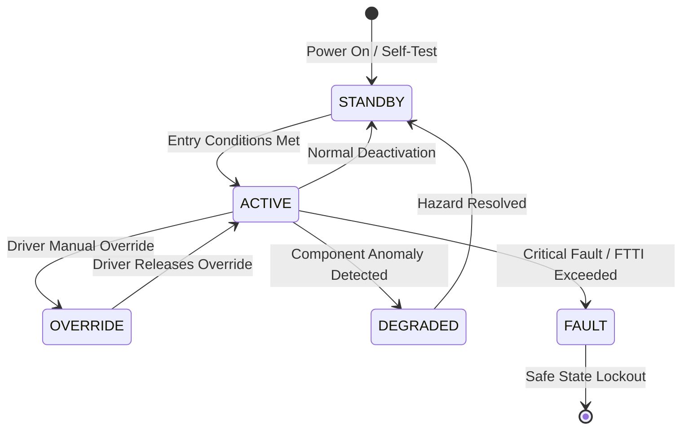

# System Requirements Specification: Automated Valet Parking (AVP - SAE Level 4)
**Feature ID:** `FEAT-ADAS-06`  
**Domain:** ADAS & Autonomous Driving  
**Target ASIL:** ASIL D  
**Compliance Standard:** ISO 26262:2018 (Part 4 - System Development) / ASPICE PAM v3.1 (SYS.2, SYS.3)  
**Parent Master Specification:** [`spec.md`](file:///c:/Workset/AntiGravityProjects/TestOptimisationExperiement/spec.md#feat-adas-06-avp)  
**Derived Software Specification:** [`FEAT-ADAS-06_AVP_SwReq.md`](file:///c:/Workset/AntiGravityProjects/TestOptimisationExperiement/software_requirements/FEAT-ADAS-06_AVP_SwReq.md)

---

## 1. Feature Overview & Operational Scope

SAE Level 4 driverless low-speed automated maneuvering within geo-fenced parking structures, executing autonomous slot search, parking, and summoning.

### Operational Context Architecture

---

## 2. Activation Logic & Operational States

- **Preconditions:** Vehicle inside mapped parking facility, passenger cabin empty (occupancy sensors confirmed), doors/windows closed, battery SOC > 20%, infrastructure communication link established.
- **Entry Conditions:** User commands 'Park Vehicle' or 'Summon Vehicle' via smartphone app; vehicle confirms path safety and infrastructure permit.
- **Deactivation Conditions:** User commands stop via app, safety perimeter violated, emergency obstacle in path, or heartbeat lost with infrastructure.
- **Driver Override Behavior:** Physical door handle touch, brake pedal press from inside, or mobile app e-stop immediately halts vehicle motion in < 100 ms.
- **Operational State Progression:**  
  `IDLE_UNLOCKED` -> `INFRASTRUCTURE_HANDSHAKE` -> `PATH_TRACKING` -> `OBSTACLE_AVOIDANCE` -> `SLOT_MANEUVERING` -> `PARKED_SECURED` -> `EMERGENCY_STOP`

### State Transition Diagram

---

## 3. Functional Safety & Failure Mitigation Concept

- **Functional Safety Goal:** SG-AVP-01: Zero collision risk with pedestrians and static infrastructure; maximum speed bounded to <= 10 km/h.
- **Fault Tolerant Time Interval (FTTI):** 100 ms
- **Safe State Definition:** Immediate emergency brake application (0.4g stop) and engage mechanical park pawl.
- **Warning & Escalation Strategy:** Exterior acoustic warning chimes (AVAS sounder at 75 dB) and hazard flashers active during motion.

### Failure Modes & Degradation Handling
- **Comm Link Loss:** If 5G / V2I heartbeat lost for > 500 ms, stop vehicle within current lane and wait for reconnection.
- **Ultrasonic Sensor Failure:** If 1 of 12 ultrasonic sensors fails, continue at reduced speed (< 5 km/h) using surround cameras; if 2 fail, bring vehicle to halt.

---

## 4. System Requirements (SYS_REQ)
*(Note: Each System Requirement is systematically partitioned into multiple Child Software Requirements)*

### `SYS-ADAS-06-01`: Multi-Floor Parking Facility V2X Map & Route Ingestion
- **Planned Release:** R100
- **ASIL Rating:** ASIL D
- **Parent Feature:** [`FEAT-ADAS-06`](file:///c:/Workset/AntiGravityProjects/TestOptimisationExperiement/spec.md#feat-adas-06)
- **Requirement Statement:**
  > The System SHALL download parking facility HD digital twin map (aisles, pillars, empty slots, floor ramps) over V2X Wi-Fi/5G and plan conflict-free path from drop-off bay to target parking slot at <= 10 km/h.
- **Activation Logic:** Active upon user commanding 'Park My Car' via smartphone app.
- **Fault Tolerant Time Interval (FTTI):** 50 ms
- **Safe State Action:** Halt vehicle motion immediately; engage EPB.
- **Failure Detection & Reaction:** If V2X map link disconnects, stop safely in parking aisle and await reconnection.
- **Input Interfaces:** `Facility_V2X_Map_Tile, Target_Parking_Slot_ID, Vehicle_Current_GPS_X_Y`
- **Output Interfaces:** `Global_Parking_Route_Waypoints[128], Target_Floor_Level_Enum`
- **System Verification Method:** Multi-story underground parking garage digital twin validation (ISO 23374).
- **Derived Child Software Requirements (1:N Link):**
  - [`SWR-ADAS-06-01`](file:///c:/Workset/AntiGravityProjects/TestOptimisationExperiement/software_requirements/FEAT-ADAS-06_AVP_SwReq.md#swr-adas-06-01)
  - [`SWR-ADAS-06-02`](file:///c:/Workset/AntiGravityProjects/TestOptimisationExperiement/software_requirements/FEAT-ADAS-06_AVP_SwReq.md#swr-adas-06-02)

### `SYS-ADAS-06-02`: Surround LiDAR & 360 Camera 3D Voxel Grid Occupancy Mapping
- **Planned Release:** R100
- **ASIL Rating:** ASIL D
- **Parent Feature:** [`FEAT-ADAS-06`](file:///c:/Workset/AntiGravityProjects/TestOptimisationExperiement/spec.md#feat-adas-06)
- **Requirement Statement:**
  > The System SHALL fuse 4 surround solid-state LiDARs and 8 cameras at 20 Hz, building 3D voxel grid map (5 cm resolution) to detect structural concrete pillars, low curbs, pedestrians, and parked vehicles.
- **Activation Logic:** Active throughout driverless automated valet operation.
- **Fault Tolerant Time Interval (FTTI):** 40 ms
- **Safe State Action:** Clamp speed to 0.0 km/h; sound gentle horn chime.
- **Failure Detection & Reaction:** If any LiDAR lens is occluded by mud, abort mission and stop in place.
- **Input Interfaces:** `Surround_Lidar_Point_Clouds[4], Surround_FishEye_Cameras[4], Ultrasonic_Distances[12]`
- **Output Interfaces:** `3D_Voxel_Occupancy_Grid[100x100x20], Static_Obstacle_Mask`
- **System Verification Method:** Low-light indoor parking garage obstacle detection benchmark testing.
- **Derived Child Software Requirements (1:N Link):**
  - [`SWR-ADAS-06-03`](file:///c:/Workset/AntiGravityProjects/TestOptimisationExperiement/software_requirements/FEAT-ADAS-06_AVP_SwReq.md#swr-adas-06-03)
  - [`SWR-ADAS-06-04`](file:///c:/Workset/AntiGravityProjects/TestOptimisationExperiement/software_requirements/FEAT-ADAS-06_AVP_SwReq.md#swr-adas-06-04)

### `SYS-ADAS-06-03`: Tight-Space Bi-Directional Crawl & Ramp Incline Control
- **Planned Release:** R100
- **ASIL Rating:** ASIL D
- **Parent Feature:** [`FEAT-ADAS-06`](file:///c:/Workset/AntiGravityProjects/TestOptimisationExperiement/spec.md#feat-adas-06)
- **Requirement Statement:**
  > The System SHALL control low-speed electric motor crawl (0.5 to 8.0 km/h +-0.2 km/h) and steering up to +-35 deg road wheel angle, navigating 15% steep inter-floor ramps and 90-degree tight corners.
- **Activation Logic:** Active along parking navigation route.
- **Fault Tolerant Time Interval (FTTI):** 30 ms
- **Safe State Action:** Full hydraulic brake clamping; zero motor crawl torque.
- **Failure Detection & Reaction:** If vehicle rolls backward on ramp > 5 cm, immediately clamp hill-hold brakes.
- **Input Interfaces:** `Global_Parking_Route_Waypoints, Incline_Grade_Pct, Motor_Resolver_Speed_RPM`
- **Output Interfaces:** `Crawl_Torque_Demand_Nm, Precision_Steering_Angle_Deg, Hill_Hold_Active_Flag`
- **System Verification Method:** 18% gradient steep ramp stopping and restart automated tests.
- **Derived Child Software Requirements (1:N Link):**
  - [`SWR-ADAS-06-05`](file:///c:/Workset/AntiGravityProjects/TestOptimisationExperiement/software_requirements/FEAT-ADAS-06_AVP_SwReq.md#swr-adas-06-05)
  - [`SWR-ADAS-06-06`](file:///c:/Workset/AntiGravityProjects/TestOptimisationExperiement/software_requirements/FEAT-ADAS-06_AVP_SwReq.md#swr-adas-06-06)

### `SYS-ADAS-06-04`: Pedestrian & Moving Vehicle 0.3-Second Autonomous Clamping
- **Planned Release:** R200
- **ASIL Rating:** ASIL D
- **Parent Feature:** [`FEAT-ADAS-06`](file:///c:/Workset/AntiGravityProjects/TestOptimisationExperiement/spec.md#feat-adas-06)
- **Requirement Statement:**
  > The System SHALL detect pedestrians walking between parked cars or reversing vehicles emerging from blind slots, executing emergency stop in <= 300 ms (braking distance < 0.5 m at 5 km/h).
- **Activation Logic:** Active at all times during AVP operation.
- **Fault Tolerant Time Interval (FTTI):** 30 ms
- **Safe State Action:** Full brake lock; hazard flashers on; await pedestrian clearing.
- **Failure Detection & Reaction:** Hold vehicle stopped until obstacle moves > 2.0 m away.
- **Input Interfaces:** `Moving_Obstacle_Tracks_Array[16], Time_To_Impact_Sec`
- **Output Interfaces:** `Emergency_Stop_Clamp_Cmd, Obstacle_Clearance_Timer_Sec`
- **System Verification Method:** Surprise pedestrian dummy emerging from behind parked SUV test.
- **Derived Child Software Requirements (1:N Link):**
  - [`SWR-ADAS-06-07`](file:///c:/Workset/AntiGravityProjects/TestOptimisationExperiement/software_requirements/FEAT-ADAS-06_AVP_SwReq.md#swr-adas-06-07)
  - [`SWR-ADAS-06-08`](file:///c:/Workset/AntiGravityProjects/TestOptimisationExperiement/software_requirements/FEAT-ADAS-06_AVP_SwReq.md#swr-adas-06-08)

### `SYS-ADAS-06-05`: Final Slot Docking Alignment, Power-Down & Remote Handshake
- **Planned Release:** R200
- **ASIL Rating:** ASIL D
- **Parent Feature:** [`FEAT-ADAS-06`](file:///c:/Workset/AntiGravityProjects/TestOptimisationExperiement/spec.md#feat-adas-06)
- **Requirement Statement:**
  > The System SHALL maneuver into designated parking slot (parallel, perpendicular, or fishbone) with +-5 cm lateral accuracy, center vehicle between white lines, shift transmission to PARK, apply EPB, fold mirrors, and signal completion to user app.
- **Activation Logic:** Active upon reaching designated parking slot.
- **Fault Tolerant Time Interval (FTTI):** 50 ms
- **Safe State Action:** Engage EPB; lock all doors; power down high-voltage bus.
- **Failure Detection & Reaction:** If slot is occupied by unexpected object, re-route to alternative slot.
- **Input Interfaces:** `Parking_Slot_Boundary_Points[4], Ultrasonic_Slot_Depth_Meters`
- **Output Interfaces:** `AVP_Mission_Completed_Flag, Vehicle_Locked_State, Final_Park_Slot_ID`
- **System Verification Method:** Automated docking endurance test across 1,000 parking slot insertions.
- **Derived Child Software Requirements (1:N Link):**
  - [`SWR-ADAS-06-09`](file:///c:/Workset/AntiGravityProjects/TestOptimisationExperiement/software_requirements/FEAT-ADAS-06_AVP_SwReq.md#swr-adas-06-09)
  - [`SWR-ADAS-06-10`](file:///c:/Workset/AntiGravityProjects/TestOptimisationExperiement/software_requirements/FEAT-ADAS-06_AVP_SwReq.md#swr-adas-06-10)

### `SYS-ADAS-06-06`: Infrastructure-to-Vehicle (I2V) 5G/V2X Secure Session Authenticator
- **Planned Release:** R200
- **ASIL Rating:** ASIL D
- **Parent Feature:** [`FEAT-ADAS-06`](file:///c:/Workset/AntiGravityProjects/TestOptimisationExperiement/spec.md#feat-adas-06)
- **Requirement Statement:**
  > The System SHALL Authenticate parking facility server public key certificate and decrypt trajectory waypoints.
- **Activation Logic:** Active during normal vehicle operation when feature state is active.
- **Fault Tolerant Time Interval (FTTI):** 50 ms
- **Safe State Action:** Transition to safe state or safe degradation tier within FTTI budget.
- **Failure Detection & Reaction:** Isolate faulted channel, latch DEM diagnostic trouble code, and inform driver.
- **Input Interfaces:** `Sensor signals, vehicle dynamics data, and bus frames via RTE.`
- **Output Interfaces:** `Actuator commands, diagnostic event flags, and cluster alerts.`
- **System Verification Method:** HiL test bench and dynamometer automated verification.
- **Derived Child Software Requirements (1:N Link):**
  - [`SWR-ADAS-06-11`](file:///c:/Workset/AntiGravityProjects/TestOptimisationExperiement/software_requirements/FEAT-ADAS-06_AVP_SwReq.md#swr-adas-06-11)
  - [`SWR-ADAS-06-12`](file:///c:/Workset/AntiGravityProjects/TestOptimisationExperiement/software_requirements/FEAT-ADAS-06_AVP_SwReq.md#swr-adas-06-12)

### `SYS-ADAS-06-07`: Indoor Parking Garage SLAM & Multi-Sensor Localization Engine
- **Planned Release:** R300
- **ASIL Rating:** ASIL D
- **Parent Feature:** [`FEAT-ADAS-06`](file:///c:/Workset/AntiGravityProjects/TestOptimisationExperiement/spec.md#feat-adas-06)
- **Requirement Statement:**
  > The System SHALL Localize vehicle in GPS-denied parking garage using wheel odometry, lidar, and ceiling camera markers.
- **Activation Logic:** Active during normal vehicle operation when feature state is active.
- **Fault Tolerant Time Interval (FTTI):** 30 ms
- **Safe State Action:** Transition to safe state or safe degradation tier within FTTI budget.
- **Failure Detection & Reaction:** Isolate faulted channel, latch DEM diagnostic trouble code, and inform driver.
- **Input Interfaces:** `Sensor signals, vehicle dynamics data, and bus frames via RTE.`
- **Output Interfaces:** `Actuator commands, diagnostic event flags, and cluster alerts.`
- **System Verification Method:** HiL test bench and dynamometer automated verification.
- **Derived Child Software Requirements (1:N Link):**
  - [`SWR-ADAS-06-13`](file:///c:/Workset/AntiGravityProjects/TestOptimisationExperiement/software_requirements/FEAT-ADAS-06_AVP_SwReq.md#swr-adas-06-13)
  - [`SWR-ADAS-06-14`](file:///c:/Workset/AntiGravityProjects/TestOptimisationExperiement/software_requirements/FEAT-ADAS-06_AVP_SwReq.md#swr-adas-06-14)

### `SYS-ADAS-06-08`: Surround Ultrasonic & Camera Occupancy Grid Map Generator
- **Planned Release:** R300
- **ASIL Rating:** ASIL D
- **Parent Feature:** [`FEAT-ADAS-06`](file:///c:/Workset/AntiGravityProjects/TestOptimisationExperiement/spec.md#feat-adas-06)
- **Requirement Statement:**
  > The System SHALL Construct 360-degree local occupancy grid map with 10 cm resolution to detect curbs and pillars.
- **Activation Logic:** Active during normal vehicle operation when feature state is active.
- **Fault Tolerant Time Interval (FTTI):** 30 ms
- **Safe State Action:** Transition to safe state or safe degradation tier within FTTI budget.
- **Failure Detection & Reaction:** Isolate faulted channel, latch DEM diagnostic trouble code, and inform driver.
- **Input Interfaces:** `Sensor signals, vehicle dynamics data, and bus frames via RTE.`
- **Output Interfaces:** `Actuator commands, diagnostic event flags, and cluster alerts.`
- **System Verification Method:** HiL test bench and dynamometer automated verification.
- **Derived Child Software Requirements (1:N Link):**
  - [`SWR-ADAS-06-15`](file:///c:/Workset/AntiGravityProjects/TestOptimisationExperiement/software_requirements/FEAT-ADAS-06_AVP_SwReq.md#swr-adas-06-15)
  - [`SWR-ADAS-06-16`](file:///c:/Workset/AntiGravityProjects/TestOptimisationExperiement/software_requirements/FEAT-ADAS-06_AVP_SwReq.md#swr-adas-06-16)

### `SYS-ADAS-06-09`: Low-Speed Path Tracking & Dynamic Steering Angle Controller
- **Planned Release:** R300
- **ASIL Rating:** ASIL D
- **Parent Feature:** [`FEAT-ADAS-06`](file:///c:/Workset/AntiGravityProjects/TestOptimisationExperiement/spec.md#feat-adas-06)
- **Requirement Statement:**
  > The System SHALL Regulate vehicle path along trajectory at speeds <= 8.0 km/h with lateral tracking error <= 5.0 cm.
- **Activation Logic:** Active during normal vehicle operation when feature state is active.
- **Fault Tolerant Time Interval (FTTI):** 20 ms
- **Safe State Action:** Transition to safe state or safe degradation tier within FTTI budget.
- **Failure Detection & Reaction:** Isolate faulted channel, latch DEM diagnostic trouble code, and inform driver.
- **Input Interfaces:** `Sensor signals, vehicle dynamics data, and bus frames via RTE.`
- **Output Interfaces:** `Actuator commands, diagnostic event flags, and cluster alerts.`
- **System Verification Method:** HiL test bench and dynamometer automated verification.
- **Derived Child Software Requirements (1:N Link):**
  - [`SWR-ADAS-06-17`](file:///c:/Workset/AntiGravityProjects/TestOptimisationExperiement/software_requirements/FEAT-ADAS-06_AVP_SwReq.md#swr-adas-06-17)
  - [`SWR-ADAS-06-18`](file:///c:/Workset/AntiGravityProjects/TestOptimisationExperiement/software_requirements/FEAT-ADAS-06_AVP_SwReq.md#swr-adas-06-18)

### `SYS-ADAS-06-10`: Cross-Aisle Pedestrian Detection & Emergency Stop Deceleration
- **Planned Release:** R400
- **ASIL Rating:** ASIL D
- **Parent Feature:** [`FEAT-ADAS-06`](file:///c:/Workset/AntiGravityProjects/TestOptimisationExperiement/spec.md#feat-adas-06)
- **Requirement Statement:**
  > The System SHALL Detect crossing pedestrians at blind garage corners and command full stop (-4.0 m/s²) in <= 150 ms.
- **Activation Logic:** Active during normal vehicle operation when feature state is active.
- **Fault Tolerant Time Interval (FTTI):** 20 ms
- **Safe State Action:** Transition to safe state or safe degradation tier within FTTI budget.
- **Failure Detection & Reaction:** Isolate faulted channel, latch DEM diagnostic trouble code, and inform driver.
- **Input Interfaces:** `Sensor signals, vehicle dynamics data, and bus frames via RTE.`
- **Output Interfaces:** `Actuator commands, diagnostic event flags, and cluster alerts.`
- **System Verification Method:** HiL test bench and dynamometer automated verification.
- **Derived Child Software Requirements (1:N Link):**
  - [`SWR-ADAS-06-19`](file:///c:/Workset/AntiGravityProjects/TestOptimisationExperiement/software_requirements/FEAT-ADAS-06_AVP_SwReq.md#swr-adas-06-19)
  - [`SWR-ADAS-06-20`](file:///c:/Workset/AntiGravityProjects/TestOptimisationExperiement/software_requirements/FEAT-ADAS-06_AVP_SwReq.md#swr-adas-06-20)

### `SYS-ADAS-06-11`: Automated Shift-by-Wire Gear State Coordinator (P-R-N-D)
- **Planned Release:** R400
- **ASIL Rating:** ASIL D
- **Parent Feature:** [`FEAT-ADAS-06`](file:///c:/Workset/AntiGravityProjects/TestOptimisationExperiement/spec.md#feat-adas-06)
- **Requirement Statement:**
  > The System SHALL Command transmission gear transitions at standstill with brake pressure interlock verification.
- **Activation Logic:** Active during normal vehicle operation when feature state is active.
- **Fault Tolerant Time Interval (FTTI):** 50 ms
- **Safe State Action:** Transition to safe state or safe degradation tier within FTTI budget.
- **Failure Detection & Reaction:** Isolate faulted channel, latch DEM diagnostic trouble code, and inform driver.
- **Input Interfaces:** `Sensor signals, vehicle dynamics data, and bus frames via RTE.`
- **Output Interfaces:** `Actuator commands, diagnostic event flags, and cluster alerts.`
- **System Verification Method:** HiL test bench and dynamometer automated verification.
- **Derived Child Software Requirements (1:N Link):**
  - [`SWR-ADAS-06-21`](file:///c:/Workset/AntiGravityProjects/TestOptimisationExperiement/software_requirements/FEAT-ADAS-06_AVP_SwReq.md#swr-adas-06-21)
  - [`SWR-ADAS-06-22`](file:///c:/Workset/AntiGravityProjects/TestOptimisationExperiement/software_requirements/FEAT-ADAS-06_AVP_SwReq.md#swr-adas-06-22)

### `SYS-ADAS-06-12`: Electric Parking Brake (EPB) Standstill Clamp & Lock Supervisor
- **Planned Release:** R400
- **ASIL Rating:** ASIL D
- **Parent Feature:** [`FEAT-ADAS-06`](file:///c:/Workset/AntiGravityProjects/TestOptimisationExperiement/spec.md#feat-adas-06)
- **Requirement Statement:**
  > The System SHALL Engage dual-motor EPB calipers upon reaching target parking stall with clamping force >= 18 kN.
- **Activation Logic:** Active during normal vehicle operation when feature state is active.
- **Fault Tolerant Time Interval (FTTI):** 100 ms
- **Safe State Action:** Transition to safe state or safe degradation tier within FTTI budget.
- **Failure Detection & Reaction:** Isolate faulted channel, latch DEM diagnostic trouble code, and inform driver.
- **Input Interfaces:** `Sensor signals, vehicle dynamics data, and bus frames via RTE.`
- **Output Interfaces:** `Actuator commands, diagnostic event flags, and cluster alerts.`
- **System Verification Method:** HiL test bench and dynamometer automated verification.
- **Derived Child Software Requirements (1:N Link):**
  - [`SWR-ADAS-06-23`](file:///c:/Workset/AntiGravityProjects/TestOptimisationExperiement/software_requirements/FEAT-ADAS-06_AVP_SwReq.md#swr-adas-06-23)
  - [`SWR-ADAS-06-24`](file:///c:/Workset/AntiGravityProjects/TestOptimisationExperiement/software_requirements/FEAT-ADAS-06_AVP_SwReq.md#swr-adas-06-24)

### `SYS-ADAS-06-13`: Vehicle Remote Summon & Waypoint Arrival Dispatcher
- **Planned Release:** R500
- **ASIL Rating:** ASIL B
- **Parent Feature:** [`FEAT-ADAS-06`](file:///c:/Workset/AntiGravityProjects/TestOptimisationExperiement/spec.md#feat-adas-06)
- **Requirement Statement:**
  > The System SHALL Transmit real-time parking progress, arrival confirmation, and vehicle coordinates to mobile app.
- **Activation Logic:** Active during normal vehicle operation when feature state is active.
- **Fault Tolerant Time Interval (FTTI):** 100 ms
- **Safe State Action:** Transition to safe state or safe degradation tier within FTTI budget.
- **Failure Detection & Reaction:** Isolate faulted channel, latch DEM diagnostic trouble code, and inform driver.
- **Input Interfaces:** `Sensor signals, vehicle dynamics data, and bus frames via RTE.`
- **Output Interfaces:** `Actuator commands, diagnostic event flags, and cluster alerts.`
- **System Verification Method:** HiL test bench and dynamometer automated verification.
- **Derived Child Software Requirements (1:N Link):**
  - [`SWR-ADAS-06-25`](file:///c:/Workset/AntiGravityProjects/TestOptimisationExperiement/software_requirements/FEAT-ADAS-06_AVP_SwReq.md#swr-adas-06-25)
  - [`SWR-ADAS-06-26`](file:///c:/Workset/AntiGravityProjects/TestOptimisationExperiement/software_requirements/FEAT-ADAS-06_AVP_SwReq.md#swr-adas-06-26)

### `SYS-ADAS-06-14`: Remote Teleoperation Emergency Heartbeat & Watchdog Monitor
- **Planned Release:** R400
- **ASIL Rating:** ASIL D
- **Parent Feature:** [`FEAT-ADAS-06`](file:///c:/Workset/AntiGravityProjects/TestOptimisationExperiement/spec.md#feat-adas-06)
- **Requirement Statement:**
  > The System SHALL Monitor continuous 50 ms heartbeat from parking control tower; trigger safe stop if link lost.
- **Activation Logic:** Active during normal vehicle operation when feature state is active.
- **Fault Tolerant Time Interval (FTTI):** 20 ms
- **Safe State Action:** Transition to safe state or safe degradation tier within FTTI budget.
- **Failure Detection & Reaction:** Isolate faulted channel, latch DEM diagnostic trouble code, and inform driver.
- **Input Interfaces:** `Sensor signals, vehicle dynamics data, and bus frames via RTE.`
- **Output Interfaces:** `Actuator commands, diagnostic event flags, and cluster alerts.`
- **System Verification Method:** HiL test bench and dynamometer automated verification.
- **Derived Child Software Requirements (1:N Link):**
  - [`SWR-ADAS-06-27`](file:///c:/Workset/AntiGravityProjects/TestOptimisationExperiement/software_requirements/FEAT-ADAS-06_AVP_SwReq.md#swr-adas-06-27)
  - [`SWR-ADAS-06-28`](file:///c:/Workset/AntiGravityProjects/TestOptimisationExperiement/software_requirements/FEAT-ADAS-06_AVP_SwReq.md#swr-adas-06-28)

### `SYS-ADAS-06-15`: DEM Non-Volatile AVP Parking Mission Audit Buffer
- **Planned Release:** R500
- **ASIL Rating:** ASIL B
- **Parent Feature:** [`FEAT-ADAS-06`](file:///c:/Workset/AntiGravityProjects/TestOptimisationExperiement/spec.md#feat-adas-06)
- **Requirement Statement:**
  > The System SHALL Record complete audit log of autonomous parking mission, sensor states, and brake events.
- **Activation Logic:** Active during normal vehicle operation when feature state is active.
- **Fault Tolerant Time Interval (FTTI):** 50 ms
- **Safe State Action:** Transition to safe state or safe degradation tier within FTTI budget.
- **Failure Detection & Reaction:** Isolate faulted channel, latch DEM diagnostic trouble code, and inform driver.
- **Input Interfaces:** `Sensor signals, vehicle dynamics data, and bus frames via RTE.`
- **Output Interfaces:** `Actuator commands, diagnostic event flags, and cluster alerts.`
- **System Verification Method:** HiL test bench and dynamometer automated verification.
- **Derived Child Software Requirements (1:N Link):**
  - [`SWR-ADAS-06-29`](file:///c:/Workset/AntiGravityProjects/TestOptimisationExperiement/software_requirements/FEAT-ADAS-06_AVP_SwReq.md#swr-adas-06-29)
  - [`SWR-ADAS-06-30`](file:///c:/Workset/AntiGravityProjects/TestOptimisationExperiement/software_requirements/FEAT-ADAS-06_AVP_SwReq.md#swr-adas-06-30)

---

## 5. System-to-Software Traceability Summary

| System Requirement ID | Planned Release | ASIL | Title | Derived Software Requirements (1:N) | Verification Method |
| :--- | :---: | :--- | :--- | :--- | :--- |
| `SYS-ADAS-06-01` | **`R100`** | ASIL D | Multi-Floor Parking Facility V2X Map & Route Ingestion | [`SWR-ADAS-06-01`](file:///c:/Workset/AntiGravityProjects/TestOptimisationExperiement/software_requirements/FEAT-ADAS-06_AVP_SwReq.md#swr-adas-06-01), [`SWR-ADAS-06-02`](file:///c:/Workset/AntiGravityProjects/TestOptimisationExperiement/software_requirements/FEAT-ADAS-06_AVP_SwReq.md#swr-adas-06-02) | Multi-story underground parking garage digital twin validation (ISO 23374). |
| `SYS-ADAS-06-02` | **`R100`** | ASIL D | Surround LiDAR & 360 Camera 3D Voxel Grid Occupancy Mapping | [`SWR-ADAS-06-03`](file:///c:/Workset/AntiGravityProjects/TestOptimisationExperiement/software_requirements/FEAT-ADAS-06_AVP_SwReq.md#swr-adas-06-03), [`SWR-ADAS-06-04`](file:///c:/Workset/AntiGravityProjects/TestOptimisationExperiement/software_requirements/FEAT-ADAS-06_AVP_SwReq.md#swr-adas-06-04) | Low-light indoor parking garage obstacle detection benchmark testing. |
| `SYS-ADAS-06-03` | **`R100`** | ASIL D | Tight-Space Bi-Directional Crawl & Ramp Incline Control | [`SWR-ADAS-06-05`](file:///c:/Workset/AntiGravityProjects/TestOptimisationExperiement/software_requirements/FEAT-ADAS-06_AVP_SwReq.md#swr-adas-06-05), [`SWR-ADAS-06-06`](file:///c:/Workset/AntiGravityProjects/TestOptimisationExperiement/software_requirements/FEAT-ADAS-06_AVP_SwReq.md#swr-adas-06-06) | 18% gradient steep ramp stopping and restart automated tests. |
| `SYS-ADAS-06-04` | **`R200`** | ASIL D | Pedestrian & Moving Vehicle 0.3-Second Autonomous Clamping | [`SWR-ADAS-06-07`](file:///c:/Workset/AntiGravityProjects/TestOptimisationExperiement/software_requirements/FEAT-ADAS-06_AVP_SwReq.md#swr-adas-06-07), [`SWR-ADAS-06-08`](file:///c:/Workset/AntiGravityProjects/TestOptimisationExperiement/software_requirements/FEAT-ADAS-06_AVP_SwReq.md#swr-adas-06-08) | Surprise pedestrian dummy emerging from behind parked SUV test. |
| `SYS-ADAS-06-05` | **`R200`** | ASIL D | Final Slot Docking Alignment, Power-Down & Remote Handshake | [`SWR-ADAS-06-09`](file:///c:/Workset/AntiGravityProjects/TestOptimisationExperiement/software_requirements/FEAT-ADAS-06_AVP_SwReq.md#swr-adas-06-09), [`SWR-ADAS-06-10`](file:///c:/Workset/AntiGravityProjects/TestOptimisationExperiement/software_requirements/FEAT-ADAS-06_AVP_SwReq.md#swr-adas-06-10) | Automated docking endurance test across 1,000 parking slot insertions. |
| `SYS-ADAS-06-06` | **`R200`** | ASIL D | Infrastructure-to-Vehicle (I2V) 5G/V2X Secure Session Authenticator | [`SWR-ADAS-06-11`](file:///c:/Workset/AntiGravityProjects/TestOptimisationExperiement/software_requirements/FEAT-ADAS-06_AVP_SwReq.md#swr-adas-06-11), [`SWR-ADAS-06-12`](file:///c:/Workset/AntiGravityProjects/TestOptimisationExperiement/software_requirements/FEAT-ADAS-06_AVP_SwReq.md#swr-adas-06-12) | HiL test bench and dynamometer automated verification. |
| `SYS-ADAS-06-07` | **`R300`** | ASIL D | Indoor Parking Garage SLAM & Multi-Sensor Localization Engine | [`SWR-ADAS-06-13`](file:///c:/Workset/AntiGravityProjects/TestOptimisationExperiement/software_requirements/FEAT-ADAS-06_AVP_SwReq.md#swr-adas-06-13), [`SWR-ADAS-06-14`](file:///c:/Workset/AntiGravityProjects/TestOptimisationExperiement/software_requirements/FEAT-ADAS-06_AVP_SwReq.md#swr-adas-06-14) | HiL test bench and dynamometer automated verification. |
| `SYS-ADAS-06-08` | **`R300`** | ASIL D | Surround Ultrasonic & Camera Occupancy Grid Map Generator | [`SWR-ADAS-06-15`](file:///c:/Workset/AntiGravityProjects/TestOptimisationExperiement/software_requirements/FEAT-ADAS-06_AVP_SwReq.md#swr-adas-06-15), [`SWR-ADAS-06-16`](file:///c:/Workset/AntiGravityProjects/TestOptimisationExperiement/software_requirements/FEAT-ADAS-06_AVP_SwReq.md#swr-adas-06-16) | HiL test bench and dynamometer automated verification. |
| `SYS-ADAS-06-09` | **`R300`** | ASIL D | Low-Speed Path Tracking & Dynamic Steering Angle Controller | [`SWR-ADAS-06-17`](file:///c:/Workset/AntiGravityProjects/TestOptimisationExperiement/software_requirements/FEAT-ADAS-06_AVP_SwReq.md#swr-adas-06-17), [`SWR-ADAS-06-18`](file:///c:/Workset/AntiGravityProjects/TestOptimisationExperiement/software_requirements/FEAT-ADAS-06_AVP_SwReq.md#swr-adas-06-18) | HiL test bench and dynamometer automated verification. |
| `SYS-ADAS-06-10` | **`R400`** | ASIL D | Cross-Aisle Pedestrian Detection & Emergency Stop Deceleration | [`SWR-ADAS-06-19`](file:///c:/Workset/AntiGravityProjects/TestOptimisationExperiement/software_requirements/FEAT-ADAS-06_AVP_SwReq.md#swr-adas-06-19), [`SWR-ADAS-06-20`](file:///c:/Workset/AntiGravityProjects/TestOptimisationExperiement/software_requirements/FEAT-ADAS-06_AVP_SwReq.md#swr-adas-06-20) | HiL test bench and dynamometer automated verification. |
| `SYS-ADAS-06-11` | **`R400`** | ASIL D | Automated Shift-by-Wire Gear State Coordinator (P-R-N-D) | [`SWR-ADAS-06-21`](file:///c:/Workset/AntiGravityProjects/TestOptimisationExperiement/software_requirements/FEAT-ADAS-06_AVP_SwReq.md#swr-adas-06-21), [`SWR-ADAS-06-22`](file:///c:/Workset/AntiGravityProjects/TestOptimisationExperiement/software_requirements/FEAT-ADAS-06_AVP_SwReq.md#swr-adas-06-22) | HiL test bench and dynamometer automated verification. |
| `SYS-ADAS-06-12` | **`R400`** | ASIL D | Electric Parking Brake (EPB) Standstill Clamp & Lock Supervisor | [`SWR-ADAS-06-23`](file:///c:/Workset/AntiGravityProjects/TestOptimisationExperiement/software_requirements/FEAT-ADAS-06_AVP_SwReq.md#swr-adas-06-23), [`SWR-ADAS-06-24`](file:///c:/Workset/AntiGravityProjects/TestOptimisationExperiement/software_requirements/FEAT-ADAS-06_AVP_SwReq.md#swr-adas-06-24) | HiL test bench and dynamometer automated verification. |
| `SYS-ADAS-06-13` | **`R500`** | ASIL B | Vehicle Remote Summon & Waypoint Arrival Dispatcher | [`SWR-ADAS-06-25`](file:///c:/Workset/AntiGravityProjects/TestOptimisationExperiement/software_requirements/FEAT-ADAS-06_AVP_SwReq.md#swr-adas-06-25), [`SWR-ADAS-06-26`](file:///c:/Workset/AntiGravityProjects/TestOptimisationExperiement/software_requirements/FEAT-ADAS-06_AVP_SwReq.md#swr-adas-06-26) | HiL test bench and dynamometer automated verification. |
| `SYS-ADAS-06-14` | **`R400`** | ASIL D | Remote Teleoperation Emergency Heartbeat & Watchdog Monitor | [`SWR-ADAS-06-27`](file:///c:/Workset/AntiGravityProjects/TestOptimisationExperiement/software_requirements/FEAT-ADAS-06_AVP_SwReq.md#swr-adas-06-27), [`SWR-ADAS-06-28`](file:///c:/Workset/AntiGravityProjects/TestOptimisationExperiement/software_requirements/FEAT-ADAS-06_AVP_SwReq.md#swr-adas-06-28) | HiL test bench and dynamometer automated verification. |
| `SYS-ADAS-06-15` | **`R500`** | ASIL B | DEM Non-Volatile AVP Parking Mission Audit Buffer | [`SWR-ADAS-06-29`](file:///c:/Workset/AntiGravityProjects/TestOptimisationExperiement/software_requirements/FEAT-ADAS-06_AVP_SwReq.md#swr-adas-06-29), [`SWR-ADAS-06-30`](file:///c:/Workset/AntiGravityProjects/TestOptimisationExperiement/software_requirements/FEAT-ADAS-06_AVP_SwReq.md#swr-adas-06-30) | HiL test bench and dynamometer automated verification. |

- **Upstream Feature Link:** [`spec.md` (FEAT-ADAS-06)](file:///c:/Workset/AntiGravityProjects/TestOptimisationExperiement/spec.md#feat-adas-06)
- **Software Requirements Specification:** [`FEAT-ADAS-06_AVP_SwReq.md`](file:///c:/Workset/AntiGravityProjects/TestOptimisationExperiement/software_requirements/FEAT-ADAS-06_AVP_SwReq.md)
