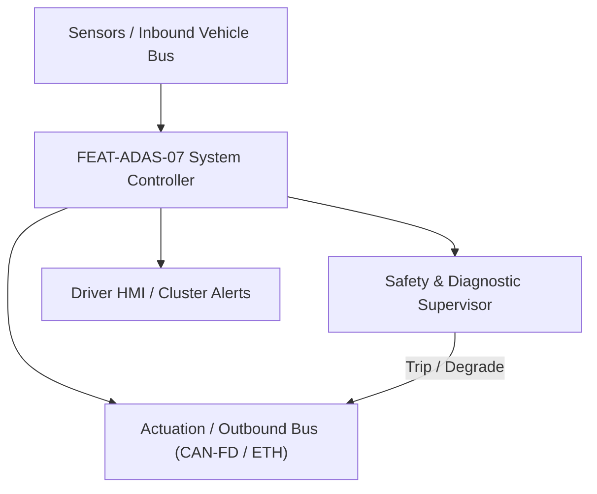
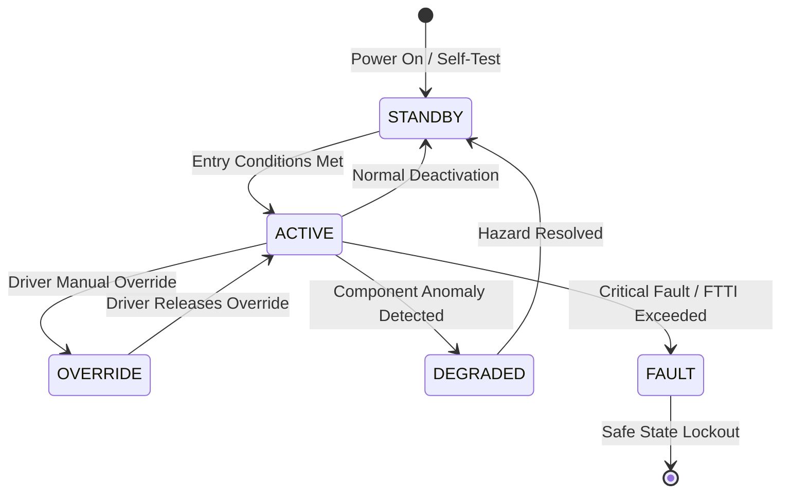

# System Requirements Specification: Automated Parking Assist (APA)
**Feature ID:** `FEAT-ADAS-07`  
**Domain:** ADAS & Autonomous Driving  
**Target ASIL:** ASIL B  
**Compliance Standard:** ISO 26262:2018 (Part 4 - System Development) / ASPICE PAM v3.1 (SYS.2, SYS.3)  
**Parent Master Specification:** [`spec.md`](file:///c:/Workset/AntiGravityProjects/TestOptimisationExperiement/spec.md#feat-adas-07-apa)  
**Derived Software Specification:** [`FEAT-ADAS-07_APA_SwReq.md`](file:///c:/Workset/AntiGravityProjects/TestOptimisationExperiement/software_requirements/FEAT-ADAS-07_APA_SwReq.md)

---

## 1. Feature Overview & Operational Scope

Assists driver by autonomously executing parallel, perpendicular, and diagonal parking maneuvers with driver supervising inside the cabin.

### Operational Context Architecture

---

## 2. Activation Logic & Operational States

- **Preconditions:** Driver seated, seatbelt buckled, vehicle speed <= 30 km/h during slot search, surround ultrasonic and camera sensors operational.
- **Entry Conditions:** Driver activates 'Park Assist' button; vehicle scans and identifies valid slot; driver selects slot and releases brake.
- **Deactivation Conditions:** Driver grabs steering wheel (> 2.5 Nm), driver presses brake firmly, door opened, or obstacle hazard detected in path.
- **Driver Override Behavior:** Driver can pause maneuver at any time by holding brake pedal; releasing brake resumes maneuver seamlessly.
- **Operational State Progression:**  
  `SEARCHING_SLOTS` -> `SLOT_OFFERED` -> `MANEUVER_ACTIVE` -> `DRIVER_INTERVENTION_PAUSE` -> `MANEUVER_COMPLETE` -> `ABORTED`

### State Transition Diagram

---

## 3. Functional Safety & Failure Mitigation Concept

- **Functional Safety Goal:** SG-APA-01: Prevent collision with adjacent parked vehicles and curbs; stop within <= 15 cm clearance.
- **Fault Tolerant Time Interval (FTTI):** 100 ms
- **Safe State Definition:** Immediate hydraulic brake application; disengage automated steering.
- **Warning & Escalation Strategy:** Continuous distance chime tone as distance to obstacle decreases below 50 cm.

### Failure Modes & Degradation Handling
- **Curb Impact Prevention:** If tire scrub against curb detected via motor torque spike, abort current turn direction and shift gear to clear curb.

---

## 4. System Requirements (SYS_REQ)
*(Note: Each System Requirement is systematically partitioned into multiple Child Software Requirements)*

### `SYS-ADAS-07-01`: Ultrasonic & Vision Parking Space Dimension Measurement
- **Planned Release:** R100
- **ASIL Rating:** ASIL B
- **Parent Feature:** [`FEAT-ADAS-07`](file:///c:/Workset/AntiGravityProjects/TestOptimisationExperiement/spec.md#feat-adas-07)
- **Requirement Statement:**
  > The System SHALL measure candidate parking space length and depth with +-5 cm accuracy while driving past at speeds up to 25 km/h, verifying slot is at least 0.8 m longer than vehicle length.
- **Activation Logic:** Active when searching for parking spaces.
- **Fault Tolerant Time Interval (FTTI):** 200 ms
- **Safe State Action:** Do not offer slot if dimension certainty < 80%.
- **Failure Detection & Reaction:** If side ultrasonic sensors blocked by mud, prompt driver to clean sensors.
- **Input Interfaces:** `Side_Ultrasonic_Sensors[4], Surround_Camera_Birdseye_Feed, Wheel_Speed_Ticks`
- **Output Interfaces:** `Slot_Length_M, Slot_Depth_M, Slot_Type_Enum, Slot_Valid_Flag`
- **System Verification Method:** Standard parking lot test fixtures with varying vehicle gap sizes.
- **Derived Child Software Requirements (1:N Link):**
  - [`SWR-ADAS-07-01`](file:///c:/Workset/AntiGravityProjects/TestOptimisationExperiement/software_requirements/FEAT-ADAS-07_APA_SwReq.md#swr-adas-07-01)
  - [`SWR-ADAS-07-02`](file:///c:/Workset/AntiGravityProjects/TestOptimisationExperiement/software_requirements/FEAT-ADAS-07_APA_SwReq.md#swr-adas-07-02)

### `SYS-ADAS-07-02`: Multi-Turn Parking Path Guidance & Gear Shift Automation
- **Planned Release:** R100
- **ASIL Rating:** ASIL B
- **Parent Feature:** [`FEAT-ADAS-07`](file:///c:/Workset/AntiGravityProjects/TestOptimisationExperiement/spec.md#feat-adas-07)
- **Requirement Statement:**
  > The System SHALL compute and execute collision-free multi-turn parking paths, automatically controlling steering angle (+-540 deg) and gear changes (D to R) to complete parking in <= 5 turns.
- **Activation Logic:** Active when driver confirms slot selection.
- **Fault Tolerant Time Interval (FTTI):** 80 ms
- **Safe State Action:** Brake to stop; hand over vehicle control to driver.
- **Failure Detection & Reaction:** If path blocked by moving pedestrian, hold position until path clears.
- **Input Interfaces:** `Selected_Slot_Coordinates, Vehicle_Odometry_Pose, Proximity_Distances`
- **Output Interfaces:** `APA_Steering_Torque_Cmd, APA_Target_Speed_Kmph, Shift_By_Wire_Cmd`
- **System Verification Method:** Parallel and perpendicular parking test trials across 100 parking maneuvers.
- **Derived Child Software Requirements (1:N Link):**
  - [`SWR-ADAS-07-03`](file:///c:/Workset/AntiGravityProjects/TestOptimisationExperiement/software_requirements/FEAT-ADAS-07_APA_SwReq.md#swr-adas-07-03)
  - [`SWR-ADAS-07-04`](file:///c:/Workset/AntiGravityProjects/TestOptimisationExperiement/software_requirements/FEAT-ADAS-07_APA_SwReq.md#swr-adas-07-04)

### `SYS-ADAS-07-03`: Multi-Move Path Shifting & Automated Transmission Direction Coordinator
- **Planned Release:** R100
- **ASIL Rating:** ASIL B
- **Parent Feature:** [`FEAT-ADAS-07`](file:///c:/Workset/AntiGravityProjects/TestOptimisationExperiement/spec.md#feat-adas-07)
- **Requirement Statement:**
  > The System SHALL coordinate automated multi-turn maneuvers (up to 5 gear shifts between DRIVE and REVERSE) to park in tight spaces, holding vehicle with foundation brakes during shift transition (< 800 ms).
- **Activation Logic:** Active when multi-move parking trajectory is required.
- **Fault Tolerant Time Interval (FTTI):** 80 ms
- **Safe State Action:** Hold vehicle stopped in current gear; request driver manual intervention.
- **Failure Detection & Reaction:** If shift actuator times out > 1200 ms, abort parking maneuver and apply EPB.
- **Input Interfaces:** `Trajectory_Maneuver_Step_Index, Current_Gear_PRND, Vehicle_Speed_Mps`
- **Output Interfaces:** `Target_Gear_Command_PRND, Shift_Brake_Hold_Req, Maneuver_Step_Complete_Flag`
- **System Verification Method:** Multi-turn tight parallel parking slot test (car length + 0.8 m).
- **Derived Child Software Requirements (1:N Link):**
  - [`SWR-ADAS-07-05`](file:///c:/Workset/AntiGravityProjects/TestOptimisationExperiement/software_requirements/FEAT-ADAS-07_APA_SwReq.md#swr-adas-07-05)
  - [`SWR-ADAS-07-06`](file:///c:/Workset/AntiGravityProjects/TestOptimisationExperiement/software_requirements/FEAT-ADAS-07_APA_SwReq.md#swr-adas-07-06)

### `SYS-ADAS-07-04`: Remote Smartphone Continuous Touch Dead-Man Switch Supervisor
- **Planned Release:** R200
- **ASIL Rating:** ASIL B
- **Parent Feature:** [`FEAT-ADAS-07`](file:///c:/Workset/AntiGravityProjects/TestOptimisationExperiement/spec.md#feat-adas-07)
- **Requirement Statement:**
  > The System SHALL supervise Bluetooth Low Energy (BLE) remote smartphone touch input: Vehicle motion SHALL occur ONLY while user continuously holds finger on smartphone screen button, stopping in <= 200 ms upon touch release or BLE disconnect (> 6 m distance).
- **Activation Logic:** Active in Remote Parking Assist (RPA) mode.
- **Fault Tolerant Time Interval (FTTI):** 100 ms
- **Safe State Action:** Execute immediate stop; apply hydraulic service brakes.
- **Failure Detection & Reaction:** If BLE packet loss exceeds 2 consecutive packets (100 ms), halt vehicle instantly.
- **Input Interfaces:** `BLE_Continuous_Touch_Token, BLE_RSSI_Distance_Estimate_M, Deadman_Switch_State`
- **Output Interfaces:** `Remote_Motion_Permit_Flag (boolean), BLE_Connection_Status_Enum`
- **System Verification Method:** Smartphone screen release latency and RF packet drop injection tests.
- **Derived Child Software Requirements (1:N Link):**
  - [`SWR-ADAS-07-07`](file:///c:/Workset/AntiGravityProjects/TestOptimisationExperiement/software_requirements/FEAT-ADAS-07_APA_SwReq.md#swr-adas-07-07)
  - [`SWR-ADAS-07-08`](file:///c:/Workset/AntiGravityProjects/TestOptimisationExperiement/software_requirements/FEAT-ADAS-07_APA_SwReq.md#swr-adas-07-08)

### `SYS-ADAS-07-05`: Ultrasonic Echo Time-of-Flight Slot Width & Depth Profiler
- **Planned Release:** R200
- **ASIL Rating:** ASIL B
- **Parent Feature:** [`FEAT-ADAS-07`](file:///c:/Workset/AntiGravityProjects/TestOptimisationExperiement/spec.md#feat-adas-07)
- **Requirement Statement:**
  > The System SHALL Measure parking slot dimensions (parallel slot min length = car + 0.8m) at speeds <= 20 km/h.
- **Activation Logic:** Active during normal vehicle operation when feature state is active.
- **Fault Tolerant Time Interval (FTTI):** 40 ms
- **Safe State Action:** Transition to safe state or safe degradation tier within FTTI budget.
- **Failure Detection & Reaction:** Isolate faulted channel, latch DEM diagnostic trouble code, and inform driver.
- **Input Interfaces:** `Sensor signals, vehicle dynamics data, and bus frames via RTE.`
- **Output Interfaces:** `Actuator commands, diagnostic event flags, and cluster alerts.`
- **System Verification Method:** HiL test bench and dynamometer automated verification.
- **Derived Child Software Requirements (1:N Link):**
  - [`SWR-ADAS-07-09`](file:///c:/Workset/AntiGravityProjects/TestOptimisationExperiement/software_requirements/FEAT-ADAS-07_APA_SwReq.md#swr-adas-07-09)
  - [`SWR-ADAS-07-10`](file:///c:/Workset/AntiGravityProjects/TestOptimisationExperiement/software_requirements/FEAT-ADAS-07_APA_SwReq.md#swr-adas-07-10)

### `SYS-ADAS-07-06`: Surround View Camera Parking Line Corner Coordinate Extractor
- **Planned Release:** R200
- **ASIL Rating:** ASIL B
- **Parent Feature:** [`FEAT-ADAS-07`](file:///c:/Workset/AntiGravityProjects/TestOptimisationExperiement/spec.md#feat-adas-07)
- **Requirement Statement:**
  > The System SHALL Extract parking slot painted boundary lines and corners from 4 fisheye cameras.
- **Activation Logic:** Active during normal vehicle operation when feature state is active.
- **Fault Tolerant Time Interval (FTTI):** 50 ms
- **Safe State Action:** Transition to safe state or safe degradation tier within FTTI budget.
- **Failure Detection & Reaction:** Isolate faulted channel, latch DEM diagnostic trouble code, and inform driver.
- **Input Interfaces:** `Sensor signals, vehicle dynamics data, and bus frames via RTE.`
- **Output Interfaces:** `Actuator commands, diagnostic event flags, and cluster alerts.`
- **System Verification Method:** HiL test bench and dynamometer automated verification.
- **Derived Child Software Requirements (1:N Link):**
  - [`SWR-ADAS-07-11`](file:///c:/Workset/AntiGravityProjects/TestOptimisationExperiement/software_requirements/FEAT-ADAS-07_APA_SwReq.md#swr-adas-07-11)
  - [`SWR-ADAS-07-12`](file:///c:/Workset/AntiGravityProjects/TestOptimisationExperiement/software_requirements/FEAT-ADAS-07_APA_SwReq.md#swr-adas-07-12)

### `SYS-ADAS-07-07`: Collision-Free Multi-Segment Parking Trajectory Planner
- **Planned Release:** R300
- **ASIL Rating:** ASIL B
- **Parent Feature:** [`FEAT-ADAS-07`](file:///c:/Workset/AntiGravityProjects/TestOptimisationExperiement/spec.md#feat-adas-07)
- **Requirement Statement:**
  > The System SHALL Generate continuous-curvature Reeds-Shepp parking maneuver path with <= 3 direction reversals.
- **Activation Logic:** Active during normal vehicle operation when feature state is active.
- **Fault Tolerant Time Interval (FTTI):** 50 ms
- **Safe State Action:** Transition to safe state or safe degradation tier within FTTI budget.
- **Failure Detection & Reaction:** Isolate faulted channel, latch DEM diagnostic trouble code, and inform driver.
- **Input Interfaces:** `Sensor signals, vehicle dynamics data, and bus frames via RTE.`
- **Output Interfaces:** `Actuator commands, diagnostic event flags, and cluster alerts.`
- **System Verification Method:** HiL test bench and dynamometer automated verification.
- **Derived Child Software Requirements (1:N Link):**
  - [`SWR-ADAS-07-13`](file:///c:/Workset/AntiGravityProjects/TestOptimisationExperiement/software_requirements/FEAT-ADAS-07_APA_SwReq.md#swr-adas-07-13)
  - [`SWR-ADAS-07-14`](file:///c:/Workset/AntiGravityProjects/TestOptimisationExperiement/software_requirements/FEAT-ADAS-07_APA_SwReq.md#swr-adas-07-14)

### `SYS-ADAS-07-08`: Steering Wheel Automated Angle Servocontrol Tracking Law
- **Planned Release:** R300
- **ASIL Rating:** ASIL B
- **Parent Feature:** [`FEAT-ADAS-07`](file:///c:/Workset/AntiGravityProjects/TestOptimisationExperiement/spec.md#feat-adas-07)
- **Requirement Statement:**
  > The System SHALL Command steering rack angle with tracking error <= 0.3° and maximum angular speed 450 °/s.
- **Activation Logic:** Active during normal vehicle operation when feature state is active.
- **Fault Tolerant Time Interval (FTTI):** 20 ms
- **Safe State Action:** Transition to safe state or safe degradation tier within FTTI budget.
- **Failure Detection & Reaction:** Isolate faulted channel, latch DEM diagnostic trouble code, and inform driver.
- **Input Interfaces:** `Sensor signals, vehicle dynamics data, and bus frames via RTE.`
- **Output Interfaces:** `Actuator commands, diagnostic event flags, and cluster alerts.`
- **System Verification Method:** HiL test bench and dynamometer automated verification.
- **Derived Child Software Requirements (1:N Link):**
  - [`SWR-ADAS-07-15`](file:///c:/Workset/AntiGravityProjects/TestOptimisationExperiement/software_requirements/FEAT-ADAS-07_APA_SwReq.md#swr-adas-07-15)
  - [`SWR-ADAS-07-16`](file:///c:/Workset/AntiGravityProjects/TestOptimisationExperiement/software_requirements/FEAT-ADAS-07_APA_SwReq.md#swr-adas-07-16)

### `SYS-ADAS-07-09`: Slow-Speed Propulsion Torque & Creep Velocity Governor
- **Planned Release:** R300
- **ASIL Rating:** ASIL B
- **Parent Feature:** [`FEAT-ADAS-07`](file:///c:/Workset/AntiGravityProjects/TestOptimisationExperiement/spec.md#feat-adas-07)
- **Requirement Statement:**
  > The System SHALL Govern vehicle speed precisely to 3.5 +- 0.5 km/h during automated parking maneuver.
- **Activation Logic:** Active during normal vehicle operation when feature state is active.
- **Fault Tolerant Time Interval (FTTI):** 30 ms
- **Safe State Action:** Transition to safe state or safe degradation tier within FTTI budget.
- **Failure Detection & Reaction:** Isolate faulted channel, latch DEM diagnostic trouble code, and inform driver.
- **Input Interfaces:** `Sensor signals, vehicle dynamics data, and bus frames via RTE.`
- **Output Interfaces:** `Actuator commands, diagnostic event flags, and cluster alerts.`
- **System Verification Method:** HiL test bench and dynamometer automated verification.
- **Derived Child Software Requirements (1:N Link):**
  - [`SWR-ADAS-07-17`](file:///c:/Workset/AntiGravityProjects/TestOptimisationExperiement/software_requirements/FEAT-ADAS-07_APA_SwReq.md#swr-adas-07-17)
  - [`SWR-ADAS-07-18`](file:///c:/Workset/AntiGravityProjects/TestOptimisationExperiement/software_requirements/FEAT-ADAS-07_APA_SwReq.md#swr-adas-07-18)

### `SYS-ADAS-07-10`: Dynamic Ultrasonic Proximity Obstacle Encroachment Monitor
- **Planned Release:** R400
- **ASIL Rating:** ASIL B
- **Parent Feature:** [`FEAT-ADAS-07`](file:///c:/Workset/AntiGravityProjects/TestOptimisationExperiement/spec.md#feat-adas-07)
- **Requirement Statement:**
  > The System SHALL Monitor obstacle clearance; command immediate stop if distance drops below 25 cm.
- **Activation Logic:** Active during normal vehicle operation when feature state is active.
- **Fault Tolerant Time Interval (FTTI):** 20 ms
- **Safe State Action:** Transition to safe state or safe degradation tier within FTTI budget.
- **Failure Detection & Reaction:** Isolate faulted channel, latch DEM diagnostic trouble code, and inform driver.
- **Input Interfaces:** `Sensor signals, vehicle dynamics data, and bus frames via RTE.`
- **Output Interfaces:** `Actuator commands, diagnostic event flags, and cluster alerts.`
- **System Verification Method:** HiL test bench and dynamometer automated verification.
- **Derived Child Software Requirements (1:N Link):**
  - [`SWR-ADAS-07-19`](file:///c:/Workset/AntiGravityProjects/TestOptimisationExperiement/software_requirements/FEAT-ADAS-07_APA_SwReq.md#swr-adas-07-19)
  - [`SWR-ADAS-07-20`](file:///c:/Workset/AntiGravityProjects/TestOptimisationExperiement/software_requirements/FEAT-ADAS-07_APA_SwReq.md#swr-adas-07-20)

### `SYS-ADAS-07-11`: Driver Steering Wheel Hands-On Intervention Cancellation Gate
- **Planned Release:** R400
- **ASIL Rating:** ASIL B
- **Parent Feature:** [`FEAT-ADAS-07`](file:///c:/Workset/AntiGravityProjects/TestOptimisationExperiement/spec.md#feat-adas-07)
- **Requirement Statement:**
  > The System SHALL Abort automated parking maneuver immediately if driver applies > 3.0 Nm steering wheel torque.
- **Activation Logic:** Active during normal vehicle operation when feature state is active.
- **Fault Tolerant Time Interval (FTTI):** 30 ms
- **Safe State Action:** Transition to safe state or safe degradation tier within FTTI budget.
- **Failure Detection & Reaction:** Isolate faulted channel, latch DEM diagnostic trouble code, and inform driver.
- **Input Interfaces:** `Sensor signals, vehicle dynamics data, and bus frames via RTE.`
- **Output Interfaces:** `Actuator commands, diagnostic event flags, and cluster alerts.`
- **System Verification Method:** HiL test bench and dynamometer automated verification.
- **Derived Child Software Requirements (1:N Link):**
  - [`SWR-ADAS-07-21`](file:///c:/Workset/AntiGravityProjects/TestOptimisationExperiement/software_requirements/FEAT-ADAS-07_APA_SwReq.md#swr-adas-07-21)
  - [`SWR-ADAS-07-22`](file:///c:/Workset/AntiGravityProjects/TestOptimisationExperiement/software_requirements/FEAT-ADAS-07_APA_SwReq.md#swr-adas-07-22)

### `SYS-ADAS-07-12`: Automated Shift-by-Wire Reverse/Drive Transition Sequence Manager
- **Planned Release:** R400
- **ASIL Rating:** ASIL B
- **Parent Feature:** [`FEAT-ADAS-07`](file:///c:/Workset/AntiGravityProjects/TestOptimisationExperiement/spec.md#feat-adas-07)
- **Requirement Statement:**
  > The System SHALL Coordinate smooth vehicle stop, brake apply, and gear change (R <-> D) during multi-point turn.
- **Activation Logic:** Active during normal vehicle operation when feature state is active.
- **Fault Tolerant Time Interval (FTTI):** 50 ms
- **Safe State Action:** Transition to safe state or safe degradation tier within FTTI budget.
- **Failure Detection & Reaction:** Isolate faulted channel, latch DEM diagnostic trouble code, and inform driver.
- **Input Interfaces:** `Sensor signals, vehicle dynamics data, and bus frames via RTE.`
- **Output Interfaces:** `Actuator commands, diagnostic event flags, and cluster alerts.`
- **System Verification Method:** HiL test bench and dynamometer automated verification.
- **Derived Child Software Requirements (1:N Link):**
  - [`SWR-ADAS-07-23`](file:///c:/Workset/AntiGravityProjects/TestOptimisationExperiement/software_requirements/FEAT-ADAS-07_APA_SwReq.md#swr-adas-07-23)
  - [`SWR-ADAS-07-24`](file:///c:/Workset/AntiGravityProjects/TestOptimisationExperiement/software_requirements/FEAT-ADAS-07_APA_SwReq.md#swr-adas-07-24)

### `SYS-ADAS-07-13`: Curbside Wheel Rim Scrape Protection & Tilt Mirror Actuator
- **Planned Release:** R500
- **ASIL Rating:** ASIL B
- **Parent Feature:** [`FEAT-ADAS-07`](file:///c:/Workset/AntiGravityProjects/TestOptimisationExperiement/spec.md#feat-adas-07)
- **Requirement Statement:**
  > The System SHALL Estimate distance to curb edge and tilt side mirrors down to provide driver visual feedback.
- **Activation Logic:** Active during normal vehicle operation when feature state is active.
- **Fault Tolerant Time Interval (FTTI):** 100 ms
- **Safe State Action:** Transition to safe state or safe degradation tier within FTTI budget.
- **Failure Detection & Reaction:** Isolate faulted channel, latch DEM diagnostic trouble code, and inform driver.
- **Input Interfaces:** `Sensor signals, vehicle dynamics data, and bus frames via RTE.`
- **Output Interfaces:** `Actuator commands, diagnostic event flags, and cluster alerts.`
- **System Verification Method:** HiL test bench and dynamometer automated verification.
- **Derived Child Software Requirements (1:N Link):**
  - [`SWR-ADAS-07-25`](file:///c:/Workset/AntiGravityProjects/TestOptimisationExperiement/software_requirements/FEAT-ADAS-07_APA_SwReq.md#swr-adas-07-25)
  - [`SWR-ADAS-07-26`](file:///c:/Workset/AntiGravityProjects/TestOptimisationExperiement/software_requirements/FEAT-ADAS-07_APA_SwReq.md#swr-adas-07-26)

### `SYS-ADAS-07-14`: Cluster Top-Down 3D Surround View Display Streamer
- **Planned Release:** R500
- **ASIL Rating:** ASIL B
- **Parent Feature:** [`FEAT-ADAS-07`](file:///c:/Workset/AntiGravityProjects/TestOptimisationExperiement/spec.md#feat-adas-07)
- **Requirement Statement:**
  > The System SHALL Composite and render 30 fps top-down parking guide trajectory onto central touchscreen display.
- **Activation Logic:** Active during normal vehicle operation when feature state is active.
- **Fault Tolerant Time Interval (FTTI):** 50 ms
- **Safe State Action:** Transition to safe state or safe degradation tier within FTTI budget.
- **Failure Detection & Reaction:** Isolate faulted channel, latch DEM diagnostic trouble code, and inform driver.
- **Input Interfaces:** `Sensor signals, vehicle dynamics data, and bus frames via RTE.`
- **Output Interfaces:** `Actuator commands, diagnostic event flags, and cluster alerts.`
- **System Verification Method:** HiL test bench and dynamometer automated verification.
- **Derived Child Software Requirements (1:N Link):**
  - [`SWR-ADAS-07-27`](file:///c:/Workset/AntiGravityProjects/TestOptimisationExperiement/software_requirements/FEAT-ADAS-07_APA_SwReq.md#swr-adas-07-27)
  - [`SWR-ADAS-07-28`](file:///c:/Workset/AntiGravityProjects/TestOptimisationExperiement/software_requirements/FEAT-ADAS-07_APA_SwReq.md#swr-adas-07-28)

### `SYS-ADAS-07-15`: DEM Parking System Component Health Diagnostics & DTC Manager
- **Planned Release:** R500
- **ASIL Rating:** ASIL B
- **Parent Feature:** [`FEAT-ADAS-07`](file:///c:/Workset/AntiGravityProjects/TestOptimisationExperiement/spec.md#feat-adas-07)
- **Requirement Statement:**
  > The System SHALL Monitor ultrasonic transducer transceiver lines and log DTCs upon hardware anomaly.
- **Activation Logic:** Active during normal vehicle operation when feature state is active.
- **Fault Tolerant Time Interval (FTTI):** 100 ms
- **Safe State Action:** Transition to safe state or safe degradation tier within FTTI budget.
- **Failure Detection & Reaction:** Isolate faulted channel, latch DEM diagnostic trouble code, and inform driver.
- **Input Interfaces:** `Sensor signals, vehicle dynamics data, and bus frames via RTE.`
- **Output Interfaces:** `Actuator commands, diagnostic event flags, and cluster alerts.`
- **System Verification Method:** HiL test bench and dynamometer automated verification.
- **Derived Child Software Requirements (1:N Link):**
  - [`SWR-ADAS-07-29`](file:///c:/Workset/AntiGravityProjects/TestOptimisationExperiement/software_requirements/FEAT-ADAS-07_APA_SwReq.md#swr-adas-07-29)
  - [`SWR-ADAS-07-30`](file:///c:/Workset/AntiGravityProjects/TestOptimisationExperiement/software_requirements/FEAT-ADAS-07_APA_SwReq.md#swr-adas-07-30)

---

## 5. System-to-Software Traceability Summary

| System Requirement ID | Planned Release | ASIL | Title | Derived Software Requirements (1:N) | Verification Method |
| :--- | :---: | :--- | :--- | :--- | :--- |
| `SYS-ADAS-07-01` | **`R100`** | ASIL B | Ultrasonic & Vision Parking Space Dimension Measurement | [`SWR-ADAS-07-01`](file:///c:/Workset/AntiGravityProjects/TestOptimisationExperiement/software_requirements/FEAT-ADAS-07_APA_SwReq.md#swr-adas-07-01), [`SWR-ADAS-07-02`](file:///c:/Workset/AntiGravityProjects/TestOptimisationExperiement/software_requirements/FEAT-ADAS-07_APA_SwReq.md#swr-adas-07-02) | Standard parking lot test fixtures with varying vehicle gap sizes. |
| `SYS-ADAS-07-02` | **`R100`** | ASIL B | Multi-Turn Parking Path Guidance & Gear Shift Automation | [`SWR-ADAS-07-03`](file:///c:/Workset/AntiGravityProjects/TestOptimisationExperiement/software_requirements/FEAT-ADAS-07_APA_SwReq.md#swr-adas-07-03), [`SWR-ADAS-07-04`](file:///c:/Workset/AntiGravityProjects/TestOptimisationExperiement/software_requirements/FEAT-ADAS-07_APA_SwReq.md#swr-adas-07-04) | Parallel and perpendicular parking test trials across 100 parking maneuvers. |
| `SYS-ADAS-07-03` | **`R100`** | ASIL B | Multi-Move Path Shifting & Automated Transmission Direction Coordinator | [`SWR-ADAS-07-05`](file:///c:/Workset/AntiGravityProjects/TestOptimisationExperiement/software_requirements/FEAT-ADAS-07_APA_SwReq.md#swr-adas-07-05), [`SWR-ADAS-07-06`](file:///c:/Workset/AntiGravityProjects/TestOptimisationExperiement/software_requirements/FEAT-ADAS-07_APA_SwReq.md#swr-adas-07-06) | Multi-turn tight parallel parking slot test (car length + 0.8 m). |
| `SYS-ADAS-07-04` | **`R200`** | ASIL B | Remote Smartphone Continuous Touch Dead-Man Switch Supervisor | [`SWR-ADAS-07-07`](file:///c:/Workset/AntiGravityProjects/TestOptimisationExperiement/software_requirements/FEAT-ADAS-07_APA_SwReq.md#swr-adas-07-07), [`SWR-ADAS-07-08`](file:///c:/Workset/AntiGravityProjects/TestOptimisationExperiement/software_requirements/FEAT-ADAS-07_APA_SwReq.md#swr-adas-07-08) | Smartphone screen release latency and RF packet drop injection tests. |
| `SYS-ADAS-07-05` | **`R200`** | ASIL B | Ultrasonic Echo Time-of-Flight Slot Width & Depth Profiler | [`SWR-ADAS-07-09`](file:///c:/Workset/AntiGravityProjects/TestOptimisationExperiement/software_requirements/FEAT-ADAS-07_APA_SwReq.md#swr-adas-07-09), [`SWR-ADAS-07-10`](file:///c:/Workset/AntiGravityProjects/TestOptimisationExperiement/software_requirements/FEAT-ADAS-07_APA_SwReq.md#swr-adas-07-10) | HiL test bench and dynamometer automated verification. |
| `SYS-ADAS-07-06` | **`R200`** | ASIL B | Surround View Camera Parking Line Corner Coordinate Extractor | [`SWR-ADAS-07-11`](file:///c:/Workset/AntiGravityProjects/TestOptimisationExperiement/software_requirements/FEAT-ADAS-07_APA_SwReq.md#swr-adas-07-11), [`SWR-ADAS-07-12`](file:///c:/Workset/AntiGravityProjects/TestOptimisationExperiement/software_requirements/FEAT-ADAS-07_APA_SwReq.md#swr-adas-07-12) | HiL test bench and dynamometer automated verification. |
| `SYS-ADAS-07-07` | **`R300`** | ASIL B | Collision-Free Multi-Segment Parking Trajectory Planner | [`SWR-ADAS-07-13`](file:///c:/Workset/AntiGravityProjects/TestOptimisationExperiement/software_requirements/FEAT-ADAS-07_APA_SwReq.md#swr-adas-07-13), [`SWR-ADAS-07-14`](file:///c:/Workset/AntiGravityProjects/TestOptimisationExperiement/software_requirements/FEAT-ADAS-07_APA_SwReq.md#swr-adas-07-14) | HiL test bench and dynamometer automated verification. |
| `SYS-ADAS-07-08` | **`R300`** | ASIL B | Steering Wheel Automated Angle Servocontrol Tracking Law | [`SWR-ADAS-07-15`](file:///c:/Workset/AntiGravityProjects/TestOptimisationExperiement/software_requirements/FEAT-ADAS-07_APA_SwReq.md#swr-adas-07-15), [`SWR-ADAS-07-16`](file:///c:/Workset/AntiGravityProjects/TestOptimisationExperiement/software_requirements/FEAT-ADAS-07_APA_SwReq.md#swr-adas-07-16) | HiL test bench and dynamometer automated verification. |
| `SYS-ADAS-07-09` | **`R300`** | ASIL B | Slow-Speed Propulsion Torque & Creep Velocity Governor | [`SWR-ADAS-07-17`](file:///c:/Workset/AntiGravityProjects/TestOptimisationExperiement/software_requirements/FEAT-ADAS-07_APA_SwReq.md#swr-adas-07-17), [`SWR-ADAS-07-18`](file:///c:/Workset/AntiGravityProjects/TestOptimisationExperiement/software_requirements/FEAT-ADAS-07_APA_SwReq.md#swr-adas-07-18) | HiL test bench and dynamometer automated verification. |
| `SYS-ADAS-07-10` | **`R400`** | ASIL B | Dynamic Ultrasonic Proximity Obstacle Encroachment Monitor | [`SWR-ADAS-07-19`](file:///c:/Workset/AntiGravityProjects/TestOptimisationExperiement/software_requirements/FEAT-ADAS-07_APA_SwReq.md#swr-adas-07-19), [`SWR-ADAS-07-20`](file:///c:/Workset/AntiGravityProjects/TestOptimisationExperiement/software_requirements/FEAT-ADAS-07_APA_SwReq.md#swr-adas-07-20) | HiL test bench and dynamometer automated verification. |
| `SYS-ADAS-07-11` | **`R400`** | ASIL B | Driver Steering Wheel Hands-On Intervention Cancellation Gate | [`SWR-ADAS-07-21`](file:///c:/Workset/AntiGravityProjects/TestOptimisationExperiement/software_requirements/FEAT-ADAS-07_APA_SwReq.md#swr-adas-07-21), [`SWR-ADAS-07-22`](file:///c:/Workset/AntiGravityProjects/TestOptimisationExperiement/software_requirements/FEAT-ADAS-07_APA_SwReq.md#swr-adas-07-22) | HiL test bench and dynamometer automated verification. |
| `SYS-ADAS-07-12` | **`R400`** | ASIL B | Automated Shift-by-Wire Reverse/Drive Transition Sequence Manager | [`SWR-ADAS-07-23`](file:///c:/Workset/AntiGravityProjects/TestOptimisationExperiement/software_requirements/FEAT-ADAS-07_APA_SwReq.md#swr-adas-07-23), [`SWR-ADAS-07-24`](file:///c:/Workset/AntiGravityProjects/TestOptimisationExperiement/software_requirements/FEAT-ADAS-07_APA_SwReq.md#swr-adas-07-24) | HiL test bench and dynamometer automated verification. |
| `SYS-ADAS-07-13` | **`R500`** | ASIL B | Curbside Wheel Rim Scrape Protection & Tilt Mirror Actuator | [`SWR-ADAS-07-25`](file:///c:/Workset/AntiGravityProjects/TestOptimisationExperiement/software_requirements/FEAT-ADAS-07_APA_SwReq.md#swr-adas-07-25), [`SWR-ADAS-07-26`](file:///c:/Workset/AntiGravityProjects/TestOptimisationExperiement/software_requirements/FEAT-ADAS-07_APA_SwReq.md#swr-adas-07-26) | HiL test bench and dynamometer automated verification. |
| `SYS-ADAS-07-14` | **`R500`** | ASIL B | Cluster Top-Down 3D Surround View Display Streamer | [`SWR-ADAS-07-27`](file:///c:/Workset/AntiGravityProjects/TestOptimisationExperiement/software_requirements/FEAT-ADAS-07_APA_SwReq.md#swr-adas-07-27), [`SWR-ADAS-07-28`](file:///c:/Workset/AntiGravityProjects/TestOptimisationExperiement/software_requirements/FEAT-ADAS-07_APA_SwReq.md#swr-adas-07-28) | HiL test bench and dynamometer automated verification. |
| `SYS-ADAS-07-15` | **`R500`** | ASIL B | DEM Parking System Component Health Diagnostics & DTC Manager | [`SWR-ADAS-07-29`](file:///c:/Workset/AntiGravityProjects/TestOptimisationExperiement/software_requirements/FEAT-ADAS-07_APA_SwReq.md#swr-adas-07-29), [`SWR-ADAS-07-30`](file:///c:/Workset/AntiGravityProjects/TestOptimisationExperiement/software_requirements/FEAT-ADAS-07_APA_SwReq.md#swr-adas-07-30) | HiL test bench and dynamometer automated verification. |

- **Upstream Feature Link:** [`spec.md` (FEAT-ADAS-07)](file:///c:/Workset/AntiGravityProjects/TestOptimisationExperiement/spec.md#feat-adas-07)
- **Software Requirements Specification:** [`FEAT-ADAS-07_APA_SwReq.md`](file:///c:/Workset/AntiGravityProjects/TestOptimisationExperiement/software_requirements/FEAT-ADAS-07_APA_SwReq.md)
