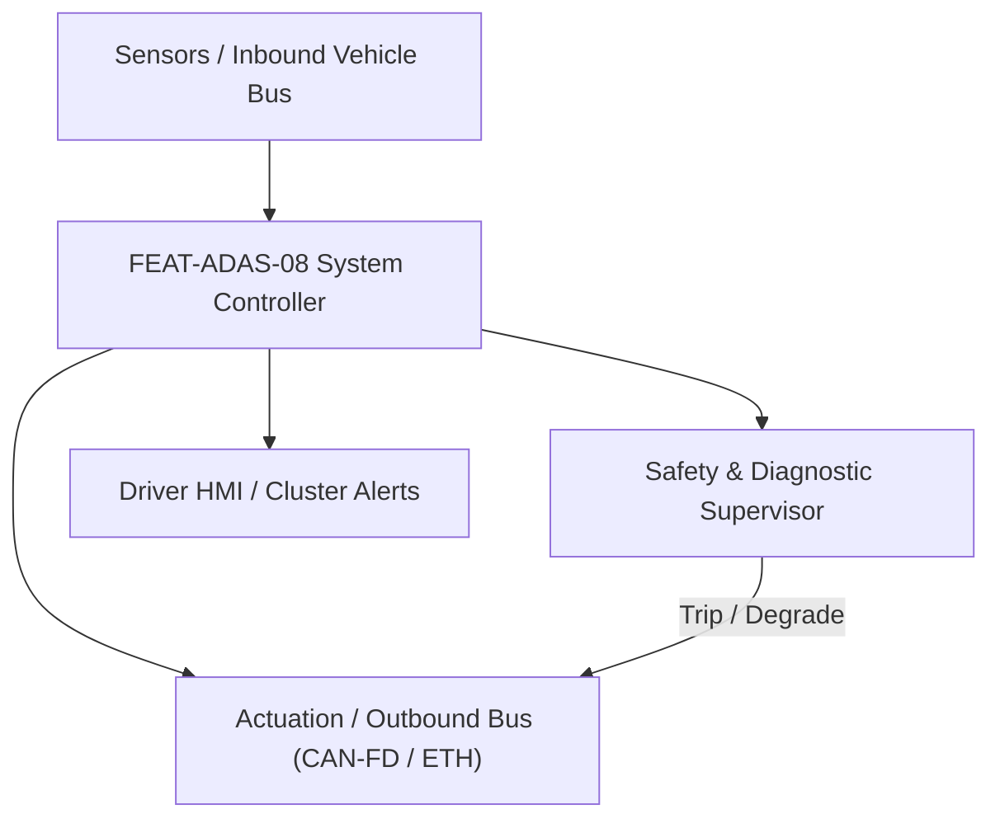
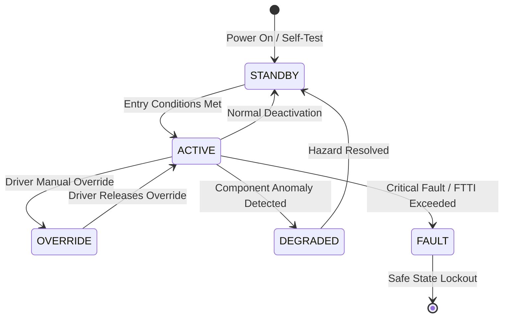

# System Requirements Specification: Blind Spot Detection & Lane Change Assist (BSD-LCA)
**Feature ID:** `FEAT-ADAS-08`  
**Domain:** ADAS & Autonomous Driving  
**Target ASIL:** ASIL B  
**Compliance Standard:** ISO 26262:2018 (Part 4 - System Development) / ASPICE PAM v3.1 (SYS.2, SYS.3)  
**Parent Master Specification:** [`spec.md`](file:///c:/Workset/AntiGravityProjects/TestOptimisationExperiement/spec.md#feat-adas-08-bsd)  
**Derived Software Specification:** [`FEAT-ADAS-08_BSD_SwReq.md`](file:///c:/Workset/AntiGravityProjects/TestOptimisationExperiement/software_requirements/FEAT-ADAS-08_BSD_SwReq.md)

---

## 1. Feature Overview & Operational Scope

Monitors blind spots and fast-approaching adjacent lane traffic using rear corner radars, issuing mirror alerts and active steering resistance.

### Operational Context Architecture

---

## 2. Activation Logic & Operational States

- **Preconditions:** Ignition in RUN, vehicle speed >= 15 km/h, rear radar sensors unblocked.
- **Entry Conditions:** Vehicle moving forward; adjacent target vehicle detected within blind zone (0-5m) or closing rapidly (TTC <= 3.5s at up to 70m range).
- **Deactivation Conditions:** Target passes beyond zone, vehicle speed < 10 km/h, or reverse gear selected.
- **Driver Override Behavior:** Driver steering override with torque > 3.0 Nm immediately cancels steering resistance.
- **Operational State Progression:**  
  `MONITORING` -> `LEVEL_1_INFO_ICON` -> `LEVEL_2_FLASH_AND_CHIME` -> `LEVEL_3_ACTIVE_STEERING_INTERVENTION` -> `SENSOR_BLIND`

### State Transition Diagram

---

## 3. Functional Safety & Failure Mitigation Concept

- **Functional Safety Goal:** SG-BSD-01: Prevent collision with adjacent lane vehicles during lane changes.
- **Fault Tolerant Time Interval (FTTI):** 100 ms
- **Safe State Definition:** Inhibit active steering torque; leave visual mirror icon illuminated as passive warning.
- **Warning & Escalation Strategy:** Level 1: Steady amber mirror icon; Level 2: Flashing red mirror icon + acoustic warning chime if turn signal engaged.

### Failure Modes & Degradation Handling
- **Rear Corner Radar Fault:** If left radar fails, disable left-side monitoring, display 'Blind Spot System Degraded' message, keep right-side operational.

---

## 4. System Requirements (SYS_REQ)
*(Note: Each System Requirement is systematically partitioned into multiple Child Software Requirements)*

### `SYS-ADAS-08-01`: Adjacent Lane Approaching Vehicle Closing-Speed Tracking
- **Planned Release:** R100
- **ASIL Rating:** ASIL B
- **Parent Feature:** [`FEAT-ADAS-08`](file:///c:/Workset/AntiGravityProjects/TestOptimisationExperiement/spec.md#feat-adas-08)
- **Requirement Statement:**
  > The System SHALL track vehicles in adjacent lanes up to 70 m rearward using dual 77 GHz rear corner radars, calculating Time-to-Collision (TTC <= 3.5s) at >= 20 Hz.
- **Activation Logic:** Active at speed >= 15 km/h.
- **Fault Tolerant Time Interval (FTTI):** 100 ms
- **Safe State Action:** Invalidate target; extinguish warning icon.
- **Failure Detection & Reaction:** If radar misaligned (> 2 deg mechanical tilt), trip service icon.
- **Input Interfaces:** `Left_Rear_Radar_Targets, Right_Rear_Radar_Targets, Vehicle_Speed`
- **Output Interfaces:** `Adjacent_Target_TTC_Sec, Blind_Zone_Occupied_Flag`
- **System Verification Method:** High-speed approaching motorcycle and vehicle test track maneuvers.
- **Derived Child Software Requirements (1:N Link):**
  - [`SWR-ADAS-08-01`](file:///c:/Workset/AntiGravityProjects/TestOptimisationExperiement/software_requirements/FEAT-ADAS-08_BSD_SwReq.md#swr-adas-08-01)
  - [`SWR-ADAS-08-02`](file:///c:/Workset/AntiGravityProjects/TestOptimisationExperiement/software_requirements/FEAT-ADAS-08_BSD_SwReq.md#swr-adas-08-02)

### `SYS-ADAS-08-02`: Side-Mirror HMI Alerts & Active Evasive Steering Resistance
- **Planned Release:** R300
- **ASIL Rating:** ASIL B
- **Parent Feature:** [`FEAT-ADAS-08`](file:///c:/Workset/AntiGravityProjects/TestOptimisationExperiement/spec.md#feat-adas-08)
- **Requirement Statement:**
  > The System SHALL illuminate mirror icons when blind zone is occupied, and apply up to 2.5 Nm resistive steering torque if driver activates turn indicator towards occupied lane.
- **Activation Logic:** Active when Turn_Signal_Active == TRUE and Blind_Zone_Occupied == TRUE.
- **Fault Tolerant Time Interval (FTTI):** 80 ms
- **Safe State Action:** Zero steering resistance torque; maintain visual alert.
- **Failure Detection & Reaction:** If steering actuator fails to acknowledge, sound loud cabin alarm.
- **Input Interfaces:** `Turn_Signal_Switch_State, Blind_Zone_Occupied_Flag, Steering_Torque`
- **Output Interfaces:** `Mirror_LED_Output_Cmd, EPS_Resistance_Torque_Cmd`
- **System Verification Method:** ISO 17387 lane change assist compliance testing.
- **Derived Child Software Requirements (1:N Link):**
  - [`SWR-ADAS-08-03`](file:///c:/Workset/AntiGravityProjects/TestOptimisationExperiement/software_requirements/FEAT-ADAS-08_BSD_SwReq.md#swr-adas-08-03)
  - [`SWR-ADAS-08-04`](file:///c:/Workset/AntiGravityProjects/TestOptimisationExperiement/software_requirements/FEAT-ADAS-08_BSD_SwReq.md#swr-adas-08-04)

### `SYS-ADAS-08-03`: Side Mirror Dual-Stage LED Warning & Acoustic Chime Trigger
- **Planned Release:** R100
- **ASIL Rating:** ASIL B
- **Parent Feature:** [`FEAT-ADAS-08`](file:///c:/Workset/AntiGravityProjects/TestOptimisationExperiement/spec.md#feat-adas-08)
- **Requirement Statement:**
  > The System SHALL command side mirror triangular amber LED indicators: Stage 1 (Continuous ON) when vehicle is in blind zone; Stage 2 (Flashing 4.0 Hz + 800 Hz chime) if driver activates turn indicator towards occupied zone.
- **Activation Logic:** Active at speeds > 15 km/h.
- **Fault Tolerant Time Interval (FTTI):** 60 ms
- **Safe State Action:** Extinguish warning LEDs; prompt driver via cluster text.
- **Failure Detection & Reaction:** If LED driver reports open circuit, log DTC B15C2 and display cluster alert.
- **Input Interfaces:** `Blind_Zone_Occupied_Left, Blind_Zone_Occupied_Right, Turn_Signal_Stalk_State`
- **Output Interfaces:** `Mirror_LED_Left_Cmd, Mirror_LED_Right_Cmd, BSD_Warning_Chime_Req`
- **System Verification Method:** Photometric mirror LED flash frequency and luminance testing.
- **Derived Child Software Requirements (1:N Link):**
  - [`SWR-ADAS-08-05`](file:///c:/Workset/AntiGravityProjects/TestOptimisationExperiement/software_requirements/FEAT-ADAS-08_BSD_SwReq.md#swr-adas-08-05)
  - [`SWR-ADAS-08-06`](file:///c:/Workset/AntiGravityProjects/TestOptimisationExperiement/software_requirements/FEAT-ADAS-08_BSD_SwReq.md#swr-adas-08-06)

### `SYS-ADAS-08-04`: Active Steering Resistance Overlay to Oppose Collision Lane Change
- **Planned Release:** R200
- **ASIL Rating:** ASIL B
- **Parent Feature:** [`FEAT-ADAS-08`](file:///c:/Workset/AntiGravityProjects/TestOptimisationExperiement/spec.md#feat-adas-08)
- **Requirement Statement:**
  > The System SHALL command EPS steering torque resistance (up to +3.0 Nm opposing driver turn) if driver begins steering across lane line into an approaching vehicle (TTC <= 2.5s) to prevent sideswipe collision.
- **Activation Logic:** Active when lane change collision is predicted.
- **Fault Tolerant Time Interval (FTTI):** 40 ms
- **Safe State Action:** Zero opposing torque; restore free manual steering.
- **Failure Detection & Reaction:** Inhibit steering resistance if driver applies > 5.0 Nm intentional force.
- **Input Interfaces:** `Closing_Vehicle_TTC_Sec, Steering_Wheel_Angle_Deg, Lane_Line_Crossing_Flag`
- **Output Interfaces:** `EPS_Opposing_Torque_Nm, Sideswipe_Intervention_Active_Flag`
- **System Verification Method:** ISO 17387 lane change collision avoidance dynamic track test.
- **Derived Child Software Requirements (1:N Link):**
  - [`SWR-ADAS-08-07`](file:///c:/Workset/AntiGravityProjects/TestOptimisationExperiement/software_requirements/FEAT-ADAS-08_BSD_SwReq.md#swr-adas-08-07)
  - [`SWR-ADAS-08-08`](file:///c:/Workset/AntiGravityProjects/TestOptimisationExperiement/software_requirements/FEAT-ADAS-08_BSD_SwReq.md#swr-adas-08-08)

### `SYS-ADAS-08-05`: Rear Corner Radar High-Speed Object Trajectory Tracker
- **Planned Release:** R200
- **ASIL Rating:** ASIL B
- **Parent Feature:** [`FEAT-ADAS-08`](file:///c:/Workset/AntiGravityProjects/TestOptimisationExperiement/spec.md#feat-adas-08)
- **Requirement Statement:**
  > The System SHALL Track position, velocity, and heading of up to 32 targets in adjacent lanes up to 75 m rearward.
- **Activation Logic:** Active during normal vehicle operation when feature state is active.
- **Fault Tolerant Time Interval (FTTI):** 40 ms
- **Safe State Action:** Transition to safe state or safe degradation tier within FTTI budget.
- **Failure Detection & Reaction:** Isolate faulted channel, latch DEM diagnostic trouble code, and inform driver.
- **Input Interfaces:** `Sensor signals, vehicle dynamics data, and bus frames via RTE.`
- **Output Interfaces:** `Actuator commands, diagnostic event flags, and cluster alerts.`
- **System Verification Method:** HiL test bench and dynamometer automated verification.
- **Derived Child Software Requirements (1:N Link):**
  - [`SWR-ADAS-08-09`](file:///c:/Workset/AntiGravityProjects/TestOptimisationExperiement/software_requirements/FEAT-ADAS-08_BSD_SwReq.md#swr-adas-08-09)
  - [`SWR-ADAS-08-10`](file:///c:/Workset/AntiGravityProjects/TestOptimisationExperiement/software_requirements/FEAT-ADAS-08_BSD_SwReq.md#swr-adas-08-10)

### `SYS-ADAS-08-06`: Adjacent Lane Blind Spot Zone Vehicle Occupancy Detector
- **Planned Release:** R200
- **ASIL Rating:** ASIL B
- **Parent Feature:** [`FEAT-ADAS-08`](file:///c:/Workset/AntiGravityProjects/TestOptimisationExperiement/spec.md#feat-adas-08)
- **Requirement Statement:**
  > The System SHALL Detect presence of vehicles in blind zone polygon (from side mirror to 3 m rear of bumper).
- **Activation Logic:** Active during normal vehicle operation when feature state is active.
- **Fault Tolerant Time Interval (FTTI):** 40 ms
- **Safe State Action:** Transition to safe state or safe degradation tier within FTTI budget.
- **Failure Detection & Reaction:** Isolate faulted channel, latch DEM diagnostic trouble code, and inform driver.
- **Input Interfaces:** `Sensor signals, vehicle dynamics data, and bus frames via RTE.`
- **Output Interfaces:** `Actuator commands, diagnostic event flags, and cluster alerts.`
- **System Verification Method:** HiL test bench and dynamometer automated verification.
- **Derived Child Software Requirements (1:N Link):**
  - [`SWR-ADAS-08-11`](file:///c:/Workset/AntiGravityProjects/TestOptimisationExperiement/software_requirements/FEAT-ADAS-08_BSD_SwReq.md#swr-adas-08-11)
  - [`SWR-ADAS-08-12`](file:///c:/Workset/AntiGravityProjects/TestOptimisationExperiement/software_requirements/FEAT-ADAS-08_BSD_SwReq.md#swr-adas-08-12)

### `SYS-ADAS-08-07`: Closing Velocity & Time-to-Collision (TTC) Criticality Evaluator
- **Planned Release:** R300
- **ASIL Rating:** ASIL B
- **Parent Feature:** [`FEAT-ADAS-08`](file:///c:/Workset/AntiGravityProjects/TestOptimisationExperiement/spec.md#feat-adas-08)
- **Requirement Statement:**
  > The System SHALL Calculate TTC = d_rel / v_closing; trigger Level 1 warning when TTC <= 3.5 seconds.
- **Activation Logic:** Active during normal vehicle operation when feature state is active.
- **Fault Tolerant Time Interval (FTTI):** 30 ms
- **Safe State Action:** Transition to safe state or safe degradation tier within FTTI budget.
- **Failure Detection & Reaction:** Isolate faulted channel, latch DEM diagnostic trouble code, and inform driver.
- **Input Interfaces:** `Sensor signals, vehicle dynamics data, and bus frames via RTE.`
- **Output Interfaces:** `Actuator commands, diagnostic event flags, and cluster alerts.`
- **System Verification Method:** HiL test bench and dynamometer automated verification.
- **Derived Child Software Requirements (1:N Link):**
  - [`SWR-ADAS-08-13`](file:///c:/Workset/AntiGravityProjects/TestOptimisationExperiement/software_requirements/FEAT-ADAS-08_BSD_SwReq.md#swr-adas-08-13)
  - [`SWR-ADAS-08-14`](file:///c:/Workset/AntiGravityProjects/TestOptimisationExperiement/software_requirements/FEAT-ADAS-08_BSD_SwReq.md#swr-adas-08-14)

### `SYS-ADAS-08-08`: Side Mirror Optical Warning LED Intensity Driver
- **Planned Release:** R300
- **ASIL Rating:** ASIL B
- **Parent Feature:** [`FEAT-ADAS-08`](file:///c:/Workset/AntiGravityProjects/TestOptimisationExperiement/spec.md#feat-adas-08)
- **Requirement Statement:**
  > The System SHALL Drive side-mirror amber warning LED, adjusting brightness according to ambient light sensor.
- **Activation Logic:** Active during normal vehicle operation when feature state is active.
- **Fault Tolerant Time Interval (FTTI):** 50 ms
- **Safe State Action:** Transition to safe state or safe degradation tier within FTTI budget.
- **Failure Detection & Reaction:** Isolate faulted channel, latch DEM diagnostic trouble code, and inform driver.
- **Input Interfaces:** `Sensor signals, vehicle dynamics data, and bus frames via RTE.`
- **Output Interfaces:** `Actuator commands, diagnostic event flags, and cluster alerts.`
- **System Verification Method:** HiL test bench and dynamometer automated verification.
- **Derived Child Software Requirements (1:N Link):**
  - [`SWR-ADAS-08-15`](file:///c:/Workset/AntiGravityProjects/TestOptimisationExperiement/software_requirements/FEAT-ADAS-08_BSD_SwReq.md#swr-adas-08-15)
  - [`SWR-ADAS-08-16`](file:///c:/Workset/AntiGravityProjects/TestOptimisationExperiement/software_requirements/FEAT-ADAS-08_BSD_SwReq.md#swr-adas-08-16)

### `SYS-ADAS-08-09`: Turn Signal Activation Intent & Level 2 Alert Escalation
- **Planned Release:** R300
- **ASIL Rating:** ASIL B
- **Parent Feature:** [`FEAT-ADAS-08`](file:///c:/Workset/AntiGravityProjects/TestOptimisationExperiement/spec.md#feat-adas-08)
- **Requirement Statement:**
  > The System SHALL Escalate to flashing optical warning and 750 Hz acoustic chime if driver signals toward occupied lane.
- **Activation Logic:** Active during normal vehicle operation when feature state is active.
- **Fault Tolerant Time Interval (FTTI):** 20 ms
- **Safe State Action:** Transition to safe state or safe degradation tier within FTTI budget.
- **Failure Detection & Reaction:** Isolate faulted channel, latch DEM diagnostic trouble code, and inform driver.
- **Input Interfaces:** `Sensor signals, vehicle dynamics data, and bus frames via RTE.`
- **Output Interfaces:** `Actuator commands, diagnostic event flags, and cluster alerts.`
- **System Verification Method:** HiL test bench and dynamometer automated verification.
- **Derived Child Software Requirements (1:N Link):**
  - [`SWR-ADAS-08-17`](file:///c:/Workset/AntiGravityProjects/TestOptimisationExperiement/software_requirements/FEAT-ADAS-08_BSD_SwReq.md#swr-adas-08-17)
  - [`SWR-ADAS-08-18`](file:///c:/Workset/AntiGravityProjects/TestOptimisationExperiement/software_requirements/FEAT-ADAS-08_BSD_SwReq.md#swr-adas-08-18)

### `SYS-ADAS-08-10`: Active Lane Change Steering Resistance Torque Superposition
- **Planned Release:** R400
- **ASIL Rating:** ASIL B
- **Parent Feature:** [`FEAT-ADAS-08`](file:///c:/Workset/AntiGravityProjects/TestOptimisationExperiement/spec.md#feat-adas-08)
- **Requirement Statement:**
  > The System SHALL Apply subtle counter-torque (+-1.5 Nm) through EPS if driver begins turning into occupied lane.
- **Activation Logic:** Active during normal vehicle operation when feature state is active.
- **Fault Tolerant Time Interval (FTTI):** 20 ms
- **Safe State Action:** Transition to safe state or safe degradation tier within FTTI budget.
- **Failure Detection & Reaction:** Isolate faulted channel, latch DEM diagnostic trouble code, and inform driver.
- **Input Interfaces:** `Sensor signals, vehicle dynamics data, and bus frames via RTE.`
- **Output Interfaces:** `Actuator commands, diagnostic event flags, and cluster alerts.`
- **System Verification Method:** HiL test bench and dynamometer automated verification.
- **Derived Child Software Requirements (1:N Link):**
  - [`SWR-ADAS-08-19`](file:///c:/Workset/AntiGravityProjects/TestOptimisationExperiement/software_requirements/FEAT-ADAS-08_BSD_SwReq.md#swr-adas-08-19)
  - [`SWR-ADAS-08-20`](file:///c:/Workset/AntiGravityProjects/TestOptimisationExperiement/software_requirements/FEAT-ADAS-08_BSD_SwReq.md#swr-adas-08-20)

### `SYS-ADAS-08-11`: Motorcycle & Narrow Vulnerable Vehicle High-Sensitivity Classifier
- **Planned Release:** R400
- **ASIL Rating:** ASIL B
- **Parent Feature:** [`FEAT-ADAS-08`](file:///c:/Workset/AntiGravityProjects/TestOptimisationExperiement/spec.md#feat-adas-08)
- **Requirement Statement:**
  > The System SHALL Enhance radar reflection clustering to identify low-RCS motorcycles overtaking in blind spots.
- **Activation Logic:** Active during normal vehicle operation when feature state is active.
- **Fault Tolerant Time Interval (FTTI):** 40 ms
- **Safe State Action:** Transition to safe state or safe degradation tier within FTTI budget.
- **Failure Detection & Reaction:** Isolate faulted channel, latch DEM diagnostic trouble code, and inform driver.
- **Input Interfaces:** `Sensor signals, vehicle dynamics data, and bus frames via RTE.`
- **Output Interfaces:** `Actuator commands, diagnostic event flags, and cluster alerts.`
- **System Verification Method:** HiL test bench and dynamometer automated verification.
- **Derived Child Software Requirements (1:N Link):**
  - [`SWR-ADAS-08-21`](file:///c:/Workset/AntiGravityProjects/TestOptimisationExperiement/software_requirements/FEAT-ADAS-08_BSD_SwReq.md#swr-adas-08-21)
  - [`SWR-ADAS-08-22`](file:///c:/Workset/AntiGravityProjects/TestOptimisationExperiement/software_requirements/FEAT-ADAS-08_BSD_SwReq.md#swr-adas-08-22)

### `SYS-ADAS-08-12`: Highway Guardrail & Stationary Structure False Positive Filter
- **Planned Release:** R400
- **ASIL Rating:** ASIL B
- **Parent Feature:** [`FEAT-ADAS-08`](file:///c:/Workset/AntiGravityProjects/TestOptimisationExperiement/spec.md#feat-adas-08)
- **Requirement Statement:**
  > The System SHALL Filter out stationary guardrails, acoustic barriers, and light poles from blind spot trigger alerts.
- **Activation Logic:** Active during normal vehicle operation when feature state is active.
- **Fault Tolerant Time Interval (FTTI):** 50 ms
- **Safe State Action:** Transition to safe state or safe degradation tier within FTTI budget.
- **Failure Detection & Reaction:** Isolate faulted channel, latch DEM diagnostic trouble code, and inform driver.
- **Input Interfaces:** `Sensor signals, vehicle dynamics data, and bus frames via RTE.`
- **Output Interfaces:** `Actuator commands, diagnostic event flags, and cluster alerts.`
- **System Verification Method:** HiL test bench and dynamometer automated verification.
- **Derived Child Software Requirements (1:N Link):**
  - [`SWR-ADAS-08-23`](file:///c:/Workset/AntiGravityProjects/TestOptimisationExperiement/software_requirements/FEAT-ADAS-08_BSD_SwReq.md#swr-adas-08-23)
  - [`SWR-ADAS-08-24`](file:///c:/Workset/AntiGravityProjects/TestOptimisationExperiement/software_requirements/FEAT-ADAS-08_BSD_SwReq.md#swr-adas-08-24)

### `SYS-ADAS-08-13`: Rear Corner Radar Bumper Misalignment & Pitch Angle Observer
- **Planned Release:** R500
- **ASIL Rating:** ASIL B
- **Parent Feature:** [`FEAT-ADAS-08`](file:///c:/Workset/AntiGravityProjects/TestOptimisationExperiement/spec.md#feat-adas-08)
- **Requirement Statement:**
  > The System SHALL Detect radar mechanical mounting misalignment > 2.0° using stationary ground target vectors.
- **Activation Logic:** Active during normal vehicle operation when feature state is active.
- **Fault Tolerant Time Interval (FTTI):** 200 ms
- **Safe State Action:** Transition to safe state or safe degradation tier within FTTI budget.
- **Failure Detection & Reaction:** Isolate faulted channel, latch DEM diagnostic trouble code, and inform driver.
- **Input Interfaces:** `Sensor signals, vehicle dynamics data, and bus frames via RTE.`
- **Output Interfaces:** `Actuator commands, diagnostic event flags, and cluster alerts.`
- **System Verification Method:** HiL test bench and dynamometer automated verification.
- **Derived Child Software Requirements (1:N Link):**
  - [`SWR-ADAS-08-25`](file:///c:/Workset/AntiGravityProjects/TestOptimisationExperiement/software_requirements/FEAT-ADAS-08_BSD_SwReq.md#swr-adas-08-25)
  - [`SWR-ADAS-08-26`](file:///c:/Workset/AntiGravityProjects/TestOptimisationExperiement/software_requirements/FEAT-ADAS-08_BSD_SwReq.md#swr-adas-08-26)

### `SYS-ADAS-08-14`: Trailer Hitch Detection & Blind Spot Zone Dynamic Extension
- **Planned Release:** R500
- **ASIL Rating:** ASIL B
- **Parent Feature:** [`FEAT-ADAS-08`](file:///c:/Workset/AntiGravityProjects/TestOptimisationExperiement/spec.md#feat-adas-08)
- **Requirement Statement:**
  > The System SHALL Extend blind spot monitoring polygon rearward by trailer length (up to 10 m) when trailer attached.
- **Activation Logic:** Active during normal vehicle operation when feature state is active.
- **Fault Tolerant Time Interval (FTTI):** 100 ms
- **Safe State Action:** Transition to safe state or safe degradation tier within FTTI budget.
- **Failure Detection & Reaction:** Isolate faulted channel, latch DEM diagnostic trouble code, and inform driver.
- **Input Interfaces:** `Sensor signals, vehicle dynamics data, and bus frames via RTE.`
- **Output Interfaces:** `Actuator commands, diagnostic event flags, and cluster alerts.`
- **System Verification Method:** HiL test bench and dynamometer automated verification.
- **Derived Child Software Requirements (1:N Link):**
  - [`SWR-ADAS-08-27`](file:///c:/Workset/AntiGravityProjects/TestOptimisationExperiement/software_requirements/FEAT-ADAS-08_BSD_SwReq.md#swr-adas-08-27)
  - [`SWR-ADAS-08-28`](file:///c:/Workset/AntiGravityProjects/TestOptimisationExperiement/software_requirements/FEAT-ADAS-08_BSD_SwReq.md#swr-adas-08-28)

### `SYS-ADAS-08-15`: DEM Diagnostic Fault Management & Low-Voltage Derating
- **Planned Release:** R500
- **ASIL Rating:** ASIL B
- **Parent Feature:** [`FEAT-ADAS-08`](file:///c:/Workset/AntiGravityProjects/TestOptimisationExperiement/spec.md#feat-adas-08)
- **Requirement Statement:**
  > The System SHALL Supervise radar supply voltage and communication timeout; set DTCs and inform driver.
- **Activation Logic:** Active during normal vehicle operation when feature state is active.
- **Fault Tolerant Time Interval (FTTI):** 100 ms
- **Safe State Action:** Transition to safe state or safe degradation tier within FTTI budget.
- **Failure Detection & Reaction:** Isolate faulted channel, latch DEM diagnostic trouble code, and inform driver.
- **Input Interfaces:** `Sensor signals, vehicle dynamics data, and bus frames via RTE.`
- **Output Interfaces:** `Actuator commands, diagnostic event flags, and cluster alerts.`
- **System Verification Method:** HiL test bench and dynamometer automated verification.
- **Derived Child Software Requirements (1:N Link):**
  - [`SWR-ADAS-08-29`](file:///c:/Workset/AntiGravityProjects/TestOptimisationExperiement/software_requirements/FEAT-ADAS-08_BSD_SwReq.md#swr-adas-08-29)
  - [`SWR-ADAS-08-30`](file:///c:/Workset/AntiGravityProjects/TestOptimisationExperiement/software_requirements/FEAT-ADAS-08_BSD_SwReq.md#swr-adas-08-30)

---

## 5. System-to-Software Traceability Summary

| System Requirement ID | Planned Release | ASIL | Title | Derived Software Requirements (1:N) | Verification Method |
| :--- | :---: | :--- | :--- | :--- | :--- |
| `SYS-ADAS-08-01` | **`R100`** | ASIL B | Adjacent Lane Approaching Vehicle Closing-Speed Tracking | [`SWR-ADAS-08-01`](file:///c:/Workset/AntiGravityProjects/TestOptimisationExperiement/software_requirements/FEAT-ADAS-08_BSD_SwReq.md#swr-adas-08-01), [`SWR-ADAS-08-02`](file:///c:/Workset/AntiGravityProjects/TestOptimisationExperiement/software_requirements/FEAT-ADAS-08_BSD_SwReq.md#swr-adas-08-02) | High-speed approaching motorcycle and vehicle test track maneuvers. |
| `SYS-ADAS-08-02` | **`R300`** | ASIL B | Side-Mirror HMI Alerts & Active Evasive Steering Resistance | [`SWR-ADAS-08-03`](file:///c:/Workset/AntiGravityProjects/TestOptimisationExperiement/software_requirements/FEAT-ADAS-08_BSD_SwReq.md#swr-adas-08-03), [`SWR-ADAS-08-04`](file:///c:/Workset/AntiGravityProjects/TestOptimisationExperiement/software_requirements/FEAT-ADAS-08_BSD_SwReq.md#swr-adas-08-04) | ISO 17387 lane change assist compliance testing. |
| `SYS-ADAS-08-03` | **`R100`** | ASIL B | Side Mirror Dual-Stage LED Warning & Acoustic Chime Trigger | [`SWR-ADAS-08-05`](file:///c:/Workset/AntiGravityProjects/TestOptimisationExperiement/software_requirements/FEAT-ADAS-08_BSD_SwReq.md#swr-adas-08-05), [`SWR-ADAS-08-06`](file:///c:/Workset/AntiGravityProjects/TestOptimisationExperiement/software_requirements/FEAT-ADAS-08_BSD_SwReq.md#swr-adas-08-06) | Photometric mirror LED flash frequency and luminance testing. |
| `SYS-ADAS-08-04` | **`R200`** | ASIL B | Active Steering Resistance Overlay to Oppose Collision Lane Change | [`SWR-ADAS-08-07`](file:///c:/Workset/AntiGravityProjects/TestOptimisationExperiement/software_requirements/FEAT-ADAS-08_BSD_SwReq.md#swr-adas-08-07), [`SWR-ADAS-08-08`](file:///c:/Workset/AntiGravityProjects/TestOptimisationExperiement/software_requirements/FEAT-ADAS-08_BSD_SwReq.md#swr-adas-08-08) | ISO 17387 lane change collision avoidance dynamic track test. |
| `SYS-ADAS-08-05` | **`R200`** | ASIL B | Rear Corner Radar High-Speed Object Trajectory Tracker | [`SWR-ADAS-08-09`](file:///c:/Workset/AntiGravityProjects/TestOptimisationExperiement/software_requirements/FEAT-ADAS-08_BSD_SwReq.md#swr-adas-08-09), [`SWR-ADAS-08-10`](file:///c:/Workset/AntiGravityProjects/TestOptimisationExperiement/software_requirements/FEAT-ADAS-08_BSD_SwReq.md#swr-adas-08-10) | HiL test bench and dynamometer automated verification. |
| `SYS-ADAS-08-06` | **`R200`** | ASIL B | Adjacent Lane Blind Spot Zone Vehicle Occupancy Detector | [`SWR-ADAS-08-11`](file:///c:/Workset/AntiGravityProjects/TestOptimisationExperiement/software_requirements/FEAT-ADAS-08_BSD_SwReq.md#swr-adas-08-11), [`SWR-ADAS-08-12`](file:///c:/Workset/AntiGravityProjects/TestOptimisationExperiement/software_requirements/FEAT-ADAS-08_BSD_SwReq.md#swr-adas-08-12) | HiL test bench and dynamometer automated verification. |
| `SYS-ADAS-08-07` | **`R300`** | ASIL B | Closing Velocity & Time-to-Collision (TTC) Criticality Evaluator | [`SWR-ADAS-08-13`](file:///c:/Workset/AntiGravityProjects/TestOptimisationExperiement/software_requirements/FEAT-ADAS-08_BSD_SwReq.md#swr-adas-08-13), [`SWR-ADAS-08-14`](file:///c:/Workset/AntiGravityProjects/TestOptimisationExperiement/software_requirements/FEAT-ADAS-08_BSD_SwReq.md#swr-adas-08-14) | HiL test bench and dynamometer automated verification. |
| `SYS-ADAS-08-08` | **`R300`** | ASIL B | Side Mirror Optical Warning LED Intensity Driver | [`SWR-ADAS-08-15`](file:///c:/Workset/AntiGravityProjects/TestOptimisationExperiement/software_requirements/FEAT-ADAS-08_BSD_SwReq.md#swr-adas-08-15), [`SWR-ADAS-08-16`](file:///c:/Workset/AntiGravityProjects/TestOptimisationExperiement/software_requirements/FEAT-ADAS-08_BSD_SwReq.md#swr-adas-08-16) | HiL test bench and dynamometer automated verification. |
| `SYS-ADAS-08-09` | **`R300`** | ASIL B | Turn Signal Activation Intent & Level 2 Alert Escalation | [`SWR-ADAS-08-17`](file:///c:/Workset/AntiGravityProjects/TestOptimisationExperiement/software_requirements/FEAT-ADAS-08_BSD_SwReq.md#swr-adas-08-17), [`SWR-ADAS-08-18`](file:///c:/Workset/AntiGravityProjects/TestOptimisationExperiement/software_requirements/FEAT-ADAS-08_BSD_SwReq.md#swr-adas-08-18) | HiL test bench and dynamometer automated verification. |
| `SYS-ADAS-08-10` | **`R400`** | ASIL B | Active Lane Change Steering Resistance Torque Superposition | [`SWR-ADAS-08-19`](file:///c:/Workset/AntiGravityProjects/TestOptimisationExperiement/software_requirements/FEAT-ADAS-08_BSD_SwReq.md#swr-adas-08-19), [`SWR-ADAS-08-20`](file:///c:/Workset/AntiGravityProjects/TestOptimisationExperiement/software_requirements/FEAT-ADAS-08_BSD_SwReq.md#swr-adas-08-20) | HiL test bench and dynamometer automated verification. |
| `SYS-ADAS-08-11` | **`R400`** | ASIL B | Motorcycle & Narrow Vulnerable Vehicle High-Sensitivity Classifier | [`SWR-ADAS-08-21`](file:///c:/Workset/AntiGravityProjects/TestOptimisationExperiement/software_requirements/FEAT-ADAS-08_BSD_SwReq.md#swr-adas-08-21), [`SWR-ADAS-08-22`](file:///c:/Workset/AntiGravityProjects/TestOptimisationExperiement/software_requirements/FEAT-ADAS-08_BSD_SwReq.md#swr-adas-08-22) | HiL test bench and dynamometer automated verification. |
| `SYS-ADAS-08-12` | **`R400`** | ASIL B | Highway Guardrail & Stationary Structure False Positive Filter | [`SWR-ADAS-08-23`](file:///c:/Workset/AntiGravityProjects/TestOptimisationExperiement/software_requirements/FEAT-ADAS-08_BSD_SwReq.md#swr-adas-08-23), [`SWR-ADAS-08-24`](file:///c:/Workset/AntiGravityProjects/TestOptimisationExperiement/software_requirements/FEAT-ADAS-08_BSD_SwReq.md#swr-adas-08-24) | HiL test bench and dynamometer automated verification. |
| `SYS-ADAS-08-13` | **`R500`** | ASIL B | Rear Corner Radar Bumper Misalignment & Pitch Angle Observer | [`SWR-ADAS-08-25`](file:///c:/Workset/AntiGravityProjects/TestOptimisationExperiement/software_requirements/FEAT-ADAS-08_BSD_SwReq.md#swr-adas-08-25), [`SWR-ADAS-08-26`](file:///c:/Workset/AntiGravityProjects/TestOptimisationExperiement/software_requirements/FEAT-ADAS-08_BSD_SwReq.md#swr-adas-08-26) | HiL test bench and dynamometer automated verification. |
| `SYS-ADAS-08-14` | **`R500`** | ASIL B | Trailer Hitch Detection & Blind Spot Zone Dynamic Extension | [`SWR-ADAS-08-27`](file:///c:/Workset/AntiGravityProjects/TestOptimisationExperiement/software_requirements/FEAT-ADAS-08_BSD_SwReq.md#swr-adas-08-27), [`SWR-ADAS-08-28`](file:///c:/Workset/AntiGravityProjects/TestOptimisationExperiement/software_requirements/FEAT-ADAS-08_BSD_SwReq.md#swr-adas-08-28) | HiL test bench and dynamometer automated verification. |
| `SYS-ADAS-08-15` | **`R500`** | ASIL B | DEM Diagnostic Fault Management & Low-Voltage Derating | [`SWR-ADAS-08-29`](file:///c:/Workset/AntiGravityProjects/TestOptimisationExperiement/software_requirements/FEAT-ADAS-08_BSD_SwReq.md#swr-adas-08-29), [`SWR-ADAS-08-30`](file:///c:/Workset/AntiGravityProjects/TestOptimisationExperiement/software_requirements/FEAT-ADAS-08_BSD_SwReq.md#swr-adas-08-30) | HiL test bench and dynamometer automated verification. |

- **Upstream Feature Link:** [`spec.md` (FEAT-ADAS-08)](file:///c:/Workset/AntiGravityProjects/TestOptimisationExperiement/spec.md#feat-adas-08)
- **Software Requirements Specification:** [`FEAT-ADAS-08_BSD_SwReq.md`](file:///c:/Workset/AntiGravityProjects/TestOptimisationExperiement/software_requirements/FEAT-ADAS-08_BSD_SwReq.md)
